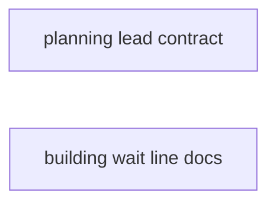

# Superlite: a planning lead's first message names `DONE planned`, the docs name the `building` wait line (B184, #716)

**Goal:** fix #716. `fleet_report.brief_message` gives every lead the generic worker contract `Status: <DONE|DONE_WITH_CONCERNS|NEEDS_CONTEXT|BLOCKED>`; a planning lead (run config `lead.build_model`) ends with `Status: DONE planned: <plan path>`, so its first message must name that status. `commands/backlog.md` and `skills/subagent-driven-development/backlog-main.md` must name the wait line `B building lead=Wn model=M plan=P` that `backlog_run._build_start` prints.
**Architecture:** `brief_message("lead", path)` reads the brief at PATH; when a line starts with `End: Status: DONE planned:` (the `backlog_brief.PLAN_END` line only a plan-phase brief carries) it appends the new `fleet_report.PLANNED` contract instead of `WORK`. Every caller (`fleet_io.send_brief` from `backlog start`, the READY resend in `fleet_io.send_text`) passes only the path, so no caller changes. Two doc sentences name the `building` line.
**Tech stack:** Python 3.10+ stdlib, pytest (through `sl run_tests`), Markdown.
**Spec:** this file, section Design; issue #716.
**Detail:** tests
**Target-min:** 11
**Wave0:** none
**Worktree:** none
**Coverage:** off

Global constraints:
- Every script line keeps the repo's `# O(...)` complexity comment; stdlib only; LF endings.
- Tests write briefs under `tmp_path`; never the machine's `~/.superlite` or a real fleet.
- Standing rules for every lead and its workers (the owner's decisions, passed on by main): this repository is public: no host names, user names, home paths, other project or repository names, ticket keys or account names in code, tests, docs, commit messages, PR texts or issue comments (write "a Swift project", "a second Mac", "the machine"). Never change the machine's gate config or ~/.superlite/machine.json; tests and proofs use private temp homes and state dirs. No real app builds as proof; this repository's own test suite is the check. Priority of this round: scheduling and admission of test runs, parallel agents and the fleet, wall-clock and token efficiency. Friction with superlite itself goes to `sl feedback add`, not into this batch. Online research is allowed when something is unclear (official docs first); name the source.
- Builds: the verdict is `sl run_tests` (the project's test command; a project with `.maxapp` runs `maxapp test`, which a build pool may place on another Mac, and a full run whose tree a green maxapp test stamp covers returns that result without a run); task trees build in <tree>/.build/DerivedData and any build of your own goes under .build/ of the worktree, never -derivedDataPath outside the worktree (your session scratchpad included; backlog cleanup removes scratchpad build folders when the worktree goes); a product, simulator or device build stays on this machine and runs only when an issue's acceptance asks for a running-app check.
- Simulators: append the UDID of each simulator you or a worker creates (`xcrun simctl create` or `clone`; a checker's `Simulators:` line marks its created ones) as one line to `<worktree>/.superlite/simulators.txt`; never list one you did not create; ship cleanup shuts down and deletes each listed one.

## Design

- A plan-phase lead brief (`backlog_brief.lead_brief` with `phase: "plan"`, default and lean text) holds the line `End: Status: DONE planned: <plan path> once the plan lints green; ...`. Single-phase and build-phase briefs end `End: Status: DONE once merge printed shipped; ...` and hold no line starting `End: Status: DONE planned:`.
- `fleet_report.PLANNED` is `WORK` with `DONE planned: <plan path>|` put first in the status list; the json block is unchanged.
- `brief_message(role, path, full=False)`: final-reviewer unchanged; role `lead` whose brief holds the marker line: `Read {path} and do what it says. {PLANNED}`; every other case (other roles, single and build leads, an unreadable brief): `... {WORK}` as today.
- Docs: `commands/backlog.md` step 5's per-line list and `backlog-main.md` step 5 name `B building lead=Wn model=M plan=P`: a planning lead's plan linted and a build lead on model M took the batch over with plan P; nothing to do; `run` goes on, a single `wait` returns on the line and is run again.

Ruling: the phase is read from the brief's End line, not passed as a parameter (because both callers of `brief_message("lead", ...)` pass only the brief path, and the brief is the one record of the phase; a parameter would need `fleet_io.send_brief`, `fleet_io.send_text` and `backlog_run.cmd_start` changed, outside this batch's files; cost if wrong: one file read per lead message) (lead's ruling).
Ruling: the marker must start a line (because a standing note or a summary path quoted in the brief may name `DONE planned` mid-line; the generated End line always starts its line) (lead's ruling).
Ruling: `PLANNED` keeps the WORK words after `DONE planned: <plan path>` (because the issue asks the message to name that status too; a planning lead may still end BLOCKED, and the json block stays the one shape `fleet_report.parse` reads) (lead's ruling).
Ruling: `fleet_io.send_text` answers and `fleet_restore` re-prompts keep `WORK` for a planning lead (because #716 names the first message only; its brief and `PLAN_FIX` text already ask for `DONE planned`) (lead's ruling).

## Task graph

```mermaid
%% schedule
gantt
  title Predicted schedule (mm:ss)
  dateFormat X
  axisFormat %M:%S
  section lane 1
  T1 Planning lead first message names DON :t1, 0, 181s
  section lane 2
  T2 Backlog docs name the building wait l :t2, 0, 172s
```





critical path: T1 (3.0 min) · peak width 2 · predicted build 3.0 min · predicted total ≈ 9.5 min (target ✓)

## Package: fleet contract

App type: CLI library. Categories: protocol (the Status line a lead's stop must carry).
**Probe entry:** none (string contract; named tests cover it)

### T1 Planning lead first message names DONE planned · Complexity 2 · Est. context 24k
**Owns:** skills/subagent-driven-development/scripts/fleet_report.py, tests/scripts/test_fleet_report_planned_716.py
**Components:** 1
**LOC owned:** 70
**Tests:** fast
**Model:** sonnet
**Covers:** Design
**Produces:** fleet_report.PLANNED_END: str · fleet_report.PLANNED: str · fleet_report.brief_message(role: str, path: str, full: bool = False) -> str
e.g. fleet_report.PLANNED_END == "End: Status: DONE planned:"
e.g. brief_message("lead", "/w/.superlite/briefs/lead.md" holding a line "End: Status: DONE planned: <plan path> once ...") -> "Read /w/.superlite/briefs/lead.md and do what it says. " + PLANNED
e.g. brief_message("lead", a single-phase brief) -> "Read <path> and do what it says. " + WORK
**Review Focus:** the tests below; `tests/scripts/test_fleet_report.py`, `tests/scripts/test_fleet_report_labelled_500.py`, `tests/scripts/test_fleet_report_red_b65.py`, `tests/scripts/test_fleet_io_b87.py` and `tests/scripts/test_fleet_io_ask_470.py` stay green unchanged.
**Test code (verbatim):**
```python
# tests/scripts/test_fleet_report_planned_716.py
"""A planning lead's first message names `DONE planned: <plan path>`; other leads keep the worker contract (#716)."""
import sys

import pytest

from test_plan_tools import SCRIPTS
sys.path.insert(0, str(SCRIPTS))
import backlog_brief as bb  # noqa: E402
import fleet_report as fr  # noqa: E402

CTX = {"sl": "/x/sl", "repo": "o/r", "backlog_md": "/x/backlog.md", "titles": {"7": "Seven"}, "summaries": [],
       "approved": {"by": "AskUserQuestion", "time": "t"}, "text": "default"}
ONE = {"id": "B1", "topic": "t", "issues": [7], "files": ["a.py"], "decisions": []}
HEAD = "End your reply with the line `Status: <DONE planned: <plan path>|DONE|DONE_WITH_CONCERNS|NEEDS_CONTEXT|BLOCKED>`"
JSON = "`, then one fenced json block"


def brief(tmp_path, phase=None, text="default"):
    p = tmp_path / "lead.md"
    p.write_text(bb.lead_brief(ONE, {**CTX, "text": text, "phase": phase, "plan": "docs/plans/p.md"}), encoding="utf-8")
    return str(p)


def test_planned_contract_names_done_planned():
    assert fr.PLANNED.startswith(HEAD)
    assert fr.PLANNED.split(JSON, 1)[1] == fr.WORK.split(JSON, 1)[1]
    assert fr.PLANNED != fr.WORK and "\n" not in fr.PLANNED


def test_marker_is_the_plan_phase_end_line():
    assert fr.PLANNED_END == "End: Status: DONE planned:"
    assert bb.PLAN_END.startswith(fr.PLANNED_END)


@pytest.mark.parametrize("text", ["default", "lean"])
def test_plan_phase_lead_gets_planned(tmp_path, text):
    p = brief(tmp_path, "plan", text)
    assert fr.brief_message("lead", p) == f"Read {p} and do what it says. {fr.PLANNED}"


@pytest.mark.parametrize("phase", [None, "build"])
def test_single_and_build_lead_keep_work(tmp_path, phase):
    p = brief(tmp_path, phase)
    assert fr.brief_message("lead", p) == f"Read {p} and do what it says. {fr.WORK}"


def test_marker_counts_only_at_line_start(tmp_path):
    p = tmp_path / "lead.md"
    p.write_text("Note: a planning lead ends End: Status: DONE planned: x\n    End: Status: DONE planned: y\n"
                 "End: Status: DONE once merge printed shipped\n", encoding="utf-8")
    assert fr.brief_message("lead", str(p)).endswith(fr.WORK)


def test_unreadable_brief_keeps_work(tmp_path):
    assert fr.brief_message("lead", str(tmp_path / "gone.md")) == f"Read {tmp_path / 'gone.md'} and do what it says. {fr.WORK}"
    assert fr.brief_message("lead", str(tmp_path)).endswith(fr.WORK)


@pytest.mark.parametrize("role", ["implementer", "fixer", "package-reviewer", "research"])
def test_other_roles_keep_work_on_a_plan_brief(tmp_path, role):
    p = brief(tmp_path, "plan")
    assert fr.brief_message(role, p) == f"Read {p} and do what it says. {fr.WORK}"


def test_final_reviewer_unchanged(tmp_path):
    p = brief(tmp_path, "plan")
    assert fr.brief_message("final-reviewer", p) == f"Review the packet {p} as your instructions say. {fr.REVIEW}"
```
**Steps:** 1 write the test file, 2 run: FAIL, 3 implement, 4 run: PASS
**Notes:** `PLANNED = WORK.replace("`Status: <DONE|", "`Status: <DONE planned: <plan path>|DONE|", 1)`. A private `_planning(path) -> bool` reads the file (`encoding="utf-8", errors="replace"`), returns False on `OSError` (a directory raises `IsADirectoryError`, an `OSError`), and checks `any(line.startswith(PLANNED_END) for line in text.splitlines())`; only role `lead` calls it. Update the module docstring's `brief_message` line and the function docstring (a lead's message follows its brief's End line). Keep `# O(...)` comments (the lead branch is O(size of the brief)).

## Package: backlog docs

App type: docs. Categories: none (prose).
**Probe entry:** none (prose; the pin test covers it)

### T2 Backlog docs name the building wait line · Complexity 1 · Est. context 22k
**Owns:** commands/backlog.md, skills/subagent-driven-development/backlog-main.md, tests/scripts/test_backlog_docs_716.py
**Components:** 1
**LOC owned:** 30
**Tests:** fast
**Model:** haiku
**Kind:** mechanical
**Covers:** Design
**Review Focus:** the tests below; `tests/scripts/test_backlog_rules_split_684.py`, `tests/scripts/test_backlog_main_docs.py` and every `tests/scripts/test_backlog_docs*.py` stay green unchanged.
**Test code (verbatim):**
```python
# tests/scripts/test_backlog_docs_716.py
"""commands/backlog.md and backlog-main.md name the `B building lead=Wn model=M plan=P` wait line (#716)."""
from pathlib import Path

ROOT = Path(__file__).resolve().parents[2]
CMD = (ROOT / "commands" / "backlog.md").read_text(encoding="utf-8")
MAIN = (ROOT / "skills" / "subagent-driven-development" / "backlog-main.md").read_text(encoding="utf-8")
RUN = (ROOT / "skills" / "subagent-driven-development" / "scripts" / "backlog_run.py").read_text(encoding="utf-8")

CMD_TEXT = ("`building` (`B building lead=Wn model=M plan=P`): a planning lead (run config `lead.build_model`) ended "
            "`Status: DONE planned: <plan>`, its plan linted and a build lead on model M took the batch over with plan P; "
            "nothing to do, run `wait` again (`run` goes on by itself);")
MAIN_TEXT = ("A planning lead (run config `lead.build_model`) that ends `Status: DONE planned: <plan>` with a plan that lints gives "
             "`B building lead=Wn model=M plan=P`: a build lead on model M took the batch over with plan P; nothing to do: "
             "`run` goes on, and a single `wait` returns on the line and is run again.")


def test_command_names_the_building_line():
    assert CMD_TEXT in CMD
    assert CMD.index("`shipped`: nothing to do") < CMD.index(CMD_TEXT) < CMD.index("`parked`: note the reason")


def test_main_rules_name_the_building_line():
    assert MAIN_TEXT in MAIN
    assert MAIN.index("one per lead that ends (shipped, parked, needs_decision, BLOCKED).") < MAIN.index(MAIN_TEXT)


def test_docs_match_the_printed_line():
    assert "out.append(f\"{bid} building lead={rec['id']} model={model} plan={plan}\")" in RUN
```
**Steps:** 1 write the test file, 2 run: FAIL, 3 edit the two docs, 4 run: PASS
**Notes:** `commands/backlog.md`, step 5: insert `CMD_TEXT` plus one space right after the clause `` `shipped`: nothing to do, run `start` again for newly startable batches; `` and before `` `parked`: note the reason for the final report; ``. `backlog-main.md`, step 5: insert one space plus `MAIN_TEXT` right after the sentence `` `wait` (one step) and `run` share these lines: one per lead that ends (shipped, parked, needs_decision, BLOCKED). ``. Copy both texts byte for byte from the test; change nothing else in either file.

## Review Focus

- T1 protocol: the marker only at line start; an unreadable brief or a non-lead role never gets `PLANNED`; the json block equals `WORK`'s.
- T2: the two sentences sit in step 5 of each file at the named places; no other line changes.

## Self-review

Coverage: Design bullets 1-3 -> T1, bullet 4 -> T2. No placeholders. No shared files, no edges.
