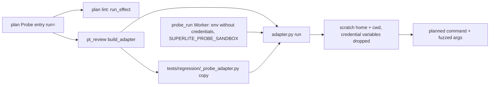
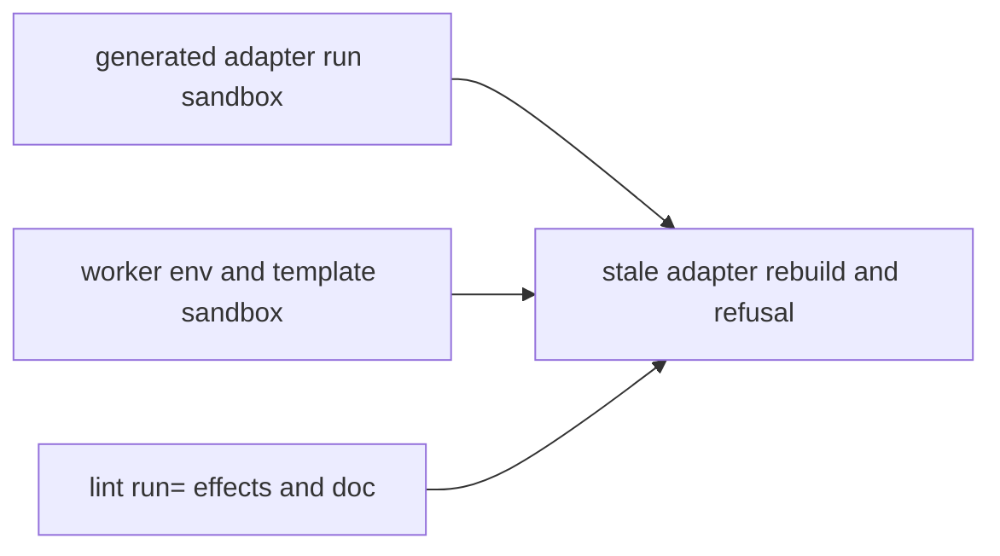

# Superlite: a `run=` Probe entry runs in a sandbox, and lint names commands with outside effects (B182, #711)

**Goal:** fix #711: the generated probe adapter's `run` starts the planned command with the probe's fuzzed arguments, the project root as working folder and the user's whole environment, so a planned nightly job (`run=<job> --dry-run`) fell through to a live run (git fetch, `gh`, `git worktree add`). The adapter's `run` must start the command in a scratch `HOME` and a scratch working folder, without credential variables; lint and `probe-plan.md` must say that every `run=` entry runs for real with fuzzed arguments and that a command with outside effects gets `**Probe entry:** none (<why>)`.
**Architecture:** the sandbox lives in the adapter's own `run` (the generated text in `pt_review._ADAPTER_RUN` and the hand-written `adapter_template.py`), because the generated regression tests import the adapter copy and call `run` without the probe worker. The probe worker drops the same credential variables from its own environment and tells the adapter its temp folder (`SUPERLITE_PROBE_SANDBOX`) so the scratch folders go when the worker goes. Lint gets `plan_tools.run_effect`; an adapter generated before this change is rebuilt by lint and refused by `probe_run`.
**Tech stack:** Python 3.10+ stdlib, pytest (through `sl run_tests`).
**Spec:** this file, section Design; issue #711.
**Detail:** tests
**Target-min:** 11
**Max chars:** 36000
**Wave0:** none
**Worktree:** none
**Coverage:** off

Global constraints:
- Every script line keeps the repo's `# O(...)` complexity comment; stdlib only; LF endings.
- The credential list, verbatim and in this order, wherever it appears (generated adapter, `adapter_template.py`, `probe_run.py`): `SANDBOX_DROP = ("GH_TOKEN", "GITHUB_TOKEN", "GH_ENTERPRISE_TOKEN", "GITHUB_ENTERPRISE_TOKEN", "GH_CONFIG_DIR", "SSH_AUTH_SOCK", "SSH_AGENT_PID", "GIT_ASKPASS", "SSH_ASKPASS", "GIT_CONFIG_GLOBAL")`.
- The lint tail, verbatim: `probes run every run= entry for real with fuzzed arguments appended, so a command that fetches, pushes, opens pull requests, deploys or restarts a service gets **Probe entry:** none (<why>)`.
- Tests use `tmp_path` folders and fake variable values (`secret`); never the machine's real tokens, `~/.superlite` or a real `gh`/`git` remote call.
- Standing rules for every lead and its workers (the owner's decisions, passed on by main): this repository is public: no host names, user names, home paths, other project or repository names, ticket keys or account names in code, tests, docs, commit messages, PR texts or issue comments (write "a Swift project", "a second Mac", "the machine"). Never change the machine's gate config or ~/.superlite/machine.json; tests and proofs use private temp homes and state dirs. No real app builds as proof; this repository's own test suite is the check. Priority of this round: scheduling and admission of test runs, parallel agents and the fleet, wall-clock and token efficiency; measure before and after where the issue names a waste (seconds, runs, tokens) and put the figures into the notes. Friction with superlite itself goes to `sl feedback add`, not into this batch. Online research is allowed when something is unclear (official docs first, then how others solved it); name the source in the notes.

## Design



The generated adapter's `run(args, stdin, package, timeout)`:
1. Splits the planned command as today; `python`/`python3`/`py` becomes `sys.executable`.
2. Makes the planned command's own tokens absolute when they name a path under `ROOT` (`_rooted`): a token that does not start with `-` and holds a path separator, or names a file (`ROOT / tok` is a file); the first token only when it holds a separator (a bare first word is a PATH lookup); a `--name=value` token's value by the same rule. Absolute tokens stay. The fuzzed `args` never change.
3. Gets the scratch folders once per process (`_sandbox() -> (home, cwd)`): under `$SUPERLITE_PROBE_SANDBOX` when it names a folder (`tempfile.mkdtemp(prefix="run-", dir=...)`), else `tempfile.mkdtemp(prefix="probe-run-")` with `atexit.register(shutil.rmtree, top, True)`; `home` and `cwd` are its subfolders `home` and `cwd`.
4. Builds the environment (`_sandbox_env(home, cwd)`): `os.environ` without the `SANDBOX_DROP` names and without `OLDPWD`; `PYTHONUSERBASE` set to the adapter's import-time `site.getuserbase()` only when unset; then `HOME=home`, `XDG_CONFIG_HOME=home/.config`, `XDG_CACHE_HOME=home/.cache`, `XDG_DATA_HOME=home/.local/share`, `XDG_STATE_HOME=home/.local/state`, `PWD=cwd`, `GIT_TERMINAL_PROMPT=0`, `GIT_CONFIG_NOSYSTEM=1`; on Windows also `USERPROFILE=home`, `APPDATA=home/AppData/Roaming`, `LOCALAPPDATA=home/AppData/Local`. `PYTHONIOENCODING` and `PYTHONPATH` are set on top as today.
5. Runs `subprocess.run(cmd + list(args), ..., cwd=cwd, env=env, timeout=timeout)`.

Ruling: the sandbox is in the adapter's `run`, not only in the worker: the generated regression tests import `tests/regression/_probe_adapter.py` and call `run` under pytest, with no worker (lead's ruling).
Ruling: a scratch folder, not a copy of the tree: a copy costs time and disk with the repository's size on every worker start; planned paths are resolved against `ROOT` instead, so `run=.build/debug/<Exec>`, `run=.venv/bin/tool`, `run=python tools/x.py` and `run=python -m pkg` keep working (lead's ruling).
Ruling: dropped beyond the issue's three: the other `gh` token and config variables, the ssh agent pid, askpass helpers and `GIT_CONFIG_GLOBAL`; `GIT_TERMINAL_PROMPT=0` and `GIT_CONFIG_NOSYSTEM=1` stop git prompting or loading a system credential helper; `PYTHONUSERBASE` stays the real one, so a `--user` install still imports and no false crash is reported (lead's ruling).
Ruling: the probe worker drops `SANDBOX_DROP` from its own environment and keeps `HOME` and its working folder: `call=` and `serve=` run project code in the worker, and a scratch `HOME` there would change its interpreter's user site and config lookups, outside #711 (lead's ruling).
Ruling: lint: a dry-run flag or an outside tool as the program fails (`PROBE:`); an effect word only warns (`WARNING: PROBE:`), since a local tool may be named `release-notes`; the way out is `**Probe entry:** none (<why>)` (lead's ruling).
Ruling: an adapter generated before this change (a `run` entry and no `SANDBOX_DROP` in its text) fails closed: `lint --stable` rebuilds it, plain lint prints the `RUN:` line, `probe_run` exits 2 (lead's ruling).
Ruling: this limits a mistake and is no security boundary (ssh reads keys from the account's home, an absolute path still reaches the tree); `probe-plan.md` says so (lead's ruling).
Ruling: both packages get `**Probe entry:** none`: the adapter's `run` is environment- and file-shaped, and `run_effect` is covered by a parametrized named test (lead's ruling).
Ruling: MISSED TARGET accepted (14.2 min vs 11): T4 runs T1's code and edits the files T2 and T3 own, so it follows them; folding T4 into T2 and T3 would make T2's probe_run refuse every generated run= adapter until T1 lands and T3's rebuild test run T1's code, the same chain with red runs in between (lead's ruling).
Ruling: measurement: the build lead times 20 `run()` calls of T1's fixture adapter (`run=python show.py`) before and after T1 and writes both figures into `.superlite/notes.md`; expected cost one `mkdtemp` per process and an environment copy per call (lead's ruling).

## Task graph

```mermaid
%% schedule
gantt
  title Predicted schedule (mm:ss)
  dateFormat X
  axisFormat %M:%S
  section lane 1
  T3 Lint run= effects and doc :t3, 0, 238s
  T4 Stale adapter rebuild and refusal :t4, 238, 225s
  section lane 2
  T2 Worker env and template sandbox :t2, 0, 233s
  section lane 3
  T1 Generated adapter run sandbox :t1, 0, 197s
```





critical path: T3 → T4 (7.7 min) · peak width 3 · predicted build 7.7 min · predicted total ≈ 14.2 min (target ✗ 11.0)

## Package: adapter sandbox

App type: CLI (the adapter starts the planned command). Categories: protocol (environment, working folder), file (paths the command names).
**Probe entry:** none (environment- and file-shaped; the named tests below cover it)

### T1 Generated adapter run sandbox · Complexity 3 · Est. context 29k
**Owns:** skills/subagent-driven-development/scripts/pt_review.py, tests/scripts/test_adapter_run_sandbox_711.py
**Components:** 1
**LOC owned:** 170
**Tests:** fast
**Model:** sonnet
**Covers:** Design
**Produces:** pt_review.build_adapter(plan: Plan, out: Path, root: Path) -> str
**Review Focus:** the tests below; `tests/scripts/test_adapter_and_packet.py`, `tests/scripts/test_probe_run_raises_418.py` and `tests/scripts/test_probe_run_timeout_368.py` stay green unchanged.
**Test code (verbatim):**
```python
# tests/scripts/test_adapter_run_sandbox_711.py
"""#711: the generated adapter's run= starts the planned command in a scratch HOME and working folder, without credential variables."""
from __future__ import annotations

import importlib.util
import json
import os
import site
import sys
from pathlib import Path

import pytest

ROOT = Path(__file__).resolve().parents[2]
SDD = ROOT / "skills" / "subagent-driven-development"
_spec = importlib.util.spec_from_file_location("pt_review_sandbox_711", SDD / "scripts" / "pt_review.py")
pt = importlib.util.module_from_spec(_spec)
sys.modules["pt_review_sandbox_711"] = pt
_spec.loader.exec_module(pt)

DROP = ("GH_TOKEN", "GITHUB_TOKEN", "GH_ENTERPRISE_TOKEN", "GITHUB_ENTERPRISE_TOKEN", "GH_CONFIG_DIR",
        "SSH_AUTH_SOCK", "SSH_AGENT_PID", "GIT_ASKPASS", "SSH_ASKPASS", "GIT_CONFIG_GLOBAL")
KEYS = ("HOME", "XDG_CONFIG_HOME", "XDG_CACHE_HOME", "PWD", "GIT_TERMINAL_PROMPT", "GIT_CONFIG_NOSYSTEM",
        "PYTHONUSERBASE", "KEEP_ME") + DROP
SHOW = ("import json, os, sys\n"
        f"keys = {KEYS!r}\n"
        "print(json.dumps({'cwd': os.getcwd(), 'argv': sys.argv[1:], 'env': {k: os.environ.get(k) for k in keys}}))\n")


def project(tmp_path: Path) -> Path:
    root = tmp_path / "proj"
    (root / "tools").mkdir(parents=True)
    (root / "tools" / "__init__.py").write_text("", encoding="utf-8")
    for rel in ("show.py", "tools/show.py", "tools/__main__.py"):
        (root / rel).write_text(SHOW, encoding="utf-8")
    return root


def adapter(root: Path, entry: str):
    plan = root / "plan.md"
    plan.write_text(f"# p\n\n**Probe entry:** {entry}\n", encoding="utf-8")
    assert pt.main(["adapter", "--plan", str(plan), "--root", str(root)]) == 0
    spec = importlib.util.spec_from_file_location(f"adapter_711_{abs(hash((str(root), entry)))}",
                                                  root / ".superlite" / "probes" / "adapter.py")
    mod = importlib.util.module_from_spec(spec)
    spec.loader.exec_module(mod)
    return mod


def shown(mod, *args) -> dict:
    rc, out, err = mod.run(list(args))
    assert rc == 0, err
    return json.loads(out)


def real(p) -> Path:
    return Path(os.path.realpath(p))


@pytest.fixture
def secrets(monkeypatch, tmp_path):
    monkeypatch.setenv("HOME", str(tmp_path / "realhome"))
    monkeypatch.delenv("SUPERLITE_PROBE_SANDBOX", raising=False)
    monkeypatch.setenv("KEEP_ME", "kept")
    for k in DROP:
        monkeypatch.setenv(k, "secret")


def test_run_has_scratch_home_cwd_and_no_credentials(tmp_path, secrets):
    root = project(tmp_path)
    out = shown(adapter(root, "run=python tools/show.py"), "--flag")
    cwd, env = real(out["cwd"]), out["env"]
    home = real(env["HOME"])
    assert cwd.name == "cwd" and home.name == "home" and cwd.parent == home.parent
    assert cwd != real(root) and real(root) not in cwd.parents
    assert real(env["XDG_CONFIG_HOME"]) == home / ".config" and real(env["XDG_CACHE_HOME"]) == home / ".cache"
    assert real(env["PWD"]) == cwd
    assert env["GIT_TERMINAL_PROMPT"] == "0" and env["GIT_CONFIG_NOSYSTEM"] == "1"
    assert env["KEEP_ME"] == "kept"
    assert {k: env[k] for k in DROP} == {k: None for k in DROP}
    assert out["argv"] == ["--flag"]


def test_planned_paths_resolve_against_the_root(tmp_path, secrets):
    root = project(tmp_path)
    for entry in ("run=python show.py", "run=python -m tools"):
        assert real(shown(adapter(root, entry))["cwd"]).name == "cwd", entry
    out = shown(adapter(root, "run=python tools/show.py --config=tools/show.py"), "tools/show.py")
    assert out["argv"] == ["--config=" + str(real(root) / "tools" / "show.py"), "tools/show.py"]


@pytest.mark.skipif(os.name == "nt", reason="POSIX executable bit")
def test_relative_executable_runs_from_the_root(tmp_path, secrets):
    root = project(tmp_path)
    exe = root / "bin" / "show"
    exe.parent.mkdir()
    exe.write_text(f"#!{sys.executable}\n" + SHOW, encoding="utf-8")
    exe.chmod(0o755)
    assert real(shown(adapter(root, "run=bin/show"))["cwd"]).name == "cwd"


def test_scratch_folders_live_under_the_probe_run_folder(tmp_path, secrets, monkeypatch):
    box = tmp_path / "worker-tmp"
    box.mkdir()
    monkeypatch.setenv("SUPERLITE_PROBE_SANDBOX", str(box))
    out = shown(adapter(project(tmp_path), "run=python tools/show.py"))
    assert real(box) in real(out["cwd"]).parents and real(box) in real(out["env"]["HOME"]).parents


def test_scratch_folders_are_made_once_per_process(tmp_path, secrets):
    mod = adapter(project(tmp_path), "run=python tools/show.py")
    a, b = shown(mod), shown(mod)
    assert a["cwd"] == b["cwd"] and a["env"]["HOME"] == b["env"]["HOME"]


def test_python_user_base_is_kept(tmp_path, secrets, monkeypatch):
    monkeypatch.delenv("PYTHONUSERBASE", raising=False)
    root = project(tmp_path)
    assert shown(adapter(root, "run=python tools/show.py"))["env"]["PYTHONUSERBASE"] == site.getuserbase()
    monkeypatch.setenv("PYTHONUSERBASE", str(tmp_path / "ub"))
    assert shown(adapter(root, "run=python show.py"))["env"]["PYTHONUSERBASE"] == str(tmp_path / "ub")


def test_drop_list_is_the_planned_one(tmp_path):
    assert adapter(project(tmp_path), "run=python show.py").SANDBOX_DROP == DROP
```
**Steps:** 1 failing tests, 2 run: FAIL, 3 implement, 4 run: PASS
**Notes:** change only `_ADAPTER_RUN` (Design steps 1-5): its block starts with `import atexit`, `import shutil`, `import site`, `import tempfile`, then `SANDBOX_DROP` (Global constraints), `_SANDBOX = []`, `_USER_BASE = site.getuserbase()`, `_sandbox()`, `_sandbox_env(home, cwd)`, `_rooted(cmd)` and `run`. `run`'s docstring says it runs in a scratch HOME and working folder without credential variables. `_ADAPTER_HEAD`, `build_adapter`, `plan_entries` and the `call`/`serve` blocks stay as they are, so `ENTRIES` and a call-only adapter's text do not change.

### T2 Worker env and template sandbox · Complexity 3 · Est. context 28k
**Owns:** skills/subagent-driven-development/probes/adapter_template.py, skills/subagent-driven-development/probes/probe_run.py, tests/scripts/test_probe_worker_sandbox_711.py
**Components:** 2
**LOC owned:** 140
**Tests:** fast
**Model:** sonnet
**Covers:** Design
**Produces:** probe_run.worker_env(timeout: float) -> dict[str, str]
**Review Focus:** the tests below; `tests/scripts/test_probe_run_timeout_368.py::test_template_reads_the_timeout_at_call_time` stays green (the template's `run` keeps `timeout=_timeout()`).
**Test code (verbatim):**
```python
# tests/scripts/test_probe_worker_sandbox_711.py
"""#711: the probe worker drops credential variables and hands the adapter its temp folder; the template's run is sandboxed."""
from __future__ import annotations

import importlib.util
import json
import os
import subprocess
import sys
from pathlib import Path

ROOT = Path(__file__).resolve().parents[2]
PROBES = ROOT / "skills" / "subagent-driven-development" / "probes"
DROP = ("GH_TOKEN", "GITHUB_TOKEN", "GH_ENTERPRISE_TOKEN", "GITHUB_ENTERPRISE_TOKEN", "GH_CONFIG_DIR",
        "SSH_AUTH_SOCK", "SSH_AGENT_PID", "GIT_ASKPASS", "SSH_ASKPASS", "GIT_CONFIG_GLOBAL")
SHOW = ("import json, os, sys\n"
        f"keys = {('HOME', 'PYTHONPATH', 'KEEP_ME') + DROP!r}\n"
        "print(json.dumps({'cwd': os.getcwd(), 'argv': sys.argv[1:], 'env': {k: os.environ.get(k) for k in keys}}))\n")


def load(name: str, path: Path):
    spec = importlib.util.spec_from_file_location(name, path)
    mod = importlib.util.module_from_spec(spec)
    sys.modules[name] = mod
    spec.loader.exec_module(mod)
    return mod


pr = load("probe_run_sandbox_711", PROBES / "probe_run.py")


def test_drop_lists_agree():
    assert pr.SANDBOX_DROP == DROP
    assert load("adapter_template_drop_711", PROBES / "adapter_template.py").SANDBOX_DROP == DROP


def test_worker_env_drops_credentials(monkeypatch):
    monkeypatch.setenv("KEEP_ME", "kept")
    for k in DROP:
        monkeypatch.setenv(k, "secret")
    env = pr.worker_env(7.0)
    assert not set(DROP) & set(env)
    assert env["KEEP_ME"] == "kept" and env["SUPERLITE_PROBE_TIMEOUT"] == "7.0"
    assert env["PYTHONIOENCODING"] == "utf-8" and env["PYTHONDONTWRITEBYTECODE"] == "1"


def test_template_run_is_sandboxed(tmp_path, monkeypatch):
    script = tmp_path / "show.py"
    script.write_text(SHOW, encoding="utf-8")
    monkeypatch.setenv("HOME", str(tmp_path / "realhome"))
    monkeypatch.delenv("SUPERLITE_PROBE_SANDBOX", raising=False)
    monkeypatch.setenv("KEEP_ME", "kept")
    for k in DROP:
        monkeypatch.setenv(k, "secret")
    tpl = load("adapter_template_run_711", PROBES / "adapter_template.py")
    monkeypatch.setattr(tpl, "CLI", [sys.executable, str(script)])
    rc, out, err = tpl.run(["--x"], "")
    assert rc == 0, err
    got = json.loads(out)
    cwd, home = Path(os.path.realpath(got["cwd"])), Path(os.path.realpath(got["env"]["HOME"]))
    assert cwd.name == "cwd" and home.name == "home" and cwd.parent == home.parent
    assert cwd != Path(os.path.realpath(os.getcwd()))
    assert got["env"]["KEEP_ME"] == "kept" and {k: got["env"][k] for k in DROP} == {k: None for k in DROP}
    assert str(tpl.ROOT) in got["env"]["PYTHONPATH"].split(os.pathsep)
    assert got["argv"] == ["--x"]


def test_worker_hands_the_adapter_its_temp_folder(tmp_path):
    seen = tmp_path / "seen"
    seen.mkdir()
    root = tmp_path / "proj"
    root.mkdir()
    adapter = root / "adapter.py"
    adapter.write_text(
        "import json, os\n"
        f"SEEN = {str(seen)!r}\n"
        "def run(args, stdin):\n"
        "    box = os.environ.get('SUPERLITE_PROBE_SANDBOX')\n"
        "    with open(os.path.join(SEEN, '%d.json' % os.getpid()), 'w') as f:\n"
        "        json.dump({'box': box, 'isdir': bool(box) and os.path.isdir(box),\n"
        "                   'leaked': [k for k in ('GH_TOKEN', 'GITHUB_TOKEN', 'SSH_AUTH_SOCK') if k in os.environ]}, f)\n"
        "    return 0, 'ok', ''\n", encoding="utf-8")
    env = dict(os.environ, GH_TOKEN="secret", GITHUB_TOKEN="secret", SSH_AUTH_SOCK=str(tmp_path / "agent.sock"))
    p = subprocess.run([sys.executable, str(PROBES / "probe_run.py"), "--adapter", str(adapter), "--root", str(root)],
                       capture_output=True, text=True, timeout=300, env=env)
    files = sorted(seen.glob("*.json"))
    assert files, p.stdout + p.stderr
    for f in files:
        got = json.loads(f.read_text(encoding="utf-8"))
        assert got["isdir"] and got["leaked"] == [], got
        assert Path(got["box"]).name.startswith("probe-") and not Path(got["box"]).exists()
```
**Steps:** 1 failing tests, 2 run: FAIL, 3 implement, 4 run: PASS
**Notes:** `probe_run.py`: a module constant `SANDBOX_DROP` (Global constraints); `worker_env(timeout)` returns `os.environ` without those names plus `PYTHONIOENCODING="utf-8"`, `PYTHONDONTWRITEBYTECODE="1"`, `SUPERLITE_PROBE_TIMEOUT=str(timeout)`; `Worker.__init__` uses `env=worker_env(timeout_for({"entry": "run"}, cfg))`; `worker_main` sets `os.environ["SUPERLITE_PROBE_SANDBOX"] = str(tmp)` right after its `tmp = Path(tempfile.mkdtemp(prefix="probe-"))` (the parent already removes that folder in `Worker.close`, after a kill too). `adapter_template.py`: add `from pathlib import Path`, `ROOT = Path(__file__).resolve().parents[2]` (comment: `.superlite/probes/adapter.py` -> the project root; the regression copy rewrites this line), `SANDBOX_DROP`, and `_sandbox()` / `_sandbox_env(home, cwd)` exactly as Design steps 3-4 (with `import atexit, shutil, site, tempfile`); `run` sets `env["PYTHONPATH"] = os.pathsep.join([str(ROOT / "src"), str(ROOT)] + ([os.environ["PYTHONPATH"]] if os.environ.get("PYTHONPATH") else []))` and passes `cwd=cwd, env=env` and keeps `timeout=_timeout()`. The `CLI` comment says to name files as `str(ROOT / "...")`, since `run` starts it in a scratch folder. The docstring's `run(args, stdin)` line adds: runs in a scratch HOME and working folder without credential variables.

## Package: lint

App type: library (plan text in, lint lines out). Categories: encoding (shell quoting, unbalanced quotes), deep (long commands).
**Probe entry:** none (one pure function covered by a parametrized named test)

### T3 Lint run= effects and doc · Complexity 3 · Est. context 29k
**Owns:** skills/subagent-driven-development/scripts/plan_tools.py, skills/writing-plans/probe-plan.md, tests/scripts/test_lint_probe_run_effects_711.py
**Components:** 2
**LOC owned:** 170
**Tests:** fast
**Model:** sonnet
**Covers:** Design
**Produces:** plan_tools.run_effect(cmd: str) -> tuple[str, str] | None · plan_tools.run_entry_warnings(plan: Plan) -> list[str]
e.g. run_effect("scripts/nightly.sh --dry-run") -> ("issue", "has a dry-run flag")
e.g. run_effect("gh pr create --fill") -> ("issue", "runs gh")
e.g. run_effect("bash scripts/deploy.sh") -> ("warning", "deploy")
**Review Focus:** `test_run_effect` (unbalanced quote, empty command, `-c`, a `release` path part); the existing PROBE tests in `tests/scripts/test_plan_edges_probe_stack_491_496.py` and `tests/scripts/test_writing_plans_split_684.py::test_no_plan_rule_lost` stay green unchanged.
**Test code (verbatim):**
```python
# tests/scripts/test_lint_probe_run_effects_711.py
"""#711: lint names a run= Probe entry with outside effects; probe-plan.md says run= entries run for real with fuzzed arguments."""
from __future__ import annotations

from pathlib import Path

import pytest

from test_plan_edges_probe_stack_491_496 import fix_of, lint, plan, task
from test_plan_tools import SCRIPTS, run

import plan_tools as ptm  # noqa: E402

ROOT = Path(__file__).resolve().parents[2]
TAIL = ("probes run every run= entry for real with fuzzed arguments appended, so a command that fetches, pushes, "
        "opens pull requests, deploys or restarts a service gets **Probe entry:** none (<why>)")


@pytest.mark.parametrize("cmd, want", [
    ("scripts/nightly.sh --dry-run", ("issue", "has a dry-run flag")),
    ("python -m jobs.nightly --dry_run=1", ("issue", "has a dry-run flag")),
    ("tool -n --DryRun", ("issue", "has a dry-run flag")),
    ("gh pr create --fill", ("issue", "runs gh")),
    ("/usr/bin/git fetch origin", ("issue", "runs git")),
    ("env FOO=1 sudo kubectl apply -f x.yaml", ("issue", "runs kubectl")),
    ("bash scripts/deploy.sh", ("warning", "deploy")),
    ("python tools/publish_docs.py", ("warning", "publish")),
    ("python -m app push", ("warning", "push")),
    ("python -m minisheet", None),
    (".build/debug/Tool", None),
    ("target/release/tool --json", None),
    (".venv/bin/pkgtool sync", None),
    ("node dist/cli.js", None),
    ("python -c 'print(1)'", None),
    ("tool 'unbalanced", None),
    ("", None),
])
def test_run_effect(cmd, want):
    assert ptm.run_effect(cmd) == want


def test_dry_run_entry_fails_lint_for_its_task(tmp_path):
    p = plan(tmp_path, [task("T1", "src/jobs/nightly.py, tests/test_nightly.py", probe="run=python -m jobs.nightly --dry-run")])
    r = run(SCRIPTS / "plan_tools.py", "lint", "--plan", p)
    assert r.returncode == 1
    msg = "PROBE: run=python -m jobs.nightly --dry-run has a dry-run flag: " + TAIL
    assert "ISSUE: " + msg in r.out
    assert any(f["task"] == "T1" and msg in f["reasons"] for f in fix_of(tmp_path, p)["fix"])


def test_outside_tool_entry_in_a_section_is_a_plan_issue(tmp_path):
    p = plan(tmp_path, [task("T1", "src/a.py, tests/test_a.py")], after="## Design\n**Probe entry:** run=gh pr list\n\n")
    assert "PROBE: run=gh pr list runs gh: " + TAIL in lint(p)
    assert any("run=gh pr list" in str(x) for x in fix_of(tmp_path, p)["plan_issues"])


def test_effect_word_is_a_warning_only(tmp_path):
    p = plan(tmp_path, [task("T1", "scripts/deploy.py, tests/test_deploy.py", probe="run=python scripts/deploy.py")])
    out = lint(p)
    assert 'WARNING: PROBE: run=python scripts/deploy.py names "deploy": ' + TAIL in out
    assert "ISSUE: PROBE" not in out


def test_long_command_is_cut(tmp_path):
    long = "scripts/nightly.sh " + "--opt " * 20 + "--dry-run"
    p = plan(tmp_path, [task("T1", "src/a.py, tests/test_a.py", probe="run=" + long)])
    assert "PROBE: run=" + long[:57] + "... has a dry-run flag: " + TAIL in lint(p)


def test_plain_and_fenced_entries_stay_quiet(tmp_path):
    p = plan(tmp_path, [task("T1", "src/minisheet/cli.py, tests/test_cli.py", probe="run=python -m minisheet · raises=ValueError")],
             after="## Design\n```\n**Probe entry:** run=gh pr list\n```\n\n")
    assert "PROBE" not in lint(p)


def test_probe_plan_says_run_entries_run_for_real():
    text = (ROOT / "skills" / "writing-plans" / "probe-plan.md").read_text(encoding="utf-8")
    assert "Every `run=` entry is executed for real with fuzzed arguments appended" in text
    assert "fetches, pushes, opens pull requests, deploys or restarts a service gets `**Probe entry:** none (<why>)`" in text
    assert "scratch `HOME`" in text and "`GH_TOKEN`" in text and "`SSH_AUTH_SOCK`" in text
```
**Steps:** 1 failing tests, 2 run: FAIL, 3 implement, 4 run: PASS
**Notes:** `run_effect(cmd)`: tokens = `shlex.split(cmd)`, on `ValueError` `cmd.split()`. Skip leading wrappers (stem in `env, sudo, nohup, time, exec, uv, uvx, npx, poetry, pipenv, run`), `NAME=value` assignments and options right after a wrapper. An interpreter (stem in `python, python3, py, node, bash, sh, zsh, ruby, perl`) moves the program to its script: `-m X` gives X's last dotted part, `-c` gives no program, other options are skipped, else the first non-option token. The stem is the lowercased basename without extension. Checks, first hit wins: (1) any token matching `^--?dry[-_]?run(=.*)?$` (case-insensitive) -> `("issue", "has a dry-run flag")`; (2) program stem in `gh, git, ssh, scp, sftp, rsync, curl, wget, docker, podman, kubectl, helm, systemctl, launchctl, service, terraform, ansible, ansible-playbook, aws, gcloud, az, heroku, fly, flyctl, vercel, netlify` -> `("issue", "runs <stem>")`; (3) the program stem's parts (split at `-`, `_`, `.`), then every later non-option token without a path separator, lowercased, against `deploy, publish, push, release, restart, upload, nightly, cron` -> `("warning", <word>)`; else None. `probe_issues`: a `run=` part whose `run_effect` is an issue adds `Issue(f"PROBE: run={shown} {reason}: {TAIL}", ...)` with the same holder, scope and dedupe as the `call=` issues, where `shown` is the command, or its first 57 characters plus `...` when longer than 60. `run_entry_warnings(plan)` walks the same unfenced `Probe entry` lines and returns `f'WARNING: PROBE: run={shown} names "{word}": {TAIL}'` once each; lint extends `warnings` with it next to `issues.extend(probe_issues(plan))`. `probe-plan.md`: add this bullet right after the `**Probe entry:**` bullet, leaving every existing sentence unchanged; the bullet is the rest of this line after the colon: - **`run=` runs for real.** Every `run=` entry is executed for real with fuzzed arguments appended, so `--dry-run` does not protect it: an argument the command does not know may fall through to its live mode. A command that fetches, pushes, opens pull requests, deploys or restarts a service gets `**Probe entry:** none (<why>)`. Lint fails `PROBE: run=<cmd> has a dry-run flag` and `PROBE: run=<cmd> runs gh` (git, ssh, curl, docker, kubectl and other outside tools), and warns `WARNING: PROBE: run=<cmd> names "deploy"` (publish, push, release, restart, upload, nightly, cron). The adapter starts the command in a scratch `HOME` and working folder, paths it names resolved against the project root, without `GH_TOKEN`, `GITHUB_TOKEN`, `SSH_AUTH_SOCK` or other credential variables: that limits a mistake and is no security boundary.

### T4 Stale adapter rebuild and refusal · Complexity 2 · Est. context 32k
**Owns:** skills/subagent-driven-development/scripts/plan_tools.py, skills/subagent-driven-development/probes/probe_run.py, tests/scripts/test_adapter_sandbox_stale_711.py
**Components:** 2
**LOC owned:** 90
**Tests:** fast
**Model:** sonnet
**Covers:** Design
**Produces:** probe_run.unsandboxed_adapter(adapter: Path) -> bool
**Review Focus:** the tests below; `tests/scripts/test_lint_adapter_refresh_423.py` and `tests/scripts/test_adapter_and_packet.py` stay green unchanged (the `(the plan's Probe entries changed)` rebuild line and the `adapter is stale (plan entry changed)` refusal keep their text).
**Test code (verbatim):**
```python
# tests/scripts/test_adapter_sandbox_stale_711.py
"""#711: an adapter generated before the run= sandbox is rebuilt by lint and refused by probe_run."""
from __future__ import annotations

import importlib.util
import subprocess
import sys
from pathlib import Path

ROOT = Path(__file__).resolve().parents[2]
SCRIPTS = ROOT / "skills" / "subagent-driven-development" / "scripts"
PROBE_RUN = ROOT / "skills" / "subagent-driven-development" / "probes" / "probe_run.py"
sys.path.insert(0, str(SCRIPTS))

import plan_tools  # noqa: E402
import pt_review  # noqa: E402

_spec = importlib.util.spec_from_file_location("probe_run_stale_711", PROBE_RUN)
pr = importlib.util.module_from_spec(_spec)
sys.modules["probe_run_stale_711"] = pr
_spec.loader.exec_module(pr)

REL = ".superlite/probes/adapter.py"
WHY = "the adapter's run= predates the sandbox"
REFUSED = "probe_run: adapter's run= predates the sandbox; rebuild with plan_tools adapter"


def built(root: Path, entry: str) -> tuple[Path, Path]:
    plan = root / "plan.md"
    plan.write_text(f"# p\n\n**Probe entry:** {entry}\n", encoding="utf-8")
    assert pt_review.main(["adapter", "--plan", str(plan), "--root", str(root)]) == 0
    return plan, root / REL


def aged(adapter: Path) -> None:
    adapter.write_text(adapter.read_text(encoding="utf-8").replace("SANDBOX_DROP", "OLD_DROP"), encoding="utf-8")


def test_old_run_adapter_is_rebuilt(tmp_path):
    plan, adapter = built(tmp_path, "run=python -m tool")
    aged(adapter)
    assert plan_tools.refresh_adapter(str(plan)) == f"ADAPTER: rebuilt {REL} ({WHY})"
    assert "SANDBOX_DROP" in adapter.read_text(encoding="utf-8")
    assert plan_tools.refresh_adapter(str(plan)) == ""


def test_plain_lint_names_the_rebuild(tmp_path):
    plan, adapter = built(tmp_path, "run=python -m tool")
    aged(adapter)
    line = plan_tools.refresh_adapter(str(plan), write=False)
    assert line.startswith("RUN: ") and line.endswith(f"(the probe adapter is stale: {WHY})")
    assert "OLD_DROP" in adapter.read_text(encoding="utf-8")


def test_call_only_adapter_stays_quiet(tmp_path):
    plan, adapter = built(tmp_path, "call=a.parse")
    assert "SANDBOX_DROP" not in adapter.read_text(encoding="utf-8")
    assert plan_tools.refresh_adapter(str(plan)) == ""


def test_unsandboxed_adapter_detection(tmp_path):
    _, adapter = built(tmp_path, "run=python -m tool")
    assert pr.unsandboxed_adapter(adapter) is False
    aged(adapter)
    assert pr.unsandboxed_adapter(adapter) is True
    hand = tmp_path / "hand.py"
    hand.write_text("def run(args, stdin):\n    return 0, '', ''\n", encoding="utf-8")
    assert pr.unsandboxed_adapter(hand) is False
    assert pr.unsandboxed_adapter(tmp_path / "missing.py") is False


def test_probe_run_refuses_an_unsandboxed_adapter(tmp_path):
    _, adapter = built(tmp_path, "run=python -m tool")
    aged(adapter)
    p = subprocess.run([sys.executable, str(PROBE_RUN), "--adapter", str(adapter), "--root", str(tmp_path)],
                       capture_output=True, text=True, timeout=120)
    assert p.returncode == 2 and REFUSED in p.stderr
```
**Steps:** 1 failing tests, 2 run: FAIL, 3 implement, 4 run: PASS
**Notes:** `plan_tools.refresh_adapter`: `old_run = any("run" in e for e in entries) and "SANDBOX_DROP" not in src`; it stays quiet only when `entries == lits["ENTRIES"] and not old_run`; `why` is `the plan has no Probe entry lines`, else `the plan's Probe entries changed` when the entries differ, else `the adapter's run= predates the sandbox`; the rebuilt line becomes `f"ADAPTER: rebuilt {rel} ({why})"`. `probe_run.unsandboxed_adapter(adapter)`: True only when `adapter_consts(adapter)["ENTRIES"]` is a list holding a dict with a `run` key and the adapter text lacks `SANDBOX_DROP`; any read error or a hand-written adapter gives False. In `main`, right after the `stale_adapter` refusal: `if unsandboxed_adapter(adapter):` print `REFUSED` to stderr and return 2. T4 waits for T1 (its tests build the sandboxed adapter), and for T2 and T3, which own the two files it edits.

## Review Focus

- adapter sandbox (T1, T2): CLI; protocol, file. Risks: a planned relative path that no longer resolves from the scratch folder (named tests: `test_planned_paths_resolve_against_the_root`, `test_relative_executable_runs_from_the_root`); a scratch folder left behind by a killed worker (`test_worker_hands_the_adapter_its_temp_folder`); a `--user` install losing its imports (`test_python_user_base_is_kept`).
- lint (T3, T4): library; encoding, deep. Risks: an unbalanced quote or an empty command raising in `run_effect` (`test_run_effect`); a false issue on a plain CLI (`test_plain_and_fenced_entries_stay_quiet`); an adapter from before this change running unsandboxed (`test_probe_run_refuses_an_unsandboxed_adapter`).

## Self-review

1. Coverage: Wanted 1 (doc, lint text) is T3; Wanted 2 (scratch HOME and cwd, no `GH_TOKEN`/`GITHUB_TOKEN`/`SSH_AUTH_SOCK`, the printing test) is T1 for the generated adapter and T2 for the template and the worker; adapters from before the change are T4.
2. Placeholders: none; every test is verbatim.
3. Types: T4 consumes no Produces; the `SANDBOX_DROP` name and value are fixed in Global constraints for T1, T2 and T4.
4. Graph: T1, T2 and T3 own disjoint files and run at once; T4 runs T1's code and edits T2's and T3's files, so it waits for all three.
5. Fields: every task has Components, LOC owned, Tests and Model.
6. Review Focus: both packages have an app type, categories and `**Probe entry:** none (<why>)`.
