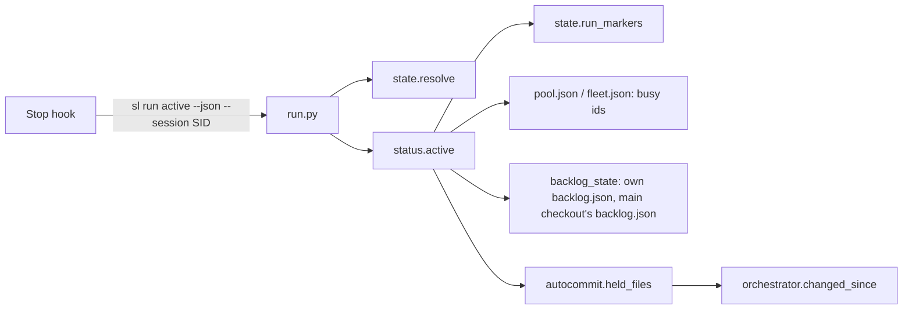
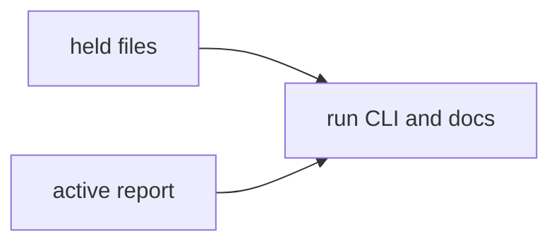

# Superlite: `sl run active` for third-party Stop hooks (B163, #671)

**Goal:** fix #671: a third-party Stop hook cannot tell a running plan run, a backlog main with running leads, or a lead from leftovers. New `sl run active [--plan P] [--session SID] [--json]` answers it in one call (exit 0 active, 1 none): kind, run markers, the worktrees of running batches, busy worker ids per worktree, and the files hidden checkpoints already hold; `docs/hooks.md` names `backlog.json`, `orchestrator.json` and the command.
**Architecture:** `autocommit.held_files(root)` (read-only blob compare of the checkpointed files with the newest checkpoint); `state.ACTIVE_MARKERS` and `state.run_markers(sd)`; `status.active(sd)` builds the report from the run markers, `pool.json`, `fleet.json`, the folder's own `backlog.json` (backlog main) and the main checkout's `backlog.json` (lead), and `status.active_lines(report)` prints it; the new tool file `run.py` is the CLI that `sl run` dispatches to.
**Tech stack:** Python 3.10+ stdlib, pytest (through `sl run_tests`); Markdown docs.
**Spec:** this file, section Design; issue #671.
**Detail:** contracts
**Target-min:** 11
**Wave0:** none
**Edges:** hard
**Coverage:** off
**Max chars:** 40000

Global constraints:
- Every new or changed script line keeps the repo's `# O(...)` complexity comment where the file uses them (state.py, status.py, run.py); stdlib only; LF endings.
- Tests use `tmp_path` repos and state folders and a private `SUPERLITE_HOME` and `SUPERLITE_CACHE_DIR` under `tmp_path`, never the real `~/.superlite`; no test reaches the network.
- Exact output texts and JSON keys are the ones in Design; existing texts stay byte-identical.
- `docs/hooks.md` and `docs/tools.md` are append-only: add lines at the end, never reorder, rewrite or delete existing lines.
- Standing rules for every lead and its workers (the owner's decisions, passed on by main): this repository is public: no host names, user names, home paths, other project or repository names, ticket keys or account names in code, tests, docs, commit messages, PR texts or issue comments (write "a Swift project", "a second Mac", "the machine"). Never change the machine's gate config or ~/.superlite/machine.json; tests and proofs use private temp homes and state dirs. No real app builds as proof; this repository's own test suite is the check. Priority of this round: scheduling and admission of test runs, parallel agents and the fleet, wall-clock and token efficiency; measure before and after where the issue names a waste (seconds, runs, tokens) and put the figures into your report. Friction with superlite itself goes to `sl feedback add`, not into this batch. Online research is allowed when something is unclear (official docs first, then how others solved it); name the source.
- Builds: the verdict is `sl run_tests` (the project's test command; a project with `.maxapp` runs `maxapp test`, which a build pool may place on another Mac, and a full run whose tree a green maxapp test stamp covers returns that result without a run); task trees build in <tree>/.build/DerivedData and any build of your own goes under .build/ of the worktree, never -derivedDataPath outside the worktree (your session scratchpad included; backlog cleanup removes scratchpad build folders when the worktree goes); a product, simulator or device build stays on this machine and runs only when an issue's acceptance asks for a running-app check.
- Simulators: append the UDID of each simulator you or a worker creates (`xcrun simctl create` or `clone`; a checker's `Simulators:` line marks its created ones) as one line to the worktree's `.superlite/simulators.txt`; never list one you did not create; ship cleanup shuts down and deletes each listed one.

Ruling: `**Coverage:** off` (because the change adds one read-only command over state files that already exist; no new subsystem; cost if wrong: none).
Ruling: `**Edges:** hard` (because T3's subprocess tests run T1's and T2's real code through `sl run active`; cost if wrong: T3 starts about 4 min later).
Ruling: accept predicted 14.6 min - T3 is sequential after T2 because its subprocess tests run the real report - about 4 min over the 11 min target.
Ruling: detail `contracts` (because every behaviour is a short rule with an exact output; cost if wrong: one fixer round).
Ruling: the command is a new tool file `run.py` (`sl` dispatches `sl run ...` to it by name), not an alias branch inside `sl` (because every `sl` tool is one file and `sl version` lists it; `sl` stays unchanged; cost if wrong: none).
Ruling: a run counts as active while its state folder holds `stable.json`, `prime.md`, `pool.json`, `orchestrator.json` or `inline-flow.json` (the markers `session-start` counts, all archived or removed by `sl orchestrator end`), while its own `backlog.json` has a batch `running` or `needs_decision` (backlog main; a `backlog.json` whose batches are all planned, parked or shipped does not count, since it outlives every round), while its checkout is the worktree of such a batch in the main checkout's `backlog.json` (lead), or while a pool agent or fleet worker in it is busy (cost if wrong: a hook stays silent while only `orchestrator.json` is left; `sl orchestrator end` clears it).
Ruling: busy means a `pool.json` agent with `busy` true or a `fleet.json` worker in state `busy`, the rule `sl status` already uses (cost if wrong: a worker still `starting` is not listed).
Ruling: checkpoint files are the files of every `checkpoints.json` entry whose working-tree blob equals the newest checkpoint's (covered); the others are `edited_after_checkpoint`, still real uncommitted work (cost if wrong: none; the hook decides).

## Design

### 1. `autocommit.held_files(root)` (#671 wanted 2)
`held_files(root) -> dict` reads `<root>/.superlite/checkpoints.json` (not the cwd's). No file, unreadable JSON, not a dict, or no `entries`: `{"covered": [], "edited": []}`. Else `files` = the sorted union of every entry's `files` (strings only), `ref` = the newest entry's `sha`, `edited = orchestrator.changed_since(Path(root), ref, files)` (the existing read-only blob compare; it falls back to HEAD when the ref is gone; import `orchestrator` inside the function), `covered` = the sorted rest. It never writes: no index file, no ref, no change to `checkpoints.json`.

### 2. Run markers (`state.py`)
`ACTIVE_MARKERS = RUN_MARKERS + ("orchestrator.json", "inline-flow.json")`. `run_markers(sd) -> list[str]`: the names of `ACTIVE_MARKERS` that are files in `sd`, in `ACTIVE_MARKERS` order. `RUN_MARKERS` and `has_run` stay unchanged (state resolution keeps its rule).

### 3. The report (`status.active`, `status.active_lines`)
`active(sd) -> dict`, keys always present:
- `active` (bool), `kind` (`"plan run"`, `"backlog main"`, `"lead"` or None), `state_dir` (str, absolute: `state._abs(sd)`), `markers` (list), `batch` (the lead's batch id, else None), `worktrees` (list), `checkpoint_files` (list), `edited_after_checkpoint` (list).
- `root` = `state.git_root(sd)`, else the parent of the absolute `sd`.
- `markers` = `state.run_markers(sd)`, plus `"backlog.json"` appended when `sd/backlog.json` has an active batch.
- busy ids of a state folder F (`busy_ids(F) -> list[str]`): the `id` (as str) of each `pool.json` agent with `busy` true, in file order, then each `fleet.json` worker id in state `busy`, in file order; duplicates dropped; unreadable or missing files give none (reuse `clean_state`).
- active batches of a `backlog.json`: its `batches` entries that are dicts with `state` in `backlog_state.ACTIVE` (`running`, `needs_decision`), read with `backlog_state.load` (missing or corrupt: none).
- lead: `backlog_state.main_root(root)` (a `RuntimeError` or `OSError`: no lead) differs from `root` and its `.superlite/backlog.json` has an active batch whose `worktree` resolves to `root` (`Path.resolve()` on both): `batch` = that batch's `id`.
- `worktrees[0]` = `{"path": str(root), "batch": <lead batch or None>, "state": <lead batch's state or None>, "busy": busy_ids(sd)}`; then, for a backlog main, one entry per active batch of `sd/backlog.json` in file order: `{"path": <its worktree, "" when missing>, "batch": <id>, "state": <state>, "busy": busy_ids(<worktree>/.superlite)}` (no worktree: busy `[]`).
- `kind`: `"lead"` when `batch` is set, else `"backlog main"` when `sd/backlog.json` has an active batch, else `"plan run"` when `markers` is not empty or `worktrees[0]["busy"]` is not empty, else None. `active` = `kind is not None`.
- `checkpoint_files`, `edited_after_checkpoint` = `autocommit.held_files(root)` `covered` and `edited` (also when not active).

`active_lines(report) -> list[str]`:
- active: `run active: <kind>[ <batch>] in <state_dir>[; markers: <m1>, <m2>]` (the batch only for a lead, the markers part only when not empty); then per worktree `worktree <path> (<label>): busy <id1>, <id2>` or `worktree <path> (<label>): no busy workers`, label `this checkout` for the first entry and `<batch> <state>` for the others.
- not active: `run active: none in <state_dir>`.
- then, when not empty, `checkpoint files: <n>: <first 10 comma-joined>` plus ` (+<k> more)` past 10, and `edited after checkpoint: <n>: <same format>`.

e.g. no markers, no backlog, no checkpoints: `["run active: none in /r/.superlite"]`
e.g. stable.json and a busy pool agent a1: `["run active: plan run in /r/.superlite; markers: stable.json, pool.json", "worktree /r (this checkout): busy a1"]`

### 4. The CLI (`run.py`, `sl run active`)
`run.py active [--plan P] [--session SID] [--json]` (argparse, `prog="sl run"`). No subcommand or an unknown one: usage on stderr, exit 2. `--session SID`: SID must match `state._SID`, else `run: bad session id: <SID>` on stderr, exit 2; it sets `os.environ["SUPERLITE_SESSION_ID"] = SID` before resolution (a hook passes the `session_id` of its input). State folder: `state.resolve(P, strict=False)` (P: a plan, a project folder or a `.superlite` folder; no P: `SUPERLITE_STATE_DIR`, the cwd's worktree run, the session's binding, `./.superlite`, as the hooks resolve it). Output: `--json` prints `json.dumps(report)` as one line; else `active_lines(report)` one per line. Exit 0 when `report["active"]`, else 1. `sl run` reaches it through `sl`'s file dispatch (`run.py`); `sl` is not changed.

### 5. Docs (#671 wanted 3)
Append to `docs/hooks.md` (it ends inside `## Detecting an active run`), as one line:
`` `sl run active [--json] [--plan P] [--session SID]` (`<plugin root>/skills/subagent-driven-development/scripts/sl`) does this resolution in one call (a hook passes its input's `session_id` as `--session`): exit 0 while a run is active, 1 when none. Run markers beyond the three above: `orchestrator.json` and `inline-flow.json` (also archived by `sl orchestrator end`); `backlog.json` counts while one of its batches is `running` or `needs_decision` (kind `backlog main`), and a folder whose checkout is such a batch's worktree is a `lead`; a busy pool agent or fleet worker also counts (kind `plan run`). `--json` prints one document: `active`, `kind`, `state_dir`, `markers`, `batch`, `worktrees` (the folder's checkout first, then each running batch's worktree, each with `path`, `batch`, `state` and the `busy` worker ids), `checkpoint_files` (files the hidden checkpoints already hold unchanged; a hook can leave them out of its warning) and `edited_after_checkpoint` (changed since; still uncommitted work). ``
Append to `docs/tools.md`, as one line:
`` The `run` tool (`run.py`, #671): `sl run active [--plan P] [--session SID] [--json]` tells a Stop hook whether the session's run is active (exit 0, 1 none, 2 usage): kind `plan run`, `backlog main` or `lead`, the run markers, the worktrees of running batches with their busy worker ids, and the files hidden checkpoints hold (`autocommit.held_files`, read-only); text lines `run active: <kind> in <state dir>`, `worktree <path> (<label>): busy W2, W3`, `checkpoint files: N: ...` (see [hooks.md](hooks.md)). ``

## Main diagram

## File structure

- `skills/subagent-driven-development/scripts/autocommit.py`: `held_files`.
- `skills/subagent-driven-development/scripts/state.py`: `ACTIVE_MARKERS`, `run_markers`.
- `skills/subagent-driven-development/scripts/status.py`: `busy_ids`, `active`, `active_lines`.
- `skills/subagent-driven-development/scripts/run.py` (new): the `sl run active` CLI.
- `docs/hooks.md`, `docs/tools.md`: one appended line each.
- Tests: `tests/scripts/test_autocommit_held_671.py`, `tests/scripts/test_status_active_671.py`, `tests/scripts/test_run_active_671.py`.

## Task graph

```mermaid
%% schedule
gantt
  title Predicted schedule (mm:ss)
  dateFormat X
  axisFormat %M:%S
  section lane 1
  T2 active-run report :t2, 0, 245s
  section lane 2
  T3 sl run active CLI and hook docs :t3, 0, 242s
  section lane 3
  T1 checkpoint files a hook can skip :t1, 0, 186s
```

critical path: T2 (4.1 min) · peak width 3 · predicted build 4.1 min · predicted total ≈ 10.6 min (target ✓)

## Predicted schedule

## Checkpoints

**Probe entry:** none (git-backed function; covered by temp-repo tests)

### T1 checkpoint files a hook can skip · Complexity 2 · Est. context 30k
**Owns:** skills/subagent-driven-development/scripts/autocommit.py, tests/scripts/test_autocommit_held_671.py
**Components:** 1
**LOC owned:** 90
**Tests:** fast
**Model:** sonnet
**Covers:** 1
**Produces:** autocommit.held_files(root: Path) -> dict
e.g. held_files(Path("/r")) with no .superlite/checkpoints.json -> {"covered": [], "edited": []}
e.g. held_files(Path("/r")) after a checkpoint of a.py and b.py, then b.py edited -> {"covered": ["a.py"], "edited": ["b.py"]}
e.g. held_files(Path("/r")) after T1 checkpoints a.py and T2 checkpoints c.py, nothing edited -> {"covered": ["a.py", "c.py"], "edited": []}
**Review Focus:** state and file cases in tests/scripts/test_autocommit_held_671.py, each in a `tmp_path` git repo with one commit (set `user.name`/`user.email` locally), checkpoints made by `autocommit.record(tid, title, files, plan)` with the cwd at the repo (monkeypatch.chdir) and autocommit off. `test_no_state_is_empty`: -> {"covered": [], "edited": []}. `test_covered_and_edited`: new a.py, b.py checkpointed by T1, then b.py edited -> covered ["a.py"], edited ["b.py"]. `test_two_tasks_union`: T1 a.py, T2 c.py -> covered ["a.py", "c.py"]. `test_deleted_after_checkpoint_is_edited`: a.py checkpointed, then deleted -> edited ["a.py"]. `test_read_only`: `git status --porcelain`, `git for-each-ref refs/superlite` and the bytes of checkpoints.json are identical before and after, and `.superlite/checkpoint.index` does not exist. `test_corrupt_state_is_empty`: checkpoints.json `{` -> empty result. `test_other_cwd`: the call made from another folder (monkeypatch.chdir(tmp_path / "elsewhere")) with the repo path -> the same result as from the repo.
**Steps:** 1 failing tests, 2 run: FAIL, 3 implement, 4 run: PASS
**Notes:** reuse `orchestrator.changed_since(root, ref, files)` (import it inside the function: orchestrator imports autocommit lazily, so no cycle at import time); do not touch `edited_since` (it writes a temporary index). Name `held_files` in the module docstring's library sentence (add one line).

## Report

**Probe entry:** none (reads state files; covered by temp-folder tests)

### T2 active-run report · Complexity 4 · Est. context 45k
**Owns:** skills/subagent-driven-development/scripts/state.py, skills/subagent-driven-development/scripts/status.py, tests/scripts/test_status_active_671.py
**Components:** 2
**LOC owned:** 190
**Tests:** fast
**Model:** sonnet
**Covers:** 2, 3
**Consumes:** autocommit.held_files(root: Path) -> dict (T1)
**Produces:** state.run_markers(sd: Path) -> list[str] · status.busy_ids(sd: Path) -> list[str] · status.active(sd: Path) -> dict · status.active_lines(report: dict) -> list[str]
e.g. state.run_markers(sd) with orchestrator.json and pool.json -> ["pool.json", "orchestrator.json"]
e.g. status.active(sd) with stable.json and pool.json agent {"id": "a1", "busy": true} in a folder outside git -> {"active": True, "kind": "plan run", "state_dir": str(sd), "markers": ["stable.json", "pool.json"], "batch": None, "worktrees": [{"path": str(sd.parent), "batch": None, "state": None, "busy": ["a1"]}], "checkpoint_files": [], "edited_after_checkpoint": []}
e.g. status.active_lines({"active": False, "kind": None, "state_dir": "/r/.superlite", "markers": [], "batch": None, "worktrees": [{"path": "/r", "batch": None, "state": None, "busy": []}], "checkpoint_files": [], "edited_after_checkpoint": []}) -> ["run active: none in /r/.superlite"]
**Review Focus:** state and protocol cases in tests/scripts/test_status_active_671.py; every test monkeypatches `autocommit.held_files` (`raising=False`) to return {"covered": [], "edited": []} unless it says otherwise, and uses state folders under `tmp_path` outside git unless it says otherwise. `test_run_markers_order`: orchestrator.json, inline-flow.json, prime.md -> ["prime.md", "orchestrator.json", "inline-flow.json"]; a folder named `pool.json` is not a marker. `test_no_run`: empty folder -> active False, kind None, worktrees[0] busy []. `test_plan_run_markers_and_busy`: the e.g. above, exactly. `test_orchestrator_alone_is_plan_run`: only orchestrator.json -> kind "plan run", markers ["orchestrator.json"]. `test_busy_worker_alone_is_plan_run`: only fleet.json {"on": true, "workers": {"W1": {"state": "ready"}, "W2": {"state": "busy", "task": "T3"}, "W3": {"state": "stopped"}}} -> kind "plan run", markers [], worktrees[0] busy ["W2"]. `test_backlog_main`: sd/backlog.json batches B1 running worktree=<tmp wt1> (wt1/.superlite/fleet.json W2 busy, pool.json agent a9 busy), B2 shipped worktree=<wt2>, B3 needs_decision worktree "" , B4 parked, B5 planned; sd/fleet.json W5 busy -> kind "backlog main", markers ["backlog.json"], worktrees == [{"path": <root>, "batch": None, "state": None, "busy": ["W5"]}, {"path": <wt1>, "batch": "B1", "state": "running", "busy": ["a9", "W2"]}, {"path": "", "batch": "B3", "state": "needs_decision", "busy": []}]. `test_backlog_all_done_is_no_run`: batches only shipped, parked, planned -> active False, markers []. `test_lead`: a `tmp_path` git repo `main` with one commit and `git worktree add ../wt -b b`; main/.superlite/backlog.json B7 running worktree=<wt>; sd = wt/.superlite with no files -> kind "lead", batch "B7", worktrees[0] == {"path": <wt>, "batch": "B7", "state": "running", "busy": []}; the same batch `shipped` -> active False. `test_corrupt_files`: pool.json, fleet.json, backlog.json each `{` -> no exception, active False. `test_checkpoint_fields`: held_files faked to {"covered": ["a.py"], "edited": ["b.py"]} -> checkpoint_files ["a.py"], edited_after_checkpoint ["b.py"] with active False. `test_lines_active`: report of test_backlog_main -> ["run active: backlog main in <sd>; markers: backlog.json", "worktree <root> (this checkout): busy W5", "worktree <wt1> (B1 running): busy a9, W2", "worktree  (B3 needs_decision): no busy workers"]. `test_lines_lead_and_checkpoints`: lead report with 12 covered files f00.py..f11.py and edited ["b.py"] -> line 1 `run active: lead B7 in <sd>`, then the worktree line, `checkpoint files: 12: f00.py, f01.py, f02.py, f03.py, f04.py, f05.py, f06.py, f07.py, f08.py, f09.py (+2 more)`, `edited after checkpoint: 1: b.py`. `test_lines_none`: the e.g. above.
**Steps:** 1 failing tests, 2 run: FAIL, 3 implement, 4 run: PASS
**Notes:** reuse `clean_state(sd)` for pool and fleet; import `backlog_state` and `autocommit` lazily inside `active` (status.py imports its helpers lazily). `state.git_root` and `state._abs` for paths. The `sl status` output stays byte-identical (its tests stay green). Add `ACTIVE_MARKERS` and `run_markers` to state.py's library sentence in the docstring; describe `active` and `active_lines` in status.py's docstring.

## CLI and docs

**Probe entry:** none (CLI driven through `sl` in temp repos)

### T3 sl run active CLI and hook docs · Complexity 3 · Est. context 40k
**Owns:** skills/subagent-driven-development/scripts/run.py, docs/hooks.md, docs/tools.md, tests/scripts/test_run_active_671.py
**Components:** 2
**LOC owned:** 170
**Tests:** fast
**Model:** sonnet
**Covers:** 4, 5
**Consumes:** status.active(sd: Path) -> dict (T2) · status.active_lines(report: dict) -> list[str] (T2) · autocommit.held_files(root: Path) -> dict (T1)
**Review Focus:** protocol, state and file cases in tests/scripts/test_run_active_671.py, each through `subprocess.run(["bash", <abs sl>, "run", ...], cwd=..., env=...)` with an env that drops every `SUPERLITE_*` variable and `CLAUDE_CODE_SESSION_ID` and sets `SUPERLITE_HOME` and `SUPERLITE_CACHE_DIR` under `tmp_path` (as tests/scripts/test_sl_status_386.py `sl()` does), in `tmp_path` git repos with one commit. `test_no_run_exit_1`: empty repo -> exit 1, stdout `run active: none in <repo>/.superlite\n`; `--json` -> exit 1 and a document with active false, kind null. `test_plan_run`: `.superlite/stable.json` `{}` and pool.json agent a1 busy -> exit 0, `--json` kind "plan run", markers ["stable.json", "pool.json"], worktrees[0].busy ["a1"]. `test_backlog_main_running_batch`: `.superlite/backlog.json` B1 running worktree <tmp wt> whose `.superlite/fleet.json` has W2 busy, B2 shipped -> exit 0, kind "backlog main", worktrees paths [<repo>, <wt>], worktrees[1].busy ["W2"]. `test_lead_worktree`: `git worktree add`, main's backlog.json B7 running at it; run with cwd at the worktree -> kind "lead", batch "B7". `test_checkpoint_files_listed`: `.superlite/orchestrator.json` {"mode": "ai"}; a.py, b.py checkpointed by `autocommit.record("T1", "t", ["a.py", "b.py"], str(plan))` in a `python3 -c` subprocess with cwd at the repo and `sys.path` at the scripts folder; edit b.py -> `--json` checkpoint_files ["a.py"], edited_after_checkpoint ["b.py"]; text output has `checkpoint files: 1: a.py` and `edited after checkpoint: 1: b.py`. `test_plan_flag`: run from `tmp_path` (outside the repo) with `--plan <repo>/.superlite` -> state_dir `<repo>/.superlite`. `test_session_flag`: binding `$SUPERLITE_HOME/sessions/s1` whose first line is `<other>/.superlite` (holding pool.json with a busy agent), cwd an empty repo -> `--session s1 --json` state_dir `<other>/.superlite`, kind "plan run". `test_bad_session_exit_2`: `--session ../x` -> exit 2, stderr `run: bad session id: ../x`. `test_usage_exit_2`: `sl run` and `sl run nope` -> exit 2, stderr names `active`. `test_docs_name_command` (reads files, no subprocess): the `## Detecting an active run` section of docs/hooks.md contains `sl run active`, `orchestrator.json`, `backlog.json`, `--session`, `checkpoint_files` and `edited_after_checkpoint`; docs/tools.md contains `sl run active [--plan P] [--session SID] [--json]`.
**Steps:** 1 failing tests, 2 run: FAIL, 3 implement, 4 run: PASS
**Notes:** run.py follows status.py's layout (module docstring with usage, `sys.path.insert(0, scripts dir)`, `main(argv=None) -> int`, `# O(...)` comments). Append the two doc lines of Design 5 verbatim at the end of each file. A batch's `worktree` in a test is a plain folder under `tmp_path` (only `test_lead_worktree` needs a real `git worktree add`).

## Review Focus

- `autocommit.held_files` (git, file): file (deleted, edited, corrupt state), state (several tasks), read-only. Cases in T1.
- `status.active` (state files): state (markers, busy workers, batch states, lead lookup), file (corrupt JSON). Cases in T2.
- `run.py` (CLI): protocol (subcommand, flags, exit codes, JSON), state (session binding, `--plan`). Cases in T3.

## Self-review

Coverage: #671 wanted 1 -> T2 (report) and T3 (CLI); wanted 2 -> T1 and T2's fields; wanted 3 -> T3's hooks.md line; wanted 4 (plan run, backlog main with a running batch, no run) -> T3's subprocess tests plus T2's unit tests. T1, T2, T3 share no file. T3 waits for T1 and T2 because its subprocess tests run their code.
