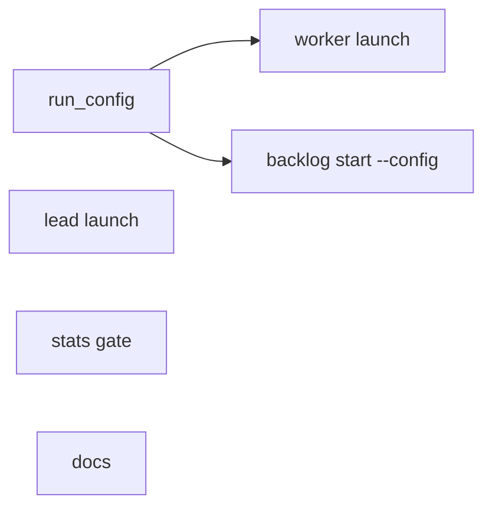

# Superlite: one run config for leads and workers, a lean lead start (B169, #681)

**Goal:** fix #681: a named run config (lead model, effort, autocompact window, cache TTL for lead and workers, the lead's denied tools and MCP servers, worker models per role, a lead brief text variant id) read by `sl backlog start --config NAME` and `sl fleet`; the lead starts with an explicit model and effort and without the tools and MCP servers it does not use; the cache TTL is set explicitly; the routing stats gate compares a cheap tier with the default tier's measured rate.
**Architecture:** new `run_config.py` resolves a named config from three layers (built-in `config/run-configs.json`, machine `$SUPERLITE_HOME/run-configs.json`, project `.superlite/run-configs.json`), validates it and gives it an id; a run's active config is a snapshot `<state dir>/run-config.json`. `backlog_run start` resolves once and passes it to `fleet_lead.spawn_lead`, which builds the lean lead argv and env and writes the snapshot into the lead's state dir; `fleet._spawn` reads the snapshot for the worker TTL and per-role model pins. `routing.pick_tier` takes its bar from `routing.gate_bar`.
**Tech stack:** Python 3.10+ stdlib, pytest (through `sl run_tests`); JSON config; Markdown docs.
**Spec:** this file, section Design; issue #681.
**Detail:** contracts
**Target-min:** 11
**Wave0:** none
**Worktree:** none
**Max chars:** 32000

Global constraints:
- Every script line keeps the repo's `# O(...)` complexity comment; stdlib only; LF endings.
- Claude Code names (checked against `claude --help` 2.1.323 and code.claude.com/docs/en/prompt-caching.md): `--effort low|medium|high|xhigh|max`, `--autocompact <tokens>`, `--strict-mcp-config`, `--mcp-config <file>`, `--no-chrome`, `--disallowedTools`; env `CLAUDE_CODE_PROMPT_CACHE_TTL` (`5m` or `1h`) sets a session's main-conversation TTL. A fleet worker and a lead are each a main-conversation session.
- The lead keeps the Skill tool and its skills (no `--disable-slash-commands`): leads load superlite skills and `rocketsim`.
- Tests use `tmp_path` homes (`SUPERLITE_HOME`) and state dirs; never the real `~/.superlite`.
- Standing rules for every lead and its workers (the owner's decisions, passed on by main): this repository is public: no host names, user names, home paths, other project or repository names, ticket keys or account names in code, tests, docs, commit messages, PR texts or issue comments (write "a Swift project", "a second Mac", "the machine"). Never change the machine's gate config or ~/.superlite/machine.json; tests and proofs use private temp homes and state dirs. No real app builds as proof; this repository's own test suite is the check. Priority of this round: scheduling and admission of test runs, parallel agents and the fleet, wall-clock and token efficiency; measure before and after where the issue names a waste and put the figures into your report. Friction with superlite itself goes to `sl feedback add`, not into this batch. Online research is allowed when something is unclear (official docs first); name the source.
- Builds: the verdict is `sl run_tests` (the project's test command; a project with `.maxapp` runs `maxapp test`, which a build pool may place on another Mac, and a full run whose tree a green maxapp test stamp covers returns that result without a run); task trees build in <tree>/.build/DerivedData and any build of your own goes under .build/ of the worktree, never -derivedDataPath outside the worktree (your session scratchpad included; backlog cleanup removes scratchpad build folders when the worktree goes); a product, simulator or device build stays on this machine and runs only when an issue's acceptance asks for a running-app check.
- Simulators: append the UDID of each simulator you create (`xcrun simctl create` or `clone`) as one line to `<worktree>/.superlite/simulators.txt`; never list one you did not create; ship cleanup shuts down and deletes each listed one.

## Coverage

| Category | State | Basis |
|---|---|---|
| Scope and success criteria | settled | #681 Wanted 1-6; success: a lead starts with `--model`, `--effort`, `--strict-mcp-config`, `--no-chrome` and the deny list from the config, its first request measured smaller; TTL env set; config id in the batch record |
| Domain and data model | ruled | config shape in Design 1 |
| Persistence and migration | ruled | new files only; a run without a snapshot resolves the default config; no migration |
| Interfaces and contracts | settled | `lead_argv(sl, model)` with no other argument keeps today's list; `spawn_lead` keeps its positional args; `sl backlog start` keeps its stdout lines |
| UI states | n/a | CLI text only |
| Concurrency and state ownership | ruled | main resolves and the lead's spawn writes the snapshot before the pane opens; workers only read it |
| Error handling and recovery | ruled | a bad config file or value refuses `backlog start --config` and `fleet on --config` (exit 2) before any spawn; a worker spawn never fails on config: `active` falls back to the built-in default with one stderr line |
| Security and privacy | ruled | config files are trusted local files; values validated by type and enum; no paths in the id |
| Performance and limits | settled | lead first request measured before and after (notes); one small file read per spawn |
| Observability | ruled | config id in the batch record, the lead and worker fleet.json records, one stderr `run config:` line at start |
| Testing strategy | ruled | unit tests per task with tmp homes and the in-process Herdr fake |
| Compatibility | ruled | defaults reproduce today's lead model (opus) and effort (xhigh: the effort leads inherited from the user's settings); workers keep their models; TTL 1h is the subscription default |
| Rollout | ruled | ships with the next version; rollback reverts the PR |
| Research unknowns | settled | flag and env names checked (Global constraints); lean flags spiked on this machine (notes) |

Ruling: default lead effort `xhigh` (because 519 lead transcripts ran on opus with the user's `modelSettings` effortLevel xhigh; cost if wrong: one config value).
Ruling: lead `mcp` default `project` (the servers its workers get: test-cmd.json "mcp", else `xcode` for a Swift project) because 32 of 519 leads used Xcode MCP tools (RenderPreview, workspaces); no worker deny list or usage note for the lead, which opens workspaces as coordinator.
Ruling: the lead brief text variant has one value, `default`; variants need backlog_brief.py (another batch's file): follow-up. A cheaper lead model after the plan needs a mid-session switch: follow-up, no config key yet.
Ruling: history rows get the config id through a follow-up (history.py is another batch's file); the snapshot `<sd>/run-config.json` makes the id readable for it.
Ruling: `config/models.json` stays unchanged: costs already price cache writes by the measured 5m/1h split.

## Design

### 1. Run config (#681 Wanted 1, 4)
Resolved shape: `{"name", "id", "sources", "lead": {"model", "effort", "autocompact", "deny", "mcp", "text"}, "cache_ttl": {"lead", "workers"}, "workers": {role: model or null}}`. A file is `{"default": NAME or null, "configs": {NAME: partial config}}`; keys starting `_` are ignored. NAME resolves as: the built-in `default` config, then each layer's `configs[NAME]` section by section (built-in, machine, project), then CLI overrides. The default NAME is the project file's `default`, else the machine's, else `default`. id = `NAME-` + 8 hex of sha256 over the canonical JSON of lead, cache_ttl and workers. Riskier values (smaller window, lower effort, cheaper final reviewer) are values a config may set; the built-in default keeps today's behaviour.

### 2. Lead launch (#681 Wanted 2, 3)
`--model` and `--effort` always explicit; `--strict-mcp-config` (plus `--mcp-config` for the kept servers), `--no-chrome`, deny list `AskUserQuestion Artifact ArtifactComments ArtifactData ListAgents ReadNotifications ReportFindings ScheduleWakeup Workflow` (519 leads: Artifact 4 uses, ReadNotifications 6, ListAgents 1, the others 0); `CLAUDE_CODE_PROMPT_CACHE_TTL=1h`; `--autocompact` from the config, else main's window.

### 3. Workers (#681 Wanted 1, 3)
`fleet spawn` sets `CLAUDE_CODE_PROMPT_CACHE_TTL` from `cache_ttl.workers` and pins `--model` for a role the config names. `fleet on --config NAME` writes the snapshot for a run outside the backlog.

### 4. Stats gate (#681 Wanted 5)
`stats_gate.baseline: "default_tier"`: a cheap tier's band is held only when its first-time pass rate is below the default tier's rate on the same band (that band needs min_n samples), else below the fixed `min_first_time_pass`.

### 5. Docs and tests (#681 Wanted 6)
docs/config.md section, docs/tools.md lines; tests per task.

## File structure

- `skills/subagent-driven-development/scripts/run_config.py`: load, validate, resolve, id, snapshot; CLI `show`, `list`.
- `skills/subagent-driven-development/config/run-configs.json`: the built-in `default` config.
- `skills/subagent-driven-development/scripts/fleet_lead.py`: lean lead argv, env with TTL, config-driven spawn.
- `skills/subagent-driven-development/scripts/fleet_mcp.py`: `named` lookup by server name.
- `skills/subagent-driven-development/scripts/fleet.py`: worker TTL, role model pin, `on --config`.
- `skills/subagent-driven-development/scripts/routing.py`, `config/routing.json`: baseline gate.
- `skills/subagent-driven-development/scripts/backlog_run.py`: `start --config`, record stamp.
- `docs/config.md`, `docs/tools.md`.

## Task graph

```mermaid
%% schedule
gantt
  title Predicted schedule (mm:ss)
  dateFormat X
  axisFormat %M:%S
  section lane 1
  T1 run_config :t1, 0, 338s
  T3 worker launch :t3, 338, 280s
  section lane 2
  T2 lead launch :t2, 0, 332s
  T5 backlog start --config :t5, 338, 277s
  section lane 3
  T4 stats gate baseline :t4, 0, 268s
  section lane 4
  T6 docs :t6, 0, 268s
```

critical path: T1 → T3 (10.3 min) · peak width 4 · predicted build 10.3 min · predicted total ≈ 20.8 min (target ✗ 11.0)

## Package: run config

**Probe entry:** call=run_config.load_text · raises=ConfigError

### T1 run_config · Complexity 5 · Est. context 46k
**Owns:** skills/subagent-driven-development/scripts/run_config.py, skills/subagent-driven-development/config/run-configs.json, tests/scripts/test_run_config_681.py
**Components:** 2
**LOC owned:** 210
**Tests:** fast
**Model:** sonnet
**Covers:** 1
**Produces:** run_config.ConfigError(ValueError)
**Produces:** run_config.load_text(text: str, source: str = "<text>") -> dict
e.g. load_text('{"configs": {"low": {"lead": {"effort": "high"}}}}') -> {"default": None, "configs": {"low": {"lead": {"effort": "high"}}}}
e.g. load_text('{"configs": {"x": {"lead": {"effort": "huge"}}}}', "p.json") raises ConfigError("p.json: x: lead.effort: huge is not one of low, medium, high, xhigh, max")
e.g. load_text("[1]") raises ConfigError("<text>: not a JSON object")
**Produces:** run_config.resolve(name: str | None = None, project: str | Path | None = None, overrides: dict | None = None) -> dict
e.g. resolve() -> {"name": "default", "id": "default-0123abcd", "sources": ["builtin"], "lead": {"model": "opus", "effort": "xhigh", "autocompact": None, "deny": ["AskUserQuestion", "Artifact", "ArtifactComments", "ArtifactData", "ListAgents", "ReadNotifications", "ReportFindings", "ScheduleWakeup", "Workflow"], "mcp": "project", "text": "default"}, "cache_ttl": {"lead": "1h", "workers": "1h"}, "workers": {"implementer": None, "fixer": None, "package-reviewer": None, "final-reviewer": None}}
e.g. resolve("low", project=P) with P/.superlite/run-configs.json = {"configs": {"low": {"lead": {"effort": "high"}}}} -> the default's fields with lead.effort "high", "name": "low", "sources": ["builtin", "project"]
e.g. resolve(overrides={"lead": {"model": "sonnet"}}) -> lead.model "sonnet" and an id other than resolve()["id"]
e.g. resolve("nope") raises ConfigError("run config nope: not defined; known: default")
**Produces:** run_config.write_active(sd: str | Path, cfg: dict) -> Path
e.g. write_active(sd, resolve()) -> sd / "run-config.json"
**Produces:** run_config.active(sd: str | Path, project: str | Path | None = None) -> dict
e.g. active(sd) after write_active(sd, cfg) -> cfg
e.g. active(sd_without_snapshot) -> resolve(None, None)
**Review Focus:** `test_unknown_key_is_an_error`: a config with `lead.efort` raises ConfigError naming `unknown key efort`; `test_bool_is_not_a_window`: `lead.autocompact` true raises, 99999 and 1000001 raise, 400000 passes; `test_ttl_enum`: `cache_ttl.lead` "2h" raises, "5m" passes; `test_workers_role_names`: `workers.reviewer` raises, `workers.final-reviewer` "sonnet" passes; `test_project_beats_machine`: machine sets low.lead.effort "medium", project sets "high": resolve("low", P) gives "high" and sources ["machine", "project"] after "builtin"; `test_default_name_from_project_file`: project `"default": "low"` makes resolve(None, P)["name"] "low"; `test_id_stable_and_value_sensitive`: two resolve() calls give one id; a changed effort changes it; `test_broken_snapshot_falls_back`: active(sd) with `{` in run-config.json returns resolve()'s fields and prints one stderr line starting `run config:`; `test_bad_machine_file_active_falls_back`: active(sd) with a machine file `[1]` returns the built-in default with one stderr line; `test_cli_show_and_error`: `run_config.py show --config nope` exits 2 with stderr `error: run config nope: not defined; known: default`, `show` exits 0 printing JSON whose name is "default".
**Steps:** 1 failing tests, 2 run: FAIL, 3 implement, 4 run: PASS
**Notes:** Machine file `Path(os.environ.get("SUPERLITE_HOME") or Path.home() / ".superlite") / "run-configs.json"`; project file `Path(project) / ".superlite" / "run-configs.json"` (no project: no layer); built-in `Path(__file__).resolve().parent.parent / "config" / "run-configs.json"`. Missing file = empty layer; unreadable or invalid = ConfigError from `load_text` with the path as source. Validation (load_text per layer, resolve again on the merged result): file keys `default` (str or None), `configs` (dict); config keys `lead`, `cache_ttl`, `workers`; lead `model` (non-empty str, no whitespace), `effort` (low, medium, high, xhigh, max), `autocompact` (None or int 100000-1000000, bool refused), `deny` (list of non-empty str), `mcp` ("project" or list of non-empty str), `text` (VARIANTS = ("default",)); cache_ttl `lead`, `workers` (None, "5m", "1h"); workers keys implementer, fixer, package-reviewer, final-reviewer, research, checker, writer, values None or a model str. Error text `<source>: <name>: <section>.<key>: <why>`. Merge per section with dict.update on deep copies; `sources` lists the layers that define NAME, in layer order. id over `json.dumps({"lead":..., "cache_ttl":..., "workers":...}, sort_keys=True, separators=(",", ":"))`. write_active writes `json.dumps(cfg, indent=1, sort_keys=True)` through a temp file and os.replace. CLI: `show [--config NAME] [--project P]` prints that JSON; `list [--project P]` prints `<name> <sources joined by ,>` per known name, sorted, then `default: <name>`. The built-in JSON holds `_comment`, `"default": "default"` and the `default` config of the first example.

## Package: launch

**Probe entry:** none (argv builders and spawns over the Herdr fake; named tests cover them)

### T2 lead launch · Complexity 5 · Est. context 52k
**Owns:** skills/subagent-driven-development/scripts/fleet_lead.py, skills/subagent-driven-development/scripts/fleet_mcp.py, tests/scripts/test_fleet_lead.py, tests/scripts/test_fleet_lead_b87.py, tests/scripts/test_fleet_lead_config_681.py
**Components:** 2
**LOC owned:** 170
**Tests:** fast
**Model:** sonnet
**Covers:** 2
**Consumes:** run_config.resolve(name: str | None = None, project: str | Path | None = None, overrides: dict | None = None) -> dict (T1) · run_config.write_active(sd: str | Path, cfg: dict) -> Path (T1)
**Produces:** fleet_lead.lead_argv(sl_path: str, model: str, window: int | None = None, effort: str | None = None, deny: list | None = None, mcp_config: str | None = None) -> list
e.g. lead_argv("/p/sl", "opus") -> ["--model", "opus", "--permission-mode", "auto", "--allowedTools", "Bash(maxapp ship *)", "Bash(/p/sl backlog ship *)", "--disallowedTools", "AskUserQuestion"]
e.g. lead_argv("/p/sl", "opus", 400000, "xhigh", ["Artifact"]) -> ["--model", "opus", "--effort", "xhigh", "--permission-mode", "auto", "--allowedTools", "Bash(maxapp ship *)", "Bash(/p/sl backlog ship *)", "--strict-mcp-config", "--no-chrome", "--disallowedTools", "AskUserQuestion", "Artifact", "--autocompact", "400k"]
e.g. lead_argv("/p/sl", "opus", None, "high", [], "/s/mcp.json") -> ["--model", "opus", "--effort", "high", "--permission-mode", "auto", "--allowedTools", "Bash(maxapp ship *)", "Bash(/p/sl backlog ship *)", "--strict-mcp-config", "--mcp-config", "/s/mcp.json", "--no-chrome", "--disallowedTools", "AskUserQuestion"]
**Produces:** fleet_lead.lead_env(main_sd, lead_sd, wid, config_dir, base_env, accounts, ttl: str | None = None) -> dict
**Produces:** fleet_lead.spawn_lead(main_sd, worktree, model: str | None = None, env: dict | None = None, rc: dict | None = None) -> dict
e.g. spawn_lead(sd, wt, "opus", env={"HOME": "/u"}, rc=cfg) -> {"id": "W1", "name": ..., "account": ..., "pane_id": ..., "agent": "lead", "model": "opus", "role": "lead", "lead_sd": ".../wt/.superlite", "config": "default-0123abcd"}
**Produces:** fleet_mcp.named(names: list, project, claude_json) -> tuple
e.g. named(["xcode"], P, None) -> ({"xcode": {"type": "stdio", "command": "xcrun", "args": ["mcpbridge"]}}, [])
e.g. named(["nope"], P, None) -> ({}, [f"mcp: nope left out: no definition in {P}/.mcp.json, None or the built-in list"])
**Review Focus:** `test_spawn_argv_from_config`: spawn_lead with resolve() starts the agent with `--effort xhigh`, `--strict-mcp-config`, `--no-chrome` and every deny name once; `test_spawn_ttl_env`: the pane env and the record's launch env hold `CLAUDE_CODE_PROMPT_CACHE_TTL` "1h"; a config with cache_ttl.lead None sets no such key; `test_config_window_beats_main_window`: lead.autocompact 300000 gives `--autocompact 300k` while main's settings say 400000; `test_snapshot_and_record`: `<wt>/.superlite/run-config.json` holds the config, the fleet.json record has `run_config` = its id; `test_mcp_list_from_config`: lead.mcp ["xcode"] with the check passing writes `--mcp-config <wt>/.superlite/fleet/mcp-*.json`; a failing check leaves it out with one stderr line; `test_mcp_error_never_blocks`: fleet_mcp raising gives a lean start without `--mcp-config`; `test_old_argv_kept`: lead_argv("/p/sl", "opus") equals the first example.
**Steps:** 1 failing tests, 2 run: FAIL, 3 implement, 4 run: PASS
**Notes:** spawn_lead: `rc = rc or run_config.resolve()`, `lm = model or rc["lead"]["model"]`; window `rc["lead"]["autocompact"] or main_window(base, lm)`; servers for lead.mcp "project": `fleet_mcp.servers("implementer", worktree, fleet.claude_json(cdir, base))`, for a list: `fleet_mcp.named(list, worktree, ...)`; each kept server checked with `mcp_check.check(n, d, lsd, worktree)` as `fleet._spawn` does; config via `fleet_mcp.write_config(lsd, kept)`; any exception: no MCP, stderr `Wn mcp: none: <e>`; no XCODE_DENY and no usage note for the lead. Deny names deduplicated, AskUserQuestion first. `run_config.write_active(lsd, rc)` before `open_pane`; record and return gain the id (`run_config` / `config`). `fleet_mcp.servers` keeps its result and calls `named(_names(project), ...)`. Update the existing tests that pin the old spawn argv (test_fleet_lead.py line 28: expected argv now the lean form); keep test_fleet_lead_b87's `lead_argv` cases passing unchanged.

### T3 worker launch · Complexity 4 · Est. context 50k
**Owns:** skills/subagent-driven-development/scripts/fleet.py, tests/scripts/test_fleet_run_config_681.py
**Components:** 1
**LOC owned:** 110
**Tests:** fast
**Model:** sonnet
**Covers:** 3
**Consumes:** run_config.active(sd: str | Path, project: str | Path | None = None) -> dict (T1) · run_config.resolve(name: str | None = None, project: str | Path | None = None, overrides: dict | None = None) -> dict (T1) · run_config.write_active(sd: str | Path, cfg: dict) -> Path (T1) · run_config.ConfigError(ValueError) (T1)
**Produces:** fleet.with_model(argv: list, model: str) -> list
e.g. with_model(["--agent", "superlite:final-reviewer", "--effort", "high", "--disallowedTools", "AskUserQuestion"], "sonnet") -> ["--agent", "superlite:final-reviewer", "--model", "sonnet", "--effort", "high", "--disallowedTools", "AskUserQuestion"]
e.g. with_model(["--agent", "superlite:implementer", "--model", "sonnet"], "opus") -> ["--agent", "superlite:implementer", "--model", "opus"]
**Review Focus:** `test_worker_ttl_from_snapshot`: a snapshot with cache_ttl.workers "5m" gives the pane env and record env `CLAUDE_CODE_PROMPT_CACHE_TTL` "5m"; no snapshot gives "1h"; `test_role_pin`: workers.final-reviewer "sonnet" starts `--role final-reviewer` with `--model sonnet` once and the launch line names sonnet; an implementer spawn in that run keeps its tier model; `test_haiku_tier_keeps_haiku_prime`: workers.implementer "sonnet" with `--tier haiku` still needs prime-haiku.md; `test_record_run_config`: the worker record has `run_config` = the snapshot id; `test_on_config_writes_snapshot`: `fleet on --config low --plan SD` with a project file defining low writes SD/run-config.json named low; `test_on_bad_config_exits_2`: `fleet on --config nope` exits 2 with stderr `error: run config nope: not defined; known: default` and fleet stays off; `test_on_without_config_keeps_snapshot`: a plain `fleet on` leaves an existing snapshot unchanged.
**Steps:** 1 failing tests, 2 run: FAIL, 3 implement, 4 run: PASS
**Notes:** In `_spawn`, after `launch = fleet_roles.launch(...)`: `rc = run_config.active(sd, project)`; the prime file is still chosen from launch's model; `pin = rc["workers"].get(role)`: when set, argv base = `with_model(launch["argv"], pin)` and the model passed to `choose_account`, `_retry_account` and `_launch_line` is pin; `ttl = rc["cache_ttl"]["workers"]`: when set, wenv gets `CLAUDE_CODE_PROMPT_CACHE_TTL`; record gets `"run_config": rc["id"]`. `on` gets `--config NAME`: `run_config.resolve(NAME, Path(sd).resolve().parent)` then `write_active(sd, cfg)` and stderr `fleet: run config <id>`, all before `fs.set_on`; ConfigError prints `error: <msg>` to stderr and returns 2. with_model replaces the value after an existing `--model`, else inserts `--model X` right after `--agent <name>`, else prepends it. Use the in-process Herdr fake of tests/scripts/test_fleet_lean_377.py.

## Package: routing

**Probe entry:** none (pure function over stats dicts; named tests)

### T4 stats gate baseline · Complexity 2 · Est. context 30k
**Owns:** skills/subagent-driven-development/scripts/routing.py, skills/subagent-driven-development/config/routing.json, tests/scripts/test_routing_gate_681.py
**Components:** 1
**LOC owned:** 70
**Tests:** fast
**Kind:** mechanical
**Model:** haiku
**Covers:** 4
**Produces:** routing.gate_bar(stats: dict, gate: dict, default: str, band: str) -> float
e.g. gate_bar({"bands_by_tier": {"sonnet|b1": {"n": 20, "ftp_rate": 0.74}}}, {"min_n": 8, "baseline": "default_tier", "min_first_time_pass": 0.8}, "sonnet", "b1") -> 0.74
e.g. gate_bar({"bands_by_tier": {"sonnet|b1": {"n": 3, "ftp_rate": 0.5}}}, {"min_n": 8, "baseline": "default_tier", "min_first_time_pass": 0.8}, "sonnet", "b1") -> 0.8
e.g. gate_bar({"bands_by_tier": {"sonnet|b1": {"n": 20, "ftp_rate": 0.74}}}, {"min_n": 8, "min_first_time_pass": 0.8}, "sonnet", "b1") -> 0.8
**Review Focus:** `test_gate_bar_examples`: the three examples; `test_gate_bar_null_rate_falls_back`: sonnet|b1 n 20 ftp_rate None gives 0.8; `test_cheap_tier_at_baseline_keeps_haiku`: pick_tier({"task": "T1", "band": "b1", "mechanical": True, "critical_path": False}, cfg, stats) with rules [haiku when mechanical and not critical_path, sonnet], default sonnet, stats_gate {"min_n": 8, "baseline": "default_tier", "min_first_time_pass": 0.8}, stats haiku|b1 n 10 ftp 0.75 and sonnet|b1 n 20 ftp 0.74 returns "haiku"; `test_cheap_tier_below_baseline_gated`: haiku|b1 ftp 0.70 returns "sonnet" and the gated list is ["T1"]; `test_thin_baseline_uses_fixed_bar`: haiku|b1 n 10 ftp 0.78, sonnet|b1 n 3 returns "sonnet"; `test_shipped_gate_has_baseline`: load_cfg()["stats_gate"] == {"min_n": 8, "baseline": "default_tier", "min_first_time_pass": 0.8}.
**Steps:** 1 failing tests, 2 run: FAIL, 3 implement, 4 run: PASS
**Notes:** gate_bar: when `gate.get("baseline") == "default_tier"` and `stats["bands_by_tier"][f"{default}|{band}"]` has `n >= gate.get("min_n", 8)` and a non-None ftp_rate, return that rate; else `gate.get("min_first_time_pass", 0.8)`. pick_tier compares `s["ftp_rate"] < gate_bar(stats, gate, default, ft.get("band"))` instead of the fixed bar; nothing else changes. routing.json: `"stats_gate": {"min_n": 8, "baseline": "default_tier", "min_first_time_pass": 0.8}`, and in `_comment` replace the stats_gate sentence with: "`stats_gate`: from history stats, a tier|band with at least min_n samples stays on the default tier when its first-time pass rate is below the default tier's rate on the same band (`baseline: default_tier`, that band with at least min_n samples), else below min_first_time_pass." Run tests/scripts/test_routing.py too.

## Package: backlog start

**Probe entry:** none (CLI over the backlog fixtures; named tests)

### T5 backlog start --config · Complexity 3 · Est. context 48k
**Owns:** skills/subagent-driven-development/scripts/backlog_run.py, tests/scripts/test_backlog_run_config_681.py, tests/scripts/test_backlog_run.py, tests/scripts/test_backlog_start_551.py
**Components:** 1
**LOC owned:** 90
**Tests:** fast
**Model:** sonnet
**Covers:** 1, 2
**Consumes:** run_config.resolve(name: str | None = None, project: str | Path | None = None, overrides: dict | None = None) -> dict (T1) · run_config.ConfigError(ValueError) (T1) · fleet_lead.spawn_lead(main_sd, worktree, model: str | None = None, env: dict | None = None, rc: dict | None = None) -> dict (T2)
**Review Focus:** `test_start_stamps_config_id`: a fake spawn_lead records its rc; after `start B1` the batch's `run_config` equals run_config.resolve(None, root)["id"] and the fake got lead effort "xhigh" and model "opus"; `test_start_config_from_project_file`: root/.superlite/run-configs.json defines low with lead.effort "high"; `start B1 --config low` passes effort "high" and stamps an id starting `low-`; `test_unknown_config_refuses_before_spawn`: `start B1 --config nope` exits 2, stdout holds `BLOCKED: run config: run config nope: not defined; known: default`, the fake is never called and B1 stays planned; `test_model_flag_overrides`: `start B1 --model sonnet` passes model "sonnet" and rc lead.model "sonnet"; `test_stdout_lines_unchanged`: the `B1 running lead=... worktree=...` line is unchanged and the `run config: <id>` line goes to stderr.
**Steps:** 1 failing tests, 2 run: FAIL, 3 implement, 4 run: PASS
**Notes:** `start` gets `--config NAME` (default None); `--model` default becomes None. In cmd_start, after the ship-approval check and before the Herdr probe: `rc = run_config.resolve(a.config, root, {"lead": {"model": a.model}} if a.model else None)`; ConfigError → `return _refuse(f"run config: {e}")`; one stderr line `run config: <id> (lead <model>, effort <effort>)`. Spawn with `fleet_lead.spawn_lead(sd, wt, rc["lead"]["model"], rc=rc)`; `mark` adds `"run_config": rc["id"]`. Update the spawn_lead fakes in test_backlog_run.py (line 23) and test_backlog_start_551.py (line 10) to take `rc=None` and pass it on; reuse their fixtures; tests set SUPERLITE_HOME to tmp_path.

## Package: docs

**Probe entry:** none (docs)

### T6 docs · Complexity 2 · Est. context 30k
**Owns:** docs/config.md, docs/tools.md, tests/scripts/test_docs_run_config_681.py
**Components:** 1
**LOC owned:** 60
**Tests:** fast
**Model:** sonnet
**Covers:** 5
**Review Focus:** `test_config_md_run_config`: docs/config.md contains `run-configs.json`, `run-config.json`, `--config NAME`, `CLAUDE_CODE_PROMPT_CACHE_TTL`, `--strict-mcp-config`, `xhigh` and `default_tier`; `test_tools_md_lines`: docs/tools.md contains `` `run_config` ``, `backlog start --config` and `fleet on --config`; `test_tools_md_append_only`: docs/tools.md still holds its old last line starting `` `batch_cost.py` appends one cost and quality row `` and the new lines come after it.
**Steps:** 1 failing tests, 2 run: FAIL, 3 implement, 4 run: PASS
**Notes:** docs/config.md: add a `run-configs.json` bullet to the config list and a `## Run config` section after `## Permissions (Claude Code)` from this plan's Design 1-3 and T1-T3 contracts: the three files and their precedence (built-in, machine `$SUPERLITE_HOME/run-configs.json`, project `.superlite/run-configs.json`, then `--model`), every field with its default (lead model opus, effort xhigh, autocompact null = main's window, the deny list, mcp project, text default; cache_ttl lead and workers 1h; workers null = the agent file's model), the id, the snapshot `<state dir>/run-config.json`, `sl run_config show|list`, `sl backlog start --config NAME`, `sl fleet on --config NAME`, the lead flags (`--model`, `--effort`, `--strict-mcp-config`, `--no-chrome`, deny list) and `CLAUDE_CODE_PROMPT_CACHE_TTL`; change the routing.json bullet to say the stats gate compares with the default tier's rate on the band (`baseline: default_tier`). docs/tools.md is append-only: add three lines after its last line (run_config tool; `sl backlog start --config NAME` with the stamped `run_config` id; `sl fleet on --config NAME` and the worker TTL and role model pin), never edit existing lines.

## Review Focus

- run config (library, file): state (layer precedence, default name), encoding (JSON text, bools as ints), file (missing, unreadable, broken snapshot); cases in T1.
- launch (CLI argv): protocol (flag order, variadic lists ending at the next option, dedupe), state (snapshot before the pane, record ids); cases in T2, T3.
- routing (numeric): bar choice with thin or null baselines; cases in T4.
- backlog start (CLI): protocol (refusal before any spawn, stdout unchanged); cases in T5.

## Self-review

Every Wanted item maps to a task (1: T1, T3, T5; 2: T2, T5; 3: T2, T3; 4: T1; 5: T4; 6: all, T6). Edges are only T1 consumers whose tests run the real resolve; T5 fakes spawn_lead. No two parallel tasks share a file. The cheaper-lead-model switch, brief variants and the history stamp are follow-ups.
