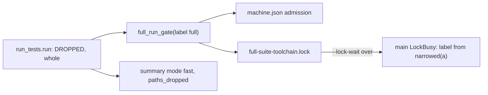
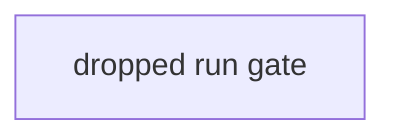

# Superlite: a --fast run with dropped paths takes the full-run gate (B183, #714)

**Goal:** fix #714: a `--fast` run whose paths the test command cannot take (#708: it runs the whole command, labelled fast) takes no full-suite lock and so runs beside other full runs of its toolchain; it now goes through the full-run gate (machine.json admission, else the toolchain's full-suite lock) unless test-cmd.json sets `"lock": false`.
**Architecture:** `run_tests.run` passes the gate label `"full"` to `full_run_gate` when `DROPPED` is set and the run's command was not narrowed (no `-m`, no pass-through args, no honoured marker); the run's own label stays `fast`. `main`'s LockBusy and AdmissionBusy handlers write the summary under the run's label (`narrowed(a)`), not a fixed `"full"`.
**Tech stack:** Python 3.10+ stdlib, pytest (through `sl run_tests`).
**Spec:** this file, section Design; issue #714.
**Detail:** tests
**Target-min:** 11
**Wave0:** none
**Worktree:** none
**Max chars:** 20000

Global constraints:
- Every script line keeps the repo's `# O(...)` complexity comment; stdlib only; LF endings.
- Tests use `tmp_path` projects and a private `SUPERLITE_HOME`; never the real `~/.superlite`.
- Standing rules for every lead and its workers (the owner's decisions, passed on by main): this repository is public: no host names, user names, home paths, other project or repository names, ticket keys or account names in code, tests, docs, commit messages, PR texts or issue comments (write "a Swift project", "a second Mac", "the machine"). Never change the machine's gate config or ~/.superlite/machine.json; tests and proofs use private temp homes and state dirs. No real app builds as proof; this repository's own test suite is the check. Priority of this round: scheduling and admission of test runs, parallel agents and the fleet, wall-clock and token efficiency; measure before and after where the issue names a waste and put the figures into your report. Friction with superlite itself goes to `sl feedback add`, not into this batch. Online research is allowed when something is unclear (official docs first); name the source.
- Builds: the verdict is `sl run_tests` (the project's test command; a project with `.maxapp` runs `maxapp test`, which a build pool may place on another Mac, and a full run whose tree a green maxapp test stamp covers returns that result without a run); task trees build in <tree>/.build/DerivedData and any build of your own goes under .build/ of the worktree, never -derivedDataPath outside the worktree (your session scratchpad included; backlog cleanup removes scratchpad build folders when the worktree goes); a product, simulator or device build stays on this machine and runs only when an issue's acceptance asks for a running-app check.
- Simulators: append the UDID of each simulator you or a worker creates (`xcrun simctl create` or `clone`; a checker's `Simulators:` line marks its created ones) as one line to `<worktree>/.superlite/simulators.txt`; never list one you did not create; ship cleanup shuts down and deletes each listed one.

## Coverage

| Category | State | Basis |
|---|---|---|
| Scope and success criteria | settled | #714 Expected: a dropped-paths fast run takes the full-suite lock when `lock` is not false, with a test |
| Domain and data model | ruled | no new summary key; `mode` stays `fast`, `paths_dropped` as in #708 |
| Persistence and migration | n/a | no stored format changes |
| Interfaces and contracts | ruled | existing gate texts reused (waiting line, `full-suite lock: still held ...`, `no full-suite lock: test-cmd.json sets "lock": false ...`) |
| UI states | n/a | CLI text only |
| Concurrency and state ownership | ruled | the existing `full_run_gate` (flock, FIFO queue, nested-run skip) is reused unchanged |
| Error handling and recovery | ruled | `--lock-wait S` bounds the wait: exit 2, red summary under label `fast` |
| Security and privacy | n/a | no new input |
| Performance and limits | ruled | a dropped run may now wait for the lock; that wait is the fix |
| Observability | ruled | the gate's existing lines and `.lockwait` note |
| Testing strategy | ruled | subprocess runs of run_tests.py in tmp projects with a lock holder process |
| Compatibility | ruled | runs that pass their paths, `-m`, pass-through and full runs unchanged |
| Rollout | ruled | ships with the next version; rollback reverts the PR |
| Research unknowns | n/a | code read by the lead: run_tests.run, full_run_gate, full_suite_lock, main |

## Design

### 1. Gate a whole-command fast run (#714)
In `run`, keep `resolved = spec["command"]` right after the spec is resolved (before the `-m` and honoured-marker blocks). At the `gate` call of the non-Python branch pass `"full" if whole else label`, where `whole = bool(DROPPED) and not a.marker and not getattr(a, "passthrough", None) and spec["command"] == resolved`. `full_run_gate` then applies machine.json admission or the toolchain lock, and `"lock": false` prints its existing no-lock line. Everything else (summary mode, unit stamp, destinations, stamp hit) keeps `label`.

### 2. Busy summaries keep the label
`main` writes the LockBusy and AdmissionBusy summaries with `"fast" if narrowed(a) else "full"` (as its LimitHit handler does), so a dropped run's red summary says `mode: fast` and keeps `paths_dropped`.

Ruling: the gate label, not the run label, changes, because #708's ruling keeps the run labelled fast (ledger, summary mode, no unit stamp).
Ruling: a dropped run narrowed by `-m`, pass-through args or an honoured marker takes no gate, because the B131 ruling makes those narrowed fast runs; only the whole command is gated.
Ruling: the dropped run goes through machine.json admission when that key is set, because admission replaces the lock for full runs of that toolchain (#659).
Ruling: the test goes in a new tests/scripts/test_run_tests_dropped_lock_714.py, because the tests/scripts/test_run_tests.py the issue names does not exist and the repo keeps one file per issue.

## Main diagram



## File structure

- `skills/subagent-driven-development/scripts/run_tests.py`: the gate label in `run`, the busy summaries' label in `main`, one docstring sentence.
- `tests/scripts/test_run_tests_dropped_lock_714.py`: the tests.

## Task graph

```mermaid
%% schedule
gantt
  title Predicted schedule (mm:ss)
  dateFormat X
  axisFormat %M:%S
  section lane 1
  T1 dropped-paths fast run takes the full :t1, 0, 189s
```





critical path: T1 (3.2 min) · peak width 1 · predicted build 3.2 min · predicted total ≈ 9.7 min (target ✓)

## Package: run gate

App type: CLI. Categories: concurrency (the machine-wide lock), state (`DROPPED` per run).
**Probe entry:** none (lock-holder fixtures; named tests cover them)

### T1 dropped-paths fast run takes the full-run gate · Complexity 2 · Est. context 40k
**Owns:** skills/subagent-driven-development/scripts/run_tests.py, tests/scripts/test_run_tests_dropped_lock_714.py
**Components:** 1
**LOC owned:** 120
**Tests:** fast
**Model:** sonnet
**Covers:** 1, 2
**Produces:** run_tests.run(a) -> int
e.g. test-cmd.json {"language": "shell", "test": "bash all.sh"}, `--fast a.sh`, shell lock held elsewhere, `--lock-wait 1` -> 2, summary {"mode": "fast", "paths_dropped": "--fast paths not passed, .superlite/test-cmd.json has no {files}", "error": "full-suite lock: still held ..."}
**Review Focus:** the tests below; a full run, a `-m` run and a run that passes its paths keep their gate behaviour (existing suites test_full_suite_lock_480.py, test_run_tests_lock_key_630.py, test_run_tests_paths_dropped_708.py stay green).
**Test code (verbatim):**
```python
"""#714: a --fast run whose paths are dropped runs the whole command, so it takes the full-run gate."""
from __future__ import annotations

import json
import os
import subprocess
import sys
from pathlib import Path

import pytest

ROOT = Path(__file__).resolve().parents[2]
sys.path.insert(0, str(ROOT / "skills" / "subagent-driven-development" / "scripts"))
import run_tests  # noqa: E402
from _fixtures import DISK_FREE  # noqa: E402

pytestmark = pytest.mark.skipif(os.name == "nt", reason="flock is POSIX only")

RUN_TESTS = Path(run_tests.__file__)
NOTE = "--fast paths not passed, .superlite/test-cmd.json has no {files}"
SEEN = 'printf "%s" "${SUPERLITE_FULL_SUITE_LOCK:-none}" > lock.txt\n'
HOLDER = r'''
import fcntl, json, os, sys, time
p = sys.argv[1]
os.makedirs(os.path.dirname(p), exist_ok=True)
fd = os.open(p, os.O_RDWR | os.O_CREAT, 0o600)
fcntl.flock(fd, fcntl.LOCK_EX)
os.ftruncate(fd, 0)
os.write(fd, json.dumps({"pid": os.getpid(), "root": "/elsewhere", "task": None, "started": time.time() - 60}).encode())
print("held", flush=True)
time.sleep(60)
'''


def run(tmp_path, *args):
    env = {k: v for k, v in os.environ.items() if not k.startswith("SUPERLITE_")}
    env.update(DISK_FREE, SUPERLITE_HOME=str(tmp_path / "home"), PYTHONIOENCODING="utf-8")
    sl = tmp_path / ".superlite"
    cp = subprocess.run([sys.executable, str(RUN_TESTS), "--log", str(sl / "incidents.jsonl"), "--ledger", str(sl / "ledger.md"),
                         "--summary", str(sl / "test-summary.json"), *map(str, args)],
                        capture_output=True, cwd=tmp_path, env=env, timeout=120, text=True)
    cp.both = cp.stdout + cp.stderr
    return cp


def project(tmp_path, cfg):
    (tmp_path / ".superlite").mkdir()
    (tmp_path / ".superlite" / "test-cmd.json").write_text(json.dumps({"language": "shell", **cfg}), encoding="utf-8")
    (tmp_path / "all.sh").write_text(SEEN + 'echo "3 passed"\n', encoding="utf-8")
    (tmp_path / "run.sh").write_text(SEEN + 'echo "$# passed"\n', encoding="utf-8")
    (tmp_path / "a.sh").write_text("exit 0\n", encoding="utf-8")


def hold(tmp_path):
    lock = tmp_path / "home" / "locks" / "full-suite-shell.lock"
    proc = subprocess.Popen([sys.executable, "-c", HOLDER, str(lock)], stdout=subprocess.PIPE, text=True)
    assert proc.stdout.readline().strip() == "held"
    return proc


def stop(proc):
    proc.kill()
    proc.wait(timeout=10)
    proc.stdout.close()


def held_run(tmp_path, *args):
    proc = hold(tmp_path)
    try:
        return run(tmp_path, *args)
    finally:
        stop(proc)


def summary(tmp_path):
    return json.loads((tmp_path / ".superlite" / "test-summary.json").read_text(encoding="utf-8"))


def seen(tmp_path):
    return (tmp_path / "lock.txt").read_text(encoding="utf-8")


def test_dropped_fast_run_holds_the_full_suite_lock(tmp_path):
    project(tmp_path, {"test": "bash all.sh"})
    cp = run(tmp_path, "--fast", "a.sh")
    assert cp.returncode == 0, cp.both
    assert seen(tmp_path).isdigit(), cp.both
    data = summary(tmp_path)
    assert data["mode"] == "fast"
    assert data["passed"] == 3
    assert data["paths_dropped"] == NOTE


def test_dropped_fast_run_waits_for_a_held_lock(tmp_path):
    project(tmp_path, {"test": "bash all.sh"})
    cp = held_run(tmp_path, "--fast", "a.sh", "--lock-wait", "1")
    assert cp.returncode == 2, cp.both
    assert "waiting for the shell full-suite lock" in cp.stderr
    assert "full-suite lock: still held" in cp.stderr
    assert not (tmp_path / "lock.txt").exists()
    data = summary(tmp_path)
    assert data["mode"] == "fast"
    assert data["paths_dropped"] == NOTE
    assert data["error"].startswith("full-suite lock: still held")


def test_dropped_fast_run_with_lock_false_runs_beside_a_holder(tmp_path):
    project(tmp_path, {"test": "bash all.sh", "lock": False})
    cp = held_run(tmp_path, "--fast", "a.sh", "--lock-wait", "1")
    assert cp.returncode == 0, cp.both
    assert 'no full-suite lock: test-cmd.json sets "lock": false' in cp.stderr
    assert "waiting for" not in cp.stderr
    assert seen(tmp_path) == "none"
    assert summary(tmp_path)["passed"] == 3


def test_fast_run_that_passes_its_paths_takes_no_lock(tmp_path):
    project(tmp_path, {"test": "bash all.sh", "test_file": "bash run.sh {files}"})
    cp = held_run(tmp_path, "--fast", "a.sh", "--lock-wait", "1")
    assert cp.returncode == 0, cp.both
    assert "waiting for" not in cp.stderr
    assert seen(tmp_path) == "none"
    assert summary(tmp_path)["passed"] == 1


def test_dropped_run_narrowed_by_passthrough_takes_no_lock(tmp_path):
    project(tmp_path, {"test": "bash all.sh"})
    cp = held_run(tmp_path, "--fast", "a.sh", "--lock-wait", "1", "--", "extra")
    assert cp.returncode == 0, cp.both
    assert "waiting for" not in cp.stderr
    assert seen(tmp_path) == "none"
    assert summary(tmp_path)["paths_dropped"] == NOTE
```
**Steps:** 1 failing tests, 2 run: FAIL, 3 implement, 4 run: PASS
**Notes:** in `run`, set `resolved = spec["command"]` just after the `node_gone` check (before `if a.marker and not spec["python"]:`); at the non-Python `with full_run_gate(a, label, lock_toolchain(spec), spec.get("lock", True)) as gate:` pass the gate label from Design 1 (compute `whole` after the `DROPPED` block). The Python branch never sets `DROPPED` and stays unchanged. In `main`, the `except LockBusy` and `except full_gate.AdmissionBusy` handlers write `"fast" if narrowed(a) else "full"` instead of `"full"`. Add one sentence to the module docstring paragraph on the full-suite lock (the one starting "A `--full` run holds a machine-wide lock per toolchain"), after its first sentence: "A `--fast` run whose paths the test command cannot take runs the whole command (#708) and passes the same gate, admission or lock, unless it is narrowed by `-m`, pass-through args or an honoured marker; its label stays fast (#714)." Run the four neighbour suites named in Review Focus too: `sl run_tests --task T1 --fast tests/scripts/test_run_tests_dropped_lock_714.py tests/scripts/test_full_suite_lock_480.py tests/scripts/test_run_tests_lock_key_630.py tests/scripts/test_run_tests_paths_dropped_708.py`.

## Review Focus

Package run gate: concurrency (a dropped run waits for and holds the toolchain lock; `"lock": false` skips it), state (the gate label from `DROPPED` and the narrowing, the busy summary's label). Each case is a named test in T1.

## Self-review

Coverage: Design 1 -> T1 (four gate tests), Design 2 -> T1 (`test_dropped_fast_run_waits_for_a_held_lock` asserts mode fast). No placeholders. One task, no edges, no shared file.
