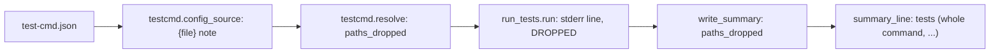
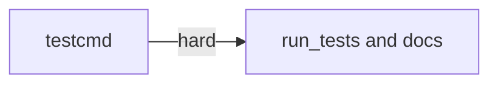

# Superlite: run_tests --fast says when its paths are dropped (B179, #708)

**Goal:** fix #708: a `--fast` run whose resolved test command has no path placeholder (a `test` without `test_file`, or a `test_file` without `{files}`) runs the whole command silently; it now says so on stderr and in the summary line, and a `{file}` (singular) typo in the config gets a note naming `{files}`.
**Architecture:** `testcmd.resolve` marks the spec `paths_dropped` (paths given, template holds none of `{files}`, `{names}`, `{only_testing}`); `testcmd.config_source` notes a `{file}` typo once per file and key. `run_tests.run` prints one stderr line for a dropped spec and records `paths_dropped` in the summary; `run_tests.summary_line` prints it as the head.
**Tech stack:** Python 3.10+ stdlib, pytest (through `sl run_tests`); Markdown docs.
**Spec:** this file, section Design; issue #708.
**Detail:** tests
**Target-min:** 11
**Wave0:** none
**Worktree:** none
**Max chars:** 22000

Global constraints:
- Every script line keeps the repo's `# O(...)` complexity comment; stdlib only; LF endings.
- Tests use `tmp_path` projects and a private `SUPERLITE_HOME`; never the real `~/.superlite`.
- Exact texts: note `--fast paths not passed, <origin> has no <slot>` (slot `{only_testing}` for language swift, else `{files}`); stderr line `run_tests: <note>; the whole command runs: <command>`; summary head `tests (whole command, <note>)`; typo note `testcmd: <origin>: "<key>" holds {file}; the placeholder for --fast paths is {files}`.
- Standing rules for every lead and its workers (the owner's decisions, passed on by main): this repository is public: no host names, user names, home paths, other project or repository names, ticket keys or account names in code, tests, docs, commit messages, PR texts or issue comments (write "a Swift project", "a second Mac", "the machine"). Never change the machine's gate config or ~/.superlite/machine.json; tests and proofs use private temp homes and state dirs. No real app builds as proof; this repository's own test suite is the check. Priority of this round: scheduling and admission of test runs, parallel agents and the fleet, wall-clock and token efficiency; measure before and after where the issue names a waste and put the figures into your report. Friction with superlite itself goes to `sl feedback add`, not into this batch. Online research is allowed when something is unclear (official docs first); name the source.
- Builds: the verdict is `sl run_tests` (the project's test command; a project with `.maxapp` runs `maxapp test`, which a build pool may place on another Mac, and a full run whose tree a green maxapp test stamp covers returns that result without a run); task trees build in <tree>/.build/DerivedData and any build of your own goes under .build/ of the worktree, never -derivedDataPath outside the worktree (your session scratchpad included; backlog cleanup removes scratchpad build folders when the worktree goes); a product, simulator or device build stays on this machine and runs only when an issue's acceptance asks for a running-app check.
- Simulators: append the UDID of each simulator you or a worker creates (`xcrun simctl create` or `clone`; a checker's `Simulators:` line marks its created ones) as one line to `<worktree>/.superlite/simulators.txt`; never list one you did not create; ship cleanup shuts down and deletes each listed one.

## Coverage

| Category | State | Basis |
|---|---|---|
| Scope and success criteria | settled | #708 Wanted 1-3; success: the issue's two named tests (`bash all.sh` with `--fast a.sh`; `test_file: "bash {file}"`) plus the doc line |
| Domain and data model | ruled | spec key `paths_dropped: bool` from resolve; summary key `paths_dropped: str` (the note) only on a dropped run |
| Persistence and migration | ruled | new optional summary key; readers that do not know it ignore it; no migration |
| Interfaces and contracts | ruled | texts in Global constraints; mode stays `fast` |
| UI states | n/a | CLI text only |
| Concurrency and state ownership | ruled | one module set (`_SAID_FILE`) in testcmd; one run global `DROPPED` in run_tests, cleared by main like `WARNING` |
| Error handling and recovery | ruled | no new exit code; the typo command still runs as written |
| Security and privacy | n/a | config is the user's own file |
| Performance and limits | ruled | two substring checks per resolve; the typo scan only for file and user configs |
| Observability | ruled | the stderr line, the summary key and head, the typo note |
| Testing strategy | ruled | unit tests over resolve and config_source; subprocess runs of run_tests.py in tmp projects |
| Compatibility | ruled | `tests (fast)` head unchanged for a run that passes its paths |
| Rollout | ruled | ships with the next version; rollback reverts the PR |
| Research unknowns | n/a | code paths read by the lead: testcmd.resolve, config_source, run_tests.run, summary_line |

## Design

### 1. Dropped paths (#708 Wanted 1)
Paths are passed when the chosen template (`test_file`, else `test`) holds `{files}`, `{names}` or `{only_testing}`; otherwise `resolve` returns `paths_dropped: True` (False without paths and in the built-in python branch). `run_tests.run` prints the stderr line after the missing-path check, when `paths`, `not spec["python"]` and `spec.get("paths_dropped")`, and sets the run global the summary records.

### 2. `{file}` typo (#708 Wanted 2)
`config_source` checks `test` and `test_file` of a project, main-checkout or user config for `{file}` not preceded by `$`, and prints the note once per (resolved root, origin, key, value) in the process. The command is not rewritten.

### 3. Docs (#708 Wanted 3)
`docs/language.md` gains one paragraph after the first one (text in T2).

Ruling: the label stays `fast` (ledger line, summary mode, no full-suite lock, no unit stamp) because #708 asks for the text only; taking the full-suite lock for a whole-command fast run is a follow-up.
Ruling: `{names}` and `{only_testing}` count as path placeholders, because both map the paths (Swift, Xcode, go -run); their unfiltered fallback keeps its own note.
Ruling: the `{file}` typo is noted, not corrected, because a silent rewrite hides a config error the user should fix.
Ruling: edge T1 -> T2 is hard, because T2's subprocess tests run the real resolve.

## Main diagram



## File structure

- `skills/subagent-driven-development/scripts/testcmd.py`: `paths_dropped` in resolve, `{file}` note in config_source.
- `skills/subagent-driven-development/scripts/run_tests.py`: `dropped_note`, the stderr line, summary key and head.
- `docs/language.md`: the paragraph.

## Task graph




critical path: T1 → T2 (10.0 min) · peak width 1 · predicted build 10.0 min · predicted total ≈ 20.5 min (target ✗ 11.0)

## Package: fast paths

App type: CLI. Categories: protocol (placeholder matching), state (once-per-process note).
**Probe entry:** none (config-shaped inputs; named tests cover them)

### T1 testcmd dropped paths and {file} note · Complexity 2 · Est. context 34k
**Owns:** skills/subagent-driven-development/scripts/testcmd.py, tests/scripts/test_testcmd_paths_dropped_708.py
**Components:** 1
**LOC owned:** 110
**Tests:** fast
**Model:** sonnet
**Covers:** 1, 2
**Produces:** testcmd.resolve(root, paths, notes) -> dict
e.g. resolve(root with {"language": "shell", "test": "bash all.sh"}, ["a.sh"]) -> {"command": "bash all.sh", "paths_dropped": True, "origin": ".superlite/test-cmd.json", ...}
e.g. resolve(root with {"test": "bash all.sh", "test_file": "bash run.sh {files}"}, ["a.sh", "b.sh"]) -> {"command": "bash run.sh a.sh b.sh", "paths_dropped": False, ...}
e.g. resolve(root with {"language": "shell", "test": "bash all.sh"}, []) -> {"command": "bash all.sh", "paths_dropped": False, ...}
**Produces:** testcmd.file_slot_note(cfg: dict, origin: str, root: Path) -> None
**Review Focus:** the tests below; `${file}` (a shell variable) is no typo.
**Test code (verbatim):**
```python
"""testcmd marks --fast paths a command cannot take and names {files} for a {file} typo (#708)."""
from __future__ import annotations

import json
import sys
from pathlib import Path

sys.path.insert(0, str(Path(__file__).resolve().parents[2] / "skills" / "subagent-driven-development" / "scripts"))
import testcmd  # noqa: E402


def project(tmp_path, cfg):
    (tmp_path / ".superlite").mkdir()
    (tmp_path / ".superlite" / "test-cmd.json").write_text(json.dumps(cfg), encoding="utf-8")
    return tmp_path


def test_test_only_drops_paths(tmp_path):
    project(tmp_path, {"language": "shell", "test": "bash all.sh"})
    spec = testcmd.resolve(tmp_path, ["a.sh"])
    assert spec["command"] == "bash all.sh"
    assert spec["paths_dropped"] is True


def test_test_file_without_files_drops_paths(tmp_path):
    project(tmp_path, {"language": "shell", "test": "bash all.sh", "test_file": "bash one.sh"})
    spec = testcmd.resolve(tmp_path, ["a.sh"])
    assert spec["command"] == "bash one.sh"
    assert spec["paths_dropped"] is True


def test_files_template_keeps_paths(tmp_path):
    project(tmp_path, {"language": "shell", "test": "bash all.sh", "test_file": "bash run.sh {files}"})
    spec = testcmd.resolve(tmp_path, ["a.sh", "b.sh"])
    assert spec["command"] == "bash run.sh a.sh b.sh"
    assert spec["paths_dropped"] is False


def test_names_template_keeps_paths(tmp_path):
    project(tmp_path, {"language": "go", "test": "go test ./...", "test_file": "go test -run {names} ./..."})
    assert testcmd.resolve(tmp_path, ["pkg/a_test.go"])["paths_dropped"] is False


def test_no_paths_is_not_dropped(tmp_path):
    project(tmp_path, {"language": "shell", "test": "bash all.sh"})
    assert testcmd.resolve(tmp_path, [])["paths_dropped"] is False


def test_file_singular_note_once(tmp_path, capsys):
    project(tmp_path, {"language": "shell", "test": "bash all.sh", "test_file": "bash {file}"})
    testcmd.config_source(tmp_path)
    testcmd.config_source(tmp_path)
    err = capsys.readouterr().err
    assert err.count('testcmd: .superlite/test-cmd.json: "test_file" holds {file}; the placeholder for --fast paths is {files}') == 1


def test_file_note_for_test_key(tmp_path, capsys):
    project(tmp_path, {"language": "shell", "test": "bash {file}"})
    testcmd.resolve(tmp_path, ["a.sh"])
    assert '"test" holds {file}' in capsys.readouterr().err


def test_shell_variable_is_no_typo(tmp_path, capsys):
    project(tmp_path, {"language": "shell", "test": "for file in t/*.sh; do bash ${file}; done"})
    testcmd.config_source(tmp_path)
    assert "holds {file}" not in capsys.readouterr().err


def test_user_entry_note_names_its_file(tmp_path, monkeypatch, capsys):
    user = tmp_path / "user.json"
    user.write_text(json.dumps({"python": {"test": "runner pytest", "test_file": "runner pytest {file}"}}), encoding="utf-8")
    monkeypatch.setenv("SUPERLITE_USER_TEST_CMD", str(user))
    proj = tmp_path / "p"
    proj.mkdir()
    (proj / "pyproject.toml").write_text("[tool.pytest.ini_options]\n", encoding="utf-8")
    cfg, src, origin = testcmd.config_source(proj)
    assert src == "user"
    assert f'testcmd: {origin}: "test_file" holds {{file}}' in capsys.readouterr().err
```
**Steps:** 1 failing tests, 2 run: FAIL, 3 implement, 4 run: PASS
**Notes:** In `resolve`, after `template` is chosen: `dropped = bool(paths) and not any(s in template for s in ("{files}", "{names}", "{only_testing}"))`; add `"paths_dropped": dropped` to the returned dict and `"paths_dropped": False` to the python (`command: None`) dict. For the note, rename the current body of `config_source` to `_config_source(root)` and make `config_source` call it, then `file_slot_note(cfg, origin, root)` when `cfg is not None and src in ("test-cmd.json", "user")`. `file_slot_note` uses `re.compile(r"(?<!\$)\{file\}")` on `test` and `test_file` (str values only), prints the typo note (Global constraints) on stderr, and remembers `(str(Path(root).resolve()), origin, key, value)` in a module-level set `_SAID_FILE` so a process prints each once. Update the module docstring's `Library:` line with `file_slot_note`.

### T2 run_tests line, summary head and docs · Complexity 3 · Est. context 46k
**Owns:** skills/subagent-driven-development/scripts/run_tests.py, docs/language.md, tests/scripts/test_run_tests_paths_dropped_708.py
**Components:** 2
**LOC owned:** 120
**Tests:** fast
**Model:** sonnet
**Covers:** 1, 3
**Consumes:** testcmd.resolve(root, paths, notes) -> dict (T1)
**Produces:** run_tests.dropped_note(spec: dict) -> str
**Review Focus:** the tests below; a `--fast` run that passes its paths keeps the `tests (fast)` head and writes no `paths_dropped` key.
**Test code (verbatim):**
```python
"""run_tests --fast says when the test command takes no paths and runs whole (#708)."""
from __future__ import annotations

import json
import os
import subprocess
import sys
from pathlib import Path

ROOT = Path(__file__).resolve().parents[2]
sys.path.insert(0, str(ROOT / "skills" / "subagent-driven-development" / "scripts"))
import run_tests  # noqa: E402
from _fixtures import DISK_FREE  # noqa: E402

RUN_TESTS = Path(run_tests.__file__)
NOTE = "--fast paths not passed, .superlite/test-cmd.json has no {files}"
LINE = f"run_tests: {NOTE}; the whole command runs: bash all.sh"


def run(tmp_path, *args):
    env = {k: v for k, v in os.environ.items() if not k.startswith("SUPERLITE_")}
    env.update(DISK_FREE, SUPERLITE_HOME=str(tmp_path / "home"), PYTHONIOENCODING="utf-8")
    sl = tmp_path / ".superlite"
    cp = subprocess.run([sys.executable, str(RUN_TESTS), *map(str, args), "--log", str(sl / "incidents.jsonl"),
                         "--ledger", str(sl / "ledger.md"), "--summary", str(sl / "test-summary.json")],
                        capture_output=True, cwd=tmp_path, env=env, timeout=120, text=True)
    cp.both = cp.stdout + cp.stderr
    return cp


def project(tmp_path, cfg):
    (tmp_path / ".superlite").mkdir()
    (tmp_path / ".superlite" / "test-cmd.json").write_text(json.dumps(cfg), encoding="utf-8")
    (tmp_path / "all.sh").write_text('echo "3 passed"\n', encoding="utf-8")
    (tmp_path / "run.sh").write_text('echo "$# passed"\n', encoding="utf-8")
    (tmp_path / "a.sh").write_text("exit 0\n", encoding="utf-8")
    return tmp_path


def summary(tmp_path):
    return json.loads((tmp_path / ".superlite" / "test-summary.json").read_text(encoding="utf-8"))


def test_fast_paths_dropped_line(tmp_path):
    project(tmp_path, {"language": "shell", "test": "bash all.sh"})
    cp = run(tmp_path, "--fast", "a.sh")
    assert cp.returncode == 0, cp.both
    assert cp.stderr.count(LINE) == 1, cp.stderr
    data = summary(tmp_path)
    assert data["mode"] == "fast"
    assert data["passed"] == 3
    assert data["paths_dropped"] == NOTE
    assert run_tests.summary_line(data) == f"tests (whole command, {NOTE}): 3 passed, 0 failed"


def test_files_template_no_line(tmp_path):
    project(tmp_path, {"language": "shell", "test": "bash all.sh", "test_file": "bash run.sh {files}"})
    cp = run(tmp_path, "--fast", "a.sh")
    assert cp.returncode == 0, cp.both
    assert "--fast paths not passed" not in cp.stderr
    data = summary(tmp_path)
    assert data["passed"] == 1
    assert "paths_dropped" not in data
    assert run_tests.summary_line(data) == "tests (fast): 1 passed, 0 failed"


def test_full_run_no_line(tmp_path):
    project(tmp_path, {"language": "shell", "test": "bash all.sh", "lock": False})
    cp = run(tmp_path, "--full")
    assert cp.returncode == 0, cp.both
    assert "--fast paths not passed" not in cp.stderr
    assert "paths_dropped" not in summary(tmp_path)


def test_dropped_note_swift_names_only_testing():
    spec = {"language": "swift", "origin": "~/.config/superlite/test-cmd.json"}
    assert run_tests.dropped_note(spec) == "--fast paths not passed, ~/.config/superlite/test-cmd.json has no {only_testing}"


def test_plain_fast_head_unchanged():
    assert run_tests.summary_line({"passed": 3, "failed": 1, "skipped": 0, "mode": "fast"}) == "tests (fast): 3 passed, 1 failed"


def test_docs_language_names_the_line():
    text = (ROOT / "docs" / "language.md").read_text(encoding="utf-8")
    assert "ignores the `--fast` paths" in text
    assert f"`{LINE}`" in text
    assert "holds {file}; the placeholder for --fast paths is {files}" in text
```
**Steps:** 1 failing tests, 2 run: FAIL, 3 implement, 4 run: PASS
**Notes:** `dropped_note(spec)`: slot `{only_testing}` when `spec.get("language") == "swift"`, else `{files}`; origin `spec.get("origin") or "the test config"`. Add module global `DROPPED = ""` beside `WARNING` (comment: the dropped-paths note of this fast run; write_summary records it, main clears it), add it to main's `global` line and clear it there. In `run`, right after the `if paths and (spec["python"] or label == "fast"):` missing-path block: `if paths and not spec["python"] and spec.get("paths_dropped"):` set `DROPPED = dropped_note(spec)` (declare `global DROPPED` at the top of `run`) and print `f"run_tests: {DROPPED}; the whole command runs: {spec['command']}"` to stderr. `write_summary` adds `data["paths_dropped"] = DROPPED` when set. `summary_line`: head `f"tests (whole command, {data['paths_dropped']})"` when `data.get("paths_dropped")`, else as now. Docs: insert this paragraph as a new paragraph after the first paragraph of `docs/language.md` (one line, a blank line on each side): **Fast runs and `{files}`.** `test` is the `--full` command and `test_file` the `--fast` one; `{files}` in it becomes the given paths (`{names}` and `{only_testing}` map them to test suites, see Swift and Xcode). A command without such a placeholder (a `test` with no `test_file`, or a `test_file` without `{files}`) ignores the `--fast` paths and runs whole, still labelled fast; `run_tests` prints `run_tests: --fast paths not passed, .superlite/test-cmd.json has no {files}; the whole command runs: bash all.sh` on stderr, and the `--wait` summary line starts `tests (whole command, --fast paths not passed, .superlite/test-cmd.json has no {files})`. The placeholder is plural: a `test` or `test_file` holding `{file}` runs as written, with the stderr note `testcmd: .superlite/test-cmd.json: "test_file" holds {file}; the placeholder for --fast paths is {files}` when the config is read.

## Review Focus

Package fast paths: protocol (which placeholders carry paths; `${file}` is no typo), state (the typo note once per process; `DROPPED` cleared per run by main). Each case is a named test in T1 or T2.

## Self-review

Coverage: Wanted 1 -> T1 (flag) and T2 (line, summary); Wanted 2 -> T1; Wanted 3 -> T2. No placeholders. Consumes matches T1's Produces. One hard edge; the two tasks share no file.
