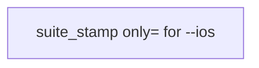

# Superlite: suite_stamp rejects a suite-narrowed iOS stamp for `maxapp test --ios` (B185, #718)

**Goal:** fix #718: `suite_stamp.green_base` accepts an iOS test stamp that carries `only=<suites>` (written by a plain `maxapp test` whose `.maxapp` `test_full` narrows the iOS part to named suites) for `maxapp test --ios`, which runs the whole iOS suite; such a stamp must not count for `--ios`, and stays valid for the plain `maxapp test` that wrote it.
**Architecture:** `_read_stamp` gains a `whole` flag: with `whole=True` a stamp holding an `only` key returns None. `green_base` passes `whole=True` when the command is `maxapp test --ios` (its platforms include `iOS`); plain `maxapp test` reads only the macOS stamp as before.
**Tech stack:** Python 3.10+ stdlib, pytest (through `sl run_tests`).
**Spec:** this file, section Design; issue #718.
**Detail:** tests
**Target-min:** 11
**Wave0:** none
**Worktree:** none
**Coverage:** off

Global constraints:
- Every script line keeps the repo's `# O(...)` complexity comment; stdlib only; LF endings.
- Tests use `tmp_path` git repositories; never the machine's own git common dir or `~/.superlite`.
- Stamp format (maxapp's writer): lines `tree=`, `platform=`, `commit=`, `tests=`, `xcode=`, `host=`, and on the iOS file only, when `test_full` names `iOS=<Target/Suite>[,...]`, `only=<comma-separated Target/Suite list>`; `maxapp test --ios` clears the narrowing and writes no `only=`.
- Standing rules for every lead and its workers (the owner's decisions, passed on by main): this repository is public: no host names, user names, home paths, other project or repository names, ticket keys or account names in code, tests, docs, commit messages, PR texts or issue comments (write "a Swift project", "a second Mac", "the machine"). Never change the machine's gate config or ~/.superlite/machine.json; tests and proofs use private temp homes and state dirs. No real app builds as proof; this repository's own test suite is the check. Priority of this round: scheduling and admission of test runs, parallel agents and the fleet, wall-clock and token efficiency; measure before and after where the issue names a waste and put the figures into your report. Friction with superlite itself goes to `sl feedback add`, not into this batch. Online research is allowed when something is unclear (official docs first); name the source.
- Builds: the verdict is `sl run_tests` (the project's test command; a project with `.maxapp` runs `maxapp test`, which a build pool may place on another Mac, and a full run whose tree a green maxapp test stamp covers returns that result without a run); task trees build in <tree>/.build/DerivedData and any build of your own goes under .build/ of the worktree, never -derivedDataPath outside the worktree (your session scratchpad included; backlog cleanup removes scratchpad build folders when the worktree goes); a product, simulator or device build stays on this machine and runs only when an issue's acceptance asks for a running-app check.
- Simulators: append the UDID of each simulator you or a worker creates (`xcrun simctl create` or `clone`; a checker's `Simulators:` line marks its created ones) as one line to `<worktree>/.superlite/simulators.txt`; never list one you did not create; ship cleanup shuts down and deletes each listed one.

## Design

`maxapp test --ios` means the whole iOS suite, so every stamp it reads must cover the whole suite: a stamp with any `only` key (an empty value too, which maxapp never writes) is narrowed and counts as no stamp. Since the first stamped first-parent commit is the base, a narrowed stamp there ends the search with None and `run_tests --full` runs the suite. Plain `maxapp test` reads only the macOS stamp (maxapp never writes `only=` there); its result is unchanged.

Ruling: any `only` key rejects for `--ios`, an empty value too - the safe side is a run, never a skipped suite - cost if wrong: one extra suite run for a stamp maxapp never writes.
Ruling: plain `maxapp test` keeps reading only the macOS stamp - #718 asks only for `--ios`; reading the iOS stamp of a `test_full` run needs `.maxapp` parsing - cost if wrong: a follow-up names it.

## Task graph

```mermaid
%% schedule
gantt
  title Predicted schedule (mm:ss)
  dateFormat X
  axisFormat %M:%S
  section lane 1
  T1 Reject an only= iOS stamp for --ios :t1, 0, 176s
```





critical path: T1 (2.9 min) · peak width 1 · predicted build 2.9 min · predicted total ≈ 11.4 min (target ✗ 11.0)

## Package: stamp

App type: CLI library. Categories: protocol (stamp file keys).
**Probe entry:** none (file-shaped inputs; named tests cover them)

### T1 Reject an only= iOS stamp for --ios · Complexity 1 · Est. context 20k
**Owns:** skills/subagent-driven-development/scripts/suite_stamp.py, tests/scripts/test_suite_stamp_only_718.py
**Components:** 1
**LOC owned:** 70
**Tests:** fast
**Kind:** mechanical
**Model:** haiku
**Covers:** Design
**Produces:** suite_stamp.green_base(root, command, not_code, depth=50) -> dict | None
e.g. green_base(repo with macOS stamp tests=12 and iOS stamp tests=5 holding only=App/SuiteA,App/SuiteB, "maxapp test --ios", []) -> None
e.g. green_base(same repo, "maxapp test", []) -> {"tests": 12, "platforms": ["macOS"], ...}
**Review Focus:** the tests below; the 639 tests stay green unchanged.
**Test code (verbatim):**
```python
# tests/scripts/test_suite_stamp_only_718.py
"""A suite-narrowed iOS stamp (only=) does not count for maxapp test --ios (#718)."""
import sys
from test_plan_tools import SCRIPTS
from test_suite_stamp_639 import commit, git, repo_with, stamp, tree
sys.path.insert(0, str(SCRIPTS))
import suite_stamp as ss  # noqa: E402


def only_stamp(repo, rev="HEAD", only="App/SuiteA,App/SuiteB"):
    t = tree(repo, rev)
    return stamp(repo, rev, platform="iOS", text=f"tree={t}\nplatform=iOS\ncommit={git(repo, 'rev-parse', rev)}\n"
                                                 f"tests=5\nonly={only}\n")


def test_ios_rejects_only_stamp(tmp_path):
    r = repo_with(tmp_path)
    stamp(r)
    only_stamp(r)
    assert ss.green_base(r, "maxapp test --ios", []) is None


def test_ios_rejects_empty_only(tmp_path):
    r = repo_with(tmp_path)
    stamp(r)
    only_stamp(r, only="")
    assert ss.green_base(r, "maxapp test --ios", []) is None


def test_ios_whole_stamp_hits(tmp_path):
    r = repo_with(tmp_path)
    stamp(r)
    stamp(r, platform="iOS", tests="5")
    out = ss.green_base(r, "maxapp test --ios", [])
    assert out["tests"] == 17 and out["platforms"] == ["macOS", "iOS"]


def test_plain_test_keeps_its_stamp(tmp_path):
    r = repo_with(tmp_path)
    f = stamp(r)
    only_stamp(r)
    out = ss.green_base(r, "maxapp test", [])
    assert out["tests"] == 12 and out["platforms"] == ["macOS"] and out["stamps"] == [str(f)]


def test_ios_only_stamp_on_ancestor_is_no_hit(tmp_path):
    r = repo_with(tmp_path)
    stamp(r)
    only_stamp(r)
    commit(r, {"docs/x.md": "b\n"}, "docs")
    assert ss.green_base(r, "maxapp test --ios", ["docs/**"]) is None


def test_read_stamp_whole_flag(tmp_path):
    r = repo_with(tmp_path)
    f = only_stamp(r)
    assert ss._read_stamp(f, tree(r), "iOS") == 5
    assert ss._read_stamp(f, tree(r), "iOS", whole=True) is None
```
**Steps:** 1 failing tests, 2 run: FAIL, 3 implement, 4 run: PASS
**Notes:** In `_read_stamp(f, tree, platform, whole=False)`, after the tree/platform check: `if whole and "only" in kv: return None` with comment `# O(1) a suite-narrowed stamp covers part of the suite (#718)`. In `green_base`, after `platforms`: `whole = "iOS" in platforms  # O(1) maxapp test --ios runs the whole iOS suite`, and call `_read_stamp(f, tree, p, whole)`. In the module docstring, after `tests is an integer above 0;`, insert ` for maxapp test --ios a stamp holding only= (a run narrowed to named suites) counts as none;` and add `#718` to the issue list at its end.
