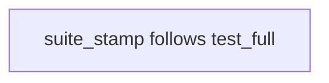

# Superlite: plain `maxapp test` follows the `.maxapp` `test_full` in suite_stamp (B186, #720)

**Goal:** fix #720: for plain `maxapp test`, `suite_stamp.green_base` reads only the macOS stamp, but maxapp's plain run follows the `.maxapp` `test_full` definition and also runs iOS when it names `iOS` or `iOS=<suites>`. A macOS stamp alone then counts as green for a run that would also test iOS. It must also require the iOS stamp, and when the definition narrows iOS, that stamp's `only=` must name the same suites.
**Architecture:** a new `suite_stamp.test_full_ios(root)` reads `<git top of root>/.maxapp` the way maxapp's parser does and returns the iOS part of `test_full`. `green_base` uses it for plain `maxapp test`: the platforms become macOS and iOS, and the iOS stamp is checked by a new `_read_stamp` `suites` parameter, or by `whole=True` for a bare `iOS`. `maxapp_platforms(command)` and `maxapp test --ios` stay unchanged.
**Tech stack:** Python 3.10+ stdlib, pytest (through `sl run_tests`).
**Spec:** this file, section Design; issue #720.
**Detail:** tests
**Target-min:** 11
**Wave0:** none
**Worktree:** none
**Coverage:** off

Global constraints:
- Every script line keeps the repo's `# O(...)` complexity comment; stdlib only; LF endings.
- Tests use `tmp_path` git repositories; never the machine's own git common dir or `~/.superlite`.
- `.maxapp` parsing as maxapp does it: each line is trimmed on both sides; blank lines and lines starting with `#` are skipped; `key=value` splits at the first `=`; the key is right-trimmed and the value left-trimmed; a value starting with `"` or `'` is invalid; a repeated key is invalid. `test_full` words split on whitespace and are case-sensitive: `macOS`, `iOS`, `lint`, `iOS=<Target/Suite>[,<Target/Suite>...]` (the list is non-empty, does not start or end with `,`, and holds no `,,`). Each part appears at most once (`iOS` and `iOS=...` are one part), and `macOS` must be named. An empty or missing `test_full` means `macOS`.
- Stamp format (maxapp's writer): lines `tree=`, `platform=`, `commit=`, `tests=`, `xcode=`, `host=`, and on the iOS file of a narrowed run `only=<the iOS= list as written, comma-separated>`; a whole-iOS run writes no `only=`.
- Standing rules for every lead and its workers (the owner's decisions, passed on by main): this repository is public: no host names, user names, home paths, other project or repository names, ticket keys or account names in code, tests, docs, commit messages, PR texts or issue comments (write "a Swift project", "a second Mac", "the machine"). Never change the machine's gate config or ~/.superlite/machine.json; tests and proofs use private temp homes and state dirs. No real app builds as proof; this repository's own test suite is the check. Priority of this round: scheduling and admission of test runs, parallel agents and the fleet, wall-clock and token efficiency; measure before and after where the issue names a waste and put the figures into your report. Friction with superlite itself goes to `sl feedback add`, not into this batch. Online research is allowed when something is unclear (official docs first, then how others solved it); name the source.
- Builds: the verdict is `sl run_tests` (the project's test command; a project with `.maxapp` runs `maxapp test`, which a build pool may place on another Mac, and a full run whose tree a green maxapp test stamp covers returns that result without a run); task trees build in <tree>/.build/DerivedData and any build of your own goes under .build/ of the worktree, never -derivedDataPath outside the worktree (your session scratchpad included; backlog cleanup removes scratchpad build folders when the worktree goes); a product, simulator or device build stays on this machine and runs only when an issue's acceptance asks for a running-app check.
- Simulators: append the UDID of each simulator you or a worker creates (`xcrun simctl create` or `clone`; a checker's `Simulators:` line marks its created ones) as one line to `<worktree>/.superlite/simulators.txt`; never list one you did not create; ship cleanup shuts down and deletes each listed one.

## Design

Plain `maxapp test` runs what `test_full` names: macOS always; iOS whole for `iOS`; iOS narrowed to the listed suites for `iOS=<list>`; `lint` adds a step with no platform and no stamp. `green_base` must require the stamps of that run:
- no `.maxapp`, no or empty `test_full`, or one naming only `macOS`/`lint`: the macOS stamp, as before.
- `iOS`: macOS and iOS stamps; the iOS stamp must hold no `only` key (as for `--ios`, B185).
- `iOS=<list>`: macOS and iOS stamps; the iOS stamp's `only=` must hold the same suite set (split at `,`, order ignored).
- malformed `test_full` (maxapp exits 2 on it): no hit, so the suite runs and maxapp names the error.

`maxapp test --ios` keeps its B185 rule (both stamps, no `only` key) and reads no `.maxapp`. `.maxapp` is read from the working tree at `git rev-parse --show-toplevel` of `root` (maxapp's own ROOT). The stamp base search, `_changed` and `sync_change` are unchanged.

Ruling: `maxapp_platforms(command)` stays the command parser and takes no root. Its other caller (run_tests' build warning) only tests it for non-None, and `green_base` also needs the iOS suites, so the `test_full` read lives in `test_full_ios` (lead's ruling).
Ruling: a narrowed definition needs an `only=` with an equal suite set. A whole-iOS stamp (written by `--ios`) does not count for it: maxapp's narrowed run also fails when a named suite runs no test, and a whole run never checked that. Cost if wrong: one suite run that could have been skipped (lead's ruling).
Ruling: only `test_full`'s own rules and the quoted-value and duplicate-key rules are mirrored. maxapp rejects any other bad `.maxapp` line on every command, so no stamp can exist for such a tree (lead's ruling).

## Task graph

```mermaid
%% schedule
gantt
  title Predicted schedule (mm:ss)
  dateFormat X
  axisFormat %M:%S
  section lane 1
  T1 Plain maxapp test follows test_full :t1, 0, 197s
```





critical path: T1 (3.3 min) · peak width 1 · predicted build 3.3 min · predicted total ≈ 11.8 min (target ✗ 11.0)

## Package: stamp

App type: CLI library. Categories: protocol (`.maxapp` and stamp file keys).
**Probe entry:** none (file-shaped inputs; named tests cover them)

### T1 Plain maxapp test follows test_full · Complexity 2 · Est. context 26k
**Owns:** skills/subagent-driven-development/scripts/suite_stamp.py, tests/scripts/test_suite_stamp_test_full_720.py
**Components:** 1
**LOC owned:** 170
**Tests:** fast
**Model:** sonnet
**Covers:** Design
**Produces:** suite_stamp.test_full_ios(root) -> frozenset[str] | None (raises ValueError on a malformed test_full) · suite_stamp._read_stamp(f, tree, platform, whole=False, suites=None) -> int | None · suite_stamp.green_base(root, command, not_code, depth=50) -> dict | None
e.g. test_full_ios(repo whose .maxapp has test_full=macOS iOS=A/B,C/D) -> frozenset({"A/B", "C/D"}); test_full=macOS iOS -> frozenset(); test_full=lint macOS -> None; no .maxapp -> None; test_full=iOS -> ValueError
e.g. green_base(repo with test_full=lint macOS iOS and only a macOS stamp tests=12, "maxapp test", []) -> None
e.g. green_base(same repo plus a whole iOS stamp tests=5, "maxapp test", []) -> {"tests": 17, "platforms": ["macOS", "iOS"], ...}
**Review Focus:** the tests below; `tests/scripts/test_suite_stamp_639.py` and `tests/scripts/test_suite_stamp_only_718.py` stay green unchanged.
**Test code (verbatim):**
```python
# tests/scripts/test_suite_stamp_test_full_720.py
"""Plain maxapp test follows the .maxapp test_full: an iOS part there needs the iOS stamp, narrowed to the same suites (#720)."""
import sys
import pytest
from test_plan_tools import SCRIPTS
from test_suite_stamp_639 import commit, git, repo_with, stamp, tree
sys.path.insert(0, str(SCRIPTS))
import suite_stamp as ss  # noqa: E402


def project(tmp_path, test_full=None, extra=""):
    tmp_path.mkdir(parents=True, exist_ok=True)
    body = "package=Pkg\npackage_scheme=Pkg\nplatforms=macOS iOS\n" + extra
    if test_full is not None:
        body += f"test_full={test_full}\n"
    return repo_with(tmp_path, {"src/a.py": "1\n", "docs/x.md": "a\n", ".maxapp": body})


def ios_stamp(repo, only=None, tests="5", rev="HEAD"):
    t = tree(repo, rev)
    text = f"tree={t}\nplatform=iOS\ncommit={git(repo, 'rev-parse', rev)}\ntests={tests}\n"
    if only is not None:
        text += f"only={only}\n"
    return stamp(repo, rev, platform="iOS", text=text)


def test_whole_ios_needs_the_ios_stamp(tmp_path):
    r = project(tmp_path, "lint macOS iOS")
    stamp(r)
    assert ss.green_base(r, "maxapp test", []) is None


def test_whole_ios_hits_with_both_stamps(tmp_path):
    r = project(tmp_path, "lint macOS iOS")
    m = stamp(r)
    f = ios_stamp(r)
    out = ss.green_base(r, "maxapp test", [])
    assert out["tests"] == 17 and out["platforms"] == ["macOS", "iOS"] and out["stamps"] == [str(m), str(f)]


def test_whole_ios_rejects_a_narrowed_stamp(tmp_path):
    r = project(tmp_path, "macOS iOS")
    stamp(r)
    ios_stamp(r, only="App/SuiteA")
    assert ss.green_base(r, "maxapp test", []) is None


def test_narrowed_ios_hits_with_the_same_suites(tmp_path):
    r = project(tmp_path, "macOS iOS=App/SuiteA,App/SuiteB lint")
    stamp(r)
    ios_stamp(r, only="App/SuiteA,App/SuiteB")
    out = ss.green_base(r, "maxapp test", [])
    assert out["tests"] == 17 and out["platforms"] == ["macOS", "iOS"]


def test_narrowed_ios_ignores_suite_order(tmp_path):
    r = project(tmp_path, "macOS iOS=App/SuiteA,App/SuiteB")
    stamp(r)
    ios_stamp(r, only="App/SuiteB,App/SuiteA")
    assert ss.green_base(r, "maxapp test", [])["tests"] == 17


@pytest.mark.parametrize("only", [None, "", "App/SuiteA", "App/SuiteA,App/SuiteB,App/SuiteC"])
def test_narrowed_ios_needs_equal_suites(tmp_path, only):
    r = project(tmp_path, "macOS iOS=App/SuiteA,App/SuiteB")
    stamp(r)
    ios_stamp(r, only=only)
    assert ss.green_base(r, "maxapp test", []) is None


def test_narrowed_ios_needs_the_ios_stamp(tmp_path):
    r = project(tmp_path, "macOS iOS=App/SuiteA")
    stamp(r)
    assert ss.green_base(r, "maxapp test", []) is None


@pytest.mark.parametrize("test_full", [None, "", "macOS", "lint macOS", "macOS lint"])
def test_macos_only_definition_keeps_the_macos_stamp(tmp_path, test_full):
    r = project(tmp_path, test_full)
    f = stamp(r)
    out = ss.green_base(r, "maxapp test", [])
    assert out["tests"] == 12 and out["platforms"] == ["macOS"] and out["stamps"] == [str(f)]


@pytest.mark.parametrize("test_full", ["iOS", "lint", "macOS iOS=", "macOS iOS=,A/B", "macOS iOS=A/B,", "macOS iOS=A/B,,C/D",
                                       "macOS iOS iOS=A/B", "macOS macOS iOS", "macOS ios", "macOS watchOS",
                                       "'macOS iOS'", '"macOS iOS"'])
def test_malformed_definition_is_no_hit(tmp_path, test_full):
    r = project(tmp_path, test_full)
    stamp(r)
    ios_stamp(r)
    assert ss.green_base(r, "maxapp test", []) is None


def test_duplicate_test_full_key_is_no_hit(tmp_path):
    r = project(tmp_path, "macOS", extra="test_full=macOS iOS\n")
    stamp(r)
    ios_stamp(r)
    assert ss.green_base(r, "maxapp test", []) is None


def test_definition_is_read_like_maxapp(tmp_path):
    r = repo_with(tmp_path, {"src/a.py": "1\n", ".maxapp": "# test_full=macOS\n\n  test_full =   macOS   iOS=App/SuiteA  \npackage=Pkg\n"})
    stamp(r)
    assert ss.green_base(r, "maxapp test", []) is None
    ios_stamp(r, only="App/SuiteA")
    assert ss.green_base(r, "maxapp test", [])["platforms"] == ["macOS", "iOS"]


def test_commented_definition_is_ignored(tmp_path):
    r = repo_with(tmp_path, {"src/a.py": "1\n", ".maxapp": "# test_full=macOS iOS\npackage=Pkg\n"})
    f = stamp(r)
    assert ss.green_base(r, "maxapp test", [])["stamps"] == [str(f)]


def test_definition_is_read_at_the_git_top(tmp_path):
    r = project(tmp_path, "macOS iOS")
    stamp(r)
    assert ss.green_base(r / "src", "maxapp test", []) is None
    ios_stamp(r)
    assert ss.green_base(r / "src", "maxapp test", [])["tests"] == 17


def test_ancestor_base_needs_the_ios_stamp_too(tmp_path):
    r = project(tmp_path, "macOS iOS")
    stamp(r)
    commit(r, {"docs/x.md": "b\n"}, "docs")
    assert ss.green_base(r, "maxapp test", ["docs/**"]) is None
    ios_stamp(r, rev="HEAD~1")
    out = ss.green_base(r, "maxapp test", ["docs/**"])
    assert out["tests"] == 17 and out["changed"] == ["docs/x.md"]


def test_ios_flag_keeps_the_whole_suite_rule(tmp_path):
    r = project(tmp_path, "macOS iOS=App/SuiteA")
    stamp(r)
    ios_stamp(r, only="App/SuiteA")
    assert ss.green_base(r, "maxapp test --ios", []) is None
    ios_stamp(r)
    assert ss.green_base(r, "maxapp test --ios", [])["tests"] == 17


def test_maxapp_platforms_unchanged():
    assert ss.maxapp_platforms("maxapp test") == ["macOS"]
    assert ss.maxapp_platforms("maxapp test --ios") == ["macOS", "iOS"]
    assert ss.maxapp_platforms("maxapp test --only A/B") is None


def test_test_full_ios_values(tmp_path):
    assert ss.test_full_ios(project(tmp_path / "a", "macOS lint")) is None
    assert ss.test_full_ios(project(tmp_path / "b", "macOS iOS")) == frozenset()
    assert ss.test_full_ios(project(tmp_path / "c", "macOS iOS=A/B,C/D")) == frozenset({"A/B", "C/D"})
    assert ss.test_full_ios(project(tmp_path / "d")) is None
    e = tmp_path / "e"
    e.mkdir()
    assert ss.test_full_ios(repo_with(e)) is None
    with pytest.raises(ValueError):
        ss.test_full_ios(project(tmp_path / "f", "iOS"))


def test_read_stamp_suites(tmp_path):
    r = project(tmp_path, "macOS iOS=A/B,C/D")
    f = ios_stamp(r, only="C/D,A/B")
    assert ss._read_stamp(f, tree(r), "iOS", suites=frozenset({"A/B", "C/D"})) == 5
    assert ss._read_stamp(f, tree(r), "iOS", suites=frozenset({"A/B"})) is None
    g = ios_stamp(r)
    assert ss._read_stamp(g, tree(r), "iOS", suites=frozenset({"A/B", "C/D"})) is None
    assert ss._read_stamp(g, tree(r), "iOS") == 5
```
**Steps:** 1 failing tests, 2 run: FAIL, 3 implement, 4 run: PASS
**Notes:** `test_full_ios(root)`: top = `_git(root, "rev-parse", "--show-toplevel").strip()`; a missing `<top>/.maxapp` returns None; parse per the Global constraints (raise ValueError for an invalid line value, a repeated `test_full` key, or an invalid `test_full`); `frozenset()` is falsy, so callers test `is not None`. `_read_stamp(..., suites=None)`: after the existing `whole` check, a non-empty `suites` needs `"only" in kv` and `frozenset(s for s in kv["only"].split(",") if s) == suites`, else None. `green_base`: when `maxapp_platforms(command) == ["macOS"]` (plain run), call `test_full_ios(root)` inside the existing try (add `ValueError` to its except); a non-None result sets `platforms = ["macOS", "iOS"]`; the iOS stamp is read with `whole=True` for `frozenset()` and `suites=<set>` for a non-empty set; the macOS stamp keeps `whole=False` for a plain run; `--ios` keeps `whole=True` for both. Module docstring: after the #718 clause, add that plain maxapp test follows the .maxapp test_full at the git top (an iOS part needs the iOS stamp too: whole for iOS, only= holding the same suites for iOS=<list>; a malformed test_full counts as none), and add #720 to the issue list.
