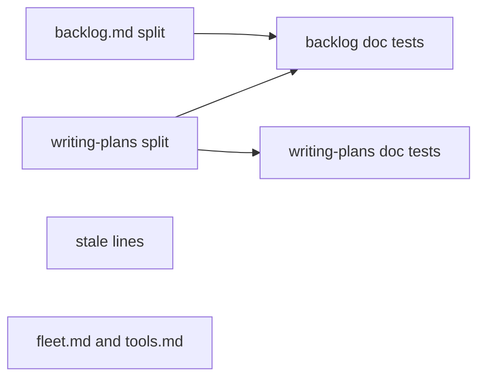
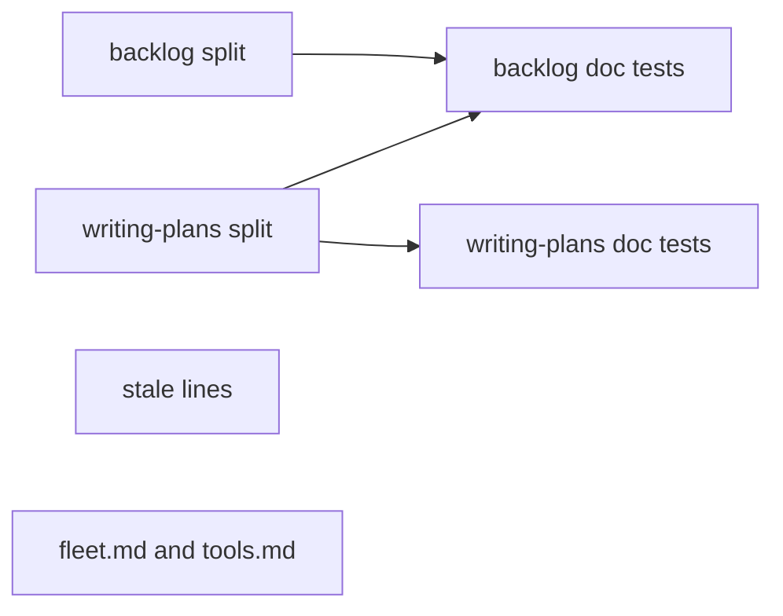

# Superlite: backlog rules split by reader, a smaller plan-writing skill, stale lines fixed (B172, #684)

**Goal:** fix #684 (and #677, folded into it): the backlog rules become one file per reader (main, lead) with a test that no rule sentence is lost; the plan-writing skill keeps a core under 12 KB and loads its task template, probe plan and split parts from side files; the stale lines the issue names say what the code does; docs/tools.md and fleet.md gain the lines the issue and its comments ask for.
**Architecture:** Markdown texts only, plus tests. `skills/subagent-driven-development/backlog.md` stays the lead's file (the path `backlog_run.py` already passes into every lead brief), and main's rules move verbatim into the new `backlog-main.md`. `skills/writing-plans/SKILL.md` keeps its core; whole sections move verbatim into `task-template.md`, `probe-plan.md`, `split.md`, and the human-orchestrator steps into the existing `review-plan.md`. A sentence-set test per split compares a frozen fixture of the pre-split sentences with the union of the new files.
**Tech stack:** Markdown docs; Python 3.10+ stdlib tests under pytest (through `sl run_tests`).
**Spec:** this file, section Design; issue #684 with its three owner comments; issue #677.
**Detail:** tests
**Target-min:** 11
**Wave0:** none
**Worktree:** none
**Coverage:** off
**Max chars:** 22000
**Read first:** .superlite/briefs/standing.md

Global constraints:
- Public repository: no host names, user names, home paths, other project or repository names, ticket keys or account names in any file or commit message.
- Never change the machine's gate config or ~/.superlite/machine.json; tests use private temp homes and state dirs.
- No real app builds; this repository's test suite is the check. Builds: the verdict is `sl run_tests`; any build of your own goes under .build/ of the worktree, never -derivedDataPath outside the worktree. Simulators: append the UDID of each one you create to .superlite/simulators.txt.
- Moved text moves verbatim: whole lines, same words. A sentence is rewritten only where a task names it.
- `docs/tools.md` is append-only: add new lines at the end of the file; never reorder, rewrite or delete an existing line.
- The SDD `SKILL.md` stays at or under 13300 characters (`tests/scripts/test_docs_683.py`).
- Sentence helper, the same function in both split tests (`rule_sentences(text) -> set[str]`): per line, strip a leading heading, bullet or list-number marker (`^\s*(?:#+\s+|[-*]\s+|\d+[a-z]?\.\s+)`), skip empty lines and `---`, split the rest at `(?<=[.!?])\s+(?=[A-Z`"(*\[])`, collapse whitespace in each part, keep parts of 12 or more characters.

Ruling: lead's file keeps the name backlog.md, main's rules move to backlog-main.md (because `backlog_run.py`, owned by planned batch B175, builds the lead brief's path from backlog.md, and the lead section carries most of the test pins).
Ruling: Permissions goes with the lead file, Limits with main's (Permissions describes the lead's own pane; Limits is main's checkout and setup).
Ruling: the rule-set check is a test with a frozen fixture of the pre-split sentences, one per line (`tests/scripts/fixtures/rules_684/`); a later change that rewrites a rule sentence on purpose edits its fixture line (the test message says so).
Ruling: the "split parts" are the seven write-for-the-split rules plus `## Split by interface` (split.md); the human-orchestrator steps go to review-plan.md, which only human mode reads; together that brings the core under 12 KB with every sentence kept.
Ruling: agents/implementer.md, package-reviewer.md and the fixer files name no MCP server today and get none: `fleet.py` appends the server usage note to those workers' system prompts; the stale sentences are writing-plans (probe part), docs/simulator-limits.md and the `fleet.py` spawn docstring.
Ruling: agents/researcher.md keeps `model: haiku` (docs/fleet.md: fleet off keeps the agent file's haiku) and gains one line naming the fleet pin (sonnet, `fleet_roles.py`).
Ruling: docs/tools.md gets the #677 items as new lines at the end (the brief's append-only rule wins over #677's "clause in the existing row"; a rewritten row conflicts with another batch at the rebase).

## Design

### 1. Backlog rules by reader (#684 Wanted 1, 4; comments 1 and 3)
- `backlog.md` (lead): heading `# Backlog mode: batch leads`, the intro paragraph, one new line `Main's rules are in \`backlog-main.md\`; this file holds the lead's.`, then `## Lead` and `## Permissions` verbatim.
- `backlog-main.md` (main, new): heading `# Backlog mode: main`, the same intro paragraph, one new line `A lead's rules are in \`backlog.md\`; this file holds main's.`, then `## Main` (items 1-8) and `## Limits` verbatim. Item 5 gains one sentence: to compare run configs per batch, `"$SL" experiment set --id ID --arms A,B` before the round, `start` gives each batch its arm (`experiment next --batch B`), `"$SL" experiment report ID` compares them after.
- `commands/backlog.md` names only `backlog-main.md` ("Main's rules live in `skills/subagent-driven-development/backlog-main.md`; read it once."), and gains: run each `step B: main runs this: <command>` line's command before `"$SL" backlog start`, after checking that the issue's own author or the user's decision asks for it (a `Max runs this:` one goes to the user; never a destructive one without the user's yes); an answers file may carry `"steps": {"<question>": {"runs": "main"|"user", "command": C, "why": W}}` for a step its answer needs; the experiment sentence in the loop step.
- The lead brief (`backlog_brief.py`) already names only backlog.md: unchanged.
- Existing tests that pin Main or Limits sentences in backlog.md read backlog-main.md (or both files).

### 2. Plan-writing skill core and side files (#684 Wanted 2)
- `skills/writing-plans/task-template.md`: the whole `## Task template` section. `probe-plan.md`: the whole `## Review Focus: the probe plan` section. `split.md`: the seven numbered write-for-the-split rules (`## Write for the split`) and the whole `## Split by interface` section, each list with its own numbers.
- `review-plan.md` gains a first section `## Human orchestrator: the two phases` holding the five human-mode steps verbatim.
- SKILL.md keeps the rest and adds one pointer line each, saying when to read: `split.md` before ordering the tasks, `task-template.md` before the first task block, `probe-plan.md` before the Review Focus and Running-app checks sections, `review-plan.md` first in human mode.
- Stale fixes inside the moved text: "Follow all six rules" names seven and `split.md`; the After-writing link `(see "Who decides sets the mode")` names the real heading "Who orchestrates sets the mode"; the probe part's MCP sentence (Section 3).
- SKILL.md under 12000 bytes, checked by a test.

### 3. Stale lines (#684 Wanted 3)
- Reuse cap: SDD `SKILL.md` says `dispatch` never offers an agent past 3 tasks; `config/routing.json` sets `max_tasks` 20 (`max_context_k` 60 haiku, 80 sonnet; `max_idle_min` 50). The line names the routing.json limits; `fixing.md` owner reuse follows the same `max_tasks`.
- MCP: fleet workers start with no MCP server (`--strict-mcp-config`), except an implementer, fixer or package-reviewer of a project that needs one: the servers its test-cmd.json `"mcp"` list names, else `xcode` (`xcrun mcpbridge`; `XcodeOpenWorkspace` and `XcodeCloseWorkspace` denied) for a Swift or Xcode project on macOS; each server is checked before the start (a macOS GUI session; `SUPERLITE_MCP_CHECK=0` skips the check) and a usage note goes into the worker's system prompt (`fleet_mcp.py`, `mcp_check.py`, `fleet.py`). Fixed in writing-plans' probe part, docs/simulator-limits.md, the `fleet.py` spawn docstring, and named in fleet.md.
- agents/researcher.md: one line naming the fleet pin (sonnet, low) next to the file's haiku for fleet off.
- metrics.md and orchestrator.md: one opening line each naming their reader: a reference for maintainers and the docs; no brief, command or worker loads it.

### 4. fleet.md and docs/tools.md lines (#684 comment 1 and 2, #677)
- fleet.md: `fleet wait --timeout 0` waits without a limit and runs only as a background command (a foreground call ends at the 600000 ms Bash limit); one wait covers one run's state dir (it waits for the busy workers of the `fleet.json` that `--plan` resolves, so a lead's workers and main's are waited for apart); the restore paragraph's `re-arm:` lines are `fleet wait --wave ...` while a worker is busy and `backlog run` (main's re-arm) while leads exist; the MCP fact of Section 3; the last line names both rule files by reader.
- docs/tools.md, new lines at the end: the test-command default and the `--only` expansion; the per-tree stamp hit line; test-cmd.json `"not_code"`; the ship lock `TREE:` lines; the Swift prime `Verdict` line; the backlog status `machine:` disk line; `sl orchestrator end` removes `<state folder>/scratch/` and appends `; scratch folder removed`; the backlog rules by reader.

## File structure

- `skills/subagent-driven-development/backlog.md`: the lead's backlog rules.
- `skills/subagent-driven-development/backlog-main.md`: main's backlog rules (new).
- `commands/backlog.md`: main's command; names backlog-main.md.
- `skills/writing-plans/SKILL.md`: the plan-writing core. `task-template.md`, `probe-plan.md`, `split.md`: side files (new). `review-plan.md`: human-mode template and steps.
- `skills/subagent-driven-development/SKILL.md`, `fixing.md`, `metrics.md`, `orchestrator.md`, `fleet.md`, `agents/researcher.md`, `docs/simulator-limits.md`, `docs/tools.md`, `skills/subagent-driven-development/scripts/fleet.py` (docstring): stale and new lines.
- `tests/scripts/test_backlog_rules_split_684.py`, `tests/scripts/test_writing_plans_split_684.py`, `tests/scripts/test_docs_684_stale.py`, `tests/scripts/test_docs_684_tools.py` (new) and `tests/scripts/fixtures/rules_684/backlog.txt`, `writing_plans.txt` (new).

## Task graph

```mermaid
%% schedule
gantt
  title Predicted schedule (mm:ss)
  dateFormat X
  axisFormat %M:%S
  section lane 1
  T3 writing-plans core and side files :t3, 0, 237s
  T2 backlog doc tests follow the split :t2, 237, 183s
  section lane 2
  T1 backlog rules by reader :t1, 0, 235s
  T4 writing-plans doc tests follow the sp :t4, 237, 182s
  section lane 3
  T6 fleet.md and docs/tools.md lines :t6, 0, 224s
  section lane 4
  T5 stale lines :t5, 0, 180s
```

critical path: T3 → T2 (7.0 min) · peak width 4 · predicted build 7.0 min · predicted total ≈ 15.5 min (target ✗ 11.0)

## Package: texts

**Probe entry:** none (Markdown texts; named tests cover them)

### T1 backlog rules by reader · Complexity 3 · Est. context 45k
**Owns:** skills/subagent-driven-development/backlog.md, skills/subagent-driven-development/backlog-main.md, commands/backlog.md, tests/scripts/test_backlog_rules_split_684.py, tests/scripts/fixtures/rules_684/backlog.txt
**Components:** 2
**LOC owned:** 140
**Tests:** fast
**Model:** sonnet
**Covers:** 1
**Review Focus:** `test_no_backlog_rule_lost`: every line of the fixture is in `rule_sentences(backlog.md + backlog-main.md)`; the failure names up to 5 lost sentences and says to edit the fixture line when a rewrite is on purpose; `test_each_reader_has_its_section`: backlog.md holds `## Lead` and `## Permissions`, no `## Main`; backlog-main.md holds `## Main` and `## Limits`, no `## Lead`; `test_command_names_only_main_file`: commands/backlog.md holds `backlog-main.md` and not `subagent-driven-development/backlog.md`; `test_command_steps_and_experiment`: commands/backlog.md holds `step B:`, `"steps"`, `experiment set`, `experiment next` and `experiment report`; backlog-main.md holds `experiment report`.
**Test code:** named tests above, in pytest; the fixture is `sorted(rule_sentences(text))` of `git show 5821bb77:skills/subagent-driven-development/backlog.md`, one per line, written once by the task (the test reads only the fixture, never git).
**Steps:** 1 failing tests, 2 run: FAIL, 3 split the file per Design 1, 4 run: PASS
**Notes:** Split per Design 1, whole lines moved. Before DONE run `sl run_tests --fast` over the tests listed in T2's Owns and report which fail; do not edit them.

### T3 writing-plans core and side files · Complexity 3 · Est. context 50k
**Owns:** skills/writing-plans/SKILL.md, skills/writing-plans/task-template.md, skills/writing-plans/probe-plan.md, skills/writing-plans/split.md, skills/writing-plans/review-plan.md, docs/simulator-limits.md, tests/scripts/test_writing_plans_split_684.py, tests/scripts/fixtures/rules_684/writing_plans.txt
**Components:** 2
**LOC owned:** 150
**Tests:** fast
**Model:** sonnet
**Covers:** 2, 3
**Review Focus:** `test_no_plan_rule_lost`: every fixture line is in `rule_sentences` of SKILL.md + the three side files + review-plan.md; `test_core_under_12_kb`: SKILL.md is under 12000 bytes; `test_core_names_each_side_file`: SKILL.md names `task-template.md`, `probe-plan.md`, `split.md` and `review-plan.md`; `test_side_files_hold_their_parts`: task-template.md holds `| \`Owns\` |`, probe-plan.md holds `| App type | Generic categories |`, split.md holds `**Interface stubs in Wave 0.**` and `**Contract examples.**`, review-plan.md holds `orchestrator approve --review`; `test_mcp_sentence_says_what_code_does`: no `fleet workers start without` in skills/writing-plans/*.md or docs/simulator-limits.md, and probe-plan.md names `implementer, fixer or package-reviewer` and `xcode`.
**Test code:** named tests above, in pytest; fixture as in T1, from `git show 5821bb77:skills/writing-plans/SKILL.md`; fixture lines change only for the sentences Design 2 and 3 rewrite (six rules, the "Who decides" link, the MCP sentence), each named in the test docstring.
**Steps:** 1 failing tests, 2 run: FAIL, 3 move the sections per Design 2 and fix the stale sentences, 4 run: PASS
**Notes:** Side files start with a `# ` heading line and one sentence on when to read them; no frontmatter. Moved sections keep their `##` headings. docs/simulator-limits.md:34: replace the clause "and fleet workers start without MCP servers" with what Design 3 says for a fleet worker. Before DONE run `sl run_tests --fast` over the tests in T4's Owns and in T2's Owns and report which fail; do not edit them.

### T2 backlog doc tests follow the split · Complexity 2 · Est. context 40k
**Owns:** tests/scripts/test_backlog_command_590.py, tests/scripts/test_backlog_decide_fit.py, tests/scripts/test_backlog_docs.py, tests/scripts/test_backlog_docs_369_370.py, tests/scripts/test_backlog_docs_469_488.py, tests/scripts/test_backlog_docs_581.py, tests/scripts/test_backlog_docs_590.py, tests/scripts/test_backlog_docs_602.py, tests/scripts/test_backlog_docs_674.py, tests/scripts/test_backlog_docs_b86.py, tests/scripts/test_backlog_docs_b89.py, tests/scripts/test_backlog_docs_b90.py, tests/scripts/test_backlog_main_docs.py, tests/scripts/test_backlog_start_arms_673.py, tests/scripts/test_docs_552_reap.py, tests/scripts/test_docs_607_backlog.py, tests/scripts/test_docs_672.py, tests/scripts/test_docs_683.py, tests/scripts/test_docs_b26.py, tests/scripts/test_docs_b72_backlog.py, tests/scripts/test_docs_b95_prompts.py, tests/scripts/test_docs_backlog_run_673.py, tests/scripts/test_run_state_docs_b19.py
**Components:** 1
**LOC owned:** 80
**Tests:** fast
**Model:** sonnet
**Covers:** 1
**Review Focus:** each pinned string keeps its assertion; only the file it is read from changes: a Main or Limits string from backlog-main.md, a Lead or Permissions string from backlog.md, a whole-file check from both files joined; a writing-plans pin in test_docs_b26.py or test_docs_b95_prompts.py reads SKILL.md plus the side file that now holds it.
**Test code:** the listed files themselves; no assertion dropped or weakened.
**Steps:** 1 run the listed tests: FAIL where a pin moved, 2 point each read at the file holding the text, 3 run: PASS
**Notes:** Prefer one module constant per file (`MAIN = ... / "backlog-main.md"`) next to the existing one.

### T4 writing-plans doc tests follow the split · Complexity 2 · Est. context 40k
**Owns:** tests/scripts/test_docs_475_task_cmd.py, tests/scripts/test_docs_b72_skills.py, tests/scripts/test_docs_b93_writing_plans.py, tests/scripts/test_docs_checker_600.py, tests/scripts/test_docs_contract.py, tests/scripts/test_mvp_plan_docs_b19.py, tests/scripts/test_orchestrator.py, tests/scripts/test_task_constraints_285.py, tests/scripts/test_docs_607_agents.py, tests/scripts/test_coverage_docs.py, tests/scripts/test_docs_review_red_606.py, tests/scripts/test_isolation_wording.py, tests/scripts/test_agent_mcp_tools.py, tests/scripts/test_docs_601_launch.py
**Components:** 1
**LOC owned:** 70
**Tests:** fast
**Model:** sonnet
**Covers:** 2
**Review Focus:** each pinned string keeps its assertion and reads the file that now holds it (SKILL.md, a side file, or all of `skills/writing-plans/*.md` joined); test_docs_checker_600.py's two MCP pins assert the new sentences of Design 3 instead of the stale ones.
**Test code:** the listed files themselves; no assertion dropped or weakened.
**Steps:** 1 run the listed tests: FAIL where a pin moved, 2 point each read at the file holding the text, 3 run: PASS

### T5 stale lines · Complexity 2 · Est. context 40k
**Owns:** skills/subagent-driven-development/SKILL.md, skills/subagent-driven-development/fixing.md, skills/subagent-driven-development/metrics.md, skills/subagent-driven-development/orchestrator.md, agents/researcher.md, skills/subagent-driven-development/scripts/fleet.py, tests/scripts/test_docs_684_stale.py
**Components:** 1
**LOC owned:** 60
**Tests:** fast
**Model:** sonnet
**Covers:** 3
**Review Focus:** `test_reuse_cap_from_routing`: SDD SKILL.md has no `past 3 tasks` and names `routing.json` and `20`; fixing.md has no `<=3 tasks`; `test_skill_md_cap`: SDD SKILL.md is at most 13300 characters; `test_researcher_names_fleet_pin`: agents/researcher.md frontmatter `model: haiku` and its body names `sonnet`; `test_reference_files_name_reader`: the second non-empty line of metrics.md and of orchestrator.md says no brief, command or worker loads the file.
**Test code:** named tests above, in pytest.
**Steps:** 1 failing tests, 2 run: FAIL, 3 fix the lines per Design 3, 4 run: PASS
**Notes:** fleet.py: rewrite only the spawn docstring sentence "Every worker starts lean (#377): no MCP servers..." to Design 3's MCP fact; no code change. Then run `sl run_tests --fast` over tests that read these files (`grep -l` them) and fix a pin this task broke only inside its Owns; report any other.

### T6 fleet.md and docs/tools.md lines · Complexity 3 · Est. context 50k
**Owns:** skills/subagent-driven-development/fleet.md, docs/tools.md, tests/scripts/test_docs_684_tools.py
**Components:** 2
**LOC owned:** 70
**Tests:** fast
**Model:** sonnet
**Covers:** 4, 3
**Review Focus:** `test_fleet_md_background_wait`: fleet.md holds `fleet wait --timeout 0`, `background command` in that paragraph and `one run's state dir`; `test_fleet_md_rearm_backlog_run`: the restore paragraph holds `backlog run` and no `backlog wait`; `test_fleet_md_mcp_fact`: fleet.md holds `--strict-mcp-config`, `implementer, fixer or package-reviewer` and `xcrun mcpbridge`; `test_fleet_md_rule_files`: fleet.md's last line names `backlog-main.md` and `backlog.md`; `test_tools_md_677_lines`: docs/tools.md holds `not_code`, `TREE: unchanged by the sync`, `Verdict:`, `no run` (the stamp hit line), `--only`, `machine: <free` (or the exact disk form the code prints), `scratch folder removed`, `backlog-main.md`. The diff of docs/tools.md against 5821bb77 adds lines only (`git diff --numstat` shows 0 deleted); say so in the report.
**Test code:** named tests above, in pytest.
**Steps:** 1 failing tests, 2 run: FAIL, 3 add the lines per Design 4, 4 run: PASS
**Notes:** Code facts, check each in the code before writing: `fleet_io.py` (wait, timeout 0 at :948, stderr note :1002), `fleet_restore.py:257-278` (re-arm lines), `fleet_mcp.py:19-56`, `mcp_check.py`, `testcmd.py:16-17, 907-913, 1272-1273`, `run_tests.py:1292-1293`, `suite_stamp.py:93`, `backlog_ship.py:206-213`, `build_prime.py:273-274`, `backlog.py:931-937`, `orchestrator.py:154-169`; for item 1 read `git show` of the 1.5.166 commit (`git log --oneline | grep 1.5.166`). Add a fact only when the doc does not say it yet (grep first). Then run `sl run_tests --fast` over the tests that read fleet.md or docs/tools.md (`grep -l`) and report any that fail.

## Review Focus

Package texts: app type file I/O / generator (Markdown), categories file and encoding: verbatim moves (no sentence lost, no line rewrapped), UTF-8 text with `->` and `≤` intact, no broken relative links (`../brainstorming/coverage.md`, `../subagent-driven-development/fleet.md` from the side files), each pointer says when to read its file.

## Self-review

Coverage: Wanted 1 (T1, T2), 2 (T3, T4), 3 (T3, T5, T6), 4 (notes, measured by the lead), #677 and comments (T1, T6). No placeholders. No two tasks that can run at once share a file: T2 and T4 own disjoint test lists; T1 and T3 run the other's tests read-only. Edges are execution dependencies: T2's tests read T1's and T3's files, T4's read T3's.
