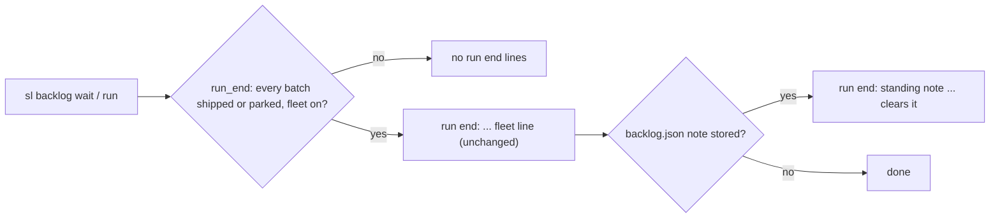
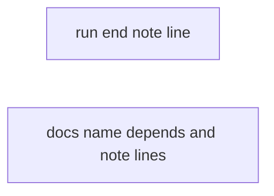

# Superlite: standing note at the run end, depends lines in main's docs (B205)

**Goal:** fix #777: the `run end:` output of `backlog wait` names a stored standing note and the command that clears it, and main's docs tell main to clear or keep it on purpose; fix #773: `commands/backlog.md` names plan's `depends:` repair lines and status's `B waits for D: <reason>` line.
**Architecture:** `backlog_run.run_end(root, sd, p)` appends one more `run end:` line when backlog.json holds a note (`backlog_state.note_line(data)` is not None); prose in `commands/backlog.md`, `skills/subagent-driven-development/backlog-main.md` and `docs/tools.md`.
**Tech stack:** Python 3.10+ stdlib; pytest through `sl run_tests`; Markdown prompts.
**Spec:** this file, section Design; issues #773, #777.
**Detail:** contracts
**Target-min:** 11
**Wave0:** none
**Coverage:** off

Global constraints:
- Existing tests stay green. An existing test file changes only when the task Owns it. If another existing test turns red, report it in DONE_WITH_CONCERNS with the test id and the reason instead of editing it.
- Run `sl` as an executable (`<abs>/sl ...`). Verify with `<abs>/sl run_tests --fast <own test files> --task Tn --background`, then run the printed `wait:` line in the foreground and end the turn only after it reports.
- No version edits (the ship step bumps the version). Never run `scripts/evals.sh`, `claude plugin eval` or `scripts/test_layers.py run`.
- The exact output line in Design 1 is the contract: code prints it byte for byte, docs quote it byte for byte (with `<file>`, `<time>`, `<n> lines` as placeholders).
- Code style as in backlog_run.py: a `# O(...)` complexity comment on each new line.
- Builds: the verdict is `sl run_tests`; task trees build in <tree>/.build/DerivedData and any build of your own goes under .build/ of the worktree, never -derivedDataPath outside the worktree; a product, simulator or device build stays on this machine and runs only when an issue's acceptance asks for a running-app check.
- Simulators: append the UDID of each simulator you create (`xcrun simctl create` or `clone`) as one line to /Users/max/github/superlite/.claude/worktrees/superlite-b205-backlog-note-and-docs/.superlite/simulators.txt; never list one you did not create.

Ruling: Max's decision (#777): the run end names the stored note and the command that clears it; the note does not expire with the plan round.
Ruling: the clear command is `sl backlog start --note /dev/null` (read_note reads it as empty, set_note drops the note, and at the run end start finds no planned batch); a dedicated clear flag would need backlog.py, which B207 owns (because the existing path already clears; cost if wrong: a follow-up adds a flag and the line's text changes).
Ruling: the note line is a second `run end:` line after the existing one, in every branch that prints a run end line (fleet off, live workers, failed off), so the existing line and its tests stay byte for byte (because main reads lines; cost if wrong: one more line per run end).
Ruling: backlog-main.md and docs/tools.md are edited too (no open batch lists them), so main's rules and the tools row name the new line; named in notes.md.
Ruling: no taskgraph edge: T2 quotes the Design 1 line, which is the contract; already in the lead worktree, no `sl worktree ensure`; no probe adapter (prose and one fleet-side-effect function, covered by named tests).
LAYERS: unit, headless, evals

```mermaid
%% schedule
gantt
  title Predicted schedule (mm:ss)
  dateFormat X
  axisFormat %M:%S
  section lane 1
  T1 run end names the standing note :t1, 0, 275s
  section lane 2
  T2 docs name depends lines and the note :t2, 0, 270s
```

critical path: T1 (4.6 min) · peak width 2 · predicted build 4.6 min · predicted total ≈ 15.1 min (target ✗ 11.0)

## Design

### 1. The note line
`run_end` loads backlog.json once (it already does for the batches). When it would return a run end line (any of its three branches: live workers, fleet off, `sl fleet off failed`), and `backlog_state.note_line(data)` is not None, it returns that line plus:

`run end: standing note from <file> (<time>, <n> lines) still goes into every later lead brief; sl backlog start --note /dev/null clears it`

`<file>` and `<time>` are the note's `file` and `time` fields (`str()`; each control character `[\x00-\x1f\x7f]` becomes a space); `<n>` is the note text's line count, `1 line` for one. No note, an empty note text or no run end line: the output is exactly what it is today.

### 2. Docs
- `commands/backlog.md` step 2: after `plan --add` prints only the batches it added., one sentence: plan keeps a dependency only where the batches share a file or the triage gave a reason; a dropped one prints `depends: B no longer waits for D: no shared file and no reason`, an order only dropped ones held prints `depends: B waits for D: <reason> (the order the dropped dependencies held)`; `status` shows each held batch's `B waits for D: <reason>` line and `start` refuses with it.
- `commands/backlog.md` step 4: the `--note` sentence adds that the note outlives the run until cleared (step 8).
- `commands/backlog.md` step 5: after the two run end lines, one sentence: a stored standing note adds the Design 1 line.
- `commands/backlog.md` step 8: at the run end decide the standing note on purpose: run `"$SL" backlog start --note /dev/null` unless the next plan round needs it, and name the choice (cleared, or kept and why) in the closing report.
- `skills/subagent-driven-development/backlog-main.md`: step 5's run end sentence adds the Design 1 line and the same clear-or-keep rule; the `--note` sentence adds that the note outlives the run until cleared.
- `docs/tools.md` `backlog_run` row: the `run end:` clause adds that a stored note adds a `run end: standing note ...` line naming `sl backlog start --note /dev/null`.

## Package: backlog_run

**Probe entry:** none (fleet side effects; the Review Focus cases are named tests in T1)
App type: CLI. Categories: state, file. Risks: changing the existing run end line, a note line without a run end, a stale note record without file or time.

### T1 run end names the standing note · Complexity 2 · Est. context 35k
**Owns:** skills/subagent-driven-development/scripts/backlog_run.py, tests/scripts/test_backlog_run_end_note_777.py
**Components:** 1
**LOC owned:** 90
**Tests:** fast
**Model:** sonnet
**Est. time:** 2.5 min (1 component, about 90 LOC, fast tests)
**Produces:** backlog_run.run_end(root: Path, sd: Path, p: Path) -> list[str] (unchanged signature; e.g. a stored note after a fleet off -> ["run end: every batch shipped or parked; fleet off (stopped workers cleared: 1)", "run end: standing note from /x/note.md (2026-11-14T10:00:00Z, 2 lines) still goes into every later lead brief; sl backlog start --note /dev/null clears it"])
**Review Focus:** state: the existing run end line is unchanged; no note line without a run end line; the note line follows every branch; a note record missing `file` or `time` still prints one line.
**Test code:** `tests/scripts/test_backlog_run_end_note_777.py` reuses the `rk` fixture shape of `tests/scripts/test_backlog_run_end_590.py` (fakes for `fleet` and `fleet_state` in `sys.modules`, `delenv SUPERLITE_FLEET_WORKER`); a note is stored with `bs.update(p, lambda d: d.update(note={"text": T, "file": F, "time": "2026-11-14T10:00:00Z"}))`. NOTE(F, n) = `f"run end: standing note from {F} (2026-11-14T10:00:00Z, {n}) still goes into every later lead brief; sl backlog start --note /dev/null clears it"`. Named tests:
- `test_note_follows_fleet_off`: B1 shipped, W1 stopped, note text `a\nb`, file `/x/note.md` -> `[HEAD + "fleet off (stopped workers cleared: 1)", NOTE("/x/note.md", "2 lines")]`.
- `test_note_follows_live_workers`: W2 busy, note text `only` -> `[HEAD + "live workers W2 still run: sl fleet off stops and clears them", NOTE("/x/note.md", "1 line")]`.
- `test_note_follows_failed_off`: fleet.main returns 3 -> `[HEAD + "sl fleet off failed (3): run it again", NOTE(...)]`.
- `test_no_note_keeps_one_line`: no note key, and a note with text `""` -> exactly `[HEAD + "fleet off (stopped workers cleared: 1)"]`.
- `test_no_run_end_no_note_line`: a planned batch next to a shipped one, note stored -> `[]`; fleet off, note stored -> `[]`.
- `test_control_characters_become_spaces`: file `"/x/a\nb.md"` -> the line contains `standing note from /x/a b.md (`.
- `test_dev_null_clears_the_note` (skip on `os.name == "nt"`): `bs.read_note("/dev/null") == ""`; `bs.set_note(d, "", "/dev/null", now)` drops `note`; run_end then returns the one fleet line.
- `test_wait_prints_the_note_line`: as `test_wait_appends_the_run_end_line` in test_backlog_run_end_590.py, with a note stored: the output's last two lines are the run end line and NOTE(...).
**Steps:** 1 failing tests, 2 run: FAIL, 3 implement, 4 run: PASS, 5 run test_backlog_run_end_590.py and test_backlog_run.py once: still green.
**Notes:** one helper in backlog_run.py builds the note line from `data`; use `bs.note_line(data)` as the stored-note check. Add one sentence to backlog_run.py's module docstring (#777).

## Package: backlog docs

**Probe entry:** none (prose)
App type: docs. Risks: a quoted line that differs from Design 1 or from plan's real `depends:` output; breaking existing doc tests that read these files (grep tests/scripts for `commands/backlog.md`, `backlog-main.md`, `tools.md`).

### T2 docs name depends lines and the note line · Complexity 2 · Est. context 40k
**Owns:** commands/backlog.md, skills/subagent-driven-development/backlog-main.md, docs/tools.md, tests/scripts/test_backlog_docs_773_777.py
**Components:** 1
**LOC owned:** 50
**Tests:** fast
**Model:** sonnet
**Est. time:** 3 min (1 component, about 50 LOC, fast tests)
**Review Focus:** every quoted line equals Design 1 or the `depends:` lines in backlog-main.md step 2; existing sentences stay unless Design 2 extends them.
**Test code:** `tests/scripts/test_backlog_docs_773_777.py`, NOTE = `run end: standing note from <file> (<time>, <n> lines) still goes into every later lead brief; sl backlog start --note /dev/null clears it`; a step is the line of commands/backlog.md that starts `N. `. Named tests:
- `test_command_step2_names_depends_lines`: step 2 contains `depends: B no longer waits for D: no shared file and no reason`, `depends: B waits for D: <reason> (the order the dropped dependencies held)` and `B waits for D: <reason>`.
- `test_command_step5_names_note_line`: step 5 contains NOTE.
- `test_command_step8_clears_or_keeps_note`: step 8 contains `"$SL" backlog start --note /dev/null`, `standing note` and `closing report`.
- `test_command_step4_note_outlives_run`: step 4 contains `--note FILE` and `step 8`.
- `test_main_rules_name_note_line`: backlog-main.md contains NOTE and `--note /dev/null`.
- `test_tools_row_names_note_line`: docs/tools.md's `| \`backlog_run\` |` row contains `run end: standing note` and `--note /dev/null`.
**Steps:** 1 failing tests, 2 run: FAIL, 3 edit, 4 run: PASS plus the existing doc tests that read these three files.
**Notes:** Design 2 lists each edit; keep each change to its sentence, no rewording elsewhere.

## Self-review
- Coverage: #777 (T1 code, T2 steps 4, 5, 8, backlog-main.md, tools.md); #773 (T2 step 2).
- No placeholders; T1 and T2 share no file.
