# Superlite: `backlog plan --issues N` reads a pinned issue the open-issue list misses by number (B207, #776)

**Goal:** fix #776: `sl backlog plan --issues N [--add]` right after `gh issue create` answers `BLOCKED: GitHub issue #N not found among the open issues` for up to a minute, because the paginated open-issue listing lags the create. Plan must read a pinned number the list misses directly by number before it gives up, and a pin that is still missing must be named on stdout next to the batch table, so a chained call cannot hide it.
**Architecture:** a new `backlog.read_issue(n)` reads one issue through `gh api repos/{owner}/{repo}/issues/N --jq ISSUE_JQ` (the REST object, same shape as the listing plus `state` and a pull-request flag). `pinned_issues(issues, nums, missing=None)` calls it for each pinned number absent from the list. `cmd_plan`'s GitHub branch passes a `missing` list. If every pin is missing it prints `BLOCKED` with the first reason (exit 3). Otherwise it adds one `not found:` note line per miss, which the existing final print puts on stdout after the batch rows, and narrows `pin` to the found issues, as the Jira path does since B125.
**Tech stack:** Python 3.10+ stdlib, pytest (through `sl run_tests`).
**Spec:** this file, section Design; issue #776.
**Detail:** tests
**Target-min:** 11
**Wave0:** none
**Worktree:** none
**Coverage:** off

Global constraints:
- Every script line keeps the repo's `# O(...)` complexity comment; stdlib only; LF endings.
- Tests fake `bl._gh` (the `bk` fixture of tests/scripts/test_backlog_cli.py, or a monkeypatched replacement); no test calls the real gh or acli.
- This repository is public: no host names, user names, home paths, other project or repository names in code, tests, docs or commit messages.
- Builds: the verdict is `sl run_tests` (the project's test command; a project with `.maxapp` runs `maxapp test`, which a build pool may place on another Mac, and a full run whose tree a green maxapp test stamp covers returns that result without a run); task trees build in <tree>/.build/DerivedData and any build of your own goes under .build/ of the worktree, never -derivedDataPath outside the worktree (your session scratchpad included; backlog cleanup removes scratchpad build folders when the worktree goes); a product, simulator or device build stays on this machine and runs only when an issue's acceptance asks for a running-app check.
- Simulators: append the UDID of each simulator you or a worker creates (`xcrun simctl create` or `clone`; a checker's `Simulators:` line marks its created ones) as one line to /Users/max/github/superlite/.claude/worktrees/superlite-b207-backlog-plan-pin-lag/.superlite/simulators.txt; never list one you did not create; ship cleanup shuts down and deletes each listed one.

## Design

The listing is `gh api --paginate repos/{owner}/{repo}/issues?state=open` (ISSUES_JQ). A pinned number it does not hold is read by number:
- open issue, not a pull request: planned like a listed one (the public-repo trust check on `authorAssociation` still applies).
- closed: missing, reason `closed`. A pull request: missing, reason `a pull request`. An answer that is not an object holding that number: missing, reason `no issue in the answer`. A gh failure (404, network): missing, reason = the text after ` failed: ` in the `_gh` error, whitespace collapsed, cut to 120 characters, `gh failed` when empty.
- some pins missing: one line each, `not found: #N (not in the open-issue list; read by number: <reason>)`. After a gh failure it ends with `; sl backlog plan --issues N --add retries it`; a closed issue or a pull request gets no retry hint. The lines go into `notes`, so a plain plan prints them after the status rows and `--add` after the added rows, both on stdout. The plan goes on with the found pins.
- every pin missing: `BLOCKED: GitHub issue #N not found among the open issues nor read by number (<reason>)` for the first missing pin, exit 3, backlog.json unchanged.
- a pin the list holds triggers no read by number.

Ruling: read once by number, no 60 s sleep-retry. The REST read by number does not lag the listing, while a retry loop would delay every real miss and make tests depend on timing (lead's ruling).
Ruling: `gh api repos/{owner}/{repo}/issues/N`, not `gh issue view N`. The REST object carries `author_association`, which the public-repo trust check needs, in the listing's own shape (lead's ruling).
Ruling: a partial miss plans the found pins and names the rest, and only an all-miss blocks. This mirrors the Jira `not found:` path (B125) (lead's ruling).

## Task graph

```mermaid
%% schedule
gantt
  title Predicted schedule (mm:ss)
  dateFormat X
  axisFormat %M:%S
  section lane 1
  T1 Pinned issue read by number :t1, 0, 372s
```




critical path: T1 (6.2 min) · peak width 1 · predicted build 6.2 min · predicted total ≈ 18.7 min (target ✗ 11.0)

## Package: backlog plan intake

App type: CLI. Categories: protocol (gh REST answers), state (pin narrowing).
**Probe entry:** none (gh is faked; the named tests cover each answer shape)

### T1 Pinned issue read by number · Complexity 2 · Est. context 30k
**Owns:** skills/subagent-driven-development/scripts/backlog.py, tests/scripts/test_backlog_plan_pin_433.py
**Components:** 1
**LOC owned:** 140
**Tests:** fast
**Model:** sonnet
**Covers:** Design
**Produces:** backlog.ISSUE_JQ: str · backlog.read_issue(n: int) -> tuple[dict | None, str | None] · backlog.pinned_issues(issues: list, nums: list, missing: list | None = None) -> list
e.g. read_issue(4) with gh answering {"number": 4, ..., "state": "open", "pull": false} -> ({"number": 4, "title": "Four", "body": "body 4", "author": {"login": "max"}, "authorAssociation": "OWNER"}, None)
e.g. read_issue(8) closed -> (None, "closed"); gh failing "gh api repos/{owner}/{repo}/issues/9 failed: gh: Not Found (HTTP 404)" -> (None, "gh: Not Found (HTTP 404)")
e.g. pinned_issues(ISSUES, [2, 9, 1], gone) -> [issue 2, issue 1], gone == [(9, "closed")] when read_issue(9) gives (None, "closed")
**Review Focus:** the tests below; every other test in tests/scripts/test_backlog_plan_pin_433.py, test_backlog_cli.py and test_backlog_plan_add_505.py stays green unchanged.
**Test code (verbatim):** replace `test_issues_number_not_open_is_blocked` in tests/scripts/test_backlog_plan_pin_433.py with the tests below. Add `import re` and `ISSUES` to the existing imports (`from test_backlog_cli import ISSUES, bk, briefed, cli, load, BATCH, bl, bs  # noqa: F401`), and put the helpers below the existing `no_acli` fixture.
```python
DIRECT = re.compile(r"repos/\{owner\}/\{repo\}/issues/(\d+)")
GONE = "gh: Not Found (HTTP 404)"


def rest(n, title, assoc="OWNER", state="open", pull=False, login="max"):
    """One issue as ISSUE_JQ shapes the REST answer of issues/N (#776)."""
    return {"number": n, "title": title, "body": f"body {n}", "author": {"login": login}, "authorAssociation": assoc,
            "state": state, "pull": pull}


def lagging(bk, monkeypatch, read):
    """gh whose open-issue list holds only ISSUES (1 to 3); issues/N answers from read, any other number is a 404 (#776)."""
    def gh(args):
        bk.gh.append(args)
        if args[:2] == ["repo", "view"]:
            return {"nameWithOwner": "o/r", "visibility": bk.vis}
        m = DIRECT.fullmatch(args[1]) if args[0] == "api" and len(args) > 1 else None
        if m:
            n = int(m.group(1))
            if n not in read:
                raise RuntimeError(f"gh api repos/{{owner}}/{{repo}}/issues/{n} failed: {GONE}")
            return read[n]
        return ISSUES
    monkeypatch.setattr(bl, "_gh", gh)


def direct_reads(bk):
    return [int(DIRECT.fullmatch(a[1]).group(1)) for a in bk.gh if a[0] == "api" and len(a) > 1 and DIRECT.fullmatch(a[1])]


def test_pinned_issue_missing_from_the_list_is_read_by_number_776(bk, capsys, monkeypatch, no_acli):
    lagging(bk, monkeypatch, {4: rest(4, "Four")})
    bk.batches = [{**BATCH, "issues": [4]}]
    rc, out = cli(capsys, "plan", "--issues", "4")
    assert rc == 0 and "B1 | #4 | planned" in out and "not found" not in out
    assert nums(bk) == [4] and "body 4" in brief(bk)
    assert ["api", "repos/{owner}/{repo}/issues/4", "--jq", bl.ISSUE_JQ] in bk.gh
    assert load(bk)["titles"] == {"4": "Four"}


def test_listed_pins_read_nothing_by_number_776(bk, capsys, monkeypatch, no_acli):
    lagging(bk, monkeypatch, {})
    assert cli(capsys, "plan", "--issues", "2,1")[0] == 0
    assert direct_reads(bk) == []


def test_partial_miss_plans_the_rest_and_prints_not_found_on_stdout_776(bk, capsys, monkeypatch, no_acli):
    lagging(bk, monkeypatch, {})
    bk.batches = [{**BATCH, "issues": [1]}]
    rc, out = cli(capsys, "plan", "--issues", "1,9")
    line = f"not found: #9 (not in the open-issue list; read by number: {GONE}); sl backlog plan --issues 9 --add retries it"
    assert rc == 0 and line in out.splitlines()
    assert out.index("B1 | #1 | planned") < out.index(line)
    assert nums(bk) == [1] and [b["issues"] for b in load(bk)["batches"]] == [[1]]
    assert direct_reads(bk) == [9]


def test_every_pin_missing_blocks_with_the_reason_776(bk, capsys, monkeypatch, no_acli):
    lagging(bk, monkeypatch, {})
    assert cli(capsys, "plan", "--issues", "9,8") == (
        3, f"BLOCKED: GitHub issue #9 not found among the open issues nor read by number ({GONE})\n")
    assert load(bk)["batches"] == []


def test_closed_issue_and_pull_request_are_not_found_776(bk, capsys, monkeypatch, no_acli):
    lagging(bk, monkeypatch, {8: rest(8, "Eight", state="closed"), 7: rest(7, "Seven", pull=True)})
    bk.batches = [{**BATCH, "issues": [1]}]
    rc, out = cli(capsys, "plan", "--issues", "1,8,7")
    lines = out.splitlines()
    assert rc == 0 and nums(bk) == [1]
    assert "not found: #8 (not in the open-issue list; read by number: closed)" in lines
    assert "not found: #7 (not in the open-issue list; read by number: a pull request)" in lines


def test_issue_read_by_number_keeps_the_trust_check_776(bk, capsys, monkeypatch, no_acli):
    lagging(bk, monkeypatch, {5: rest(5, "Five", assoc="NONE", login="eve")})
    bk.batches = [{**BATCH, "issues": [1]}]
    assert cli(capsys, "plan", "--issues", "1,5")[0] == 0
    assert nums(bk) == [1] and load(bk)["outside"] == [{"number": 5, "title": "Five", "author": "eve"}]


def test_add_reads_a_fresh_issue_by_number_776(bk, capsys, monkeypatch, no_acli):
    for k in ("SUPERLITE_FLEET_ROLE", "SUPERLITE_FLEET_PARENT_DIR", "SUPERLITE_FLEET_WORKER", "SUPERLITE_STATE_DIR"):
        monkeypatch.delenv(k, raising=False)
    bk.batches = [{**BATCH, "issues": [1]}]
    assert cli(capsys, "plan")[0] == 0
    bs.update(bs.path(bk.root), lambda d: bs.batch(d, "B1").update(state="running"))
    lagging(bk, monkeypatch, {4: rest(4, "Four")})
    bk.batches = [{**BATCH, "topic": "urgent", "issues": [4], "files": ["b.py"]}]
    rc, out = cli(capsys, "plan", "--issues", "4", "--add")
    assert rc == 0 and "B2 | #4 | planned" in out
    assert [b["issues"] for b in load(bk)["batches"]] == [[1], [4]]


def test_pinned_issues_reads_only_missing_numbers_776(monkeypatch):
    reads = []
    monkeypatch.setattr(bl, "read_issue", lambda n: reads.append(n) or (None, "closed"))
    gone = []
    assert bl.pinned_issues(ISSUES, [2, 9, 1], gone) == [ISSUES[1], ISSUES[0]]
    assert reads == [9] and gone == [(9, "closed")]
    with pytest.raises(RuntimeError, match=r"^GitHub issue #9 not found among the open issues nor read by number \(closed\)$"):
        bl.pinned_issues(ISSUES, [9])


def test_read_issue_answer_shapes_776(monkeypatch):
    seen = []
    answers = {4: rest(4, "Four"), 8: rest(8, "Eight", state="closed"), 7: rest(7, "Seven", pull=True),
               6: [rest(6, "Six")], 5: rest(3, "Three")}
    fails = {9: f"failed:   gh: Not Found\n(HTTP 404)", 10: "failed: " + "x" * 300, 11: "failed: "}

    def gh(args):
        seen.append(args)
        n = int(DIRECT.fullmatch(args[1]).group(1))
        if n in fails:
            raise RuntimeError(f"gh api repos/{{owner}}/{{repo}}/issues/{n} {fails[n]}")
        return answers[n]
    monkeypatch.setattr(bl, "_gh", gh)
    assert bl.read_issue(4) == ({"number": 4, "title": "Four", "body": "body 4", "author": {"login": "max"},
                                 "authorAssociation": "OWNER"}, None)
    assert seen[0] == ["api", "repos/{owner}/{repo}/issues/4", "--jq", bl.ISSUE_JQ]
    assert bl.read_issue(8) == (None, "closed")
    assert bl.read_issue(7) == (None, "a pull request")
    assert bl.read_issue(6) == (None, "no issue in the answer")
    assert bl.read_issue(5) == (None, "no issue in the answer")
    assert bl.read_issue(9) == (None, GONE)
    assert bl.read_issue(10) == (None, "x" * 120)
    assert bl.read_issue(11) == (None, "gh failed")


def test_issue_jq_keeps_the_listing_fields_776():
    for field in ("number", "title", "body", "author: {login: .user.login}", "authorAssociation: .author_association"):
        assert field in bl.ISSUES_JQ and field in bl.ISSUE_JQ
    assert "state" in bl.ISSUE_JQ and 'pull: has("pull_request")' in bl.ISSUE_JQ
```
**Steps:** 1 write the failing tests, 2 run: FAIL, 3 implement, 4 run: PASS
**Notes:**
- `ISSUE_JQ = '{number, title, body, author: {login: .user.login}, authorAssociation: .author_association, state, pull: has("pull_request")}'`, placed next to ISSUES_JQ.
- `read_issue(n)`: `_gh(["api", f"repos/{{owner}}/{{repo}}/issues/{n}", "--jq", ISSUE_JQ])` (no `--paginate`, so `_gh` returns one object). On RuntimeError the reason is `" ".join(str(e).split(" failed: ", 1)[-1].split())[:120] or "gh failed"`. An answer that is not a dict, or whose `number` is not `n`, gives `no issue in the answer`. A true `pull` gives `a pull request`. A `state` other than `open` (case-insensitive) gives `closed`. An open issue returns the dict without `state` and `pull`.
- `pinned_issues(issues, nums, missing=None)`: `by` from the list; for each n in nums not in `by`, call `read_issue(n)` (module-level name, so tests can monkeypatch it), add a found issue to `by`, else collect `(n, reason)`. With misses and `missing is None`, raise `RuntimeError(f"GitHub issue #{n} not found among the open issues nor read by number ({reason})")` for the first miss. Otherwise extend `missing` and return `[by[n] for n in nums if n in by]`.
- `cmd_plan`, GitHub branch (`if pin is not None:` after the listing): replace the try/except with `gone: list = []`; `issues = pinned_issues(issues, pin, gone)`. If `gone and len(gone) == len(pin)`, print `BLOCKED: GitHub issue #{n} not found among the open issues nor read by number ({reason})` for `gone[0]` and return 3. For each miss, append to `notes` the `not found:` line from Design (the retry hint only when the reason is neither `closed` nor `a pull request`). Then `pin = [n for n in pin if n not in {g[0] for g in gone}]` when `gone`. `notes` is created before the `if jira:` branch already.
- Module docstring: after the `(#602)` clause, add `; plan --issues reads a pinned GitHub issue the lagging open-issue list misses by number, plans the found pins and prints a not-found line for the rest beside the batch table (#776)`.

## Review Focus

Package backlog plan intake (CLI, gh faked): the gh answer shapes in `test_read_issue_answer_shapes_776` (open, closed, pull request, list, wrong number, 404, long and empty error); stdout placement of `not found:` after the batch rows (`test_partial_miss_plans_the_rest_and_prints_not_found_on_stdout_776`); the trust check on an issue read by number (`test_issue_read_by_number_keeps_the_trust_check_776`); the `--add` chain (`test_add_reads_a_fresh_issue_by_number_776`).

## Self-review

Coverage: each Design bullet has a named test. No placeholders. One task, so no edges or seams. Plan near 12k characters.
