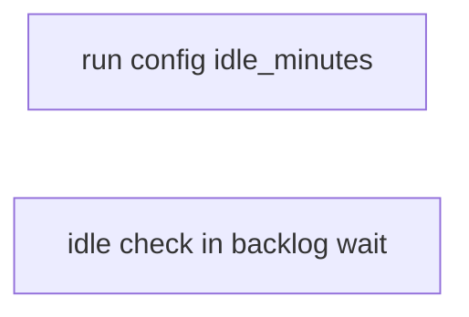

# Superlite: backlog wait notices a lead that goes silent without a stop event (B206, #769)

**Goal:** `sl backlog wait` re-prompts once, then parks, a running lead that sits idle with no stop record: no shell child process and no session-file write for a configured time, while it holds no ship lock and waits for no answer. The check costs no model call.
**Architecture:** run_config validates a new optional key `lead.idle_minutes` (T1). backlog_run gets a probe that finds the lead's session id (Herdr agent row), its transcript files (worker launch env and cwd), its Claude pid (`<state home>/sessions/<sid>` line 2, else the lead's own fleet.json owner) and its shell children (machine_load._ps), and a step in `_round` that turns a silence over the limit into one re-prompt, then a park (T2).
**Tech stack:** Python 3.10+ stdlib; pytest through `sl run_tests`.
**Spec:** this file, section Design; issue #769.
**Detail:** tests
**Target-min:** 11
**Wave0:** none
**Worktree:** none
**Coverage:** off

Global constraints:
- Every script line keeps the repo's `# O(...)` complexity comment; stdlib only; LF endings.
- This repository is public: no host names, user names, home paths, other project or repository names in code, tests, docs or commit messages.
- Fleet modules (fleet, fleet_io, fleet_state, ship_lock, machine_load, run_config) are imported inside functions in backlog_run.py so tests can swap them.
- Builds: the verdict is `sl run_tests` (the project's test command; a project with `.maxapp` runs `maxapp test`, which a build pool may place on another Mac, and a full run whose tree a green maxapp test stamp covers returns that result without a run); task trees build in <tree>/.build/DerivedData and any build of your own goes under .build/ of the worktree, never -derivedDataPath outside the worktree (your session scratchpad included; backlog cleanup removes scratchpad build folders when the worktree goes); a product, simulator or device build stays on this machine and runs only when an issue's acceptance asks for a running-app check.
- Simulators: append the UDID of each simulator you or a worker creates (`xcrun simctl create` or `clone`; a checker's `Simulators:` line marks its created ones) as one line to /Users/max/github/superlite/.claude/worktrees/superlite-b206-backlog-wait-idle-lead/.superlite/simulators.txt; never list one you did not create; ship cleanup shuts down and deletes each listed one.

## Design

Cause (2026-11-13 transcripts of B193, B201 and B204, read by the lead): each silent lead's last turn ended on `API Error: 403 Attention Required! | Cloudflare` (an `isApiErrorMessage` assistant entry, then `turn_duration`). Claude Code fires `StopFailure`, not `Stop`, when a turn ends on an API error; hooks/hooks.json binds only `Stop` to capture-worker-stop, so no stop record was written and `backlog wait` saw nothing. Binding `StopFailure` is a follow-up (hooks/hooks.json belongs to B216); the idle check below catches this and any other silent end.

Ruling: config value: run config key `lead.idle_minutes`, `null` or an integer 0 to 1440; absent or `null` means IDLE_MIN = 10; 0 turns the check off. It stays out of the built-in default, so config ids do not change (B175's rule). backlog_run reads it from the lead worktree's snapshot `run_config.active(<wt>/.superlite)["lead"]` (lead's ruling).
Ruling: idle means all of: batch state running, no stop record since `since` (the existing `rec is None` branch), the lead's Herdr agent alive, `_unanswered(b)` false, the ship lock not held by this batch (`ship_lock.holder(ship_lock.lock_path(repo))["batch"] != bid`), the newest transcript write older than the limit, a live lead pid, and no child of that pid whose command basename (leading `-` dropped) is a shell (`sh bash zsh dash fish ksh tcsh csh`). Claude Code runs every Bash call, foreground or background, in a shell child; its long-lived helpers (caffeinate, MCP servers) are not shells and do not count (lead's ruling: on this machine idle Claude processes keep `caffeinate` and MCP children).
Ruling: the probe reads, in this order, stopping at the first unknown with no line: session id = `fleet.hc.session_of(row)` of the Herdr row named `b["agent"]` (one `fleet.hc.agents()` call per round, cached in `states["rows"]`), else main's worker record `session`; transcripts = `<cfg>/projects/<fleet_io.project_dir(cwd)>/<sid>.jsonl` plus every `*.jsonl` under `<cfg>/projects/<project_dir(cwd)>/<sid>/` (subagent transcripts), where cfg = worker `launch.env.CLAUDE_CONFIG_DIR`, else `~/.claude`, and cwd = worker `launch.cwd`, else `b["worktree"]`; silence = now - max(newest mtime in ms, `since`, `idle_at`); pid = line 2 of `<state.home()>/sessions/<sid>` (digits), else `owner_pid` of `<wt>/.superlite/fleet.json` when its `owner_session` equals sid; alive by `os.kill(pid, 0)` (PermissionError counts alive). Any exception in the probe means unknown (lead's ruling).
Ruling: first idle period: batch keys `idle_reprompted: True`, `idle_at: now`, one `fleet_io.main(["send", lead, "--text", IDLE.format(minutes=m), "--plan", sd])`, wait line `B idle <m> min: re-prompted` (m = silence // 60000). A failed send parks with `idle <m> min: re-prompt not delivered`. A second idle period (measured from `idle_at` or a later write) parks with `idle <m> min after an idle re-prompt (no child process, no session-file write, no stop event)` through `_park` (stops the lead, frees the lock). start, the build-lead start and answer reset `idle_reprompted: False, idle_at: 0`, as they reset `reprompted` (lead's ruling).

IDLE text: `superlite: backlog wait saw no stop event, no command running and no session-file write from you for {minutes} min. Go on with the batch where you left off; never end a turn while your workers run, and end your turn only with a Status line (Status: DONE, DONE_WITH_CONCERNS, NEEDS_CONTEXT or BLOCKED), or write .superlite/question.json and end with Status: NEEDS_DECISION.`

## Task graph

```mermaid
%% schedule
gantt
  title Predicted schedule (mm:ss)
  dateFormat X
  axisFormat %M:%S
  section lane 1
  T2 Idle check in backlog wait :t2, 0, 774s
  section lane 2
  T1 Run config key lead.idle_minutes :t1, 0, 719s
```





critical path: T2 (12.9 min) · peak width 2 · predicted build 12.9 min · predicted total ≈ 33.4 min (target ✗ 11.0)

## Package: backlog wait

App type: CLI library (main's `sl backlog wait`). Categories: state (batch keys across rounds), boundary (minutes at the limit), error (missing pid, transcript, Herdr row).
**Probe entry:** none (a wait loop over Herdr and process state; the named tests below cover each case)

### T1 Run config key lead.idle_minutes · Complexity 2 · Est. context 30k
**Owns:** skills/subagent-driven-development/scripts/run_config.py, skills/subagent-driven-development/config/run-configs.json, docs/config.md, tests/scripts/test_run_config_idle_769.py
**Components:** 1
**LOC owned:** 40
**Tests:** fast
**Model:** haiku
**Kind:** mechanical
**Produces:** run_config._lead(src: str, name: str, lead: dict) -> None (accepts lead.idle_minutes: null or int 0..1440; raises ConfigError naming `lead.idle_minutes` otherwise)
**Review Focus:** boundary: 0 and 1440 pass, -1 and 1441 fail; a bool fails.
**Test code (verbatim):**
```python
"""#769: run config key lead.idle_minutes (minutes of lead silence before backlog wait re-prompts; 0 turns the check off)."""
import json
import sys

import pytest

from test_plan_tools import SCRIPTS

sys.path.insert(0, str(SCRIPTS))
import run_config as rc  # noqa: E402


@pytest.mark.parametrize("v", [None, 0, 10, 1440])
def test_idle_minutes_takes_null_or_0_to_1440(v):
    rc._lead("t", "x", {"idle_minutes": v})


@pytest.mark.parametrize("v", [-1, 1441, True, 2.5, "10"])
def test_idle_minutes_refuses_other_values(v):
    with pytest.raises(rc.ConfigError, match="lead.idle_minutes"):
        rc._lead("t", "x", {"idle_minutes": v})


def test_builtin_configs_leave_idle_minutes_out_so_config_ids_stay():
    d = json.loads(rc.BUILTIN.read_text(encoding="utf-8"))
    leads = [d["default"].get("lead") or {}] + [(c or {}).get("lead") or {} for c in (d.get("configs") or {}).values()]
    assert all("idle_minutes" not in x for x in leads)
    assert "idle_minutes" in d["_comment"]
```
**Steps:** 1 failing test, 2 run: FAIL, 3 add `"idle_minutes"` to LEAD_KEYS and one `elif k == "idle_minutes"` branch in `_lead` (message `must be null or an integer from 0 to 1440`), name `idle_minutes` in the `_comment` lead key list of run-configs.json (no other change there), add one sentence to docs/config.md after the `lead.build_effort` text: "`lead.idle_minutes`: absent (10); minutes a running lead may stay silent (no stop event, no command running, no session-file write) before `backlog wait` re-prompts it once and then parks the batch; `0` turns the check off." 4 run: PASS
**Notes:** do not add the key to any built-in config body: that changes every config id.

### T2 Idle check in backlog wait · Complexity 5 · Est. context 60k
**Owns:** skills/subagent-driven-development/scripts/backlog_run.py, docs/fleet.md, tests/scripts/test_backlog_wait_idle_769.py
**Components:** 2
**LOC owned:** 190
**Tests:** fast
**Model:** sonnet
**Kind:** design
**Produces:** backlog_run.IDLE_MIN: int = 10 · backlog_run.IDLE: str · backlog_run.idle_silence(sd: Path, data: dict, b: dict, states: dict) -> int | None (silence in ms when the lead is idle by the Design rules, else None; never raises) · backlog_run._idle(p: Path, sd: Path, data: dict, b: dict, states: dict) -> list[str]
**Review Focus:** state: the re-prompt starts a new idle period from `idle_at`; a write after it starts one from that write; start, build start and answer reset both keys. boundary: silence exactly at the limit counts. error: no Herdr row, no session id, no transcript, dead pid, pid of another session's fleet owner, lock holder unreadable: no line, no send.
**Test code (verbatim):**
```python
"""#769: backlog wait re-prompts a live lead that is silent (no shell child, no session-file write, no stop record) once, then parks it."""
import json
import os
import re
import sys
import types

import pytest

from backlog_fixtures import Q, batch as b
from test_backlog_run import bk, put, get, run, running  # noqa: F401
import backlog_run as br  # noqa: E402
import backlog_state as bs  # noqa: E402
import state  # noqa: E402

SID = "0b0c4d1e-aaaa-bbbb-cccc-000000000769"
T0 = 1_700_000_000  # transcript mtime, epoch seconds
MIN = 60_000
SNAP = {"id": "t-1", "cache_ttl": {}, "workers": {}}


def _slug(p):
    return re.sub(r"[^A-Za-z0-9]", "-", str(p))  # fleet_io.project_dir's rule


@pytest.fixture
def idle(bk, monkeypatch, tmp_path):
    wt = running(bk)
    cfg = tmp_path / "cfg"
    tr = cfg / "projects" / _slug(wt) / f"{SID}.jsonl"
    tr.parent.mkdir(parents=True)
    tr.write_text("{}\n")
    os.utime(tr, (T0, T0))
    bk.fleets[str(bk.sd)] = {"workers": {"W1": {"name": "sl-m-W1", "role": "lead", "worktree": str(wt),
                                                 "launch": {"cwd": str(wt), "env": {"CLAUDE_CONFIG_DIR": str(cfg)}}}}}
    hc = sys.modules["fleet"].hc
    monkeypatch.setattr(hc, "agents", lambda: [{"name": "sl-m-W1", "agent_status": "done", "agent_session": {"value": SID}}], raising=False)
    monkeypatch.setattr(hc, "session_of", lambda row: (row.get("agent_session") or {}).get("value"), raising=False)
    monkeypatch.setattr(sys.modules["fleet_io"], "project_dir", _slug, raising=False)
    ns = types.SimpleNamespace(wt=wt, tr=tr, holder=None, procs=[(os.getpid() + 100000, os.getpid(), 0, "caffeinate")])
    monkeypatch.setattr(sys.modules["ship_lock"], "holder", lambda p: ns.holder, raising=False)
    monkeypatch.setitem(sys.modules, "machine_load", types.SimpleNamespace(_ps=lambda: ns.procs))
    (state.home() / "sessions").mkdir(parents=True, exist_ok=True)
    (state.home() / "sessions" / SID).write_text(f"{wt / '.superlite'}\n{os.getpid()}\n")
    (wt / ".superlite" / "run-config.json").write_text(json.dumps({**SNAP, "lead": {"idle_minutes": 10}}))
    monkeypatch.setattr(br, "_now_ms", lambda: T0 * 1000 + 12 * MIN)
    return ns


def _texts(bk):
    return [c[1] for c in bk.calls if c[0] == "text"]


def test_silent_lead_is_reprompted_once_then_parked(bk, idle, capsys, monkeypatch):
    assert run(capsys, "wait", "--timeout", "0") == (0, "B1 idle 12 min: re-prompted\n")
    x = get(bk, "B1")
    assert x["state"] == "running" and x["idle_reprompted"] is True and x["idle_at"] == T0 * 1000 + 12 * MIN
    t = _texts(bk)
    assert len(t) == 1 and t[0][:3] == ["send", "W1", "--text"] and "12 min" in t[0][3] and "Status:" in t[0][3]
    assert t[0][4:] == ["--plan", str(bk.sd)]
    assert run(capsys, "wait", "--timeout", "0") == (0, "TIMEOUT\n")
    monkeypatch.setattr(br, "_now_ms", lambda: T0 * 1000 + 23 * MIN)
    assert run(capsys, "wait", "--timeout", "0") == (
        0, "B1 parked: idle 11 min after an idle re-prompt (no child process, no session-file write, no stop event)\n")
    assert get(bk, "B1")["state"] == "parked" and ("stop", ["W1"]) in bk.calls and len(_texts(bk)) == 1


def test_a_write_after_the_reprompt_starts_a_new_idle_period(bk, idle, capsys, monkeypatch):
    assert run(capsys, "wait", "--timeout", "0")[1] == "B1 idle 12 min: re-prompted\n"
    os.utime(idle.tr, (T0 + 20 * 60, T0 + 20 * 60))
    monkeypatch.setattr(br, "_now_ms", lambda: T0 * 1000 + 29 * MIN)
    assert run(capsys, "wait", "--timeout", "0") == (0, "TIMEOUT\n")
    monkeypatch.setattr(br, "_now_ms", lambda: T0 * 1000 + 30 * MIN)
    assert run(capsys, "wait", "--timeout", "0")[1].startswith("B1 parked: idle 10 min after an idle re-prompt")


@pytest.mark.parametrize("now_min,want", [(9, "TIMEOUT\n"), (10, "B1 idle 10 min: re-prompted\n")])
def test_default_idle_time_is_ten_minutes(bk, idle, capsys, monkeypatch, now_min, want):
    (idle.wt / ".superlite" / "run-config.json").write_text(json.dumps({**SNAP, "lead": {}}))
    monkeypatch.setattr(br, "_now_ms", lambda: T0 * 1000 + now_min * MIN)
    assert run(capsys, "wait", "--timeout", "0") == (0, want)


@pytest.mark.parametrize("case", ["shell child", "login shell child", "fresh write", "subagent write", "ship lock", "off",
                                  "no pid", "dead pid", "no transcript", "no herdr row", "unanswered", "lock unreadable"])
def test_lead_that_works_or_cannot_be_read_is_never_idle(bk, idle, capsys, monkeypatch, case):
    sess = state.home() / "sessions" / SID
    if case == "shell child":
        idle.procs = [(os.getpid() + 100000, os.getpid(), 0, "/bin/zsh")]
    elif case == "login shell child":
        idle.procs = [(os.getpid() + 100000, os.getpid(), 0, "-bash")]
    elif case == "fresh write":
        os.utime(idle.tr, (T0 + 300, T0 + 300))
    elif case == "subagent write":
        sub = idle.tr.parent / SID / "subagents" / "agent-1.jsonl"
        sub.parent.mkdir(parents=True)
        sub.write_text("{}\n")
        os.utime(sub, (T0 + 300, T0 + 300))
    elif case == "ship lock":
        idle.holder = {"batch": "B1", "lead": "W1"}
    elif case == "off":
        (idle.wt / ".superlite" / "run-config.json").write_text(json.dumps({**SNAP, "lead": {"idle_minutes": 0}}))
    elif case == "no pid":
        sess.unlink()
    elif case == "dead pid":
        sess.write_text(f"{idle.wt / '.superlite'}\n99999999\n")
    elif case == "no transcript":
        idle.tr.unlink()
    elif case == "no herdr row":
        monkeypatch.setattr(sys.modules["fleet"].hc, "agents", lambda: [])
    elif case == "unanswered":
        bs.update(bs.path(bk.root), lambda d: bs.batch(d, "B1").update({"decisions": [{"questions": [{"question": "Which?"}]}], "answers": {}}))
    elif case == "lock unreadable":
        def boom(p):
            raise OSError("unreadable")
        monkeypatch.setattr(sys.modules["ship_lock"], "holder", boom)
    assert run(capsys, "wait", "--timeout", "0") == (0, "TIMEOUT\n")
    assert not [c for c in bk.calls if c[0] in ("text", "stop")]
    assert not get(bk, "B1").get("idle_reprompted")


@pytest.mark.parametrize("owner,want", [(SID, "B1 idle 12 min: re-prompted\n"), ("another-session", "TIMEOUT\n")])
def test_lead_pid_falls_back_to_its_fleet_owner_of_the_same_session(bk, idle, capsys, owner, want):
    (state.home() / "sessions" / SID).unlink()
    (idle.wt / ".superlite" / "fleet.json").write_text(json.dumps({"on": True, "workers": {}, "owner_session": owner, "owner_pid": os.getpid()}))
    assert run(capsys, "wait", "--timeout", "0") == (0, want)


def test_failed_send_parks_at_once(bk, idle, capsys, monkeypatch):
    monkeypatch.setattr(sys.modules["fleet_io"], "main", lambda argv: bk.calls.append(("text", argv)) or 1)
    assert run(capsys, "wait", "--timeout", "0") == (0, "B1 parked: idle 12 min: re-prompt not delivered\n")


def test_start_and_answer_reset_the_idle_keys(bk, capsys, tmp_path):
    wt = running(bk, idle_reprompted=True, idle_at=4000)
    bs.update(bs.path(bk.root), lambda d: bs.batch(d, "B1").update({"state": "needs_decision"}))
    (wt / ".superlite" / "question.json").write_text(json.dumps(Q))
    f = tmp_path / "a.json"
    f.write_text(json.dumps({"answers": {"Keep the v1 API?": "Drop"}, "by": "user"}))
    assert run(capsys, "answer", "B1", "--file", str(f))[0] == 0
    assert get(bk, "B1")["idle_reprompted"] is False and get(bk, "B1")["idle_at"] == 0
    put(bk, b("B2", ["b.py"], idle_reprompted=True, idle_at=4000))
    assert run(capsys, "start", "B2")[0] == 0
    assert get(bk, "B2")["idle_reprompted"] is False and get(bk, "B2")["idle_at"] == 0
```
**Steps:** 1 failing tests, 2 run: FAIL, 3 implement per Design: constants IDLE_MIN, IDLE (the Design's IDLE text, `{minutes}` placeholder), SHELLS; `idle_silence` (the probe, wrapped so any exception returns None); `_idle` (re-prompt or park, the lines above); in `_round` call `out.extend(_idle(p, sd, data, b, states))` right after `_gone` in the branch where the lead's agent is alive and no stop record exists; add `"idle_reprompted": False, "idle_at": 0` beside `"reprompted": False` in start, the build-lead start and answer; one docstring sentence after the `reprompted` sentence; in docs/fleet.md one table row after "Lead stops without a status" (`| Lead goes silent | A lead ends its turn with no stop event (an API error) and stays idle for lead.idle_minutes (10) | wait prints B idle <m> min: re-prompted; a second idle period parks the batch with idle <m> min after an idle re-prompt ... |`) and one sentence where the doc names backlog wait's re-prompt or gone-panes line. 4 run: PASS, also tests/scripts/test_backlog_run.py and tests/scripts/test_backlog_run_lifecycle.py.
**Notes:** `idle_silence` checks cheap things first (config off, unanswered, lock, Herdr row, transcript mtime) and runs `machine_load._ps()` only when the silence is already over the limit. The answer test copies `test_answer_and_start_reset_the_reprompt` in test_backlog_run_lifecycle.py.

## Running-app checks

None: no UI, widget or app target.

## Self-review

Coverage: issue Expected 1 (idle test: no child, no write, no lock, no answer) T2; 2 (one re-prompt, `B idle <m> min: re-prompted`, second period parks with the reason) T2; 3 (config value, no model call) T1 and T2; 4 (cause from the hook log) Design and the PR body. No placeholders; T1 and T2 share no file and have no edge (T2 reads the key with `.get`).
