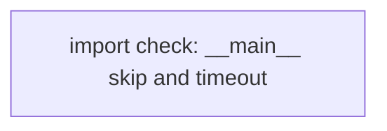

# Superlite: commit_task import check skips __main__.py and survives a timeout (B218, #839)

**Goal:** the commit import check no longer runs a `__main__.py` (an unguarded `sys.exit(main())` passes the commit), and an import that blocks past the timeout is a check result naming the file, not a `subprocess.TimeoutExpired` crash.
**Architecture:** `commit_task.is_module` treats `__main__.py` as no module, so the import check never imports it (the syntax check still compiles it) and `main` notes the skip on stderr. `IMPORT_DRIVER` prints one `@import-check <rel>` marker line on stdout before each import; `import_errors` catches `subprocess.TimeoutExpired`, reads the last marker from the partial stdout and returns one problem for that file.
**Tech stack:** Python 3.10+ stdlib; pytest through `sl run_tests`.
**Spec:** this file, section Design; issue #839.
**Detail:** tests
**Target-min:** 11
**Wave0:** none
**Worktree:** none
**Coverage:** off

Global constraints:
- Every script line keeps the repo's `# O(...)` complexity comment; stdlib only; LF endings.
- A test that spawns git in a temporary repository removes GIT_DIR, GIT_INDEX_FILE and GIT_WORK_TREE from the child env (the test_run_scripts helpers already do).
- This repository is public: no host names, user names, home paths, other project or repository names in code, tests, docs or commit messages.
- Builds: the verdict is `sl run_tests` (the project's test command; a project with `.maxapp` runs `maxapp test`, which a build pool may place on another Mac, and a full run whose tree a green maxapp test stamp covers returns that result without a run); task trees build in <tree>/.build/DerivedData and any build of your own goes under .build/ of the worktree, never -derivedDataPath outside the worktree (your session scratchpad included; backlog cleanup removes scratchpad build folders when the worktree goes); a product, simulator or device build stays on this machine and runs only when an issue's acceptance asks for a running-app check.
- Simulators: append the UDID of each simulator you or a worker creates (`xcrun simctl create` or `clone`; a checker's `Simulators:` line marks its created ones) as one line to /Users/max/github/superlite/.claude/worktrees/superlite-b218-commit-task-import-check/.superlite/simulators.txt; never list one you did not create; ship cleanup shuts down and deletes each listed one.

## Design

Today `is_module` lets `pkg/__main__.py` through; the driver imports it as `pkg.__main__`, which runs the program against the driver's own argv, and the `SystemExit` it raises is caught by the driver's `except BaseException` and reported as an import failure. A module whose import blocks runs into the 120 s `subprocess.run(..., timeout=120)` in `import_errors`, which catches only `OSError`, so `commit_task` dies with a `TimeoutExpired` traceback.

Ruling: `is_module` returns False for a file named `__main__.py` (any folder), so plan lint's PYTHONPATH warning (plan_tools.pythonpath_warnings, which calls `is_module`) skips it too; `main` prints `import check skipped (__main__ runs the program): F` on stderr once per such file, beside the fixture note (a `__main__.py` under `fixtures/` keeps only the fixture note). The syntax check still compiles it (lead's ruling; upstream skips silently in the driver).
Ruling: the timeout is `IMPORT_TIMEOUT = 120` seconds; `import_timeout()` returns `float(os.environ["SUPERLITE_IMPORT_TIMEOUT"])` when that parses to a number above 0, else `IMPORT_TIMEOUT`, so tests can run the CLI with a 2 s limit (lead's ruling).
Ruling: the driver prints `@import-check <rel>` (constant `IMPORT_MARK = "@import-check "`, flushed) on stdout right before it imports a file; on `TimeoutExpired` `import_errors` decodes `e.stdout` (bytes on POSIX; None possible), takes the file of the last marker line, else `files[0]`, and returns `[(file, 0, f"TimeoutExpired: import did not finish in {secs:g} s (top-level code that blocks: move it under if __name__ == \"__main__\":)")]`. Results of files imported before it are dropped; the commit fails anyway (lead's ruling).
Ruling: `main` handles that problem like any import problem: stdout `import F:0 TimeoutExpired: ...`, an incident, `Tn FAILED: ...`, exit 1 (lead's ruling).
Ruling: the commit_task.py module docstring's import-check sentence names the `__main__` skip and the timeout line; docs/tools.md is unchanged (the issue asks no docs change) (lead's ruling).

## Task graph

```mermaid
%% schedule
gantt
  title Predicted schedule (mm:ss)
  dateFormat X
  axisFormat %M:%S
  section lane 1
  T1 Import check skips __main__.py and re :t1, 0, 189s
```





critical path: T1 (3.2 min) · peak width 1 · predicted build 3.2 min · predicted total ≈ 9.7 min (target ✓)

## Package: commit_task import check

App type: CLI (a coordinator script). Categories: state (partial stdout after a kill), encoding (bytes vs str in TimeoutExpired), process (a killed child).
**Probe entry:** none (a commit gate run in temporary git repositories; the named tests cover each case)

### T1 Import check skips __main__.py and reports a blocking import · Complexity 3 · Est. context 40k
**Owns:** skills/subagent-driven-development/scripts/commit_task.py, tests/scripts/test_commit_task_import_839.py
**Components:** 1
**LOC owned:** 90
**Tests:** fast
**Model:** sonnet
**Kind:** design
**Produces:** commit_task.import_timeout() -> float · commit_task.is_module(path: str) -> bool (False for `__main__.py`)
**Review Focus:** state: the marker names the file that blocked, not the first file; encoding: `e.stdout` is bytes or None after the kill, never a crash; process: no `TimeoutExpired` traceback reaches stderr.
**Test code (verbatim):**
```python
"""#839: the import check skips __main__.py and reports a blocking import as a timeout, not a crash."""
import sys
from pathlib import Path

HERE = Path(__file__).resolve().parent
sys.path.insert(0, str(HERE))
from test_commit_pix_v2 import repo_with, task  # noqa: E402
from test_run_scripts import SCRIPTS, commit, write  # noqa: E402

sys.path.insert(0, str(SCRIPTS))
import commit_task  # noqa: E402

CLI = "import argparse\n\n\ndef main():\n    argparse.ArgumentParser().parse_args()\n    return 0\n"
MAIN = "import sys\n\nfrom tool.cli import main\n\nsys.exit(main())\n"
BLOCK = "import time\n\ntime.sleep(60)\n"
FAST = {"SUPERLITE_IMPORT_TIMEOUT": "2"}
TIMEOUT = 'TimeoutExpired: import did not finish in 2 s (top-level code that blocks: move it under if __name__ == "__main__":)'


def test_main_files_are_no_modules():
    assert not commit_task.is_module("tool/__main__.py")
    assert not commit_task.is_module("src/pkg/__main__.py")
    assert not commit_task.is_module("__main__.py")
    assert commit_task.is_module("tool/cli.py")
    assert commit_task.is_module("tool/main.py")


def test_package_with_unguarded_main_commits(tmp_path):
    repo = repo_with(tmp_path, task(1, ["tool/__init__.py", "tool/cli.py", "tool/__main__.py"]))
    write(repo, "tool/__init__.py", "")
    write(repo, "tool/cli.py", CLI)
    write(repo, "tool/__main__.py", MAIN)
    r = commit(repo, "T1")
    assert r.returncode == 0, r.stdout + r.stderr
    assert r.stderr.count("import check skipped (__main__ runs the program): tool/__main__.py") == 1
    assert "SystemExit" not in r.stdout + r.stderr


def test_main_with_a_syntax_error_still_blocks(tmp_path):
    repo = repo_with(tmp_path, task(1, ["tool/__init__.py", "tool/__main__.py"]))
    write(repo, "tool/__init__.py", "")
    write(repo, "tool/__main__.py", "def main(:\n")
    r = commit(repo, "T1")
    assert r.returncode == 1, r.stdout + r.stderr
    assert "syntax tool/__main__.py:1" in r.stdout


def test_import_timeout_reads_the_env(monkeypatch):
    monkeypatch.delenv("SUPERLITE_IMPORT_TIMEOUT", raising=False)
    assert commit_task.import_timeout() == 120
    for bad in ("", "abc", "0", "-5"):
        monkeypatch.setenv("SUPERLITE_IMPORT_TIMEOUT", bad)
        assert commit_task.import_timeout() == 120
    monkeypatch.setenv("SUPERLITE_IMPORT_TIMEOUT", "2.5")
    assert commit_task.import_timeout() == 2.5


def test_blocking_import_names_the_file_that_blocked(tmp_path, monkeypatch):
    monkeypatch.setenv("SUPERLITE_IMPORT_TIMEOUT", "3")
    write(tmp_path, "ok.py", "X = 1\n")
    write(tmp_path, "slow.py", BLOCK)
    write(tmp_path, "later.py", "Y = 2\n")
    errs = commit_task.import_errors(["ok.py", "slow.py", "later.py"], [], root=tmp_path)
    assert errs == [("slow.py", 0, TIMEOUT.replace("in 2 s", "in 3 s"))]


def test_blocking_import_fails_like_an_import_error(tmp_path):
    (tmp_path / "slow").mkdir()
    (tmp_path / "broken").mkdir()
    slow = repo_with(tmp_path / "slow", task(1, ["tools/slow.py"]))
    write(slow, "tools/slow.py", BLOCK)
    broken = repo_with(tmp_path / "broken", task(1, ["tools/bad.py"]))
    write(broken, "tools/bad.py", "import module_that_does_not_exist_xyz\n")
    want = commit(broken, "T1").returncode
    r = commit(slow, "T1", env=FAST)
    assert want == 1
    assert r.returncode == want, r.stdout + r.stderr
    assert f"import tools/slow.py:0 {TIMEOUT}" in r.stdout
    assert "T1 FAILED: import tools/slow.py:0 TimeoutExpired" in r.stdout
    assert "Traceback" not in r.stderr
```
**Steps:** 1 write the test file, 2 run: FAIL (record the summary line as `Red run:`), 3 implement in commit_task.py, 4 run: PASS, then the existing import-check tests (`tests/scripts/test_commit_task_pythonpath_712.py`, `test_commit_import_packages.py`, `test_commit_pix_v2.py`) stay green.
**Notes:** print the marker inside the driver right before the `try:` that imports (skip entries may print one too; harmless). Decode partial stdout with `errors="replace"`. `{secs:g}` prints `2` for 2.0 and `120` for 120.0. Keep `except OSError` as is; add a separate `except subprocess.TimeoutExpired`. If `test_blocking_import_fails_like_an_import_error`'s `FAILED:` wording differs (the FAILED line joins problems with `; `), match the existing `T1 FAILED: <first shown line>` form; do not change the FAILED format.

## Review Focus

- state: three files, the second blocks: the problem names the second (`test_blocking_import_names_the_file_that_blocked`).
- encoding: `TimeoutExpired.stdout` is bytes on POSIX and may be None: no AttributeError or TypeError.
- process: the CLI run exits 1 with an `import F:0` line and no traceback (`test_blocking_import_fails_like_an_import_error`).

## Self-review

One task, one module plus its new test file; every issue acceptance line maps to a named test (`test_package_with_unguarded_main_commits`, `test_blocking_import_fails_like_an_import_error`). No placeholders. Running-app checks: none (a CLI script).
