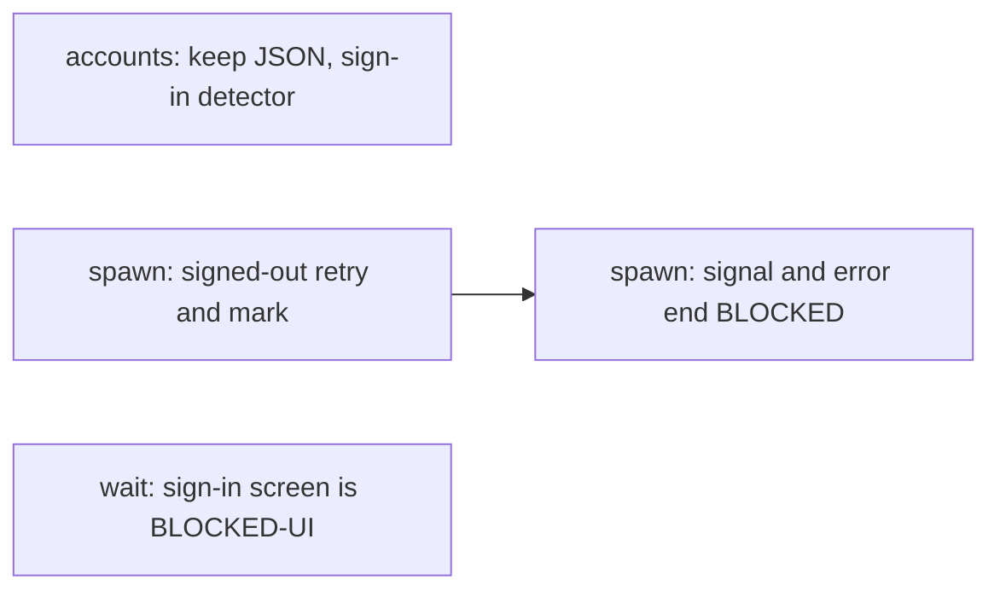

# Superlite: fleet spawn and wait see a signed-out account; spawn never ends silent (B209, #782, #783)

**Goal:** fix #782 and #783: `accounts._run` drops the whole usage report when `claude-profile usage --json` exits 1 (one account failed) although its JSON is valid, so a signed-out account looks usable; `fleet spawn` starts workers on it, prints `sent` (one-turn roles) or `no READY` (implementers), and `fleet wait` reads the sign-in screen as `DONE (screen)`. A `fleet spawn` cut short by a caller (a Bash timeout) prints neither a `Wn account=` line nor a `BLOCKED:` line.
**Architecture:** `accounts.py` keeps the JSON of a non-zero exit and gains one sign-in screen detector, `sign_in_screen(screen)`. `fleet.py` checks every new worker's screen with it after the start and after the prime: a signed-out account is marked in fleet.json (`signed_out`, 15 min), `choose_account` skips marked accounts, and the spawn is retried once on another account (the existing `_Slow` retry), else BLOCKED naming the account. `fleet_io.wait` routes a sign-in screen to its `_blocked` path (BLOCKED-UI naming the account) before any report parse or ask. `fleet spawn` installs SIGTERM, SIGHUP and SIGINT handlers for its start phase and turns a signal or an unexpected exception into one `BLOCKED:` line, leaving no worker in `starting`.
**Tech stack:** Python 3.10+ stdlib, pytest (through `sl run_tests`).
**Spec:** this file, section Design; issues #782, #783.
**Detail:** contracts
**Target-min:** 11
**Wave0:** none
**Worktree:** none
**Coverage:** off

Global constraints:
- Every script line keeps the repo's `# O(...)` complexity comment as its neighbours do; stdlib only; LF endings.
- This repository is public: no host names, user names, home paths, other project or repository names, ticket keys or real account names in code, tests or docs; tests name accounts `a1`, `a2`, `a3`.
- Tests never call the real `claude-profile`, `claude` or Herdr: use the fakes the neighbouring tests use (`SUPERLITE_CLAUDE_PROFILE_BIN` fake scripts or monkeypatched `ac.read_usage`/`ac.read_listing`; the FakeHerdr of `tests/scripts/test_fleet.py` and `tests/scripts/test_fleet_io.py`).
- T1, T2 and T3 build at once: T2 and T3 tests replace `accounts.sign_in_screen` with a fake that follows T1's e.g. lines (`monkeypatch.setattr(ac, "sign_in_screen", fake, raising=False)`), so they pass before and after T1 commits.
- Sign-in screen marks (Claude Code 2.1.325, read from its binary): `Select login method:`, `Paste code here if prompted`, `Browser didn't open? Use the url below to sign in`, `Opening browser to sign in`.
- Builds: the verdict is `sl run_tests` (the project's test command; a project with `.maxapp` runs `maxapp test`, which a build pool may place on another Mac, and a full run whose tree a green maxapp test stamp covers returns that result without a run); task trees build in <tree>/.build/DerivedData and any build of your own goes under .build/ of the worktree, never -derivedDataPath outside the worktree (your session scratchpad included; backlog cleanup removes scratchpad build folders when the worktree goes); a product, simulator or device build stays on this machine and runs only when an issue's acceptance asks for a running-app check; copy this sentence into every worker brief.
- Simulators: append the UDID of each simulator you or a worker creates (`xcrun simctl create` or `clone`; a checker's `Simulators:` line marks its created ones) as one line to /Users/max/github/superlite/.claude/worktrees/superlite-b209-fleet-spawn-accounts-and-ready/.superlite/simulators.txt; never list one you did not create; ship cleanup shuts down and deletes each listed one; copy this sentence into every worker brief.

## Design

Understood from the issues: one signed-out account (its config dir exists, no login) makes `claude-profile usage --json` exit 1 with valid JSON and a per-account `error`; `_run` returns `{}` on any non-zero exit, so `pick_account` spreads by worker count alone and picks the signed-out account. Its workers sit at Claude Code's sign-in screen: one-turn roles get their brief typed into the code prompt (`sent`), implementers answer no READY, and `wait`'s screen fallback parses the echoed brief as DONE. The three `no READY (pane 61 rows, 83 cols)` implementers of #783 are the same incident (same run, same minutes, workers on the signed-out account). The fixer spawn that printed no `Wn account=` line fits a caller that cut the call short: the only stdout line comes after the machine gate (up to 100 s), two `claude-profile` calls (up to 40 s each), the start and the screen check, all silent on stdout.

- `accounts._run`: a non-zero exit whose stdout parses as a JSON object returns that object; anything else stays `{}`. The per-account `error` then skips the account through `_skip` as it already does.
- `accounts.sign_in_screen(screen) -> bool`: True when a screen line, stripped of whitespace and the TUI characters `fleet._is_ready` strips plus `❯` and `>`, starts with one of the four marks. Starting the line is what tells the screen from a diff or test file that quotes a mark.
- `fleet._spawn`: reads the screen once after the start for every role (today only one-turn roles do) and again after the prime when READY is missing. A sign-in screen marks the account (`mark_signed_out`), keeps the screen, closes the pane and raises `_SignedOut` (a `_Slow`), so `spawn` retries once on another account and stderr reads `W1 account a1 signed out: Claude Code sign-in screen; retrying on account a2`. A signed-out retry ends `BLOCKED: W2 account a2 signed out: Claude Code sign-in screen; sign in once (CLAUDE_CONFIG_DIR=<dir> claude, then /login), then rerun; retried after W1 on a1`; with no other account, `choose_account` prints `BLOCKED: no account with headroom` and one `a1: signed out (Claude Code sign-in screen)` line per marked account.
- `fleet.json` `signed_out`: `{account: ms}`; `choose_account` drops entries marked within `SIGNED_OUT_TTL_MS` (900000). After a sign-in the account comes back by itself within 15 minutes.
- `fleet_io._blocked(sd, wid, w, screen=None)`: a sign-in screen adds ` (signed out: account <a> shows the Claude Code sign-in screen; sign in there, then respawn)` to the BLOCKED-UI line. `wait`'s done/idle branch checks the screen it read before `fleet_report.parse` and `_ask` and routes a sign-in screen to `_blocked`: never DONE, never an ask typed into the code prompt.
- `fleet spawn` (plain, `--for-dispatch`, `--for-review`, `--package`): SIGTERM, SIGHUP and SIGINT raise `_Stopped` for the start phase (restored before `--wait`'s wait). `_Stopped` or any other exception (SystemExit passes) ends as `BLOCKED: fleet spawn stopped by SIGTERM after N s; W3 left blocked; give the Bash call a timeout of 600000 ms, then rerun` or `BLOCKED: fleet spawn: RuntimeError: boom` (traceback on stderr), exit 3. The worker being started (`_INFLIGHT`) is set blocked and its pane closed.

Ruling: only the sign-in screen gets the other-account retry; a plain no READY stays BLOCKED as today, because every no-READY of #783 was the signed-out account and a wider retry changes the pinned BLOCKED lines of many tests (lead's ruling).
Ruling: the mark lives in the run's fleet.json for 15 minutes, not for the machine: the usage report's per-account `error` already covers other runs once `_run` keeps it (lead's ruling).
Ruling: `fleet wait` does not mark the account; spawn's own check and the usage `error` cover the next spawn (lead's ruling).
Ruling: SIGKILL cannot be caught; the docs' Bash-timeout advice for `fleet spawn` is a follow-up for docs/fleet.md, which B206 owns (lead's ruling).
Ruling: **Detail:** contracts, because every test sits on the existing FakeHerdr and usage fakes the implementer reads (lead's ruling).

## Task graph

```mermaid
%% schedule
gantt
  title Predicted schedule (mm:ss)
  dateFormat X
  axisFormat %M:%S
  section lane 1
  T2 spawn retries a signed-out account on :t2, 0, 507s
  T4 spawn ends a signal or an error with :t4, 507, 461s
  section lane 2
  T3 wait reads a sign-in screen as BLOCKE :t3, 0, 459s
  section lane 3
  T1 accounts keep a failed run's JSON sig :t1, 0, 451s
```

critical path: T2 → T4 (16.1 min) · peak width 3 · predicted build 16.1 min · predicted total ≈ 30.6 min (target ✗ 11.0)

## Package: accounts

**App type:** library. **Categories:** encoding (TUI characters around a mark), state (exit code vs JSON).
**Probe entry:** call=accounts.sign_in_screen

### T1 accounts keep a failed run's JSON; sign-in detector · Complexity 2 · Est. context 26k
**Owns:** skills/subagent-driven-development/scripts/accounts.py, tests/scripts/test_accounts_signed_out_782.py
**Components:** 1
**LOC owned:** 110
**Tests:** fast
**Kind:** mechanical
**Model:** haiku
**Covers:** Design
**Produces:** accounts.sign_in_screen(screen: str) -> bool
e.g. accounts.sign_in_screen(" Select login method:\n\n ❯ 1. Claude account with subscription") -> True
e.g. accounts.sign_in_screen("│ Paste code here if prompted >  │") -> True
e.g. accounts.sign_in_screen("+    MARKS = ('Select login method:',)") -> False
**Produces:** accounts.SIGN_IN_MARKS: tuple[str, ...]
**Review Focus:** `test_run_keeps_json_of_exit_1`: a fake `claude-profile` printing `{"accounts": [{"name": "a1", "error": "not signed in", "limits": []}, {"name": "a2", "error": null, "limits": []}]}` and exiting 1 gives `read_usage()` that dict, and `pick_account(usage, ["a1", "a2"])` returns `"a2"`; `test_run_exit_1_bad_json_is_empty`: exit 1 with stdout `oops` gives `{}`; `test_run_exit_1_json_list_is_empty`: exit 1 with stdout `[1]` gives `{}`; `test_sign_in_marks`: each of the four marks alone on a line, also behind `│`, `❯`, `●` or spaces, gives True; `test_sign_in_quoted_is_false`: the mark inside a quoted string, after a diff `+`, or mid-line (`I saw Select login method: there`) gives False; `test_sign_in_empty_false`: `""` and `"READY"` give False.
**Steps:** 1 failing tests, 2 run: FAIL, 3 implement, 4 run: PASS
**Notes:** `SIGN_IN_MARKS` holds the four marks of the Global constraints, in that order. The strip set is the one `fleet._is_ready` uses plus `❯` and `>`; strip only the line's ends, then `startswith`.

## Package: fleet

**App type:** CLI plus concurrency. **Categories:** protocol (stdout `Wn account=` and `BLOCKED:` lines, exit codes), state (fleet.json `signed_out`, a worker left `starting`), encoding (screens).
**Probe entry:** none (every entry starts Herdr panes and Claude sessions)

### T2 spawn retries a signed-out account once and marks it · Complexity 4 · Est. context 52k
**Owns:** skills/subagent-driven-development/scripts/fleet.py, tests/scripts/test_fleet_signed_out_782.py
**Components:** 2
**LOC owned:** 190
**Tests:** fast
**Model:** sonnet
**Covers:** Design
**Consumes:** accounts.sign_in_screen(screen: str) -> bool (T1)
**Produces:** fleet.mark_signed_out(sd: Path, account: str) -> None
**Produces:** fleet.signed_out_accounts(sd: Path, now_ms: int | None = None) -> set[str]
e.g. after mark_signed_out(sd, "a1") at t, signed_out_accounts(sd, t + 60000) -> {"a1"}; signed_out_accounts(sd, t + 960000) -> set()
**Produces:** fleet.SIGNED_OUT_TTL_MS: int = 900000
**Produces:** fleet._SignedOut(_Slow)
**Review Focus:** `test_one_turn_signed_out_retries_other_account`: accounts a1 (usage prefers it) and a2, the first agent's screen is the sign-in screen, the second's a prompt: `spawn(..., role="research")` returns W2 on a2; stderr holds `W1 account a1 signed out: Claude Code sign-in screen; retrying on account a2`; fleet.json W1 `state` is `blocked`, `signed_out` holds `a1`; W1's pane was closed; no brief was sent to W1. `test_prime_signed_out_retries_other_account`: an implementer whose screen after the prime shows `Paste code here if prompted >` and no READY retries on a2, where READY shows, and prints `W2 account=a2 pane=`. `test_only_account_signed_out_blocks`: a1 is the only account and signed out: exit 3, stdout holds `BLOCKED: no account with headroom` and `a1: signed out (Claude Code sign-in screen)`, no `account=` line. `test_signed_out_retry_also_signed_out`: a1 and a2 both show the sign-in screen: exit 3, stdout ends `BLOCKED: W2 account a2 signed out: Claude Code sign-in screen; sign in once (CLAUDE_CONFIG_DIR=<a2 dir> claude, then /login), then rerun; retried after W1 on a1`, both marked. `test_choose_account_skips_marked_within_ttl`: a1 marked 60 s ago gives a2; marked 960 s ago gives a1. `test_normal_screen_marks_nothing`: a prompt screen spawns W1, `signed_out` absent or empty.
**Steps:** 1 failing tests, 2 run: FAIL, 3 implement, 4 run: PASS
**Notes:** Read the screen after the start (and the trust accept) for every role; the prime path checks again when READY is missing, before the trust-dialog message. `fail(...)` gets a `signed_out` flag: first try raises `_SignedOut` after `_keep`; the retry calls `_blocked` with the sign-in hint (the default dir `~/.claude` reads `claude, then /login` without the variable). `choose_account` drops marked entries along with `avoid` and prints the `a1: signed out (Claude Code sign-in screen)` lines under its BLOCKED line. `mark_signed_out` writes under `fs.locked(sd)`. Keep `_retry_account` as is: the mark already keeps it off the signed-out account.

### T3 wait reads a sign-in screen as BLOCKED-UI naming the account · Complexity 3 · Est. context 40k
**Owns:** skills/subagent-driven-development/scripts/fleet_io.py, tests/scripts/test_fleet_io_signed_out_782.py
**Components:** 1
**LOC owned:** 120
**Tests:** fast
**Model:** sonnet
**Covers:** Design
**Consumes:** accounts.sign_in_screen(screen: str) -> bool (T1)
**Produces:** fleet_io._blocked(sd: Path, wid: str, w: dict, screen: str | None = None) -> dict
e.g. _blocked(sd, "W1", {"task": "R1", "account": "a1", ...}, "Select login method:") prints `W1 R1 BLOCKED-UI <sd>/fleet/screens/W1.txt (signed out: account a1 shows the Claude Code sign-in screen; sign in there, then respawn)` and returns {"id": "W1", "task": "R1", "status": "BLOCKED-UI", "report": "<sd>/fleet/screens/W1.txt", "source": "screen"}
**Review Focus:** `test_wait_sign_in_screen_is_blocked_not_done`: a busy one-turn worker W1 (label R1, account a1), herdr state idle, screen `Select login method:` plus a line `Status: DONE`: `wait` prints the BLOCKED-UI line naming account a1, no `DONE` line, fleet.json W1 `state` is `blocked`, and no prompt or key was sent to W1 (no ask). `test_wait_blocked_state_names_signed_out`: herdr state `blocked` with the sign-in screen prints the same reason. `test_wait_plain_screen_unchanged`: an idle screen `Status: DONE` without a mark still ends `DONE ... (screen)`. `test_blocked_without_sign_in_unchanged`: `_blocked` on a trust dialog screen prints the old line with no `signed out` text.
**Steps:** 1 failing tests, 2 run: FAIL, 3 implement, 4 run: PASS
**Notes:** In `wait`'s done/idle branch, after `read_screen(..., 80, "recent")`, a sign-in screen goes to `_blocked(sd, wid, w, text)` and leaves `pending` before `fleet_report.parse`, `_ask` and `_take`. `_blocked` reads its own 40 visible lines only when `screen` is None.

### T4 spawn ends a signal or an error with one BLOCKED line · Complexity 3 · Est. context 46k
**Owns:** skills/subagent-driven-development/scripts/fleet.py, tests/scripts/test_fleet_spawn_stopped_783.py
**Components:** 1
**LOC owned:** 130
**Tests:** fast
**Model:** sonnet
**Covers:** Design
**Produces:** fleet._Stopped(BaseException)
**Review Focus:** `test_sigterm_during_start_blocks_and_closes_worker`: a fake `start_agent` that sends the process SIGTERM (`os.kill(os.getpid(), signal.SIGTERM)`) after the pane opened: `main(["spawn", "--role", "fixer", "--plan", <sd>])` returns 3, the last stdout line starts `BLOCKED: fleet spawn stopped by SIGTERM after ` and holds `W1 left blocked`, fleet.json W1 `state` is `blocked`, the fake's `close_pane` got W1's pane. `test_sigterm_in_machine_gate_blocks`: SIGTERM raised inside the machine gate gives `BLOCKED: fleet spawn stopped by SIGTERM after ` with no worker named, exit 3. `test_unexpected_error_blocks`: `fs.next_id` raising `RuntimeError("boom")` gives stdout `BLOCKED: fleet spawn: RuntimeError: boom`, a `Traceback` on stderr, exit 3. `test_for_dispatch_sigterm_blocks`: SIGTERM during a `--for-dispatch` worker start prints the BLOCKED line on the real stdout (not into `_spawn_quiet`'s buffer). `test_handlers_restored`: after a normal spawn and after a stopped one, `signal.getsignal(SIGTERM)`, SIGHUP and SIGINT equal their values before `main`.
**Steps:** 1 failing tests, 2 run: FAIL, 3 implement, 4 run: PASS
**Notes:** `_INFLIGHT` (module dict: sd, wid, pane) is set in `_spawn` right after `open_pane` and cleared in `fail` and before the `Wn account=` print. Catch `_Stopped` and `Exception` in `main`'s spawn branch around the gate-to-send work, outside every `redirect_stdout`; restore the saved handlers in `finally`, and before `fio.wait` for `--wait`. Handlers are installed only in the main thread.

## Review Focus

Packages accounts and fleet above; the cases are named in each task. Specific risks: a screen that quotes a mark mid-line or in a diff (false sign-in), the retry landing on the same signed-out account, a signal arriving while `_spawn_quiet` redirects stdout, a worker left `starting` after a stop.

## Self-review

Coverage: `_run` (T1), detector (T1), spawn check, mark, skip and retry (T2), wait (T3), silent spawn (T4). T2 and T4 share fleet.py, so T4 waits for T2. No placeholders; every Consumes has a Produces with examples.
