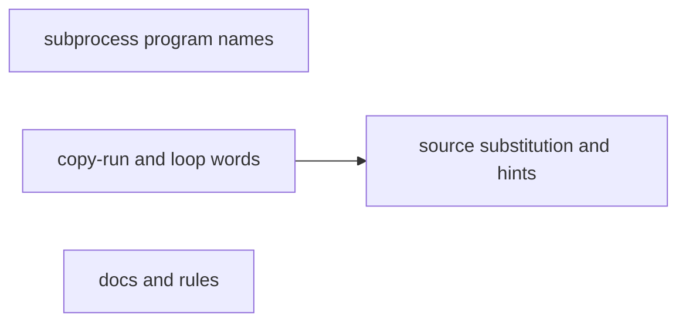

# Superlite: coordinator guard reads more scratch-script and shell forms, and names the way out (B210, #780 #781 #821)

**Goal:** fix the false blocks #780 and #781 still show at 1.5.216 and give every remaining unresolved block a cause-specific way out; route main's code rulings to a fixer (#821). Measured before (in-process `guard_judge.judge`, temp project): 12 of 17 sightings block.
**Architecture:** `guard_tools._a_sh` reads a subprocess program from a list name bound once, a `*` splat and `sys.executable` (T1). `guard_judge` records the source text of a `cp`/`mv` copy as the copied script's text, drops a heredoc script's text on any later write, and reads `$(seq ...)` and numeric `{A..B}` for-loop words (T2). It passes `source <(...)` for a print-only read of git-tracked files and prints a cause-specific hint line before `Unresolved word:` (T3). Docs and the lead/main rules name it (T4).
**Tech stack:** Python 3.10+ stdlib, bash; pytest through `sl run_tests`.
**Spec:** this file, section Design; issues #780, #781, #821.
**Detail:** tests
**Target-min:** 11
**Wave0:** none
**Worktree:** none
**Coverage:** off

Global constraints:
- Every script line keeps the repo's `# O(...)` complexity comment; stdlib only; LF endings.
- A test that spawns git in a temporary repository removes GIT_DIR, GIT_INDEX_FILE and GIT_WORK_TREE from the child env.
- This repository is public: no host names, user names, home paths, other project or repository names in code, tests, docs or commit messages.
- Your own session's coordinator guard is the installed (old) code: never run a script that needs the new guard from your shell; tests call the worktree's code in-process.
- Builds: the verdict is `sl run_tests` (the project's test command; a project with `.maxapp` runs `maxapp test`, which a build pool may place on another Mac, and a full run whose tree a green maxapp test stamp covers returns that result without a run); task trees build in <tree>/.build/DerivedData and any build of your own goes under .build/ of the worktree, never -derivedDataPath outside the worktree (your session scratchpad included; backlog cleanup removes scratchpad build folders when the worktree goes); a product, simulator or device build stays on this machine and runs only when an issue's acceptance asks for a running-app check.
- Simulators: append the UDID of each simulator you or a worker creates (`xcrun simctl create` or `clone`; a checker's `Simulators:` line marks its created ones) as one line to /Users/max/github/superlite/.claude/worktrees/superlite-b210-coordinator-guard-unresolved-words/.superlite/simulators.txt; never list one you did not create; ship cleanup shuts down and deletes each listed one.

## Design

Sightings at 1.5.216, before: still blocked are `source <(sed -n ... tracked)` and `. <(cat tracked)`, `cp X .superlite/scratch/m.py; python3 .superlite/scratch/m.py`, `cmd = [...]; subprocess.run(cmd)`, `subprocess.run([*base, x])`, `[sys.executable, ...]`, `for i in $(seq 1 40); do printf x > <outside>/t$i; done`, the `--also` loop (`too many variable values`), `eval "$W"` of a captured wait line and `printf >> "$f"` with `f=$(... | sed -n ...)`. Already passing: `$SL commit_task S8 --also $P/a $P/b` (also after `sed -i`), a TemporaryDirectory script, `subprocess.run(['bash', HOOK])` with HOOK from argv.

Found while reproducing: `cat > S <<E ... E; echo 'rm -rf src' > S; bash S` passes, judged by the stale heredoc text. The hook prepends every existing scratch script as such a heredoc, so any overwrite-then-run of a scratch script passes unjudged.

Ruling: `source <(...)`/`. <(...)` passes when the substitution is one simple command `cat F...`, `head [-n N] F...`, `tail [-n N] F...` or `sed -n` whose scripts are only `p` with optional line-number, `$` or `/regex/` addresses (one or a range); each F is a literal (or known-variable) path to an existing regular file that git tracks in its own repository, not under `<state folder>/scratch/`, not written earlier in this call, no glob; the command defines no function or alias of that name and assigns no PATH. This mirrors `source <tracked file>`, which passes unjudged since B174. Everything else stays an unknown target (lead's ruling).
Ruling: a `cp` or `mv` with one literal source and a literal target (a file, or an existing folder: target/basename) records the source's text (guard_files.script_text, the same caps) as the target's script text; a source written earlier in the call by a heredoc gives that text, any other source written earlier in the call gives none (lead's ruling).
Ruling: adjacent fix: every write `_check` records (`st.shared["wrote"]`) drops the path's heredoc script text, so a later run of it is an unknown target unless the copy rule set new text (lead's ruling).
Ruling: B176's "a non-literal program or `*args` stays unknown" keeps its meaning for what the guard cannot read; these forms now read: a list or tuple display bound once to a name whose every other use is the first argument of a subprocess call or a `*` splat inside a list display; a `*` splat of such a name or of a literal display; `sys.executable` as `python3` after a plain `import sys`, with no rebinding of `sys` and no write to `sys.executable` (lead's ruling).
Ruling: a for-list word `$(seq LAST)`, `$(seq FIRST LAST)` or `$(seq FIRST STEP LAST)` with integer operands (STEP not 0), or an unquoted numeric `{A..B}` (zero padding kept, descending too), binds its numbers, at most MAX_BRACE (64) values; not when the command defines a `seq` function or alias, assigns PATH, or sets IFS (lead's ruling).
Ruling: `eval "$W"` and `printf >> "$f"` stay blocked (B174: eval of unread text is unknown); `--also` already takes several paths. Their blocks name the way out instead (lead's ruling).

Hint lines (guard_judge constants, printed in place of UNRESOLVED_HINT, right before `Unresolved word:`; `{scratch}` replaced as in MESSAGES):
- `SOURCE_HINT`, for a word starting `<(` or `>(`: "The guard cannot read a program given as `<(...)`: `source <(...)` passes only as a print-only `sed -n`, `cat`, `head` or `tail` of git-tracked files. Else write the lines to {scratch}/defs.sh in one call, then run `. {scratch}/defs.sh` in the next; a script there is judged by its text."
- `EVAL_HINT`, for a word `eval ...: text the guard cannot resolve`: "eval runs text the guard cannot read (a captured `wait:` line, a variable): print the text in one call, then run the printed command literally in the next."
- `MANY_HINT`, for the word `too many variable values`: "A variable has more values than the guard follows (a list built in a loop): write the words literally in the command; `sl commit_task Tn --also A B C` takes several paths after one --also."

The scratch note (MESSAGES["code"], the hook's `scratch_hint`, test_guard_subprocess_705.NOTE) ends: "A subprocess call whose program is not a string literal (`[prog, ...]`) is judged unknown; a list name bound once to a literal list (used only as the call's argument or a `*` splat) counts as that list, `sys.executable` as python3, and a later argument that is not a literal is judged like an unknown shell variable."

Ruling: #821: the guard already names the fixer route; main's step 3 (backlog-main.md) gets one sentence routing a project-file ruling to an implementer or fixer. #780's last ask goes into backlog.md as a `Guard batches:` bullet (lead's ruling).
Ruling: files outside the brief's list, listed by no open batch: guard_tools.py, hooks/block-coordinator-edits, docs/hooks.md, skills/subagent-driven-development/backlog.md and backlog-main.md, tests/scripts/test_guard_subprocess_705.py, the new tests (lead's ruling).

## Task graph

```mermaid
%% schedule
gantt
  title Predicted schedule (mm:ss)
  dateFormat X
  axisFormat %M:%S
  section lane 1
  T2 Copy-and-run text later writes numeri :t2, 0, 597s
  T3 `source <(...)` of tracked files caus :t3, 597, 598s
  section lane 2
  T4 Docs and backlog rules :t4, 0, 575s
  section lane 3
  T1 Subprocess program from a list name a :t1, 0, 553s
```





critical path: T2 → T3 (19.9 min) · peak width 3 · predicted build 19.9 min · predicted total ≈ 36.4 min (target ✗ 11.0)

## Package: coordinator guard

App type: library (a hook's judge). Categories: deep (nested shells, substitutions), state (writes earlier in one call), encoding (quotes in sed scripts).
**Probe entry:** none (a hook judge; the named tests below cover each case)

### T1 Subprocess program from a list name, a splat, sys.executable · Complexity 4 · Est. context 45k
**Owns:** skills/subagent-driven-development/scripts/guard_tools.py, tests/scripts/test_guard_subprocess_names_780.py
**Components:** 1
**LOC owned:** 150
**Tests:** fast
**Model:** sonnet
**Kind:** design
**Produces:** guard_tools.targets(words: list[str], text: str | None = None) -> list[str] (unchanged signature; reads the new forms)
**Review Focus:** deep: a name rebound by `for`, `with`, walrus, `+=`, subscript or attribute call stays unknown; state: `globals()['cmd'] = ...` stays unknown.
**Test code (verbatim):**
```python
"""#780: a subprocess program read from a list name bound once, a `*` splat of such a list, and sys.executable."""
import sys
from pathlib import Path

import pytest

sys.path.insert(0, str(Path(__file__).resolve().parents[2] / "skills" / "subagent-driven-development" / "scripts"))

from guard_judge import judge  # noqa: E402
from guard_tools import targets  # noqa: E402


def _py(code):
    return targets(["python3", "-c", code], text=code)


@pytest.mark.parametrize("code", [
    "import subprocess\ncmd = ['ls', '-l']\nsubprocess.run(cmd)\n",
    "import subprocess\ncmd = ('git', 'status')\nsubprocess.run(cmd, capture_output=True)\n",
    "import subprocess\nbase = ['git', 'status']\nsubprocess.run([*base, '--short'])\n",
    "import subprocess\nbase = ['git', 'log']\nfor i in range(3):\n    subprocess.run([*base, '-1'])\n    subprocess.run(base)\n",
    "import subprocess\nsubprocess.run([*['git', 'log'], '-1'])\n",
    "import subprocess, sys\nsubprocess.run([sys.executable, '-c', 'print(1)'])\n",
    "import subprocess, sys\nsubprocess.run([sys.executable, '-V'], check=True)\n",
])
def test_readable_program_passes_like_a_literal_list(code):
    assert _py(code) == []


@pytest.mark.parametrize("code,want", [
    ("import subprocess\ncmd = ['rm', 'src/a.py']\nsubprocess.run(cmd)\n", ["src/a.py"]),
    ("import subprocess\nbase = ['cp', 'x']\nsubprocess.run([*base, 'src/a.py'])\n", ["src/a.py"]),
    ("import subprocess, sys\nsubprocess.run([sys.executable, '-c', \"open('src/a.py', 'w')\"])\n", ["src/a.py"]),
])
def test_resolved_program_is_judged_by_its_words(code, want):
    assert _py(code) == want


@pytest.mark.parametrize("code", [
    "import subprocess\ncmd = ['ls']\ncmd.append('src')\nsubprocess.run(cmd)\n",
    "import subprocess\ncmd = ['ls']\ncmd += ['x']\nsubprocess.run(cmd)\n",
    "import subprocess\ncmd = ['ls']\ncmd[0] = 'rm'\nsubprocess.run(cmd)\n",
    "import subprocess\ncmd = ['ls']\ncmd = ['rm', 'src/a.py']\nsubprocess.run(cmd)\n",
    "import subprocess\ndef f(c):\n    c.append('x')\ncmd = ['ls']\nf(cmd)\nsubprocess.run(cmd)\n",
    "import subprocess\nfor cmd in (['ls'], ['rm', 'src/a.py']):\n    subprocess.run(cmd)\n",
    "import subprocess\nwith open('x') as cmd:\n    subprocess.run(cmd)\n",
    "import subprocess\ncmd = ['ls']\nif (cmd := ['rm', 'src/a.py']):\n    subprocess.run(cmd)\n",
    "import subprocess, sys\ncmd = sys.argv[1:]\nsubprocess.run(cmd)\n",
    "import subprocess, sys\ncmd = [sys.argv[1], 'x']\nsubprocess.run(cmd)\n",
    "import subprocess\ncmd = ['ls']\nglobals()['cmd'] = ['rm', 'src/a.py']\nsubprocess.run(cmd)\n",
    "import subprocess, sys\nsubprocess.run(['git', *sys.argv[1:]])\n",
    "import subprocess, sys\nsys.executable = '/bin/sh'\nsubprocess.run([sys.executable, '-c', 'rm -rf src'])\n",
    "import subprocess\nimport os as sys\nsubprocess.run([sys.executable, '-c', 'print(1)'])\n",
])
def test_unreadable_program_stays_unknown(code):
    assert "?" in _py(code)


def test_scratch_script_with_a_splat_passes(tmp_path):
    p = tmp_path / "p"
    (p / ".superlite" / "scratch").mkdir(parents=True)
    cmd = ("cat > .superlite/scratch/b.py <<'EOF'\nimport subprocess\nbase = ['git', 'status']\n"
           "subprocess.run([*base, '--short'])\nEOF\npython3 .superlite/scratch/b.py")
    assert judge(cmd, str(p), str(p), "active", (str(p / ".superlite"),)) is None
```
**Steps:** 1 failing tests, 2 run: FAIL, 3 implement in `_a_sh`/`_cmd_words` (resolve before the `kinds[0]` check; the `_CALLS` subprocess lambda must let a bare name through to `_a_sh`), 4 run: PASS, 5 `run_tests --fast tests/scripts/test_guard_subprocess_705.py tests/scripts/test_guard_tools*.py` green.
**Notes:** read the script with `ast` once per text (B197 uses one binding check for TemporaryDirectory: reuse its helper where it fits). A `SyntaxError` means unknown.

### T2 Copy-and-run text, later writes, numeric loop words · Complexity 5 · Est. context 55k
**Owns:** skills/subagent-driven-development/scripts/guard_judge.py, tests/scripts/test_guard_copy_run_780.py
**Components:** 2
**LOC owned:** 190
**Tests:** fast
**Model:** sonnet
**Kind:** design
**Produces:** guard_judge.judge(command: str, cwd: str, project: str, mode: str, sds: tuple = (), transcript: str | None = None) -> Verdict | None (unchanged signature)
**Review Focus:** state: a write after a heredoc drops its text; a copy whose source this call wrote stays unknown; deep: a `seq` function, alias or PATH change keeps `$i` unknown.
**Test code (verbatim):**
```python
"""#780: a script copied in the same Bash call is judged by its source's text; a later write drops a heredoc's text;
`$(seq ...)` and numeric `{a..b}` for-loop words are read."""
import os
import subprocess
import sys
from pathlib import Path

import pytest

sys.path.insert(0, str(Path(__file__).resolve().parents[2] / "skills" / "subagent-driven-development" / "scripts"))

from guard_judge import judge  # noqa: E402

GIT_ENV = {k: v for k, v in os.environ.items() if k not in ("GIT_DIR", "GIT_INDEX_FILE", "GIT_WORK_TREE")}


@pytest.fixture
def proj(tmp_path):
    p = tmp_path / "p"
    (p / ".superlite" / "scratch").mkdir(parents=True)
    (p / "tools").mkdir()
    (p / "tools" / "defs.sh").write_text("A=1\nf() { echo hi; }\n# end\n")
    subprocess.run(["git", "init", "-q", str(p)], check=True, env=GIT_ENV)
    subprocess.run(["git", "-C", str(p), "add", "tools/defs.sh"], check=True, env=GIT_ENV)
    subprocess.run(["git", "-C", str(p), "-c", "user.email=t@t", "-c", "user.name=t", "commit", "-qm", "init"],
                   check=True, env=GIT_ENV)
    (p / ".superlite" / "m.py").write_text("print(1)\n")
    (p / ".superlite" / "bad.py").write_text("open('src/a.py', 'w').write('x')\n")
    (p / ".superlite" / "bad.sh").write_text("rm -rf src\n")
    return str(p)


def _j(p, cmd):
    return judge(cmd, p, p, "active", (p + "/.superlite",))


@pytest.mark.parametrize("cmd", [
    'mkdir -p .superlite/scratch; cp .superlite/m.py .superlite/scratch/m.py; python3 .superlite/scratch/m.py "$PWD"',
    "cp .superlite/m.py .superlite/scratch/ && python3 .superlite/scratch/m.py",
    "cp -f .superlite/m.py .superlite/scratch/m2.py && python3 .superlite/scratch/m2.py",
    "mv .superlite/m.py .superlite/scratch/m3.py; python3 .superlite/scratch/m3.py",
    "cp tools/defs.sh .superlite/scratch/d.sh; bash .superlite/scratch/d.sh",
    "cat > .superlite/scratch/x.sh <<'E'\necho hi\nE\ncp tools/defs.sh .superlite/scratch/x.sh; bash .superlite/scratch/x.sh",
])
def test_copied_script_is_judged_by_its_source_text(proj, cmd):
    assert _j(proj, cmd) is None


@pytest.mark.parametrize("cmd", [
    "cp .superlite/bad.py .superlite/scratch/b.py; python3 .superlite/scratch/b.py",
    "cp .superlite/bad.sh .superlite/scratch/b.sh && bash .superlite/scratch/b.sh",
    "mv .superlite/bad.sh .superlite/scratch/; sh .superlite/scratch/bad.sh",
    "cat > .superlite/scratch/x.sh <<'E'\necho hi\nE\ncp .superlite/bad.sh .superlite/scratch/x.sh; bash .superlite/scratch/x.sh",
])
def test_copied_writer_blocks(proj, cmd):
    v = _j(proj, cmd)
    assert v is not None and v.kind == "code"


@pytest.mark.parametrize("cmd", [
    'cp "$X" .superlite/scratch/m.py; python3 .superlite/scratch/m.py',
    "echo 'rm -rf src' > .superlite/a.sh; cp .superlite/a.sh .superlite/scratch/a.sh; bash .superlite/scratch/a.sh",
    "cp .superlite/bad.py .superlite/m.py .superlite/scratch/; python3 .superlite/scratch/m.py",
    "cp .superlite/missing.py .superlite/scratch/n.py; python3 .superlite/scratch/n.py",
])
def test_unreadable_copy_stays_unknown(proj, cmd):
    v = _j(proj, cmd)
    assert v is not None and v.rel == "?"


@pytest.mark.parametrize("write", [
    "echo 'rm -rf src' > .superlite/scratch/x.sh",
    "printf 'rm -rf src\\n' >> .superlite/scratch/x.sh",
    "sed -i.bak 's/hi/x/' .superlite/scratch/x.sh",
])
def test_later_write_drops_the_heredoc_text(proj, write):
    cmd = f"cat > .superlite/scratch/x.sh <<'E'\necho hi\nE\n{write}; bash .superlite/scratch/x.sh"
    assert _j(proj, cmd) is not None


def test_heredoc_script_alone_still_passes(proj):
    assert _j(proj, "cat > .superlite/scratch/x.sh <<'E'\necho hi\nE\nbash .superlite/scratch/x.sh") is None


@pytest.mark.parametrize("words", ["$(seq 1 40)", "$(seq 3)", "$(seq 2 2 10)", "{1..3}", "{01..12}", "{5..1}"])
def test_numeric_loop_words_bind_known_values(proj, words):
    out = os.path.dirname(proj) + "/sp"
    assert _j(proj, f"for i in {words}; do printf x > {out}/t$i; done") is None


def test_numeric_loop_into_the_project_names_the_file(proj):
    v = _j(proj, "for i in $(seq 1 3); do printf x > src/t$i.py; done")
    assert v is not None and v.rel == "src/t1.py"


@pytest.mark.parametrize("pre,words", [
    ("", "$(seq 1 100)"),
    ("", "$(seq 1 0.5 3)"),
    ("", "$(seq 1 0 3)"),
    ("", '"$(seq 1 3)"'),
    ("", "$(seq -w 1 3)"),
    ("", "{1..100}"),
    ("seq() { echo ../../src/a; }; ", "$(seq 1 3)"),
    ("alias seq='echo ../../src/a'; ", "$(seq 1 3)"),
    ("PATH=/tmp/x:$PATH; ", "$(seq 1 3)"),
    ("IFS=1; ", "$(seq 1 3)"),
])
def test_unreadable_loop_words_stay_unknown(proj, pre, words):
    out = os.path.dirname(proj) + "/sp"
    assert _j(proj, f"{pre}for i in {words}; do printf x > {out}/t$i; done") is not None
```
**Steps:** 1 failing tests, 2 run: FAIL, 3 implement (copy text where cp/mv targets are judged; the drop where `_check` adds to `st.shared["wrote"]`; loop words in `_loop_values`), 4 run: PASS, 5 `run_tests --fast tests/scripts/test_guard_scratch_script.py tests/scripts/test_guard_for_loop_289.py tests/scripts/test_guard_false_blocks.py tests/scripts/test_guard_false_blocks_554.py` green.

### T3 `source <(...)` of tracked files, cause hints, scratch note · Complexity 5 · Est. context 60k
**Owns:** skills/subagent-driven-development/scripts/guard_judge.py, tests/scripts/test_guard_source_hints_781.py, hooks/block-coordinator-edits, tests/scripts/test_guard_subprocess_705.py
**Components:** 2
**LOC owned:** 200
**Tests:** fast
**Model:** sonnet
**Kind:** design
**Produces:** guard_judge.SOURCE_HINT: str · guard_judge.EVAL_HINT: str · guard_judge.MANY_HINT: str
**Review Focus:** deep: `bash -c 'source <(...)'` and a `cd` before it; encoding: a sed `w`, `s///p` or unknown script stays unknown; the last two stderr lines stay `Unresolved word:` then `Blocked command:`.
**Test code (verbatim):**
```python
"""#781: `source <(...)` of a print-only read of git-tracked files passes; unresolved blocks name the way out for
their cause; the scratch note names the subprocess programs the guard reads (#780)."""
import io
import json
import os
import subprocess
import sys
from pathlib import Path

import pytest

ROOT = Path(__file__).resolve().parents[2]
sys.path.insert(0, str(ROOT / "skills" / "subagent-driven-development" / "scripts"))

import guard_judge  # noqa: E402
from guard_judge import judge  # noqa: E402

SL = str(ROOT / "skills" / "subagent-driven-development" / "scripts" / "sl")
GIT_ENV = {k: v for k, v in os.environ.items() if k not in ("GIT_DIR", "GIT_INDEX_FILE", "GIT_WORK_TREE")}
NOTE = ("A subprocess call whose program is not a string literal (`[prog, ...]`) is judged unknown; a list name bound "
        "once to a literal list (used only as the call's argument or a `*` splat) counts as that list, `sys.executable` "
        "as python3, and a later argument that is not a literal is judged like an unknown shell variable.")


@pytest.fixture
def proj(tmp_path):
    p = tmp_path / "p"
    (p / ".superlite" / "scratch").mkdir(parents=True)
    (p / "tools").mkdir()
    (p / "tools" / "defs.sh").write_text("A=1\nf() { echo hi; }\n# end\n")
    (p / "tools" / "b.sh").write_text("B=2\n")
    subprocess.run(["git", "init", "-q", str(p)], check=True, env=GIT_ENV)
    subprocess.run(["git", "-C", str(p), "add", "tools"], check=True, env=GIT_ENV)
    subprocess.run(["git", "-C", str(p), "-c", "user.email=t@t", "-c", "user.name=t", "commit", "-qm", "init"],
                   check=True, env=GIT_ENV)
    (p / ".superlite" / "bad.sh").write_text("rm -rf src\n")
    return str(p)


def _j(p, cmd):
    return judge(cmd, p, p, "active", (p + "/.superlite",))


def _block(p, cmd, monkeypatch, capsys):
    data = {"tool_name": "Bash", "tool_input": {"command": cmd}, "cwd": p}
    monkeypatch.setattr(sys, "stdin", io.StringIO(json.dumps(data)))
    rc = guard_judge.main(["--mode", "active", "--project", p, "--sd", p + "/.superlite"])
    return rc, capsys.readouterr().err.splitlines()


@pytest.mark.parametrize("cmd", [
    "source <(sed -n '1,5p' tools/defs.sh)",
    ". <(cat tools/defs.sh)",
    "source <(sed -n -e 1p -e '3,$p' tools/defs.sh)",
    "source <(head -n 2 tools/defs.sh)",
    "source <(tail -n 1 tools/defs.sh)",
    "source <(cat tools/defs.sh tools/b.sh)",
    "bash -c 'source <(sed -n \"/^A=/,/^# end/p\" tools/defs.sh); echo $A'",
    "cd tools && source <(sed -n 2p defs.sh)",
])
def test_print_only_read_of_tracked_files_passes(proj, cmd):
    assert _j(proj, cmd) is None


@pytest.mark.parametrize("cmd", [
    "source <(sed -n '1w src/a.py' tools/defs.sh)",
    "source <(sed -n 's/A/B/p' tools/defs.sh)",
    "source <(sed '1d' tools/defs.sh)",
    "source <(sed -n \"$R\" tools/defs.sh)",
    "source <(sed -n 1p .superlite/bad.sh)",
    "source <(cat tools/defs.sh .superlite/bad.sh)",
    "source <(cat tools/missing.sh)",
    "source <(echo 'rm -rf src')",
    "source <(cat tools/defs.sh | sh)",
    "source <(cat tools/defs.sh; rm -rf src)",
    "sed() { echo 'rm -rf src'; }; source <(sed -n 1p tools/defs.sh)",
    "source <(cat \"$F\")",
    "source <(cat tools/*.sh)",
])
def test_other_process_substitutions_stay_unknown(proj, cmd):
    assert _j(proj, cmd) is not None


def test_source_block_names_the_scratch_way_out(proj, monkeypatch, capsys):
    rc, err = _block(proj, "source <(sed -n \"$R\" tools/defs.sh)", monkeypatch, capsys)
    assert rc == 2
    assert err[-3] == guard_judge.SOURCE_HINT.replace("{scratch}", ".superlite/scratch")
    assert err[-2] == 'Unresolved word: <(sed -n "$R" tools/defs.sh)'
    assert guard_judge.UNRESOLVED_HINT not in err


def test_eval_block_names_print_then_run(proj, monkeypatch, capsys):
    cmd = f"W=$({SL} run_tests --full --background 2>&1 | grep '^wait:' | sed 's/^wait: //'); eval \"$W\""
    rc, err = _block(proj, cmd, monkeypatch, capsys)
    assert rc == 2
    assert err[-3] == guard_judge.EVAL_HINT
    assert err[-2].startswith("Unresolved word: eval ")


def test_loop_built_list_names_the_also_form(proj, monkeypatch, capsys):
    files = " ".join(f"t{i}.py" for i in range(11))
    cmd = f'SL={SL}; A=""; for f in {files}; do A="$A --also tests/$f"; done; $SL commit_task T1 $A'
    rc, err = _block(proj, cmd, monkeypatch, capsys)
    assert rc == 2
    assert err[-3] == guard_judge.MANY_HINT
    assert err[-2] == "Unresolved word: too many variable values"


def test_other_unresolved_words_keep_the_generic_hint(proj, monkeypatch, capsys):
    rc, err = _block(proj, 'printf x >> "$f"', monkeypatch, capsys)
    assert rc == 2
    assert err[-3] == guard_judge.UNRESOLVED_HINT


def test_scratch_note_names_readable_programs(proj, monkeypatch, capsys):
    rc, err = _block(proj, "printf x > src/a.py", monkeypatch, capsys)
    assert rc == 2
    assert any(line.endswith(NOTE) for line in err)
```
**Steps:** 1 failing tests, 2 run: FAIL, 3 implement in `_source_or_eval` (lex the substitution body with the judge's lexer, one simple command, literal words) and in `main` (pick the hint by the verdict's word); set the scratch-note sentence in MESSAGES["code"], the hook's `scratch_hint` and test_guard_subprocess_705.NOTE, 4 run: PASS, 5 `run_tests --fast tests/scripts/test_guard_subprocess_705.py tests/scripts/test_judge_housekeeping.py tests/scripts/test_coordinator_doc_images.py tests/scripts/test_block_coordinator_edits.py` green.
**Notes:** tracked = `_git_rc(["ls-files", "--error-unmatch", "--", name], folder, ctx) == 0`, as `_session_written` asks. The hint text is the Design section's, word for word.

### T4 Docs and backlog rules · Complexity 1 · Est. context 30k
**Owns:** docs/hooks.md, skills/subagent-driven-development/backlog.md, skills/subagent-driven-development/backlog-main.md, tests/scripts/test_docs_b210.py
**Components:** 2
**LOC owned:** 40
**Tests:** fast
**Model:** haiku
**Kind:** mechanical
**Test code (verbatim):**
```python
"""B210: the docs name the #780/#781 guard rules, the guard-batch measurement rule and main's code-ruling route (#821)."""
from pathlib import Path

ROOT = Path(__file__).resolve().parents[2]
SDD = ROOT / "skills" / "subagent-driven-development"


def test_hooks_doc_names_b210_rules():
    t = (ROOT / "docs" / "hooks.md").read_text()
    for s in ("unresolved words (#780, #781)", "`source <(...)`", "print-only `sed -n`", "`cp` or `mv`",
              "`$(seq [FIRST [STEP]] LAST)`", "`sys.executable`", "defs.sh", "--also A B C"):
        assert s in t, s
    assert "`sys.executable`, `run(cmd)`" not in t


def test_lead_rules_name_who_runs_a_guard_measurement():
    t = (SDD / "backlog.md").read_text()
    assert t.count("- Guard batches:") == 1
    assert "runs in a worker the plan task names, never in your shell (#780)" in t


def test_main_rules_route_project_file_rulings():
    t = (SDD / "backlog-main.md").read_text()
    assert "names who makes it, an implementer task or a fixer (`sl findings route`)" in t
    assert t.count("(#821)") == 1
```
**Steps:** 1 write the test, 2 run: FAIL, 3 make the three edits below exactly, 4 run: PASS.
**Notes:** Edits, text exactly as written:
1. docs/hooks.md, in the line starting "- `block-coordinator-edits`, subprocess arguments (#705)", replace "(`[prog, ...]`, `sys.executable`, `run(cmd)`, an f-string or `+` shell string), an unpacked list or a `+` tail" with "(`[prog, ...]`, `run(cmd)` unless #780 reads `cmd`, an f-string or `+` shell string), an unpacked list the guard cannot read or a `+` tail". Then insert this new line right after that line:
"- `block-coordinator-edits`, unresolved words (#780, #781): `source <(...)` and `. <(...)` pass when the substitution is one print-only `sed -n` (each script only `p` with optional line-number, `$` or `/regex/` addresses), `cat`, `head` or `tail` whose operands are literal, existing, git-tracked regular files outside `<state folder>/scratch/` that the call did not write, like `source <tracked file>`; any other `<(...)` stays an unknown target. A script made by `cp` or `mv` of one literal readable source (also into a folder) is judged by the source's text when the same call runs it; any other later write to a heredoc-written script drops its text, so its run is an unknown target. A `for` list word `$(seq [FIRST [STEP]] LAST)` with integer operands or a numeric `{A..B}` binds its numbers (at most 64; not when the command defines a `seq` function or alias, assigns `PATH` or sets `IFS`). In a judged script a list name bound once to a literal list or tuple (every other use a subprocess call's argument or a `*` splat in a list) counts as that list, a `*` splat of such a list or of a literal one is flattened, and `sys.executable` (after `import sys`, never assigned) reads as `python3`. An unresolved block names the way out for its cause: a `<(...)` program (write it to `<scratch>/defs.sh` in one call, then `. <scratch>/defs.sh` in the next), an `eval` the guard cannot read (print it, then run the printed command literally) and too many variable values (write the words literally; `sl commit_task Tn --also A B C` takes several paths)."
2. skills/subagent-driven-development/backlog.md: insert this new line right after the line starting "- Adjacent fixes:":
"- Guard batches: your own session runs the installed coordinator guard, not your worktree's; a measurement script whose text that old guard refuses (one that runs the new hook through `subprocess`) runs in a worker the plan task names, never in your shell (#780)."
3. skills/subagent-driven-development/backlog-main.md: append to the end of the line starting "3. `\"$SL\" backlog decide --print`" (after its last character, one space first):
"An answer or ruling that changes a project file (code, `project.pbxproj`, a build setting) names who makes it, an implementer task or a fixer (`sl findings route`): a lead's coordinator guard refuses the lead's own edit of it (#821)."

## Review Focus

- Package coordinator guard (library): deep, state, encoding; cases are in T1, T2 and T3. Specific risks: a hole that turns a project write into a pass (any new pass path must judge or refuse every write it could hide), stale script text, and the hint lines changing the last two stderr lines (pinned by earlier tests).

## Self-review

Coverage: #780 copy-and-run (T2), list-splat and non-literal program (T1), scratchpad printf loop (T2), the guard-batch note (T4); #781 source (T3), hints for eval and loop lists (T3); #821 (T4). Placeholders: none. Shared file guard_judge.py: T2 and T3 both own it; the T2 --> T3 edge runs them one after the other.
