# Superlite: history rows count once, a finish rerun records nothing new (B219, #840)

**Goal:** a rerun of `sl finish` (or `history.py write`) for one run appends no second copy of its rows, and every reader of `history.jsonl` (stats, the predictor, `read`, `import`, the bench importer) counts rows with an equal content key once, so existing files need no migration.
**Architecture:** `history.row_key(row)` is the content key (date, language, task, duration_s, tokens in, tokens out, model); `history.unique_rows(rows)` keeps the first row of each key; `read_rows` returns `unique_rows` of the file. `record_run` drops this run's rows that the project history (`<sl_dir>/history.jsonl`, the repository's own file) already holds by (run, task) or by key, appends the rest there, and appends to the global file only rows whose key it does not hold.
**Tech stack:** Python 3.10+ stdlib; pytest through `sl run_tests`.
**Spec:** this file, section Design; issue #840.
**Detail:** tests
**Target-min:** 11
**Wave0:** none
**Worktree:** none
**Coverage:** off

Global constraints:
- Every script line keeps the repo's `# O(...)` complexity comment; stdlib only; LF endings.
- This repository is public: no host names, user names, home paths, other project or repository names in code, tests, docs or commit messages.
- Builds: the verdict is `sl run_tests` (the project's test command; a project with `.maxapp` runs `maxapp test`, which a build pool may place on another Mac, and a full run whose tree a green maxapp test stamp covers returns that result without a run); task trees build in <tree>/.build/DerivedData and any build of your own goes under .build/ of the worktree, never -derivedDataPath outside the worktree (your session scratchpad included; backlog cleanup removes scratchpad build folders when the worktree goes); a product, simulator or device build stays on this machine and runs only when an issue's acceptance asks for a running-app check.
- Simulators: append the UDID of each simulator you or a worker creates (`xcrun simctl create` or `clone`; a checker's `Simulators:` line marks its created ones) as one line to /Users/max/github/superlite/.claude/worktrees/superlite-b219-history-dedupe/.superlite/simulators.txt; never list one you did not create; ship cleanup shuts down and deletes each listed one.

## Design

Today `record_run` appends every row `run_rows` builds; `finish.py` passes no run id, so each finish run stamps the clock (`%Y%m%d-%H%M%S`) and a rerun appends the same tasks again under a new id (about 3% duplicate rows in one measured history file). Every code reader goes through `history.read_rows` (predict.py `_history_coef`, bench/history_import.py, the `read`, `derive` and `import` commands, `record_run`'s stats refresh); stats readers (budget, plan_tools, routing) read `stats.json`, which `write_stats` derives from `read_rows`.

Ruling: the content key is upstream's (date, task, duration_s, tokens in, tokens out, model) plus `language`: a finish rerun keeps the language, while rows of two projects (or test fixtures that write equal numbers for two languages) stay distinct. `run`, `pred_min`, `slack_min`, `critical_path`, `experiment`, `run_config` and `prime_bytes` are left out: they change between reruns (the predictor refits from the rows the first run appended) (lead's ruling).
Ruling: `row_key` returns `json.dumps([date, language, task, duration_s, tokens_in, tokens_out, model])` of the row's values (missing ones None; `tokens` that is no dict gives None for both), so a malformed row never raises and the key is hashable (lead's ruling).
Ruling: rows with no measurement (duration_s None) collapse by the same key; they add only to `n` (upstream's key, lead's ruling).
Ruling: the (run, task) guard reads only the project history, since the global file has no repository field and two repositories' leads can finish in the same clock second with the same task id; the project file is the repository scope upstream's (repository, run, task) guard names, and `sl orchestrator end` does not archive it. No `repo` row field is added and the default run id stays the clock (finish.py is another batch's file) (lead's ruling).
Ruling: `record_run` returns the rows it recorded in the project history (none on a rerun), so `finish` and `history.py write` print `history: 0 rows appended` for a rerun; both stats files are refreshed every call, as today (lead's ruling).
Ruling: the history.py module docstring and the `history` row of docs/tools.md name the dedupe; no other doc changes (lead's ruling).

## Task graph

```mermaid
%% schedule
gantt
  title Predicted schedule (mm:ss)
  dateFormat X
  axisFormat %M:%S
  section lane 1
  T1 History rows count once and a rerun r :t1, 0, 201s
```




critical path: T1 (3.4 min) · peak width 1 · predicted build 3.4 min · predicted total ≈ 11.9 min (target ✗ 11.0)

## Package: run history

App type: CLI (a coordinator script). Categories: state (append-only files across two runs), data (key equality with None, floats and odd values), compat (existing files with duplicates read without a rewrite).
**Probe entry:** none (a coordinator script run on temporary history files; the named tests cover each case)

### T1 History rows count once and a rerun records nothing new · Complexity 3 · Est. context 42k
**Owns:** skills/subagent-driven-development/scripts/history.py, tests/scripts/test_history_dedupe_840.py, docs/tools.md
**Components:** 1
**LOC owned:** 170
**Tests:** fast
**Model:** sonnet
**Kind:** design
**Produces:** history.row_key(row: dict) -> str · history.unique_rows(rows: list) -> list · history.read_rows(path=None) -> list (unique rows) · history.record_run(plan_path, sl_dir=".superlite", run_id=None) -> list (the rows recorded now)
**Review Focus:** state: a second `record_run` for one run appends nothing to either file and returns []; data: `row_key` of a row with `tokens` None, a list or a dict-valued duration does not raise; compat: a file with duplicate rows gives the same `derive` output as its deduped copy, without rewriting the file.
**Test code (verbatim):**
```python
"""#840: history rows with an equal content key count once, and a rerun of record_run records nothing new."""
import importlib
import json
import sys

from test_metrics_history import HISTORY, _hist, _row, setup_run
from test_plan_tools import SCRIPTS, run
from test_routing import mech_plan

sys.path.insert(0, str(SCRIPTS))
import history  # noqa: E402
import predict  # noqa: E402


def row(task="T1", run_id="r1", dur=90.0, tin=100, tout=200, model="sonnet", day="2026-11-14", language="python", **kw):
    r = {"v": 1, "date": day, "run": run_id, "source": "run", "language": language, "task": task, "kind": "mechanical", "loc": 40,
         "components": 1, "tests": "fast", "band": "mechanical/le60/fast", "tier": "sonnet", "model": model, "duration_s": dur,
         "tokens": {"in": tin, "out": tout, "cache_read": 0, "cache_write": 0}, "cost_usd": 0.05, "first_time_pass": True, "pred_min": 1.5}
    r.update(kw)
    return r


def write(path, rows):
    path.parent.mkdir(parents=True, exist_ok=True)
    path.write_text("".join(json.dumps(r, sort_keys=True) + "\n" for r in rows), encoding="utf-8")


def lines(path):
    return [json.loads(x) for x in path.read_text(encoding="utf-8").splitlines() if x.strip()]


def stub_runs(monkeypatch, *batches):
    calls = iter(batches)
    monkeypatch.setattr(history, "run_rows", lambda plan_path, sl_dir=".superlite", run_id=None: next(calls))


def run_dir(tmp_path, monkeypatch):
    home = tmp_path / "home"
    monkeypatch.setenv("SUPERLITE_HOME", str(home))
    sl = tmp_path / ".superlite"
    sl.mkdir()
    return home, sl


def test_row_key_ignores_the_run_id_and_predictions():
    a = row(run_id="20261114-101500", pred_min=1.5, slack_min=0.0, critical_path=True)
    b = row(run_id="20261114-101742", pred_min=2.25, slack_min=3.0, critical_path=False, experiment="x", run_config="c")
    assert history.row_key(a) == history.row_key(b)
    for other in (row(task="T2"), row(dur=91.0), row(tin=101), row(tout=201), row(model="haiku"), row(day="2026-11-15"), row(language="swift")):
        assert history.row_key(other) != history.row_key(a)


def test_row_key_survives_odd_rows():
    keys = {history.row_key(r) for r in ({}, {"task": "T1", "tokens": None}, {"task": "T1", "tokens": [1, 2]}, {"task": "T1", "duration_s": {"x": 1}})}
    assert len(keys) == 3  # tokens None and tokens [1, 2] both give None in and out


def test_unique_rows_keeps_the_first_of_each_key_in_order():
    a1, b, a2, c = row("T1", "r1"), row("T2"), row("T1", "r2", pred_min=9.0), row("T3")
    assert history.unique_rows([a1, b, a2, c]) == [a1, b, c]
    assert history.unique_rows([]) == []


def test_record_run_twice_for_one_run_keeps_one_row(tmp_path, monkeypatch):
    home, sl = run_dir(tmp_path, monkeypatch)
    stub_runs(monkeypatch, [row("T1", "20261114-101500"), row("T2", "20261114-101500", dur=120.0)],
              [row("T1", "20261114-101742", pred_min=2.0), row("T2", "20261114-101742", dur=120.0, pred_min=3.0)])
    first = history.record_run("plan.md", sl)
    second = history.record_run("plan.md", sl)
    assert [r["task"] for r in first] == ["T1", "T2"] and second == []
    for f in (home / "history.jsonl", sl / "history.jsonl"):
        assert [(r["task"], r["run"]) for r in lines(f)] == [("T1", "20261114-101500"), ("T2", "20261114-101500")]
    for f in (home / "stats.json", sl / "stats.json"):
        assert json.loads(f.read_text(encoding="utf-8"))["rows"] == 2


def test_record_run_skips_a_task_its_run_already_recorded(tmp_path, monkeypatch):
    home, sl = run_dir(tmp_path, monkeypatch)
    stub_runs(monkeypatch, [row("T1", "r7")], [row("T1", "r7", dur=150.0), row("T2", "r7")])
    history.record_run("plan.md", sl, "r7")
    second = history.record_run("plan.md", sl, "r7")
    assert [r["task"] for r in second] == ["T2"]
    for f in (home / "history.jsonl", sl / "history.jsonl"):
        assert [(r["task"], r["duration_s"]) for r in lines(f)] == [("T1", 90.0), ("T2", 90.0)]


def test_another_repositorys_run_and_task_do_not_block(tmp_path, monkeypatch):
    home, sl = run_dir(tmp_path, monkeypatch)
    write(home / "history.jsonl", [row("T1", "20261114-101500", dur=300.0, language="go")])
    stub_runs(monkeypatch, [row("T1", "20261114-101500")])
    assert len(history.record_run("plan.md", sl)) == 1
    assert [(r["language"], r["duration_s"]) for r in lines(home / "history.jsonl")] == [("go", 300.0), ("python", 90.0)]
    assert len(lines(sl / "history.jsonl")) == 1


def test_a_row_the_global_file_holds_is_not_appended_there_again(tmp_path, monkeypatch):
    home, sl = run_dir(tmp_path, monkeypatch)
    write(home / "history.jsonl", [row("T1", "20261114-101500")])
    stub_runs(monkeypatch, [row("T1", "20261114-101742")])
    history.record_run("plan.md", sl)
    assert [r["run"] for r in lines(home / "history.jsonl")] == ["20261114-101500"]
    assert [r["run"] for r in lines(sl / "history.jsonl")] == ["20261114-101742"]


def test_duplicate_rows_give_the_same_stats_as_the_deduped_copy(tmp_path, monkeypatch):
    clean = [row("T1", "r1", dur=60.0), row("T2", "r1", dur=200.0, first_time_pass=False, tier="haiku", model="haiku"),
             row("T3", "r1", dur=95.0, band="design/le150/fast", kind="design", loc=120)]
    dup = clean[:2] + [dict(clean[0], run="r1b", pred_min=7.0), clean[2], dict(clean[1], run="r1b"), dict(clean[1], run="r1c")]
    write(tmp_path / "dup" / "history.jsonl", dup)
    write(tmp_path / "clean" / "history.jsonl", clean)
    assert history.read_rows(tmp_path / "dup" / "history.jsonl") == clean
    assert len(lines(tmp_path / "dup" / "history.jsonl")) == 6  # the file itself is not rewritten
    for name in ("dup", "clean"):
        monkeypatch.setenv("SUPERLITE_HOME", str(tmp_path / name))
        cp = run(HISTORY, "derive", cwd=tmp_path)
        assert cp.returncode == 0, cp.both
    stats = [{k: v for k, v in json.loads((tmp_path / n / "stats.json").read_text(encoding="utf-8")).items() if k != "updated"} for n in ("dup", "clean")]
    assert stats[0] == stats[1] and stats[0]["rows"] == 3


def test_the_predictor_counts_a_duplicated_row_once(tmp_path, monkeypatch):
    importlib.reload(predict)
    home = tmp_path / "home"
    monkeypatch.setenv("SUPERLITE_HOME", str(home))
    monkeypatch.setenv("SUPERLITE_HISTORY_MIN", "31")
    shipped = predict.load_coef()
    rows = [_row(i, dur=60.0 + i, loc=40 + 10 * (i % 8)) for i in range(30)]
    _hist(home, rows + [dict(r, run=r["run"] + "b") for r in rows])
    assert predict.load_coef() == shipped  # 30 distinct rows, under the 31-row minimum: no refit
    _hist(home, rows + [_row(30, dur=95.0, loc=70)] + [dict(r, run=r["run"] + "b") for r in rows])
    assert predict.load_coef()["fit"]["n"] == 31


def test_history_write_twice_for_one_run_appends_once(tmp_path, monkeypatch):
    home = tmp_path / "home"
    monkeypatch.setenv("SUPERLITE_HOME", str(home))
    p = mech_plan(tmp_path, 2)
    setup_run(tmp_path)
    sl = tmp_path / ".superlite"
    first = run(HISTORY, "write", "--plan", p, "--dir", sl, "--run", "20261114-101500", cwd=tmp_path)
    assert first.returncode == 0, first.both
    assert "history: 3 rows appended" in first.out
    second = run(HISTORY, "write", "--plan", p, "--dir", sl, "--run", "20261114-101742", cwd=tmp_path)
    assert second.returncode == 0, second.both
    assert "history: 0 rows appended" in second.out
    assert len(lines(home / "history.jsonl")) == 3 and len(lines(sl / "history.jsonl")) == 3
```
**Steps:** 1 write the test file, 2 run it: FAIL (record the summary line as `Red run:`), 3 implement in history.py, 4 run: PASS, then `tests/scripts/test_metrics_history.py`, `test_predict_language.py`, `test_history_run_config_682.py`, `test_history_language.py` and `tests/bench/test_generalized.py` stay green.
**Notes:** `record_run` order: `have = read_rows(proj)`; `seen = {(run, task)}` and `keys = {row_key}` of `have`; `rows = [r for r in unique_rows(run_rows(...)) if (r.get("run"), r.get("task")) not in seen and row_key(r) not in keys]`; global gets `[r for r in rows if row_key(r) not in {row_key(g) for g in read_rows()}]` (append only when non-empty); project gets `rows`; then both `write_stats` calls as today; return `rows`. Docstring: add one line under `Files:` that readers count rows with an equal content key once (`unique_rows`) and `write` skips a run's rows the project history already holds. docs/tools.md `history` row (line 38): append `; readers count rows with an equal content key (date, language, task, duration, tokens in and out, model) once, and a rerun of write for one run appends nothing` before the closing ` |`, keeping the row on one line. If a pinned test expects `read_rows` to return a duplicate, report it instead of changing that test.

## Review Focus

- state: two `record_run` calls for one run, with clock ids that differ and predictions that changed, leave one row per task in both files (`test_record_run_twice_for_one_run_keeps_one_row`, `test_history_write_twice_for_one_run_appends_once`).
- data: the key holds None, floats and malformed values without raising (`test_row_key_survives_odd_rows`); another repository's row with the same run id and task is kept (`test_another_repositorys_run_and_task_do_not_block`).
- compat: a file with duplicates derives the same stats as its deduped copy and stays unchanged on disk (`test_duplicate_rows_give_the_same_stats_as_the_deduped_copy`); the predictor's refit counts it once (`test_the_predictor_counts_a_duplicated_row_once`).

## Self-review

One task: one module, its new test file and one docs row; both acceptance lines of #840 map to named tests (`test_record_run_twice_for_one_run_keeps_one_row`, `test_duplicate_rows_give_the_same_stats_as_the_deduped_copy`). No placeholders. Running-app checks: none (a CLI script).
