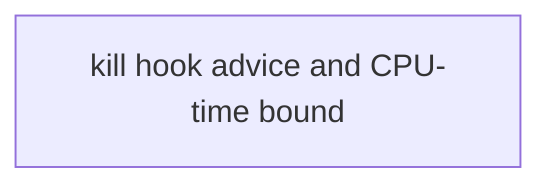

# Superlite: kill hook names a way out the classifier allows; its speed test bounds CPU time (B215, #830 #792)

**Goal:** the name-or-pattern block of `hooks/block-unsafe-kill` stops steering agents into a later-call `kill <PID>` that Claude Code's auto-mode classifier refuses (#830), and `test_long_inputs_stay_fast_666` stops failing on its 10 s wall-clock bound under `-n 4` (#792).
**Architecture:** the hook picks its block message by mode (bash or PowerShell) and names ending a helper in the call that started it, the harness's stop tool, and what to do when a classifier refuses a later kill. The test file measures the hook's CPU time through a `_child_seconds` helper (`resource.getrusage(RUSAGE_CHILDREN)`), wall time where `resource` is missing (Windows).
**Tech stack:** bash 3.2 (the hook), Python 3.10+ stdlib with pytest (the tests), through `sl run_tests`.
**Spec:** this file, section Design; issues #830, #792.
**Detail:** tests
**Target-min:** 11
**Wave0:** none
**Worktree:** none
**Coverage:** off

Global constraints:
- The hook stays bash 3.2 syntax with builtins only, LF endings, exit 2 with the message on stderr; every other block path and message stays byte for byte.
- This repository is public: no host names, user names, home paths, other project or repository names in code, tests, docs or commit messages.
- Builds: the verdict is `sl run_tests` (the project's test command; a project with `.maxapp` runs `maxapp test`, which a build pool may place on another Mac, and a full run whose tree a green maxapp test stamp covers returns that result without a run); task trees build in <tree>/.build/DerivedData and any build of your own goes under .build/ of the worktree, never -derivedDataPath outside the worktree (your session scratchpad included; backlog cleanup removes scratchpad build folders when the worktree goes); a product, simulator or device build stays on this machine and runs only when an issue's acceptance asks for a running-app check.
- Simulators: append the UDID of each simulator you or a worker creates (`xcrun simctl create` or `clone`; a checker's `Simulators:` line marks its created ones) as one line to /Users/max/github/superlite/.claude/worktrees/superlite-b215-kill-hook-advice-and-test-bound/.superlite/simulators.txt; never list one you did not create; ship cleanup shuts down and deletes each listed one.

## Design

#830: a debugging subagent was blocked for a name-based kill, followed the advice `Kill only the PIDs you started (kill <PID>, ...)` with `kill <pid> <pid>` in a later call, and the auto-mode classifier refused it ("Interfere With Workloads"). Measured by the lead at 1.5.220 in an auto-mode session: `sleep 30 & p=$!; kill $p` in one call ran (exit 143); both advised forms below pass the current hook (exit 0).

Ruling: the name-or-pattern block message keeps its first sentence and replaces the advice by a mode-specific text (exact text in T1): end only processes you started, in the same call that started them (bash `helper & pid=$!; ...; kill $pid`, PowerShell `$p = Start-Process <cmd> -PassThru; ...; Stop-Process -Id $p.Id`); if you have it, the harness's stop tool ends a background command (Claude Code: TaskStop); an auto-mode classifier may refuse a later-call kill: leave that process to end on its own and start the next helper so it ends by itself (lead's ruling).
Ruling: the shared-service message (`kill PID` of Xcode, the Simulator, claude, ...) stays unchanged: it already says to ask the user (lead's ruling).
Ruling: `docs/hooks.md` (no open batch lists it) gets one sentence on the new advice in the `block-unsafe-kill` line (lead's ruling).

#792: the 10 s bound is wall time, which grows while the hook waits for a core under `-n 4`. B160 measured the hook at 84 ms for a 1000-line heredoc and the quadratic bug it guards at 29.4 s for 1000 lines (about 265 s for the test's 3000).

Ruling: the test bounds the CPU time of the hook process (`resource.getrusage(RUSAGE_CHILDREN)` user plus system, before and after the run) at the same 10 s; where `resource` is missing (Windows) it keeps the wall-clock bound. SUPERLITE_GUARD_SECONDS stays the coordinator judge's budget (#739) and is not read here (lead's ruling).

## Task graph

```mermaid
%% schedule
gantt
  title Predicted schedule (mm:ss)
  dateFormat X
  axisFormat %M:%S
  section lane 1
  T1 Kill hook way-out message and CPU-tim :t1, 0, 217s
```





critical path: T1 (3.6 min) · peak width 1 · predicted build 3.6 min · predicted total ≈ 12.1 min (target ✗ 11.0)

## Package: kill hook

App type: hook (bash judge of a command string). Categories: encoding (`$!`, `$pid`, `$p.Id` must print literally from a double-quoted bash string), protocol (exit code and stderr per mode), numeric (the time bound).
**Probe entry:** none (a bash hook read from stdin; the named tests below cover each case)

### T1 Kill hook way-out message and CPU-time speed bound · Complexity 3 · Est. context 40k
**Owns:** hooks/block-unsafe-kill, tests/scripts/test_block_unsafe_kill.py, docs/hooks.md
**Components:** 2
**LOC owned:** 80
**Tests:** fast
**Model:** sonnet
**Kind:** design
**Produces:** _child_seconds(fn: Callable[[], T]) -> tuple[T, float] (test helper in tests/scripts/test_block_unsafe_kill.py)
**Review Focus:** encoding: `test_block_names_same_call_kill_830` (the bash message prints `$!` and `$pid` literally); protocol: `test_powershell_block_names_passthru_830` (PowerShell mode gets its own text, no `$!`); numeric: `test_child_seconds_ignore_waiting_792` (a `sleep 1` child counts under 0.5 s).
**Test code (verbatim):** add near the imports at the top of tests/scripts/test_block_unsafe_kill.py:
```python
try:
    import resource
except ImportError:  # Windows: no child CPU time; _child_seconds falls back to wall time
    resource = None

needs_rusage = pytest.mark.skipif(resource is None, reason="no child CPU time on this OS")
```
Replace the body of `test_long_inputs_stay_fast_666` so it reads:
```python
def test_long_inputs_stay_fast_666():
    body = "\n".join(f"pkill -f server{i}  # kill {i}" for i in range(3000))
    code = "\n".join(f'print("pkill -f server{i}")' for i in range(3000))
    for cmd in (f"cat > notes.txt <<'EOF'\n{body}\nEOF\necho done", f"python3 -c '{code}'"):
        r, seconds = _child_seconds(lambda: run(cmd))
        assert r.returncode == 0
        assert seconds < 10, seconds
```
Append at the end of the file:
```python
# --- #792: the speed bound counts the hook's CPU time, which does not grow while it waits for a core


@needs_rusage
def test_child_seconds_ignore_waiting_792():
    r, seconds = _child_seconds(lambda: subprocess.run([BASH, "-c", "sleep 1"]))
    assert r.returncode == 0
    assert seconds < 0.5, seconds


@needs_rusage
def test_child_seconds_count_cpu_792():
    r, seconds = _child_seconds(lambda: subprocess.run([BASH, "-c", "i=0; while ((i < 100000)); do ((i++)); done"]))
    assert r.returncode == 0
    assert seconds > 0.02, seconds


# --- #830: the block names ways to end your own processes that an auto-mode classifier allows


def test_block_names_same_call_kill_830():
    r = run("pkill -f server")
    assert r.returncode == 2
    for part in ("helper & pid=$!; ...; kill $pid", "Claude Code: TaskStop", "auto-mode classifier",
                 "kill <PID>", "caffeinate -w <PID>", "Windows: taskkill /PID <PID>"):
        assert part in r.stderr, part
    assert "Kill only the PIDs you started" not in r.stderr


def test_powershell_block_names_passthru_830():
    r = run("Stop-Process -Name node", "PowerShell")
    assert r.returncode == 2
    for part in ("$p = Start-Process <cmd> -PassThru; ...; Stop-Process -Id $p.Id", "Claude Code: TaskStop",
                 "auto-mode classifier", "Stop-Process -Id <PID>"):
        assert part in r.stderr, part
    assert "$!" not in r.stderr


def test_advised_forms_pass_the_hook_830():
    assert run("sleep 30 & pid=$!; sleep 1; kill $pid").returncode == 0
    assert run("$p = Start-Process sleep -PassThru; Stop-Process -Id $p.Id", "PowerShell").returncode == 0


def test_docs_name_the_way_out_830():
    text = (ROOT / "docs" / "hooks.md").read_text(encoding="utf-8")
    line = next(ln for ln in text.splitlines() if ln.startswith("- `block-unsafe-kill`: always on"))
    for word in ("#830", "TaskStop", "`$!`", "-PassThru", "auto-mode classifier"):
        assert word in line, word
```
**Steps:** 1 add the test code above, 2 run: FAIL (NameError `_child_seconds`, old message), 3 write `_child_seconds` below `run()` and the hook and doc edits in Notes, 4 run: PASS.
**Notes:**
- `_child_seconds(fn)`: calls `fn()` once and returns `(its result, seconds)`. With `resource`: seconds = the growth of `ru_utime + ru_stime` of `resource.getrusage(resource.RUSAGE_CHILDREN)` across the call. Without it: `time.monotonic()` growth. Docstring names #792 and why CPU time holds under a parallel suite.
- Hook: replace the one `BLOCK_MSG=...` line (line 95) by the bash text, then `[[ $MODE == ps ]] && BLOCK_MSG=...` with the PowerShell text. In the double-quoted bash strings escape every `$` of the advice as `\$` so `$!`, `$pid`, `$p` print literally. Bash text, exactly as printed:
  `Blocked: this command kills processes by name or pattern, which can stop other sessions' processes. End only processes you started, in the same call that started them: helper & pid=$!; ...; kill $pid. If you have it, your harness's stop tool ends a background command (Claude Code: TaskStop). An auto-mode classifier may refuse kill <PID> of a process from an earlier call: leave that process to end on its own and start the next helper so it ends by itself (caffeinate -w <PID>, a loop with a deadline). Windows: taskkill /PID <PID>.`
  PowerShell text, exactly as printed:
  `Blocked: this command kills processes by name or pattern, which can stop other sessions' processes. End only processes you started, in the same call that started them: $p = Start-Process <cmd> -PassThru; ...; Stop-Process -Id $p.Id. If you have it, your harness's stop tool ends a background command (Claude Code: TaskStop). An auto-mode classifier may refuse Stop-Process -Id <PID> of a process from an earlier call: leave that process to end on its own and start the next helper so it ends by itself (a loop with a deadline).`
- docs/hooks.md: append to the end of the line starting "- `block-unsafe-kill`: always on" (one space first): "A name-or-pattern block names the way out (#830): end a helper in the call that started it (`helper & pid=$!; ...; kill $pid`; PowerShell `Start-Process -PassThru`, then `Stop-Process -Id $p.Id`) or with the harness's stop tool (Claude Code: TaskStop), since an auto-mode classifier may refuse a `kill <PID>` of an earlier call's process."
- Update the hook's header comment only if it names the old advice; it does not today.

## Review Focus

- Package kill hook (hook): encoding, protocol, numeric; the cases are in T1. Specific risks: an unescaped `$` in the double-quoted message expanding to an empty string or a PID; the PowerShell text leaking into bash mode or the reverse; a CPU-time helper that reads 0 for every child (`test_child_seconds_count_cpu_792` guards it).

## Self-review

Coverage: #830 (message per mode, advised forms pass, docs), #792 (CPU-time bound, helper proven on a waiting and a busy child). Placeholders: none. One task owns all three files, so no two tasks share a file.
