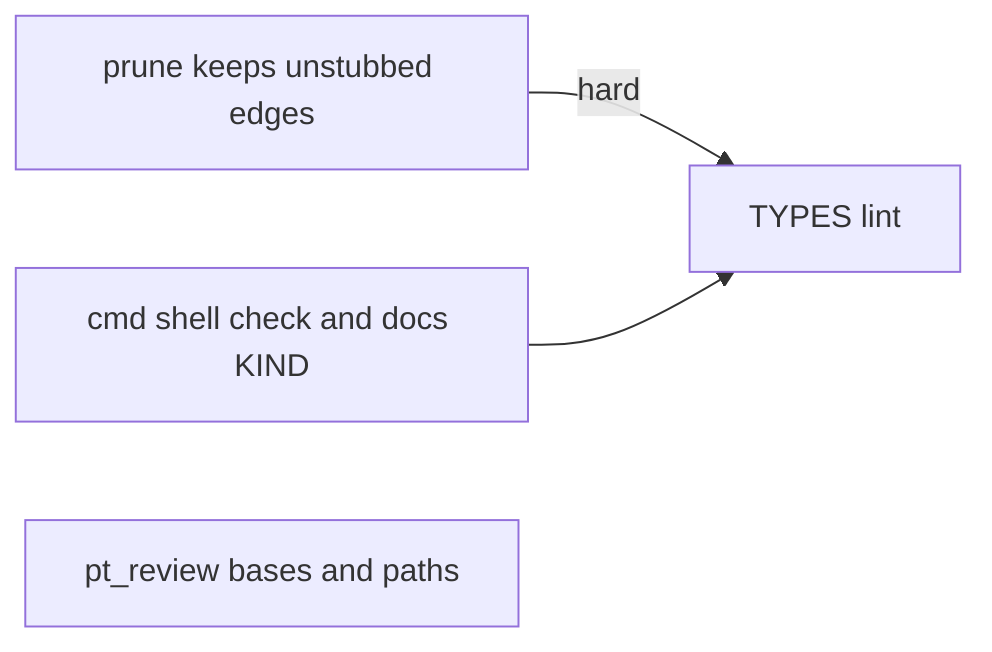

# Superlite: plan lint and contract checks read what plans really write (B213, #795 #796 #801 #803 #805 #822)

**Goal:** six false accepts or false alarms in plan lint, prune and the pt_review contract and packet go away: a typing base (`NamedTuple`) reads as a base (#795); prune keeps an edge whose producer gets no Wave 0 stub (#796); lint rejects a `cmd=` that is not valid shell (#801); a docs-only task with a `cmd=` check can be mechanical (#803); lint rejects a type a Produces signature names that a task the producer does not depend on declares (#805); section 4 collapses a doubled multi-folder prefix (#822).
**Architecture:** `wave0.stubbed_ids` names the tasks Wave 0 stubs; `shape.removable_edges` (prune, `EDGE:`, shape line) and the new `TYPES:` lint use it. `plan_tools.tests_issues` checks `cmd=` with `sh -n`; `not_mechanical_reasons` accepts docs-only Owns with a `cmd=`. `pt_review`'s introspection adds the typing pseudo-bases; `norm_path` collapses any repeated leading prefix.
**Tech stack:** Python 3.10+ stdlib; pytest through `sl run_tests`.
**Spec:** this file, section Design; issues #795, #796, #801, #803, #805, #822.
**Detail:** contracts
**Target-min:** 11
**Wave0:** none
**Worktree:** none
**Coverage:** off

Global constraints:
- Every script line keeps the repo's `# O(...)` complexity comment; stdlib only; LF endings.
- This repository is public: no host names, user names, home paths, other project or repository names in code, tests, docs or commit messages.
- New tests go in new files named in Owns; an existing test file changes only where Owns lists it.
- Builds: the verdict is `sl run_tests` (the project's test command; a project with `.maxapp` runs `maxapp test`, which a build pool may place on another Mac, and a full run whose tree a green maxapp test stamp covers returns that result without a run); task trees build in <tree>/.build/DerivedData and any build of your own goes under .build/ of the worktree, never -derivedDataPath outside the worktree (your session scratchpad included; backlog cleanup removes scratchpad build folders when the worktree goes); a product, simulator or device build stays on this machine and runs only when an issue's acceptance asks for a running-app check.
- Simulators: append the UDID of each simulator you or a worker creates (`xcrun simctl create` or `clone`; a checker's `Simulators:` line marks its created ones) as one line to /Users/max/github/superlite/.claude/worktrees/superlite-b213-plan-lint-and-contract-checks/.superlite/simulators.txt; never list one you did not create; ship cleanup shuts down and deletes each listed one.

## Design

Causes (researchers R1-R6):
- #795: `parse_sig` reads `Admission(NamedTuple)` as a def parameter list (one bare name parses as one), so B98's `_bases_only` never runs; `compare_sig` takes the bases path only when every name is in the class's MRO, and `NamedTuple`/`TypedDict` are never in it (MRO `Admission, tuple, object`), so the fields come back as extra parameters.
- #796: `shape.removable_edges` (prune, `EDGE:`, shape line) never asks whether the producer gets a Wave 0 stub; `startable` already does.
- #801: `testcmd.task_command` takes everything after `cmd=` to the field end; `run_tests` runs it with `shell=True`; `tests_issues` skips a task with `cmd=` and never checks it.
- #803: `not_mechanical_reasons`' last reason reads only the task text, never the `cmd=` or the Owns.
- #805: no lint maps a type in a Produces signature to the task declaring it; a bare `Consumes: MergeState (T3, by name)` parses as no signature and is skipped.
- #822: `norm_path` compares `parts[0] == parts[1]` only, so a two-folder prefix (`Packages/P/Packages/P/...`) never collapses.

Ruling: #795 is fixed in the introspection subprocess: a class gets `NamedTuple` added to its bases when it subclasses tuple and has `_fields`, `TypedDict` when it subclasses dict and has `__required_keys__`; `compare_sig` is unchanged, so `Name(NamedTuple)` takes its existing bases path (lead's ruling; a marker list inside compare_sig would accept `NamedTuple` on any class).
Ruling: #796 is task-level, as the issue asks: an edge is removable only when its producer is in `wave0.stubbed_ids` (empty under `**Wave0:** none`; else the tasks `stub_picks` lists for the plan's root); a producer that only edits existing files gets no stub, so its edges stay too (lead's ruling).
Ruling: #801: lint rejects, never rewrites: `TESTS: Tn cmd= is not valid shell (<sh -n's first error line>): end the command at the field's end, join steps with &&, put notes in **Notes:**`, checked with `sh -n -c` (run_tests uses `shell=True`, i.e. `/bin/sh`), 10 s timeout, skipped for draft tasks and when no `sh` is on PATH; it runs whether or not a test command resolves. PLATFORM's advice names `cmd=` joined with `&&` (lead's ruling).
Ruling: #803: the `no test code or contract` reason is skipped when every Owns entry has a `testcmd.DOC_EXT` suffix and the Tests field has a `cmd=`; the other KIND reasons still apply; task-template.md's Kind row says so (lead's ruling).
Ruling: #805 is an issue, not a WARNING (exact plan data, like the parallel-Owns issue): `TYPES:` when a Produces signature of P names a type X that task D declares, D != P, D not an ancestor of P, and either D depends on P or D gets no Wave 0 stub. D declares X when D's Produces has a class item `mod.X(...)` or a bare capitalised item `X`, else when any task's Consumes has a bare item `X (D ...)` naming one task (lead's ruling).
Ruling: #822: `norm_path` collapses the shortest repeated leading prefix of k folders (k >= 1, at least one part after both copies) when the shorter path exists and the doubled one does not, and rescans; a path where neither exists stays as written (lead's ruling).
Ruling: files outside the brief's list that no open batch lists: shape.py, skills/writing-plans/split.md and task-template.md, tests/scripts/test_lint_platform_516.py (message pin), the new tests (lead's ruling). writing-plans SKILL.md stays untouched (no evals run needed).

## Task graph

```mermaid
%% schedule
gantt
  title Predicted schedule (mm:ss)
  dateFormat X
  axisFormat %M:%S
  section lane 1
  T2 Lint checks cmd= as shell a docs-only :t2, 0, 582s
  T4 TYPES a Produces type declared by a t :t4, 582, 555s
  section lane 2
  T1 Prune keeps an edge whose producer ge :t1, 0, 578s
  section lane 3
  T3 pt_review reads typing bases and doub :t3, 0, 578s
```

critical path: T2 → T4 (18.9 min) · peak width 3 · predicted build 18.9 min · predicted total ≈ 35.4 min (target ✗ 11.0)

## Package: plan lint and prune

App type: library (lint CLI). Categories: state (graph ancestors), encoding (shell syntax).
**Probe entry:** none (a lint; the named tests below cover each case)

### T1 Prune keeps an edge whose producer gets no Wave 0 stub · Complexity 3 · Est. context 40k
**Owns:** skills/subagent-driven-development/scripts/wave0.py, skills/subagent-driven-development/scripts/shape.py, skills/writing-plans/split.md, tests/scripts/test_prune_wave0_796.py
**Components:** 2
**LOC owned:** 90
**Tests:** fast
**Model:** sonnet
**Kind:** design
**Produces:** wave0.stubbed_ids(plan: Plan, root: Path | None = None) -> set[str]
  e.g. stubbed_ids(plan with **Wave0:** none) -> set()
  e.g. stubbed_ids(plan where T1 owns new src/pkg/t1.py and T2 consumes its signature item) -> {"T1"}
**Review Focus:** state: `removable_edges` keeps every other rule (hard edges, examples, skip); `EDGE:` and the shape line follow prune.
**Test code:** in tests/scripts/test_prune_wave0_796.py, using the `plan()`/`task()` helpers style of tests/scripts/test_shape.py (`test_hard_edges_are_kept_by_prune_and_edge_notes`, line 140):
- `test_wave0_none_keeps_example_edge`: the T1->T2 plan whose T2 consumes T1's item with an `e.g.` line, header plus `**Wave0:** none`: `plan_tools prune` prints `pruned: no removable edges`, lint prints no `EDGE:` line, `wave0.stubbed_ids(plan) == set()`.
- `test_existing_owns_get_no_stub_and_keep_edge`: same plan without the header line, T1's only non-test Owns file created on disk under the plan's root first: `stubbed_ids(plan, root) == set()`, prune prints `pruned: no removable edges`.
- `test_stubbed_producer_edge_still_pruned`: same plan, T1's file absent: `stubbed_ids(plan, root) == {"T1"}`, prune prints `pruned: T1->T2`.
**Steps:** 1 failing tests, 2 run: FAIL, 3 add `stubbed_ids` next to `stub_picks` (empty when `plan.header_wave0_off()`), call it in `shape.removable_edges` (import wave0 lazily; root = `pt.stable_root(str(plan.path))` when the plan has a path, else None) and require the producer in it, 4 run: PASS plus `run_tests --fast tests/scripts/test_shape.py tests/scripts/test_wave0.py`, 5 split.md rule 7: after "or run `plan_tools prune` before the first dispatch" add "(it keeps an edge whose producer gets no Wave 0 stub: `**Wave0:** none`, or no new file to stub)".

### T2 Lint checks cmd= as shell; a docs-only task with cmd= can be mechanical · Complexity 3 · Est. context 45k
**Owns:** skills/subagent-driven-development/scripts/plan_tools.py, skills/writing-plans/task-template.md, tests/scripts/test_lint_platform_516.py, tests/scripts/test_lint_cmd_shell_801.py, tests/scripts/test_kind_docs_cmd_803.py
**Components:** 2
**LOC owned:** 110
**Tests:** fast
**Model:** sonnet
**Kind:** design
**Produces:** plan_tools.tests_issues(plan: Plan, root: Path | None) -> list[Issue] (unchanged signature; adds the shell check)
**Review Focus:** encoding: a quoted `(` or `&&` stays valid; state: draft tasks and plans without a resolvable test command.
**Test code:** lint output via the `issues_of(p)` style of tests/scripts/test_lint_tests_cmd_475.py (line 81) and `kind_plan`/`lint` of tests/scripts/test_0_3_1_scripts.py (lines 388-402):
- `test_prose_after_cmd_rejected`: `**Tests:** slow cmd=swift test --filter X (then FOO=off swift test --triple arm64-apple-ios)` gives one issue starting `TESTS: T1 cmd= is not valid shell`.
- `test_joined_cmd_accepted`: `**Tests:** slow cmd=swift test --filter X && xcodebuild build -destination 'generic/platform=iOS'` and `**Tests:** fast cmd=bash tests/hooks/test.sh` give no `TESTS: T1 cmd=` issue.
- `test_quoted_paren_accepted`: `cmd=python3 -c 'print("(x")'` gives none.
- `test_draft_task_not_checked`: the prose cmd on a `**Status:** draft` task gives none.
- `test_checked_without_test_command`: the prose cmd in a project with no resolvable test command still gives the issue.
- `test_docs_only_cmd_is_mechanical`: Kind mechanical, Owns `docs/guide.md`, `**Tests:** fast cmd=bunx prettier --check docs`, no test code: no `KIND:` line.
- `test_code_owns_cmd_not_mechanical`: same with Owns `src/a.py`: `KIND: T1 is not mechanical: no test code or contract with exact inputs and outputs`.
- `test_docs_only_without_cmd_not_mechanical`: Owns `docs/guide.md`, `**Tests:** fast`: the same KIND reason.
- test_lint_platform_516.py: its pinned message becomes the new PLATFORM text below.
**Steps:** 1 failing tests, 2 run: FAIL, 3 implement (shell check before `tests_issues`' early returns; `not_mechanical_reasons` uses `testcmd.DOC_EXT` and `testcmd.task_command`, imported lazily as `tests_issues` does), 4 run: PASS plus `run_tests --fast tests/scripts/test_lint_tests_cmd_475.py tests/scripts/test_lint_platform_516.py tests/scripts/test_0_3_1_scripts.py`.
**Notes:** PLATFORM text ends: "put that platform's build in the task's steps or in its cmd=, joined with && (e.g. **Tests:** slow cmd=<tests> && xcodebuild build -destination 'generic/platform=iOS'), and set **Tests:** slow". task-template.md Tests row, after "runs it instead of the runner": "(the whole rest of the field runs in `sh`: join steps with `&&`, prose goes in Notes; lint rejects (`TESTS:`) a cmd= `sh -n` refuses)"; Kind row: "test code or named tests with exact inputs and outputs (a docs-only task: a `cmd=` check)".

### T4 TYPES: a Produces type declared by a task the producer does not depend on · Complexity 4 · Est. context 50k
**Owns:** skills/subagent-driven-development/scripts/plan_tools.py, skills/writing-plans/task-template.md, tests/scripts/test_lint_types_805.py
**Components:** 1
**LOC owned:** 130
**Tests:** fast
**Model:** sonnet
**Kind:** design
**Consumes:** wave0.stubbed_ids(plan: Plan, root: Path | None = None) -> set[str] (T1)
**Produces:** plan_tools.types_issues(plan: Plan, graph: dict[str, list[str]], root: Path | None) -> list[Issue]
**Review Focus:** state: ancestors over the taskgraph, not direct edges; a type declared by the producer itself or an ancestor never warns.
**Test code:** in tests/scripts/test_lint_types_805.py, plans in tmp_path linted as in tests/scripts/test_plan_tools.py (`test_lint_and_schedule_accept_letter_prefixed_task_ids`, line 193), header `**Wave0:** none` unless named:
- `test_consumer_declares_type`: T3 Produces `state.MergeState(Enum)`, T4 Produces `merge.run(x: int) -> MergeState`, edge T4 --> T3: issue `TYPES: T4 Produces names MergeState, which T3 declares, and T3 depends on T4: declare MergeState in T4 or in a task both depend on`.
- `test_by_name_consume_declares`: T3 has no class item; T4 Consumes `MergeState (T3, by name)`, T4 Produces `merge.run(x: int) -> MergeState`, edge T4 --> T3: the same issue.
- `test_parallel_unstubbed`: no edge between T3 and T4: issue `TYPES: T4 Produces names MergeState, which T3 declares; T4 does not depend on T3 and no Wave 0 stub of T3 provides it: declare MergeState in T4, or add T3 --> T4`.
- `test_parallel_stubbed_ok`: no `**Wave0:** none`, T3's state.py absent and T4 consumes `state.MergeState(Enum)` from T3: no TYPES line.
- `test_ancestor_or_self_ok`: edge T3 --> T4 (T3 declares): no TYPES line; T4 declaring MergeState itself: no TYPES line.
**Steps:** 1 failing tests, 2 run: FAIL, 3 implement `types_issues` (types from `signature_types(parse_signature(item))`; ancestors from `ancestors(graph)`), call it from `lint_plan` where `anc` is computed, 4 run: PASS plus `run_tests --fast tests/scripts/test_plan_tools.py tests/scripts/test_lint_tests_cmd_475.py`, 5 task-template.md Consumes/Produces row, append: "A type a Produces signature names is declared by that task or one it depends on; lint rejects (`TYPES:`) one declared by a task that depends on it, or by a parallel task no Wave 0 stub covers."

## Package: review contract and packet

App type: library (pt_review). Categories: deep (class MRO), encoding (paths).
**Probe entry:** none (a review tool; the named tests below cover each case)

### T3 pt_review reads typing bases and doubled multi-folder paths · Complexity 3 · Est. context 45k
**Owns:** skills/subagent-driven-development/scripts/pt_review.py, tests/scripts/test_pt_review_typing_bases_795.py, tests/scripts/test_packet_doubled_prefix_822.py
**Components:** 2
**LOC owned:** 90
**Tests:** fast
**Model:** sonnet
**Kind:** design
**Produces:** pt_review.norm_path(root: Path, file: str) -> str (unchanged signature; any repeated prefix)
**Review Focus:** deep: a non-typing class keeps the B98 base and parameter compare; encoding: `src/src/x` where both exist stays.
**Test code:** #795 with the `project`/`check` helpers of tests/scripts/test_pt_review_exception_class_415.py (lines 47-78), source `class Admission(NamedTuple): gate: str; ok: bool` and `class Opts(TypedDict): name: str`:
- `test_namedtuple_base_matches`: Produces `full_gate.Admission(NamedTuple)` gives no messages.
- `test_typeddict_base_matches`: `full_gate.Opts(TypedDict)` gives no messages.
- `test_namedtuple_fields_still_compared`: `full_gate.Admission(gate: str, ok: bool)` gives none; `full_gate.Admission(gate: str)` gives `extra parameter 'ok'`.
- `test_wrong_base_still_reported`: `full_gate.Admission(Exception)` gives at least one message.
#822 with the `proj` fixture style of tests/scripts/test_packet_incidents_592.py (line 30), file `Packages/P/Tests/x.swift` created:
- `test_two_folder_prefix_collapsed`: `norm_path(proj, "Packages/P/Packages/P/Tests/x.swift") == "Packages/P/Tests/x.swift"`.
- `test_one_folder_prefix_still_collapsed`: `pkg/pkg/src/a.py` -> `pkg/src/a.py` (file `pkg/src/a.py`).
- `test_neither_exists_kept`: `Packages/Q/Packages/Q/Tests/y.swift` stays as written.
- `test_doubled_exists_kept`: with `src/src/x.py` and `src/x.py` both on disk, `src/src/x.py` stays.
- `test_section4_incident_path`: an incident at `Packages/P/Packages/P/Tests/x.swift` is listed in the packet's section 4 as `Packages/P/Tests/x.swift`.
**Steps:** 1 failing tests, 2 run: FAIL, 3 implement (bases in the introspection script near pt_review.py:699; `norm_path`'s loop), 4 run: PASS plus `run_tests --fast tests/scripts/test_pt_review_exception_class_415.py tests/scripts/test_packet_incidents_592.py`.

## Review Focus

- state: T1 and T4 read the same stub set; ancestors, not direct edges.
- encoding: `sh -n` syntax, quoted parens; path prefixes.
- deep: class MRO and typing pseudo-bases.

## Self-review

Coverage: #796 T1, #801 and #803 T2, #795 and #822 T3, #805 T4. T2 and T4 share plan_tools.py and task-template.md, ordered by T2 --> T4; T4's tests run T1's code (hard edge). No placeholders.
