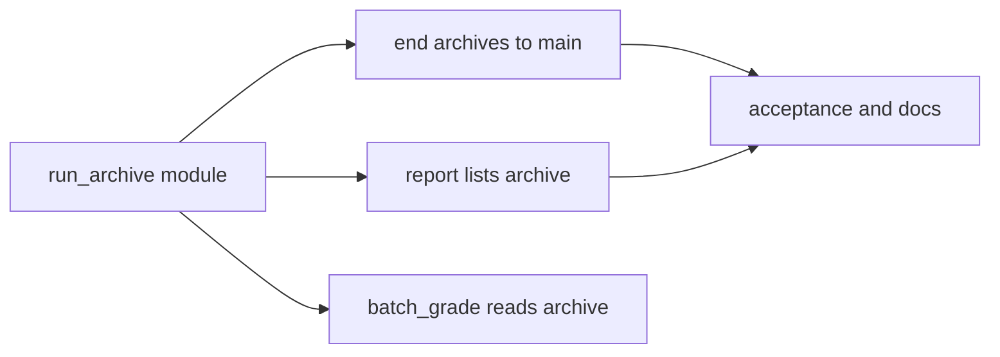

# Superlite: orchestrator end archives each run in the main checkout (B222, #843)

**Goal:** `sl orchestrator end` moves a run into `<main checkout>/.superlite/runs/<id>/` with a `run.json` manifest (plan, branch, worktree, batch), plus copies of the plan and its build report, so the run outlives its worktree; `sl report --list/--show`, `predict_live.ledger_paths` and `batch_grade` find it there; a size rule trims old runs.
**Architecture:** a new module `run_archive.py` (T1) owns where runs go and how readers find them; `orchestrator.end` (T2) writes through it; `report.py` (T3) and `batch_grade.py` (T4) read through it; T5 holds the #843 acceptance test (end in a worktree, remove it, find the run) and the docs.
**Tech stack:** Python 3.10+ stdlib; pytest through `sl run_tests`.
**Spec:** this file, section Design; issue #843.
**Detail:** tests
**Target-min:** 11
**Wave0:** none
**Worktree:** none

Global constraints:
- Every script line keeps the repo's `# O(...)` complexity comment; stdlib only; LF endings.
- This repository is public: no host names, user names, home paths, other project or repository names in code, tests, docs or commit messages.
- Tests never touch the real repository's `.superlite`: every git repo, worktree and archive lives under `tmp_path`.
- Builds: the verdict is `sl run_tests` (the project's test command; a project with `.maxapp` runs `maxapp test`, which a build pool may place on another Mac, and a full run whose tree a green maxapp test stamp covers returns that result without a run); task trees build in <tree>/.build/DerivedData and any build of your own goes under .build/ of the worktree, never -derivedDataPath outside the worktree (your session scratchpad included; backlog cleanup removes scratchpad build folders when the worktree goes); a product, simulator or device build stays on this machine and runs only when an issue's acceptance asks for a running-app check; copy this sentence into every worker brief.
- Simulators: append the UDID of each simulator you or a worker creates (`xcrun simctl create` or `clone`; a checker's `Simulators:` line marks its created ones) as one line to /Users/max/github/superlite/.claude/worktrees/superlite-b222-run-archive-main-checkout/.superlite/simulators.txt; never list one you did not create; ship cleanup shuts down and deletes each listed one; copy this sentence into every worker brief.

## Design

Today `orchestrator.end` (orchestrator.py:148) moves the run files into `sd/runs/<YYYYmmdd-HHMMSS>/` inside the worktree's own `.superlite`; ship removes the worktree, so the ledgers, metrics, plan and build report of every shipped batch are gone (#843, #827). Readers of archived runs: `batch_grade` (`sd/runs/*/metrics.jsonl`, `sd/runs/*/test-summary-*.json`) and `predict_live.ledger_paths` (`<checkout>/.superlite/runs/*/progress.md` over every checkout of `git worktree list`, the main checkout included). `report --list/--show` read only stored build reports in the plans folder.

Ruling: one new module `run_archive.py` holds the archive location, the manifest, the listing and the size rule; end, report and batch_grade call it (lead's ruling: four users of one folder layout; upstream's `run_archive.py` needs a session registry, so ours is new code).
Ruling: the main checkout is `backlog_state.main_root(sd.parent)` (git-common-dir's parent), imported inside the function (no import cycle with backlog_run -> batch_cost -> batch_grade); a state folder outside git, or an archive folder that cannot be created, keeps the old place `sd/runs` (lead's ruling).
Ruling: a run id is `<YYYYmmdd-HHMMSS>-<label>`, label = the batch id (first line of `briefs/lead.md`, else `briefs/lead-build.md`, matching `B<digits>`) else the checkout folder name, cut to 40 characters of `[A-Za-z0-9._-]`; `mkdir(exist_ok=False)` with `-2`, `-3`, ... on a clash, so two leads ending in one second never share a folder (lead's ruling).
Ruling: `run.json` = `{"id", "ended", "worktree", "branch", "plan", "batch", "files"}`; `worktree` is the resolved checkout of sd, `plan` the resolved plan path or null, `branch` null when detached or not git (lead's ruling).
Ruling: end moves what it moves today (shutil.move, so a main checkout on another volume works) and copies (copy2) the plan as `plan.md` and its stored build report pair as `build-report.md` / `build-report.json`; the plan is read before stable.json moves (lead's ruling: those files are committed, moving them would change the branch).
Ruling: size rule: the newest `KEEP_FULL = 30` runs stay whole; each older run keeps only `run.json`, `progress.md`, `metrics.jsonl`, `incidents.jsonl`, `build-report.md`, `build-report.json` and `test-summary*.json`; end prunes after each archive and adds `; N older runs trimmed` to its line when N > 0 (lead's ruling; measured: the main checkout's archive holds 308 KB for 2 runs, the largest worktree archive 800 KB).
Ruling: `batch_grade` reads `run_archive.run_dirs(sd)`: the legacy `sd/runs/*` (no manifest, or a manifest naming sd's checkout) plus the main archive's runs whose manifest names sd's checkout; without it batch rows would fall back to workers $0.00 (B170's measurement) (lead's ruling; batch_grade.py is listed by no open batch).
Ruling: `report --list` prints the stored reports as today, then `archived runs in <archive>:` and one row per run; `--show NAME` falls back to an archived run whose id is NAME, else the newest whose plan stem is NAME; `--root` (already the batch-costs root) also picks the archive (lead's ruling).
Ruling: `predict_live.ledger_paths` already reads the main checkout's `runs/*/progress.md` (the main checkout is the first `git worktree list` entry); T5's acceptance test pins that, and predict_live.py changes only if that test is red (lead's ruling).

Ruling: hard edges T1->T2, T1->T3, T1->T4 - the consumers' tests create real archive folders through run_archive, a stub cannot - cost if wrong: T2-T4 start about 4 min later.
Ruling: accept predicted 31.1 min - the archive module is the one producer every reader runs; T2, T3 and T4 run in parallel after it - cost if wrong: about 10 min of wall-clock.

## Coverage

| Category | State | Basis |
|---|---|---|
| Scope and success criteria | settled | #843: archive in the main checkout, run.json, plan/report/progress kept, readers, size rule; acceptance test in T5 |
| Domain and data model | ruled | run folder `<time>-<label>`, run.json keys above |
| Persistence and migration | ruled | legacy `sd/runs/*` stay readable through run_dirs and ledger_paths; nothing is migrated |
| Interfaces and contracts | ruled | end's line format kept (`run ended; N files moved to <dest>`), report --list rows appended, batch_grade signatures unchanged |
| UI states | n/a | CLI text only |
| Concurrency and state ownership | ruled | exist_ok=False mkdir per run id; prune ignores missing files and never touches the newest 30 |
| Error handling and recovery | ruled | no main checkout or mkdir OSError: sd/runs; unreadable run.json: {} |
| Security and privacy | n/a | local files the user owns; no untrusted input |
| Performance and limits | ruled | KEEP_FULL = 30; ledgers kept forever (KB each) |
| Observability | ruled | end names the destination and the trimmed count; report --list shows each run |
| Testing strategy | ruled | unit tests per module in tmp git repos; T5 end-to-end with a real worktree |
| Compatibility | ruled | legacy run folders without run.json listed with `-` fields |
| Rollout | n/a | ships with the plugin version bump |
| Research unknowns | n/a | none |

## Task graph

```mermaid
%% schedule
gantt
  title Predicted schedule (mm:ss)
  dateFormat X
  axisFormat %M:%S
  section lane 1
  T1 run_archive module :t1, 0, 378s
  T2 orchestrator end archives to the main :t2, 378, 372s
  T5 acceptance a run survives its worktre :t5, 750, 369s
  section lane 2
  T3 report lists and shows archived runs :t3, 378, 369s
  section lane 3
  T4 batch_grade reads the main archive :t4, 378, 362s
```

critical path: T1 → T2 → T5 (18.6 min) · peak width 3 · predicted build 18.6 min · predicted total ≈ 31.1 min (target ✗ 11.0)

## Package: run archive

App type: library and CLI (folder archive, manifest, listing). Categories: state (what moves, what is kept), concurrency (two ends in one second), encoding (run.json, report rows).
**Probe entry:** none (file-system archive driven through git worktrees; the named tests cover each case)

### T1 run_archive module · Complexity 4 · Est. context 40k
**Owns:** skills/subagent-driven-development/scripts/run_archive.py, tests/scripts/test_run_archive_843.py
**Components:** 1
**LOC owned:** 150
**Tests:** fast
**Model:** sonnet
**Kind:** design
**Produces:** run_archive.MANIFEST: str (`"run.json"`) · run_archive.KEEP_FULL: int (30) · run_archive.KEEP_ALWAYS: tuple[str, ...] (`("run.json", "progress.md", "metrics.jsonl", "incidents.jsonl", "build-report.md", "build-report.json")`) · run_archive.archive_dir(sd: Path) -> Path · run_archive.new_run(sd: Path, label: str | None = None) -> Path · run_archive.write_manifest(run: Path, info: dict) -> Path · run_archive.read_manifest(run: Path) -> dict · run_archive.runs(archive: Path) -> list[dict] · run_archive.run_dirs(sd: Path) -> list[Path] · run_archive.prune(archive: Path, keep: int = KEEP_FULL) -> int
e.g. archive_dir(Path("<main>/.claude/worktrees/wt/.superlite")) -> Path("<main>/.superlite/runs") (resolved); archive_dir(Path("<not git>/.superlite")) -> Path("<not git>/.superlite/runs")
e.g. new_run(sd, "B222") at 2026-11-14 23:59:58 -> <archive>/20261114-235958-B222; a second call that second -> <archive>/20261114-235958-B222-2; new_run(sd, "a b/c") -> <archive>/20261114-235958-a-b-c
e.g. runs(archive) -> [{"id": "20261114-235958-B222", "dir": Path(...), "batch": "B222", "worktree": "/r/wt", "plan": "/r/wt/docs/plans/p.md", ...}, {"id": "20261101-120000", "dir": Path(...)}] (newest name first; a folder without run.json gives only id and dir)
**Review Focus:** state: prune never removes a KEEP_ALWAYS file or a `test-summary*.json`, never touches the newest `keep` runs, unlinks a symlink without following it; concurrency: new_run never returns an existing folder; error: an OSError (not FileExistsError) creating the main archive falls back to `sd/runs`.
**Test code (contracts):** a helper makes a main repo in tmp_path (`git init`, one commit) and `git worktree add <tmp>/wt -b feat`.
- `test_archive_dir_of_a_worktree_is_main`: `archive_dir(wt/".superlite") == (main/".superlite"/"runs").resolve()`; for the main checkout's own sd the same path.
- `test_archive_dir_outside_git`: `archive_dir(tmp/"x"/".superlite") == tmp/"x"/".superlite"/"runs"`.
- `test_new_run_names_and_clash`: two `new_run(wt_sd, "B222")` calls give two different existing folders under the main archive, the first matching `^\d{8}-\d{6}-B222$`, the second (same second, `time.strftime` monkeypatched to a fixed value) ending `-B222-2`; `new_run(sd, "a b/c")` name ends `-a-b-c`; a 60-char label is cut to 40; `new_run(sd)` name matches `^\d{8}-\d{6}$`.
- `test_new_run_falls_back_when_archive_unwritable`: `archive_dir` monkeypatched to a path under a read-only folder (chmod 0o500): the run is created under `sd/"runs"`.
- `test_manifest_round_trip`: `write_manifest(run, {"id": "x", "batch": None})` writes `run/"run.json"`; `read_manifest` returns the dict; invalid json, a json list and a missing file each give `{}`.
- `test_runs_newest_first`: folders `20261101-120000` (no manifest) and `20261114-235958-B1` (manifest batch B1) give ids in that order reversed, the first carrying `"batch": "B1"`; a plain file in the archive is skipped; a missing archive gives `[]`.
- `test_run_dirs_matches_checkout`: main archive runs with manifest `worktree` = wt (resolved) and = another path, plus a legacy `wt/.superlite/runs/20261101-120000` without manifest: `run_dirs(wt_sd)` returns the legacy folder and the matching archive run, oldest first, not the other one; for a missing sd it returns `[]`.
- `test_prune_keeps_ledgers`: 3 runs each holding run.json, progress.md, metrics.jsonl, test-summary-1.json, build-report.json, plan.md, briefs/x.md and a symlink `lnk` to a file outside: `prune(archive, keep=1) == 2`; the newest run is untouched; the two older keep exactly the ledger files, `plan.md`, `briefs/` and `lnk` are gone and the link target still exists; a second `prune(archive, keep=1) == 0`.
**Steps:** 1 failing tests, 2 run: FAIL, 3 implement (module docstring lists the API; `archive_dir` catches RuntimeError and OSError from `backlog_state.main_root`), 4 run: PASS, 5 `run_tests --fast tests/scripts/test_run_archive_843.py` green.

### T2 orchestrator end archives to the main checkout · Complexity 4 · Est. context 45k
**Owns:** skills/subagent-driven-development/scripts/orchestrator.py, tests/scripts/test_orchestrator_end_archive_843.py, tests/scripts/test_orchestrator_end_summaries.py, tests/scripts/test_orchestrator_end_lead_brief_791.py, tests/scripts/test_orchestrator_end_scratch_690.py
**Components:** 1
**LOC owned:** 110
**Tests:** fast
**Model:** sonnet
**Kind:** design
**Consumes:** run_archive.new_run(sd: Path, label: str | None = None) -> Path (T1) · run_archive.write_manifest(run: Path, info: dict) -> Path (T1) · run_archive.prune(archive: Path, keep: int = KEEP_FULL) -> int (T1)
**Produces:** orchestrator.end(sd: Path, plan: str | None = None) -> str · orchestrator.lead_batch(sd: Path) -> str | None
e.g. lead_batch(sd) with briefs/lead.md first line `# Lead brief: B222 (run-archive)` -> "B222"; no brief -> None
**Review Focus:** state: the plan path is resolved before stable.json moves; the nothing-to-end case creates no run folder; copies never move a committed file; protocol: the printed line keeps `orchestrator: run ended; N files moved to <dest>` (N counts moved entries, briefs as one, copies not counted).
**Test code (contracts):** a main repo plus `git worktree add <tmp>/wt -b feat` as in T1's test; the run in `wt/.superlite` holds stable.json (`{"plan": "<wt>/docs/plans/p.md"}`), progress.md, metrics.jsonl, briefs/lead.md (`# Lead brief: B7 (topic)`) and briefs/T1.md; the plan `wt/docs/plans/p.md` and its `p.build-report.md` / `p.build-report.json` exist.
- `test_end_archives_into_main_checkout`: `end(wt_sd)` returns a line naming `<main>/.superlite/runs/<id>` with id ending `-B7`; that folder holds progress.md, metrics.jsonl, stable.json, briefs/T1.md, plan.md, build-report.md, build-report.json and run.json; `wt_sd/"runs"` does not exist; briefs/lead.md stays in `wt_sd/briefs`; the plan and its report pair still exist in `wt/docs/plans`.
- `test_manifest_fields`: run.json has `id` = the folder name, `batch` "B7", `branch` "feat", `worktree` = `str(wt.resolve())`, `plan` = `str(plan.resolve())`, an `ended` ISO time, and `files` = the sorted names in the folder (run.json included).
- `test_end_without_brief_labels_by_checkout`: no briefs/lead.md: id ends `-wt`, `batch` null.
- `test_end_with_plan_argument`: `end(wt_sd, str(plan))` with no stable.json still copies plan.md and the report pair.
- `test_end_outside_git_keeps_sd_runs`: a state folder in a non-git tmp folder archives under `sd/"runs"` as before.
- `test_end_trims_old_runs`: 30 old run folders (`20261101-1200NN`, NN 00-29, each with progress.md and plan.md) in the main archive, then `end`: the line ends with `; 1 older runs trimmed` (no scratch folder in this fixture) and `20261101-120000` keeps progress.md, loses plan.md.
- `test_cli_end_passes_plan`: `orchestrator.py end --plan <plan>` prints the line and exits 0 (as the existing CLI tests run it).
- Existing end tests (summaries, #791 briefs, #690 scratch) stay green; update only an assertion that pins the old folder name pattern or `sd/"runs"` when the fixture is a git checkout.
**Steps:** 1 failing tests, 2 run: FAIL, 3 implement (`end` computes `plan_file(sd, plan)`, `lead_batch`, the branch via `git -C <checkout> rev-parse --abbrev-ref HEAD`, then `run_archive.new_run`; moves with `shutil.move`; copies with `shutil.copy2` using `report.stored_paths` imported inside `end`; writes the manifest; prunes `dest.parent`; `main` passes `a.plan`; module docstring and `end`'s docstring name the main checkout's `.superlite/runs/<time>-<label>/`), 4 run: PASS, 5 `run_tests --fast tests/scripts/test_orchestrator_end_archive_843.py tests/scripts/test_orchestrator_end_summaries.py tests/scripts/test_orchestrator_end_lead_brief_791.py tests/scripts/test_orchestrator_end_scratch_690.py tests/scripts/test_orchestrator_takeover.py tests/scripts/test_finish_end_trees_614.py tests/scripts/test_session_state.py tests/scripts/test_inline_flow_clear.py` green; another test that pins the old layout: report its path.

### T3 report lists and shows archived runs · Complexity 3 · Est. context 42k
**Owns:** skills/subagent-driven-development/scripts/report.py, tests/scripts/test_report_archive_843.py
**Components:** 1
**LOC owned:** 90
**Tests:** fast
**Model:** sonnet
**Kind:** design
**Consumes:** run_archive.archive_dir(sd: Path) -> Path (T1) · run_archive.runs(archive: Path) -> list[dict] (T1)
**Produces:** report.list_reports(plans_dir, archive=None) -> str · report.show_report(name, plans_dir, full=False, archive=None) -> str
e.g. list_reports(plans, archive) with one archived run -> "no stored reports in <plans>\narchived runs in <archive>:\n  20261114-235958-B7  p  B7  time +1.0  cost +0.10\n"
**Review Focus:** encoding: with `archive=None` or an empty archive both functions return exactly today's text; a run without build-report.json lists as `  <id>  <plan stem or ->  <batch or ->  no build report`; protocol: `--root` picks the archive of that root, the default is the cwd's main checkout.
**Test code (contracts):** a real build report pair from test_report's `fixture`/`go` helpers, copied into `<tmp>/arch/<id>/build-report.md|json` with a run.json (`plan` `<x>/p.md`, `batch` "B7"); a second run `20261101-120000` with no manifest and no report.
- `test_list_appends_archived_runs`: rows in order: the stored reports (if any), `archived runs in <arch>:`, then `  20261114-235958-B7  p  B7  time ... cost ...`, then `  20261101-120000  -  -  no build report`.
- `test_list_without_archive_unchanged`: `list_reports(plans)` and `list_reports(plans, tmp/"none")` equal today's output (`no stored reports in <plans>` for an empty plans folder).
- `test_show_by_run_id`: `show_report("20261114-235958-B7", plans, archive=arch)` starts `build report (projected -> actual)` and names `<arch>/<id>/build-report.md`; `full=True` returns the md text.
- `test_show_by_plan_stem_falls_back_to_archive`: `show_report("p", empty_plans, archive=arch)` finds the B7 run.
- `test_show_run_without_report`: `show_report("20261101-120000", plans, archive=arch)` is `report: archived run 20261101-120000 has no build report; files in <dir>: <sorted names, comma-separated>\n`.
- `test_show_unknown_unchanged`: an unknown name gives today's `report: no stored report for nope in <plans>` line.
- `test_cli_root_picks_archive`: `report.py --list --root <main>` (main a git repo with `.superlite/runs/<id>/run.json`) lists the id.
**Steps:** 1 failing tests, 2 run: FAIL, 3 implement (CLI: `archive = run_archive.archive_dir(Path(a.root or Path.cwd()) / ".superlite")`, passed to both; `--root` help names `.superlite/runs` too; module docstring updated), 4 run: PASS, 5 `run_tests --fast tests/scripts/test_report_archive_843.py tests/scripts/test_report.py tests/scripts/test_build_report_name.py tests/scripts/test_report_batches_680.py` green.

### T4 batch_grade reads the main archive · Complexity 2 · Est. context 30k
**Owns:** skills/subagent-driven-development/scripts/batch_grade.py, tests/scripts/test_batch_grade_archive_843.py
**Components:** 1
**LOC owned:** 50
**Tests:** fast
**Model:** sonnet
**Kind:** design
**Consumes:** run_archive.run_dirs(sd: Path) -> list[Path] (T1)
**Produces:** batch_grade.workers(sd, prices) (unchanged signature; metrics lines from `sd/metrics.jsonl` plus each `run_dirs(sd)` folder's metrics.jsonl, deduped as today) · batch_grade.test_runs(sd) -> dict (unchanged signature; summaries from `sd` plus each `run_dirs(sd)` folder)
**Review Focus:** state: a run of another worktree in the shared archive never counts; legacy `sd/runs/*` still count (test_batch_grade_workers_682.py stays green).
**Test code (contracts):** main repo plus `git worktree add <tmp>/wt` and a second worktree `<tmp>/wt2`; the main archive holds a run with manifest `worktree` = wt (resolved) holding a full and a fast test summary (as test_batch_grade_workers_682's `test_test_runs_after_run_end`) and one for wt2 with one more full summary.
- `test_test_runs_reads_main_archive`: `batch_grade.test_runs(wt/".superlite") == {"full": 1, "full_min": 2.0, "fast": 1, "fast_min": 0.5}`.
- `test_workers_reads_main_archive`: metrics lines in the wt run's metrics.jsonl count for `workers(wt_sd, prices)` exactly as test_batch_grade_workers_682's archived-run case does; the wt2 run's lines do not.
- `test_missing_worktree_folder_empty`: `test_runs(main/".superlite"/"backlog"/"missing-worktree")` gives zero counts.
**Steps:** 1 failing tests, 2 run: FAIL, 3 implement (both readers iterate `run_archive.run_dirs(sd)` instead of `sd.glob("runs/*/...")`; docstring says so), 4 run: PASS, 5 `run_tests --fast tests/scripts/test_batch_grade_archive_843.py tests/scripts/test_batch_grade_workers_682.py tests/scripts/test_batch_cost_680.py tests/scripts/test_batch_cost_flow_680.py` green.

### T5 acceptance: a run survives its worktree; docs · Complexity 3 · Est. context 40k
**Owns:** tests/scripts/test_run_archive_e2e_843.py, skills/subagent-driven-development/scripts/predict_live.py, docs/tools.md, skills/subagent-driven-development/orchestrator.md
**Components:** 1
**LOC owned:** 90
**Tests:** fast
**Model:** sonnet
**Kind:** design
**Consumes:** orchestrator.end(sd: Path, plan: str | None = None) -> str (T2) · report.list_reports(plans_dir, archive=None) -> str (T3) · report.show_report(name, plans_dir, full=False, archive=None) -> str (T3)
**Review Focus:** state: the test removes the worktree with `git worktree remove --force` before it reads; the predictor finds the ledger from the main checkout and from another worktree.
**Test code (contracts):** a main repo, `git worktree add <tmp>/wt -b feat` and `<tmp>/wt2 -b other`; wt's run: stable.json naming `wt/docs/plans/p.md` (committed in wt), progress.md with three `- tests full passed=900 failed=0 skipped=2 seconds=240` lines, metrics.jsonl, briefs/lead.md `# Lead brief: B9 (t)`, and a real build report pair (test_report's helpers, saved as `p.build-report.md|json` next to the plan).
- `test_run_survives_worktree_removal`: run `orchestrator.py end --plan <plan>` (subprocess, cwd wt, exit 0); `git worktree remove --force wt`; then `report.py --list --root <main>` (cwd main) prints a row with the run id (ends `-B9`), `p` and `B9`; `report.py --show <id> --root <main>` starts `build report (projected -> actual)`; `predict_live.ledger_paths(main)` and `predict_live.ledger_paths(wt2)` both contain `<main>/.superlite/runs/<id>/progress.md` (resolved).
**Steps:** 1 write the test, 2 run it; if `ledger_paths` misses the archived ledger, fix predict_live.py (read `run_archive.archive_dir(root / ".superlite")` too) and say so in the report, 3 docs: docs/tools.md `orchestrator` row (end archives into the main checkout's `.superlite/runs/<time>-<label>/` with run.json, plan and build report copies, trims runs past the newest 30 to their ledgers) and its `report` row if one exists (`--list`/`--show` read the archive), orchestrator.md's `end` bullet the same, 4 `run_tests --fast tests/scripts/test_run_archive_e2e_843.py tests/scripts/test_predict_live_605.py tests/scripts/test_predict_live_659.py tests/scripts/test_docs_b95_tools.py tests/scripts/test_docs_b67_fleet.py tests/scripts/test_hooks_doc.py` green; a docs test pinning the old `runs/<time>/` text: report its path.

## Review Focus

- run_archive: prune (KEEP_ALWAYS, newest kept, symlinks), new_run clash and fallback.
- orchestrator.end: plan read before the move, copies vs moves, line format, nothing-to-end path.
- report: unchanged output without an archive; archived rows; --show fallback order.
- batch_grade: only this worktree's runs count.

## Self-review

Coverage: archive location, manifest, plan/report/progress, readers (report, predictor, batch_grade), size rule, acceptance test each map to T1-T5. No placeholders. Consumes match Produces. Edges are execution dependencies only.
