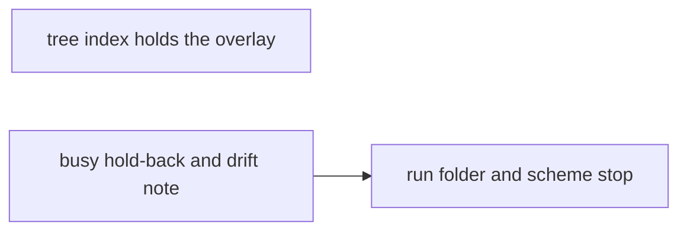

# Superlite: task trees stage their overlay, hold busy fixers' files and run in the package folder (B214, #785 #799 #817)

**Goal:** a task tree's git index holds the files the tree tests (#799), a `--fast` task tree no longer copies a file a busy reviewer or fixer is editing and a red tree run names copies the run root changed meanwhile (#785), and a project command runs in its package folder, with a missing scheme read as a no-result stop, not as test failures (#817).
**Architecture:** `trees._prepare` stages the overlay in the tree's own index through new `trees.stage` (clean filters run, so Git LFS files become pointers). `run_tests.fast_overlay` reuses `busy_held` as `worker_overlay` does; new `run_tests.tree_drift` compares the overlaid copies with the run root after a red tree run. New `run_tests.run_folder` picks the folder the project's command runs in (test-cmd.json `"cwd"`, else the `.maxapp` `package` folder for its own scheme); `run_other` runs setup and command there; an xcodebuild "no scheme / no package" exit stops as a no-result.
**Tech stack:** Python 3.10+ stdlib; pytest through `sl run_tests`.
**Spec:** this file, section Design; issues #785, #799, #817.
**Detail:** contracts
**Target-min:** 11
**Wave0:** none
**Worktree:** none
**Coverage:** off

Global constraints:
- Every script line keeps the repo's `# O(...)` complexity comment; stdlib only; LF endings.
- A test that spawns git in a temporary repository removes GIT_DIR, GIT_INDEX_FILE and GIT_WORK_TREE from the child env (the test_run_scripts and test_trees helpers already do).
- This repository is public: no host names, user names, home paths, other project or repository names in code, tests, docs or commit messages.
- Files this batch may touch: skills/subagent-driven-development/scripts/run_tests.py, skills/subagent-driven-development/scripts/trees.py, docs/language.md, new test files under tests/scripts/. testcmd.py belongs to another batch: read it, never edit it.
- Builds: the verdict is `sl run_tests` (the project's test command; a project with `.maxapp` runs `maxapp test`, which a build pool may place on another Mac, and a full run whose tree a green maxapp test stamp covers returns that result without a run); task trees build in <tree>/.build/DerivedData and any build of your own goes under .build/ of the worktree, never -derivedDataPath outside the worktree (your session scratchpad included; backlog cleanup removes scratchpad build folders when the worktree goes); a product, simulator or device build stays on this machine and runs only when an issue's acceptance asks for a running-app check.
- Simulators: append the UDID of each simulator you or a worker creates (`xcrun simctl create` or `clone`; a checker's `Simulators:` line marks its created ones) as one line to /Users/max/github/superlite/.claude/worktrees/superlite-b214-task-tree-test-runs/.superlite/simulators.txt; never list one you did not create; ship cleanup shuts down and deletes each listed one.

## Design

Research (R1-R3): a tree is `git worktree add --detach <tree> <base>` plus `shutil.copy2` of the overlay; the overlay is never staged, so the tree's index is the base checkpoint's and a git-index check (Git LFS pointers) cannot pass there (#799). `fast_overlay` copies every changed file no unfinished sibling owns, including a file a busy package reviewer or fixer is editing in the shared run root; `worker_overlay` already holds those back (B110), task trees do not (#785; probe_run writes no source file). No test-cmd.json key or setting moves the command out of the tree or root, so `xcodebuild -scheme <Package>-Package` there exits 65 and the generic red-exit path logs test-failure incidents (#817).

Ruling: `trees.stage` stages exactly the overlay: copies with `git add -A -f`, deletions with `git rm --cached --ignore-unmatch`, both `--literal-pathspecs` with NUL pathspecs on stdin. A failed stage (a required filter that fails, git-lfs missing) is a stderr warning, never a failed prepare (lead's ruling: the tree still tests the right bytes).
Ruling: no index reset on reuse: `git checkout --force --detach <base>` already drops last run's staged entries and their new files (measured by the lead in a scratch repository).
Ruling: a `--fast` task tree holds a changed file another busy fixer's or reviewer's brief names (busy_held), unless the task itself or a pulled sibling owns it; owners show as `busy Wn` in the `kept at base` line (as worker trees, B110).
Ruling: after a red (`rc == 1`) tree run, overlaid files whose bytes differ between the tree and the run root are named on stderr, like the #517 line; no summary key (lead's ruling).
Ruling: the run folder comes from test-cmd.json `"cwd"` (a relative folder inside the project), else from `.maxapp` `package` when the command's xcodebuild segment names `-scheme <package_scheme>` with no `-project`, `-workspace` or `cd`; a task's `**Tests:** cmd=` and `maxapp test` run where they run today (lead's ruling).
Ruling: a red xcodebuild run with no test count whose output says `does not contain a scheme named` or `does not contain an Xcode project, workspace or package` is a no-result stop (`kind="scheme not found"`, exit 1), not test-failure incidents.
Ruling: #785's pool part ("a pool run on another machine failed the same way") is outside this repository: a follow-up for the build pool's host toolchain check; #785's "verify line could not be run" is covered by `run_tests --task Tn` running a task's `**Tests:** cmd=` (B211, #793).

Ruling: accept predicted 25.3 min - T2 and T3 both edit run_tests.py, so they run in turn - a few minutes later than the target.

## Task graph

```mermaid
%% schedule
gantt
  title Predicted schedule (mm:ss)
  dateFormat X
  axisFormat %M:%S
  section lane 1
  T1 Tree index holds the overlay :t1, 0, 369s
  section lane 2
  T2 Busy hold-back and drift note in task :t2, 0, 366s
  T3 Run folder and scheme-not-found stop :t3, 366, 404s
```

critical path: T2 → T3 (12.8 min) · peak width 2 · predicted build 12.8 min · predicted total ≈ 25.3 min (target ✗ 11.0)

## Package: task trees and test runs

App type: CLI (a coordinator script). Categories: state (a reused tree, a staged index), process (git children, a failing clean filter), paths (relative folders, `..`, NUL-separated names).
**Probe entry:** none (git repositories in temporary folders; the named tests cover each case)

### T1 Tree index holds the overlay · Complexity 3 · Est. context 40k
**Owns:** skills/subagent-driven-development/scripts/trees.py, tests/scripts/test_trees_index_799.py
**Components:** 1
**LOC owned:** 90
**Tests:** fast
**Model:** sonnet
**Kind:** design
**Covers:** Design
**Produces:** trees.stage(tree: Path, copy: list[str], delete: list[str]) -> str ("" when staged, else one line of the failed git call's stderr, at most 200 chars; never raises; empty lists make no git call)
**Review Focus:** state: a reused tree drops last run's staged file from index and disk; process: a failing required clean filter warns and still returns the tree; paths: a file name with a space and one starting with `:` stage literally.
**Test code:** in tests/scripts/test_trees_index_799.py, temporary repositories built like test_trees.py's `repo` fixture (copy its helper; git env stripped), calling `trees.prepare(root, "T1", owns)`:
- `test_new_overlay_file_is_in_tree_index`: untracked `img.bin` in the root, owns `["img.bin"]`: `git -C tree ls-files img.bin` prints `img.bin`.
- `test_overlay_runs_the_clean_filter`: committed `.gitattributes` `*.bin filter=fake`, repo config `filter.fake.clean` = `sed s/^/CLEAN:/`, `filter.fake.smudge` = `cat`; root `img.bin` = `x\n`: `git -C tree cat-file -p :img.bin` == `CLEAN:x\n` and `(tree / "img.bin").read_bytes()` == `b"x\n"`.
- `test_modified_tracked_file_is_staged`: committed `a.py` = `1\n`, root `a.py` = `2\n`: `git -C tree diff --cached --name-only` == `a.py\n`, `git -C tree diff --name-only` == `""`.
- `test_deleted_file_leaves_tree_index`: committed `b.py` deleted in the root, owns `["b.py"]`: `git -C tree ls-files b.py` == `""`.
- `test_reuse_drops_last_overlay`: prepare with new `c.py`, delete `c.py` in the root, prepare again: `ls-files c.py` == `""` and `not (tree / "c.py").exists()`.
- `test_literal_names_stage`: new files `my file.py` and `:odd.py`: both listed by `git -C tree ls-files`.
- `test_failed_stage_keeps_the_tree`: `filter.fake.clean` = `false`, `filter.fake.required` = `true`, new `img.bin`: prepare returns the tree, `(tree / "img.bin")` holds the root bytes, captured stderr holds `trees: T1 tree index not updated: `.
- `test_stage_with_nothing_calls_no_git`: `trees.stage(tmp_path / "plain", [], [])` == `""` on a folder that is no repository.
**Steps:** 1 write the tests, 2 run: FAIL (record the summary line as `Red run:`), 3 implement `stage` and call it in `_prepare` after the copy loop, before the overlay list is written, 4 run: PASS, then tests/scripts/test_trees.py, test_trees_614.py and test_run_tests_fast_tree.py stay green.
**Notes:** warning text: `trees: <task> tree index not updated: <error>; git-index checks in the tree see the base`. Use `--pathspec-from-file=- --pathspec-file-nul` (git 2.25+) with `input=` NUL-joined paths; `git -C tree --literal-pathspecs add -A -f ...` and `git -C tree --literal-pathspecs rm -q --cached --ignore-unmatch ...`.

### T2 Busy hold-back and drift note in task trees · Complexity 3 · Est. context 45k
**Owns:** tests/scripts/test_run_tests_tree_busy_785.py
**Also-touches:** skills/subagent-driven-development/scripts/run_tests.py
**Components:** 1
**LOC owned:** 70
**Tests:** fast
**Model:** sonnet
**Kind:** design
**Covers:** Design
**Produces:** run_tests.tree_drift(root: Path, tree: Path, paths: list[str]) -> list[str] (sorted overlaid paths whose bytes differ between tree and root now; a path present on one side only counts)
**Review Focus:** state: the task's own file is never held even when a busy brief names it; process: no fleet.json means nothing held; paths: drift compares bytes, not mtimes.
**Test code:** in tests/scripts/test_run_tests_tree_busy_785.py, using the fixtures of test_run_tests_fast_tree.py and the busy-brief setup of test_isolated_review_builds_479.py (a fleet.json with a busy `package-reviewer` worker W2 whose `.superlite/briefs/<label>.md` names the file):
- `test_fast_task_tree_holds_a_busy_reviewer_file`: unowned changed `src/shared.c` named by W2's brief: `run_tests --fast <own file> --task T1` keeps it at base (tree file has the base bytes) and stderr's tree line ends `kept at base: 1 file of busy W2`.
- `test_task_own_file_is_never_held`: W2's brief names T1's own changed file: the tree holds the root bytes.
- `test_no_fleet_holds_nothing`: no fleet.json: the unowned change is overlaid.
- `test_tree_drift_names_changed_copies`: `tree_drift(root, tree, ["a.c", "b.c", "gone.c"])` with `a.c` equal, `b.c` differing and `gone.c` only in the tree == `["b.c", "gone.c"]`.
- `test_red_tree_run_names_drift`: a test command that edits the root's overlaid `src/x.c` and then fails: stderr holds `run_tests: changed in the run root while the tests ran: src/x.c; the tree tested the earlier copy, rerun to test the current files`.
**Steps:** 1 write the tests, 2 run: FAIL (record the summary line as `Red run:`), 3 implement in run_tests.py: `fast_overlay` adds `busy_held(Path(root) / ".superlite", os.environ.get("SUPERLITE_FLEET_WORKER", ""), paths)` owners as `busy Wn` for paths neither the task nor a pulled sibling owns; `tree_drift`; the drift line beside the #517 line (first 5 paths, ` (+K more)`), 4 run: PASS, then test_run_tests_fast_tree.py, test_run_tests_fast_tree_siblings.py and test_isolated_review_builds_479.py stay green.
**Notes:** commit with `commit_task T2 --plan PLAN` (run_tests.py is committed through Also-touches); T3 edits run_tests.py after you.

### T3 Run folder and scheme-not-found stop · Complexity 5 · Est. context 55k
**Owns:** skills/subagent-driven-development/scripts/run_tests.py, docs/language.md, tests/scripts/test_run_tests_run_folder_817.py
**Components:** 2
**LOC owned:** 130
**Tests:** fast
**Model:** sonnet
**Kind:** design
**Covers:** Design
**Produces:** run_tests.run_folder(cfg: dict | None, command: str, base: Path) -> str (POSIX folder relative to base, "" for none; raises ValueError with the usage text)
**Review Focus:** paths: `..`, absolute and empty `"cwd"` refused; `{files}` relative to the folder; state: a tree run runs in `<tree>/<folder>`; process: the scheme stop writes no test-failure incident.
**Test code:** in tests/scripts/test_run_tests_run_folder_817.py, temporary projects with `.superlite/test-cmd.json`, commands that write `pwd` to a file and print `1 passed`, a fake `xcodebuild` script first on PATH, `SUPERLITE_GUI_CHECK=0`:
- `test_cwd_key_runs_in_that_folder`: `"cwd": "Packages/Kit"`, `run_tests --full`: the written pwd ends `/Packages/Kit`, exit 0, stderr holds `run_tests: runs in Packages/Kit (test-cmd.json cwd)`.
- `test_cwd_key_applies_in_a_task_tree`: `"isolate": true`, a plan whose T1 owns a changed file, `--fast <file> --task T1`: pwd ends `.superlite/trees/T1/Packages/Kit`.
- `test_fast_files_relative_to_the_folder`: `test_file` `echo {files} > <out>; echo 1 passed`, `--fast Packages/Kit/tests/a_test.sh`: the out file == `tests/a_test.sh\n`.
- `test_bad_cwd_is_a_usage_error`: `"cwd"` `../x`, `/abs`, `""`, `3`: exit 2, stderr `test-cmd.json "cwd" must be a relative folder inside the project: <value>`; `"Nope"`: exit 2, `test-cmd.json "cwd" folder not found: Nope`; no incident line.
- `test_maxapp_package_for_its_scheme`: `.maxapp` `package=Packages/Kit`, `package_scheme=Kit-Package`, `Packages/Kit/Package.swift`, test `xcodebuild -scheme Kit-Package test`: the fake's pwd ends `/Packages/Kit`; with `-scheme Other`, or `cd Packages/Kit && xcodebuild -scheme Kit-Package test`, it runs in the project root.
- `test_run_folder_unit`: `run_folder({"cwd": "Packages/Kit"}, "x", base)` == `"Packages/Kit"`; `run_folder(None, "make test", base)` == `""`; `run_folder({"test": "x"}, "xcodebuild -workspace A.xcworkspace -scheme Kit-Package test", base)` == `""` with the `.maxapp` above.
- `test_missing_scheme_is_a_no_result_stop`: fake xcodebuild prints `xcodebuild: error: The workspace named "App" does not contain a scheme named "Kit-Package".` and exits 65: exit 1, stderr holds `no tests ran: xcodebuild found no scheme or package in the project root`, the summary error holds it, incidents hold no `test-failure` row and one no-result row whose target holds `scheme not found`.
- `test_language_md_names_the_run_folder`: docs/language.md holds `"cwd"` and `package_scheme`.
**Steps:** 1 write the tests, 2 run: FAIL (record the summary line as `Red run:`), 3 implement: `run_folder` (config from `testcmd.config_source(Path.cwd())`, `.maxapp` through `testcmd.read_maxapp`), applied in `run_other` to setup and command (`cwd=(tree or root)/folder`; the setup marker, failure-site base and incident paths stay at the tree or root; `record_no_result` gets the folder), `fast_spec` passes folder-relative paths to `testcmd.resolve` when the template holds `{files}` and no `{names}`/`{only_testing}`; a ValueError becomes `usage_error` (exit 2); the scheme stop beside the existing `no tests ran` stop; one `**Run folder.**` paragraph in docs/language.md after the Xcode paragraph, 4 run: PASS, then every tests/scripts/test_run_tests_*.py file stays green.
**Notes:** stop text: `no tests ran: xcodebuild found no scheme or package in <folder or "the tree root" or "the project root">: <runner line>; set test-cmd.json "cwd" to the folder that holds it`, plus ` (.maxapp package: 
)` when `.maxapp` names one. A `**Tests:** cmd=` spec (`source == "plan"`) gets no folder. T2 changed run_tests.py first: start from its committed version.

## Review Focus

- state: reused tree after a staged overlay (`test_reuse_drops_last_overlay`); a task's own file stays overlaid (`test_task_own_file_is_never_held`).
- process: a failing clean filter warns only (`test_failed_stage_keeps_the_tree`); the scheme stop logs no test-failure (`test_missing_scheme_is_a_no_result_stop`).
- paths: literal pathspecs (`test_literal_names_stage`); `"cwd"` validation (`test_bad_cwd_is_a_usage_error`); folder-relative `{files}`.

## Self-review

Three tasks; T1 owns trees.py alone; T2 and T3 both change run_tests.py, so T2 commits it through Also-touches and T3 waits for T2. Every issue's expected behaviour maps to a named test: #799 `test_overlay_runs_the_clean_filter`, #785 `test_fast_task_tree_holds_a_busy_reviewer_file` and `test_red_tree_run_names_drift`, #817 `test_maxapp_package_for_its_scheme` and `test_missing_scheme_is_a_no_result_stop`. No placeholders. Running-app checks: none (CLI scripts).
