# Superlite: trim the brainstorming skill under its cap (B208, #775)

**Goal:** fix #775: `skills/brainstorming/SKILL.md` sits at 9,994 of its 10,000-character cap (`tests/scripts/test_coverage_docs.py`), so the next rule added there fails the test. Trim it to at most 9,400 characters by tightening wording, with no rule dropped (Max's decision: trim the skill).
**Architecture:** one prose file is rewritten in place to a prepared target text; every rule, option label, path and test-pinned phrase stays; the cap and all tests stay unchanged.
**Tech stack:** Markdown skill text; pytest (through `sl run_tests`).
**Spec:** this file, section Design; issue #775.
**Detail:** full
**Target-min:** 11
**Wave0:** none
**Worktree:** none
**Coverage:** off

Global constraints:
- The new content of `skills/brainstorming/SKILL.md` is the file `/Users/max/github/superlite/.claude/worktrees/superlite-b208-trim-brainstorming-skill/.superlite/briefs/b208-skill-target.md`, byte for byte: 9,352 characters, LF endings, one trailing newline. Change nothing else.
- Builds: the verdict is `sl run_tests` (the project's test command; a project with `.maxapp` runs `maxapp test`, which a build pool may place on another Mac, and a full run whose tree a green maxapp test stamp covers returns that result without a run); task trees build in <tree>/.build/DerivedData and any build of your own goes under .build/ of the worktree, never -derivedDataPath outside the worktree (your session scratchpad included; backlog cleanup removes scratchpad build folders when the worktree goes); a product, simulator or device build stays on this machine and runs only when an issue's acceptance asks for a running-app check.
- Simulators: append the UDID of each simulator you or a worker creates (`xcrun simctl create` or `clone`; a checker's `Simulators:` line marks its created ones) as one line to `/Users/max/github/superlite/.claude/worktrees/superlite-b208-trim-brainstorming-skill/.superlite/simulators.txt`; never list one you did not create; ship cleanup shuts down and deletes each listed one.

## Design

Said (Max, #775): the skill sits exactly at its cap; trim it rather than raise the cap.
Assumed: "trim" means wording only; the skill's behaviour (sizing, one question batch, the 4-question cap, coverage pass, orchestrator handling, approval gate, worktree step) stays the same.

The target text (prepared by the lead, checked against every pin test in a scratch copy: 100 passed) cuts about 640 characters from: the intro's orchestrator and stop sentences; the Trivial, hidden-complexity and several-subsystems lines; the explore paragraph; the `**Coverage:** off` clause; the orchestrator-choice sentences (merged into one); the design paragraph and its Clear units, Fit the codebase and approach bullets; Architectural steps 1 to 4; the until-approval paragraph; the AI orchestrator section.

Ruling: target at most 9,400 characters; the text is 9,352, 648 under the cap (B201's last rule cost about 200) (lead's ruling).
Ruling: final review FR1 found one lost link (the human path's machine plan no longer named `superlite:writing-plans`); step 3 now says "write the machine plan from it with `superlite:writing-plans`" and the file is 9,383 characters (lead's ruling).
Ruling: the 10,000 cap in `tests/scripts/test_coverage_docs.py` stays and no test changes; a lower cap would only bring the next failure closer (lead's ruling).
Ruling: `sl` is defined once in step 2 as `<skill-dir>/../subagent-driven-development/scripts/sl`; the Bounded line keeps the full path (pinned by `test_isolation_wording`), and the later `worktree ensure`, `orchestrator set` and `graphify_gate` calls use `sl` like the existing `sl orchestrator status` (lead's ruling).
Ruling: the orchestrator-choice rule becomes one sentence: when `sl orchestrator status` names none, take it from the request, in a headless run AI with a `Ruling:`, else one single-choice question in the same call; then `sl orchestrator set human|ai` (same behaviour as #486) (lead's ruling).
Ruling: the frontmatter description, the 14-category coverage list, the AI-orchestrator batch paragraph and the Red flags table stay verbatim: they steer routing and the evals cases (lead's ruling).
Ruling: no new test: a doc-only change whose kept phrases are already pinned (`test_coverage_docs`, `test_orchestrator`, `test_orchestrator_once_486`, `test_isolation_wording`, `test_plain_text_batch_cap`); the headless and evals layers run once on the change (lead's ruling).

## Task graph

```mermaid
%% schedule
gantt
  title Predicted schedule (mm:ss)
  dateFormat X
  axisFormat %M:%S
  section lane 1
  T1 Trim the brainstorming skill :t1, 0, 450s
```

critical path: T1 (7.5 min) · peak width 1 · predicted build 7.5 min · predicted total ≈ 22.0 min (target ✗ 11.0)

## Package: skill text

App type: prose skill file. Categories: none.
**Probe entry:** none (prose skill file, no runnable entry)

### T1 Trim the brainstorming skill · Complexity 1 · Est. context 30k
**Owns:** skills/brainstorming/SKILL.md
**Components:** 1
**LOC owned:** 90
**Tests:** fast
**Kind:** mechanical
**Model:** haiku
**Covers:** Design
**Review Focus:** the named tests below pass unchanged; the file is 9,352 characters.
**Test code (verbatim):** no new test (doc-only). Named tests, each must pass: `tests/scripts/test_coverage_docs.py` (6 tests, incl. `test_brainstorming_points_at_the_pass`: length <= 10000), `tests/scripts/test_orchestrator_once_486.py::test_brainstorming_reads_status_first`, `tests/scripts/test_isolation_wording.py` (all), `tests/scripts/test_orchestrator.py` (all), `tests/regression/test_plain_text_batch_cap.py` (4 tests), `tests/scripts/test_sl_form.py::test_no_bash_form_in_owned_docs`.
**Steps:** 1 copy the target file over `skills/brainstorming/SKILL.md` (`cp <target> skills/brainstorming/SKILL.md`), 2 `wc -c skills/brainstorming/SKILL.md` prints 9352, 3 run the verify command over the named test files: PASS
**Notes:** doc-only change: no red run (the doc-only exemption); report `Red run: none - doc-only`.

## Review Focus

Probe plan: none (no runnable entry). The reviewer checks that no rule of the old text is lost: compare `git show 395c46d5:skills/brainstorming/SKILL.md` with the new file sentence by sentence.

## Running-app checks

None (no UI, app or extension target).

## Self-review

1. Coverage: the one requirement (under the cap with headroom, rules kept) maps to T1.
2. Placeholders: none.
3. Types: no Consumes or Produces.
4. Graph: one task, no edges.
5. Measurable fields: present.
6. Review Focus: package has app type and `Probe entry: none`; T1 names its tests.
7. Limits: plan well under 15k; schedule and lint run below.
