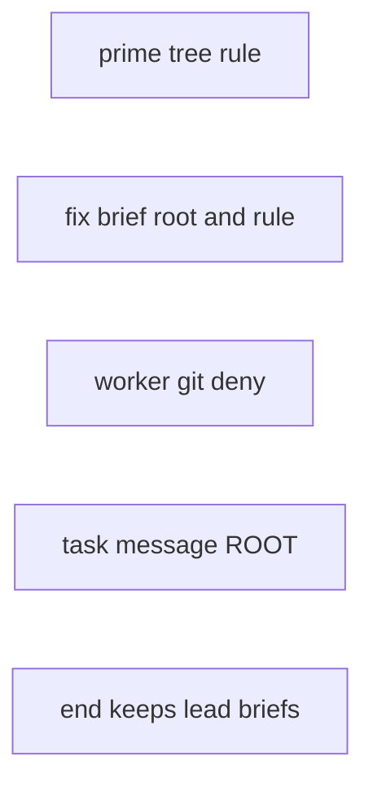

# Superlite: fleet workers keep to their tree; orchestrator end keeps the lead brief (B212, #784 #791)

**Goal:** a fleet worker edits only files under its run root, takes a dirty `git status` for the run's normal state and cannot run `git checkout`, `git restore` or `git stash` (#784); `sl orchestrator end` leaves `.superlite/briefs/lead.md` (and `lead-build.md`) in place, so a later prime, fix brief or `fleet spawn --for-review` still finds the standing note (#791).
**Architecture:** the three prime preambles (T1) and every fix brief (T2) carry the tree rule; the fix brief and the implementer task message (T4) name the absolute run root; `fleet_roles.TAIL` denies the three git commands to every worker role (T3); `orchestrator.end` archives `briefs/` file by file and skips the lead's own briefs (T5).
**Tech stack:** Python 3.10+ stdlib; pytest through `sl run_tests`.
**Spec:** this file, section Design; issues #784, #791.
**Detail:** tests
**Target-min:** 11
**Wave0:** none
**Worktree:** none
**Coverage:** off

Global constraints:
- Every script line keeps the repo's `# O(...)` complexity comment; stdlib only; LF endings.
- This repository is public: no host names, user names, home paths, other project or repository names in code, tests, docs or commit messages.
- Builds: the verdict is `sl run_tests` (the project's test command; a project with `.maxapp` runs `maxapp test`, which a build pool may place on another Mac, and a full run whose tree a green maxapp test stamp covers returns that result without a run); task trees build in <tree>/.build/DerivedData and any build of your own goes under .build/ of the worktree, never -derivedDataPath outside the worktree (your session scratchpad included; backlog cleanup removes scratchpad build folders when the worktree goes); a product, simulator or device build stays on this machine and runs only when an issue's acceptance asks for a running-app check; copy this sentence into every worker brief.
- Simulators: append the UDID of each simulator you or a worker creates (`xcrun simctl create` or `clone`; a checker's `Simulators:` line marks its created ones) as one line to /Users/max/github/superlite/.claude/worktrees/superlite-b212-worker-safety-and-lead-note/.superlite/simulators.txt; never list one you did not create; ship cleanup shuts down and deletes each listed one; copy this sentence into every worker brief.

## Design

#791: `orchestrator.end` lists `"briefs"` in `RUN_FILES` and moves the whole folder into `runs/<time>/`, so `findings.standing_note`, `build_prime.note_section`, `fleet_io.lead_brief` and the review brief find no `briefs/lead.md` after an end.
Ruling: `end` moves every entry of `briefs/` except `KEEP_BRIEFS = ("lead.md", "lead-build.md")` into `runs/<time>/briefs/`; `briefs` counts as one moved entry only when it moved something; a `briefs/` holding only kept files is not archived (lead's ruling: `backlog_run` writes both files per batch, neither is per run).

#784: the primes name Root but say nothing about other paths, nothing about a dirty tree and nothing about git restores; the fix brief names no Root; the fleet implementer task message names no ROOT; no worker is stopped from `git checkout --` in the shared tree.
Ruling: the block is a spawn deny list, not a hook: `fleet_roles.GIT_DENY = ("Bash(git checkout *)", "Bash(git restore *)", "Bash(git stash)", "Bash(git stash *)")` joins `TAIL`, so every worker role (implementer, fixer, package-reviewer, final-reviewer, checker, research) gets it; a lead (fleet_lead.py) is not a worker and keeps its list (lead's ruling: a new PreToolUse hook needs hooks/hooks.json, which B216 owns; worker agent files already forbid these commands, so no worker flow needs them).
Ruling: blanket deny instead of "outside its brief": a worker undoes its own edit by editing it back or with `git apply -R` of its own patch (fixers and reviewers already do), so no worker needs the three commands (lead's ruling).
Ruling: the fleet task message gets `ROOT=<abs run root>` after `PLAN=` (as SKILL.md step 3's in-process message); an external-repo task keeps its `Owns (relative to the task's tree of ...)` line and gets no ROOT line (lead's ruling).
Ruling: files outside the brief's list, listed by no open batch: fleet_roles.py, fleet_io.py and their tests (lead's ruling). docs/fleet.md (B206) gets the worker deny list as a follow-up.

## Task graph

```mermaid
%% schedule
gantt
  title Predicted schedule (mm:ss)
  dateFormat X
  axisFormat %M:%S
  section lane 1
  T2 Fix brief names Root and the tree rul :t2, 0, 459s
  section lane 2
  T5 orchestrator end keeps the lead's bri :t5, 0, 456s
  section lane 3
  T4 Fleet task message names ROOT :t4, 0, 455s
  section lane 4
  T3 Every worker role is denied git check :t3, 0, 453s
  section lane 5
  T1 Prime preambles carry the tree rule :t1, 0, 451s
```





critical path: T2 (7.7 min) · peak width 5 · predicted build 7.7 min · predicted total ≈ 22.2 min (target ✗ 11.0)

## Package: worker safety and lead note

App type: library (text builders, a spawn argv, a state-folder archive). Categories: state (what `end` moves), protocol (argv deny list), encoding (exact rule text).
**Probe entry:** none (text builders and a folder archive; the named tests below cover each case)

### T1 Prime preambles carry the tree rule · Complexity 2 · Est. context 30k
**Owns:** skills/subagent-driven-development/scripts/build_prime.py, tests/scripts/test_prime_tree_rule_784.py
**Components:** 1
**LOC owned:** 40
**Tests:** fast
**Model:** sonnet
**Kind:** design
**Produces:** build_prime.PREAMBLE: str · build_prime.PREAMBLE_SLIM: str · build_prime.PREAMBLE_MINI: str (each gains the lines below, right after its `- Build only what your task owns ...` line)
**Review Focus:** encoding: the lines are single lines (no wrap), the mini prime gets the one short line only.
**Test code (verbatim):**
```python
"""#784: every prime kind says to edit only under Root and that a dirty git status is the run's normal state."""
import sys

import pytest

from test_plan_tools import SCRIPTS

sys.path.insert(0, str(SCRIPTS))
import build_prime as bp  # noqa: E402

OWNS = "- Build only what your task owns (its `Owns` files). Never edit other files."
FULL = [
    "- Edit only files under Root (above), by absolute paths that start with Root. A copy of the same file elsewhere "
    "(the main checkout, the folder that holds sl) is not yours, even when your shell's cwd is there.",
    "- `git status` showing files changed against HEAD is the run's normal state (other tasks' and the coordinator's "
    "uncommitted work), never stale files: never revert, restore or stash a file you did not change. `git checkout`, "
    "`git restore` and `git stash` are denied to workers; undo your own edit by editing it back.",
]
MINI = ("- Edit only files under Root, by absolute paths. A dirty `git status` is the run's normal state: never revert, "
        "restore or stash a file you did not change (`git checkout`, `git restore` and `git stash` are denied).")


@pytest.mark.parametrize("pre", [bp.PREAMBLE, bp.PREAMBLE_SLIM])
def test_full_and_slim_carry_both_rules_after_the_owns_rule(pre):
    lines = pre.splitlines()
    i = lines.index(OWNS)
    assert lines[i + 1:i + 3] == FULL


def test_mini_carries_the_short_rule_only():
    lines = bp.PREAMBLE_MINI.splitlines()
    i = lines.index(OWNS)
    assert lines[i + 1] == MINI
    assert FULL[0] not in lines and FULL[1] not in lines


@pytest.mark.parametrize("pre", [bp.PREAMBLE, bp.PREAMBLE_SLIM, bp.PREAMBLE_MINI])
def test_rules_sit_after_the_root_slot(pre):
    assert pre.index("\n\nRules:") < pre.index("Edit only files under Root")
```
**Steps:** 1 failing tests, 2 run: FAIL, 3 add the lines to the three constants, 4 run: PASS, 5 `run_tests --fast tests/scripts/test_prime_tree_rule_784.py tests/scripts/test_prime_root.py tests/scripts/test_slim_prime.py tests/scripts/test_build_prime_mini.py tests/scripts/test_foreground_verify_rule.py tests/scripts/test_implementer_red_prime_b65.py tests/scripts/test_build_prime_both_tiers_735.py` green; an existing test that pins the old text: report its path (the coordinator adds it with `--also`).

### T2 Fix brief names Root and the tree rule · Complexity 3 · Est. context 40k
**Owns:** skills/subagent-driven-development/scripts/findings.py, tests/scripts/test_findings_root_784.py
**Components:** 1
**LOC owned:** 90
**Tests:** fast
**Model:** sonnet
**Kind:** design
**Detail:** contracts
**Produces:** findings.TREE_RULE: str · findings.head_lines(sl_path: str, plan: Path, note: list[str], wt, root: Path | None = None) -> list[str] · findings.brief_text(sl_path: str, plan: Path, task, items: list[dict], tier: int, note=(), wt=None, extras=(), checkpoints=CURRENT, plan_file: Path | None = None, root: Path | None = None) -> str · findings.coordinator_text(sl_path: str, plan: Path, items: list[dict], tier: int, running: list[str], note=(), wt=None, checkpoints=CURRENT, root: Path | None = None) -> str
**Review Focus:** state: `route` passes the root it already computes (`state.git_root(sd) or sd.parent`), resolved, POSIX; encoding: TREE_RULE is one line.
**Test code (contracts):** fixtures as in tests/scripts/test_findings_task_verify_744.py (a plan in a temp git repo, a findings JSON, `findings.route`).
- `test_tree_rule_text`: `findings.TREE_RULE == "Edit only files under Root, by absolute paths; a copy elsewhere (the main checkout, the folder that holds sl) is not yours. `git status` showing files changed against HEAD is the run's normal state: never revert, restore or stash a file you did not change (`git checkout`, `git restore` and `git stash` are denied to workers)."`
- `test_task_brief_names_root_after_plan`: `route` writes a task brief whose line right after `PLAN=...` is `Root: <Path(git toplevel).resolve().as_posix()>`, and whose line right after the `Reviewed version:` line is `TREE_RULE`.
- `test_coordinator_brief_names_root_after_plan`: a finding on a file whose owning task is running (as test_findings_task_verify_744's coordinator case) gives a coordinator brief with the same `Root:` line after `PLAN=` and `TREE_RULE` after `Reviewed version:`.
- `test_brief_text_without_root`: `brief_text(...)` called without `root=` has no line starting `Root:` and still has `TREE_RULE` after `Reviewed version:`.
**Steps:** 1 failing tests, 2 run: FAIL, 3 implement (`head_lines` appends `Root: {root}` after the PLAN line when root is given; `brief_text` and `coordinator_text` add `TREE_RULE` right after the checkpoint line and pass `root` on; `route` passes `root=root.resolve()`), 4 run: PASS, 5 `run_tests --fast tests/scripts/test_findings_root_784.py tests/scripts/test_findings*.py` green; an existing test that pins the old brief lines: report its path (the coordinator adds it with `--also`).

### T3 Every worker role is denied git checkout, restore and stash · Complexity 2 · Est. context 32k
**Owns:** skills/subagent-driven-development/scripts/fleet_roles.py, tests/scripts/test_fleet_roles_git_deny_784.py, tests/scripts/test_fleet_roles.py, tests/scripts/test_fleet_roles_checker_600.py
**Components:** 1
**LOC owned:** 50
**Tests:** fast
**Model:** sonnet
**Kind:** design
**Produces:** fleet_roles.GIT_DENY: tuple[str, ...] · fleet_roles.TAIL: list[str] (`["--disallowedTools", "AskUserQuestion", *GIT_DENY]`)
**Review Focus:** protocol: the writer's argv keeps exactly its own deny list (`AskUserQuestion`, `Bash`, `NotebookEdit`) and one `--disallowedTools`; `fleet.lean_argv` adds no duplicate deny name.
**Test code (verbatim):**
```python
"""#784: every fleet worker role is denied git checkout, git restore and git stash in the shared tree."""
import sys

import pytest

from test_plan_tools import SCRIPTS

sys.path.insert(0, str(SCRIPTS))
import fleet  # noqa: E402
import fleet_roles as fr  # noqa: E402
import routing  # noqa: E402

CFG = routing.load_cfg()
DENY = ["Bash(git checkout *)", "Bash(git restore *)", "Bash(git stash)", "Bash(git stash *)"]


def test_git_deny_constant():
    assert list(fr.GIT_DENY) == DENY
    assert fr.TAIL == ["--disallowedTools", "AskUserQuestion", *DENY]


@pytest.mark.parametrize("role,tier", [("implementer", "sonnet"), ("implementer", "haiku"), ("fixer", "2"),
                                       ("package-reviewer", None), ("final-reviewer", None), ("checker", None),
                                       ("research", None)])
def test_every_worker_role_denies_git_tree_commands(role, tier):
    argv = fr.launch(role, tier, CFG)["argv"]
    i = argv.index("--disallowedTools")
    assert argv[i + 1] == "AskUserQuestion"
    assert all(d in argv[i + 1:] for d in DENY)
    assert argv.count("--disallowedTools") == 1


def test_writer_keeps_its_own_deny_list(tmp_path):
    argv = fr.launch("writer", None, CFG, output=str(tmp_path / "x.md"))["argv"]
    assert argv[-4:] == ["--disallowedTools", "AskUserQuestion", "Bash", "NotebookEdit"]
    assert argv.count("--disallowedTools") == 1


def test_lean_argv_keeps_each_deny_name_once():
    argv = fleet.lean_argv(fr.launch("implementer", "sonnet", CFG)["argv"], None, ["Bash(git stash)"])
    assert all(argv.count(d) == 1 for d in DENY)
```
**Steps:** 1 failing tests, 2 run: FAIL, 3 add GIT_DENY and extend TAIL (the writer branch keeps slicing `argv[:-len(TAIL)]`), 4 update the local `TAIL` of test_fleet_roles.py and test_fleet_roles_checker_600.py to `fr.TAIL`, 5 run: PASS, 6 `run_tests --fast tests/scripts/test_fleet_roles*.py tests/scripts/test_fleet_lean_377.py tests/scripts/test_fleet_spawn_mcp_576.py tests/scripts/test_fleet_run_config_681.py` green; another test that pins a worker argv: report its path.

### T4 Fleet task message names ROOT · Complexity 2 · Est. context 36k
**Owns:** skills/subagent-driven-development/scripts/fleet_io.py, tests/scripts/test_fleet_io_root_784.py
**Components:** 1
**LOC owned:** 60
**Tests:** fast
**Model:** sonnet
**Kind:** design
**Detail:** contracts
**Produces:** fleet_io.task_message(plan, tasks, sl_path, superlite_root, tier="sonnet") -> str (unchanged signature; a `ROOT=<abs run root>` line right after `PLAN=` unless the message is for one external-repo task)
**Review Focus:** state: ROOT is `pt.stable_root(str(plan)).resolve().as_posix()`, the same root build_prime.with_root writes; an external task (`**Repo:**`) gets no ROOT line.
**Test code (contracts):** plan fixtures as in tests/scripts/test_fleet_io_task_cmd_475.py; the external task as in tests/scripts/test_external_repo_brief.py.
- `test_task_message_names_root_after_plan`: for one task, the line after `PLAN=<plan resolved>` is `ROOT=<pt.stable_root(str(plan)).resolve().as_posix()>`.
- `test_batch_message_names_root_once`: two tasks in one message give exactly one line starting `ROOT=`.
- `test_haiku_message_names_root`: `tier="haiku"` also has the ROOT line right after `PLAN=`.
- `test_external_task_has_no_root_line`: a task with `**Repo:**` gives no line starting `ROOT=`.
**Steps:** 1 failing tests, 2 run: FAIL, 3 implement, 4 run: PASS, 5 `run_tests --fast tests/scripts/test_fleet_io_root_784.py tests/scripts/test_fleet_io*.py tests/scripts/test_external_repo_brief.py tests/scripts/test_isolation_wording.py tests/scripts/test_task_also_edit_745.py tests/scripts/test_fleet_owns_research_b54.py tests/scripts/test_implementer_red_prime_b65.py` green; an existing test that pins the old message lines: report its path (the coordinator adds it with `--also`).

### T5 orchestrator end keeps the lead's briefs · Complexity 3 · Est. context 32k
**Owns:** skills/subagent-driven-development/scripts/orchestrator.py, tests/scripts/test_orchestrator_end_lead_brief_791.py
**Components:** 1
**LOC owned:** 70
**Tests:** fast
**Model:** sonnet
**Kind:** design
**Produces:** orchestrator.KEEP_BRIEFS: tuple[str, ...] (`("lead.md", "lead-build.md")`) · orchestrator.end(sd: Path) -> str (unchanged signature)
**Review Focus:** state: a `briefs/` with only kept files stays and is not counted; a subfolder of `briefs/` (research/) moves whole; the kept files keep their bytes.
**Test code (verbatim):**
```python
"""#791: orchestrator end archives the run's briefs but leaves the lead's own briefs in briefs/."""
from __future__ import annotations

import sys
from pathlib import Path

from test_plan_tools import SCRIPTS

sys.path.insert(0, str(SCRIPTS))
import backlog_brief as bb  # noqa: E402
import findings  # noqa: E402
import orchestrator  # noqa: E402


def briefs(sd: Path, **files: str) -> Path:
    b = sd / "briefs"
    for name, text in files.items():
        p = b / name.replace("__", "/")
        p.parent.mkdir(parents=True, exist_ok=True)
        p.write_text(text, encoding="utf-8")
    return b


def run_dirs(sd: Path) -> list[Path]:
    return sorted(p for p in (sd / "runs").iterdir() if p.is_dir())


def test_kept_names():
    assert orchestrator.KEEP_BRIEFS == ("lead.md", "lead-build.md")


def test_end_keeps_lead_briefs_and_moves_the_rest(tmp_path):
    sd = tmp_path / ".superlite"
    sd.mkdir()
    (sd / "pool.json").write_text("{}", encoding="utf-8")
    b = briefs(sd, **{"lead.md": "lead\n", "lead-build.md": "build\n", "fix-F-T1-1.md": "fix\n",
                      "research__R1.md": "r\n"})

    line = orchestrator.end(sd)

    assert line.startswith("orchestrator: run ended; 2 files moved to ")
    (dest,) = run_dirs(sd)
    assert sorted(p.name for p in b.iterdir()) == ["lead-build.md", "lead.md"]
    assert (b / "lead.md").read_text(encoding="utf-8") == "lead\n"
    assert (b / "lead-build.md").read_text(encoding="utf-8") == "build\n"
    assert (dest / "briefs" / "fix-F-T1-1.md").read_text(encoding="utf-8") == "fix\n"
    assert (dest / "briefs" / "research" / "R1.md").is_file()
    assert not (dest / "briefs" / "lead.md").exists()


def test_end_with_only_the_lead_brief_ends_nothing(tmp_path):
    sd = tmp_path / ".superlite"
    briefs(sd, **{"lead.md": "lead\n"})

    line = orchestrator.end(sd)

    assert line.startswith("orchestrator: nothing to end in ")
    assert (sd / "briefs" / "lead.md").read_text(encoding="utf-8") == "lead\n"
    assert not (sd / "runs").exists()


def test_end_without_lead_brief_still_moves_briefs(tmp_path):
    sd = tmp_path / ".superlite"
    briefs(sd, **{"T1.md": "t\n"})

    line = orchestrator.end(sd)

    assert line.startswith("orchestrator: run ended; 1 files moved to ")
    (dest,) = run_dirs(sd)
    assert (dest / "briefs" / "T1.md").is_file()
    assert not any((sd / "briefs").iterdir()) if (sd / "briefs").exists() else True


def test_standing_note_survives_end(tmp_path):
    sd = tmp_path / ".superlite"
    sd.mkdir()
    (sd / "pool.json").write_text("{}", encoding="utf-8")
    briefs(sd, **{"lead.md": f"# Lead brief\n{bb.NOTE_HEAD}\n    keep this line\nEnd.\n", "T1.md": "t\n"})
    before = findings.standing_note(sd)

    orchestrator.end(sd)

    assert before == [bb.NOTE_HEAD, "    keep this line"]
    assert findings.standing_note(sd) == before
```
**Steps:** 1 failing tests, 2 run: FAIL, 3 implement in `end` (move `briefs/` entries one by one into `dest/briefs/`, skipping KEEP_BRIEFS; drop `briefs` from the moved list when nothing moved; decide `present` before `dest` is made so a lead-only `briefs/` gives the nothing-to-end line), 4 run: PASS, 5 `run_tests --fast tests/scripts/test_orchestrator_end_lead_brief_791.py tests/scripts/test_orchestrator_end_summaries.py tests/scripts/test_orchestrator_worktree_guard.py` green.

## Review Focus

- state: `end` with a `briefs/` of only kept files, of kept plus others, of others only; a second `end` in the same second (the `-1` folder).
- protocol: deny names reach the pane argv once per role, the writer and research lists stay as they are.
- encoding: rule lines are single lines, identical where the tests pin them.

## Self-review

Coverage: #791 -> T5; #784 prime rule -> T1, fix brief -> T2, block -> T3, task text ROOT -> T4. No placeholders; no two tasks share a file; no edges (each test runs only its own task's code).
