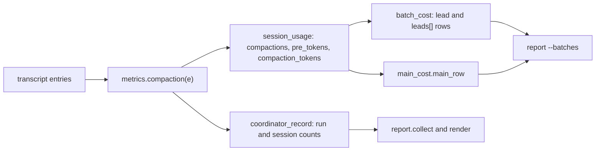
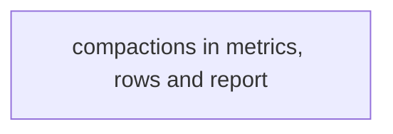

# Superlite: count compactions and pre-compaction tokens per main and lead session (B223)

**Goal:** fix #844: the transcript readers that already walk a main or lead session (`metrics.session_usage`, `metrics.coordinator_record`) count its `compact_boundary` entries and keep each one's `compactMetadata.preTokens`; the batch cost row's `lead` (and each `leads` entry) and main's cost row gain `compactions` and the largest `pre_tokens`; `sl report --batches` and the build report show the count.
**Architecture:** one reader `metrics.compaction(e)` turns one transcript entry into `{"t", "pre_tokens", "trigger"}` or None; `session_usage` and `coordinator_record` call it on the entries they already read (no second read, no hook, no prompt text). `batch_cost._one/_lead/_lead_rows` and `main_cost.main_row` sum the counts and keep the largest `pre_tokens`; `report.py` prints them through one helper. One task.
**Tech stack:** Python 3.10+ stdlib, pytest (through `sl run_tests`).
**Spec:** this file, section Design; issue #844 (acceptance: "a test with a transcript fixture holding two `compact_boundary` entries gives `compactions: 2` and the right token numbers in the cost row; `sl report` shows the count").
**Detail:** tests
**Target-min:** 11
**Wave0:** none

Global constraints:
- Every new or changed code line in `skills/subagent-driven-development/scripts/*.py` keeps the file's trailing `# O(...)` complexity comment, as every existing line has.
- Existing tests stay green. An existing test file changes only when the task Owns it. If another existing test turns red, report it in DONE_WITH_CONCERNS with the test id and the reason instead of editing it.
- Run `sl` as an executable (`/Users/max/github/superlite/skills/subagent-driven-development/scripts/sl ...`). Verify with `sl run_tests --fast <own test files> --task Tn --background`, then run the printed `wait:` line in the foreground and end the turn only after it reports.
- No version edits (the ship step bumps the version). Never run `scripts/evals.sh`, `claude plugin eval` or `scripts/test_layers.py run`.
- Builds: the verdict is `sl run_tests` (the project's test command; a project with `.maxapp` runs `maxapp test`, which a build pool may place on another Mac, and a full run whose tree a green maxapp test stamp covers returns that result without a run); task trees build in <tree>/.build/DerivedData and any build of your own goes under .build/ of the worktree, never -derivedDataPath outside the worktree (your session scratchpad included; backlog cleanup removes scratchpad build folders when the worktree goes); a product, simulator or device build stays on this machine and runs only when an issue's acceptance asks for a running-app check.
- Simulators: append the UDID of each simulator you or a worker creates (`xcrun simctl create` or `clone`; a checker's `Simulators:` line marks its created ones) as one line to /Users/max/github/superlite/.claude/worktrees/superlite-b223-compaction-metrics/.superlite/simulators.txt; never list one you did not create; ship cleanup shuts down and deletes each listed one.

Ruling: one reader, `metrics.compaction(e)`, used by `session_usage` and `coordinator_record` inside the loops that already read the transcript (because #844 asks to read it where the transcript is already read) - cost if wrong: none.
Ruling: rows carry `compactions` (int) and `pre_tokens` (the largest `preTokens`, 0 without a compaction, so sums and maxima need no None case); only `session_usage` and `coordinator_record` keep the per-compaction list (`compaction_tokens`), the rows keep the two numbers #844 names - cost if wrong: one more row key later.
Ruling: windows and sidechains follow the message rule: a timed entry counts when its timestamp is inside since/until (inclusive), an untimed one only in an unwindowed read; `isSidechain` entries count only with `sidechain=True`; in `coordinator_record` the run scope counts entries at or after the run start, `session` counts all non-sidechain ones - cost if wrong: a compaction on a window edge lands in the neighbouring main row.
Ruling: a repeated entry `uuid` counts once within one transcript; two transcripts of one lead are not deduplicated against each other (turns are not either) - cost if wrong: a resumed lead whose new transcript repeats an old boundary counts it twice.
Ruling: report text adds `, N compaction(s), largest X.Xk tokens` only when N > 0, so rows without compactions and rows written before this change print as before - cost if wrong: none.
Ruling: B223 also edits batch_cost.py, main_cost.py, skills/subagent-driven-development/metrics.md and tests/scripts/test_coordinator_run_scope.py (no open batch lists them; the last one's exact coordinator dict gains the two keys).
Ruling: MISSED TARGET accepted: one task with no split worth its overhead (readers, rows and report text share one test fixture) - cost if wrong: a few minutes of wall time.
LAYERS: unit



## Design

### 1. Reader and counts in metrics.py (T1)
- `compaction(e) -> dict | None`: for `e["type"] == "system"` and `e["subtype"] == "compact_boundary"` returns `{"t": _ts(e), "pre_tokens": p, "trigger": t}`, where `p` is `compactMetadata.preTokens` when it is an int, not a bool and >= 0, else 0, and `t` is `compactMetadata.trigger` when it is a str, else None; any other entry (or a non-dict `compactMetadata`, read as `{}`) gives None for a non-boundary entry. Docstring names #844.
- `session_usage`: in its entry loop, before the assistant filter, a boundary entry (skipped when `isSidechain` and not `sidechain`; a `uuid` already seen in this read skipped) is kept when its `t` passes the same window rule as a message's first timestamp (untimed: only without since and until). The result gains `compactions` (count), `pre_tokens` (largest, 0 when none) and `compaction_tokens` (each kept entry's `pre_tokens`, transcript order). A missing file gives 0, 0, []. Docstring names the three keys.
- `coordinator_record`: in its entry loop, a boundary entry that is not `isSidechain` (repeated `uuid` once) is collected. `out` gains `compactions`, `pre_tokens` and `compaction_tokens` of the run scope (entries whose `t` is not None and >= the run start; every collected entry when the scope is `session`), and `out["session"]` gains `compactions` and `pre_tokens` over every collected entry. Docstring names them.

### 2. Rows (T1)
- `batch_cost._one`: sums `u.get("compactions", 0)` over the lead's transcripts and keeps the largest `u.get("pre_tokens", 0)`; returns them as `compactions` and `pre_tokens`. `_lead` with several leads: sum and max over the parts. `_lead_rows`: each entry gains both keys from its `_one`.
- `main_cost.main_row`: the same sum and max over the measured sessions; the row gains `compactions` and `pre_tokens` (0 and 0 when no session was measured).
- `skills/subagent-driven-development/metrics.md`, section Batch cost record: in the `lead` field list after `` `blocked_wait_s`, `` insert `` `compactions` (the transcript's `compact_boundary` entries) and `pre_tokens` (their largest `compactMetadata.preTokens`, 0 without one), ``; `leads` is not named there today, leave it. In the main row sentence, change `turns, tokens, cost and turns by backlog subcommand` to `turns, tokens, compactions and the largest pre_tokens, cost and turns by backlog subcommand`.

### 3. Report (T1)
- `report.compactions_text(d) -> str`: `""` when `(d or {}).get("compactions")` is falsy, else `f", {n} compaction{'' if n == 1 else 's'}, largest {pre / 1000:.1f}k tokens"` with `pre = d.get("pre_tokens") or 0`.
- `batches_text`: the batch line's lead part reads `lead $C T turns<compactions_text(lead)>, wall ...`; the main line reads `main R: $C, T turns<compactions_text(row)>` before the kinds.
- `collect`: `cost_split["coordinator"]` copies `turns, context_median, context_peak, compactions, pre_tokens` (`co.get(k, 0)` for the last two). `render`: the coordinator parenthesis reads `(T turns, context median Xk, peak Yk<compactions_text(co)>; session $S)` (`co` from a report saved before this change has no keys: unchanged text).

## Coverage

| Category | State | Basis |
|---|---|---|
| Scope and success criteria | settled | #844 acceptance: fixture with two boundaries gives compactions 2 and the token numbers in the cost row; report shows the count |
| Domain and data model | ruled | entry `{t, pre_tokens, trigger}`; row keys `compactions`, `pre_tokens` (0 without) |
| Persistence and migration | ruled | append-only rows gain two keys; old rows read with `.get`, print unchanged |
| Interfaces and contracts | ruled | `metrics.compaction(e)`; session_usage and coordinator_record gain keys; `report.compactions_text(d)` |
| UI states | n/a | CLI text only |
| Concurrency and state ownership | n/a | read-only readers |
| Error handling and recovery | ruled | a missing or malformed preTokens is 0; non-dict metadata is `{}`; recording never fails a row (existing try) |
| Security and privacy | n/a | local transcripts, numbers only |
| Performance and limits | ruled | no extra file read: counted in the existing loops |
| Observability | settled | this issue is the observability |
| Testing strategy | settled | named pytest cases in tests/scripts/test_compactions_844.py with real transcript fixtures |
| Compatibility | ruled | test_coordinator_run_scope's exact coordinator dict gains the two keys |
| Rollout | ruled | one PR; version bump at ship |
| Research unknowns | n/a | boundary shape read from a real transcript: type system, subtype compact_boundary, timestamp, uuid, isSidechain, compactMetadata.trigger/preTokens/postTokens |

## File structure
- `skills/subagent-driven-development/scripts/metrics.py`: `compaction`, counts in `session_usage` and `coordinator_record` (T1).
- `skills/subagent-driven-development/scripts/batch_cost.py`: lead and leads row keys (T1).
- `skills/subagent-driven-development/scripts/main_cost.py`: main row keys (T1).
- `skills/subagent-driven-development/scripts/report.py`: `compactions_text`, batches and build report text, collect keys (T1).
- `skills/subagent-driven-development/metrics.md`: row field docs (T1).
- `tests/scripts/test_compactions_844.py`: new (T1); `tests/scripts/test_coordinator_run_scope.py`: exact dict (T1).

## Task graph

```mermaid
%% schedule
gantt
  title Predicted schedule (mm:ss)
  dateFormat X
  axisFormat %M:%S
  section lane 1
  T1 compactions in metrics rows and repor :t1, 0, 710s
```




critical path: T1 (11.8 min) · peak width 1 · predicted build 11.8 min · predicted total ≈ 30.3 min (target ✗ 11.0)

## Package: session metrics
App type: library / transcript reader. Categories: numeric (sum and max over leads and sessions, k formatting), state (run scope versus session, windows), encoding (malformed metadata). Specific risks: a sidechain boundary counted for main; a window edge counted in two main rows; a lead row of two leads summing pre_tokens instead of taking the max.
**Probe entry:** none (Ruling: readers of transcript files; their cases are named tests).

### T1 compactions in metrics, rows and report · Complexity 4 · Est. context 45k
**Owns:** skills/subagent-driven-development/scripts/metrics.py, skills/subagent-driven-development/scripts/batch_cost.py, skills/subagent-driven-development/scripts/main_cost.py, skills/subagent-driven-development/scripts/report.py, skills/subagent-driven-development/metrics.md, tests/scripts/test_compactions_844.py, tests/scripts/test_coordinator_run_scope.py
**Components:** 3
**LOC owned:** 190
**Tests:** fast
**Model:** sonnet
**Est. time:** 3.5 min (3 components, about 190 LOC, fast tests)
**Covers:** 1, 2, 3
**Consumes:** none
**Produces:** metrics.compaction(e: dict) -> dict | None · report.compactions_text(d: dict | None) -> str
**Review Focus:** numeric: `test_batch_row_sums_leads_and_keeps_the_largest`, `test_report_text_shows_the_count`; state: `test_coordinator_record_counts_run_and_session`, `test_session_usage_window_untimed_and_empty`; encoding: `test_compaction_reads_one_boundary_entry`.
**Test code (verbatim):** new file tests/scripts/test_compactions_844.py:
```python
"""#844: compact_boundary entries counted per main and lead session: metrics, the batch and main cost rows, sl report."""
from __future__ import annotations

import importlib
import json
import sys
import types
from datetime import datetime, timezone
from pathlib import Path

import pytest

HERE = Path(__file__).resolve().parent
SCRIPTS = HERE.parents[1] / "skills" / "subagent-driven-development" / "scripts"
sys.path.insert(0, str(HERE))
sys.path.insert(0, str(SCRIPTS))
import metrics  # noqa: E402
import report  # noqa: E402
from test_batch_cost_680 import WAKE0, _fake_grade, _fake_snapshot  # noqa: E402
from test_coordinator_run_scope import session_with_design  # noqa: E402
from test_main_cost_680 import abc, env, mc, root  # noqa: E402,F401
from test_routing import mech_plan  # noqa: E402

T0 = 1794520000.0


def stamp(off):
    return datetime.fromtimestamp(T0 + off, timezone.utc).isoformat().replace("+00:00", "Z")


def turn(mid, off):
    return {"type": "assistant", "timestamp": stamp(off),
            "message": {"id": mid, "model": "claude-opus-4-8", "content": [{"type": "text", "text": "x"}],
                        "usage": {"input_tokens": 2, "cache_read_input_tokens": 300, "output_tokens": 30}}}


def boundary(off, pre, uid, side=False, trigger="auto", ts=None):
    return {"type": "system", "subtype": "compact_boundary", "content": "Conversation compacted", "uuid": uid,
            "isSidechain": side, "timestamp": ts or stamp(off),
            "compactMetadata": {"trigger": trigger, "preTokens": pre, "postTokens": 30000}}


TWO = [turn("m1", 0), boundary(10, 367994, "u1"), turn("m2", 20), boundary(30, 150000, "u2", trigger="manual"),
       turn("m3", 40), boundary(35, 999999, "u3", side=True)]


def write(path, entries):
    path.parent.mkdir(parents=True, exist_ok=True)
    path.write_text("".join(json.dumps(e) + "\n" for e in entries))
    return path


def test_compaction_reads_one_boundary_entry():
    assert metrics.compaction(boundary(10, 367994, "u1")) == {"t": T0 + 10, "pre_tokens": 367994, "trigger": "auto"}
    assert metrics.compaction(turn("m1", 0)) is None
    assert metrics.compaction({"type": "system", "subtype": "other"}) is None
    assert metrics.compaction({"type": "system", "subtype": "compact_boundary"}) == {"t": None, "pre_tokens": 0, "trigger": None}
    for bad in ("9", True, -5, 2.5, None):
        e = {"type": "system", "subtype": "compact_boundary", "compactMetadata": {"preTokens": bad, "trigger": 3}}
        assert metrics.compaction(e) == {"t": None, "pre_tokens": 0, "trigger": None}
    assert metrics.compaction({"type": "system", "subtype": "compact_boundary", "compactMetadata": "x"})["pre_tokens"] == 0


def test_session_usage_counts_two_compactions(tmp_path):
    p = write(tmp_path / "t.jsonl", TWO + [boundary(10, 367994, "u1")])  # a repeated uuid counts once
    u = metrics.session_usage(p)
    assert u["compactions"] == 2 and u["pre_tokens"] == 367994 and u["compaction_tokens"] == [367994, 150000]
    assert u["turns"] == 3
    s = metrics.session_usage(p, sidechain=True)
    assert s["compactions"] == 3 and s["pre_tokens"] == 999999


def test_session_usage_window_untimed_and_empty(tmp_path):
    untimed = {"type": "system", "subtype": "compact_boundary", "uuid": "u4", "compactMetadata": {"preTokens": 5}}
    p = write(tmp_path / "t.jsonl", TWO + [untimed])
    w = metrics.session_usage(p, since=T0 + 15, until=T0 + 40)
    assert w["compactions"] == 1 and w["pre_tokens"] == 150000 and w["compaction_tokens"] == [150000]
    assert metrics.session_usage(p, since=T0 + 30, until=T0 + 30)["compactions"] == 1  # inclusive edges
    assert metrics.session_usage(p)["compactions"] == 3  # the untimed one counts only unwindowed
    e = metrics.session_usage(write(tmp_path / "e.jsonl", [turn("m1", 0)]))
    assert (e["compactions"], e["pre_tokens"], e["compaction_tokens"]) == (0, 0, [])
    gone = metrics.session_usage(tmp_path / "gone.jsonl")
    assert (gone["compactions"], gone["pre_tokens"], gone["compaction_tokens"]) == (0, 0, [])


def test_coordinator_record_counts_run_and_session(tmp_path):
    tr = write(tmp_path / "main.jsonl", TWO)
    sl = tmp_path / ".superlite"
    sl.mkdir()
    (sl / "metrics.jsonl").write_text(json.dumps({"session_transcript": str(tr)}) + "\n")
    whole = metrics.coordinator_record(sl, agents=[])
    assert whole["scope"] == "session" and whole["compactions"] == 2 and whole["pre_tokens"] == 367994
    assert whole["compaction_tokens"] == [367994, 150000]
    assert whole["session"]["compactions"] == 2 and whole["session"]["pre_tokens"] == 367994
    run = metrics.coordinator_record(sl, agents=[{"first_abs": T0 + 25}])
    assert run["scope"] == "run" and run["compactions"] == 1 and run["pre_tokens"] == 150000
    assert run["compaction_tokens"] == [150000] and run["session"]["compactions"] == 2


@pytest.fixture
def bcr(monkeypatch):
    """batch_cost with fake batch_waits and batch_grade and the real metrics.session_usage."""
    w = types.ModuleType("batch_waits")
    w.lead_kind = lambda blocks: "wait"
    w.waits = lambda p: {"wakeups": dict(WAKE0), "blocked_wait_s": 0.0}
    g = types.ModuleType("batch_grade")
    g.snapshot, g.grade = _fake_snapshot, _fake_grade
    monkeypatch.setitem(sys.modules, "batch_waits", w)
    monkeypatch.setitem(sys.modules, "batch_grade", g)
    monkeypatch.delitem(sys.modules, "batch_cost", raising=False)
    mod = importlib.import_module("batch_cost")
    yield mod
    sys.modules.pop("batch_cost", None)


def _lead_root(tmp_path, stops):
    r = tmp_path / "main"
    sd = r / ".superlite"
    sd.mkdir(parents=True)
    (sd / "metrics.jsonl").write_text("".join(json.dumps({"ev": "stop", "t": 1000, "agent_id": wid, "transcript": str(p)}) + "\n"
                                              for wid, p in stops))
    (sd / "fleet.json").write_text(json.dumps({"workers": {"W3": {"role": "lead", "tier": "opus"},
                                                           "W4": {"role": "lead", "tier": "sonnet"}}}))
    return r


def test_batch_row_lead_counts_two_compactions(bcr, tmp_path):
    a = write(tmp_path / "t" / "a.jsonl", TWO)
    row = bcr.build_row(_lead_root(tmp_path, [("W3", a)]), {"id": "B1", "lead": "W3"}, "shipped")
    assert row["lead"]["compactions"] == 2 and row["lead"]["pre_tokens"] == 367994
    assert row["leads"][0]["compactions"] == 2 and row["leads"][0]["pre_tokens"] == 367994


def test_batch_row_sums_leads_and_keeps_the_largest(bcr, tmp_path):
    a = write(tmp_path / "t" / "a.jsonl", TWO)
    b = write(tmp_path / "t" / "b.jsonl", [turn("n1", 100), boundary(110, 400000, "v1")])
    batch = {"id": "B1", "lead": "W4", "leads": [{"id": "W3", "phase": "plan"}, {"id": "W4", "phase": "build"}]}
    row = bcr.build_row(_lead_root(tmp_path, [("W3", a), ("W4", b)]), batch, "shipped")
    assert row["lead"]["compactions"] == 3 and row["lead"]["pre_tokens"] == 400000
    assert [(x["compactions"], x["pre_tokens"]) for x in row["leads"]] == [(2, 367994), (1, 400000)]
    none = write(tmp_path / "t" / "c.jsonl", [turn("k1", 0)])
    row0 = bcr.build_row(_lead_root(tmp_path / "z", [("W3", none)]), {"id": "B2", "lead": "W3"}, "shipped")
    assert row0["lead"]["compactions"] == 0 and row0["lead"]["pre_tokens"] == 0


def test_main_row_counts_compactions(mc, root, env):
    abc(env["CLAUDE_CONFIG_DIR"], root, extra=[boundary(10, 200000, "w1"), boundary(30, 250000, "w2")])
    row = mc.main_row(root, {"round": ["B1"], "main_sessions": [{"id": "abc", "t": 1.0}, {"id": "gone", "t": 2.0}]},
                      now=T0 + 100, env=env)
    assert row["compactions"] == 2 and row["pre_tokens"] == 250000
    row0 = mc.main_row(root, {"round": ["B2"], "main_sessions": [{"id": "gone", "t": 2.0}]}, now=T0 + 100, env=env)
    assert row0["compactions"] == 0 and row0["pre_tokens"] == 0


def test_report_text_shows_the_count():
    assert report.compactions_text(None) == "" and report.compactions_text({"compactions": 0, "pre_tokens": 9}) == ""
    assert report.compactions_text({"compactions": 1, "pre_tokens": 200000}) == ", 1 compaction, largest 200.0k tokens"
    rows = [{"row": "batch", "batch": "B1", "end": "shipped",
             "lead": {"cost_usd": 3.0, "turns": 40, "wall_s": 600.0, "blocked_wait_s": 300.0, "compactions": 2, "pre_tokens": 367994},
             "workers_total": {"n": 0, "cost_usd": 0.0}, "grade": {"points": 0, "letter": "A"}},
            {"row": "main", "round": ["B1"], "cost_usd": 0.5, "turns": 9, "compactions": 1, "pre_tokens": 200000}]
    t = report.batches_text(rows)
    assert "lead $3.00 40 turns, 2 compactions, largest 368.0k tokens, wall 10.0 min" in t
    assert "main B1: $0.50, 9 turns, 1 compaction, largest 200.0k tokens\n" in t
    old = [{"row": "batch", "batch": "B1", "end": "shipped", "lead": {"cost_usd": 3.0, "turns": 40}}]
    assert "compaction" not in report.batches_text(old)


def test_build_report_names_coordinator_compactions(tmp_path):
    sl = session_with_design(tmp_path)
    sess = tmp_path / "proj" / "sess.jsonl"
    extra = [boundary(0, 120000, "d1", ts="2026-10-18T09:10:00Z"), boundary(0, 367994, "r1", ts="2026-10-18T10:13:30Z"),
             boundary(0, 150000, "r2", ts="2026-10-18T10:14:02Z")]
    sess.write_text(sess.read_text(encoding="utf-8") + "".join(json.dumps(e) + "\n" for e in extra), encoding="utf-8")
    c = report.collect(mech_plan(tmp_path, 1), sl)
    co = c["cost_split"]["coordinator"]
    assert co["compactions"] == 2 and co["pre_tokens"] == 367994
    assert "peak 2.1k, 2 compactions, largest 368.0k tokens; session $" in report.render(c)
```
In tests/scripts/test_coordinator_run_scope.py, `test_budget_and_report_split_the_run_from_the_session`: the line `assert cs["coordinator"] == {"turns": len(RUN), "context_median": 1_660, "context_peak": 2_060}` becomes `assert cs["coordinator"] == {"turns": len(RUN), "context_median": 1_660, "context_peak": 2_060, "compactions": 0, "pre_tokens": 0}`; nothing else in that file changes.
**Steps:** 1 write the test file, 2 run: FAIL, 3 implement sections 1 to 3, 4 run: PASS (own test file, test_coordinator_run_scope.py, test_metrics_session_usage_680.py, test_batch_cost_680.py, test_batch_cost_leads_699.py, test_main_cost_680.py, test_report_batches_680.py)
**Notes:** `session_usage`'s loop currently `continue`s on every non-assistant entry: handle the boundary before that check. In `coordinator_record` the run start is the `start` it already computes (after the dispatch adjustment); with `start is None` the run scope equals the session. `_one` reads `u.get(...)` because test_batch_cost_680 fakes `session_usage` without the new keys.

## Review Focus
- numeric: lead sums count and takes the largest pre_tokens across leads; main sums across sessions; `k` formatting with one decimal.
- state: run scope versus session in coordinator_record; since/until inclusive; untimed only unwindowed; sidechain only on request; repeated uuid once.
- encoding: preTokens as str, bool, negative, float or missing reads 0; non-dict compactMetadata.

## Self-review
Coverage: #844 readers (1), rows (2), report (3) map to T1. No placeholders. Produces names match the tests. One task, no edges. Running-app checks: none (CLI library).
