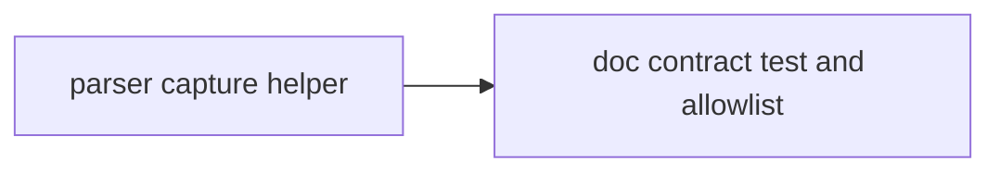

# Superlite: doc contract test checks every sl call against the real parser (B224, #845)

**Goal:** one unit test reads every `sl` call written in skills, commands, agents, docs and README and fails when its tool, subcommand, `--flag` or flag choice no longer exists in the tool's argparse parser; a short allowlist with a reason per entry covers the calls that cannot be checked.
**Architecture:** a helper module `tests/scripts/doc_contract_parsers.py` captures every tool's parser tree in ONE child Python (runpy each tool with `--help`, argparse patched to record the parser), follows the hand-routed subcommands through a route table and returns JSON. `tests/scripts/test_doc_contract.py` extracts the calls from the docs, walks each call through that tree and compares the problems with `tests/scripts/doc_contract_allowlist.txt`.
**Tech stack:** Python 3.10+ stdlib; pytest through `sl run_tests`.
**Spec:** this file, section Design; issue #845.
**Detail:** contracts
**Target-min:** 11
**Wave0:** none
**Worktree:** none
**Coverage:** off

Global constraints:
- Tests only: no script under skills/ changes. Stdlib only; LF endings.
- This repository is public: no host names, user names, home paths, other project or repository names in code, tests, docs or commit messages.
- The parser capture never writes into the repository: its child runs with cwd, HOME, XDG_CACHE_HOME and SUPERLITE_CACHE_DIR set to a fresh temporary folder, PYTHONUTF8=1, timeout 60 s.
- Builds: the verdict is `sl run_tests` (the project's test command; a project with `.maxapp` runs `maxapp test`, which a build pool may place on another Mac, and a full run whose tree a green maxapp test stamp covers returns that result without a run); task trees build in <tree>/.build/DerivedData and any build of your own goes under .build/ of the worktree, never -derivedDataPath outside the worktree (your session scratchpad included; backlog cleanup removes scratchpad build folders when the worktree goes); a product, simulator or device build stays on this machine and runs only when an issue's acceptance asks for a running-app check.
- Simulators: append the UDID of each simulator you or a worker creates (`xcrun simctl create` or `clone`; a checker's `Simulators:` line marks its created ones) as one line to /Users/max/github/superlite/.claude/worktrees/superlite-b224-doc-contract-test/.superlite/simulators.txt; never list one you did not create; ship cleanup shuts down and deletes each listed one.

## Design

Today about a hundred phrase-grep doc tests pin wording; none says whether a documented command still exists. Upstream's port runs `python <tool> [subs] --help` per call and parses the usage text. Here that is unsafe: `fleet  --help` moves the session's fleet before argparse runs (fleet.py `_follow`), and backlog, fleet, plan_tools and routing route subcommands to other modules before parsing.

Ruling: parser capture is in-process in one child: for each tool, `runpy.run_path(script, run_name="__main__")` with `sys.argv = [script, "--help"]`, `argparse.ArgumentParser.parse_known_args` patched to record `self` and then call the original; the help action exits; the last parser recorded before that `SystemExit` is the tool's parser. `--help` as the first argument skips fleet's `_follow` and every pre-parse dispatch. The tree is read from the parser objects (`_actions`, option strings, `choices`, `_SubParsersAction.choices`), never from usage text (lead's ruling; upstream parses usage text per subprocess).
Ruling: a tool is a `.py` in skills/subagent-driven-development/scripts or skills/subagent-driven-development/probes whose name does not start with `_` and whose source has `if __name__ == "__main__"`; anything else is `unknown tool`. `version` is a known tool with no arguments (sl handles it). A tool with no parser recorded is hand-parsed (tree value `None`): each non-placeholder word and flag of its call must appear in its source, as upstream does (lead's ruling).
Ruling: hand-routed subcommands follow a route table, `(tool, sub) -> (module, function)`: fleet send/keys/wait -> fleet_io.main, fleet run -> fleet_layer.main, fleet restore -> fleet_restore.main, backlog start -> backlog._start, backlog wait/run/answer/tell (`backlog.ROUTED` minus start) -> backlog_run.main, backlog ship and notes -> backlog_ship.main, plan_tools adapter/packet/contract (`plan_tools.REVIEW_COMMANDS`) -> pt_review.main, routing miss -> routing.miss. The target is called with `["--help"]`; when its parser has a subparser named like the sub, that subparser is the node, else its top parser. Names come from the module constants where they exist (lead's ruling).
Ruling: a subparser whose only action is help is a placeholder; every placeholder must be routed. Test pins that none is left unrouted (lead's ruling).
Ruling: calls are read from skills/**/*.md, commands/*.md, agents/*.md, docs/*.md and README.md (the issue's list). Launcher forms: `sl`, `"$SL"`, `$SL`, `${SL}`, a path ending in `/sl` (quoted or not, `<skill-dir>/../subagent-driven-development/scripts/sl` included) and a `<... sl>` placeholder such as `<abs sl>`; then whitespace and a tool word `[a-z][a-z0-9_]*`. Not a call: `sl:`, `sl-`, `sl's`, `sl` inside a word (lead's ruling).
Ruling: a call inside an inline code span or a fenced code block is strict: an unknown tool or subcommand is a problem. A call in prose is lenient: an unknown tool word is no call, an unknown subcommand ends the walk; flags are checked in both (lead's ruling: prose such as "sl that" is talk, code is what readers copy).
Ruling: a call ends at the end of its code span, at the line end, at a bare `|`, `;`, `&&`, `>` or `)`; in prose also at `,` or a sentence end. A bare `--` ends flag checking. Tokens lose wrapping brackets and trailing punctuation; `a|b` and `{a,b}` are alternatives, each checked (lead's ruling).
Ruling: placeholders are skipped: `<...>`, `$X`/`${X}`, all-caps words (`B`, `N`, `FILE`, `PATHS`), `Tn`/`Wn`/`T7`, numbers, `...`/`…`, `*`, quoted strings (lead's ruling).
Ruling: checked are the tool, the subcommand path (subparser choices) and each `--flag` (exact match, no argparse abbreviations; a flag counts when the reached parser or one above it on the path defines it) and, for a flag with `choices`, its value. Plain positional values are not checked (lead's ruling: the issue asks tool, subcommand and flags).
Ruling: allowlist `tests/scripts/doc_contract_allowlist.txt`: `#` comments and blank lines skipped; an entry is `<doc path> | <call> | <reason>` where `<call>` is the tool and tokens as the failure line prints them. An entry without a reason or one that matches no current problem fails a test, so the list stays short (lead's ruling).
Ruling: a real doc error the test finds is allowlisted by T2 with the reason `doc error: <correct call>`; the lead then fixes the ones in files no open batch lists (a follow-up task) and keeps the rest with an owner note (lead's ruling).

## Task graph

```mermaid
%% schedule
gantt
  title Predicted schedule (mm:ss)
  dateFormat X
  axisFormat %M:%S
  section lane 1
  T1 Parser capture helper with routed sub :t1, 0, 380s
  T2 Doc contract test and allowlist :t2, 380, 418s
```

critical path: T1 → T2 (13.3 min) · peak width 1 · predicted build 13.3 min · predicted total ≈ 25.8 min (target ✗ 11.0)

## Package: doc contract

App type: test tooling (no runnable entry). Categories: parse (the call extractor), state (patched argparse, sys.argv, cwd inside the child), process (one child Python with a timeout).
**Probe entry:** none (test code; the named tests cover each case)

### T1 Parser capture helper with routed subcommands · Complexity 4 · Est. context 45k
**Owns:** tests/scripts/doc_contract_parsers.py, tests/scripts/test_doc_contract_parsers.py
**Components:** 1
**LOC owned:** 170
**Tests:** fast
**Model:** sonnet
**Kind:** design
**Produces:** doc_contract_parsers.parser_trees() -> dict · doc_contract_parsers.ROUTES: dict[tuple[str, str], tuple[str, str]]
e.g. parser_trees()["tools"]["fleet"]["subs"]["wait"]["flags"] includes "--wave" and "--timeout" (routed to fleet_io)
e.g. parser_trees()["tools"]["backlog"]["subs"]["ship"]["flags"] includes "--wait", "--version", "--title" (routed to backlog_ship)
e.g. parser_trees()["tools"]["trees"] is None (hand-parsed); "fleet_state" not in parser_trees()["tools"]; parser_trees()["errors"] == {}
**Review Focus:** state: sys.argv, sys.path, cwd and argparse are restored after each tool, one tool's exception never stops the others; process: one child for all tools, cached; parse: a node's flags are every option string of its own parser.
**Contract:** `parser_trees()` (functools.lru_cache) runs `[sys.executable, <this file>]` once with the Global constraints' env and temp cwd, reads its stdout JSON and returns `{"tools": {name: node | None}, "errors": {name: "ExcType: message"}}`. A node is `{"flags": [option strings, sorted], "choices": {"--flag": [str choices]}, "subs": {name: node}}`. Run as a script the module captures every tool (Design rulings), applies `ROUTES` (replace `subs[sub]` with the routed node; ROUTES built from `backlog.ROUTED` and `plan_tools.REVIEW_COMMANDS` inside the child, the fixed entries written out) and prints the JSON. Help text goes to a discarded stream. An exception other than SystemExit while capturing a tool goes into `errors` and the tool's value is None.
**Test code (contracts):** `tests/scripts/test_doc_contract_parsers.py`, each against the real `parser_trees()`:
- test_flat_and_sub_parsers: `tools["backlog"]["subs"]["plan"]["flags"]` ⊇ {"--reset", "--add", "--github", "--max-batches", "--issues", "--jql", "--proposal"}; `tools["fleet"]["subs"]["on"]["flags"]` ⊇ {"--accounts", "--plan", "--config"}.
- test_routed_subcommands_follow_the_route: fleet wait ⊇ {"--wave", "--timeout"}; fleet run ⊇ {"--layer", "--plan"}; backlog ship ⊇ {"--wait", "--version", "--title"} and backlog notes is the same node; `tools["plan_tools"]["subs"]["packet"]["flags"]` ⊇ {"--plan", "--base"}.
- test_choices_are_read: `tools["backlog"]["subs"]["ship"]["choices"]` has no "--wait" key (no choices on it) and some node in the tree has a non-empty "choices" map (assert one concrete flag with choices found while implementing, named in the test).
- test_no_placeholder_left_unrouted: walking every node, no subparser node has flags ⊆ {"-h", "--help"} and empty subs unless its (tool, sub) is in ROUTES or a pinned `NO_ARGS` set the test defines (empty if none exist).
- test_hand_parsed_and_libraries: tools["trees"], tools["render_edit"], tools["autocommit"] are None; "fleet_state", "guard_tools" absent or None as found (pin what the code says); no key starts with "_"; "version" maps to `{"flags": [], "choices": {}, "subs": {}}`.
- test_no_capture_errors: `parser_trees()["errors"] == {}`.
- test_capture_leaves_the_repo_alone: `git status --porcelain` of the repository is the same before and after a fresh capture (call the uncached function).
**Steps:** 1 write the tests, 2 run: FAIL (record `Red run:`), 3 write the helper, 4 run: PASS; report the capture's wall time.
**Notes:** patch `parse_known_args` only (parse_args calls it). Restore `sys.argv`, `sys.path`, `os.getcwd()` and the patch in a finally per tool. Insert both script folders at the front of `sys.path` in the child. Use `sys.stdout`/`sys.stderr` redirection to `io.StringIO` while a tool runs, then write the JSON to the real stdout last.

### T2 Doc contract test and allowlist · Complexity 5 · Est. context 55k
**Owns:** tests/scripts/test_doc_contract.py, tests/scripts/doc_contract_allowlist.txt
**Components:** 2
**LOC owned:** 230
**Tests:** fast
**Model:** sonnet
**Kind:** design
**Consumes:** doc_contract_parsers.parser_trees() -> dict (T1) · doc_contract_parsers.ROUTES (T1)
**Produces:** test_doc_contract.extract_calls(text: str) -> list[tuple[int, bool, list[str]]] · test_doc_contract.check_call(tokens: list[str], trees: dict, strict: bool = True) -> list[str]
e.g. extract_calls("run `sl fleet wait --wave --plan .superlite` now") -> [(1, True, ["fleet", "wait", "--wave", "--plan", ".superlite"])]
e.g. check_call(["fleet", "wait", "--nope"], trees) -> ["fleet wait: no flag --nope"]
e.g. check_call(["notatool"], trees) -> ["unknown tool 'notatool'"]
**Review Focus:** parse: every launcher form, a call ending at a code span, pipe, `;`, `&&`; prose `sl:`/`sl's`/`sl-` skipped; placeholders and `a|b` alternatives; state: the renamed-flag test copies the tree, never mutates the cached one.
**Contract:** `extract_calls` returns (line number, strict, tokens) per call, strict when the call sits in an inline code span or a fenced block (Design rulings). `check_call` walks subcommands through `trees["tools"]`, then checks flags and flag choices; problem strings: `unknown tool 'X'`, `<tool> [subs]: 'X' is not a subcommand (a, b, ...)`, `<tool> [subs]: no flag --X`, `<tool> --X: 'V' is not one of [...]`, `<tool>: 'W' appears nowhere in <tool>.py` (hand-parsed). The failure line is `<path>:<line>: sl <tokens joined by a space> -> <problem>`.
**Test code (contracts):** in `tests/scripts/test_doc_contract.py`:
- test_every_sl_call_in_the_docs_is_real: more than 150 calls found; every problem not covered by the allowlist is listed, sorted, in the assertion message.
- test_allowlist_is_reasoned_and_live: every entry has three ` | ` fields and a non-empty reason; every entry matches a current problem; at most 25 entries.
- test_renamed_flag_fails: on a deep copy of the trees with fleet wait's "--wave" renamed to "--wave-all", `check_call(["fleet", "wait", "--wave", "--timeout", "540000", "--plan", ".superlite"], copy)` == ["fleet wait: no flag --wave"]; with the real trees it is [].
- test_made_up_calls_fail: unknown tool; `["backlog", "nosuchsub"]`; `["dispatch", "--no-such-flag"]`; `["backlog", "ship", "B", "lock", "--wait", "500"]` and `["orchestrator", "status"]` pass; `["version"]` passes.
- test_extractor_reads_every_launcher_form: one text with `` `sl fleet on --plan X` ``, `` `"$SL" pool busy ID Tn` ``, `` `$SL dispatch --cap 10` ``, `` `<skill-dir>/../subagent-driven-development/scripts/sl orchestrator status` ``, `` `<abs sl> run_tests --full` ``, a fenced block line `"/abs/scripts/sl" fleet off`; asserts the exact token lists.
- test_extractor_skips_prose: `sl:<repo>-w1`, `` `sl's` ``, `sl-w1`, prose `the sl that runs` -> no strict call and no problem.
- test_call_ends_at_pipes_and_spans: `` `sl metrics | head` `` -> ["metrics"]; `` `sl orchestrator status; sl metrics` `` -> two calls; `sl orchestrator set human|ai` -> no problem.
- test_placeholders_and_alternatives: `["backlog", "ship", "<B>", "lock", "--wait", "N"]` -> []; `["run_tests", "--fast", "PATHS", "--", "--anything"]` -> []; a flag with choices given `ok|bogus` reports bogus only (use the flag T1's test_choices_are_read names).
**Steps:** 1 write the tests without the allowlist, 2 run: FAIL (record `Red run:`), 3 implement extractor and checker, fix extractor false positives (never allowlist them), 4 put each real doc error in the allowlist as `doc error: <correct call>` and each uncheckable call with why, 5 run: PASS, 6 acceptance demo: temporarily rename `--wave` to `--wave-all` in skills/subagent-driven-development/scripts/fleet_io.py's wait parser, run the test, save the failure lines to /Users/max/github/superlite/.claude/worktrees/superlite-b224-doc-contract-test/.superlite/demo-845.txt, then `git checkout -- skills/subagent-driven-development/scripts/fleet_io.py` and confirm `git status` shows it clean; report the test's wall time.
**Notes:** read files as UTF-8; hand-parsed tools are read from `SCRIPTS`/`PROBES` by name. Do not edit any doc: list each `doc error` entry in your report.

## Review Focus

- parse: extractor on every launcher form; spans, fences, prose leniency; placeholder rules (T2).
- state: patched argparse restored; the cached tree never mutated (T1, T2).
- process: one child with a 60 s timeout; nothing written in the repository (T1).

## Self-review

Coverage: extraction (T2), parser check with subcommands and flags (T1, T2), placeholders (T2), allowlist with reasons (T2), acceptance renamed-flag demo and under 30 s (T2 step 6, both report wall time). Placeholders: none. Types: T2 consumes T1's names exactly. Graph: T2's doc test runs T1's capture, one edge, no shared files.
