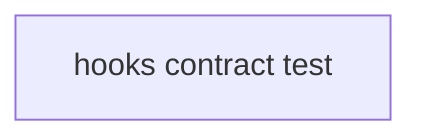

# Superlite: one contract test covers every registered hook (B225, #846)

**Goal:** one test module walks every hook `hooks/hooks.json` and `hooks/hooks-cursor.json` register and checks a valid event and matcher, LF endings, `bash -n`, and fail-open on about 25 malformed stdin inputs; a hook that must block on one of them is listed with its reason, so adding a hook without LF endings, or one that crashes on empty stdin, fails the test.
**Architecture:** the module parses both manifests into `Hook` records (no pinned list), so a new entry is checked without editing the test; helpers (`registered`, `entry_problems`, `has_cr`, `run_hook`, `run_problems`, `blocks`) take a manifest or hooks folder, and two self-tests run them on a temp plugin with a CRLF hook, a crashing hook and bad entries to prove the acceptance.
**Tech stack:** Python 3.10+ stdlib and pytest; bash (Git Bash on Windows); pytest through `sl run_tests`.
**Spec:** this file, section Design; issue #846 (port of upstream iha2/superlite `tests/scripts/test_hooks_contract.py`, in history at 569c2f94).
**Detail:** tests
**Target-min:** 11
**Wave0:** none
**Worktree:** none
**Coverage:** off

Global constraints:
- Only `tests/scripts/test_hooks_contract.py` changes; no hook, manifest, conftest or doc file is edited (other batches own several of them).
- Stdlib and pytest only; LF endings; the module docstring names #846.
- This repository is public: no host names, user names, home paths, other project or repository names in code, tests, docs or commit messages.
- Builds: the verdict is `sl run_tests` (the project's test command; a project with `.maxapp` runs `maxapp test`, which a build pool may place on another Mac, and a full run whose tree a green maxapp test stamp covers returns that result without a run); task trees build in <tree>/.build/DerivedData and any build of your own goes under .build/ of the worktree, never -derivedDataPath outside the worktree (your session scratchpad included; backlog cleanup removes scratchpad build folders when the worktree goes); a product, simulator or device build stays on this machine and runs only when an issue's acceptance asks for a running-app check.
- Simulators: append the UDID of each simulator you or a worker creates (`xcrun simctl create` or `clone`; a checker's `Simulators:` line marks its created ones) as one line to /Users/max/github/superlite/.claude/worktrees/superlite-b225-hooks-contract-test/.superlite/simulators.txt; never list one you did not create; ship cleanup shuts down and deletes each listed one.

## Design

Today `test_capture_hooks.py`, `test_hooks_bash32.py` and `test_guard_false_blocks.py` cover parts; nothing walks all registered hooks, and nothing checks CR bytes (`read_text` drops them) or `bash -n`. hooks.json registers 13 scripts (mark-inline-flow twice: PreToolUse `Skill` and UserPromptSubmit); hooks-cursor.json registers session-start under `sessionStart`. `superlite-state.sh` is sourced, not registered.

Ruling: the contract derives its cases from both manifests instead of upstream's pinned `REGISTERED` list: a new hook is checked without editing this file, and the matchers stay pinned where behaviour depends on them (test_mark_inline_flow.py and the hooks' own tests), so a hooks.json change in another batch does not have to touch this file (lead's ruling).
Ruling: "valid event and matcher" means: the event is in the host's known event set (Claude Code or Cursor), a matcher appears only on an event that takes one (tool events: tool names; SessionStart: startup, resume, clear, compact; PreCompact: manual, auto), each `|` alternative is in that set, and the command is exactly `bash "${CLAUDE_PLUGIN_ROOT}/hooks/<name>"` (Cursor: `bash ./hooks/<name>`) naming an existing file; Claude entries have `type: command` and, when present, `shell: bash` and a boolean `async` (lead's ruling).
Ruling: LF and `bash -n` run over every non-JSON file in hooks/ (the registered scripts and the sourced superlite-state.sh), as upstream does (lead's ruling).
Ruling: fail-open runs each registered script (once per host, not per event) on each malformed input in two project states: `gate` (orchestrator.json `{"mode": "human", "approved": false}`, upstream's state: the guard enforces and the state is a run) and `run` (orchestrator.json ai/approved plus `stable.json`: the plan-run markers rewrite-test-runs and capture-agent-launch read). session-start does not parse its stdin past a few regexes and always prints, so it gets three inputs (empty, garbage, binary) as upstream (lead's ruling).
Ruling: fail-open means exit 0, no blocking decision on stdout (`decision`/`permissionDecision`/`behavior` of `block` or `deny`, or `continue: false`, anywhere in a JSON stdout), empty stderr, empty stdout except for a hook in `TALKS` (session-start: the intro JSON; pre-compact: the plain-text compaction instructions it prints in any run), and every `.superlite/*.jsonl` line the hook wrote parses as JSON (lead's ruling).
Ruling: `FAIL_CLOSED` lists `(script, state, input)` cases that must block, each with its reason, and the test asserts they do block (exit 2 or a blocking decision) instead of skipping them as upstream does; known entries: block-coordinator-edits in `gate` on the Agent inputs with no `subagent_type` (a general-purpose agent, which the human gate denies by design) and on `big-write` (a well-formed Write outside the review plan, which the unapproved human gate denies by design; the `run` state still checks that the 1 MB input fails open; ruled after T1's first run). deny-worker-permission and capture-worker-stop act only with `SUPERLITE_FLEET_WORKER` set and final-review-check only in a git repository: the test runs outside both, which a comment says (lead's ruling).
Ruling: each run is isolated: env without `SUPERLITE_FLEET_*`, `CLAUDE_*` and `CURSOR_*` vars and without `SUPERLITE_STATE_DIR` and `SUPERLITE_FINAL_REVIEW`, then `HOME` = a temp folder, `CLAUDE_PROJECT_DIR` = the temp project, cwd = the temp project, and the host's plugin root var (`CLAUDE_PLUGIN_ROOT`, Cursor: `CURSOR_PLUGIN_ROOT`) = the plugin root; `SUPERLITE_HOME` comes from the conftest autouse fixture; a 60 s timeout per run (lead's ruling).

## Task graph

```mermaid
%% schedule
gantt
  title Predicted schedule (mm:ss)
  dateFormat X
  axisFormat %M:%S
  section lane 1
  T1 Hooks contract test covers every regi :t1, 0, 302s
```





critical path: T1 (5.0 min) · peak width 1 · predicted build 5.0 min · predicted total ≈ 15.5 min (target ✗ 11.0)

## Package: hooks contract

App type: test module (pytest over bash hook scripts). Categories: protocol (hook stdin and stdout contract per host), data (malformed, typed-wrong, huge and binary payloads), compat (Claude Code and Cursor manifests, bash 3.2 and Git Bash).
**Probe entry:** none (a test module; the named tests are the probes)

### T1 Hooks contract test covers every registered hook · Complexity 4 · Est. context 55k
**Owns:** tests/scripts/test_hooks_contract.py
**Components:** 1
**LOC owned:** 230
**Tests:** slow
**Model:** sonnet
**Kind:** design
**Covers:** Design
**Produces:** Hook(host: str, event: str, matcher: str | None, entry: dict) NamedTuple with property script -> str | None · registered(manifest: Path) -> list[Hook] · entry_problems(hook: Hook, hooks_dir: Path = HOOKS) -> list[str] · has_cr(path: Path) -> bool · run_hook(script: Path, raw: str, project: Path, host: str = "claude") -> subprocess.CompletedProcess · run_problems(r, talks: bool) -> list[str] · blocks(r) -> bool · project(tmp_path: Path, state: str) -> Path
**Review Focus:** protocol: `test_fails_open` asserts exit 0, no blocking decision, empty stderr, empty stdout outside `TALKS`, valid JSONL; every `FAIL_CLOSED` case blocks and names a real case (`test_fail_closed_cases_are_real`); data: 1 MB Write content, 1 MB prompt, binary bytes, wrong-typed and null fields; compat: hooks-cursor.json entries run with `CURSOR_PLUGIN_ROOT`; acceptance: `test_contract_catches_a_crlf_hook_and_a_crash_on_empty_stdin`.
**Test code (verbatim):** the two acceptance self-tests below fail first (the helpers do not exist yet); the rest of the module follows Notes.
```python
def test_contract_catches_a_crlf_hook_and_a_crash_on_empty_stdin(tmp_path):
    hooks = tmp_path / "plugin" / "hooks"
    hooks.mkdir(parents=True)
    (hooks / "good").write_bytes(b"#!/usr/bin/env bash\nIFS= read -r -d '' input\nexit 0\n")
    (hooks / "crlf").write_bytes(b"#!/usr/bin/env bash\r\nexit 0\r\n")
    (hooks / "crash").write_bytes(b"#!/usr/bin/env bash\nset -e\nIFS= read -r -d '' input\nexit 0\n")
    cmd = 'bash "${CLAUDE_PLUGIN_ROOT}/hooks/%s"'
    data = {"hooks": {"PreToolUse": [{"matcher": "Bash", "hooks": [{"type": "command", "shell": "bash", "command": cmd % n}
                                                                    for n in ("good", "crlf", "crash")]}]}}
    (hooks / "hooks.json").write_text(json.dumps(data), encoding="utf-8")
    found = registered(hooks / "hooks.json")
    assert [h.script for h in found] == ["good", "crlf", "crash"]
    assert [entry_problems(h, hooks) for h in found] == [[], [], []]
    assert [h.script for h in found if has_cr(hooks / h.script)] == ["crlf"]
    if BASH:
        proj = project(tmp_path, "gate")
        assert run_problems(run_hook(hooks / "good", "", proj), talks=False) == []
        assert run_problems(run_hook(hooks / "crash", "", proj), talks=False) == ["exit 1"]


def test_contract_rejects_a_bad_event_matcher_or_command(tmp_path):
    hooks = tmp_path / "hooks"
    hooks.mkdir()
    (hooks / "ok").write_text("exit 0\n", encoding="utf-8")
    ok = {"type": "command", "command": 'bash "${CLAUDE_PLUGIN_ROOT}/hooks/ok"'}
    data = {"hooks": {
        "PreToolUs": [{"matcher": "Bash", "hooks": [ok]}],
        "PreToolUse": [{"matcher": "Bash|Bsh", "hooks": [ok]},
                       {"matcher": "Bash", "hooks": [{"type": "command", "command": "python3 x.py"}]},
                       {"matcher": "Bash", "hooks": [{"type": "command", "command": 'bash "${CLAUDE_PLUGIN_ROOT}/hooks/gone"'}]}],
        "Stop": [{"matcher": "x", "hooks": [ok]}],
    }}
    (hooks / "hooks.json").write_text(json.dumps(data), encoding="utf-8")
    got = [entry_problems(h, hooks) for h in registered(hooks / "hooks.json")]
    assert [len(p) for p in got] == [1, 1, 1, 1, 1], got
    for problems, needle in zip(got, ("unknown claude event PreToolUs", "Bsh", "does not run a hooks/ script",
                                      "hooks/gone missing", "Stop takes no matcher")):
        assert needle in problems[0], (needle, problems)
    (hooks / "hooks-cursor.json").write_text(json.dumps({"version": 1, "hooks": {"sesionStart": [{"command": "bash ./hooks/ok"}]}}),
                                              encoding="utf-8")
    [cursor] = registered(hooks / "hooks-cursor.json")
    assert cursor.host == "cursor" and cursor.script == "ok"
    assert entry_problems(cursor, hooks) == ["unknown cursor event sesionStart"]
```
**Steps:** 1 write the module header, constants and the two tests above, 2 run them: FAIL (record the summary line as `Red run:`), 3 write the helpers and the per-hook tests from Notes, 4 run the module: PASS (all cases), then `tests/scripts/test_hooks_bash32.py`, `test_capture_hooks.py` and `test_fleet_hooks.py` stay green.
**Notes:**
- Module start: docstring (#846, one contract for every hook both manifests register; fail-closed cases in `FAIL_CLOSED`, talking hooks in `TALKS`); `ROOT = parents[2]`, `HOOKS = ROOT / "hooks"`, `BASH` as upstream (Git Bash path on Windows, else `shutil.which("bash")`), `needs_bash = pytest.mark.skipif(not BASH, ...)` on every test that runs bash (the acceptance test guards its runs with `if BASH`).
- Sets: `CLAUDE_EVENTS = {SessionStart, SessionEnd, UserPromptSubmit, PreToolUse, PostToolUse, PostToolUseFailure, PermissionRequest, Notification, Stop, SubagentStart, SubagentStop, PreCompact}`; `TOOLS = {Bash, PowerShell, Monitor, Edit, Write, NotebookEdit, MultiEdit, Agent, Task, Skill, Read, Grep, Glob, WebFetch, WebSearch, TodoWrite, AskUserQuestion, ExitPlanMode}`; `MATCHER_WORDS = {SessionStart: {startup, resume, clear, compact}, PreCompact: {manual, auto}}` plus TOOLS for PreToolUse, PostToolUse, PostToolUseFailure, PermissionRequest; `CURSOR_EVENTS = {sessionStart, sessionEnd, beforeShellExecution, afterShellExecution, beforeMCPExecution, afterMCPExecution, beforeReadFile, afterFileEdit, beforeSubmitPrompt, afterAgentResponse, afterAgentThought, stop, preToolUse, postToolUse, postToolUseFailure, subagentStart, subagentStop, preCompact}`. Add a name to a set only when that host's current hooks docs list it.
- `registered`: a manifest with a top-level `version` key is Cursor-shaped (`hooks: {event: [{command}]}`, host `cursor`, matcher from the entry), else Claude-shaped (`hooks: {event: [{matcher?, hooks: [{...}]}]}`, host `claude`, matcher from the group); one `Hook` per command object in file order. `script` fullmatches `bash "\$\{CLAUDE_PLUGIN_ROOT\}/hooks/([\w-]+)"` (Cursor: `bash \./hooks/([\w-]+)`) on `entry.get("command")`, else None.
- `entry_problems` messages, in this order: `unknown <host> event <event>`; `command <cmd!r> does not run a hooks/ script` or `hooks/<script> missing`; `<event> takes no matcher` (a matcher on an event outside MATCHER_WORDS, or any matcher on Cursor) or `<event> matcher <matcher!r>: <bad alternatives, comma-joined> not allowed`; for Claude entries `type <t!r> is not command`, `shell <s!r> is not bash`, `async <a!r> is not a boolean`.
- `has_cr(path)`: `b"\r" in path.read_bytes()`. `HOOK_FILES` = sorted files in HOOKS whose suffix is not `.json`; `test_hook_files_have_lf_endings(path)` and `test_hook_files_parse_under_bash(path)` (`[BASH, "-n", path]` exit 0, stderr in the message) parametrize over it, ids = file name.
- `CLAUDE = registered(HOOKS / "hooks.json")`, `CURSOR = registered(HOOKS / "hooks-cursor.json")`; `test_manifests_register_hooks`: CLAUDE non-empty, `("cursor", "session-start")` among CURSOR's (host, script), Cursor `version == 1`; `test_manifest_entry_is_valid(hook)` over CLAUDE + CURSOR (ids `host-event-script`) asserts `entry_problems(hook) == []`.
- `project(tmp_path, state)`: `tmp_path/"home"` and `tmp_path/"proj"/.superlite`; STATES `gate` = orchestrator.json `{"mode": "human", "approved": false}`; `run` = orchestrator.json `{"mode": "ai", "approved": true}` and stable.json `{}`. `run_hook` builds the env from the Design ruling and runs `[BASH, script]` with `input=raw`, `capture_output=True`, `text=True`, `encoding="utf-8"`, `errors="replace"`, `cwd=project`, `timeout=60`; the plugin root is `script.parent.parent`.
- `blocks(r)`: exit 2, or a JSON stdout holding a blocking decision anywhere (Design ruling). `run_problems(r, talks)` returns, in order: `exit <n>` when non-zero, `stdout decision <value>` when blocking, `stdout <first 200 chars!r>` when stdout is non-empty and not `talks`, `stderr <first 200 chars!r>` when stderr is non-empty.
- `MALFORMED` (name: raw), upstream's 21 (empty, not-json, brace-not-json, garbage, empty-object, empty-array, open-brace, truncated, truncated-agent, no-tool-name, no-tool-input-bash, no-tool-input-agent, edit-empty-input, bash-command-int, agent-id-int, prompt-int, prompt-cwd-only, null-fields, unknown-tool, binary, big-write) plus: `big-prompt` `{"prompt": "x" * 1_000_000}`, `session-id-traversal` `{"session_id": "../../etc", "prompt": "hi"}`, `stop-fields-wrong-type` `{"stop_hook_active": "yes", "transcript_path": 5, "agent_type": 5}`, `permission-no-input` `{"hook_event_name": "PermissionRequest", "tool_name": "Bash"}`.
- `SCRIPTS` = sorted unique `(host, script)` of CLAUDE + CURSOR; `CASES` = each `(host, script)` x STATES x MALFORMED, session-start only on empty, garbage, binary; ids `host-script-state-name`. `test_fails_open(host, script, state, name, tmp_path)`: a `FAIL_CLOSED` case asserts `blocks(r)` with its reason in the message; every other case asserts `run_problems(r, script in TALKS) == []` with (script, state, name) in the message; then every line of `proj/.superlite/*.jsonl` parses with `json.loads`. `test_fail_closed_cases_are_real`: each FAIL_CLOSED key names a script in SCRIPTS, a state in STATES and an input in MALFORMED.
- Empirical step: run the module once and read every failing case. Expected: block-coordinator-edits blocks in `gate` on `truncated-agent`, `no-tool-input-agent` (FAIL_CLOSED, reason: an Agent call with no subagent_type is general-purpose, which the human gate denies by design); session-start and pre-compact talk (TALKS with their reasons). Any other failure (a non-zero exit, a block, output or invalid JSONL): do not add it to FAIL_CLOSED or TALKS and do not edit a hook; report DONE_WITH_CONCERNS with each case id and its `run_problems` output, so the lead rules.
- Measure the module's wall time with `-p no:xdist` once and give it in the report.

## Review Focus

- protocol: every registered script, in both states, on every malformed input exits 0 with no blocking decision and no stray output (`test_fails_open`); the fail-closed list is asserted closed and cannot go stale (`test_fail_closed_cases_are_real`).
- data: 1 MB Write content and prompt, binary bytes, null and wrong-typed fields (`MALFORMED`); JSONL rows a hook writes stay valid.
- compat: hooks-cursor.json entries run with the Cursor root var; LF and `bash -n` over every hooks/ script (`test_hook_files_have_lf_endings`, `test_hook_files_parse_under_bash`).
- acceptance (#846): a CRLF hook and a hook that crashes on empty stdin are caught (`test_contract_catches_a_crlf_hook_and_a_crash_on_empty_stdin`); bad events, matchers and commands are caught (`test_contract_rejects_a_bad_event_matcher_or_command`).

## Self-review

One task, one new test file; the issue's checks (event and matcher, LF, `bash -n`, fail-open on about 20 malformed inputs, fail-closed cases with a reason) and its acceptance map to named tests. No placeholders. Running-app checks: none (a test module).
