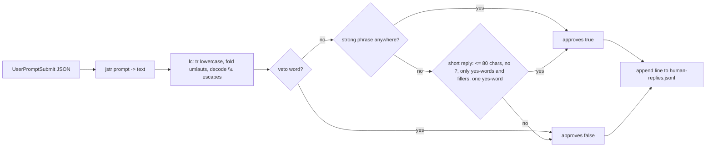
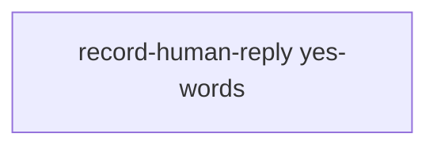

# Superlite: human approval accepts short yes-words such as ok, sure, ja, passt (B231)

**Goal:** fix #852: `hooks/record-human-reply` records `approves: true` for a short reply made only of yes-words ("ok", "sure", "ja", "passt", "mach", "ja, passt", "ok mach weiter"), for German approval phrases anywhere ("sieht gut aus", "leg los", "genehmigt", "freigegeben"), and still never for a reply with a veto word in English or German ("ja, aber ...", "ok warte", "Ändere X") or for a long reply that merely contains "ok".
**Architecture:** one change in the bash hook's matcher (lines 38-44 today) plus its header comment; `orchestrator.py` keeps reading `approves: true` unchanged. One task.
**Tech stack:** bash 3.2 compatible builtins (stock macOS; no `${var,,}`, no new external process), pytest through `sl run_tests`.
**Spec:** this file, section Design; issue #852 (body: "widen the approve pattern with short English and German yes-words; widen the veto words with their German forms (nein, aber, warte, ändere); a reply with a veto word still never approves"; acceptance: "hook tests for each new word, for a veto in each language, and for a long reply that merely contains ok").
**Detail:** tests
**Target-min:** 11
**Wave0:** none

Global constraints:
- The hook stays bash builtins only apart from the existing `tr`, `date` and `perl` calls (no new external process: each costs about 250 ms on Windows), keeps LF endings, passes `bash -n`, exits 0 always and writes nothing to stdout or stderr.
- Existing tests stay green, in particular `tests/scripts/test_human_gate.py` (`test_reply_approves`, `test_reply_does_not_approve`) and `tests/scripts/test_hooks_contract.py`. An existing test file changes only when the task Owns it. If another existing test turns red, report it in DONE_WITH_CONCERNS with the test id and the reason instead of editing it.
- Run `sl` as an executable (`<abs>/sl ...`). Verify with `<abs>/sl run_tests --fast <own test files> --task Tn --background`, then run the printed `wait:` line in the foreground and end the turn only after it reports.
- No version edits (the ship step bumps the version). Never run `scripts/evals.sh`, `claude plugin eval` or `scripts/test_layers.py run`.
- Builds: the verdict is `sl run_tests` (the project's test command; a project with `.maxapp` runs `maxapp test`, which a build pool may place on another Mac, and a full run whose tree a green maxapp test stamp covers returns that result without a run); task trees build in <tree>/.build/DerivedData and any build of your own goes under .build/ of the worktree, never -derivedDataPath outside the worktree (your session scratchpad included; backlog cleanup removes scratchpad build folders when the worktree goes); a product, simulator or device build stays on this machine and runs only when an issue's acceptance asks for a running-app check.
- Simulators: append the UDID of each simulator you or a worker creates (`xcrun simctl create` or `clone`; a checker's `Simulators:` line marks its created ones) as one line to /Users/max/github/superlite/.claude/worktrees/superlite-b231-human-approval-yes-words/.superlite/simulators.txt; never list one you did not create; ship cleanup shuts down and deletes each listed one.

Ruling: two tiers (lead's ruling): the existing strong phrases, plus four German ones, approve anywhere in the reply as today; the short yes-words (ok, sure, ja, passt, mach, ...) approve only when the whole reply is yes-words and filler words, at most 80 characters and without a `?` (because "ok" inside a long reply or a question is no approval; the issue's acceptance asks for exactly that) - cost if wrong: a short approval with an unlisted word ("passt schon") stays closed and the human types "approve".
Ruling: a veto word anywhere still blocks both tiers; the veto list gains German negations and change words beyond the issue's four (nicht, kein, keine, warten, moment, stopp, ändern, änderung, statt, stattdessen; ASCII forms aendere, aendern) (because a false veto only keeps the gate closed, the safe side) - cost if wrong: "ok, kein Problem" stays closed, as "no problem" already does.
Ruling: before matching, the hook folds Ä Ö Ü to ä ö ü and decodes the JSON escapes `ä Ä ö Ö ü Ü` (either hex case after `tr`) and `’` (to `'`), since a harness whose JSON escapes non-ASCII would otherwise hide "ändere" from the veto; the recorded `text` stays as today - cost if wrong: none, a few builtin substitutions.
Ruling: tests go into tests/scripts/test_record_human_reply_stdin_489.py (the brief's file); this plan goes into docs/plans/ (no open batch lists it); no doc change beyond the hook's header comment (docs/hooks.md names no words); probe entry none (a bash hook, its cases are named tests) - cost if wrong: one NEEDS_CONTEXT round.
Ruling: accept predicted 15.2 min - one task, nothing to split - cost: none.
LAYERS: unit, headless



## Design

### 1. Matcher in `hooks/record-human-reply` (T1)
- Unchanged: the input bounds, `jstr`, the state checks, the recorded line `{"t":..,"approves":..,"text":"<first 160 chars>"}`, the 160-char cut of `text` (applied after matching, as today), exit 0.
- Normalising `lc` (after the existing `tr` lowercase): replace `Ä`→`ä`, `Ö`→`ö`, `Ü`→`ü`; replace the literal six-character escapes `ä` and `Ä` by `ä`, `ö` and `Ö` by `ö`, `ü` and `Ü` by `ü`, and `’` by `'`; replace the raw character `’` by `'`. Pattern form: `lc="${lc//\\u00e4/ä}"`. bash 3.2 keeps the backslash of a `\'` replacement, so the apostrophe goes through a variable: `q="'"; lc="${lc//\\u2019/$q}"`.
- Strong phrases (`re_yes`, matched anywhere with the existing `$b`/`$e` word bounds): today's list plus `genehmigt`, `freigegeben`, `leg[[:space:]]+los`, `sieht[[:space:]]+gut[[:space:]]+aus`.
- Veto words (`re_no`, anywhere, same bounds): today's list (not, don't, don’t, dont, no, wait, stop, but, change, instead) plus `nein`, `nicht`, `kein`, `keine`, `aber`, `warte`, `warten`, `moment`, `stopp`, `ändere`, `ändern`, `änderung`, `aendere`, `aendern`, `statt`, `stattdessen`.
- Short yes-words: `ok`, `okay`, `sure`, `yep`, `yeah`, `fine`, `good`, `great`, `perfect`, `alright`, `go`, `ja`, `jo`, `jep`, `passt`, `mach`, `machs`, `los`, `klar`, `gut`, `genau`, `gerne`, `gern`, `perfekt`, `super`, `prima`, `weiter`, `einverstanden`.
- Filler words (never approve alone): `so`, `das`, `es`, `s`, `it`, `that`, `let`, `lets`, `bitte`, `please`, `danke`, `thanks`, `dann`, `then`, `mal`, `doch`, `sounds`, `klingt`, `for`, `me`, `für`, `mich`, `mir`, `sehr`, `very`, `yes`, `approve`.
- Short rule: with `s='[[:space:][:punct:]]'`, `Y` the yes-word alternation and `F` the filler alternation, `re_short="^$s*(($Y|$F)$s+)*($Y)($s+($Y|$F))*$s*\$"` (the whole reply is tokens of Y or F separated by spaces or ASCII punctuation, at least one of them from Y). It applies only when `${#lc} -le 80` and `lc` holds no `?`.
- Decision: `approves=true` when `lc` matches no `re_no` and (it matches `re_yes`, or the short rule holds); else false.
- Header comment (lines 6-8 today): name both tiers, the veto list in both languages, the 80-character and `?` limits and the escape decoding, in the file's terse style.

## Coverage

| Category | State | Basis |
|---|---|---|
| Scope and success criteria | settled | #852 acceptance: each new word, a veto per language, a long reply holding "ok" |
| Domain and data model | n/a | the recorded line keeps its three keys |
| Persistence and migration | n/a | human-replies.jsonl format unchanged |
| Interfaces and contracts | settled | `approves` read by orchestrator.py unchanged |
| UI states | n/a | none |
| Concurrency and state ownership | n/a | one append per prompt, as today |
| Error handling and recovery | settled | fail-open contract unchanged (exit 0, silent) |
| Security and privacy | ruled | prompt text is untrusted: no eval, regex only; a false approval opens the gate, so short words need a whole-reply match and any veto blocks |
| Performance and limits | ruled | short rule only for `lc` up to 80 characters; builtins only |
| Observability | n/a | none |
| Testing strategy | settled | named pytest cases in the brief's test file |
| Compatibility | ruled | bash 3.2 and 5, C and UTF-8 locales; escaped and raw UTF-8 JSON input |
| Rollout | ruled | one PR; version bump at ship |
| Research unknowns | n/a | regex checked on macOS bash 3.2 in C and UTF-8 locales |

## File structure
- `hooks/record-human-reply`: matcher tiers, normalising, header comment (T1).
- `tests/scripts/test_record_human_reply_stdin_489.py`: #852 cases appended (T1).

## Task graph

```mermaid
%% schedule
gantt
  title Predicted schedule (mm:ss)
  dateFormat X
  axisFormat %M:%S
  section lane 1
  T1 record-human-reply accepts short yes- :t1, 0, 281s
```




critical path: T1 (4.7 min) · peak width 1 · predicted build 4.7 min · predicted total ≈ 15.2 min (target ✗ 11.0)

## Package: human approval hook
App type: library / parser of untrusted text. Categories: encoding (umlauts raw and escaped, curly apostrophe, punctuation), state (veto beats every approval), deep (n/a: no nesting). Specific risks: a long or questioning reply approving through "ok"; a German veto hidden by case or JSON escapes; a regex that bash 3.2 reads differently.
**Probe entry:** none (Ruling: a bash hook; its cases are named tests).

### T1 record-human-reply accepts short yes-words · Complexity 3 · Est. context 30k
**Owns:** hooks/record-human-reply, tests/scripts/test_record_human_reply_stdin_489.py
**Components:** 1
**LOC owned:** 110
**Tests:** fast
**Model:** sonnet
**Est. time:** 2.0 min (1 component, about 110 LOC, fast tests)
**Covers:** 1
**Consumes:** none
**Produces:** none
**Review Focus:** encoding: `test_veto_hidden_by_json_escape` (escaped "Ändere" still vetoes), `test_veto_words_block` ("Ändere" upper case); state: `test_veto_words_block` (veto beats short and strong tiers); limits: `test_long_or_questioning_reply_does_not_approve`.
**Test code (verbatim):** append to tests/scripts/test_record_human_reply_stdin_489.py, and change its first line to `"""#489: record-human-reply never waits on stdin; #852: short yes-words approve, veto words in English and German block."""`:
```python
# ---- #852: short yes-words approve a short reply; veto words in English and German ----

def approves(proj, tmp_path, prompt, ascii_json=False):
    jsonl(proj).unlink(missing_ok=True)
    raw = json.dumps({"hook_event_name": "UserPromptSubmit", "prompt": prompt}, ensure_ascii=ascii_json)
    r = subprocess.run([BASH, str(REPLY)], input=raw.encode("utf-8"), capture_output=True,
                       env=env_for(proj, tmp_path), timeout=15)
    assert r.returncode == 0 and r.stdout == b"" and r.stderr == b""
    (line,) = jsonl(proj).read_text(encoding="utf-8").splitlines()
    return json.loads(line)["approves"]


SHORT_WORDS = ["ok", "okay", "sure", "yep", "yeah", "fine", "good", "great", "perfect", "alright", "go",
               "ja", "jo", "jep", "passt", "mach", "machs", "los", "klar", "gut", "genau", "gerne", "gern",
               "perfekt", "super", "prima", "weiter", "einverstanden"]


@pytest.mark.parametrize("word", SHORT_WORDS)
def test_short_yes_word_alone_approves(proj, tmp_path, word):
    assert approves(proj, tmp_path, word) is True
    assert approves(proj, tmp_path, word.capitalize() + "!") is True


@pytest.mark.parametrize("prompt", [
    "ja, passt", "Passt so.", "ok mach", "Mach's", "ok, mach weiter", "Ja bitte", "sure, thanks",
    "sounds good", "klingt gut", "let's go", "Let’s go", "passt für mich", "ok dann mach mal", "  OK  ",
    "Sieht gut aus, leg los", "Genehmigt.", "Plan freigegeben, danke dir für die Arbeit an den Tests",
    "Der Plan sieht gut aus und die Tests decken alles ab",
])
def test_short_and_german_replies_approve(proj, tmp_path, prompt):
    assert approves(proj, tmp_path, prompt) is True


GERMAN_VETO = ["nein", "nicht", "kein", "keine", "aber", "warte", "warten", "moment", "stopp", "ändere", "Ändere",
               "ändern", "Änderung", "aendere", "aendern", "statt", "stattdessen"]


@pytest.mark.parametrize("word", GERMAN_VETO)
def test_german_veto_word_blocks(proj, tmp_path, word):
    assert approves(proj, tmp_path, "Sieht gut aus, " + word + " den Titel") is False
    assert approves(proj, tmp_path, "approve, " + word) is False


def test_veto_control_approves(proj, tmp_path):
    assert approves(proj, tmp_path, "Sieht gut aus, den Titel") is True
    assert approves(proj, tmp_path, "approve, ok") is True


@pytest.mark.parametrize("prompt", [
    "ja, aber nimm einen anderen Namen", "ok warte", "passt, ändere aber den Titel", "Ändere den Titel, dann ok",
    "Nein, mach das", "leg los, aber ohne Tests", "genehmigt, keine Doku", "Sieht gut aus, stattdessen Variante B",
    "ok but rename it", "sure, wait", "looks good, but change the name", "go ahead, no tests", "lgtm, stop",
])
def test_veto_words_block(proj, tmp_path, prompt):
    assert approves(proj, tmp_path, prompt) is False


@pytest.mark.parametrize("prompt", [
    "ok so I think we should rework the parser first and then look at the export",
    "ok, schreib zuerst die Tests für den Parser und den Export",
    "ok rename the file", "ja den Export auch", "ok?", "passt das?", "ja? mach",
    "ok " * 30, "so", "bitte", "thanks", "okey dokey", "gutes Wetter heute",
])
def test_long_or_questioning_reply_does_not_approve(proj, tmp_path, prompt):
    assert approves(proj, tmp_path, prompt) is False


def test_veto_hidden_by_json_escape(proj, tmp_path):
    assert approves(proj, tmp_path, "Sieht gut aus, Ändere den Titel", ascii_json=True) is False
    assert approves(proj, tmp_path, "Sieht gut aus, ändere den Titel", ascii_json=True) is False
    assert approves(proj, tmp_path, "passt für mich", ascii_json=True) is True
    assert approves(proj, tmp_path, "Let’s go", ascii_json=True) is True
```
**Steps:** 1 append the tests, 2 run: FAIL (the new yes-words and German veto words), 3 change the hook as in Design 1, 4 run: PASS (also `tests/scripts/test_human_gate.py` and `tests/scripts/test_hooks_contract.py`).
**Notes:** `"ok " * 30` is 90 characters of yes-words: the 80-character limit keeps it closed. "okey" is no listed word, so "okey dokey" stays closed. "Plan freigegeben, danke dir ..." approves through the strong tier although "plan", "dir" and "arbeit" are no short words.

## Review Focus
- encoding: umlauts raw (C and UTF-8 locale) and `\u00XX`-escaped; `’` raw and escaped; ASCII punctuation as separators.
- state: a veto word anywhere wins over both tiers.
- limits: the short rule never fires above 80 characters, on a `?`, or on fillers alone.

## Self-review
- Coverage: each new short word (parametrized alone and capitalised), each German strong phrase, a veto per language and the escaped veto, and the long "ok" reply have named cases.
- No placeholders; no Consumes or Produces (one task, no seam).
- Graph: one node, no edges.
