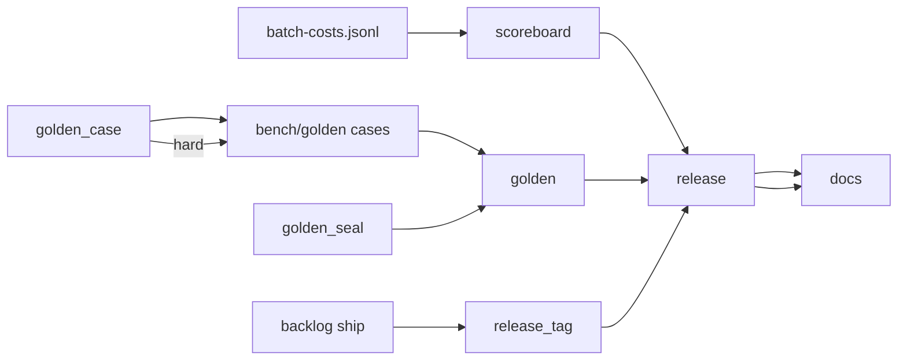

# Lean release pipeline

**Goal:** a free scoreboard over live batch rows, golden batches before minor and major releases, patch tags at ship, one release command.
**Architecture:** five new stdlib scripts beside the backlog tools (`scoreboard`, `release_tag`, `golden_case`, `golden_seal`, `golden`, `release`), golden cases as JSON under `bench/golden/`, three small edits in the ship and start path.
**Tech stack:** Python 3.10+, stdlib only, pytest, git, gh.
**Spec:** docs/plans/2026-11-15-lean-release-pipeline.review.md
**Review plan:** docs/plans/2026-11-15-lean-release-pipeline.review.md
**Detail:** contracts
**Max chars:** 34000

## Global constraints
- New scripts live in `skills/subagent-driven-development/scripts/` and run as `sl <name>`; follow the neighbours' style, including the per-line complexity comments.
- Results on stdout, everything else on stderr; `--json` prints JSON.
- Every external command (git, gh, bash, claude, another script) goes through one module-level `_run(cmd: list, cwd=None, timeout=None) -> tuple[int, str]`; tests replace it. No test starts an agent, calls gh, pushes, tags this repository or runs `scripts/bump-version.sh` here; tests that need git use a repository under `tmp_path`.
- Tests: `tests/scripts/test_<module>.py`, pytest, no network.
- Version rule: a lead bumps the patch number only; minor and major only through `sl release`, which refuses when `SUPERLITE_FLEET_WORKER` is set.
- Versions are `X.Y.Z` integers; tags are `v<version>`, annotated.
- Golden level sets: minor = cases `small`, `typical`; major = `small`, `typical`, `large`.

## Coverage
| Category | State | Basis |
|---|---|---|
| Scope and success criteria | settled | Max, 15 Nov: core path checked, a baseline to spot regressions, no enterprise coverage |
| Domain and data model | settled | the golden case record above; batch rows exist already |
| Persistence and migration | ruled | golden cases live in the repository, golden results in a local results file; no old data to move |
| Interfaces and contracts | settled | batch rows and the ship steps keep their shape; the bump step only loses the right to jump minor or major |
| UI states | n/a | command-line output only |
| Concurrency and state ownership | ruled | a golden run uses its own state folder and its own copy; one release at a time, under the existing ship lock |
| Error handling and recovery | ruled | a failed step stops before any push; a rerun continues from the last finished step |
| Security and privacy | settled | cases come from this public repository only; no hostnames or private project names in cases |
| Performance and limits | ruled | a golden batch is cut off after 90 minutes or three times its earlier cost |
| Observability | settled | the scoreboard and the stored golden results are the record |
| Testing strategy | ruled | unit tests with a fake lead for the run logic; one real golden run per case as acceptance |
| Compatibility | settled | installs that follow main keep working; the stable install line is new |
| Rollout | ruled | patch tagging first, the first minor release only on Max's word |
| Research unknowns | spike | T5: the trial spike: a lead in a sealed copy that stops before ship |

Ruling: golden results stay local, not in the repository (because they are machine facts like the batch rows; cost if wrong: one command to commit them later).
Ruling: a failed release step stops before any push (because a half-published release is the only hard-to-undo state; cost if wrong: one more manual step).
Ruling: cut-off at 90 minutes or three times the earlier cost (because the slowest quarter of real batches ends near 56 minutes; cost if wrong: a slow but healthy run is cut and rerun).
Ruling: a fake lead in unit tests (because real runs cost quota; cost if wrong: a run-logic bug shows up only in the acceptance run).
Ruling: one release at a time under the ship lock (because a release and a shipping batch both change the version; cost if wrong: a release waits for a ship).
Ruling: patch tagging first (because it changes nothing a lead does except adding a tag; cost if wrong: tags can be deleted).
Ruling: the spike is the coordinator's real sealed run of case `small` after T4, T5 and T6 are committed, not an implementer task (because it starts a lead and spends quota; cost if wrong: a fix round on T5 or T6).
Ruling: hidden tests are stored as text inside each case file (because a case is then one owned file and pytest never collects it; cost if wrong: larger JSON).
Ruling: the README install line changes with the first minor release, when `stable` exists (because the line would be dead until then; cost if wrong: one doc edit).
Ruling: backlog_run.py, backlog_brief.py and backlog_ship.py are shared with the open run token-trims-914; edits stay within the lines named in T2 and T5 (because a rebase of three small hunks is cheaper than duplicated start logic; cost if wrong: one rebase conflict at ship).

## Main diagram

```mermaid
%% schedule
gantt
  title Predicted schedule (mm:ss)
  dateFormat X
  axisFormat %M:%S
  section lane 1
  T7 release command :t7, 0, 241s
  T8 rules and docs :t8, 241, 285s
  section lane 2
  T6 golden run :t6, 0, 238s
  section lane 3
  T5 sealed lead start :t5, 0, 236s
  section lane 4
  T3 golden case files :t3, 0, 235s
  T4 the three cases :t4, 235, 270s
  section lane 5
  T2 patch tag at ship :t2, 0, 222s
  section lane 6
  T1 scoreboard :t1, 0, 195s
```

critical path: T7 → T8 (8.8 min) · peak width 6 · predicted build 8.8 min · predicted total ≈ 17.3 min

## File structure
- `scripts/scoreboard.py`: trend, band and outlier flags over batch rows.
- `scripts/release_tag.py`: bump level of a version change, annotated tag at a commit.
- `scripts/golden_case.py`: case files: load, list, make from a merged pull request, verify.
- `scripts/golden_seal.py`: sealed copy, lead start, wait, cost row, cleanup.
- `scripts/golden.py`: checks, score, run with one rerun, results file, CLI.
- `scripts/release.py`: preflight, scoreboard, golden run, bump, tag, publish, stable.
- `bench/golden/{small,typical,large}/case.json`: the three cases.
- `docs/release.md`, `AGENTS.md`, `docs/experiments.md`, `docs/tools.md`: rules and docs.

(`scripts/` = `skills/subagent-driven-development/scripts/`.)

## Scoreboard
**Probe entry:** run=python3 skills/subagent-driven-development/scripts/scoreboard.py --root

### T1 scoreboard · Complexity 4 (O-n) · Est. context 30k
**Owns:** skills/subagent-driven-development/scripts/scoreboard.py, tests/scripts/test_scoreboard.py
**Components:** 1
**LOC owned:** 140
**Tests:** fast
**Model:** sonnet
**Est. time:** 3 min (1 component, about 140 LOC, fast tests)
**Consumes:** none
**Produces:** scoreboard.metrics(row: dict) -> dict · scoreboard.board(rows: list, window: int = 15) -> dict
e.g. metrics({"lead": {"cost_usd": 3.0, "turns": 60}, "workers_total": {"cost_usd": 1.0}, "grade": {"points": 2, "tasks": 4, "first_time_pass": 3, "letter": "B"}}) -> {"lead_usd": 3.0, "total_usd": 4.0, "lead_turns": 60, "points": 2, "first_pass": 0.75}
e.g. board([]) -> {"enough": False, "window": 15, "now": 0, "baseline": 0, "metrics": {}, "flags": [], "outliers": []}
e.g. board(rows30) with lead cost 4.0 in the first 15 rows and 6.0 in the last 15 -> ["flags"] == ["lead_usd +50% (4.00 -> 6.00)"], ["enough"] True
**Review Focus:** `test_zero_tasks_first_pass_none`: tasks 0 gives first_pass None and the row is left out of that metric; `test_malformed_row_skipped`: a row without `lead` is ignored; `test_unknown_root_exit_0`: a root without rows prints `scoreboard: no batch rows` and exits 0
**Test code (contracts):** `test_metrics_example` (the e.g. above); `test_latest_shipped_only`: two rows of batch B1 (first parked, last shipped) count once, a batch whose last row is `parked` is left out; `test_not_enough`: 20 rows, window 15 gives enough False and no flags; `test_cost_flag`: the 4.0 to 6.0 example; `test_no_flag_within_30pct`: 4.0 to 5.0 gives no flag; `test_points_flag_abs`: mean points 1.0 to 3.5 flags `points +2.5 (1.0 -> 3.5)`, 1.0 to 2.5 does not; `test_first_pass_flag`: mean 0.90 to 0.75 flags `first_pass -0.15 (0.90 -> 0.75)`; `test_outlier_letter_d`: a row of the window with letter D is in outliers as `B7 grade D`; `test_outlier_cost`: total above 3 times the baseline median is `B9 cost 15.00 (3x median 4.00)`; `test_cli_exit`: flags give exit 1, none give exit 0, `--json` prints the board dict.
**Steps:** 1 failing tests, 2 run: FAIL, 3 implement, 4 run: PASS
**Notes:** rows = latest row per batch with `row == "batch"` and `end == "shipped"`, in file order. now = last `window` rows, baseline = all rows before them; enough needs `window` rows in each. Per metric: lead_usd, total_usd, lead_turns use medians and flag a rise above 30 %; points and first_pass use means and flag +2.0 points or -0.10. CLI: `scoreboard.py [--root R] [--window N] [--json]`; root defaults to `backlog_state.main_root(Path.cwd())`; text output one line per metric `name now base change`, then flags and outliers.

## Versions and release
**Probe entry:** none (tags, pushes and publishes)

### T2 patch tag at ship · Complexity 4 (O-1) · Est. context 34k
**Owns:** skills/subagent-driven-development/scripts/release_tag.py, skills/subagent-driven-development/scripts/backlog_ship.py, tests/scripts/test_release_tag.py
**Components:** 2
**LOC owned:** 110
**Tests:** fast
**Model:** sonnet
**Est. time:** 3 min (2 components, about 110 LOC, fast tests)
**Consumes:** none
**Produces:** release_tag.level(cur: str, new: str) -> str · release_tag.tag(root: Path, version: str, sha: str, push: bool = True) -> str
e.g. level("1.5.244", "1.5.245") -> "patch"
e.g. level("1.5.244", "1.6.0") -> "minor"
e.g. level("1.5.244", "2.0.0") -> "major"
e.g. tag(repo, "1.5.245", "abc1234") -> "tag v1.5.245 pushed"
**Review Focus:** `test_level_invalid`: level("1.5.244", "1.5.243"), level("1.5", "1.6.0") and level("1.5.244", "x") give "invalid", equal versions give "none"; `test_tag_exists`: a second tag call for the same version returns `tag v1.5.245 exists` and changes nothing; `test_tag_never_raises`: a git failure returns `tag v1.5.245 failed: <last git line>`
**Test code (contracts):** `test_level_examples` (the e.g. lines); `test_tag_annotated`: in a tmp repository tag(repo, "1.5.245", HEAD, push=False) creates an annotated tag whose message is `Version 1.5.245` and returns `tag v1.5.245 created`; `test_tag_push_cmd`: with `_run` replaced, push=True runs `git fetch origin`, `git tag -a v1.5.245 -m "Version 1.5.245" <sha>`, then `git push origin refs/tags/v1.5.245`; `test_bump_refuses_minor`: backlog_ship `_bump` with `--version 1.6.0` on current 1.5.244 returns exit 2 and `refused: a lead bumps the patch number only (sl release minor|major)`; `test_bump_patch_ok`: `--version 1.5.245` and no `--version` still bump; `test_merge_tags`: after a merge that printed `merged #12` for a batch with version 1.5.245, `_merge` asks `gh pr view 12 --json mergeCommit -q .mergeCommit.oid`, calls release_tag.tag with that sha and appends its line to the output; `test_merge_tag_failure_keeps_exit`: a failing tag leaves exit 0.
**Steps:** 1 failing tests, 2 run: FAIL, 3 implement, 4 run: PASS
**Notes:** backlog_ship.py edits only: the level guard in `_bump` before the bump command, and the tag call in `_merge` after `_set(root, bid, pr=n, merged=True, ...)`. A batch without `version` gets no tag. level: major greater gives "major"; same major and minor greater gives "minor"; same major and minor and patch greater gives "patch".

### T7 release command · Complexity 6 (O-n) · Est. context 46k
**Owns:** skills/subagent-driven-development/scripts/release.py, tests/scripts/test_release.py
**Components:** 2
**LOC owned:** 230
**Tests:** fast
**Model:** sonnet
**Est. time:** 5 min (2 components, about 230 LOC, fast tests)
**Consumes:** scoreboard.board(rows: list, window: int = 15) -> dict (T1) · release_tag.level(cur: str, new: str) -> str (T2) · release_tag.tag(root: Path, version: str, sha: str, push: bool = True) -> str (T2) · golden_case.cases(root: Path) -> list (T3) · golden.run(cases: list, src: Path, out: Path, rerun: bool = True, timeout_s: int = 5400, seal=None) -> list (T6)
**Produces:** release.next_version(cur: str, level: str) -> str · release.preflight(root: Path, env: dict) -> list · release.main(argv: list) -> int
e.g. next_version("1.5.244", "minor") -> "1.6.0"
e.g. next_version("1.5.244", "major") -> "2.0.0"
e.g. preflight(root, {"SUPERLITE_FLEET_WORKER": "W3"}) -> ["release runs only in Max's own session, never in a lead or worker"]
**Review Focus:** `test_refuses_patch_level`: `release.py patch` exits 2 with `patch versions are released by leads at ship`; `test_dirty_tree_refused`: an uncommitted file gives exit 2 and names it; `test_golden_red_stops_before_bump`: a failed golden row gives exit 1 and no bump, commit or tag command ran; `test_push_failure_exit_3`: a failing `git push` gives exit 3 and prints `undo: git reset --hard origin/<branch> && git tag -d v1.6.0`
**Test code (contracts):** `test_next_version_examples`; `test_preflight_clean`: a tmp repository on its default branch, clean and level with origin gives []; `test_preflight_behind`: one commit behind origin gives `main is behind origin/main`; `test_flags_need_accept`: board flags give exit 4 and `scoreboard flags: ...; rerun with --accept-flags`, with `--accept-flags` the run goes on; `test_level_sets`: minor passes cases small and typical to golden.run, major all three; `test_step_order`: with every step faked, the commands run in the order bump script, `claude plugin validate --strict .`, `git commit -am "Release v1.6.0"`, tag (push False), `git push origin HEAD:main refs/tags/v1.6.0`, `gh release create v1.6.0 --generate-notes --title "superlite 1.6.0"`, `git push origin v1.6.0^{commit}:refs/heads/stable`; `test_notes_start_tag`: with tags v1.5.0 (commit `Release v1.5.0`) and v1.5.3 present the release command adds `--notes-start-tag v1.5.0` (the newest tag `sl release` made); with no such tag it starts at the newest `v*` tag below the new version (v1.5.309 for 1.6.0); with no `v*` tag it adds nothing (#1042); `test_dry_run`: prints `would release v1.6.0 (tag v1.6.0, stable -> v1.6.0)` and runs no bump, commit, tag or push; `test_dry_run_no_golden`: `--dry-run --no-golden` skips golden.run, `--no-golden` without `--dry-run` exits 2; `test_validate_missing_claude`: a missing `claude` binary prints `validate: skipped (claude not found)` and goes on.
**Steps:** 1 failing tests, 2 run: FAIL, 3 implement, 4 run: PASS
**Notes:** CLI `release.py minor|major [--dry-run] [--no-golden] [--accept-flags] [--root R]`. Order: preflight (worker env, default branch, clean tree, level with origin after `git fetch`, tag `v<next>` absent), scoreboard, golden run with results in `<root>/.superlite/golden-results.jsonl`, then the steps of `test_step_order`. Current version: the first `.json` entry of `.version-bump.json`. The stable push failing is a warning line, exit stays 0. Exit codes: 0 released or dry run fine, 1 golden red, 2 refused, 3 a step failed after the bump, 4 flags need `--accept-flags`. Hold `ship_lock` (read `ship_lock.py` for its API) from the bump to the last push, owner `release`.

## Golden batches
**Probe entry:** none (starts agent sessions and calls gh)

### T3 golden case files · Complexity 5 (O-n) · Est. context 38k
**Owns:** skills/subagent-driven-development/scripts/golden_case.py, tests/scripts/test_golden_case.py
**Components:** 2
**LOC owned:** 190
**Tests:** fast
**Model:** sonnet
**Est. time:** 4.5 min (2 components, about 190 LOC, fast tests)
**Consumes:** none
**Produces:** golden_case.CaseError(ValueError) · golden_case.load(case_dir: Path) -> dict · golden_case.cases(root: Path) -> list · golden_case.make(root: Path, pr: int, case_id: str, size: str, batch: str | None = None) -> Path · golden_case.verify(root: Path, case: dict) -> dict
e.g. load(Path("bench/golden/small")) -> {"id": "small", "size": "small", "topic": "golden-small", "base": "9cdc1857", "merge": "f9a85449", "issues": [{"number": 866, "title": "t", "body": "b"}], "test_cmd": "uv run --no-project --with pytest python -m pytest -q -p no:cacheprovider", "hidden_tests": [{"path": "tests/scripts/test_x.py", "text": "def test_x(): ..."}], "baseline": {"lead_usd": 3.1, "total_usd": 3.57, "lead_turns": 60, "wall_min": 29.0}, "dir": "/abs/bench/golden/small"}
e.g. [c["id"] for c in cases(root)] -> ["small", "typical", "large"]
e.g. verify(root, case) -> {"base_fails": True, "merge_passes": True}
**Review Focus:** `test_load_missing_key`: a case without `base` raises CaseError naming `base`; `test_load_bad_json`: raises CaseError with the file name; `test_hidden_path_escape`: a hidden test path with `..` or a leading `/` raises CaseError; `test_cases_empty`: a root without `bench/golden` gives []
**Test code (contracts):** `test_load_adds_dir`: load returns the stored keys plus `dir`; `test_cases_order`: folders large, small, typical come back as small, typical, large; `test_make_from_pr`: in a tmp repository with a base commit and a merge commit that adds `tests/test_new.py` and changes `src/a.py`, with `_run` answering the gh calls, make writes `bench/golden/<id>/case.json` whose base is the merge commit's first parent, whose hidden_tests holds exactly `tests/test_new.py` with its text at the merge commit, and whose issues hold number, title and body of each closing issue; `test_make_no_new_tests`: a pull request that adds no file under `tests/` raises CaseError `PR <n> adds no test file`; `test_make_baseline`: `batch="B7"` copies lead cost, total cost, lead turns and wall minutes of B7's last batch row into `baseline`, without it baseline is {}; `test_verify_true`: hidden test fails at base and passes at merge gives both True; `test_verify_vacuous`: a hidden test that passes at base gives base_fails False; `test_cli_verify_exit`: `golden_case.py verify` exits 1 when any case has a False.
**Steps:** 1 failing tests, 2 run: FAIL, 3 implement, 4 run: PASS
**Notes:** make reads `gh pr view <n> --json mergeCommit,title,closingIssuesReferences` and `gh issue view <n> --json title,body`; added test files come from `git diff --name-status <base> <merge> -- tests/` (status A). verify checks out each commit into a temp clone, writes the hidden tests, runs `<test_cmd> <paths>` and removes the clone. CLI: `make --pr N --id ID --size small|typical|large [--batch B]`, `verify [ID]`, `list`. Issue text only from this repository's own issues; no comments.

### T4 the three cases · Complexity 3 (O-1) · Est. context 30k
**Owns:** bench/golden/small/case.json, bench/golden/typical/case.json, bench/golden/large/case.json
**Components:** 1
**LOC owned:** 60
**Tests:** slow cmd=python3 skills/subagent-driven-development/scripts/golden_case.py verify
**Model:** sonnet
**Est. time:** 3 min (1 component, data files, slow check)
**Consumes:** golden_case.make(root: Path, pr: int, case_id: str, size: str, batch: str | None = None) -> Path (T3) · golden_case.verify(root: Path, case: dict) -> dict (T3)
**Produces:** none
**Review Focus:** `verify`: every case fails its hidden tests at base and passes them at merge; no case text names a host or a private project
**Test code (contracts):** the `cmd=` check exits 0.
**Steps:** 1 run make for each case, 2 run verify, 3 swap a case that does not verify for its fallback, 4 verify exits 0
**Notes:** run `golden_case.py make` from the run root with batch rows read from `<main checkout>/.superlite/batch-costs.jsonl` (pass `--root` of the main checkout for the baseline, write the case into this worktree). Picks: small = PR 866 (batch B225), fallbacks 867 (B227), 856 (B218); typical = PR 874 (B228), fallbacks 870 (B224), 858 (B206); large = PR 859 (B212), fallback 876 (B229). Report which PR each case uses.

### T5 sealed lead start · Complexity 6 (O-n) · Est. context 48k
**Owns:** skills/subagent-driven-development/scripts/golden_seal.py, skills/subagent-driven-development/scripts/backlog_run.py, skills/subagent-driven-development/scripts/backlog_brief.py, tests/scripts/test_golden_seal.py
**Components:** 2
**LOC owned:** 200
**Tests:** fast
**Model:** sonnet
**Est. time:** 5 min (2 components, about 200 LOC, fast tests)
**Consumes:** none
**Produces:** golden_seal.seal(case: dict, src: Path, work: Path) -> Path · golden_seal.start(clone: Path, config: str | None = None) -> dict · golden_seal.wait(clone: Path, timeout_s: int = 5400) -> dict · golden_seal.row(clone: Path) -> dict | None · golden_seal.worktree(clone: Path) -> Path | None · golden_seal.cleanup(clone: Path) -> None
e.g. seal(case, repo, tmp) -> tmp / "small"
e.g. start(clone) -> {"ok": True, "lead": "W1", "out": "B1 running lead=W1 worktree=/t/small/.claude/worktrees/superlite-b1-golden-small"}
e.g. start(clone) -> {"ok": False, "lead": None, "out": "BLOCKED: B1 lead did not start"}
e.g. wait(clone) -> {"state": "parked", "reason": "BLOCKED (ship not approved)"}
e.g. wait(clone, 1) -> {"state": "timeout", "reason": ""}
e.g. row(clone) -> {"row": "batch", "batch": "B1", "end": "parked", "lead": {"cost_usd": 3.0, "turns": 60, "wall_s": 1800}, "workers_total": {"cost_usd": 0.5}, "tests": {"full": 1}, "grade": {"tasks": 1, "final_rounds": 1}}
e.g. row(clone_without_rows) -> None
e.g. worktree(clone) -> Path("/t/small/.claude/worktrees/superlite-b1-golden-small")
**Review Focus:** `test_seal_no_remote`: the clone has no remote and HEAD is the case's base on branch `main`; `test_seal_existing_dir`: a second seal into the same folder replaces it; `test_start_unsealed_still_refused`: backlog_run start without approval and without `sealed` still prints `no ship approval yet`; `test_cleanup_missing_dir`: cleanup of a folder that is gone does nothing
**Test code (contracts):** `test_seal_state`: `<clone>/.superlite/backlog.json` holds repo "", approved_ship None, `sealed` {"issue_dir": "<clone>/.superlite/golden/issues"}, titles {"866": "t"} and one batch {"id": "B1", "topic": "golden-small", "issues": [866], "state": "planned", "files": []}; `test_seal_issue_files`: `<issue_dir>/866.md` holds the title as a heading and the body; `test_seal_copies_test_cmd`: the source's `.superlite/test-cmd.json` is copied when it exists; `test_brief_frozen_issues`: lead_brief with ctx `issue_dir` holds `Issues (sealed run without GitHub: read each issue from <issue_dir>/<n>.md; gh does not work here):` and no `gh issue view`, and still holds `Ship: NOT approved`; `test_brief_unchanged_without_issue_dir`: without the key the text equals today's; `test_start_sealed_passes_gate`: with `sealed` in the state, cmd_start goes past the approval check (fleet modules stubbed); `test_start_parses`: the two start e.g. lines from `_run` output; `test_wait_parses`: `B1 parked: BLOCKED (ship not approved)` gives the parked e.g., exit by timeout gives the timeout e.g., `B1 needs_decision question=...` gives state needs_decision; `test_row_last_batch_row`: row returns the last `row == "batch"` line of the clone's batch-costs.jsonl, None without the file; `test_worktree_from_state`: returns the batch's `worktree` path from the state file.
**Steps:** 1 failing tests, 2 run: FAIL, 3 implement, 4 run: PASS
**Notes:** seal: `git clone --no-hardlinks <src> <work>/<id>`, `git checkout -B main <base>`, `git remote remove origin`, then the state and issue files. start runs `backlog_run.py start B1` with cwd = clone (plus `--config C`), wait runs `backlog_run.py wait --timeout S`, cleanup runs `fleet.py stop --all` in the clone and removes the folder. backlog_run.py edits only: the approval check in cmd_start becomes `if not data.get("approved_ship") and not data.get("sealed")`, and `_write_brief` passes `ctx["issue_dir"] = (data.get("sealed") or {}).get("issue_dir")` when set. backlog_brief.py edit only: the issue-source sentence in lead_brief gets the sealed branch before the Jira branch.

### T6 golden run · Complexity 6 (O-n) · Est. context 44k
**Owns:** skills/subagent-driven-development/scripts/golden.py, tests/scripts/test_golden.py
**Components:** 2
**LOC owned:** 210
**Tests:** fast
**Model:** sonnet
**Est. time:** 5 min (2 components, about 210 LOC, fast tests)
**Consumes:** golden_case.cases(root: Path) -> list (T3) · golden_seal.seal(case: dict, src: Path, work: Path) -> Path (T5) · golden_seal.start(clone: Path, config: str | None = None) -> dict (T5) · golden_seal.wait(clone: Path, timeout_s: int = 5400) -> dict (T5) · golden_seal.row(clone: Path) -> dict | None (T5) · golden_seal.worktree(clone: Path) -> Path | None (T5) · golden_seal.cleanup(clone: Path) -> None (T5)
**Produces:** golden.score(case: dict, facts: dict) -> dict · golden.run(cases: list, src: Path, out: Path, rerun: bool = True, timeout_s: int = 5400, seal=None) -> list · golden.main(argv: list) -> int
e.g. score(case, {"state": "parked", "reason": "BLOCKED (ship not approved)", "hidden_ok": True, "row": {"lead": {"cost_usd": 3.0, "turns": 60, "wall_s": 1800}, "workers_total": {"cost_usd": 0.5}, "tests": {"full": 1}, "grade": {"tasks": 1, "final_rounds": 1}}}) -> {"passed": True, "why": [], "warn": [], "lead_usd": 3.0, "total_usd": 3.5, "lead_turns": 60, "wall_min": 30.0}
e.g. the same facts with hidden_ok False -> ["passed"] False, ["why"] == ["hidden tests red"]
e.g. run([case], repo, out, seal=fake) -> [{"v": 1, "row": "golden", "case": "small", "attempt": 1, "passed": True, "why": [], "warn": [], "lead_usd": 3.0, "total_usd": 3.5, "lead_turns": 60, "wall_min": 30.0, "plugin": "1.5.244+076a39a"}]
**Review Focus:** `test_score_no_row`: row None gives passed False and why `no cost row`; `test_score_timeout`: state timeout gives why `timeout`; `test_score_other_block`: reason `BLOCKED: tests red` gives why `lead ended: BLOCKED: tests red`; `test_run_cleanup_always`: cleanup runs when start fails and when score raises; `test_results_append`: a second run appends, never rewrites
**Test code (contracts):** `test_score_examples` (the e.g. lines); `test_score_process_facts`: tasks 0 adds `no plan tasks`, final_rounds 0 adds `no final review`, tests.full 0 adds `suite never ran`; `test_score_warns`: lead cost above 2 times baseline lead_usd adds warn `lead cost 7.00 above 2x baseline 3.10`, turns likewise, passed stays True, and an empty baseline warns nothing; `test_hidden_check`: `golden.hidden_ok(case, wt)` writes each hidden test into the worktree, runs `<test_cmd> <paths>` there and returns True on exit 0; `test_run_rerun_once`: a fake that fails then passes gives two rows with attempts 1 and 2; `test_run_no_rerun`: rerun False gives one failed row; `test_run_start_failure`: start ok False gives passed False with why `lead did not start: <out>`; `test_run_parallel_isolated`: two cases get two different clone folders under one temp work folder that is gone afterwards; `test_cli_levels`: `run --level minor` runs small and typical, `--level major` all three, `--ids large` only large, unknown id exits 2; `test_cli_exit`: all passed exit 0, one failed after rerun exit 1; `test_cli_worker_refused`: `SUPERLITE_FLEET_WORKER` set gives exit 2; `test_history`: `history` prints per case the run count, the median lead cost and max divided by min.
**Steps:** 1 failing tests, 2 run: FAIL, 3 implement, 4 run: PASS
**Notes:** run: per case in its own thread: seal, start, wait, facts (state, reason, row, `hidden_ok` in `seal.worktree(clone)`), score, cleanup; the last attempt's row decides. timeout_s also ends a case whose row shows lead cost above 3 times the baseline. `seal` defaults to the golden_seal module; tests pass their own object. Results file default `<root>/.superlite/golden-results.jsonl`; `plugin` is the version plus the short HEAD sha of the source. CLI: `golden.py run [--level minor|major | --ids a,b] [--no-rerun] [--timeout S] [--root R]`, `golden.py history [ID]`.

## Docs
**Probe entry:** none (documentation)

### T8 rules and docs · Complexity 2 (O-1) · Est. context 30k
**Owns:** docs/release.md, AGENTS.md, docs/experiments.md, docs/tools.md
**Components:** 1
**LOC owned:** 90
**Tests:** fast cmd=grep -q "sl release minor" docs/release.md && grep -q "patch number" AGENTS.md && grep -q "golden" docs/experiments.md && grep -q "scoreboard" docs/tools.md
**Model:** sonnet
**Est. time:** 2.5 min (1 component, about 90 lines of docs)
**Consumes:** release.main(argv: list) -> int (T7)
**Produces:** none
**Review Focus:** the AGENTS.md rule says who may bump what; no hostname or private project name in any doc
**Test code (contracts):** the `cmd=` check exits 0.
**Steps:** 1 write docs/release.md, 2 edit the three files, 3 run the check
**Notes:** docs/release.md: version rule (leads bump the patch number at ship and the merged version gets tag `v<version>`; minor and major only by `sl release minor|major` in Max's session after his confirmation; an agent may propose a level with its reason), the release steps, the golden cases and how to replace one (`sl golden_case make`, `verify`), `sl golden run` and `history` (the run-to-run noise figure comes from `history` once a case has 5 runs), the scoreboard thresholds, the stable install line `/plugin marketplace add maxboettinger/superlite@stable` (valid from the first minor release). AGENTS.md: replace the "Versions are declared in" rule with: versions live in `.version-bump.json`; a lead bumps the patch number at ship; minor and major only through `sl release` on Max's instruction; never run `scripts/bump-version.sh` by hand for a minor or major bump; `--audit` stays. docs/experiments.md: one section "Golden batches" pointing at docs/release.md, and one sentence that the effort sweep is parked. docs/tools.md: append rows for scoreboard, golden_case, golden, release, release_tag in the table's existing form; change no existing row.

## Review Focus
Package: release pipeline scripts. App type: CLI plus file I/O. Categories: protocol (commands, exit codes), state (results file, version and tag state, sealed copy), file (case files, path escape), encoding (issue text in briefs).
Specific risks: a release half published (bump committed, push failed); a tag on the wrong commit; a vacuous hidden test; a sealed run that reaches GitHub; a scoreboard that flags noise.

## Coordinator steps
- After T4, T5 and T6 are committed: one real `sl golden run --ids small` (the spike); a deviation becomes a fix task.
- Before the final review: real runs of `typical` and `large`, and `sl release minor --dry-run --no-golden`.

## Self-review
Coverage: every part of the review plan maps to a task (spike = coordinator step). No placeholders. Consumes match Produces. Edges: T4 runs T3's code, T8 describes T7. Each task has Components, LOC owned, Tests, Model.
