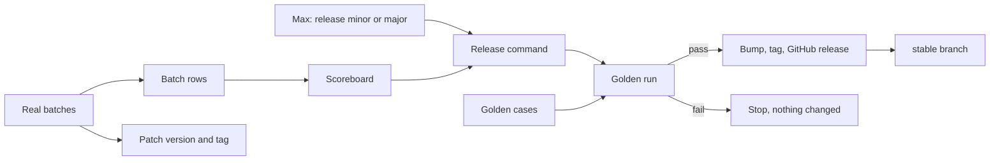
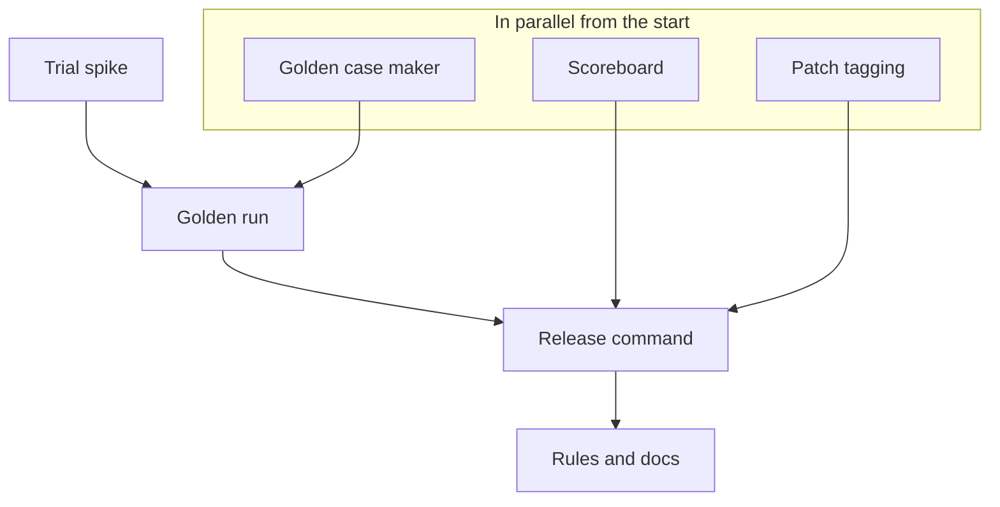

# Lean release pipeline: review plan

## Summary
superlite gets a small, cheap way to know two things: that its core job (a lead plans a batch, workers build it, reviewers check it) still works before a bigger release, and whether cost or quality drifted over the last days. Real batches already write a cost and quality row each; a scoreboard reads those for free. A few fixed "golden" batches replay real past work in a sealed copy before a minor or major release. Versions get a clear meaning: leads release patch versions on their own, minor and major releases happen only on Max's word, and every version is tagged on GitHub. This closes issue 915 in its lean form; the effort sweep of issue 913 stays parked.

## What you will get
- A scoreboard command: the last 15 batches against the batches before them (lead cost, total cost, first-time pass, grade points, lead turns), plus a flag on any single batch that is far off.
- Three golden batches taken from real, already merged superlite work: one small (1 task), one typical (2 to 3 tasks), one larger (4 to 5 tasks).
- A golden run that plays such a batch through the real lead, workers and reviews in a sealed copy, never pushes or opens a pull request, and ends with a plain pass or fail.
- One release command for minor and major releases: 2 golden batches for minor, 3 for major, then version bump, tag, GitHub release with notes, and the `stable` branch moved forward.
- Patch versions as today, released by leads at ship without any golden batch, now each with a git tag.
- Written rules: who may bump what, and how to install the stable version.

## What will be built
| Part | What it does (one sentence) | Size (S/M/L) | Built by |
|---|---|---|---|
| Trial spike | Proves one lead can run a batch in a sealed copy of the repository and stop before shipping | S | a careful helper |
| Golden case maker | Turns one merged pull request into a golden case: start commit, frozen issue text, and its new tests kept hidden and checked to fail before the fix | M | a careful helper |
| Golden run | Runs chosen cases in sealed copies, checks tests, hidden tests and that plan, review and final review happened, reruns a failure once, and stores the result | L | a careful helper |
| Scoreboard | Reads the batch rows and prints trend, band and outlier flags | M | a fast helper |
| Patch tagging | Lets a lead bump only the patch number at ship and tags the merged version | S | a fast helper |
| Release command | Checks the state, runs the golden batches for the level, then bumps, tags, publishes and moves `stable` | M | a careful helper |
| Rules and docs | States the version rules, the stable install line, and how to read scoreboard and golden results | S | a fast helper |

## How it fits together


## Key code changes
A golden case is a small record; the hidden tests are the ones the real pull request added.

```json
{
  "id": "typical-2-tasks",
  "base": "<commit before the fix>",
  "issues": [{"number": 845, "title": "...", "body": "..."}],
  "test_cmd": "<the repository's own tests>",
  "hidden_tests": ["<test files from the merged pull request>"],
  "baseline": {"lead_cost_usd": 4.1, "lead_turns": 66}
}
```

The release command refuses to run inside a lead or worker, so only Max's own session can start it.

```text
sl release minor      # 2 golden batches, then 1.6.0, tag, release, stable
sl release major      # 3 golden batches, then 2.0.0
sl release minor --dry-run   # everything except bump, tag and push
```

## How it gets built


## Decisions you can change
- Golden batches per release: patch 0, minor 2, major 3 (default, your answer) | other counts
- Patch releases by leads: a git tag only (default) | also a GitHub release entry each | no tag
- `stable` branch moves: at minor and major releases only (default) | at every patch too
- A red golden batch: one rerun, then the release stops (default) | no rerun
- Golden run cost check: warn above twice the case's own earlier cost (default) | fail the release
- Scoreboard flags at release time: shown, and the release asks before going on (default) | block the release
- Changelog: GitHub's generated release notes (default) | a changelog file in the repository
- Release commit: pushed straight to main (default) | through a pull request
- Extra plugin tag in Claude Code's own format on each release: yes (default) | no
- Commits: leave my work uncommitted, superlite takes hidden checkpoints (default) | commit each task on my branch

## Coverage
| Category | State | Basis |
|---|---|---|
| Scope and success criteria | settled | Max, 15 Nov: core path checked, a baseline to spot regressions, no enterprise coverage |
| Domain and data model | settled | the golden case record above; batch rows exist already |
| Persistence and migration | ruled | golden cases live in the repository, golden results in a local results file; no old data to move |
| Interfaces and contracts | settled | batch rows and the ship steps keep their shape; the bump step only loses the right to jump minor or major |
| UI states | n/a | command-line output only |
| Concurrency and state ownership | ruled | a golden run uses its own state folder and its own copy; one release at a time, under the existing ship lock |
| Error handling and recovery | ruled | a failed step stops before any push; a rerun continues from the last finished step |
| Security and privacy | settled | cases come from this public repository only; no hostnames or private project names in cases |
| Performance and limits | ruled | a golden batch is cut off after 90 minutes or three times its earlier cost |
| Observability | settled | the scoreboard and the stored golden results are the record |
| Testing strategy | ruled | unit tests with a fake lead for the run logic; one real golden run per case as acceptance |
| Compatibility | settled | installs that follow main keep working; the stable install line is new |
| Rollout | ruled | patch tagging first, the first minor release only on Max's word |
| Research unknowns | spike | the trial spike: a lead in a sealed copy that stops before ship |

Ruling: golden results stay local, not in the repository (because they are machine facts like the batch rows; cost if wrong: one command to commit them later).
Ruling: a failed release step stops before any push (because a half-published release is the only hard-to-undo state; cost if wrong: one more manual step).
Ruling: cut-off at 90 minutes or three times the earlier cost (because the slowest quarter of real batches ends near 56 minutes; cost if wrong: a slow but healthy run is cut and rerun).
Ruling: a fake lead in unit tests (because real runs cost quota; cost if wrong: a run-logic bug shows up only in the acceptance run).
Ruling: one release at a time under the ship lock (because a release and a shipping batch both change the version; cost if wrong: a release waits for a ship).
Ruling: patch tagging first (because it changes nothing a lead does except adding a tag; cost if wrong: tags can be deleted).

## Risks
- A lead may not run cleanly in a sealed copy: the spike comes first, and the golden run is built only on what the spike proves.
- One run of one case is noisy (published figures: up to twice the cost between runs): pass or fail rests on hard facts, cost only warns, and five runs per case give our own noise figure.
- The golden cases are Python work on superlite itself, while most real use is Swift and web work: the scoreboard covers real use, the golden batches only the core path.
- Leads keep bumping patch versions between releases: the release command takes the next minor or major number from the latest tag, so no number is used twice.

## Out of scope
- The effort sweep and any experiment with arms (issue 913 stays parked).
- Judges, Langfuse scores, weekly runs, golden cases from other repositories, selectors.
- Tags for versions released before this change.
- GitHub Actions workflows.

## How we will know it works
- The scoreboard prints the trend for the existing 70 batch rows and flags the known expensive batches.
- Each of the three golden cases is shown to fail its hidden tests before the fix and pass them with the merged fix, without any agent.
- One real golden run per case ends with pass, leaves no branch, push or pull request behind, and stores its cost.
- `sl release minor --dry-run` runs two golden batches and prints the version, tag and notes it would publish.
- A lead that tries a minor bump at ship is refused; a patch ship ends with a new tag on GitHub.

## Rough time and cost
About 1 to 2 hours and 15 to 30 USD to build (rough, until linted), plus about 18 USD once for the first real run of the three golden cases. Afterwards: 0 USD per patch, about 10 USD per minor release, about 18 USD per major release.
