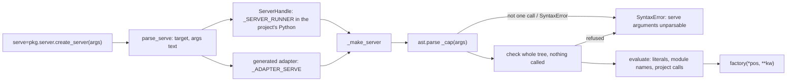
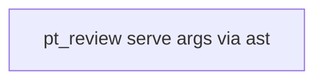

# Superlite: pt_review reads serve= arguments with ast, never eval (B217)

**Goal:** fix #838: `pt_review.py`'s `_SERVE_SNIPPET._make_server` reads the argument text of a `serve=` Probe entry with `ast` instead of `eval("_cap(%s)" % args_src, ...)`; no expression text from the plan runs; an argument it refuses is reported the way an unparsable argument is reported now (`SyntaxError: ...`, which the contract check shows as `producer Tn server failed to start: SyntaxError: ...` and the probe adapter raises).
**Architecture:** one change inside the `_SERVE_SNIPPET` string of `skills/subagent-driven-development/scripts/pt_review.py`, which both the contract check's server runner (`_SERVER_RUNNER`, run by `ServerHandle` in the project's Python) and the generated probe adapter (`_ADAPTER_SERVE`) embed. `_make_server` parses `_cap(<args>)` with `ast.parse`, checks the whole tree first (nothing is called before the check passes), then evaluates it. One task.
**Tech stack:** Python 3.10+ stdlib (ast, inspect, site, sysconfig), pytest (through `sl run_tests`).
**Spec:** this file, section Design; issue #838 (body: "read the arguments with ast.parse / ast.literal_eval for the forms the function accepts today; anything else is reported the way an unparsable argument is reported now. No dynamic code execution on project text").
**Detail:** tests
**Target-min:** 11
**Wave0:** none

Global constraints:
- Every new or changed line of `pt_review.py` outside a string constant keeps the file's trailing `# O(...)` complexity comment; lines inside the `_SERVE_SNIPPET` string carry none (as today).
- The `_SERVE_SNIPPET` string never contains `'''` (it is a raw triple-single-quoted string concatenated into `_SERVER_RUNNER` and `_ADAPTER_SERVE`).
- Existing tests stay green. An existing test file changes only when the task Owns it. If another existing test turns red, report it in DONE_WITH_CONCERNS with the test id and the reason instead of editing it.
- Run `sl` as an executable (`<abs>/sl ...`). Verify with `<abs>/sl run_tests --fast <own test files> --task Tn --background`, then run the printed `wait:` line in the foreground and end the turn only after it reports.
- No version edits (the ship step bumps the version). Never run `scripts/evals.sh`, `claude plugin eval` or `scripts/test_layers.py run`.
- Builds: the verdict is `sl run_tests` (the project's test command; a project with `.maxapp` runs `maxapp test`, which a build pool may place on another Mac, and a full run whose tree a green maxapp test stamp covers returns that result without a run); task trees build in <tree>/.build/DerivedData and any build of your own goes under .build/ of the worktree, never -derivedDataPath outside the worktree (your session scratchpad included; backlog cleanup removes scratchpad build folders when the worktree goes); a product, simulator or device build stays on this machine and runs only when an issue's acceptance asks for a running-app check.
- Simulators: append the UDID of each simulator you or a worker creates (`xcrun simctl create` or `clone`; a checker's `Simulators:` line marks its created ones) as one line to /Users/max/github/superlite/.claude/worktrees/superlite-b217-pt-review-ast-serve-args/.superlite/simulators.txt; never list one you did not create; ship cleanup shuts down and deletes each listed one.

Ruling: the reader accepts what serve entries write in practice (`create_server(Workbook())`, `create_server()`): literals, names and dotted names of the serve module, and calls whose callee is a dotted name resolving to the project's own code (a module file outside the stdlib and site-packages paths), with `*` and `**` arguments; everything else (builtins, stdlib or installed-package callees such as `os.system` or `Path`, any `__` name or attribute, subscripts, lambdas, comprehensions, f-strings, operators on names, a callee that is not a dotted name) is `SyntaxError: serve arguments unparsable: ...` (because a module that imports `os` would otherwise still run `os.system(...)` from plan text) - cost if wrong: a plan passing a stdlib or third-party object (`Path("x")`) to its server factory fails contract part2 with that message and needs a module-level helper in the project.
Ruling: the check walks the whole argument tree before any callee runs, so a refused argument anywhere means no project call ran either - cost if wrong: none, one extra tree walk.
Ruling: an unknown name is `SyntaxError: serve arguments unparsable: ...` too (eval raised NameError), so every refusal reads the same - cost if wrong: one changed error word in a part2 mismatch line.
Ruling: no doc change outside pt_review.py's module docstring (skills/writing-plans/probe-plan.md and docs/tools.md name no argument forms); tests go in the new file tests/scripts/test_pt_review_serve_args_838.py and this plan in docs/plans/ (no open batch lists either); detail tests; no probe adapter (pt_review is the tool under change) - cost if wrong: one NEEDS_CONTEXT round.
LAYERS: unit



## Design

### 1. ast reader in `_SERVE_SNIPPET` (T1)
- `_make_server(target, args_src)` keeps its signature, its return value `(fn(*pos, **kw), fn)`, the `port` default (`kw["port"] = 0` when the factory has a `port` parameter and no `port` keyword was given) and the `serve factory needs arguments` error for `args_src is None`. Only how `pos, kw` are read changes. The snippet text holds no `eval(`, `exec(` or `compile(`.
- `args_src is None`: `pos, kw = (), {}` as today. Otherwise `tree = ast.parse("_cap(%s)" % args_src, mode="eval").body`; a `SyntaxError` from that parse is raised again as `SyntaxError("serve arguments unparsable: " + <its msg>)`. A body that is not an `ast.Call` whose `func` is the `ast.Name` `_cap` raises `SyntaxError("serve arguments unparsable: not one argument list")` (`1), __import__('os').system('x'` parses as a tuple).
- `ns = vars(mod)` (the serve target's module). Every refusal raises `SyntaxError("serve arguments unparsable: <reason>; write literals, names of <module name> and calls of the project's own code")`; `<reason>` names the node (`name '__import__'`, `attribute '__init__'`, `os.system is not the project's own code`, `Subscript`, ...).
- Phase 1, check (getattr only, nothing called), each argument node of `_cap` (an `ast.Starred` argument checks its value; a keyword checks its value, `arg is None` is `**`):
  - a node `ast.literal_eval` accepts (any exception from it means it does not) is a literal: allowed (`-1`, `2.5`, `'x'`, `None`, `[1, (2, 3)]`, `{'a': {4}}`, `set()`);
  - `ast.List`, `ast.Tuple`, `ast.Set`: each element checked; `ast.Dict`: each key and value checked, a `None` key (`**` inside a dict display) refused;
  - `ast.Name`: refused when its id starts with `__` or is not a key of `ns` (builtins are no module names);
  - `ast.Attribute`: refused when `attr` starts with `__`; its value checked;
  - `ast.Call`: its `func` must be an `ast.Name` or a chain of `ast.Attribute` ending in an `ast.Name` (else refused: `Workbook()(1)`, `(lambda: 1)()`), each name and attribute checked as above; the callee is resolved (`ns[name]`, then `getattr` per attribute) and must be the project's own code; its args, `*` args and keywords checked like `_cap`'s;
  - any other node type is refused (Subscript, Lambda, comprehensions, JoinedStr, BoolOp, Compare, IfExp, NamedExpr, Await, a BinOp or UnaryOp `ast.literal_eval` refuses).
- The project's own code: `m = inspect.getmodule(callee)`; own when `m` has a `__file__` whose `os.path.realpath` lies under none of these realpath'd folders: the `sysconfig.get_paths()` values for `stdlib`, `platstdlib`, `purelib` and `platlib`, `site.getsitepackages()` and `site.getusersitepackages()` (each when the function exists). `os.system` (module `posix`, no `__file__`), `types.SimpleNamespace` and `pathlib.Path` are not own; `Workbook` from the project's own module is.
- Phase 2, evaluate the same tree: a literal is `ast.literal_eval(node)`, containers are built from their elements, a Name is `ns[id]`, an Attribute is `getattr`, a Call is `callee(*args, **kw)` (a Starred argument extends the positional list, a `**` keyword updates the keyword dict); `_cap`'s positional values become `pos` (a tuple) and its keywords `kw` (a dict).
- Helpers stay nested inside `_make_server` or take names starting with `_serve_`: the generated adapter already defines `_resolve`, `_entry` and `_server` at module level.
- Module docstring: below the line `  **Probe entry:** call=pkg.mod.fn · run=python -m pkg · serve=pkg.server.create_server(Workbook())` add the line `      serve= arguments are read with ast, never eval: literals, names of the serve module and calls of the project's own code; anything else is SyntaxError "serve arguments unparsable"`.

## Coverage

| Category | State | Basis |
|---|---|---|
| Scope and success criteria | settled | #838: no eval, refused arguments reported as unparsable, serve tests green |
| Domain and data model | n/a | no data change |
| Persistence and migration | n/a | no stored data |
| Interfaces and contracts | ruled | `_make_server(target, args_src)` signature and return unchanged; serve= syntax narrowed to literals, module names, project calls |
| UI states | n/a | none |
| Concurrency and state ownership | n/a | none |
| Error handling and recovery | ruled | every refusal is SyntaxError "serve arguments unparsable: ..."; existing part2 mismatch and adapter raise paths unchanged |
| Security and privacy | ruled | untrusted plan text: no eval, no builtins, no `__` names, callees only the project's own code, check before any call |
| Performance and limits | ruled | one ast parse and two tree walks per server start |
| Observability | settled | the SyntaxError text names the refused node |
| Testing strategy | settled | named pytest cases: `_make_server` directly, ServerHandle and the generated adapter end to end |
| Compatibility | ruled | `create_server(Workbook())` and `create_server()` read as before; stdlib or package constructors in serve args now refused (Ruling) |
| Rollout | ruled | one PR; version bump at ship |
| Research unknowns | n/a | none |

## File structure
- `skills/subagent-driven-development/scripts/pt_review.py`: `_SERVE_SNIPPET._make_server` ast reader, module docstring line (T1).
- `tests/scripts/test_pt_review_serve_args_838.py`: new, #838 cases (T1).

## Task graph



critical path: T1 (6.4 min) · peak width 1 · predicted build 6.4 min · predicted total ≈ 18.9 min (target ✗ 11.0)

## Package: pt_review serve entries
App type: library / parser of untrusted text. Categories: encoding (argument text that closes the list early, dunders, f-strings), deep (nested containers and calls, dotted callees), state (nothing called before the check passes). Specific risks: plan text reaching a builtin, a stdlib callee or a dunder attribute; a project call running before a later argument is refused; the adapter's module-level names colliding with snippet helpers.
**Probe entry:** none (Ruling: pt_review is the tool under change; its cases are named tests).

### T1 pt_review reads serve= arguments with ast · Complexity 5 · Est. context 40k
**Owns:** skills/subagent-driven-development/scripts/pt_review.py, tests/scripts/test_pt_review_serve_args_838.py
**Components:** 1
**LOC owned:** 190
**Tests:** fast
**Model:** sonnet
**Est. time:** 3.0 min (1 component, about 190 LOC, fast tests)
**Covers:** 1
**Consumes:** none
**Produces:** none
**Review Focus:** encoding: `test_refused_arguments_run_nothing_and_read_as_unparsable` (early close, dunder name and attribute, f-string, lambda, comprehension, subscript); deep: `test_literals_names_and_project_calls_are_read`, `test_starred_arguments_are_read`; state: the `Trace(), os.system(...)` case (no project call before refusal); seams: `test_server_handle_reports_a_refused_argument_and_runs_nothing`, `test_generated_adapter_refuses_the_same_argument`, `test_server_handle_starts_with_a_project_call_argument`.
**Test code (verbatim):** new file tests/scripts/test_pt_review_serve_args_838.py:
```python
"""#838: pt_review reads serve= arguments with ast, never eval: literals, the serve module's names and calls of the project's own code."""
from __future__ import annotations

import importlib.util
import sys
from pathlib import Path

import pytest

HERE = Path(__file__).resolve().parent
SCRIPT = HERE.parent.parent / "skills" / "subagent-driven-development" / "scripts" / "pt_review.py"

_spec = importlib.util.spec_from_file_location("pt_review", SCRIPT)
pt_review = importlib.util.module_from_spec(_spec)
sys.modules["pt_review"] = pt_review
_spec.loader.exec_module(pt_review)

APP = '''\
import os
from types import SimpleNamespace

import models838 as models

LIMIT = 3
_PRIVATE = "p"
cfg = SimpleNamespace(name="cfg")
TRACE = os.path.join(os.path.dirname(os.path.abspath(__file__)), "called")


class Workbook:
    def __init__(self, rows=0):
        self.rows = rows


class Trace:
    def __init__(self):
        open(TRACE, "w").close()


def make(*args, port=0, **kw):
    return {"args": args, "port": port, "kw": kw}
'''

MODELS = '''\
class Store:
    def __init__(self, path=":memory:"):
        self.path = path


def default_path():
    return "d.db"
'''

SERVER_APP = '''\
from http.server import BaseHTTPRequestHandler, HTTPServer


class Store:
    def __init__(self, path):
        self.path = path


def make(store=None, port=0):
    return HTTPServer(("127.0.0.1", port), BaseHTTPRequestHandler)
'''


@pytest.fixture()
def make_server(tmp_path, monkeypatch):
    (tmp_path / "app838.py").write_text(APP, encoding="utf-8")
    (tmp_path / "models838.py").write_text(MODELS, encoding="utf-8")
    monkeypatch.syspath_prepend(str(tmp_path))
    ns: dict = {}
    exec(pt_review._SERVE_SNIPPET, ns)  # our own snippet text, the code under test
    yield ns["_make_server"]
    for name in ("app838", "models838"):
        sys.modules.pop(name, None)


def test_snippet_has_no_dynamic_execution():
    for word in ("eval(", "exec(", "compile("):
        assert word not in pt_review._SERVE_SNIPPET


def test_no_arguments_calls_the_factory_with_port_0(make_server):
    for args in (None, ""):
        got, fn = make_server("app838.make", args)
        assert got == {"args": (), "port": 0, "kw": {}} and fn.__name__ == "make"


def test_literals_names_and_project_calls_are_read(make_server):
    got, _fn = make_server("app838.make",
                           "Workbook(rows=2), models.Store(models.default_path()), LIMIT, cfg.name, -1, 2.5, 'x', "
                           "None, True, [1, (2, 3)], {'a': {4}}, set(), port=7, extra=_PRIVATE")
    wb, store, *rest = got["args"]
    assert type(wb).__name__ == "Workbook" and wb.rows == 2
    assert type(store).__name__ == "Store" and store.path == "d.db"
    assert rest == [3, "cfg", -1, 2.5, "x", None, True, [1, (2, 3)], {"a": {4}}, set()]
    assert got["port"] == 7 and got["kw"] == {"extra": "p"}


def test_starred_arguments_are_read(make_server):
    got, _fn = make_server("app838.make", "*[1, 2], *(LIMIT,), **{'k': cfg.name}")
    assert got["args"] == (1, 2, 3) and got["kw"] == {"k": "cfg"} and got["port"] == 0


REFUSED = [
    "__import__('os').system('touch {mark}')",  # #838: a builtin reached by name
    "os.system('touch {mark}')",  # the module imports os: a stdlib callee
    "Workbook.__init__.__globals__['os'].system('touch {mark}')",  # dunder attribute
    "__builtins__",  # dunder name
    "Trace(), os.system('touch {mark}')",  # refused before Trace() runs
    "1), __import__('os').system('touch {mark}'",  # closes the argument list early
    "(lambda: os.system('touch {mark}'))()",  # lambda callee
    "[os.system('touch {mark}') for _ in (1,)]",  # comprehension
    "open('{mark}', 'w')",  # a builtin is no module name
    "SimpleNamespace(a=1)",  # a stdlib class is not the project's own code
    "LIMIT + 1",  # arithmetic on a name
    "cfg['name']",  # subscript
    "Workbook()(1)",  # callee is a call result
    "f'{{LIMIT}}'",  # f-string
    "nosuch",  # unknown name
    "Workbook(",  # does not parse
]


@pytest.mark.parametrize("args", REFUSED)
def test_refused_arguments_run_nothing_and_read_as_unparsable(make_server, tmp_path, args):
    mark = tmp_path / "mark"
    with pytest.raises(SyntaxError, match="serve arguments unparsable"):
        make_server("app838.make", args.format(mark=mark))
    assert not mark.exists() and not (tmp_path / "called").exists()


def test_server_handle_reports_a_refused_argument_and_runs_nothing(tmp_path):
    (tmp_path / "srv838.py").write_text(SERVER_APP, encoding="utf-8")
    mark = tmp_path / "mark"
    handle = pt_review.ServerHandle(tmp_path, "srv838.make", f"__import__('os').system('touch {mark}')", timeout=20)
    try:
        assert handle.info is None
        assert handle.error.startswith("SyntaxError: serve arguments unparsable"), handle.error
    finally:
        handle.close()
    assert not mark.exists()


def test_server_handle_starts_with_a_project_call_argument(tmp_path):
    (tmp_path / "srv838.py").write_text(SERVER_APP, encoding="utf-8")
    handle = pt_review.ServerHandle(tmp_path, "srv838.make", "Store('x.db')", timeout=20)
    try:
        assert handle.error is None and handle.info and handle.info["port"] > 0
    finally:
        handle.close()


def test_generated_adapter_refuses_the_same_argument(tmp_path):
    (tmp_path / "srv838.py").write_text(SERVER_APP, encoding="utf-8")
    mark = tmp_path / "mark"
    plan = tmp_path / "plan.md"
    plan.write_text(f"**Probe entry:** serve=srv838.make(__import__('os').system('touch {mark}'))\n", encoding="utf-8")
    out = tmp_path / "adapter.py"
    assert pt_review.main(["adapter", "--plan", str(plan), "--root", str(tmp_path), "--out", str(out)]) == 0
    spec = importlib.util.spec_from_file_location("probe_adapter_838", out)
    adapter = importlib.util.module_from_spec(spec)
    spec.loader.exec_module(adapter)
    try:
        with pytest.raises(SyntaxError, match="serve arguments unparsable"):
            adapter.start_server()
    finally:
        adapter.close()
        sys.modules.pop("srv838", None)
    assert not mark.exists()
```
**Steps:** 1 write the test file, 2 run: FAIL (eval runs `__import__`, the other refusals pass through), 3 implement the Design 1 reader, 4 run: PASS, 5 run the existing serve tests: `tests/scripts/test_pt_review.py tests/scripts/test_probe_run.py tests/scripts/test_pt_review_noise_batch.py` green.
**Notes:** the existing serve forms `minisheet.server.create_server(Workbook())` (tests/scripts/fixtures/review_basic/plan.md) and `fixture_site.create_server()` (test_probe_run.py) must read as before. `ServerHandle` runs the snippet in `pyrun.project_python(root)` (sys.executable for a folder without `.venv`), with `cwd=root`, so `srv838` imports from the test folder.

## Self-review
- Coverage: #838's three asks (ast reader, refusal reported as unparsable, no dynamic execution) map to Design 1 and T1's tests; acceptance's `__import__('os').system(...)` case is REFUSED[0] plus the ServerHandle and adapter tests.
- Placeholders: none. Types: no Consumes or Produces (one task). Graph: one node, no edges.
