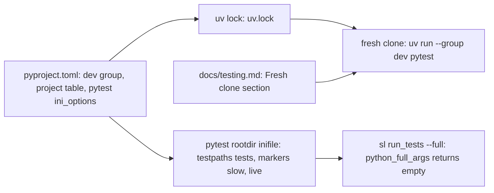
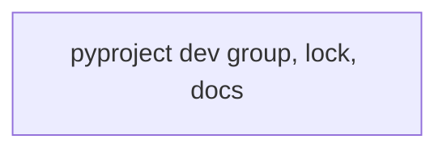

# Superlite: track the test dependencies in pyproject.toml and uv.lock (B227)

**Goal:** fix #848: a tracked repo-root `pyproject.toml` holds the unit suite's dev dependency group (pytest, pytest-xdist), `testpaths` and the `slow` and `live` markers; `uv.lock` is committed; `docs/testing.md` names the fresh-clone command. Acceptance: on a fresh clone `uv run --group dev pytest tests/scripts -q -x --co` collects the suite; `scripts/bump-version.sh --audit` stays clean.
**Architecture:** config and docs only. `pyproject.toml` is a virtual uv project (no `[build-system]`, nothing installed); pytest reads its `[tool.pytest.ini_options]` as the rootdir inifile; `uv.lock` pins the dev group for Python >= 3.10. No script changes: `testcmd.python_full_args` already returns `[]` when testpaths is set.
**Tech stack:** TOML, uv 0.13 (`uv lock`), pytest (through `sl run_tests`), Python 3.10+ (README.md line 75).
**Spec:** this file, section Design; issue #848 (body: "a `pyproject.toml` with a dev dependency group (pytest, pytest-xdist), `testpaths`, and `slow` and `live` markers; `uv.lock` committed; `docs/testing.md` names the command for a fresh clone"; out of scope: `-n auto` in `addopts`, hypothesis, upstream's project name).
**Detail:** tests
**Target-min:** 11
**Wave0:** none

Global constraints:
- Existing tests stay green. An existing test file changes only when the task Owns it. If another existing test turns red, report it in DONE_WITH_CONCERNS with the test id and the reason instead of editing it.
- Run `sl` as an executable (`<abs>/sl ...`). Verify with `<abs>/sl run_tests --fast <own test files> --task Tn --background`, then run the printed `wait:` line in the foreground and end the turn only after it reports.
- No version edits (the ship step bumps the version). Never run `scripts/evals.sh`, `claude plugin eval` or `scripts/test_layers.py run`.
- Never run `uv run`, `uv sync` or `uv venv` in the task tree (they create `.venv/` there); `uv lock` and `uv lock --check` are the only uv commands.
- Builds: the verdict is `sl run_tests` (the project's test command; a project with `.maxapp` runs `maxapp test`, which a build pool may place on another Mac, and a full run whose tree a green maxapp test stamp covers returns that result without a run); task trees build in <tree>/.build/DerivedData and any build of your own goes under .build/ of the worktree, never -derivedDataPath outside the worktree (your session scratchpad included; backlog cleanup removes scratchpad build folders when the worktree goes); a product, simulator or device build stays on this machine and runs only when an issue's acceptance asks for a running-app check.
- Simulators: append the UDID of each simulator you or a worker creates (`xcrun simctl create` or `clone`; a checker's `Simulators:` line marks its created ones) as one line to /Users/max/github/superlite/.claude/worktrees/superlite-b227-pyproject-dev-group/.superlite/simulators.txt; never list one you did not create; ship cleanup shuts down and deletes each listed one.

Ruling: `testpaths = ["tests"]`, not upstream's `["tests/scripts"]` (because `testcmd.python_full_args` returns `[]` once testpaths is set, so `tests/scripts` would drop tests/bench and tests/regression from `sl run_tests --full` without a configured command; `["tests"]` keeps a bare `pytest` equal to the maintainer's `pytest tests`).
Ruling: a `[project]` table with `name = "superlite"`, `dynamic = ["version"]`, `requires-python = ">=3.10"` and no `[build-system]` (because without `[project]` uv warns on every run and locks for the locking interpreter's minor, >=3.12 here, while README.md promises 3.10; a static version would put a second version into pyproject.toml and uv.lock that every bump would stale; uv 0.13.6 locks this form with no version in the lock, checked in a scratch project).
Ruling (build, supersedes `dynamic = ["version"]` above and in T1): the `[project]` table carries a fixed `version = "0.0.0"` with a comment that it is not the plugin's version (because a dynamic version makes uv build the project's metadata with setuptools, whose flat-layout discovery fails on this repo's top-level folders; a fixed version never changes on a bump, so uv.lock stays valid; T1's test and docs sentence follow it).
Ruling: markers `slow` and `live` are registered only; no `--strict-markers`, no `addopts` (out of scope per #848; the worker count stays in the command); `pytest>=8` and `pytest-xdist>=3.8` lower bounds, exact pins live in uv.lock.
Ruling: tests go in the new file tests/scripts/test_pyproject_dev_group_848.py and this plan in docs/plans/ (no open batch lists either); `.superlite/test-cmd.json` (untracked, per machine) is unchanged; detail tests; no probe adapter (no runnable entry).
LAYERS: unit



## Design

### 1. pyproject.toml, uv.lock and docs (T1)
- `pyproject.toml` content is fixed in T1's Notes, byte for byte.
- `uv.lock` comes from `uv lock` in the task tree (default index, PyPI); never hand-edited. Its `requires-python` is `>=3.10`, its `superlite` package is `source = { virtual = "." }` with no version.
- `docs/testing.md` gets one new section `## Fresh clone` directly before `## Stamps`, text fixed in T1's Notes. It adds no table row (test_evals_suite reads the first line starting `| evals`), and keeps every existing line.

## Coverage

| Category | State | Basis |
|---|---|---|
| Scope and success criteria | settled | #848 acceptance: fresh-clone collect command, bump audit clean |
| Domain and data model | n/a | no data |
| Persistence and migration | n/a | no stored data |
| Interfaces and contracts | ruled | testpaths `["tests"]` keeps `pytest tests` collection; markers registered only |
| UI states | n/a | none |
| Concurrency and state ownership | n/a | none |
| Error handling and recovery | n/a | config only |
| Security and privacy | ruled | dependencies from the default PyPI index, pinned with hashes in uv.lock |
| Performance and limits | ruled | no addopts; worker count stays in the command |
| Observability | n/a | none |
| Testing strategy | settled | named pytest cases parse pyproject.toml, uv.lock and docs/testing.md; fresh-clone collect run by the lead |
| Compatibility | ruled | Python >= 3.10 as README.md states; explicit-path pytest runs unchanged (R1) |
| Rollout | ruled | one PR; version bump at ship never touches pyproject.toml or uv.lock |
| Research unknowns | n/a | uv behaviour checked before planning |

## File structure
- `pyproject.toml`: new; dev group, virtual project table, pytest settings (T1).
- `uv.lock`: new; generated by `uv lock` (T1).
- `docs/testing.md`: new `## Fresh clone` section (T1).
- `tests/scripts/test_pyproject_dev_group_848.py`: new; #848 cases (T1).

## Task graph

```mermaid
%% schedule
gantt
  title Predicted schedule (mm:ss)
  dateFormat X
  axisFormat %M:%S
  section lane 1
  T1 pyproject dev group uv.lock and fresh :t1, 0, 542s
```




critical path: T1 (9.0 min) · peak width 1 · predicted build 9.0 min · predicted total ≈ 25.5 min (target ✗ 11.0)

## Package: test configuration
App type: config files read by pytest and uv. Categories: encoding (TOML that pytest and uv both read), state (lock in sync with pyproject). Specific risks: testpaths narrowing the default full run, a version string in pyproject.toml or uv.lock that bump-version.sh --audit flags.
**Probe entry:** none (Ruling: no runnable entry; its cases are named tests).

### T1 pyproject dev group, uv.lock and fresh-clone docs · Complexity 2 · Est. context 30k
**Owns:** pyproject.toml, uv.lock, docs/testing.md, tests/scripts/test_pyproject_dev_group_848.py
**Components:** 1
**LOC owned:** 95
**Tests:** fast
**Kind:** mechanical
**Model:** haiku
**Est. time:** 2.0 min (1 component, about 95 LOC, fast tests)
**Covers:** 1
**Consumes:** none
**Produces:** none
**Review Focus:** encoding: `test_pytest_settings_keep_tests_and_register_markers`, `test_project_table_is_virtual_and_versionless`; state: `test_lock_matches_pyproject`, `test_full_run_passes_no_path`
**Test code (verbatim):** new file tests/scripts/test_pyproject_dev_group_848.py:
```python
"""#848: the unit suite's dependencies and pytest settings live in the tracked pyproject.toml and uv.lock."""
from __future__ import annotations

import re
import sys
from pathlib import Path

import pytest

tomllib = pytest.importorskip("tomllib")  # Python 3.11+

REPO = Path(__file__).resolve().parents[2]
SCRIPTS = REPO / "skills" / "subagent-driven-development" / "scripts"
sys.path.insert(0, str(SCRIPTS))
import testcmd  # noqa: E402


def _toml(name: str) -> dict:
    return tomllib.loads((REPO / name).read_text(encoding="utf-8"))


def _names(reqs) -> set:
    return {re.split(r"[<>=!~\[; ]", r, maxsplit=1)[0].lower() for r in reqs if isinstance(r, str)}


def test_dev_group_holds_pytest_and_xdist():
    assert {"pytest", "pytest-xdist"} <= _names(_toml("pyproject.toml")["dependency-groups"]["dev"])


def test_project_table_is_virtual_and_versionless():
    data = _toml("pyproject.toml")
    project = data["project"]
    assert project["name"] == "superlite"
    assert project["requires-python"] == ">=3.10"
    assert "version" not in project
    assert project["dynamic"] == ["version"]
    assert "build-system" not in data


def test_pytest_settings_keep_tests_and_register_markers():
    ini = _toml("pyproject.toml")["tool"]["pytest"]["ini_options"]
    assert ini["testpaths"] == ["tests"]
    assert "addopts" not in ini
    assert {"slow", "live"} <= {m.split(":", 1)[0].strip() for m in ini["markers"]}


def test_lock_matches_pyproject():
    lock = _toml("uv.lock")
    assert lock["requires-python"] == ">=3.10"
    pkgs = {p["name"]: p for p in lock["package"]}
    assert {"pytest", "pytest-xdist"} <= set(pkgs)
    root = pkgs["superlite"]
    assert root["source"] == {"virtual": "."}
    assert "version" not in root
    assert {"pytest", "pytest-xdist"} <= {d["name"] for d in root["dev-dependencies"]["dev"]}


def test_full_run_passes_no_path():
    assert testcmd.python_full_args(REPO) == []


def test_testing_doc_names_the_fresh_clone_command():
    text = (REPO / "docs" / "testing.md").read_text(encoding="utf-8")
    assert "## Fresh clone" in text
    assert "uv run --group dev pytest tests/scripts -q -x --co" in text
    assert "uv.lock" in text
    assert text.index("## Fresh clone") < text.index("## Stamps")
```
**Steps:** 1 write the test file, 2 run it: FAIL (no pyproject.toml), 3 write pyproject.toml (Notes), run `uv lock` in the task tree, add the docs section (Notes), 4 run: PASS, 5 run `uv lock --check` (prints the resolved count, exit 0) and `bash scripts/bump-version.sh --audit` (no finding names pyproject.toml or uv.lock).
**Notes:** pyproject.toml, byte for byte:
```toml
[project]
name = "superlite"
dynamic = ["version"]
requires-python = ">=3.10"

[dependency-groups]
dev = [
    "pytest>=8",
    "pytest-xdist>=3.8",
]

[tool.pytest.ini_options]
testpaths = ["tests"]
markers = [
    "slow: long-running test; deselect with -m 'not slow'",
    "live: runs a real agent turn and spends quota; select with -m live",
]
```
docs/testing.md: insert this section directly before the line `## Stamps`, with one blank line before and after it:
```markdown
## Fresh clone

The unit suite's dependencies (pytest, pytest-xdist) are the `dev` dependency group in `pyproject.toml`, pinned by the committed `uv.lock`. On a fresh clone, with `uv` installed:

    uv run --group dev pytest tests/scripts -q -x --co    # collects the script tests, runs none
    uv run --group dev pytest -q -n auto                  # the whole suite; the e2e tests skip without SUPERLITE_E2E=1

`pyproject.toml` sets `testpaths = ["tests"]`, so a bare `pytest`, and `sl run_tests --full` without a configured test command, collect what `pytest tests` collects. It registers two markers: `slow` (deselect with `-m "not slow"`) and `live` (a real agent turn that spends quota). The worker count stays in the command, never in `addopts`, which would also apply to `--fast` runs and nested xdist runs. A machine's `.superlite/test-cmd.json` still sets the command `sl run_tests` runs. The project table declares no version (`dynamic = ["version"]`), so a version bump never touches `pyproject.toml` or `uv.lock`.
```
