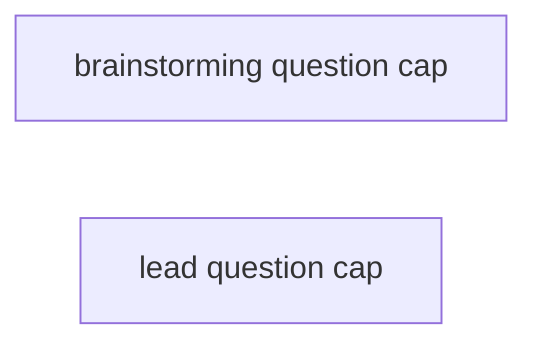

# Superlite: rank open questions by cost saved and cap them (B228, #849)

**Goal:** brainstorming step 2 (with coverage.md step 3) and the lead question rules (backlog.md, the lead brief) rank the open questions by what the answer saves, ask at most 2 rounds of 4 and rule the rest as `Ruling:` lines the user (or main) can veto; major and uncertain questions rank first and are never ruled away by the cap.
**Architecture:** text rules only. Two skill docs and the lead rules doc change wording; `backlog_brief.py` gains one constant `QUESTION_CAP` that `lead_brief` appends as its own line just before each "Escalate a new major decision" line (plan phase and build phase). Unit tests pin the new wording.
**Tech stack:** Markdown; Python 3.10+ stdlib; pytest through `sl run_tests`.
**Spec:** this file, section Design; issue #849.
**Detail:** tests
**Target-min:** 11
**Wave0:** none
**Worktree:** none
**Coverage:** off (bounded wording change to an existing flow; no new data, interfaces or rollout)

Global constraints:
- `skills/brainstorming/SKILL.md` stays at or under 10,000 characters (`tests/scripts/test_coverage_docs.py`); the cap is never raised. Net growth of SKILL.md at most 300 characters.
- Keep every phrase other tests pin unless this plan says to change it: in SKILL.md the ONE-call sentence, the `detail` sentence, the 14 coverage categories, "Read `coverage.md` in this skill's folder"; in coverage.md the phrase "no question tool: at most 4 numbered questions per message and no question after them; rows past the fourth are asked after the reply"; in backlog.md every existing sentence (fixture `tests/scripts/fixtures/rules_684/backlog.txt`).
- This repository is public: no host names, user names, home paths, other project or repository names in code, tests, docs or commit messages. LF endings.
- Builds: the verdict is `sl run_tests` (the project's test command; a project with `.maxapp` runs `maxapp test`, which a build pool may place on another Mac, and a full run whose tree a green maxapp test stamp covers returns that result without a run); task trees build in <tree>/.build/DerivedData and any build of your own goes under .build/ of the worktree, never -derivedDataPath outside the worktree (your session scratchpad included; backlog cleanup removes scratchpad build folders when the worktree goes); a product, simulator or device build stays on this machine and runs only when an issue's acceptance asks for a running-app check.
- Simulators: append the UDID of each simulator you or a worker creates (`xcrun simctl create` or `clone`; a checker's `Simulators:` line marks its created ones) as one line to /Users/max/github/superlite/.claude/worktrees/superlite-b228-question-cap-ranking/.superlite/simulators.txt; never list one you did not create; ship cleanup shuts down and deletes each listed one.

## Design

Today brainstorming step 2 asks the open coverage rows "in as few 4-question calls as possible, until none is open" and coverage.md step 3 repeats "until no row is open"; a lead escalates any major decision to `.superlite/question.json` with no cap. Upstream's port asks only questions whose answer saves cost, at most 2 rounds of 4.

Ruling: ranking order is (1) major and uncertain questions, which the cap never rules away, then (2) the rest by what the answer saves: it shrinks the plan, or it makes a task mechanical enough for a cheaper model. Lead's ruling (issue text).
Ruling: a round is one `AskUserQuestion` call (plain text: one message of at most 4 numbered questions); for a lead one `.superlite/question.json`. At most 2 rounds of 4; bounded work keeps its one batch. Lead's ruling.
Ruling: past the cap a brainstorming question becomes a `Ruling:` line the user can veto, a coverage row becomes `ruled` with that ruling as its basis; a lead writes its capped-out questions as `Ruling:` lines in `.superlite/pr-body.md`, where main and the user read and can veto them. Lead's ruling (a lead's notes.md holds only 6 lines for later batches).
Ruling: text rules only; no code counts question rounds (YAGNI: the issue asks for the rule and its brief line). Lead's ruling.
Ruling: the cap line in the lead brief is its own line `Question cap: ...`, placed directly before the "Escalate a new major decision" line in both phases, so #626's pin (the evals rule directly after the Escalate line) holds. Lead's ruling.
Ruling: SKILL.md sits at 9,370 of its 10,000-character cap, so the change fits without a trim; the issue's "at its cap" predates that count. Lead's ruling.

## Task graph

```mermaid
%% schedule
gantt
  title Predicted schedule (mm:ss)
  dateFormat X
  axisFormat %M:%S
  section lane 1
  T1 brainstorming question cap :t1, 0, 183s
  section lane 2
  T2 lead question cap :t2, 0, 181s
```





critical path: T1 (3.0 min) · peak width 2 · predicted build 3.0 min · predicted total ≈ 11.6 min (target ✗ 11.0)

## Package: question cap

**Probe entry:** none (text rules; the unit tests read the docs and call `backlog_brief.lead_brief`).

### T1 brainstorming question cap · Complexity 2 · Est. context 30k
**Owns:** skills/brainstorming/SKILL.md, skills/brainstorming/coverage.md, tests/regression/test_plain_text_batch_cap.py, tests/scripts/test_question_cap_skill_849.py
**Components:** 1
**LOC owned:** 60
**Tests:** fast
**Kind:** design
**Model:** sonnet
**Est. time:** 2 min (1 component, about 60 LOC, fast tests)
**Consumes:** none
**Produces:** none
**Review Focus:** `test_step2_caps_two_rounds_of_four`: step 2 says "Ask at most 2 rounds of 4 (plain text: 4 per message, no 5th, the rest after the reply)"; `test_no_ask_until_none_open`: neither doc says "until none is open" or "until no row is open"; `test_skill_under_cap`: SKILL.md at most 10,000 characters.
**Steps:** 1 write the new test file and the changed regression pin, 2 run: FAIL, 3 edit the two docs, 4 run: PASS, 5 run `tests/scripts/test_coverage_docs.py tests/scripts/test_coverage_reference.py tests/scripts/test_coverage.py tests/regression/test_plain_text_batch_cap.py tests/scripts/test_orchestrator_once_486.py tests/scripts/test_isolation_wording.py tests/scripts/test_upstream_text_841.py` too: PASS.

Edit 1, `skills/brainstorming/SKILL.md` step 2: replace the sentence "Architectural work asks the open coverage rows in as few 4-question calls as possible, until none is open (plain text: 4 per message, no 5th, the rest after the reply)." with exactly:

"**Rank and cap:** rank the open questions (coverage rows too) by what the answer saves: major and uncertain first (the cap never rules them away), then those whose answer shrinks the plan or makes a task mechanical enough for a cheaper model. Ask at most 2 rounds of 4 (plain text: 4 per message, no 5th, the rest after the reply); rule the rest as `Ruling:` lines the user can veto (a coverage row: `ruled`)."

Nothing else in SKILL.md changes.

Edit 2, `skills/brainstorming/coverage.md` step 3: replace "3. Ask the open rows with `AskUserQuestion`: 4 per call, recommended option first, as few calls as possible, repeated until no row is open (no question tool:" with "3. Rank the open rows by what the answer saves (major and uncertain first, then rows whose answer shrinks the plan or makes a task mechanical) and ask them with `AskUserQuestion`: 4 per call, recommended option first, at most 2 calls (no question tool:", and after "each answered row becomes `settled` (the answer) or `ruled`." insert " Rows past the cap become `ruled`, the basis a `Ruling:` the user can veto; a major or uncertain row is never ruled away by the cap." The rest of the step stays.

Edit 3, `tests/regression/test_plain_text_batch_cap.py` `test_plain_text_rounds_keep_the_cap_758`: its first assert becomes `assert "Ask at most 2 rounds of 4 (plain text: 4 per message, no 5th, the rest after the reply)" in SKILL.read_text()`; the PLAIN_CAP assert stays.

**Test code (verbatim):** `tests/scripts/test_question_cap_skill_849.py`
```python
"""#849: brainstorming ranks open questions by what the answer saves and asks at most 2 rounds of 4."""
from pathlib import Path

ROOT = Path(__file__).resolve().parents[2]
SKILL = (ROOT / "skills/brainstorming/SKILL.md").read_text(encoding="utf-8")
COVERAGE = (ROOT / "skills/brainstorming/coverage.md").read_text(encoding="utf-8")


def step2() -> str:
    return SKILL.split("## 2. Explore and ask, once")[1].split("## 3. Design")[0]


def test_step2_ranks_by_cost_saved():
    s = step2()
    assert "rank the open questions (coverage rows too) by what the answer saves" in s
    assert "shrinks the plan or makes a task mechanical enough for a cheaper model" in s


def test_step2_caps_two_rounds_of_four():
    assert "Ask at most 2 rounds of 4 (plain text: 4 per message, no 5th, the rest after the reply)" in step2()


def test_step2_rules_the_rest():
    assert "rule the rest as `Ruling:` lines the user can veto (a coverage row: `ruled`)" in step2()


def test_major_and_uncertain_never_capped():
    assert "major and uncertain first (the cap never rules them away)" in step2()


def test_no_ask_until_none_open():
    assert "until none is open" not in SKILL
    assert "until no row is open" not in COVERAGE


def test_coverage_step3_ranks_and_caps():
    assert "Rank the open rows by what the answer saves (major and uncertain first" in COVERAGE
    assert "recommended option first, at most 2 calls (no question tool:" in COVERAGE
    assert "a major or uncertain row is never ruled away by the cap" in COVERAGE


def test_skill_under_cap():
    assert len(SKILL) <= 10000
```

### T2 lead question cap · Complexity 2 · Est. context 32k
**Owns:** skills/subagent-driven-development/backlog.md, skills/subagent-driven-development/scripts/backlog_brief.py, tests/scripts/test_backlog_brief_jira_208.py, tests/scripts/test_question_cap_lead_849.py
**Components:** 1
**LOC owned:** 50
**Tests:** fast
**Kind:** design
**Model:** sonnet
**Est. time:** 2 min (1 component, about 50 LOC, fast tests)
**Consumes:** none
**Produces:** none
**Review Focus:** `test_cap_line_before_escalate_in_build_brief`: the cap line sits directly before the Escalate line; `test_cap_line_in_plan_phase`: the plan-phase brief has it too; #626's pin (evals rule directly after Escalate) still passes.
**Steps:** 1 write the new test file, 2 run: FAIL, 3 add the constant, its two appends and the backlog.md sentence, 4 update the golden brief in test_backlog_brief_jira_208.py (insert `bb.QUESTION_CAP + "\n"` before each expected Escalate line), 5 run the new file plus `tests/scripts/test_backlog_brief*.py tests/scripts/test_backlog_rules_split_684.py`: PASS.

Edit 1, `skills/subagent-driven-development/scripts/backlog_brief.py`: add a module constant next to `CODE_RULE`:
```python
QUESTION_CAP = ("Question cap: rank your open questions by what the answer saves (major and uncertain first, never dropped by the cap; "
                "then those whose answer shrinks the plan or makes a task mechanical enough for a cheaper model), ask at most 2 "
                "rounds of 4 (one .superlite/question.json each) and rule the rest as `Ruling:` lines in .superlite/pr-body.md, "
                "where main and the user can veto them.")
```
In `lead_brief`, add `out.append(QUESTION_CAP)  # O(1)` directly before each of the two `out.append("Escalate a new major decision: ...")` calls (plan phase and the build or single-lead path). Nothing else changes in the file.

Edit 2, `skills/subagent-driven-development/backlog.md` ## Lead: in the bullet "Never ask the user. ...", after the sentence "A question for the human goes to `.superlite/question.json` (`{"questions": [...]}`, AskUserQuestion shape), then end with `Status: NEEDS_DECISION`." insert the sentence "Rank your open questions by what the answer saves (major and uncertain first: the cap never drops them), ask at most 2 rounds of 4 (a round is one question.json) and rule the rest as `Ruling:` lines in pr-body.md, where main and the user can veto them (#849)." Every existing sentence stays verbatim.

**Test code (verbatim):** `tests/scripts/test_question_cap_lead_849.py`
```python
"""#849: the lead brief and the lead rules cap a lead's questions at 2 rounds of 4, ranked by what the answer saves."""
import sys
from pathlib import Path

from test_plan_tools import SCRIPTS
sys.path.insert(0, str(SCRIPTS))
import backlog_brief as bb  # noqa: E402

ROOT = Path(__file__).resolve().parents[2]
LCTX = {"sl": "/x/sl", "repo": "o/r", "backlog_md": "b.md"}
BATCH = {"id": "B1", "issues": [7]}


def _lines(ctx):
    return bb.lead_brief(BATCH, ctx).splitlines()


def test_cap_line_text():
    assert bb.QUESTION_CAP.startswith("Question cap: rank your open questions by what the answer saves")
    assert "major and uncertain first, never dropped by the cap" in bb.QUESTION_CAP
    assert "ask at most 2 rounds of 4 (one .superlite/question.json each)" in bb.QUESTION_CAP
    assert "rule the rest as `Ruling:` lines in .superlite/pr-body.md" in bb.QUESTION_CAP


def test_cap_line_before_escalate_in_build_brief():
    lines = _lines(LCTX)
    assert lines.count(bb.QUESTION_CAP) == 1
    assert lines[lines.index(bb.QUESTION_CAP) + 1].startswith("Escalate a new major decision:")


def test_cap_line_in_plan_phase():
    lines = _lines({**LCTX, "phase": "plan"})
    assert lines.count(bb.QUESTION_CAP) == 1
    assert lines[lines.index(bb.QUESTION_CAP) + 1].startswith("Escalate a new major decision:")


def test_backlog_md_lead_rule():
    text = (ROOT / "skills/subagent-driven-development/backlog.md").read_text(encoding="utf-8")
    lead = text.split("## Lead")[1].split("## Permissions")[0]
    assert "Rank your open questions by what the answer saves (major and uncertain first: the cap never drops them)" in lead
    assert "ask at most 2 rounds of 4 (a round is one question.json)" in lead
```

## Review Focus

- T1: the SKILL.md character count after the edit, and that every phrase other tests pin is unchanged (run the step-5 files).
- T2: the golden brief in test_backlog_brief_jira_208.py matches the new line order exactly; the plan-phase and lean briefs carry the cap line once.

## Self-review

Every #849 requirement maps to a task: brainstorming step 2 (T1), the lead question rules in backlog.md and the brief (T2), the cap line in the brief test (T2), SKILL.md under its cap (T1). No placeholders; no shared files; no edges.
