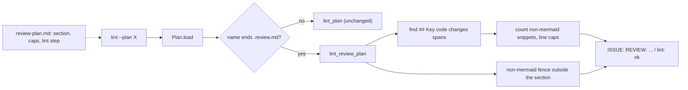

# Superlite: review plan 'Key code changes' section, capped by lint (B230)

**Goal:** fix #851: the human review plan (`skills/writing-plans/review-plan.md`) may hold one `## Key code changes` section with 1 to 4 fenced snippets of at most 15 lines each; the rest of the review plan stays code-free; `plan_tools lint --plan <x>.review.md` checks the caps (accepts a plan inside them, rejects a fifth snippet or a snippet over 15 lines).
**Architecture:** `plan_tools.cmd_lint` sends a plan whose file name ends `.review.md` to a new `lint_review_plan(plan)` instead of `lint_plan`; it reuses `Plan.fenced`/`Plan.blocks` (`scan_fences`) and prints the usual `ISSUE: ...` / `lint: N issue(s)` / `lint: ok` lines. The doc gains the section, its caps and the lint step.
**Tech stack:** Python 3.10+ stdlib, pytest (through `sl run_tests`), Markdown.
**Spec:** this file, section Design; issue #851 (port of upstream iha2/superlite 563264b7, snippets part only).
**Detail:** tests
**Target-min:** 11
**Wave0:** none

Global constraints:
- Every new or changed code line of `plan_tools.py` carries the file's trailing `# O(...)` complexity comment.
- Existing tests stay green. An existing test file changes only when the task Owns it. If another existing test turns red, report it in DONE_WITH_CONCERNS with the test id and the reason instead of editing it.
- Run `sl` as an executable (`/Users/max/github/superlite/skills/subagent-driven-development/scripts/sl ...`). Verify with `sl run_tests --fast <own test files> --task Tn --background`, then run the printed `wait:` line in the foreground and end the turn only after it reports.
- No version edits (the ship step bumps the version). Never run `scripts/evals.sh`, `claude plugin eval` or `scripts/test_layers.py run`. Never edit `skills/*/SKILL.md`.
- Builds: the verdict is `sl run_tests` (the project's test command; a project with `.maxapp` runs `maxapp test`, which a build pool may place on another Mac, and a full run whose tree a green maxapp test stamp covers returns that result without a run); task trees build in <tree>/.build/DerivedData and any build of your own goes under .build/ of the worktree, never -derivedDataPath outside the worktree (your session scratchpad included; backlog cleanup removes scratchpad build folders when the worktree goes); a product, simulator or device build stays on this machine and runs only when an issue's acceptance asks for a running-app check.
- Simulators: append the UDID of each simulator you or a worker creates (`xcrun simctl create` or `clone`; a checker's `Simulators:` line marks its created ones) as one line to /Users/max/github/superlite/.claude/worktrees/superlite-b230-review-plan-snippets/.superlite/simulators.txt; never list one you did not create; ship cleanup shuts down and deletes each listed one.

Ruling: a review plan is recognised by its file name only (`.review.md`, any case), the name review-plan.md already prescribes; lint of any other plan is unchanged - cost if wrong: a review plan saved under another name gets the machine-plan lint (no task headings).
Ruling: the section is optional; when present it holds 1 to 4 snippets; every line between the fences counts toward the 15, blank ones too; a `mermaid` block is never a snippet and is allowed anywhere - cost if wrong: one changed number.
Ruling: "the rest stays code-free" is enforced too: any other fenced block outside `## Key code changes` that is not `mermaid` is a `REVIEW:` issue (a fence elsewhere would dodge the cap) - cost if wrong: a review plan that shows command output in a fenced block must put it inline.
Ruling: B230 also edits files outside its list that no open batch lists: docs/tools.md (plan_tools row), tests/scripts/fixtures/rules_684/writing_plans.txt and tests/scripts/test_writing_plans_split_684.py (the rewritten review-plan rule sentence), new tests and this plan.
Ruling: upstream's mermaid limits stay out (issue: not in scope); writing-plans SKILL.md names no "no code" rule, so it stays unchanged.
LAYERS: unit, headless



## Design

### 1. Review-plan lint (T1)
- `is_review_plan(path) -> bool`: `Path(path).name.lower().endswith(".review.md")`.
- `cmd_lint`: after `plan = Plan.load(args.plan)`, when `is_review_plan(plan.path)`: `issues, warnings = lint_review_plan(plan)`, print warnings, no `refresh_adapter` line, then the usual `ISSUE: ` lines and `lint: N issue(s)` (exit 1) or `lint: ok` (exit 0). `--stable` keeps its current path.
- Constants `REVIEW_SNIPPETS_MAX = 4`, `REVIEW_SNIPPET_LINES = 15`, `REVIEW_SECTION = "key code changes"`.
- `lint_review_plan(plan) -> (issues, [])`. Line numbers are 1-based. A section heading is an unfenced line `## <title>` (exactly two `#`) whose `heading_phrase(title) == "key code changes"` (so `## 5. Key code changes` and a trailing colon count). The section runs to the next unfenced line starting `# ` or `## `, or the end. A block is a snippet when its start lies in a section and its info's first word, lowercased, is not `mermaid`. Issues, in this order:
  1. two or more sections: `REVIEW: ## Key code changes appears {n} times (lines {a}, {b}); keep one section`; the snippets of all of them count together.
  2. an unterminated block (`len(block.content) == block.end - block.start`): `REVIEW: code fence at line {L} is never closed`; such a block gets no other check.
  3. a section with no snippet: `REVIEW: ## Key code changes (line {L}) holds no snippet; add 1 to 4 fenced snippets or drop the section`.
  4. more than 4 snippets: `REVIEW: ## Key code changes holds {n} snippets; the cap is 4 (snippets at lines {L1}, {L2}, ...)`.
  5. each snippet with more than 15 content lines: `REVIEW: snippet at line {L} in ## Key code changes has {n} lines; the cap is 15`.
  6. each non-mermaid block outside every section: `REVIEW: code block at line {L} is outside ## Key code changes; a review plan holds code only there`.

### 2. review-plan.md and its pinned text (T2)
- Phase step 1 becomes exactly: ``Write the review plan, small requests too (one-page form): `<plans>/<date>-<topic>.review.md`, plain words with diagrams, no taskgraph and no code outside its `## Key code changes` snippets (`review-plan.md`). Before you show it, run `sl plan_tools lint --plan <path>`: a `.review.md` path gets only the review-plan checks (the snippet caps), and it writes nothing.`` The rest of step 1 stays.
- Required sections: new item 5 after `## How it fits together`, the later items renumbered 6 to 12: ``5. `## Key code changes` (optional): 1 to 4 fenced snippets of at most 15 lines each, in the target language, showing the signatures or the core logic the plan adds or changes (a before/after, a new signature, a data shape, the key branch). One plain sentence above each says why it matters. Illustrative only: the machine plan's stubs and tests stay the contract. Leave the section out when no snippet helps; plan lint rejects a fifth snippet, a longer one, and code anywhere else.``
- One-page form: after the `## How it fits together` item add ``optionally `## Key code changes` (same caps)``.
- Example: a `## Key code changes` section between `## How it fits together` and `## How it gets built`: one sentence and one `python` snippet of 2 to 6 lines (the counter: `def count(text: str) -> tuple[int, int, int]: return text.count("\n"), len(text.split()), len(text)` written over lines).
- Do not, first bullet: ``- No code outside `## Key code changes` (at most 4 snippets of at most 15 lines), no `%% taskgraph`, no `Produces`/`Consumes` lines, no `e.g.` examples, no file paths, no agent or model names.``
- Do not, last bullet: ``- Do not dispatch, build or run `lint --stable` before the yes (`lint --stable`, `dispatch`, `wave0` and `build_prime` refuse); plain `lint` of the review plan is fine.``
- Fixture `tests/scripts/fixtures/rules_684/writing_plans.txt` line 198 becomes the new first sentence of step 1 (verbatim); the docstring of `test_writing_plans_split_684.py` adds the review step 1 sentence (now naming `## Key code changes`) to its list of rewritten sentences.
- docs/tools.md, the `| `plan_tools` |` row: append before its closing `|` the sentence ``Plain `lint --plan <x>.review.md` lints a human review plan instead: `## Key code changes` may hold 1 to 4 fenced snippets of at most 15 lines each (blank lines count), any other non-`mermaid` code block is an issue, and each break prints `ISSUE: REVIEW: ...` (#851).``

## Coverage

| Category | State | Basis |
|---|---|---|
| Scope and success criteria | settled | #851 acceptance: lint accepts the section inside the caps, rejects a fifth snippet or one over 15 lines |
| Domain and data model | n/a | no data |
| Persistence and migration | n/a | no stored data |
| Interfaces and contracts | ruled | `plan_tools lint --plan <x>.review.md` takes the review-plan path; messages in Design 1 |
| UI states | n/a | none |
| Concurrency and state ownership | n/a | none |
| Error handling and recovery | ruled | each break is one `ISSUE: REVIEW:` line, exit 1; an unclosed fence is its own issue |
| Security and privacy | n/a | lint reads the file only |
| Performance and limits | ruled | one pass over lines and blocks, O(L) |
| Observability | settled | issue lines name the line number |
| Testing strategy | settled | named pytest cases on `lint_review_plan` and the CLI; the doc's own example linted |
| Compatibility | ruled | non-`.review.md` plans lint as before (test) |
| Rollout | ruled | one PR; version bump at ship |
| Research unknowns | n/a | none |

## File structure
- `skills/subagent-driven-development/scripts/plan_tools.py`: `is_review_plan`, `lint_review_plan`, the `cmd_lint` branch (T1).
- `tests/scripts/test_lint_review_plan_851.py`: new, lint cases (T1).
- `skills/writing-plans/review-plan.md`: section, caps, lint step, example (T2).
- `tests/scripts/fixtures/rules_684/writing_plans.txt`, `tests/scripts/test_writing_plans_split_684.py`: rewritten rule sentence (T2).
- `docs/tools.md`: plan_tools row sentence (T2).
- `tests/scripts/test_review_plan_doc_851.py`: new, doc cases (T2).

## Task graph

```mermaid
%% schedule
gantt
  title Predicted schedule (mm:ss)
  dateFormat X
  axisFormat %M:%S
  section lane 1
  T1 review plan lint :t1, 0, 197s
  T2 review plan doc :t2, 197, 188s
```




critical path: T1 → T2 (6.4 min) · peak width 1 · predicted build 6.4 min · predicted total ≈ 14.9 min (target ✗ 11.0)

## Package: plan lint for review plans
App type: CLI linter of Markdown. Categories: encoding (``` and ~~~ fences, longer fences, headings inside fences, unclosed fence), boundary (4 vs 5 snippets, 15 vs 16 lines, blank lines), state (none). Specific risks: a `##` line inside a snippet ending the section; machine-plan lint changing; mermaid counted as code.
**Probe entry:** none (Ruling: lint is the tool under change; its cases are named tests).

### T1 review plan lint · Complexity 3 · Est. context 35k
**Owns:** skills/subagent-driven-development/scripts/plan_tools.py, tests/scripts/test_lint_review_plan_851.py
**Components:** 1
**LOC owned:** 150
**Tests:** fast
**Model:** sonnet
**Est. time:** 2.5 min (1 component, about 150 LOC, fast tests)
**Covers:** 1
**Consumes:** none
**Produces:** plan_tools.is_review_plan(path: str | Path | None) -> bool · plan_tools.lint_review_plan(plan: Plan) -> tuple[list[str], list[str]]
**Review Focus:** boundary: `test_four_snippets_of_15_lines_pass`, `test_fifth_snippet_is_an_issue`, `test_snippet_over_15_lines_is_an_issue`, `test_blank_lines_count`; encoding: `test_heading_inside_a_snippet_does_not_end_the_section`, `test_tilde_fence_counts`, `test_unclosed_fence_is_an_issue`; compatibility: `test_machine_plan_lint_is_unchanged`.
**Test code (verbatim):** new file tests/scripts/test_lint_review_plan_851.py:
```python
"""#851: plan lint on a review plan (*.review.md) checks `## Key code changes`: 1 to 4 fenced snippets of at most 15 lines, no code block elsewhere."""
import subprocess
import sys

from test_plan_tools import SCRIPTS

sys.path.insert(0, str(SCRIPTS))
import plan_tools as ptm  # noqa: E402

NAME = "2026-11-15-tool.review.md"
FIG = "```mermaid\nflowchart LR\n  A[You] --> B[Tool]\n```\n"


def snippet(n_lines=3, fence="```", lang="python"):
    body = "\n".join(f"x{i} = {i}" for i in range(n_lines))
    return f"Why it matters.\n\n{fence}{lang}\n{body}\n{fence}\n"


def review(snippets=None, extra=""):
    text = "# Tool: review plan\n\n## Summary\nA small tool.\n\n## How it fits together\n" + FIG
    if snippets is not None:
        text += "\n## Key code changes\n" + "\n".join(snippets)
    return text + "\n## How we will know it works\n- It prints the count.\n" + extra


def line_of(text, ln, nth=0):
    return [i + 1 for i, l in enumerate(text.split("\n")) if l == ln][nth]


def lint(tmp_path, text, name=NAME):
    p = tmp_path / name
    p.write_text(text, encoding="utf-8")
    return ptm.lint_review_plan(ptm.Plan.load(str(p)))


def run_cli(tmp_path, text, name=NAME):
    p = tmp_path / name
    p.write_text(text, encoding="utf-8")
    r = subprocess.run([sys.executable, str(SCRIPTS / "plan_tools.py"), "lint", "--plan", str(p)],
                       capture_output=True, text=True, cwd=tmp_path)
    return r.returncode, r.stdout


def test_is_review_plan_by_name():
    assert ptm.is_review_plan("docs/plans/2026-11-15-x.review.md")
    assert ptm.is_review_plan("X.REVIEW.MD")
    assert not ptm.is_review_plan("docs/plans/2026-11-15-x.md")
    assert not ptm.is_review_plan(None)


def test_four_snippets_of_15_lines_pass(tmp_path):
    assert lint(tmp_path, review([snippet(15)] * 4)) == ([], [])


def test_no_section_passes(tmp_path):
    assert lint(tmp_path, review()) == ([], [])


def test_fifth_snippet_is_an_issue(tmp_path):
    text = review([snippet()] * 5)
    issues, _ = lint(tmp_path, text)
    starts = ", ".join(str(line_of(text, "```python", k)) for k in range(5))
    assert issues == [f"REVIEW: ## Key code changes holds 5 snippets; the cap is 4 (snippets at lines {starts})"]


def test_snippet_over_15_lines_is_an_issue(tmp_path):
    text = review([snippet(3), snippet(16)])
    issues, _ = lint(tmp_path, text)
    start = line_of(text, "```python", 1)
    assert issues == [f"REVIEW: snippet at line {start} in ## Key code changes has 16 lines; the cap is 15"]


def test_blank_lines_count(tmp_path):
    text = review(["```python\n" + "x = 1\n\n" * 8 + "```\n"])
    issues, _ = lint(tmp_path, text)
    assert issues == [f"REVIEW: snippet at line {line_of(text, '```python')} in ## Key code changes has 16 lines; the cap is 15"]


def test_empty_section_is_an_issue(tmp_path):
    text = review([])
    issues, _ = lint(tmp_path, text)
    head = line_of(text, "## Key code changes")
    assert issues == [f"REVIEW: ## Key code changes (line {head}) holds no snippet; add 1 to 4 fenced snippets or drop the section"]


def test_code_outside_the_section_is_an_issue(tmp_path):
    text = review([snippet()], extra="\n```bash\nwordcount sample.txt\n```\n")
    issues, _ = lint(tmp_path, text)
    assert issues == [f"REVIEW: code block at line {line_of(text, '```bash')} is outside ## Key code changes; "
                      "a review plan holds code only there"]


def test_code_without_the_section_is_an_issue(tmp_path):
    text = review(None, extra="\n```\nplain fence\n```\n")
    issues, _ = lint(tmp_path, text)
    assert len(issues) == 1 and "is outside ## Key code changes" in issues[0], issues


def test_mermaid_is_never_a_snippet(tmp_path):
    assert lint(tmp_path, review([snippet()] * 4 + [FIG])) == ([], [])


def test_heading_inside_a_snippet_does_not_end_the_section(tmp_path):
    text = review(["```markdown\n## Not a heading\n```\n", snippet()])
    assert lint(tmp_path, text) == ([], [])


def test_tilde_fence_counts(tmp_path):
    issues, _ = lint(tmp_path, review([snippet(fence="~~~")] * 5))
    assert len(issues) == 1 and "holds 5 snippets; the cap is 4" in issues[0], issues


def test_numbered_heading_counts(tmp_path):
    text = review([snippet()] * 5).replace("## Key code changes", "## 5. Key code changes:")
    issues, _ = lint(tmp_path, text)
    assert len(issues) == 1 and issues[0].startswith("REVIEW: ## Key code changes holds 5 snippets; the cap is 4"), issues


def test_two_sections_are_an_issue_and_count_together(tmp_path):
    text = review([snippet()] * 3, extra="\n## Key code changes\n" + snippet() + snippet())
    issues, _ = lint(tmp_path, text)
    a, b = line_of(text, "## Key code changes"), line_of(text, "## Key code changes", 1)
    assert issues[0] == f"REVIEW: ## Key code changes appears 2 times (lines {a}, {b}); keep one section"
    assert len(issues) == 2 and "holds 5 snippets; the cap is 4" in issues[1], issues


def test_unclosed_fence_is_an_issue(tmp_path):
    text = review([snippet()]) + "\n```python\nx = 1\n"
    issues, _ = lint(tmp_path, text)
    assert issues == [f"REVIEW: code fence at line {line_of(text, '```python', 1)} is never closed"]


def test_cli_ok_and_issue_exit_codes(tmp_path):
    code, out = run_cli(tmp_path, review([snippet(15)] * 4))
    assert code == 0 and out.strip().splitlines()[-1] == "lint: ok", out
    code, out = run_cli(tmp_path, review([snippet()] * 5))
    assert code == 1, out
    assert "ISSUE: REVIEW: ## Key code changes holds 5 snippets; the cap is 4" in out
    assert out.strip().splitlines()[-1] == "lint: 1 issue(s)"
    assert "no task headings" not in out and "taskgraph" not in out and "Coverage" not in out


def test_machine_plan_lint_is_unchanged(tmp_path):
    code, out = run_cli(tmp_path, review([snippet()] * 5), name="2026-11-15-tool.md")
    assert code == 1 and "no task headings" in out and "REVIEW:" not in out, out
```
**Steps:** 1 write the test file, 2 run: FAIL (no `lint_review_plan`), 3 implement Design 1, 4 run: PASS, 5 run `tests/scripts/test_plan_tools.py` green.
**Notes:** `scan_fences` keeps an unterminated block with `end = len(lines) - 1` and `content = lines[start+1:]`, so `len(content) == end - start` marks it. `Plan.lines` comes from `text.split("\n")`.

### T2 review plan doc · Complexity 2 · Est. context 30k
**Owns:** skills/writing-plans/review-plan.md, tests/scripts/fixtures/rules_684/writing_plans.txt, tests/scripts/test_writing_plans_split_684.py, docs/tools.md, tests/scripts/test_review_plan_doc_851.py
**Components:** 1
**LOC owned:** 90
**Tests:** fast
**Model:** sonnet
**Est. time:** 2.5 min (1 component, about 90 LOC, fast tests)
**Covers:** 2
**Consumes:** plan_tools lint CLI on a `.review.md` path (T1)
**Produces:** none
**Review Focus:** `test_example_has_a_snippet_and_passes_review_lint` (the doc's own example lints ok); `test_no_plan_rule_lost` (tests/scripts/test_writing_plans_split_684.py) stays green with the rewritten fixture line.
**Test code (verbatim):** new file tests/scripts/test_review_plan_doc_851.py:
```python
"""#851: review-plan.md allows one `## Key code changes` section (1 to 4 snippets of at most 15 lines), and its own example passes review-plan lint."""
import re
import subprocess
import sys
from pathlib import Path

from test_plan_tools import SCRIPTS

ROOT = Path(__file__).resolve().parents[2]
DOC = ROOT / "skills" / "writing-plans" / "review-plan.md"


def doc():
    return DOC.read_text(encoding="utf-8")


def example():
    m = re.search(r"^````markdown\n(.*?)^````$", doc(), re.S | re.M)
    assert m, "review-plan.md lost its ````markdown example"
    return m.group(1)


def test_required_sections_name_key_code_changes_with_caps():
    text = doc()
    item = re.search(r"^5\. `## Key code changes`.*$", text, re.M)
    assert item, "no item 5 `## Key code changes` in Required sections"
    assert "1 to 4" in item.group(0) and "15 lines" in item.group(0)
    assert text.index("`## How it fits together`") < item.start() < text.index("`## How it gets built`")


def test_do_not_list_keeps_code_out_elsewhere():
    rule = next(l for l in doc().splitlines() if l.startswith("- No ") and "taskgraph" in l)
    assert rule.startswith("- No code outside `## Key code changes`"), rule


def test_step_one_names_the_lint_command():
    assert "run `sl plan_tools lint --plan <path>`" in doc()


def test_example_has_a_snippet_and_passes_review_lint(tmp_path):
    ex = example()
    assert "## Key code changes" in ex and "```python" in ex
    p = tmp_path / "2026-11-15-word-counter.review.md"
    p.write_text(ex, encoding="utf-8")
    r = subprocess.run([sys.executable, str(SCRIPTS / "plan_tools.py"), "lint", "--plan", str(p)],
                       capture_output=True, text=True, cwd=tmp_path)
    assert r.returncode == 0 and r.stdout.strip().splitlines()[-1] == "lint: ok", r.stdout + r.stderr


def test_tools_doc_names_review_lint():
    tools = (ROOT / "docs" / "tools.md").read_text(encoding="utf-8")
    row = next(l for l in tools.splitlines() if l.startswith("| `plan_tools` |"))
    assert ".review.md" in row and "Key code changes" in row and "ISSUE: REVIEW:" in row
```
**Steps:** 1 write the test file, 2 run: FAIL, 3 make the Design 2 edits (doc, fixture line 198, the split test's docstring, docs/tools.md), 4 run the new file plus `tests/scripts/test_writing_plans_split_684.py tests/scripts/test_coverage_docs.py tests/scripts/test_orchestrator.py`: PASS.
**Notes:** keep every other review-plan.md sentence verbatim (test_orchestrator.py and the rules_684 fixture pin them); `test_coverage_docs.py` needs `## Decisions you can change`, `## Coverage`, `## Risks` in that order. The `| `plan_tools` |` row is one line: append inside it.

## Self-review
- Coverage: #851's asks (allow the section, caps 4 x 15, lint checks the caps, rest code-free) map to Design 1 (T1) and Design 2 (T2); acceptance = `test_four_snippets_of_15_lines_pass`, `test_fifth_snippet_is_an_issue`, `test_snippet_over_15_lines_is_an_issue`.
- Placeholders: none. Types: T2 consumes the CLI only. Graph: T2's example test runs T1's lint, one edge.
