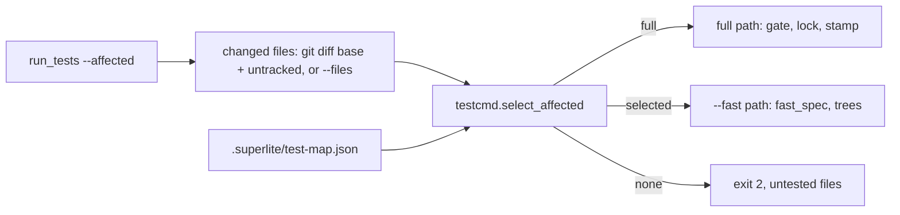
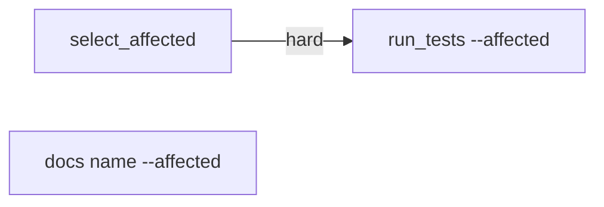

# Superlite: run_tests --affected (B226, #847)

**Goal:** port upstream iha2/superlite 15a1df6d's selector only (#847): `run_tests --affected [--base REV] [--files F ...]` runs the test files `testcmd.select_affected` picks for a change; SDD SKILL.md step 3 and the implementer text name it.
**Architecture:** `testcmd.select_affected(root, changed)` is a pure-ish selector (reads the tree, no runner); `run_tests.run` turns `--affected` into the changed-file list (git or `--files`), calls the selector, then hands the selected test files to the existing `--fast` path (or the existing full path on a setup change).
**Tech stack:** Python 3 stdlib scripts; pytest through `sl run_tests`; Markdown docs.
**Spec:** this file, section Design; issue #847.
**Detail:** tests
**Target-min:** 11
**Wave0:** none
**Worktree:** none
**Coverage:** off

Global constraints:
- Builds: the verdict is `sl run_tests` (the project's test command; a project with `.maxapp` runs `maxapp test`, which a build pool may place on another Mac, and a full run whose tree a green maxapp test stamp covers returns that result without a run); task trees build in <tree>/.build/DerivedData and any build of your own goes under .build/ of the worktree, never -derivedDataPath outside the worktree (your session scratchpad included; backlog cleanup removes scratchpad build folders when the worktree goes); a product, simulator or device build stays on this machine and runs only when an issue's acceptance asks for a running-app check.
- Simulators: append the UDID of each simulator you or a worker creates (`xcrun simctl create` or `clone`; a checker's `Simulators:` line marks its created ones) as one line to /Users/max/github/superlite/.claude/worktrees/superlite-b226-run-tests-affected/.superlite/simulators.txt; never list one you did not create; ship cleanup shuts down and deletes each listed one.
- Text quoted in a task is copied byte for byte (backticks, punctuation, LF endings).
- Not in scope (#847): upstream's "never block builds on tests, whole suite opt-in", `--reuse`, `tree_id`, per-run ids, `_runner_args`, xdist fallback. The full-suite rule, `scripts/test_layers.py` and the Stop hook stay as they are.
- A test that spawns git strips GIT_DIR, GIT_INDEX_FILE and GIT_WORK_TREE from the child env; fixture repos live in `tmp_path / "repo"` (conftest puts `_sl_home` and other folders in `tmp_path`).

## Design

Said (#847): `run_tests --affected [--base REV] [--files ...]` calls `testcmd.select_affected`: changed test files, tests related by name, tests that mention a changed module, hits from `.superlite/test-map.json`; a change to shared setup (conftest, fixtures, the test command) selects everything; it lists changed files no test covers. Inside a task tree the base is the task's start checkpoint. One line in SDD SKILL.md step 3 and the implementer text name it. Acceptance: tests for each selection rule on a fixture repository, for Python and for a Swift package test target named after its module. The PR names the count picked for a one-line SDD `SKILL.md` edit.

### select_affected (testcmd.py)

`select_affected(root: str, changed: list[str]) -> dict`. `changed` paths are root-relative (backslashes become `/`). Steps:

1. **Full trigger.** The first path in input order that is a trigger returns `{"full": True, "trigger": p, "selected": [], "reasons": {}, "untested": []}` at once. Triggers: basename in `AFFECTED_FULL_NAMES` = {conftest.py, pyproject.toml, setup.py, setup.cfg, pytest.ini, tox.ini, requirements.txt, uv.lock, poetry.lock, Pipfile.lock, package.json, package-lock.json, yarn.lock, pnpm-lock.yaml, bun.lockb, go.mod, go.sum, Cargo.toml, Cargo.lock, Package.swift, Package.resolved, project.pbxproj}; a folder part in `DATA_DIRS` (fixtures, fixture, testdata); `.superlite/test-cmd.json` or `.superlite/test-map.json`; a word of the resolved test command (`shlex.split` of `resolve(root)["command"]`, errors ignored) that names this path as an existing file under root; a test-map `_full` glob (fnmatch).
2. **Candidates:** test files of the tree, listed once: `git ls-files -co --exclude-standard -z` in root (not a repo or git fails: `os.walk` skipping `SKIP_DIRS` and dot folders), dropping `.superlite/` paths and paths that are not files. Language = `(resolve(root) or {}).get("language")`. Python: name `test_*.py` or `*_test.py`, and when the pytest config sets `testpaths` (new `pytest_testpaths(root) -> list[str]`: pytest.ini `[pytest]`, pyproject `[tool.pytest.ini_options]`, tox.ini `[pytest]`, setup.cfg `[tool:pytest]`; whitespace-split string or list) only files equal to or under one of them (fnmatch per folder prefix). Other languages: `is_test_path(p)` and suffix in `RUNNER_EXT[lang]` (unknown language: `TEST_CODE_EXT`).
3. **Per changed path, in input order, rules in this order; a test keeps its first reason:** `changed` (p is a candidate); `related` (only when `has_related(root)`: `resolve_related(root, p)` hits that are candidates; FileNotFoundError = none); `name` (p is no test path: candidates whose stem, with one prefix `test_` or suffix `_test`, `Tests`, `Test`, `.test`, `.spec`, `_spec` removed, equals p's stem); `module` (p has a `Sources/<M>/` part with a file below it: every candidate under the folder of a Swift test target named `<M>Tests`, folders from `swift_target_map(root)["dirs"]`); `map` (each test-map key other than `_full` whose glob matches p: a value with `*?[` selects the candidates it matches, else an existing candidate path); `mention` (candidates other than p whose text holds p's stem as a whole word, `\b<stem>\b`, each file read once).
4. **untested:** each changed path that is not a test path (`is_test_path` false) and got no hit, input order, no duplicates. A changed test path that does not exist is neither selected nor untested.
5. Return `{"full": False, "selected": sorted(reasons), "reasons": dict(sorted(reasons.items())), "untested": untested}`.

### run_tests --affected (run_tests.py)

- `--affected` joins the `--fast`/`--full` group; `--base REV` and `--files F ...` (nargs `+`, extend; commas split like `--fast`) need it, else `usage_error` `--base needs --affected` / `--files needs --affected`. `narrowed(a)` counts `a.affected`. `to_root` rewrites relative `--files` entries against the cwd, as it does `--also`.
- A `--task Tn` whose plan **Tests:** has `cmd=`: that command runs as today; stderr `run_tests: --affected: Tn runs its **Tests:** cmd=; no selection`.
- Changed files: `--files` given: those, base None. Else base = `--base`, or with `--task Tn` the run's start (`autocommit.base_of(autocommit.load_state())` when it gives a sha), else `trees.base_commit(".")` (last checkpoint, else HEAD); files = `git diff --name-only --no-renames -z <base>` plus `git ls-files -o --exclude-standard -z`, without `.superlite/` paths except `.superlite/test-cmd.json` and `.superlite/test-map.json`; with `--task Tn` only paths Tn owns (`nt.owns_match` against the owns the `--task` tree code uses, also-claims included). A git error: `usage_error` `--affected: cannot diff against <base>: <first git stderr line>`. No files: `usage_error` `--affected: no changed files since <base[:12]>` (`--files` never reaches it: argparse needs one).
- `sel = testcmd.select_affected(".", changed)`; stderr `run_tests: --affected: <M> changed, <N> selected (base <base[:12]>)` (`(--files)` without a base), plus `; untested: <a, b, ...>` (first 10, then ` (+K more)`).
- Full: stderr `run_tests: --affected: <trigger> changed: the whole suite runs`; the run continues exactly as `--full` (label `full`: lock or admission gate, unit snapshot, `--task` keeps its own files).
- Nothing selected: `usage_error` `--affected: no test covers the change; untested: <names>; write a test or run --fast PATHS` (exit 2, no incident).
- Else the selected files become the `--fast` paths (label `fast`) and the existing flow runs (skip_non_test, expand_fast_paths, fast_spec, Swift `-only-testing` mapping, trees).
- Every summary the `--affected` run writes through `finish_run` holds `"affected": {"base": base or None, "changed": M, "selected": [...], "reasons": {...}, "untested": [...]}` plus `"trigger"` on a full run.

Ruling: the summary `mode` stays `fast` or `full` and the ledger line stays `- tests fast|full`; selection details go in a new `affected` key (because finish.py, pt_review.py, batch_grade.py and report.py switch on mode `full`/`fast`, and finish.py belongs to open batch B229) (lead's ruling).
Ruling: nothing selected exits 2 through `usage_error` naming the untested files, not a green zero-count run (because a zero-test green is a false green under this repo's verify rule, and `--fast` with no test left already exits 2, B131) (lead's ruling).
Ruling: a full trigger runs the real full path (label `full`, full-suite lock or admission, unit stamp) rather than the whole command under the fast label (because a whole-suite run must pass the full-run gate, #714) (lead's ruling).
Ruling: with `--task Tn` the base is the run's start checkpoint and only Tn's owned files count, so a re-run after Tn's checkpoint still sees Tn's change; without `--task` the base is the last checkpoint, else HEAD (because the checkpoint state records no per-task start; Owns narrowing gives the task's own change set) (lead's ruling).
Ruling: a bad or unreadable base exits 2, it never falls back to the whole suite (because an explicit wrong `--base` is a usage error here, as other run_tests usage errors are) (lead's ruling).
Ruling: SDD SKILL.md (13282 of 13300) gains ` (or \`--affected\` for \`--fast PATHS\`)` after the pinned verify command and drops ` (mini prime cuts lines)` (unpinned), landing at 13295 (lead's ruling).
Ruling: docs/tools.md's run_tests row gains one `--affected` sentence before the B67-pinned `; \`--wait\` keeps stdout` tail (no open batch lists docs/tools.md) (lead's ruling).

## Main diagram



## Task graph

```mermaid
%% schedule
gantt
  title Predicted schedule (mm:ss)
  dateFormat X
  axisFormat %M:%S
  section lane 1
  T1 select_affected picks the tests a cha :t1, 0, 337s
  T2 run_tests --affected runs the selecte :t2, 337, 332s
  section lane 2
  T3 SKILL implementer and tools docs name :t3, 0, 295s
```





critical path: T1 → T2 (11.2 min) · peak width 2 · predicted build 11.2 min · predicted total ≈ 21.7 min (target ✗ 11.0)

## File structure

- `skills/subagent-driven-development/scripts/testcmd.py`: `select_affected`, `pytest_testpaths`, `AFFECTED_FULL_NAMES` (T1).
- `tests/scripts/test_testcmd_affected_847.py`: new, T1's tests (Python and Swift package fixtures).
- `skills/subagent-driven-development/scripts/run_tests.py`: `--affected`, `--base`, `--files` (T2).
- `tests/scripts/test_run_tests_affected_847.py`: new, T2's tests.
- `skills/subagent-driven-development/SKILL.md`, `agents/implementer.md`, `docs/tools.md`, `tests/scripts/test_orchestrator.py` (SDD_PINNED), `tests/scripts/test_docs_affected_847.py` (new): docs (T3).

## Package: selector

App type: Python library function. Categories: deep (selection rules), numeric (none), state (none).
**Probe entry:** none (library function and CLI script; their pytest suites run them)

### T1 select_affected picks the tests a change touches · Complexity 5 · Est. context 45k
**Owns:** skills/subagent-driven-development/scripts/testcmd.py, tests/scripts/test_testcmd_affected_847.py
**Components:** 2
**LOC owned:** 290
**Tests:** fast
**Kind:** design
**Model:** sonnet
**Covers:** Design
**Produces:** testcmd.select_affected(root: str, changed: list[str]) -> dict
  e.g. select_affected("repo", ["tests/test_misc.py"]) -> {"full": False, "selected": ["tests/test_misc.py"], "reasons": {"tests/test_misc.py": "changed"}, "untested": []}
  e.g. select_affected("repo", ["pyproject.toml"]) -> {"full": True, "trigger": "pyproject.toml", "selected": [], "reasons": {}, "untested": []}
  e.g. select_affected("repo", ["src/calc/orphan.py"]) -> {"full": False, "selected": [], "reasons": {}, "untested": ["src/calc/orphan.py"]}
**Review Focus:** every test below; rule order and first-reason-wins; `testpaths` drops `bench/`; the Swift `module` rule reads Package.swift targets through `swift_target_map`; each test file read at most once per call; `.superlite/` never a candidate.
**Test code (verbatim):** new file `tests/scripts/test_testcmd_affected_847.py`:
```python
"""#847: testcmd.select_affected picks the tests a change touches, on a Python and a Swift package fixture."""
import json
import os
import subprocess
import sys
from pathlib import Path

SCRIPTS = Path(__file__).resolve().parents[2] / "skills" / "subagent-driven-development" / "scripts"
sys.path.insert(0, str(SCRIPTS))
import testcmd  # noqa: E402

PY = {
    "pyproject.toml": '[project]\nname = "calc"\n\n[tool.pytest.ini_options]\ntestpaths = ["tests"]\n',
    "src/calc/adder.py": "def add(a, b):\n    return a + b\n",
    "src/calc/fmt.py": "def show(x):\n    return str(x)\n",
    "src/calc/orphan.py": "X = 1\n",
    "tests/conftest.py": "",
    "tests/fixtures/sample.txt": "1 2\n",
    "tests/test_adder.py": "from calc.adder import add\n\n\ndef test_add():\n    assert add(1, 2) == 3\n",
    "tests/test_report.py": "from calc import fmt\n\n\ndef test_show():\n    assert fmt.show(1) == '1'\n",
    "tests/test_misc.py": "def test_true():\n    assert True\n",
    "bench/test_speed.py": "from calc.adder import add\n\n\ndef test_speed():\n    assert add(0, 0) == 0\n",
}
SWIFT_PKG = {
    "Package.swift": ('// swift-tools-version:5.9\nimport PackageDescription\n\nlet package = Package(\n    name: "Calc",\n'
                      '    targets: [\n        .target(name: "Calc"),\n        .testTarget(name: "CalcTests", dependencies: ["Calc"]),\n'
                      '        .target(name: "Fmt"),\n        .testTarget(name: "FmtTests", dependencies: ["Fmt"]),\n    ]\n)\n'),
    "Sources/Calc/Adder.swift": "public func add(_ a: Int, _ b: Int) -> Int { a + b }\n",
    "Sources/Calc/Parser.swift": "public struct Parser { public init() {} }\n",
    "Sources/Fmt/Pretty.swift": "public func pretty(_ x: Int) -> String { String(x) }\n",
    "Tests/CalcTests/AdderTests.swift": ("import XCTest\n@testable import Calc\n\nfinal class AdderTests: XCTestCase {\n"
                                         "    func testAdd() { XCTAssertEqual(add(1, 2), 3) }\n}\n"),
    "Tests/CalcTests/ParserTests.swift": ("import XCTest\n@testable import Calc\n\nfinal class ParserTests: XCTestCase {\n"
                                          "    func testInit() { _ = Parser() }\n}\n"),
    "Tests/FmtTests/PrettyTests.swift": ("import XCTest\n@testable import Fmt\n\nfinal class PrettyTests: XCTestCase {\n"
                                         "    func testPretty() { XCTAssertEqual(pretty(1), \"1\") }\n}\n"),
}
SWIFT_CFG = {"language": "swift", "test": "swift test"}


def make(tmp_path, files, cfg=None):
    root = tmp_path / "repo"
    for rel, text in files.items():
        (root / rel).parent.mkdir(parents=True, exist_ok=True)
        (root / rel).write_text(text, encoding="utf-8")
    if cfg is not None:
        (root / ".superlite").mkdir(exist_ok=True)
        (root / ".superlite" / "test-cmd.json").write_text(json.dumps(cfg), encoding="utf-8")
    env = {k: v for k, v in os.environ.items() if k not in ("GIT_DIR", "GIT_INDEX_FILE", "GIT_WORK_TREE")}
    subprocess.run(["git", "init", "-q"], cwd=root, check=True, env=env)
    return root


def test_changed_test_file_selects_itself(tmp_path):
    root = make(tmp_path, PY)
    assert testcmd.select_affected(str(root), ["tests/test_misc.py"]) == {
        "full": False, "selected": ["tests/test_misc.py"], "reasons": {"tests/test_misc.py": "changed"}, "untested": []}


def test_a_deleted_test_is_neither_selected_nor_untested(tmp_path):
    root = make(tmp_path, PY)
    assert testcmd.select_affected(str(root), ["tests/test_gone.py"]) == {
        "full": False, "selected": [], "reasons": {}, "untested": []}


def test_source_selects_its_test_by_name_and_testpaths_drop_bench(tmp_path):
    root = make(tmp_path, PY)
    assert testcmd.select_affected(str(root), ["src/calc/adder.py"]) == {
        "full": False, "selected": ["tests/test_adder.py"], "reasons": {"tests/test_adder.py": "name"}, "untested": []}


def test_source_selects_tests_that_mention_its_module(tmp_path):
    root = make(tmp_path, PY)
    r = testcmd.select_affected(str(root), ["src/calc/fmt.py"])
    assert r["selected"] == ["tests/test_report.py"]
    assert r["reasons"] == {"tests/test_report.py": "mention"}


def test_related_template_maps_a_source(tmp_path):
    files = {**PY, "tests/test_orphan_extra.py": "def test_x():\n    pass\n"}
    root = make(tmp_path, files, cfg={"related": "tests/test_{src}_extra.py"})
    assert testcmd.select_affected(str(root), ["src/calc/orphan.py"]) == {
        "full": False, "selected": ["tests/test_orphan_extra.py"],
        "reasons": {"tests/test_orphan_extra.py": "related"}, "untested": []}


def test_untested_lists_changed_files_no_test_covers(tmp_path):
    root = make(tmp_path, PY)
    r = testcmd.select_affected(str(root), ["src/calc/orphan.py", "README.md", "tests/test_misc.py", "src/calc/orphan.py"])
    assert r["selected"] == ["tests/test_misc.py"]
    assert r["untested"] == ["src/calc/orphan.py", "README.md"]


def test_shared_setup_selects_everything(tmp_path):
    root = make(tmp_path, PY)
    for p in ("tests/conftest.py", "pyproject.toml", "tests/fixtures/sample.txt", "uv.lock", "Package.swift"):
        r = testcmd.select_affected(str(root), ["src/calc/adder.py", p])
        assert r == {"full": True, "trigger": p, "selected": [], "reasons": {}, "untested": []}, p


def test_the_test_command_and_its_config_select_everything(tmp_path):
    files = {**PY, "scripts/run-tests.sh": "pytest -q\n"}
    root = make(tmp_path, files, cfg={"language": "python", "test": "bash scripts/run-tests.sh"})
    for p in ("scripts/run-tests.sh", ".superlite/test-cmd.json"):
        r = testcmd.select_affected(str(root), ["src/calc/adder.py", p])
        assert r == {"full": True, "trigger": p, "selected": [], "reasons": {}, "untested": []}, p


def test_map_file_adds_tests_and_full_globs(tmp_path):
    root = make(tmp_path, PY)
    (root / ".superlite").mkdir()
    (root / ".superlite" / "test-map.json").write_text(json.dumps(
        {"src/calc/orphan.py": ["tests/test_misc.py"], "docs/*.md": ["tests/test_r*.py"], "_full": ["config/*.yml"]}),
        encoding="utf-8")
    assert testcmd.select_affected(str(root), ["src/calc/orphan.py", "docs/guide.md"]) == {
        "full": False, "selected": ["tests/test_misc.py", "tests/test_report.py"],
        "reasons": {"tests/test_misc.py": "map", "tests/test_report.py": "map"}, "untested": []}
    r = testcmd.select_affected(str(root), ["config/app.yml"])
    assert r["full"] is True and r["trigger"] == "config/app.yml"


def test_pytest_testpaths_reads_each_config(tmp_path):
    (tmp_path / "pytest.ini").write_text("[pytest]\ntestpaths = tests\n    more\n", encoding="utf-8")
    assert testcmd.pytest_testpaths(str(tmp_path)) == ["tests", "more"]
    (tmp_path / "pytest.ini").unlink()
    (tmp_path / "pyproject.toml").write_text('[tool.pytest.ini_options]\ntestpaths = ["tests"]\n', encoding="utf-8")
    assert testcmd.pytest_testpaths(str(tmp_path)) == ["tests"]
    (tmp_path / "pyproject.toml").write_text("[project]\nname = 'x'\n", encoding="utf-8")
    assert testcmd.pytest_testpaths(str(tmp_path)) == []


def test_swift_source_selects_its_module_test_target(tmp_path):
    root = make(tmp_path, SWIFT_PKG, cfg=SWIFT_CFG)
    assert testcmd.select_affected(str(root), ["Sources/Calc/Parser.swift"]) == {
        "full": False,
        "selected": ["Tests/CalcTests/AdderTests.swift", "Tests/CalcTests/ParserTests.swift"],
        "reasons": {"Tests/CalcTests/AdderTests.swift": "module", "Tests/CalcTests/ParserTests.swift": "name"},
        "untested": []}


def test_swift_changed_test_and_manifest(tmp_path):
    root = make(tmp_path, SWIFT_PKG, cfg=SWIFT_CFG)
    r = testcmd.select_affected(str(root), ["Tests/FmtTests/PrettyTests.swift"])
    assert r["selected"] == ["Tests/FmtTests/PrettyTests.swift"]
    assert r["reasons"] == {"Tests/FmtTests/PrettyTests.swift": "changed"}
    assert testcmd.select_affected(str(root), ["Package.swift"])["trigger"] == "Package.swift"


def test_swift_source_outside_every_test_target_is_untested(tmp_path):
    root = make(tmp_path, {**SWIFT_PKG, "Sources/Tool/Runner.swift": "struct Runner {}\n"}, cfg=SWIFT_CFG)
    assert testcmd.select_affected(str(root), ["Sources/Tool/Runner.swift"]) == {
        "full": False, "selected": [], "reasons": {}, "untested": ["Sources/Tool/Runner.swift"]}
```
**Steps:** 1 write the test file, 2 run it: FAIL (AttributeError: no select_affected), 3 implement per Design "select_affected (testcmd.py)", reusing `is_test_path`, `SKIP_DIRS`, `DATA_DIRS`, `RUNNER_EXT`, `TEST_CODE_EXT`, `has_related`, `resolve_related`, `swift_target_map` and `resolve`; add one line naming `select_affected` to the module docstring's library list, 4 run the verify command: PASS, 5 run `tests/scripts/test_testcmd*.py` too: no new failure.
**Notes:** verify paths: `tests/scripts/test_testcmd_affected_847.py`. `select_affected` never runs a test command and never writes a file.

## Package: CLI

App type: CLI script. Categories: deep (flag rules), state (checkpoint base).
**Probe entry:** none (run_tests.py is run as a subprocess by its pytest suite)

### T2 run_tests --affected runs the selected tests · Complexity 5 · Est. context 55k
**Owns:** skills/subagent-driven-development/scripts/run_tests.py, tests/scripts/test_run_tests_affected_847.py
**Components:** 2
**LOC owned:** 260
**Tests:** fast
**Kind:** design
**Model:** sonnet
**Covers:** Design
**Consumes:** testcmd.select_affected(root: str, changed: list[str]) -> dict (T1)
**Review Focus:** every test below; `--affected` passes through `--background` (argv forwarded, pointer mode `fast`); a full trigger takes the same gate and lock as `--full`; the `affected` summary key on both fast and full runs; `.superlite/` state files never count as changed; `--task` narrowing reads the same owns the tree code uses; a task with `**Tests:** cmd=` runs its command.
**Test code (verbatim):** new file `tests/scripts/test_run_tests_affected_847.py`:
```python
"""#847: run_tests --affected [--base REV] [--files F ...] runs the tests testcmd.select_affected picks."""
import json
import os
import subprocess
import sys
from pathlib import Path

SCRIPTS = Path(__file__).resolve().parents[2] / "skills" / "subagent-driven-development" / "scripts"
RUN_TESTS = SCRIPTS / "run_tests.py"
CFG = {"language": "python", "lock": False,
       "test": "echo FULL > .superlite/got.txt; echo '1 passed'",
       "test_file": "printf '%s\\n' {files} > .superlite/got.txt; echo '1 passed'"}
FILES = {
    "src/calc/adder.py": "def add(a, b):\n    return a + b\n",
    "src/calc/orphan.py": "X = 1\n",
    "tests/conftest.py": "",
    "tests/test_adder.py": "from calc.adder import add\n\n\ndef test_add():\n    assert add(1, 2) == 3\n",
    "tests/test_misc.py": "def test_true():\n    assert True\n",
}
PLAN = """# Plan

### T1 adder
**Owns:** src/calc/adder.py, tests/test_adder.py

### T2 misc
**Owns:** src/calc/orphan.py, tests/test_misc.py
"""
GIT_ENV = {k: v for k, v in os.environ.items() if k not in ("GIT_DIR", "GIT_INDEX_FILE", "GIT_WORK_TREE")}


def git(root, *args):
    return subprocess.run(["git", "-c", "user.name=t", "-c", "user.email=t@example.com", *args], cwd=root, check=True,
                          capture_output=True, text=True, env=GIT_ENV).stdout.strip()


def repo(tmp_path):
    root = tmp_path / "repo"
    for rel, text in FILES.items():
        (root / rel).parent.mkdir(parents=True, exist_ok=True)
        (root / rel).write_text(text, encoding="utf-8")
    git(root, "init", "-q")
    (root / ".git" / "info").mkdir(parents=True, exist_ok=True)
    (root / ".git" / "info" / "exclude").write_text(".superlite/\n", encoding="utf-8")
    git(root, "add", "-A")
    git(root, "commit", "-qm", "base")
    (root / ".superlite").mkdir()
    (root / ".superlite" / "test-cmd.json").write_text(json.dumps(CFG), encoding="utf-8")
    (root / ".superlite" / "plan.md").write_text(PLAN, encoding="utf-8")
    return root


def rt(cwd, *args, root=None):
    sl = Path(root or cwd) / ".superlite"
    return subprocess.run([sys.executable, str(RUN_TESTS), *args, "--log", str(sl / "incidents.jsonl"),
                           "--ledger", str(sl / "ledger.md"), "--summary", str(sl / "test-summary.json")],
                          cwd=cwd, capture_output=True, text=True, timeout=120)


def summary(root):
    return json.loads((root / ".superlite" / "test-summary.json").read_text(encoding="utf-8"))


def got(root):
    p = root / ".superlite" / "got.txt"
    return p.read_text(encoding="utf-8").splitlines() if p.exists() else None


def edit(root, rel):
    with open(root / rel, "a", encoding="utf-8") as f:
        f.write("# changed\n")


def test_affected_runs_the_tests_a_change_touches(tmp_path):
    root = repo(tmp_path)
    edit(root, "src/calc/adder.py")
    r = rt(root, "--affected")
    assert r.returncode == 0, r.stderr
    assert got(root) == ["tests/test_adder.py"]
    assert "run_tests: --affected: 1 changed, 1 selected (base " in r.stderr
    s = summary(root)
    assert s["mode"] == "fast"
    assert s["affected"] == {"base": git(root, "rev-parse", "HEAD"), "changed": 1, "selected": ["tests/test_adder.py"],
                             "reasons": {"tests/test_adder.py": "name"}, "untested": []}


def test_files_replace_git_changes(tmp_path):
    root = repo(tmp_path)
    r = rt(root, "--affected", "--files", "tests/test_misc.py")
    assert r.returncode == 0, r.stderr
    assert got(root) == ["tests/test_misc.py"]
    assert "run_tests: --affected: 1 changed, 1 selected (--files)" in r.stderr
    assert summary(root)["affected"]["base"] is None


def test_files_from_a_subfolder_are_read_from_there(tmp_path):
    root = repo(tmp_path)
    r = rt(root / "tests", "--affected", "--files", "test_misc.py", root=root)
    assert r.returncode == 0, r.stderr
    assert got(root) == ["tests/test_misc.py"]


def test_nothing_selected_exits_2_and_names_the_untested_files(tmp_path):
    root = repo(tmp_path)
    edit(root, "src/calc/orphan.py")
    r = rt(root, "--affected")
    assert r.returncode == 2, r.stderr
    assert ("--affected: no test covers the change; untested: src/calc/orphan.py; "
            "write a test or run --fast PATHS") in r.stderr
    assert got(root) is None
    assert "untested: src/calc/orphan.py" in summary(root)["error"]


def test_no_change_exits_2(tmp_path):
    root = repo(tmp_path)
    r = rt(root, "--affected")
    assert r.returncode == 2
    assert "--affected: no changed files since " in r.stderr
    assert got(root) is None


def test_shared_setup_change_runs_the_whole_suite(tmp_path):
    root = repo(tmp_path)
    edit(root, "tests/conftest.py")
    r = rt(root, "--affected")
    assert r.returncode == 0, r.stderr
    assert got(root) == ["FULL"]
    assert "run_tests: --affected: tests/conftest.py changed: the whole suite runs" in r.stderr
    s = summary(root)
    assert s["mode"] == "full" and s["affected"]["trigger"] == "tests/conftest.py"


def test_bad_base_exits_2(tmp_path):
    root = repo(tmp_path)
    r = rt(root, "--affected", "--base", "no-such-rev")
    assert r.returncode == 2
    assert "--affected: cannot diff against no-such-rev" in r.stderr
    assert got(root) is None


def test_base_and_files_need_affected(tmp_path):
    root = repo(tmp_path)
    r = rt(root, "--fast", "tests/test_misc.py", "--base", "HEAD")
    assert r.returncode == 2 and "--base needs --affected" in r.stderr
    r = rt(root, "--fast", "tests/test_misc.py", "--files", "src/calc/adder.py")
    assert r.returncode == 2 and "--files needs --affected" in r.stderr
    assert got(root) is None


def test_explicit_base_reaches_back(tmp_path):
    root = repo(tmp_path)
    edit(root, "src/calc/adder.py")
    git(root, "commit", "-qam", "change adder")
    r = rt(root, "--affected", "--base", "HEAD~1")
    assert r.returncode == 0, r.stderr
    assert got(root) == ["tests/test_adder.py"]


def test_task_keeps_its_own_files(tmp_path):
    root = repo(tmp_path)
    edit(root, "src/calc/adder.py")
    edit(root, "tests/test_misc.py")
    r = rt(root, "--affected", "--task", "T1", "--plan", ".superlite")
    assert r.returncode == 0, r.stderr
    assert got(root) == ["tests/test_adder.py"]
    assert summary(root)["affected"]["changed"] == 1


def test_task_base_is_the_run_start_so_a_checkpointed_change_still_counts(tmp_path):
    root = repo(tmp_path)
    start = git(root, "rev-parse", "HEAD")
    edit(root, "src/calc/adder.py")
    git(root, "commit", "-qam", "T1 checkpoint")
    cp = git(root, "rev-parse", "HEAD")
    (root / ".superlite" / "checkpoints.json").write_text(json.dumps(
        {"base": start, "head": start,
         "entries": [{"task": "T1", "sha": cp, "title": "T1", "files": ["src/calc/adder.py"]}]}), encoding="utf-8")
    r = rt(root, "--affected", "--task", "T1", "--plan", ".superlite")
    assert r.returncode == 0, r.stderr
    assert got(root) == ["tests/test_adder.py"]
    assert summary(root)["affected"]["base"] == start
    r = rt(root, "--affected")
    assert r.returncode == 2
    assert "--affected: no changed files since " + cp[:12] in r.stderr


def test_background_run_passes_affected_through(tmp_path):
    root = repo(tmp_path)
    r = rt(root, "--affected", "--files", "tests/test_misc.py", "--background")
    assert r.returncode == 0, r.stderr
    assert r.stdout.strip().splitlines()[-1].startswith("wait: ")
    path = r.stdout.split("summary: ", 1)[1].splitlines()[0].strip()
    w = rt(root, "--wait", path, "--timeout", "60")
    assert w.returncode == 0, w.stderr
    assert got(root) == ["tests/test_misc.py"]
```
**Steps:** 1 write the test file, 2 run it: FAIL (argparse: unrecognized `--affected`), 3 implement per Design "run_tests --affected (run_tests.py)": the flags in `main`, `narrowed`, `to_root`, the selection block in `run` after the `task_cmd_spec` branch and before `skip_non_test`, the `affected` summary key; update the module docstring's usage line, 4 run the verify command: PASS, 5 run `tests/scripts/test_run_tests_fast_mapping_597.py tests/scripts/test_run_tests_task_cmd_475.py tests/scripts/test_testcmd_affected_847.py` too: no new failure.
**Notes:** verify paths: `tests/scripts/test_run_tests_affected_847.py`. The flag's argparse help reads `run the tests the change touches (testcmd.select_affected; see --base, --files)`.

## Package: docs

App type: prose. Categories: none.
**Probe entry:** none (skill and agent prose, pinned by tests)

### T3 SKILL, implementer and tools docs name --affected · Complexity 1 · Est. context 30k
**Owns:** skills/subagent-driven-development/SKILL.md, agents/implementer.md, docs/tools.md, tests/scripts/test_orchestrator.py, tests/scripts/test_docs_affected_847.py
**Components:** 2
**LOC owned:** 40
**Tests:** fast
**Kind:** mechanical
**Model:** haiku
**Covers:** Design
**Review Focus:** `test_sdd_step3_names_affected`, `test_implementer_names_affected`, `test_tools_row_names_affected`; SDD SKILL.md at most 13300 characters (`test_orchestrator.py`); the B67 and B16 tools-row pins stay green.
**Test code (verbatim):** new file `tests/scripts/test_docs_affected_847.py`:
```python
"""#847: the SDD task message, the implementer text and docs/tools.md name run_tests --affected."""
from pathlib import Path

ROOT = Path(__file__).resolve().parents[2]


def read(rel):
    return (ROOT / rel).read_text(encoding="utf-8")


def test_sdd_step3_names_affected():
    text = read("skills/subagent-driven-development/SKILL.md")
    assert "`<abs sl> run_tests --fast PATHS --task Tn --background` (or `--affected` for `--fast PATHS`), then run" in text
    assert "(mini prime cuts lines)" not in text
    assert len(text) <= 13300


def test_implementer_names_affected():
    line = next(ln for ln in read("agents/implementer.md").splitlines() if ln.startswith("- TDD."))
    assert ("`<abs sl> run_tests --fast PATHS --task Tn --background` (or `<abs sl> run_tests --affected --task Tn --background`: "
            "run_tests picks the tests your change touches; when no test covers it, it exits 2 naming the files, so write that test), "
            "then run the `wait:` line it prints") in line


def test_tools_row_names_affected():
    row = next(ln for ln in read("docs/tools.md").splitlines() if ln.startswith("| `run_tests`"))
    for phrase in ("`--affected [--base REV] [--files F ...]` (#847)", "`testcmd.select_affected`", "`.superlite/test-map.json`",
                   "nothing selected exits 2 naming the untested files; `--wait` keeps stdout one JSON document"):
        assert phrase in row, phrase
```
**Steps:** 1 write the test file, 2 run it: FAIL (3 failed), 3 edits: (a) `skills/subagent-driven-development/SKILL.md` step 3 (line 55): replace `` `<abs sl> run_tests --fast PATHS --task Tn --background`, then run the printed `` with `` `<abs sl> run_tests --fast PATHS --task Tn --background` (or `--affected` for `--fast PATHS`), then run the printed ``, and replace `` instead of `task` (mini prime cuts lines), and `` with `` instead of `task`, and ``; (b) `agents/implementer.md` line 20: replace `` Fast check, always in the background: `<abs sl> run_tests --fast PATHS --task Tn --background`, then run the `wait:` line it prints `` with `` Fast check, always in the background: `<abs sl> run_tests --fast PATHS --task Tn --background` (or `<abs sl> run_tests --affected --task Tn --background`: run_tests picks the tests your change touches; when no test covers it, it exits 2 naming the files, so write that test), then run the `wait:` line it prints ``; (c) `docs/tools.md`, the line starting `| \`run_tests\``: insert directly before its text `; \`--wait\` keeps stdout one JSON document` the text `; \`--affected [--base REV] [--files F ...]\` (#847) runs the test files \`testcmd.select_affected\` picks for the changed files (git diff against REV, default the last checkpoint, else HEAD, plus untracked files; \`--files\` replaces git; with \`--task Tn\` the base is the run's start and only Tn's owned files count): changed test files, tests named after a changed file (\`test_<stem>\`, \`<stem>Tests\`, the \`related\` template), every test file of a Swift package's \`<Module>Tests\` target for a change under \`Sources/<Module>/\`, tests that name a changed file's stem as a whole word, and the hits of \`.superlite/test-map.json\` (\`{"<glob>": ["<test path or glob>"], "_full": ["<glob>"]}\`); a change to shared setup (conftest.py, pyproject.toml, lockfiles, Package.swift, a fixtures or testdata folder, the test-cmd.json or a file its command names, a \`_full\` glob) runs the whole suite as \`--full\` does; the summary gets an \`affected\` key (base, changed, selected, reasons, untested, trigger) and stderr one \`--affected: M changed, N selected\` line; nothing selected exits 2 naming the untested files` (backslash-escaped backticks above are literal backticks in the file); (d) `tests/scripts/test_orchestrator.py`: append to the SDD_PINNED tuple, before its closing `)`, the two lines `    # test_docs_affected_847.py` and `    "(or \`--affected\` for \`--fast PATHS\`)",`; 4 `wc -c skills/subagent-driven-development/SKILL.md` prints 13295; 5 run the verify command: PASS.
**Notes:** verify paths: `tests/scripts/test_docs_affected_847.py tests/scripts/test_orchestrator.py tests/scripts/test_docs_b67_tools.py tests/scripts/test_docs_b32_sdd.py tests/scripts/test_foreground_verify_rule.py tests/scripts/test_implementer_wait_cue_b36.py`. Do not run `tests/scripts/test_doc_contract.py` in this task: it checks `--affected` against run_tests' parser, which T2 builds; the final full run covers it.

## Review Focus

- selector (T1): deep: the five rules, their order and first-reason-wins; full triggers return at once; `testpaths` filter; Swift `module` rule from Package.swift test targets; untested list order and dedupe.
- CLI (T2): deep: flag validation, `--files` from a subfolder, `--background` pass-through; state: the `--task` base (run start) vs the plain base (last checkpoint), Owns narrowing; the full trigger takes the `--full` path.
- docs (T3): SDD SKILL.md cap, pinned phrases intact.

## Self-review

Every Design rule has a test in T1 or T2; T3 pins the doc lines. No placeholders. T2 consumes T1's exact Produces line; the hard edge keeps T2 after T1's commit (its subprocess tests run the real selector). T3 shares no file with T1 or T2.
