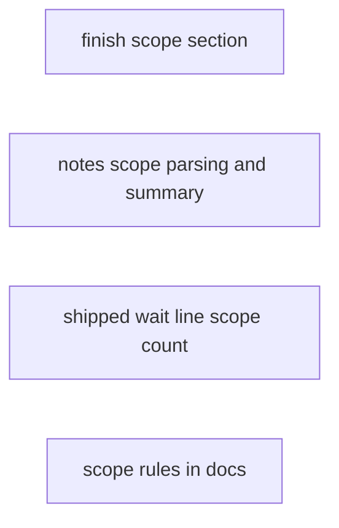

# Superlite: scope rulings after approval (B229, #850)

**Goal:** a ruling that adds, drops or changes a deliverable after approval is written `Ruling: [scope] ...`; `sl finish` prints a `scope rulings:` section, the backlog ship summary lists a lead's scope rulings first, and the shipped wait line gains ` scope=N`.
**Architecture:** `finish.scope_rulings` filters the ledger rulings by the `[scope]` tag; `backlog_brief.scope_rulings` parses a lead's notes, `backlog_ship.note_items` stores them as the batch key `scope`, `backlog_run._shipped` counts them on the wait line, `backlog_brief.summary` orders them first. The lead brief, backlog.md, orchestrator.md and docs/tools.md name the tag.
**Tech stack:** Python 3.10+ stdlib; pytest through `sl run_tests`; Markdown.
**Spec:** this file, section Design; issue #850.
**Detail:** contracts
**Target-min:** 11
**Wave0:** none
**Worktree:** none
**Coverage:** off (bounded change to an existing flow: one tag on existing ruling lines, one new list key on the batch record; no migration, no new interface for other repos)

Global constraints:
- The tag is the literal `[scope]`, matched case-insensitively, directly after `Ruling:` (optional leading `- ` or `* ` bullet and `**Ruling:**` bold, as the existing parsers accept); the text after the tag (whitespace stripped) is the scope ruling; an empty text is not one.
- Keep every phrase other tests pin unless this plan says to change it; a golden test that pins changed text is updated in the task that changes the text.
- This repository is public: no host names, user names, home paths, other project or repository names in code, tests, docs or commit messages. LF endings. Every new code line keeps the repo's trailing `# O(...)` complexity comment style.
- Builds: the verdict is `sl run_tests` (the project's test command; a project with `.maxapp` runs `maxapp test`, which a build pool may place on another Mac, and a full run whose tree a green maxapp test stamp covers returns that result without a run); task trees build in <tree>/.build/DerivedData and any build of your own goes under .build/ of the worktree, never -derivedDataPath outside the worktree (your session scratchpad included; backlog cleanup removes scratchpad build folders when the worktree goes); a product, simulator or device build stays on this machine and runs only when an issue's acceptance asks for a running-app check.
- Simulators: append the UDID of each simulator you or a worker creates (`xcrun simctl create` or `clone`; a checker's `Simulators:` line marks its created ones) as one line to /Users/max/github/superlite/.claude/worktrees/superlite-b229-scope-rulings/.superlite/simulators.txt; never list one you did not create; ship cleanup shuts down and deletes each listed one.

## Design

Today rulings are free text: nothing separates "the coordinator decided a detail" from "it built something other than the approved plan or the issue asked for". Upstream (iha2 3bbf0071) tags the latter `Ruling: [scope] ...` and lists them at finish.

Ruling: finish prints `scope rulings: N`, then one `- <text>` line per scope ruling (tag removed), then a blank line, directly after the `rulings:` block and only when N > 0; the `rulings:` list keeps every ruling whole, tag included (as upstream). Lead's ruling.
Ruling: a lead writes its scope rulings into notes.md as `Ruling: [scope] ...`; `backlog_ship.note_items` gains the key `scope` (list of texts, tag removed, whitespace collapsed, control characters dropped), so the batch record and `_shipped` get it through the existing `**items` path of merge, `ship done` and no-change. Lead's ruling.
Ruling: the wait line of a shipped batch appends ` scope=N` after ` unverified=N` and before ` design: ...`, only when N > 0; no per-ruling `B scope:` lines (the summary holds them), and the no-change line and the `status` table stay unchanged. Lead's ruling (the issue names the shipped wait line only).
Ruling: the summary B.md lists the notes' scope ruling lines first among its note lines (others keep their order), so its 10-line cap never drops them before another note line. Lead's ruling.
Ruling: the coordinator rule goes into orchestrator.md (new section) and the lead rule into the lead brief's notes rule and backlog.md; SDD SKILL.md line 14 belongs to open batch B226, so its `[scope]` mention is a follow-up. Lead's ruling.
Ruling: B229 also edits backlog_ship.py, skills/subagent-driven-development/backlog.md, skills/subagent-driven-development/orchestrator.md, docs/tools.md and tests (no open batch lists them). Lead's ruling.

## Task graph

```mermaid
%% schedule
gantt
  title Predicted schedule (mm:ss)
  dateFormat X
  axisFormat %M:%S
  section lane 1
  T4 scope rules in docs :t4, 0, 351s
  section lane 2
  T2 notes scope parsing and summary :t2, 0, 338s
  section lane 3
  T1 finish scope section :t1, 0, 274s
  section lane 4
  T3 shipped wait line scope count :t3, 0, 267s
```

critical path: T4 (5.8 min) · peak width 4 · predicted build 5.8 min · predicted total ≈ 16.3 min (target ✗ 11.0)

## Package: finish

**Probe entry:** none (CLI over a ledger file; the cases are named tests through `finish --ledger`).

### T1 finish scope section · Complexity 2 · Est. context 30k
**Owns:** skills/subagent-driven-development/scripts/finish.py, tests/scripts/test_finish_scope_850.py
**Components:** 1
**LOC owned:** 70
**Tests:** fast
**Kind:** design
**Model:** sonnet
**Est. time:** 2 min (1 component, about 70 LOC, fast tests)
**Consumes:** none
**Produces:** finish.scope_rulings(rulings: list[str]) -> list[str]
  e.g. scope_rulings(["keep the flags", "[scope] drop CSV export - spec 4 - one task", "[SCOPE]  rename parse()"]) -> ["drop CSV export - spec 4 - one task", "rename parse()"]
  e.g. scope_rulings(["keep [scope] as a word", "[scope]", "[scope]   "]) -> []
**Review Focus:** `test_finish_prints_scope_section`: ledger "Ruling: keep the CLI flag names\nRuling: [scope] drop CSV export - spec 4 conflicts - cost: one task\n- **Ruling:** [SCOPE] rename parse() - clash - cost: re-run\n" gives stdout containing "rulings: 3\n" and "scope rulings: 2\n- drop CSV export - spec 4 conflicts - cost: one task\n- rename parse() - clash - cost: re-run\n\n", and the rulings list still holds "- [scope] drop CSV export - spec 4 conflicts - cost: one task"; `test_finish_no_scope_section`: ledger "Ruling: keep the CLI flag names\n" gives no "scope rulings" in stdout; `test_scope_rulings_examples`: both e.g. lines above; `test_scope_section_after_rulings_block`: the "scope rulings:" line comes after the last "- " line of the `rulings:` block and before any "held:" or "tests" line.
**Steps:** 1 write tests/scripts/test_finish_scope_850.py (run finish as tests/scripts/test_run_scripts.py does: `run("finish", "--ledger", ledger, "--log", tmp_path / "none.jsonl")`), 2 run: FAIL, 3 implement in finish.summary right after the `rulings:` block, 4 run: PASS, 5 run tests/scripts/test_run_scripts.py and every tests/scripts/test_finish*.py too: PASS.

## Package: backlog

**Probe entry:** none (state and notes files of the backlog CLI; the cases are named tests).

### T2 notes scope parsing and summary · Complexity 3 · Est. context 40k
**Owns:** skills/subagent-driven-development/scripts/backlog_brief.py, skills/subagent-driven-development/scripts/backlog_ship.py, tests/scripts/test_backlog_scope_850.py, tests/scripts/test_backlog_ship_notes_476.py, tests/scripts/test_backlog_ship_582.py, tests/scripts/test_backlog_brief_b90.py, tests/scripts/test_backlog_brief_jira_208.py
**Components:** 3
**LOC owned:** 110
**Tests:** fast
**Kind:** design
**Model:** sonnet
**Est. time:** 3.5 min (3 components, about 110 LOC, fast tests)
**Consumes:** none
**Produces:** backlog_brief.scope_rulings(notes: str) -> list[str]
  e.g. scope_rulings("Ruling: x\nRuling: [scope] dropped CSV export (#12)\n- ruling: [SCOPE]  added --dry-run\n") -> ["dropped CSV export (#12)", "added --dry-run"]
  e.g. scope_rulings("Ruling: keep [scope] words\nFollow-up: y\n") -> []
**Produces:** backlog_ship.note_items(notes: str) -> dict
  e.g. note_items("Ruling: [scope] dropped X\nFollow-up: y\n") -> {"followups": ["y"], "undone": [], "unverified": [], "scope": ["dropped X"], "kind": None}
  e.g. note_items("") -> {"followups": [], "undone": [], "unverified": [], "scope": [], "kind": None}
**Review Focus:** `test_scope_rulings_examples`: both scope_rulings e.g. lines; `test_note_items_scope`: both note_items e.g. lines; `test_scope_ruling_control_chars`: scope_rulings("Ruling: [scope] a\x1b[2J\tb\n") -> ["a[2J b"]; `test_summary_lists_scope_first`: backlog_brief.summary({"id": "B7", "issues": [850], "pr": 9, "version": "1.0.1"}, "Ruling: plain one\nFollow-up: f\nRuling: [scope] dropped X\n") equals "B7 shipped: #850\nPR: #9\nVersion: 1.0.1\nRuling: [scope] dropped X\nRuling: plain one\nFollow-up: f\n"; `test_summary_cap_keeps_scope`: a batch with a Decisions line and 8 plain note lines then 1 scope line keeps the scope line in the 10-line summary; `test_summary_without_scope_unchanged`: notes with no scope line give the same summary as before this change; `test_merge_stores_scope`: a ship merge whose notes.md holds "Ruling: [scope] dropped X\n" stores `scope == ["dropped X"]` on the batch record (fixture as in test_backlog_ship_notes_476.test_merge_keeps_notes_and_items); `test_notes_rule_names_scope`: backlog_brief.NOTES_RULE contains "`Ruling: [scope] ...`".
**Steps:** 1 write tests/scripts/test_backlog_scope_850.py, 2 run: FAIL, 3 implement, 4 run: PASS, 5 add `"scope": []` (or the scope list) to every exact note_items dict in tests/scripts/test_backlog_ship_notes_476.py and tests/scripts/test_backlog_ship_582.py, update the golden brief pins in tests/scripts/test_backlog_brief_b90.py and tests/scripts/test_backlog_brief_jira_208.py, then run every tests/scripts/test_backlog_*.py: PASS.
**Notes:** NOTES_RULE edit: replace "`Ruling: ...` lines that change later batches, one `Follow-up: ...` line" with "`Ruling: ...` lines that change later batches, one `Ruling: [scope] ...` line per ruling that adds, drops or changes a deliverable your issues or plan asked for (the summary lists those first, the shipped wait line counts them), one `Follow-up: ...` line"; nothing else in NOTES_RULE changes. `note_items` gets the list from `backlog_brief.scope_rulings` (import backlog_brief inside the function, as backlog_ship does elsewhere); a scope ruling line still counts as a follow-up when the existing FOLLOW regex matches it. `summary` decides "scope line" with the same regex as scope_rulings.

### T3 shipped wait line scope count · Complexity 1 · Est. context 25k
**Owns:** skills/subagent-driven-development/scripts/backlog_run.py, tests/scripts/test_backlog_run_scope_850.py
**Components:** 1
**LOC owned:** 35
**Tests:** fast
**Kind:** mechanical
**Model:** haiku
**Est. time:** 1.5 min (1 component, about 35 LOC, fast tests)
**Consumes:** none
**Produces:** none
**Review Focus:** `test_shipped_line_counts_scope`: with the `bk` fixture as in tests/scripts/test_backlog_run_b90.py, `running(bk, merged=True, pr=201, version="1.5.8", followups=["file docs"], scope=["dropped CSV export", "added a flag"])`, stop `{"t": 2000, "last": "Status: DONE"}`, `run(capsys, "wait", "--timeout", "0")` returns `(0, f"B1 shipped PR #201 1.5.8 summary={s} followups=1 scope=2\nB1 follow-up: file docs\n")` with `s = bk.sd / "backlog" / "B1.md"`; `test_shipped_line_scope_after_unverified`: `unverified=["app check (#3)"], scope=["x"]` gives a first line ending `summary={s} unverified=1 scope=1`; `test_shipped_line_without_scope`: `scope=[]` gives exactly `f"B1 shipped PR #201 1.5.8 summary={s}\n"`.
**Steps:** 1 write the three tests (import the fixture and helpers the way test_backlog_run_b90.py does), 2 run: FAIL, 3 in backlog_run._shipped add `sc = list(b.get("scope") or [])` and append `f" scope={len(sc)}" if sc else ""` to `cnt` right after the unverified count and before the design suffix, 4 run: PASS, 5 run tests/scripts/test_backlog_run_b90.py too: PASS.

## Package: docs

**Probe entry:** none (prose).

### T4 scope rules in docs · Complexity 1 · Est. context 30k
**Owns:** skills/subagent-driven-development/backlog.md, skills/subagent-driven-development/orchestrator.md, docs/tools.md
**Components:** 1
**LOC owned:** 12
**Tests:** fast cmd=grep -q 'Ruling: \[scope\]' skills/subagent-driven-development/backlog.md && grep -q '## Scope rulings' skills/subagent-driven-development/orchestrator.md && grep -q 'scope rulings:' docs/tools.md && grep -q 'scope=N' docs/tools.md
**Kind:** design
**Model:** sonnet
**Est. time:** 1.5 min (1 component, about 12 LOC, fast tests)
**Consumes:** none
**Produces:** none
**Review Focus:** `cmd check`: the four greps pass; every existing sentence of backlog.md stays (tests/scripts/test_backlog_rules_split_684.py and the docs tests pass).
**Steps:** 1 run the cmd: FAIL, 2 edit, 3 run the cmd: PASS, 4 run tests/scripts/test_backlog_rules_split_684.py, tests/scripts/test_backlog_docs_b90.py and every tests/scripts/test_docs*.py and tests/scripts/test_orchestrator*.py: PASS.
**Notes:** Edit 1, backlog.md `## Lead`: insert, directly after the bullet that starts "- Keep your notes in `.superlite/notes.md`", the new bullet "- Scope rulings: a ruling that adds, drops or changes a deliverable your issues or the approved plan asked for is one `Ruling: [scope] <decision> - <why>` line in notes.md (and in the run's progress.md): `sl finish` lists it under `scope rulings:`, the ship summary lists such lines first and the shipped wait line gains ` scope=N` (#850)." Edit 2, orchestrator.md: a new section `## Scope rulings` directly before `## Benchmarks`, one paragraph: "Once the plan is approved (human mode) or its first task dispatched (AI mode), a ruling that adds, drops or changes a deliverable the approved plan, its spec or its issue asked for is written `Ruling: [scope] <decision> - <why> - <cost if wrong>`. `sl finish` lists those under `scope rulings:` (the `rulings:` list keeps them too); a batch lead also writes each into notes.md, so the ship summary and main's wait line show it." Edit 3, docs/tools.md: in the `finish` row append to its first sentence's list the clause "; a `scope rulings: N` section lists the `Ruling: [scope]` lines, tag removed (#850)"; in the first `backlog_run` row add the sentence "A shipped wait line ends ` scope=N` when the lead's notes hold N `Ruling: [scope]` lines (#850)." next to where it names followups=/undone= (else at the end of the row).

## Review Focus

- finish (CLI, file): tag matching (case, bold, bullet, tag mid-text), empty tag text, section placement and the blank line after it.
- backlog (state, file, encoding): control characters in notes, the summary 10-line cap with scope lines, exact note_items dict shape (all existing callers), the wait line order of counts.
- docs: no existing pinned sentence changes.

## Self-review

Coverage: issue #850 asks for the coordinator and lead rules (T4, T2 NOTES_RULE), the finish section (T1), the ship summary (T2) and the wait line (T3); acceptance tests are T1's and T3's. No placeholders; T3 reads the batch key `scope` that T2 writes, a data name only, so no edge. No two tasks share a file.
