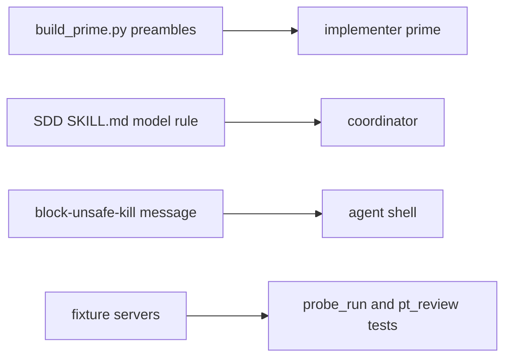
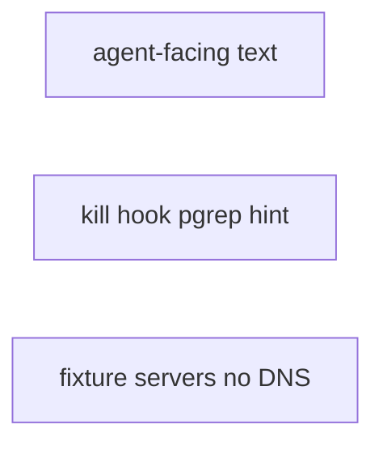

# Superlite: small upstream fixes (B220, #841)

**Goal:** port four small upstream iha2/superlite fixes (#841): the prime names `sl incident add` and `sl commit_task`; the `model` rule is stated once, for superlite agents only; the kill guard's block message names `pgrep -f <pattern>`; the fixture HTTP servers bind without a reverse-DNS lookup.
**Architecture:** four independent text or fixture edits, each with its own regression test; no interfaces between tasks.
**Tech stack:** Python 3 scripts and fixtures, bash 3.2 hook, Markdown skills; pytest through `sl run_tests`.
**Spec:** this file, section Design; issue #841.
**Detail:** full
**Target-min:** 11
**Wave0:** none
**Worktree:** none
**Coverage:** off

Global constraints:
- Builds: the verdict is `sl run_tests` (the project's test command; a project with `.maxapp` runs `maxapp test`, which a build pool may place on another Mac, and a full run whose tree a green maxapp test stamp covers returns that result without a run); task trees build in <tree>/.build/DerivedData and any build of your own goes under .build/ of the worktree, never -derivedDataPath outside the worktree (your session scratchpad included; backlog cleanup removes scratchpad build folders when the worktree goes); a product, simulator or device build stays on this machine and runs only when an issue's acceptance asks for a running-app check.
- Simulators: append the UDID of each simulator you or a worker creates (`xcrun simctl create` or `clone`; a checker's `Simulators:` line marks its created ones) as one line to /Users/max/github/superlite/.claude/worktrees/superlite-b220-small-upstream-fixes/.superlite/simulators.txt; never list one you did not create; ship cleanup shuts down and deletes each listed one.
- Text quoted in a task is copied byte for byte (backticks, punctuation, LF endings).

## Design

Said (#841): use the `sl` forms in the prime (upstream 141153bc); the `model` rule applies to superlite's own agents only, stated in one place, the other wording dropped; the kill block message gains `pgrep -f <pattern>`, check the list, then `kill <PID>` (upstream d2823ffe), message only, no `pkill -f` exception; both fixture servers skip `HTTPServer`'s reverse-DNS lookup (upstream 96332689). Not in scope: the `experimental: cacheTtl` agent frontmatter.

Ruling: the one place for the `model` rule is SDD SKILL.md line 12 (the coordinator's always-loaded text): "Never pass `model` to a superlite agent."; fixing.md line 48 drops its unscoped "Never pass `model` to an agent call (it overrides the agent file)." and brainstorming's Explore sweep drops "model haiku" (lead's ruling, because the issue asks for one place and fixing.md is read only while fixing).
Ruling: SDD SKILL.md sits at 13292 of its 13300 SDD_CAP; line 12 trims "fixes go to fixer agents: tiers, escalation and contract in `fixing.md`." to "fixes go to fixer agents per `fixing.md`." so the file lands at 13282 with the scoped rule; the cap stays (lead's ruling).
Ruling: brainstorming makes no claim about the Explore agent's model (upstream's "it runs on Haiku" is unverified here) (lead's ruling).
Ruling: only the bash-mode block message gets the pgrep sentence; the PowerShell message stays (pgrep is not a PowerShell tool, and the issue asks for the message only); docs/hooks.md's block-unsafe-kill line names it too (lead's ruling).
Ruling: the fixture servers take upstream's `server_bind` override verbatim; `create_server` keeps its `-> HTTPServer` annotation (lead's ruling).

## Main diagram



## Task graph

```mermaid
%% schedule
gantt
  title Predicted schedule (mm:ss)
  dateFormat X
  axisFormat %M:%S
  section lane 1
  T3 Fixture servers bind without reverse :t3, 0, 207s
  section lane 2
  T1 Prime tool names and the model rule :t1, 0, 207s
  section lane 3
  T2 Kill block message names pgrep :t2, 0, 177s
```





critical path: T3 (3.5 min) · peak width 3 · predicted build 3.5 min · predicted total ≈ 12.0 min (target ✗ 11.0)

## File structure

- `skills/subagent-driven-development/scripts/build_prime.py`: prime preambles (T1).
- `skills/subagent-driven-development/SKILL.md`, `skills/subagent-driven-development/fixing.md`, `skills/brainstorming/SKILL.md`: the `model` rule (T1).
- `tests/scripts/test_orchestrator.py`: SDD_PINNED gains the new pinned phrase (T1).
- `tests/scripts/test_upstream_text_841.py`: new, T1's regression tests.
- `hooks/block-unsafe-kill`, `tests/scripts/test_block_unsafe_kill.py`, `docs/hooks.md`: kill message (T2).
- `tests/scripts/fixtures/probe_server/src/fixture_site.py`, `tests/scripts/fixtures/review_basic/src/minisheet/server.py`, `tests/scripts/test_fixture_servers_no_dns_841.py` (new): fixtures (T3).

## Package: agent-facing text

App type: prose and constant strings. Categories: none.
**Probe entry:** none (text constants and skill prose, no runnable entry)

### T1 Prime tool names and the model rule · Complexity 1 · Est. context 30k
**Owns:** skills/subagent-driven-development/scripts/build_prime.py, skills/subagent-driven-development/SKILL.md, skills/subagent-driven-development/fixing.md, skills/brainstorming/SKILL.md, tests/scripts/test_orchestrator.py, tests/scripts/test_upstream_text_841.py
**Components:** 2
**LOC owned:** 50
**Tests:** fast
**Kind:** mechanical
**Model:** haiku
**Covers:** Design
**Review Focus:** `test_prime_preambles_name_the_sl_forms_841`, `test_model_rule_stated_once_for_superlite_agents_841`, `test_no_skill_sets_a_model_on_explore_841`; SDD SKILL.md at most 13300 characters (`test_orchestrator.py`).
**Test code (verbatim):** new file `tests/scripts/test_upstream_text_841.py`:
```python
"""#841: the prime names the sl tool forms; the `model` rule is stated once, for superlite agents."""
import sys
from pathlib import Path

ROOT = Path(__file__).resolve().parents[2]
sys.path.insert(0, str(ROOT / "skills" / "subagent-driven-development" / "scripts"))
import build_prime  # noqa: E402


def test_prime_preambles_name_the_sl_forms_841():
    for text in (build_prime.PREAMBLE, build_prime.PREAMBLE_SLIM):
        assert "- Log every unexpected failure, workaround or guess with `sl incident add`.\n" in text
        assert "- Do not commit. The coordinator records a checkpoint with `sl commit_task`.\n" in text
    for text in (build_prime.PREAMBLE, build_prime.PREAMBLE_SLIM, build_prime.PREAMBLE_MINI):
        assert "incident.py" not in text and "commit_task.py" not in text


def test_model_rule_stated_once_for_superlite_agents_841():
    hits = [(p.relative_to(ROOT).as_posix(), line) for p in sorted((ROOT / "skills").rglob("*.md"))
            for line in p.read_text(encoding="utf-8").splitlines() if "pass `model`" in line]
    assert [h[0] for h in hits] == ["skills/subagent-driven-development/SKILL.md"], hits
    assert "Never pass `model` to a superlite agent." in hits[0][1]


def test_no_skill_sets_a_model_on_explore_841():
    brain = (ROOT / "skills" / "brainstorming" / "SKILL.md").read_text(encoding="utf-8")
    assert "(broad sweeps: an Explore agent, effort low)" in brain
    for p in sorted((ROOT / "skills").rglob("*.md")):
        assert "model haiku" not in p.read_text(encoding="utf-8"), p
```
**Steps:** 1 write the test file, 2 run it: FAIL (3 failed), 3 edits: (a) `build_prime.py`: in PREAMBLE and PREAMBLE_SLIM replace each `- Log every unexpected failure, workaround or guess with incident.py add.` with `- Log every unexpected failure, workaround or guess with \`sl incident add\`.` and each `- Do not commit. The coordinator commits through commit_task.py.` with `- Do not commit. The coordinator records a checkpoint with \`sl commit_task\`.` (the backticks are literal in the file); (b) `skills/subagent-driven-development/SKILL.md` line 12: replace `fixes go to fixer agents: tiers, escalation and contract in \`fixing.md\`. Never pass \`model\`.**` with `fixes go to fixer agents per \`fixing.md\`. Never pass \`model\` to a superlite agent.**`; (c) `skills/subagent-driven-development/fixing.md` line 48: replace `- Never pass \`model\` to an agent call (it overrides the agent file). Never dispatch` with `- Never dispatch`; (d) `skills/brainstorming/SKILL.md` line 23: replace `(broad sweeps: an Explore agent, model haiku, effort low)` with `(broad sweeps: an Explore agent, effort low)`; (e) `tests/scripts/test_orchestrator.py`: append to the SDD_PINNED tuple, before its closing `)`, the two lines `    # test_upstream_text_841.py` and `    "Never pass \`model\` to a superlite agent.",`; 4 `wc -c skills/subagent-driven-development/SKILL.md` prints 13282; 5 run the verify command: PASS.
**Notes:** verify paths: `tests/scripts/test_upstream_text_841.py tests/scripts/test_orchestrator.py tests/scripts/test_coverage_docs.py tests/scripts/test_build_prime_mini.py tests/scripts/test_implementer_red_prime_b65.py tests/scripts/test_prime_tree_rule_784.py tests/scripts/test_foreground_verify_rule.py`.

## Package: kill guard

App type: bash PreToolUse hook. Categories: none.
**Probe entry:** none (the hook's own pytest suite runs it as a subprocess)

### T2 Kill block message names pgrep · Complexity 1 · Est. context 30k
**Owns:** hooks/block-unsafe-kill, tests/scripts/test_block_unsafe_kill.py, docs/hooks.md
**Components:** 1
**LOC owned:** 30
**Tests:** fast
**Kind:** mechanical
**Model:** haiku
**Covers:** Design
**Review Focus:** `test_block_names_pgrep_way_out_841`, `test_powershell_block_has_no_pgrep_841`, `test_pgrep_passes_the_hook_841`, `test_docs_name_pgrep_841`; the #830 tests stay green.
**Test code (verbatim):** append to `tests/scripts/test_block_unsafe_kill.py` (it already defines `run` and `ROOT`):
```python


# --- #841: the bash block names how to find a PID started earlier (upstream d2823ffe, message only)


def test_block_names_pgrep_way_out_841():
    r = run("pkill -f server")
    assert r.returncode == 2
    assert "To find the PID of one you started earlier: pgrep -f <pattern>, check the list holds only yours, then kill <PID>." in r.stderr


def test_powershell_block_has_no_pgrep_841():
    r = run("Stop-Process -Name node", "PowerShell")
    assert r.returncode == 2
    assert "pgrep" not in r.stderr


def test_pgrep_passes_the_hook_841():
    r = run("pgrep -f server")
    assert r.returncode == 0 and r.stderr == ""


def test_docs_name_pgrep_841():
    text = (ROOT / "docs" / "hooks.md").read_text(encoding="utf-8")
    line = next(ln for ln in text.splitlines() if ln.startswith("- `block-unsafe-kill`: always on"))
    assert "`pgrep -f <pattern>`" in line and "(#841)" in line
```
**Steps:** 1 append the tests, 2 run them: FAIL (2 failed: the block test and the docs test), 3 edits: (a) `hooks/block-unsafe-kill`, the bash-mode `BLOCK_MSG=` assignment (line 95, not the `[[ $MODE == ps ]]` one): right after `(Claude Code: TaskStop). ` insert `To find the PID of one you started earlier: pgrep -f <pattern>, check the list holds only yours, then kill <PID>. ` so the message continues `An auto-mode classifier may refuse kill <PID> ...` unchanged; (b) `docs/hooks.md` line 9 (the `- \`block-unsafe-kill\`: always on` line) ends `an earlier call's process.`: append ` The bash-mode block also names \`pgrep -f <pattern>\` to find a PID started earlier: check the list holds only yours, then \`kill <PID>\` (#841).` to the end of that line; 4 run the verify command: PASS.
**Notes:** verify paths: `tests/scripts/test_block_unsafe_kill.py`. No other change to the hook.

## Package: test fixtures

App type: in-process HTTP fixture servers. Categories: none.
**Probe entry:** none (fixtures used by test_probe_run.py and test_pt_review.py)

### T3 Fixture servers bind without reverse DNS · Complexity 1 · Est. context 32k
**Owns:** tests/scripts/fixtures/probe_server/src/fixture_site.py, tests/scripts/fixtures/review_basic/src/minisheet/server.py, tests/scripts/test_fixture_servers_no_dns_841.py
**Components:** 2
**LOC owned:** 60
**Tests:** fast
**Kind:** mechanical
**Model:** haiku
**Covers:** Design
**Review Focus:** `test_probe_fixture_binds_without_dns_841`, `test_minisheet_fixture_binds_without_dns_841`; test_probe_run.py and test_pt_review.py stay green.
**Test code (verbatim):** new file `tests/scripts/test_fixture_servers_no_dns_841.py`:
```python
"""#841: the fixture HTTP servers bind without HTTPServer's reverse-DNS lookup (socket.getfqdn)."""
import subprocess
import sys
from pathlib import Path

FIX = Path(__file__).resolve().parent / "fixtures"

SCRIPT = r'''
import http.client, socket, sys, threading
def no_dns(*a, **k):
    raise AssertionError("socket.getfqdn called")
socket.getfqdn = no_dns
if sys.argv[1] == "probe":
    import fixture_site
    srv = fixture_site.create_server()
    path = "/echo"
else:
    from minisheet.server import create_server
    from minisheet.workbook import Workbook
    srv = create_server(Workbook())
    path = "/nope"
host, port = srv.server_address[:2]
assert (srv.server_name, srv.server_port) == (host, port), (srv.server_name, srv.server_port)
t = threading.Thread(target=srv.handle_request, daemon=True)
t.start()
conn = http.client.HTTPConnection("127.0.0.1", port, timeout=10)
conn.request("GET", path)
print(conn.getresponse().status)
t.join(10)
srv.server_close()
'''


def _run(kind, src):
    return subprocess.run([sys.executable, "-c", SCRIPT, kind], cwd=src, capture_output=True, text=True, timeout=60)


def test_probe_fixture_binds_without_dns_841():
    r = _run("probe", FIX / "probe_server" / "src")
    assert r.returncode == 0, r.stderr
    assert r.stdout.split() == ["200"]


def test_minisheet_fixture_binds_without_dns_841():
    r = _run("sheet", FIX / "review_basic" / "src")
    assert r.returncode == 0, r.stderr
    assert r.stdout.split() == ["404"]
```
**Steps:** 1 write the test file, 2 run it: FAIL (2 failed, AssertionError socket.getfqdn called), 3 edits, as upstream 96332689: (a) `fixture_site.py`: add `import socketserver` after `import json`; in `class Server(HTTPServer):` add, before `def crash`, the method `def server_bind(self):` with body `socketserver.TCPServer.server_bind(self)  # skip HTTPServer's reverse-DNS lookup: it can hang on macOS` and `self.server_name, self.server_port = self.server_address[:2]`, then a blank line; (b) `minisheet/server.py`: add `import socketserver` after `import json`; after `from .workbook import Workbook` and its two blank lines add `class _Server(HTTPServer):` with the same `server_bind` method, then two blank lines; the last line becomes `    return _Server(("127.0.0.1", port), Handler)`; the `-> HTTPServer` annotation stays; 4 run the verify command: PASS.
**Notes:** verify paths: `tests/scripts/test_fixture_servers_no_dns_841.py tests/scripts/test_probe_run.py tests/scripts/test_pt_review.py`.

## Review Focus

Probe plan: none (no runnable entry). The reviewer checks: each quoted text landed byte for byte; SDD SKILL.md is at most 13300 characters and no other skill states the `model` rule; the bash block message still reads as one way out (same-call kill, stop tool, pgrep then kill, classifier caveat, Windows); the fixture servers keep their behaviour.

## Running-app checks

None (no UI, app or extension target).

## Self-review

1. Coverage: the four items of #841 map to T1 (items 1, 2), T2 (item 3), T3 (item 4).
2. Placeholders: none.
3. Types: no Consumes or Produces.
4. Graph: three tasks, no edges, no shared files.
5. Measurable fields: present.
6. Review Focus: each package has an app type and `Probe entry: none`; each task names its tests.
7. Limits: under 15k; schedule and lint run below.
