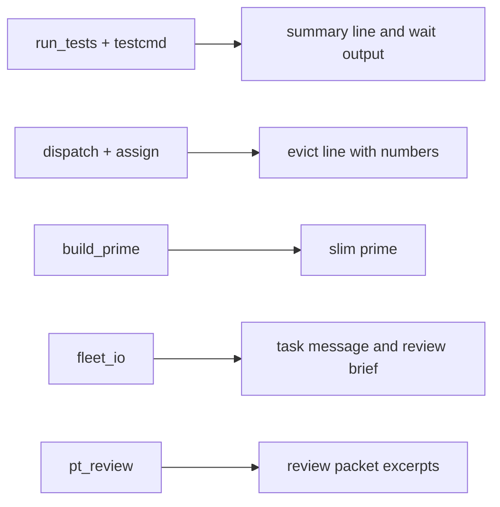
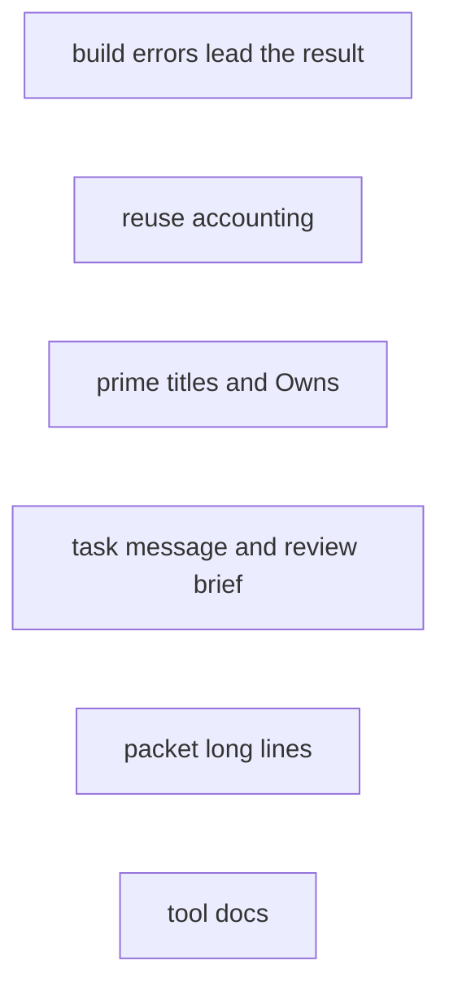

# Superlite: token trims and test-result fixes (#912, #901, #914)

**Goal:** agents get the cause of a red test run in its first line, workers are reused when their context allows it, and superlite's own outputs stop repeating text an agent already holds. Every trimmed output names the command or path that returns the cut part.
**Architecture:** five independent changes in five script files (`testcmd.py` + `run_tests.py`, `assign.py` + `dispatch.py` + `fleet.py`, `build_prime.py`, `fleet_io.py`, `pt_review.py`) and one docs task. No task runs another task's code; there are no taskgraph edges.
**Tech stack:** Python 3.10+ stdlib; pytest through `sl run_tests`.
**Spec:** this file, section Design; issues #912, #901, #914.
**Detail:** contracts
**Target-min:** 11
**Wave0:** none
**Coverage:** off

Global constraints:
- Every script line keeps the repo's `# O(...)` complexity comment; stdlib only; LF endings.
- This repository is public: no host names, user names, home paths, other project or repository names in code, tests, docs or commit messages.
- A trimmed output never drops information silently: it carries one line that names the `sl` command or file path that returns the cut part.
- An existing test that pins a changed output is updated in the same task only when it is in the task's Owns; any other failing test is reported in the task report, never edited.
- The verdict is `sl run_tests` (never raw pytest); new tests see a red run before the code they test.

## Design

Measured in a 26 h trace export (5,728 tool calls, 22.2M chars of tool output): the worker prime is 11.9% of all tool output and 72% of it is the per-task list; 79.8% of a task message is the `Do not touch:` list; 100 of 522 `run_tests` runs reported a compile error as "no tests ran"; `run_tests --wait` printed 141k chars of per-file counts on green runs; seven review packets carried the same 15k-char table rows.

Ruling: the slim prime keeps each stable task's title and Owns and drops `After:`, `Produces:` and `Consumes:` (user decision: the ownership map stays, interfaces come from `sl task Tn`).
Ruling: the haiku prime (`build_mini`) and haiku task messages are unchanged: a mechanical worker gets its whole block in the message and has the weakest lookup habit.
Ruling: `run_tests --wait` keeps JSON on stdout and drops only the `files` map; the summary file on disk is unchanged because the review packet reads it.
Ruling: the `--background` start cue (`WAIT_CUE`) is unchanged: it exists to stop early turn ends and saves little.
Ruling: #901 keeps `max_context_k` 80 and adds no project override: the value is a policy number to measure offline (#915). The limit already counts only what a worker added since READY; this plan fixes what is counted twice and makes the numbers visible.
Ruling: an xcsift summary with `errors` or `linker_errors` above 0 and no `errors` array is a build error, not an empty run: a build that reports errors ran no tests because it failed.
Ruling: Global constraints stay in review and fix briefs; reviewers get them only there.

## Task graph

```mermaid
%% schedule
gantt
  title Predicted schedule (mm:ss)
  dateFormat X
  axisFormat %M:%S
  section lane 1
  T1 Build errors lead the test result :t1, 0, 238s
  section lane 2
  T2 Worker reuse counts context correctly :t2, 0, 232s
  section lane 3
  T5 Review packet clips very long diff li :t5, 0, 195s
  section lane 4
  T3 Prime lists titles and Owns only :t3, 0, 192s
  section lane 5
  T4 Task message and review brief trimmed :t4, 0, 189s
  section lane 6
  T6 Tool docs describe the new outputs :t6, 0, 182s
```

critical path: T1 (4.0 min) · peak width 6 · predicted build 4.0 min · predicted total ≈ 12.5 min (target ✗ 11.0)

## Package: test runner

App type: CLI. Categories: protocol (summary keys and exit codes), state (incident log), encoding (paths and long messages).
**Probe entry:** none (coordinator scripts run on temporary folders; the named tests cover each case)

### T1 Build errors lead the test result · Complexity 5 · Est. context 62k
**Owns:** skills/subagent-driven-development/scripts/testcmd.py, skills/subagent-driven-development/scripts/run_tests.py, tests/scripts/test_run_tests_build_error_912.py, tests/scripts/test_testcmd_counts_481.py, tests/scripts/test_run_tests_fast_mapping_597.py, tests/scripts/test_run_tests_wait_line.py
**Components:** 2
**LOC owned:** 210
**Tests:** fast
**Model:** sonnet
**Kind:** design
**Est. time:** 5 min (2 components, about 210 LOC, fast tests)
**Produces:** testcmd.xcsift_summary(lines: list[str], rc: int) -> dict | None (adds key `errors: list[str]`) · run_tests.summary_line(data: dict) -> str
**Review Focus:** protocol: a compile error gives exit 1, a summary without an `error` key and a first failure that starts `build error:`; state: no `no-result` incident for it; encoding: an error path under the run folder is shown relative, one outside it as given; protocol: a run whose filter matches nothing still says `no tests ran`.
**Steps:** 1 failing tests, 2 run: FAIL, 3 implement, 4 run: PASS
**Notes:** Cause (#912): `testcmd.xcsift_summary` sets `empty` to `xcsift summary: 0 passed, 0 failed tests` whenever no test was counted, also when it read an error; `run_tests.py` `red_empty` then writes the summary with no failures and records a no-result. Contracts:
- `xcsift_summary`: `errors` is up to 5 strings `<file>:<line>: <message>` (message alone without a file) from the `errors` array; `error` stays its first entry. `empty` is `""` when the array holds an entry or `summary.errors` or `summary.linker_errors` is above 0; with counts above 0 and no array, `error` is `xcsift summary: N errors, M linker errors`. `merge_parsed` carries `errors` like `error`.
- `run_tests.py`: `red_empty` is false when `p["error"]` is set (every parser). The xcsift branch adds one failure per entry of `p["errors"]`, at most 3, text `build error: <path>:<line>: <message>` cut to 200 chars, the path relative to the run folder by the same `relative_to` logic the failed-test sites use, placed at its file when `placed()` knows it, else `("-", 0, ...)`; more than 3 errors add a last failure `build error: (+K more)`. The existing insert of `build error: {p['error']}` must not add a second copy of the first error.
- `summary_line`: each of the first 3 failures is shown as `<head>: <reason>`: head is the text before the first `": "` with a leading `-::` removed, cut to 60 chars; reason is the rest cut to 90 chars (no reason: head alone). A head `build error` keeps its whole rest, cut to 140 chars.
- `--wait` stdout: the summary JSON without its `files` key, plus `"summary": "<absolute path of the summary file>"`; stderr lines and the exit code unchanged; the file on disk keeps `files`.
Named tests in `test_run_tests_build_error_912.py` (reuse `BUILD_OBJ`, `ZERO_OBJ`, `dump` and the `_run_cmd_json` pattern of `test_testcmd_counts_481.py`, with a command that prints the JSON and exits 1):
- `test_xcsift_error_is_not_empty`: `xcsift_summary(dump(BUILD_OBJ).splitlines(), 1)` gives `empty == ""`, `error == "/src/App/Foo.swift:10: cannot find 'bar' in scope"`, `errors == [error]`, `counted is False`, `failed == 1`.
- `test_xcsift_error_count_without_array`: `{"status": "failed", "summary": {"errors": 2, "linker_errors": 1, "failed_tests": 0, "passed_tests": 0}}`, rc 1, gives `empty == ""` and `error == "xcsift summary: 2 errors, 1 linker errors"`.
- `test_xcsift_zero_without_errors_stays_empty`: `ZERO_OBJ`, rc 0, gives `empty == "xcsift summary: 0 passed, 0 failed tests"`.
- `test_build_error_run_is_red_not_no_result`: the run exits 1; the summary has `failed == 1`, no `error` key, `failures[0] == "-::build error: /src/App/Foo.swift:10: cannot find 'bar' in scope"`; `.superlite/incidents.jsonl` is absent or holds no line with kind `no-result`.
- `test_build_error_path_is_relative`: an error whose file is `<tmp>/Tests/AppTests/FooTests.swift`, line 44, message `missing arguments` gives a failure that ends `build error: Tests/AppTests/FooTests.swift:44: missing arguments`.
- `test_five_errors_list_three_and_the_rest`: five errors give failures 1 to 3 starting `build error: ` and a fourth equal to `-::build error: (+2 more)`.
- `test_plain_error_line_beats_no_tests_line`: plain output `a.swift:3: error: x` plus a runner "no tests" line, exit 1, gives a red run whose first failure starts `-::build error:` and no `no tests ran` error.
- `test_empty_filter_still_no_tests_ran`: `ZERO_OBJ` with exit 1 keeps `error` starting `no tests ran:`.
- `test_summary_line_shows_the_build_error`: `summary_line({"mode": "fast", "passed": 0, "failed": 1, "failures": ["-::build error: Tests/A.swift:44: missing arguments"]}) == "tests (fast): 0 passed, 1 failed; failing: build error: Tests/A.swift:44: missing arguments"`.
- `test_summary_line_shows_the_assertion`: failures `["tests/test_a.py::test_x: assert 1 == 2"]` give `...; failing: tests/test_a.py::test_x: assert 1 == 2`.
- `test_wait_stdout_drops_files`: a finished summary with `"files": {"a.py": [1, 0]}`: `--wait` stdout parses as JSON, has no `files`, has `summary` equal to the file's absolute path; the file still holds `files`.

## Package: dispatch

App type: CLI. Categories: numeric (context sums), state (pool entries across rounds).
**Probe entry:** none (reads a pool and a plan from a temporary folder; the named tests cover each case)

### T2 Worker reuse counts context correctly · Complexity 5 · Est. context 58k
**Owns:** skills/subagent-driven-development/scripts/assign.py, skills/subagent-driven-development/scripts/dispatch.py, skills/subagent-driven-development/scripts/fleet.py, tests/scripts/test_reuse_accounting_901.py, tests/scripts/test_dispatch_evict.py, tests/scripts/test_dispatch_prime_budget.py, tests/scripts/test_fleet_dispatch_round.py, tests/scripts/test_fleet_evict_dropped_424.py, tests/scripts/test_pool_baseline_455.py, tests/scripts/test_pool_inprocess_baseline_675.py, tests/scripts/test_routing.py
**Components:** 2
**LOC owned:** 170
**Tests:** fast
**Model:** sonnet
**Kind:** design
**Est. time:** 4.5 min (2 components, about 170 LOC, fast tests)
**Produces:** assign.eligibility(agent: dict, est_context: float, limits: dict | None = None, prime_k: float = 0.0, reuse_prefix_k: float = 0.0) -> str | None · assign.context_note(agent: dict, est_context: float, prime_k: float = 0.0, reuse_prefix_k: float = 0.0) -> str
**Review Focus:** numeric: the fixed prefix is subtracted once per batch member that has an estimate and never below 0; numeric: a task without `Est. context` keeps the 20k default untouched; state: the evict reason names held, READY and next values of the line that set the reason; state: a worker started under a run-config model pin is offered a second task of its tier.
**Steps:** 1 failing tests, 2 run: FAIL, 3 implement, 4 run: PASS
**Notes:** Background (#901): `eligibility` already counts `context_k - baseline_k` (what the worker added since READY). Still wrong: a task's `Est. context` holds the predictor's fixed prefix (`context.prefix` in `config/predictor.json`, 18000 tokens) that a running worker already holds inside its baseline, so reuse counts it twice; the evict line hides its numbers; a missing baseline silently falls back to the prime's size. Contracts:
- `eligibility`: the context check is `max(0, context_k - base) + max(0, est_context - reuse_prefix_k) > max_context_k`; reason strings unchanged.
- `context_note`: `"held 96k, at READY 55k, next 20k"` for `({"context_k": 96, "baseline_k": 55}, 38, 7, 18)`; without `baseline_k`: `"held 96k, at READY unknown (prime 7k used), next 20k"`. Numbers print with `:g` after rounding to whole k.
- `dispatch.plan_dispatch`: `reuse_prefix_k` is the predictor prefix / 1000 times the number of batch members that have an `est_context` (members on the 20k default add none), read through the loader `predict.py` already uses; a `context over` reason stored for an agent becomes `context over 80k (<context_note>)`. Fresh-worker batch packing is unchanged.
- `fleet.py`: a worker whose model comes from the run config's `workers[role]` pin is registered in the pool under its routing tier (`sonnet` or `haiku`), not under the pinned model string. Write the failing test first; if it passes without a change, keep the test, change nothing and say so in the report.
Named tests in `test_reuse_accounting_901.py`:
- `test_reuse_counts_the_prefix_once`: agent `{"context_k": 75, "baseline_k": 30, "tasks": ["T1"], "idle_min": 0}`, estimate 38, limits `{"max_context_k": 80, "max_tasks": 20, "max_idle_min": 50}`: `"context over 80k"` with `reuse_prefix_k=0`, `None` with `reuse_prefix_k=18`.
- `test_reuse_prefix_never_goes_negative`: estimate 10 with `reuse_prefix_k=18` counts 0 for the next task.
- `test_context_note_with_and_without_baseline`: the two strings above.
- `test_evict_line_carries_the_numbers`: a pool agent with `context_k` 190, `baseline_k` 30 and one ready task of estimate 38: `dispatch` stderr holds `evict=A1 context over 80k (held 190k, at READY 30k, next 20k)`.
- `test_default_estimate_keeps_its_prefix`: a ready task without `Est. context` and an agent that added 62k is evicted (62 + 20 > 80).
- `test_pinned_model_worker_registers_under_its_tier`: a spawn under a run config with `workers.implementer` set to `sonnet-pinned` leaves a pool entry whose tier is `sonnet`.

## Package: prime and briefs

App type: file generator. Categories: file (generated text), encoding (long lines), state (stable set).
**Probe entry:** none (generators run on plan fixtures; the named tests cover each case)

### T3 Prime lists titles and Owns only · Complexity 3 · Est. context 46k
**Owns:** skills/subagent-driven-development/scripts/build_prime.py, tests/scripts/test_prime_trim_914.py, tests/scripts/test_slim_prime.py, tests/scripts/test_build_prime_launch_601.py, tests/scripts/test_build_prime_both_tiers_735.py, tests/scripts/test_build_prime_stub_root.py, tests/scripts/test_prime_standing_note_738.py
**Components:** 1
**LOC owned:** 120
**Tests:** fast
**Model:** sonnet
**Kind:** design
**Est. time:** 3.5 min (1 component, about 120 LOC, fast tests)
**Produces:** build_prime.build_slim(plan, sd=None) -> bytes · build_prime.note_section(sd, skip=()) -> str
**Review Focus:** file: the slim prime of a plan with Produces and Consumes holds no line starting `After:`, `Produces:` or `Consumes:` below the task heading; file: the haiku prime of the same plan still holds its `Produces:` lines; state: a draft or unstable task stays out, as today.
**Steps:** 1 failing tests, 2 run: FAIL, 3 implement, 4 run: PASS
**Notes:** Contracts:
- `build_slim`: per stable task exactly `### Tn <title>` and `Owns: a, b`. The section heading is `## Stable tasks: titles and files`, followed by: `Only the tasks listed here are fixed. A task's text, its dependencies and the Produces lines it consumes come from `sl task Tn` (any task id, not only yours).`
- `PREAMBLE_SLIM`: the rule `Code to the interfaces below and the Consumes and Produces lines of your task.` becomes `Code to the Consumes and Produces lines of your task (`sl task Tn` prints them).`; the next line about signatures stays.
- `note_section(sd, skip)`: drops a standing-note line equal, after `strip()`, to a line in `skip`; returns `""` when none is left. `build_slim` passes the Global constraints lines it prints. Check every other caller of `note_section` and keep its output unchanged.
- `build_mini` is unchanged.
- Search `skills/subagent-driven-development/scripts/` for the old heading text `purpose, dependencies, interfaces`; a script outside Owns that parses it is reported, not edited.
Named tests in `test_prime_trim_914.py` (plan fixtures as `test_slim_prime.py` builds them):
- `test_slim_prime_lists_title_and_owns_only`: a plan with T1 (Produces `a.f() -> int`) and T2 (Consumes it, edge T1 --> T2): the slim prime holds `### T1 `, `Owns: ` for both, and none of `After: T1`, `Produces: a.f() -> int`, `Consumes: a.f() -> int`.
- `test_slim_prime_points_at_sl_task`: the text holds `## Stable tasks: titles and files` and `(any task id, not only yours)`.
- `test_slim_prime_is_smaller`: for that plan `len(new slim prime)` is below the length of the same text with the three dropped line kinds added back.
- `test_haiku_prime_keeps_interfaces`: `build_mini` output for a haiku task still holds its `Produces:` line.
- `test_standing_note_not_printed_twice`: a standing note line that equals a Global constraints line appears once in the prime; a note with no line left prints no `## Standing note` heading.
- `test_standing_note_other_lines_stay`: a note line not in the constraints stays under `## Standing note`.

### T4 Task message and review brief trimmed · Complexity 3 · Est. context 44k
**Owns:** skills/subagent-driven-development/scripts/fleet_io.py, tests/scripts/test_brief_trims_914.py, tests/scripts/test_fleet_io.py, tests/scripts/test_fleet_owns_research_b54.py, tests/scripts/test_task_also_edit_745.py, tests/scripts/test_fleet_io_review_422.py
**Components:** 1
**LOC owned:** 100
**Tests:** fast
**Model:** sonnet
**Kind:** design
**Est. time:** 3 min (1 component, about 100 LOC, fast tests)
**Produces:** fleet_io.task_message(...) -> str (same parameters as today)
**Review Focus:** file: a sonnet task message of a 30-task plan holds no other task's file path; file: a haiku task message still lists them; file: the review brief names each file in scope once.
**Steps:** 1 failing tests, 2 run: FAIL, 3 implement, 4 run: PASS
**Notes:** Contracts:
- `task_message`, tier other than `haiku`, other tasks own files: the line is `Do not touch: any other file (N files belong to other tasks; the prime's task list names their owners)` with N the count of the list it replaces. No other owned file: `Do not touch: (nothing else is owned)` as today. Tier `haiku`: the full list as today. The `Owns:` and Also-touches lines are unchanged.
- Review brief: `Files in scope: a, b` stays; the next heading becomes ``Incident hotspots (`<sl> incident hotspots --files <the files in scope, comma-joined>`):`` with the literal text in angle brackets, so the list is printed once. The hotspot output below it is unchanged.
Named tests in `test_brief_trims_914.py` (plan fixtures as `test_fleet_io.py` builds them):
- `test_task_message_counts_other_files`: T1 owns `a.py`; T2 and T3 own `b.py`, `c.py`, `d.py`: the sonnet message for T1 holds `Do not touch: any other file (3 files belong to other tasks; the prime's task list names their owners)` and none of `b.py`, `c.py`, `d.py`.
- `test_task_message_haiku_keeps_the_list`: the same plan, tier `haiku`: the line is `Do not touch: b.py, c.py, d.py`.
- `test_task_message_alone_unchanged`: a one-task plan gives `Do not touch: (nothing else is owned)`.
- `test_review_brief_lists_files_once`: a review brief for T2 holds `b.py` exactly once outside the hotspot output and the heading text `--files <the files in scope, comma-joined>`.

### T5 Review packet clips very long diff lines · Complexity 4 · Est. context 50k
**Owns:** skills/subagent-driven-development/scripts/pt_review.py, tests/scripts/test_packet_long_lines_914.py
**Components:** 1
**LOC owned:** 140
**Tests:** fast
**Model:** sonnet
**Kind:** design
**Est. time:** 4 min (1 component, about 140 LOC, fast tests)
**Produces:** pt_review.clip_diff_lines(lines: list[str], cap: int = 400, ctx: int = 120) -> list[str]
**Review Focus:** encoding: a 15,000-char line pair with one changed word shows that word in both lines; encoding: the first differing column is right when the lines differ in length; file: lines at or under the cap are returned as the same objects; file: `+++`, `---` and `@@` lines are never clipped or paired.
**Steps:** 1 failing tests, 2 run: FAIL, 3 implement, 4 run: PASS
**Notes:** A review packet's excerpt section printed a two-word change inside 15k-char table rows in full. Contracts:
- A line of at most `cap` chars is unchanged. Header lines (`+++ `, `--- `, `@@`) are unchanged whatever their length.
- A `-` line directly followed by a `+` line, at least one over `cap`: both become their marker char, `…`, the differing span with `ctx` chars before and after (the span is what remains after the common prefix and common suffix of the two bodies; a span over `cap` chars is cut to its first `cap`), `…`, then ` [line of N chars, changed at col C; read the file for the rest]` with N the body length and C the 1-based first differing column.
- Any other line over `cap`: its first `cap` chars, then ` [+N chars; read the file for the rest]`.
- The function that collects the per-file diff lines for the excerpt section passes every file's lines through `clip_diff_lines` before the excerpt budget is computed, so `excerpt_need` counts the clipped size.
Named tests in `test_packet_long_lines_914.py`:
- `test_short_lines_unchanged`: `clip_diff_lines(["+a", " b", "-c"]) == ["+a", " b", "-c"]`.
- `test_pair_shows_the_changed_word`: bodies of 15,000 chars equal but for `old` against `new` at column 7001: both results are under 800 chars, hold `old` and `new` respectively, and end `[line of 15000 chars, changed at col 7001; read the file for the rest]`.
- `test_pair_of_different_lengths`: `-` body `"x" * 500` and `+` body `"x" * 500 + "tail"` give `changed at col 501` on both.
- `test_lone_long_line_keeps_its_head`: `"+" + "y" * 1000` gives `"+" + "y" * 399` then ` [+601 chars; read the file for the rest]` (cap counts the marker char).
- `test_headers_never_clipped`: a 600-char `+++ b/<path>` line is unchanged and is not paired with a `---` line.
- `test_excerpts_use_clipped_lines`: a git fixture whose one change sits in a 15,000-char row gives an excerpt section under 2,500 chars that holds `read the file for the rest`.

## Package: docs

App type: file generator. Categories: file.
**Probe entry:** none (documentation)

### T6 Tool docs describe the new outputs · Complexity 2 · Est. context 40k
**Owns:** docs/tools.md, tests/scripts/test_docs_token_trims_914.py
**Components:** 1
**LOC owned:** 50
**Tests:** fast
**Model:** sonnet
**Kind:** design
**Est. time:** 2.5 min (1 component, about 50 LOC, fast tests)
**Review Focus:** file: every existing docs test for `docs/tools.md` stays green (rows are edited by adding sentences, never by reordering or removing text other tests pin).
**Steps:** 1 failing test, 2 run: FAIL, 3 edit, 4 run: PASS
**Notes:** Add one sentence each, from the contracts of T1 to T5 in this plan (do not wait for their code): the `run_tests` row (a compile error leads the result as `build error: <file>:<line>: <message>` and is no no-result; `--wait` prints the summary without `files` and names the summary file), the `build_prime` row (the slim prime lists each stable task's title and Owns; `sl task Tn` prints interfaces), the `dispatch` row (the evict line shows `held`, `at READY` and `next`; a reused worker's next task counts without the fixed prefix), the fleet row that describes the task message (`Do not touch:` is one line for sonnet workers) and the packet row (diff lines over 400 chars show the changed span). Named test `test_tools_md_names_the_trims` in `test_docs_token_trims_914.py`: `docs/tools.md` holds each of `build error: <file>:<line>: <message>`, `titles and files`, `at READY`, `any other file` and `read the file for the rest`.

## Review Focus

- Test runner (CLI): protocol, state, encoding. Risks: a real empty filter misread as a build error; a second copy of the first error; a no-result incident still logged.
- Dispatch (CLI): numeric, state. Risks: the prefix subtracted for a default estimate; a batch counted as one member.
- Prime and briefs (file generator): file, encoding, state. Risks: the haiku forms changed by accident; an off-by-one column in a clipped pair; a parser of the old prime heading.
- Docs: file.

## Self-review

Coverage: #912 T1; #901 T2; #914 prime T3, task message and review brief T4, packet T5, wait output T1; docs T6. No two tasks share a file. No edges: no task's tests run another task's code.
