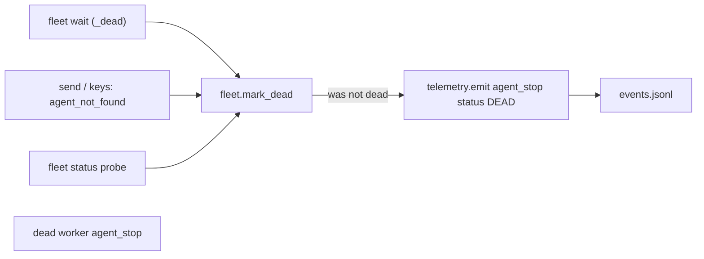

# Superlite: a DEAD fleet worker emits agent_stop status DEAD (#937)

**Goal:** when superlite marks a fleet worker dead (its agent is gone), `<superlite home>/events.jsonl` gets exactly one `agent_stop` line with `status: "DEAD"`, filled like the `agent_stop` line `fleet wait` writes at a worker's report; `docs/telemetry.md` names `DEAD` among the `agent_stop` statuses.
**Architecture:** `fleet.mark_dead(sd, wid)` is the one place the dead state is set (callers: `fleet_io._dead` in `fleet wait`, the send/keys `agent_not_found` path in `fleet_io.main`, the `fleet status` probe in `fleet.main`). It emits the line after the lock is released, only on the transition from not dead to dead.
**Tech stack:** Python 3.10+ stdlib; pytest through `sl run_tests`.
**Spec:** issue #937 and this file, section Design; contract C6 of the agent telemetry design (kept by main).
**Detail:** tests
**Target-min:** 11
**Wave0:** none
**Coverage:** off (bounded: one emit at an existing state change, no new field or kind)

Global constraints:
- Standing note from main (binding): Agent telemetry program (14 issues in dashmax, max-core, superlite, maxnet-services, dotfiles), run by one main session as AI orchestrator. Binding spec: ~/github/dashmax/docs/superpowers/specs/2026-11-16-agent-telemetry-design.md (sections 4-11, contract 6a, your issue's row in 12). Mockups and Max's picks: https://claude.ai/code/artifact/e51150a0-6232-426f-9960-9df41cf9a235. The contract (section 6a) is shared by five repositories: never rename, retype or drop a field. A gap or conflict in it is a question to main (NEEDS_DECISION), not a local change; adding an optional field is allowed and goes into your PR body. Other units build in parallel against the contract examples; do not wait for them. Test against fixtures and the contract, never against another repository's unmerged code. Producers fail open; no prompts, responses or file contents in any ledger; secrets only via `secret get`. Max pre-approved merging, deploying (dashmax deploy.sh, maxnet-services stack deploys) and patch releases for this program. Put every follow-up for another repository into your notes as `Follow-up: other repository <name>: ...`.
- Builds: the verdict is `sl run_tests` (the project's test command; a project with `.maxapp` runs `maxapp test`, which a build pool may place on another Mac, and a full run whose tree a green maxapp test stamp covers returns that result without a run); task trees build in <tree>/.build/DerivedData and any build of your own goes under .build/ of the worktree, never -derivedDataPath outside the worktree (your session scratchpad included; backlog cleanup removes scratchpad build folders when the worktree goes); a product, simulator or device build stays on this machine and runs only when an issue's acceptance asks for a running-app check.
- Simulators: append the UDID of each simulator you or a worker creates (`xcrun simctl create` or `clone`; a checker's `Simulators:` line marks its created ones) as one line to /Users/max/github/superlite/.claude/worktrees/superlite-b235-telemetry-a-dead-fleet-worker-emits/.superlite/simulators.txt; never list one you did not create.
- Every Python script line keeps the repo's `# O(...)` complexity comment; stdlib only; LF endings. This repository is public: no host names, user names or home paths in code, tests, docs or commit messages.
- No new kind and no new field: the line uses `telemetry.KINDS["agent_stop"]` as it is. A telemetry failure (SystemExit too) never changes `mark_dead`'s state change, output or exit. Every test that asserts an emitted line is named `test_kind_<kind>_<case>` and checks it with `telemetry.validate(line) == []`.
- An existing test that pins a changed output is updated only when it is in the task's Owns; any other failing test is reported, never edited. New tests see a red run before the code they test.

## Design

What #937 asks: dashmax's alert `maxnet-agents-batch-parked` counts `superlite_agent` points with status `DEAD`, but superlite writes no line when it marks a fleet worker dead. Done when a test shows that marking a worker dead writes exactly one such line and the full suite is green.

- `fleet.mark_dead(sd, wid)` keeps its state change. Inside the lock it remembers whether the worker was already dead and a copy of the record before the update. After the lock, when the worker was not dead before, it calls `_tel_dead(sd, before)`.
- `fleet._tel_dead(sd, w)` (never raises): `telemetry.emit("agent_stop", sd=sd, task=<the T-id at the start of w["task"], else None>, role=w["role"] or "implementer", model=w["model"] or w["tier"], effort=None, account=w["account"], machine=w["machine"] or None, duration_s=<round((fleet_io.now_ms() - w["sent"]) / 1000, 1) when w["state"] was "busy" and w["sent"] is set, else None>, tokens=None, cost_usd=None, tool_calls=None, status="DEAD")`. `telemetry` and `fleet_io` are imported lazily inside the `try` (fleet_io's `now_ms` is the clock `sent` was written with); `writer_role` and the common fields come from `telemetry.emit` as on every line. No `review` line for a dead reviewer.
- `docs/telemetry.md`: the `agent_stop` row's Writer cell names all three writers, and a sentence after the Kinds table names the status words, `DEAD` included.

Ruling: one emit in `mark_dead` on the not-dead to dead transition (because all three DEAD sites call it, and a second `mark_dead` of the same worker must not add a line; cost if wrong: one call per site).
Ruling: the DEAD line has `tokens`, `cost_usd`, `tool_calls` and `effort` null and `duration_s` only for a busy worker (because a gone agent leaves no report and no stop record to read usage from; cost if wrong: one transcript read).
Ruling: no new field: the common `worker` stays the writer's `$SUPERLITE_FLEET_WORKER` (C0) and the batch is reached through `run`, as on the report-time `agent_stop` line (because C6 forbids retyping `worker` and that line carries no batch either; cost if wrong: one optional field).
Ruling: an idle (ready) worker found dead by `fleet status` writes the line too, with `task` and `duration_s` null (because the issue asks for a line wherever the DEAD state is set).
Ruling: MISSED TARGET accepted (because the plan is one task, so the critical path is that task; cost if wrong: none).

```mermaid
%% schedule
gantt
  title Predicted schedule (mm:ss)
  dateFormat X
  axisFormat %M:%S
  section lane 1
  T1 dead worker agent_stop :t1, 0, 291s
```





critical path: T1 (4.9 min) · peak width 1 · predicted build 4.9 min · predicted total ≈ 15.4 min (target ✗ 11.0)

## File structure

- `skills/subagent-driven-development/scripts/fleet.py`: `mark_dead` emits through the new `_tel_dead` (T1).
- `docs/telemetry.md`: `agent_stop` Writer cell and the status sentence (T1).
- `tests/scripts/test_telemetry_dead_937.py`: the new tests (T1).

## Sections

### Fleet dead-worker telemetry

**Probe entry:** none (a state change in a fleet state folder plus a line in the telemetry home; its cases are named tests in T1)

### T1 dead worker agent_stop · Complexity 2 · Est. context 40k
**Owns:** skills/subagent-driven-development/scripts/fleet.py, docs/telemetry.md, tests/scripts/test_telemetry_dead_937.py
**Components:** 1
**LOC owned:** 110
**Tests:** fast
**Model:** sonnet
**Kind:** design
**Covers:** Design
**Produces:** fleet.mark_dead(sd: Path, wid: str) -> None
**Review Focus:** state: `test_kind_agent_stop_dead_once` (a second `mark_dead` adds no line); state: `test_kind_agent_stop_dead_in_wait` (the wait path's one line with the worker's fields); file: `test_mark_dead_fails_open` (a raising `telemetry.emit` still marks the worker dead); file: `test_kind_agent_stop_dead_off_switch`
**Test code (verbatim):**
```python
# tests/scripts/test_telemetry_dead_937.py: a fleet worker marked DEAD writes one agent_stop line with status DEAD (#937)
import json, sys
from test_fleet_io import world, FakeHerdr  # noqa: F401
from test_plan_tools import SCRIPTS
sys.path.insert(0, str(SCRIPTS))
import fleet  # noqa: E402
import fleet_io as io  # noqa: E402
import telemetry  # noqa: E402


def lines(kind): return [e for e in telemetry.read_events() if e["kind"] == kind]


def fj(w): return json.loads((w.sd / "fleet.json").read_text())["workers"]


def set_worker(w, wid, **kw):
    d = json.loads((w.sd / "fleet.json").read_text()); d["workers"][wid].update(kw)
    (w.sd / "fleet.json").write_text(json.dumps(d))


def test_kind_agent_stop_dead_in_wait(world):
    io.send(world.sd, world.plan, "W1", ["T3"], "/sl/sl", "/sl")
    sent = world.clock.t[0]
    world.fh.states = [{"sl-proj-w2": "working"}]; world.fh.gone = {"sl-proj-w1"}
    out = io.wait(world.sd, ["W1"], 60000)
    assert [r["status"] for r in out] == ["DEAD"]
    (e,) = lines("agent_stop")
    assert telemetry.validate(e) == []
    assert (e["status"], e["task"], e["role"], e["model"], e["account"], e["machine"], e["effort"]) == \
        ("DEAD", "T3", "implementer", "sonnet", "claude1", None, None)
    assert (e["tokens"], e["cost_usd"], e["tool_calls"]) == (None, None, None)
    assert 0 <= e["duration_s"] <= round((world.clock.t[0] - sent) / 1000, 1)
    assert lines("review") == []


def test_kind_agent_stop_dead_once(world):
    set_worker(world, "W1", state="busy", task="T4", sent=world.clock.t[0])
    fleet.mark_dead(world.sd, "W1")
    fleet.mark_dead(world.sd, "W1")
    assert fj(world)["W1"]["dead"] is True
    (e,) = lines("agent_stop")
    assert telemetry.validate(e) == [] and (e["status"], e["task"], e["duration_s"]) == ("DEAD", "T4", 0.0)


def test_kind_agent_stop_dead_idle_worker(world):
    set_worker(world, "W2", role="research", last_task="R1")
    fleet.mark_dead(world.sd, "W2")
    (e,) = lines("agent_stop")
    assert telemetry.validate(e) == []
    assert (e["status"], e["role"], e["task"], e["duration_s"], e["model"]) == ("DEAD", "research", None, None, "sonnet")


def test_kind_agent_stop_dead_reviewer_writes_no_review(world):
    set_worker(world, "W1", role="final-reviewer", state="busy", task="FR2", sent=world.clock.t[0] - 3000)
    fleet.mark_dead(world.sd, "W1")
    (e,) = lines("agent_stop")
    assert telemetry.validate(e) == []
    assert (e["status"], e["role"], e["task"], e["duration_s"]) == ("DEAD", "final-reviewer", None, 3.0)
    assert lines("review") == []


def test_kind_agent_stop_dead_send_not_found(world, capsys):
    def gone(name, text, until, timeout_ms): raise world.fh.HerdrError("agent_not_found", "gone")
    world.fh.prompt = gone
    assert io.main(["send", "W1", "--text", "hi"]) == 2
    assert fj(world)["W1"]["dead"] is True
    (e,) = lines("agent_stop")
    assert telemetry.validate(e) == [] and e["status"] == "DEAD" and e["role"] == "implementer"


def test_kind_agent_stop_dead_unknown_worker_writes_nothing(world):
    fleet.mark_dead(world.sd, "W9")
    assert lines("agent_stop") == []


def test_mark_dead_fails_open(world, monkeypatch):
    def boom(*a, **k): raise SystemExit(3)
    monkeypatch.setattr(telemetry, "emit", boom)
    fleet.mark_dead(world.sd, "W1")
    assert fj(world)["W1"]["state"] == "stopped" and fj(world)["W1"]["dead"] is True


def test_kind_agent_stop_dead_off_switch(world, monkeypatch):
    monkeypatch.setenv("SUPERLITE_TELEMETRY", "0")
    fleet.mark_dead(world.sd, "W1")
    assert fj(world)["W1"]["dead"] is True
    assert lines("agent_stop") == []


def test_docs_name_dead_status():
    doc = (SCRIPTS.parents[2] / "docs" / "telemetry.md").read_text(encoding="utf-8")
    assert "`DEAD` when superlite marks a fleet worker dead" in doc
    row = next(l for l in doc.splitlines() if l.startswith("| `agent_stop` |"))
    assert "`fleet_io.py`" in row and "`fleet.py`" in row
```
**Steps:** 1 write the test file, 2 run it: FAIL, 3 implement `_tel_dead` and the `mark_dead` change, then the docs, 4 run it: PASS, then the telemetry and fleet test files.
**Notes:** the docs sentence goes right after the Kinds table, before `Example:`, and reads: "`agent_stop` `status` is the status word of the agent's report (`DONE`, `DONE_WITH_CONCERNS`, `NEEDS_CONTEXT`, `BLOCKED`, `UNKNOWN`, a reviewer's verdict), or `DEAD` when superlite marks a fleet worker dead (its agent is gone: `fleet wait`, a refused send or keys, `fleet status`); a `DEAD` line has `effort`, `tokens`, `cost_usd` and `tool_calls` null and `duration_s` only for a worker that was busy." The `agent_stop` row's Writer cell becomes: "hook `capture-agent-stop` (one Python call); `fleet_io.py` at a fleet worker's report; `fleet.py` when a fleet worker is marked dead". Keep the Fields cell unchanged (`test_telemetry_docs_933.py` parses it). `fleet.py` already imports `re`.

## Review Focus

- state: one line per death, never two (`test_kind_agent_stop_dead_once`); the wait path's fields match the report-time line (`test_kind_agent_stop_dead_in_wait`).
- file: fail open and off switch (`test_mark_dead_fails_open`, `test_kind_agent_stop_dead_off_switch`).

## Running-app checks

None: no UI, widget, extension or browser target.

## Self-review

Coverage: the issue's two changes and its acceptance test map to T1. No placeholders. One task, no edges, no shared files. Fields filled. Schedule and lint run after this write.
