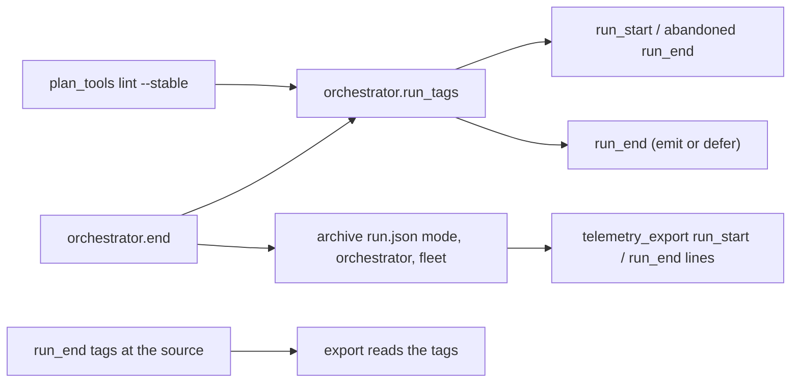

# Superlite: run_end carries mode, orchestrator and fleet (#935)

**Goal:** every `run_end` line in `<superlite home>/events.jsonl` carries `mode`, `orchestrator` and `fleet` as of the run's end, from the same source `run_start` uses; `sl telemetry export --since` writes them on exported `run_end` (and `run_start`) lines; `docs/telemetry.md` lists them.
**Architecture:** one shared reader `orchestrator.run_tags(sd, session)` gives the three values of a run folder; `plan_tools` (run_start, abandoned run_end) and `orchestrator.end` (run_end, emitted or deferred) call it; `end` also writes the three values into the archive's `run.json`, which the export reads.
**Tech stack:** Python 3.10+ stdlib; pytest through `sl run_tests`.
**Spec:** issue #935 and this file, section Design; contract C6 of the agent telemetry design (kept by main).
**Detail:** tests
**Target-min:** 11
**Wave0:** none
**Coverage:** off (bounded: two optional fields added to one existing kind on an existing flow)
**Max chars:** 23000

Global constraints:
- Standing note from main (binding): contract C6 is shared by five repositories: never rename, retype or drop a field; a gap or conflict in it is a question to the coordinator (NEEDS_DECISION), not a local change; adding an optional field is allowed and is named in your report. Producers fail open; no prompts, responses or file contents in any ledger; secrets only via `secret get`. Test against fixtures and the contract, never against another repository's unmerged code. Every follow-up for another repository goes into your report as `Follow-up: other repository <name>: ...`.
- Builds: the verdict is `sl run_tests` (the project's test command; a project with `.maxapp` runs `maxapp test`, which a build pool may place on another Mac, and a full run whose tree a green maxapp test stamp covers returns that result without a run); task trees build in <tree>/.build/DerivedData and any build of your own goes under .build/ of the worktree, never -derivedDataPath outside the worktree (your session scratchpad included; backlog cleanup removes scratchpad build folders when the worktree goes); a product, simulator or device build stays on this machine and runs only when an issue's acceptance asks for a running-app check.
- Simulators: append the UDID of each simulator you create (`xcrun simctl create` or `clone`) as one line to the run's `.superlite/simulators.txt`; never list one you did not create.
- Every Python script line keeps the repo's `# O(...)` complexity comment; stdlib only; LF endings. This repository is public: no host names, user names or home paths in code, tests, docs or commit messages.
- The three values: `mode` a mode word or null; `orchestrator` `ai`, `human` or null; `fleet` a bool (the same type `run_start` writes, from `fleet_state.is_on`) or null when its source failed. They are added as the last three fields of `telemetry.KINDS["run_end"]`, after `reason`; no other kind changes.
- A telemetry failure never changes a lint, an `end`, an export or their output. Every test that asserts an emitted line is named `test_kind_<kind>_<case>` and checks it with `telemetry.validate(line) == []`.
- An existing test that pins a changed output is updated only when it is in the task's Owns; any other failing test is reported, never edited. New tests see a red run before the code they test.

## Design

What #935 asks: C6 lists `mode`, `orchestrator`, `fleet` only on `run_start`, so a run whose `run_start` predates the shipper's window (or a backfill slice) loses them. Add them to `run_end` (optional added fields), to exported `run_end` lines, and to the docs. Done when a test shows a run's `run_end` line with the three fields and the full suite is green.

- `orchestrator.run_tags(sd, session=None)` returns `{"mode", "orchestrator", "fleet"}`. `mode`: `"backlog"` when `lead_batch(sd)` names a batch (the folder's `briefs/lead.md`), else `telemetry.session_mode(session)`, else `"backlog"` when `$SUPERLITE_FLEET_ROLE` is `lead`, else None. `orchestrator`: `read_state(sd)["mode"]` or None. `fleet`: `fleet_state.is_on(sd)`. Each of the three is read in its own `try`; a failing one is None.
- `run_start` (`plan_tools._telemetry_run_start`) takes its three values from `run_tags(sl_dir, sid)` instead of computing them itself.
- The abandoned `run_end` (`plan_tools._telemetry_run`) adds `run_tags(sl_dir, owner)` (the old run's session); a failure there gives no tags and changes nothing else.
- `orchestrator._run_end_fields` adds `run_tags(sd, <stable.json run_session or None>)`, read before stable.json moves; the deferred path stores them with the other fields, so the line written at ship time has them. `end` copies the three values into the archive's `run.json` (keys `mode`, `orchestrator`, `fleet`).
- Export (`telemetry_export._archive`): `run_start` and `run_end` lines take `mode` from `run.json` `mode` (a non-empty string), else `"backlog"` when `run.json` names a `batch`, else None; `orchestrator` when it is `ai` or `human`, else None; `fleet` when it is a bool, else None.

Ruling: `fleet` on `run_end` is a bool like on `run_start`, not the words `on`/`off` of the issue text (because C6 forbids retyping and the agentops parser maps the bool to the `on`/`off` tag; cost if wrong: one parser line).
Ruling: adjacent fix: a lead run's mode is `backlog` on `run_start` too (because a lead calls brainstorming, which records `regular` for its session, so `run_start` of every default-text lead said `regular`; cost if wrong: one precedence line).
Ruling: exported `run_start` lines get the three values as well, from the same `run.json` keys (because they come free with the reader and a backfill slice may hold only the start; cost if wrong: none).
Ruling: MISSED TARGET accepted: T1 → T2 is a two-task chain because T2's tests execute T1's `KINDS["run_end"]` (because a stub of a constant table is the change itself; cost if wrong: a few minutes of wall time).
Ruling: an archive written before this change yields `backlog` when `run.json` names a batch and null otherwise (because every batch archive is a lead run; orchestrator and fleet were never archived).

```mermaid
%% schedule
gantt
  title Predicted schedule (mm:ss)
  dateFormat X
  axisFormat %M:%S
  section lane 1
  T1 run_end tags at the source :t1, 0, 417s
  T2 export reads the tags :t2, 417, 370s
```





critical path: T1 → T2 (13.1 min) · peak width 1 · predicted build 13.1 min · predicted total ≈ 25.6 min (target ✗ 11.0)

## File structure

- `skills/subagent-driven-development/scripts/telemetry.py`: `KINDS["run_end"]` gains the three fields (T1).
- `skills/subagent-driven-development/scripts/orchestrator.py`: `run_tags`, `_run_end_fields`, `end` manifest keys (T1).
- `skills/subagent-driven-development/scripts/plan_tools.py`: `_telemetry_run_start` and `_telemetry_run` use `run_tags` (T1).
- `docs/telemetry.md`: the `run_end` row, the added-fields sentence, run end and export notes (T1).
- `skills/subagent-driven-development/scripts/telemetry_export.py`: `_archive` reads the three keys (T2).
- `tests/scripts/test_telemetry_run_end_935.py` (T1), `tests/scripts/test_telemetry_export_935.py` (T2), `tests/scripts/test_telemetry_export_933.py` (T2: one pinned assertion).

## Sections

### Telemetry run tags

**Probe entry:** none (reads files of a run folder and the telemetry home; its cases are named tests in T1 and T2)

### T1 run_end tags at the source · Complexity 3 · Est. context 48k
**Owns:** skills/subagent-driven-development/scripts/telemetry.py, skills/subagent-driven-development/scripts/orchestrator.py, skills/subagent-driven-development/scripts/plan_tools.py, docs/telemetry.md, tests/scripts/test_telemetry_run_end_935.py
**Components:** 2
**LOC owned:** 190
**Tests:** fast
**Model:** sonnet
**Kind:** design
**Covers:** Design
**Produces:** telemetry.KINDS: dict[str, tuple[str, ...]] · orchestrator.run_tags(sd: Path, session: str | None = None) -> dict
  e.g. telemetry.KINDS["run_end"][-4:] -> ("reason", "mode", "orchestrator", "fleet")
  e.g. run_tags(Path("/p/.superlite"), "s1") with orchestrator.json {"mode": "ai"}, fleet.json {"on": true}, <home>/telemetry/sessions/s1.mode "feature" -> {"mode": "feature", "orchestrator": "ai", "fleet": True}
  e.g. run_tags(empty folder) -> {"mode": None, "orchestrator": None, "fleet": False}; with briefs/lead.md "# Lead brief: B9 (topic)" -> mode "backlog"
**Review Focus:** state: `test_kind_run_end_lead_deferred_backlog` (a lead folder defers; `finish_deferred(..., "shipped")` writes one run_end with mode backlog, orchestrator ai, fleet True); state: `test_kind_run_end_abandoned_carries_run_tags` (the old session's mode); file: `test_run_tags_fail_open` (a raising `fleet_state.is_on` gives fleet None, the other two intact); file: `test_run_json_carries_run_tags`
**Test code (verbatim):**
```python
"""run_end carries mode, orchestrator and fleet from the source run_start uses (#935)."""
from __future__ import annotations

import json
import os
import subprocess
import sys
from pathlib import Path

import pytest
from test_plan_tools import SCRIPTS, make_plan, pt

sys.path.insert(0, str(SCRIPTS))
import orchestrator  # noqa: E402
import report  # noqa: E402
import telemetry  # noqa: E402

RUN_ID = "20261116T130500Z-a1b2c3"
FAKE = {"headline": {"wall_min": {"projected": 30.0, "actual": 12.5}, "agents": {"projected": 5, "actual": 4}},
        "cost_split": {"total_usd": 3.25}, "critical_path": {"projected_min": 20.0},
        "quality": {"tests": {"passed": 9, "failed": 1}, "first_time_pass": 2, "first_time_n": 3},
        "tasks": [{"task": "T1"}]}
TASKS = [{"id": f"T{i}", "time": 3, "components": 1, "loc": 100, "tests": "fast"} for i in (1, 2, 3)]


@pytest.fixture(autouse=True)
def env(tmp_path, monkeypatch):
    for var in ("SUPERLITE_TELEMETRY", "CLAUDE_CODE_SESSION_ID", "SUPERLITE_SESSION_ID", "SUPERLITE_STATE_DIR",
                "SUPERLITE_FLEET_ROLE", "SUPERLITE_FLEET_WORKER", "GIT_DIR", "GIT_INDEX_FILE", "GIT_WORK_TREE"):
        monkeypatch.delenv(var, raising=False)
    monkeypatch.setenv("SUPERLITE_HOME", str(tmp_path / "home"))
    monkeypatch.setattr(report, "collect", lambda plan, sd: FAKE)


def git(cwd, *a):
    env = {k: v for k, v in os.environ.items() if not k.startswith("GIT_")}
    subprocess.run(["git", "-C", str(cwd), "-c", "user.name=t", "-c", "user.email=t@t", *a], check=True,
                   capture_output=True, env=env)


def mode_file(sid, word):
    d = Path(os.environ["SUPERLITE_HOME"]) / "telemetry" / "sessions"
    d.mkdir(parents=True, exist_ok=True)
    (d / f"{sid}.mode").write_text(word + "\n", encoding="utf-8")


def tags(sd, orch=None, fleet=None):
    sd.mkdir(parents=True, exist_ok=True)
    if orch:
        (sd / "orchestrator.json").write_text(json.dumps({"mode": orch, "by": "main"}), encoding="utf-8")
    if fleet is not None:
        (sd / "fleet.json").write_text(json.dumps({"on": fleet}), encoding="utf-8")


def make_run(tmp_path, brief=None):
    root = tmp_path / "proj"
    root.mkdir()
    git(root, "init", "-q")
    (root / "f").write_text("x")
    git(root, "add", "f")
    git(root, "commit", "-qm", "c")
    plan = root / "docs" / "plans" / "p.md"
    plan.parent.mkdir(parents=True)
    plan.write_text("# plan\n")
    sd = root / ".superlite"
    (sd / "briefs").mkdir(parents=True)
    (sd / "stable.json").write_text(json.dumps({"plan": str(plan), "run_id": RUN_ID, "run_session": "s1"}))
    (sd / "progress.md").write_text("p")
    if brief:
        (sd / "briefs" / "lead.md").write_text(brief)
    return root, sd


def ends():
    out = [e for e in telemetry.read_events() if e["kind"] == "run_end"]
    for e in out:
        assert telemetry.validate(e) == []
    return out


@pytest.fixture
def repo(tmp_path, monkeypatch):
    monkeypatch.setenv("CLAUDECODE", "1")
    r = tmp_path / "lintrepo"
    env = {k: v for k, v in os.environ.items() if not k.startswith("GIT_")}
    subprocess.run(["git", "init", "-q", "-b", "feat-x", str(r)], check=True, env=env)
    (r / ".superlite").mkdir()
    return r


def lint(repo, session):
    p = make_plan(repo, TASKS, header="**Detail:** contracts")
    os.environ["CLAUDE_CODE_SESSION_ID"] = session
    try:
        cp = pt("lint", "--stable", "--plan", p, cwd=repo)
    finally:
        del os.environ["CLAUDE_CODE_SESSION_ID"]
    assert cp.returncode == 0, cp.both


def test_run_end_fields_appended():
    assert telemetry.KINDS["run_end"][-4:] == ("reason", "mode", "orchestrator", "fleet")


def test_run_tags_examples(tmp_path, monkeypatch):
    sd = tmp_path / "a" / ".superlite"
    tags(sd, "ai", True)
    mode_file("s1", "feature")
    assert orchestrator.run_tags(sd, "s1") == {"mode": "feature", "orchestrator": "ai", "fleet": True}
    bare = tmp_path / "b" / ".superlite"
    bare.mkdir(parents=True)
    assert orchestrator.run_tags(bare) == {"mode": None, "orchestrator": None, "fleet": False}
    monkeypatch.setenv("SUPERLITE_FLEET_ROLE", "lead")
    assert orchestrator.run_tags(bare)["mode"] == "backlog"


def test_run_tags_lead_brief_wins(tmp_path):
    sd = tmp_path / ".superlite"
    (sd / "briefs").mkdir(parents=True)
    (sd / "briefs" / "lead.md").write_text("# Lead brief: B9 (topic)\n", encoding="utf-8")
    mode_file("s1", "regular")
    assert orchestrator.run_tags(sd, "s1")["mode"] == "backlog"


def test_run_tags_fail_open(tmp_path, monkeypatch):
    import fleet_state
    sd = tmp_path / ".superlite"
    tags(sd, "human", True)

    def boom(_sd):
        raise OSError("disk")
    monkeypatch.setattr(fleet_state, "is_on", boom)
    assert orchestrator.run_tags(sd) == {"mode": None, "orchestrator": "human", "fleet": None}


def test_kind_run_end_carries_run_tags(tmp_path):
    root, sd = make_run(tmp_path)
    tags(sd, "ai", True)
    mode_file("s1", "feature")
    orchestrator.end(sd)
    (e,) = ends()
    assert (e["outcome"], e["mode"], e["orchestrator"], e["fleet"]) == ("done", "feature", "ai", True)


def test_kind_run_end_tags_null_without_sources(tmp_path):
    root, sd = make_run(tmp_path)
    orchestrator.end(sd)
    (e,) = ends()
    assert (e["mode"], e["orchestrator"], e["fleet"]) == (None, None, False)


def test_kind_run_end_lead_deferred_backlog(tmp_path):
    root, sd = make_run(tmp_path, brief="# Lead brief: B9 (topic)\n")
    tags(sd, "ai", True)
    mode_file("s1", "regular")
    orchestrator.end(sd)
    assert ends() == []
    assert telemetry.finish_deferred(telemetry.batch_key(root, "B9"), "shipped")
    (e,) = ends()
    assert (e["outcome"], e["mode"], e["orchestrator"], e["fleet"]) == ("shipped", "backlog", "ai", True)


def test_run_json_carries_run_tags(tmp_path):
    root, sd = make_run(tmp_path)
    tags(sd, "human", False)
    mode_file("s1", "debug")
    orchestrator.end(sd)
    (manifest,) = (root / ".superlite" / "runs").glob("*/run.json")
    m = json.loads(manifest.read_text(encoding="utf-8"))
    assert (m["mode"], m["orchestrator"], m["fleet"]) == ("debug", "human", False)


def test_kind_run_end_abandoned_carries_run_tags(repo):
    lint(repo, "s1")
    (repo / ".superlite" / "session").unlink()  # the first session has ended
    tags(repo / ".superlite", "ai", True)
    mode_file("s1", "debug")
    lint(repo, "s2")
    (e,) = ends()
    assert e["outcome"] == "abandoned"
    assert (e["mode"], e["orchestrator"], e["fleet"]) == ("debug", "ai", True)


def test_kind_run_start_lead_is_backlog(repo):
    (repo / ".superlite" / "briefs").mkdir()
    (repo / ".superlite" / "briefs" / "lead.md").write_text("# Lead brief: B9 (topic)\n", encoding="utf-8")
    mode_file("s1", "regular")
    lint(repo, "s1")
    (s,) = [e for e in telemetry.read_events() if e["kind"] == "run_start"]
    assert telemetry.validate(s) == [] and s["mode"] == "backlog"
```
**Steps:** 1 write the test file, 2 run: FAIL, 3 implement, 4 run: PASS, then `sl run_tests --full`
**Notes:** `run_tags` sits beside `lead_batch` in orchestrator.py and imports `telemetry` and `fleet_state` lazily. `_run_end_fields` reads `run_session` from `sd/stable.json` (None when missing or bad) and merges `run_tags(sd, that)`; `end` adds `"mode"`, `"orchestrator"`, `"fleet"` from `tel` to the `info` dict it writes as run.json. In `plan_tools._telemetry_run` compute the tags in their own `try` (`{}` on failure) so a failed import never changes the returned run keys; in `_telemetry_run_start` drop the now unused `fleet_state` import. docs/telemetry.md: append the three fields to the `run_end` row (`test_telemetry_docs_933.py` pins the row to KINDS); name them in the "Added fields beyond the base contract" sentence (on `run_end`, as of the run's end, from the source `run_start` uses); add to "Run end" that a run whose folder holds a lead brief has mode `backlog`; add to "Export" that exported `run_start` and `run_end` lines take the three values from the archive's `run.json`, and an older archive gives `backlog` when it names a batch, else null.

### T2 export reads the tags · Complexity 2 · Est. context 30k
**Owns:** skills/subagent-driven-development/scripts/telemetry_export.py, tests/scripts/test_telemetry_export_935.py, tests/scripts/test_telemetry_export_933.py
**Components:** 1
**LOC owned:** 70
**Tests:** fast
**Model:** haiku
**Kind:** mechanical
**Covers:** Design
**Consumes:** telemetry.KINDS: dict[str, tuple[str, ...]] (T1)
**Produces:** telemetry_export.rebuild(since: date, roots: list[Path], home: Path) -> list[dict]
**Review Focus:** encoding: `test_kind_run_end_export_bad_values_dropped` (mode 7, orchestrator "robot", fleet "on" give three nulls)
**Test code (verbatim):**
```python
"""`sl telemetry export`: exported run lines carry mode, orchestrator and fleet from run.json (#935)."""
import json
import os
import sys
from datetime import date
from pathlib import Path

import pytest

SCRIPTS = Path(__file__).resolve().parents[2] / "skills" / "subagent-driven-development" / "scripts"
sys.path.insert(0, str(SCRIPTS))
import telemetry  # noqa: E402
import telemetry_export  # noqa: E402


@pytest.fixture
def root(tmp_path):
    r = tmp_path / "proj"
    (r / ".superlite" / "runs").mkdir(parents=True)
    return r


def archive(root, **manifest):
    d = root / ".superlite" / "runs" / "20261102-101500-b1"
    d.mkdir(parents=True)
    (d / "run.json").write_text(json.dumps({"id": d.name, "branch": "feat/x", "plan": "/w/plans/p.md",
                                            "ended": "2026-11-02T11:00:00", **manifest}), encoding="utf-8")
    (d / "lint-log.jsonl").write_text(json.dumps({"time": "2026-11-02T10:15:00", "stable": 2}) + "\n", encoding="utf-8")
    return d


def run_lines(root):
    lines = telemetry_export.rebuild(date(2026, 11, 1), [root], Path(os.environ["SUPERLITE_HOME"]))
    out = {x["kind"]: x for x in lines if x["kind"] in ("run_start", "run_end")}
    for x in out.values():
        assert telemetry.validate(x) == [] and x["backfill"] is True
    return out["run_start"], out["run_end"]


def test_kind_run_end_export_carries_run_tags(root):
    archive(root, batch=None, mode="feature", orchestrator="ai", fleet=True)
    for line in run_lines(root):
        assert (line["mode"], line["orchestrator"], line["fleet"]) == ("feature", "ai", True)


def test_kind_run_end_export_old_lead_archive_is_backlog(root):
    archive(root, batch="B7")
    for line in run_lines(root):
        assert (line["mode"], line["orchestrator"], line["fleet"]) == ("backlog", None, None)


def test_kind_run_end_export_old_archive_nulls(root):
    archive(root, batch=None)
    for line in run_lines(root):
        assert (line["mode"], line["orchestrator"], line["fleet"]) == (None, None, None)


def test_kind_run_end_export_bad_values_dropped(root):
    archive(root, batch=None, mode=7, orchestrator="robot", fleet="on")
    for line in run_lines(root):
        assert (line["mode"], line["orchestrator"], line["fleet"]) == (None, None, None)
```
**Steps:** 1 write the test file, 2 run: FAIL, 3 implement, 4 run: PASS
**Notes:** In `_archive` compute once from the manifest: `mode = _str(man.get("mode")) or ("backlog" if man.get("batch") else None)`, `orch = man.get("orchestrator") if man.get("orchestrator") in ("ai", "human") else None`, `fleet = man.get("fleet") if isinstance(man.get("fleet"), bool) else None`; pass `mode=`, `orchestrator=`, `fleet=` to both the `run_start` and the `run_end` `_line` call. In `tests/scripts/test_telemetry_export_933.py` `test_kind_run_start_export_archive` (its archive names batch "B1") change only `line["mode"] is None` to `line["mode"] == "backlog"`. Update the module docstring's `run_start` and `run_end` sentence to say they carry mode, orchestrator and fleet from run.json.

## Review Focus

Package telemetry run tags: app type library (file I/O); categories state (deferred line written later by another process), file (missing or bad run.json, stable.json, orchestrator.json, fleet.json), encoding (manifest values of the wrong type). Specific risks: a lead run's line written at ship time must keep the tags stored at `end`; a run whose `run_start` predates the window must still be tagged by its `run_end`; a telemetry failure must never change a lint's run keys or an `end`'s output. Cases are in T1 and T2.

## Self-review

Coverage: run_end fields (T1), source shared with run_start (T1), deferred path (T1), export (T2), docs (T1), acceptance test (T1 `test_kind_run_end_carries_run_tags`). No placeholders. T2 consumes T1's KINDS by name; its tests execute KINDS, so the edge stays. No two tasks share a file.
