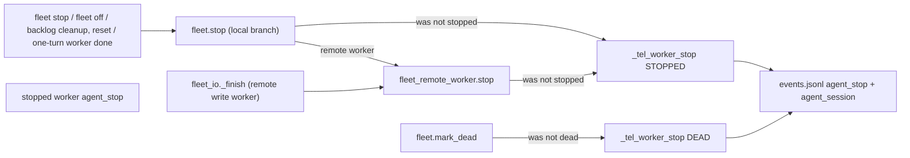

# Superlite: a stopped fleet worker emits agent_stop STOPPED with its session id (#939)

**Goal:** when superlite stops a fleet worker on purpose, `<superlite home>/events.jsonl` gets exactly one `agent_stop` line with `status: "STOPPED"`, filled like the `DEAD` line; every fleet-worker `agent_stop` line (`STOPPED`, `DEAD`, the report-time line) carries the added optional field `agent_session` (the worker's own Claude Code session id) when superlite knows it, and leaves the key out when it does not; `docs/telemetry.md` names `STOPPED` and `agent_session`.
**Architecture:** every deliberate stop of a local worker goes through `fleet.stop` (`fleet stop`, `fleet off`, a one-turn or layer worker after its report via `fleet_io._stop_worker`, backlog cleanup and reset via `backlog_run._stop` and `backlog_undo._stop_lead`, a lead's sub-workers); a remote worker's stop goes through `fleet_remote_worker.stop` (from `fleet.stop`'s remote branch and from `fleet_io._finish` for a remote write worker). The worker's session id is already in `fleet.json` as `workers[wid]["session"]` (`fleet._store_session`, herdr's lookup after READY, also for remote spawns).
**Tech stack:** Python 3.10+ stdlib; pytest through `sl run_tests`.
**Spec:** issue #939 and this file, section Design; contract C6 of the agent telemetry design (kept by main).
**Detail:** tests
**Target-min:** 11
**Wave0:** none
**Coverage:** off (bounded: one emit at two existing state changes and one optional field)

Global constraints:
- Standing note from main (binding): Agent telemetry program (14 issues in dashmax, max-core, superlite, maxnet-services, dotfiles), run by one main session as AI orchestrator. Binding spec: ~/github/dashmax/docs/superpowers/specs/2026-11-16-agent-telemetry-design.md (sections 4-11, contract 6a, your issue's row in 12). Mockups and Max's picks: https://claude.ai/code/artifact/e51150a0-6232-426f-9960-9df41cf9a235. The contract (section 6a) is shared by five repositories: never rename, retype or drop a field. A gap or conflict in it is a question to main (NEEDS_DECISION), not a local change; adding an optional field is allowed and goes into your PR body. Other units build in parallel against the contract examples; do not wait for them. Test against fixtures and the contract, never against another repository's unmerged code. Producers fail open; no prompts, responses or file contents in any ledger; secrets only via `secret get`. Max pre-approved merging, deploying (dashmax deploy.sh, maxnet-services stack deploys) and patch releases for this program. Put every follow-up for another repository into your notes as `Follow-up: other repository <name>: ...`.
- Builds: the verdict is `sl run_tests` (the project's test command; a project with `.maxapp` runs `maxapp test`, which a build pool may place on another Mac, and a full run whose tree a green maxapp test stamp covers returns that result without a run); task trees build in <tree>/.build/DerivedData and any build of your own goes under .build/ of the worktree, never -derivedDataPath outside the worktree (your session scratchpad included; backlog cleanup removes scratchpad build folders when the worktree goes); a product, simulator or device build stays on this machine and runs only when an issue's acceptance asks for a running-app check.
- Simulators: append the UDID of each simulator you or a worker creates (`xcrun simctl create` or `clone`; a checker's `Simulators:` line marks its created ones) as one line to /Users/max/github/superlite/.claude/worktrees/superlite-b236-telemetry-a-stopped-fleet-worker-em/.superlite/simulators.txt; never list one you did not create.
- Every Python script line keeps the repo's `# O(...)` complexity comment; stdlib only; LF endings. This repository is public: no host names, user names or home paths in code, tests, docs or commit messages.
- No new kind; `telemetry.KINDS["agent_stop"]` stays byte-identical (docs test `test_telemetry_docs_933.py` pins the Fields cell to it). `agent_session` is the only added field. A telemetry failure (SystemExit too) never changes a stop's state change, output or exit. Every test that asserts an emitted line is named `test_kind_<kind>_<case>` and checks it with `telemetry.validate(line) == []`.
- Tests never reach a real herdr: a test that calls `fleet.stop` uses a world whose `fleet.hc` is a fake (`test_fleet.world`, `test_fleet_remote_worker.world`).
- An existing test that pins a changed output is updated only when it is in the task's Owns; any other failing test is reported, never edited. New tests see a red run before the code they test.

## Design

What #939 asks: dashmax's crash alert cannot tell a fleet worker superlite stopped on purpose from a crash, because superlite writes no line when it closes a worker's pane, and a superlite line's `session` is the writer's session, not the worker's. Done when a test shows that stopping a worker writes exactly one `STOPPED` line with `agent_session`, a `DEAD` line carries it too, and the full suite is green.

- `telemetry.py`: new `OPTIONAL = {"agent_stop": ("agent_session",)}`. `_build` appends each optional key of the kind after the `KINDS` fields (before `backfill`) only when its value is truthy; `validate` accepts it (still rejects every other unknown key).
- `fleet._tel_dead(sd, w)` becomes `fleet._tel_worker_stop(sd, w, status)` (same fields, never raises) and adds `agent_session=w.get("session")`. `mark_dead` calls it with `"DEAD"`.
- `fleet.stop`, local branch: right after `fs.set_state(sd, wid, "stopped")`, `_tel_worker_stop(sd, live[wid], "STOPPED")`. `live` holds only workers not yet stopped, so a second stop (`fleet off` after `fleet stop`) adds no line and a dead worker (already stopped) gets none.
- `fleet_remote_worker.stop(sd, wid)`: remember `was = w.get("state")` from the record it already loads; after its `fs.set_state(sd, wid, "stopped")`, when `was != "stopped"`, `fleet._tel_worker_stop(sd, w, "STOPPED")`. This covers `fleet.stop`'s remote branch and `fleet_io._finish`'s direct call, and a repeated `_finish` adds no second line.
- `fleet_io._tel_finish`: the report-time `agent_stop` adds `agent_session=cur.get("session")` (`cur` is the record re-read under the lock; `w` may be a stale copy).
- `docs/telemetry.md`: the Line shape sentence "A field with no value is `null`." gains ", except the optional `agent_session`, which is left out"; the `agent_stop` Writer cell adds "; `fleet.py` and `fleet_remote_worker.py` when superlite stops a fleet worker"; the status sentence names `STOPPED`; the Added fields paragraph names `agent_session`. Exact text in T1 Notes.

Ruling: one emit at each stop state change (`fleet.stop` local branch, `fleet_remote_worker.stop`) (because every deliberate pane close goes through one of the two, so `fleet stop`, `fleet off`, backlog cleanup, reset and a one-turn worker after its report are all covered by the same line; cost if wrong: one call per path).
Ruling: a one-turn or layer worker stopped after its report writes a `STOPPED` line after its report-time line (because the issue asks for a line on every path that closes the pane, and a closed pane without a lifecycle end is what the crash alert sees; cost if wrong: one filter in the consumer).
Ruling: `agent_session` comes from `fleet.json`'s `session` (herdr's lookup after READY, refreshed by restore) for all three lines; no new hook and no `--session-id` at launch (because the value is already stored for local and remote workers; cost if wrong: one Stop-hook field later).
Ruling: `agent_session` is left out when unknown, not written as `null` (because the issue says "omitted when unknown"; `validate` accepts it as an optional key, as it does `backfill`).
Ruling: no line for a failed spawn (`_stopped_line` sets `blocked`, the agent never ran a task) nor for `backlog_undo._stop_lead`'s fallback that exits a lead agent with no worker record (because its `fleet.stop` already wrote the lead's line when it had one; cost if wrong: one emit).
Ruling: MISSED TARGET accepted (because the plan is one task, so the critical path is that task).

```mermaid
%% schedule
gantt
  title Predicted schedule (mm:ss)
  dateFormat X
  axisFormat %M:%S
  section lane 1
  T1 stopped worker agent_stop :t1, 0, 282s
```





critical path: T1 (4.7 min) · peak width 1 · predicted build 4.7 min · predicted total ≈ 13.2 min (target ✗ 11.0)

## File structure

- `skills/subagent-driven-development/scripts/telemetry.py`: `OPTIONAL`, `_build`, `validate` (T1).
- `skills/subagent-driven-development/scripts/fleet.py`: `_tel_worker_stop`, `mark_dead`, `stop` (T1).
- `skills/subagent-driven-development/scripts/fleet_remote_worker.py`: `stop` emits (T1).
- `skills/subagent-driven-development/scripts/fleet_io.py`: `_tel_finish` passes `agent_session` (T1).
- `docs/telemetry.md`: line shape, Writer cell, status sentence, added fields (T1).
- `tests/scripts/test_telemetry_stopped_939.py`, `tests/scripts/test_telemetry_stopped_remote_939.py`: the new tests (T1).

## Sections

### Fleet stop telemetry

**Probe entry:** none (a state change in a fleet state folder plus a line in the telemetry home; its cases are named tests in T1)

### T1 stopped worker agent_stop · Complexity 3 · Est. context 50k
**Owns:** skills/subagent-driven-development/scripts/telemetry.py, skills/subagent-driven-development/scripts/fleet.py, skills/subagent-driven-development/scripts/fleet_remote_worker.py, skills/subagent-driven-development/scripts/fleet_io.py, docs/telemetry.md, tests/scripts/test_telemetry_stopped_939.py, tests/scripts/test_telemetry_stopped_remote_939.py
**Components:** 4
**LOC owned:** 190
**Tests:** fast
**Model:** sonnet
**Kind:** design
**Covers:** Design
**Produces:** fleet._tel_worker_stop(sd: Path, w: dict, status: str) -> None
**Review Focus:** state: `test_kind_agent_stop_stopped_once` (a second stop and `fleet off` add no line); state: `test_kind_agent_stop_stopped_remote_once` (a repeated remote stop adds no line); contract: `test_kind_agent_stop_no_session_key_left_out`, `test_validate_rejects_other_unknown_keys`; file: `test_stop_fails_open`
**Test code (verbatim):**
```python
# tests/scripts/test_telemetry_stopped_939.py: a fleet worker stopped on purpose writes one agent_stop STOPPED line; fleet-worker agent_stop lines carry agent_session (#939)
import json, sys
from test_fleet import world, FakeHerdr  # noqa: F401
from test_plan_tools import SCRIPTS
sys.path.insert(0, str(SCRIPTS))
import fleet  # noqa: E402
import fleet_io  # noqa: E402
import telemetry  # noqa: E402

SID = "0b8c1d2e-3f40-4a5b-9c6d-7e8f90a1b2c3"


def lines(kind): return [e for e in telemetry.read_events() if e["kind"] == kind]


def seed(w, **workers):
    d = fleet.fs.default(); d.update(on=True, workspace_id="w6", root_pane="w6:p1", accounts=["claude1"], next=len(workers) + 1)
    d["workers"] = {wid: {"name": f"sl-proj-{wid.lower()}", "pane_id": f"w6:p{i + 1}", "account": "claude1", "agent": "superlite:implementer",
                          "tier": "sonnet", "state": "ready", "task": None, "started": 1000, **kw} for i, (wid, kw) in enumerate(workers.items())}
    fleet.fs.save(w.sd, d)


def test_kind_agent_stop_stopped_once(world):
    seed(world, W1={"session": SID}, W2={})
    assert fleet.stop(world.sd, ["W1"]) == ["W1"]
    assert fleet.stop(world.sd, ["W1"]) == []
    assert fleet.stop(world.sd, all_=True) == ["W2"]
    a, b = lines("agent_stop")
    assert telemetry.validate(a) == [] and telemetry.validate(b) == []
    assert (a["status"], a["task"], a["role"], a["model"], a["account"], a["machine"], a["effort"], a["duration_s"]) == \
        ("STOPPED", None, "implementer", "sonnet", "claude1", None, None, None)
    assert (a["tokens"], a["cost_usd"], a["tool_calls"], a["agent_session"]) == (None, None, None, SID)
    assert b["status"] == "STOPPED" and "agent_session" not in b
    assert list(a)[-1] == "agent_session"


def test_kind_agent_stop_stopped_busy_worker(world, monkeypatch):
    monkeypatch.setattr(fleet_io, "now_ms", lambda: 2_005_000)
    seed(world, W1={"state": "busy", "task": "T3,T4", "sent": 2_000_000, "role": "package-reviewer", "model": "opus", "session": SID})
    fleet.stop(world.sd, ["W1"])
    (e,) = lines("agent_stop")
    assert telemetry.validate(e) == []
    assert (e["status"], e["task"], e["role"], e["model"], e["duration_s"], e["agent_session"]) == ("STOPPED", "T3", "package-reviewer", "opus", 5.0, SID)
    assert lines("review") == []


def test_kind_agent_stop_stopped_fleet_off(world):
    seed(world, W1={"session": SID}, W2={"state": "stopped", "dead": True, "session": "other"})
    assert fleet.main(["off"]) == 0
    (e,) = lines("agent_stop")
    assert telemetry.validate(e) == [] and (e["status"], e["agent_session"]) == ("STOPPED", SID)


def test_kind_agent_stop_dead_carries_agent_session(world):
    seed(world, W1={"session": SID})
    fleet.mark_dead(world.sd, "W1")
    fleet.stop(world.sd, all_=True)
    (e,) = lines("agent_stop")
    assert telemetry.validate(e) == [] and (e["status"], e["agent_session"]) == ("DEAD", SID)


def test_kind_agent_stop_report_carries_agent_session(world):
    seed(world, W1={"state": "busy", "task": "T3", "sent": 1, "session": SID})
    stale = {k: v for k, v in fleet.fs.load(world.sd)["workers"]["W1"].items() if k != "session"}
    fleet_io._tel_finish(world.sd, "W1", stale, {"status": "DONE", "findings": []}, "T3")
    (e,) = lines("agent_stop")
    assert telemetry.validate(e) == [] and (e["status"], e["task"], e["agent_session"]) == ("DONE", "T3", SID)


def test_kind_agent_stop_no_session_key_left_out(world):
    seed(world, W1={"session": ""})
    fleet.stop(world.sd, ["W1"])
    (e,) = lines("agent_stop")
    assert telemetry.validate(e) == [] and "agent_session" not in e


def test_validate_rejects_other_unknown_keys():
    line = telemetry._build("agent_stop", None, None, None, {"status": "STOPPED", "agent_session": SID})
    assert telemetry.validate(line) == []
    assert telemetry.validate({**line, "worker_session": SID}) == ["agent_stop: unexpected worker_session"]
    run = telemetry._build("tests", None, None, None, {"mode": "fast", "agent_session": SID})
    assert "agent_session" not in run


def test_stop_fails_open(world, monkeypatch):
    def boom(*a, **k): raise SystemExit(3)
    monkeypatch.setattr(telemetry, "emit", boom)
    seed(world, W1={"session": SID})
    assert fleet.stop(world.sd, ["W1"]) == ["W1"]
    assert fleet.fs.load(world.sd)["workers"]["W1"]["state"] == "stopped"


def test_kind_agent_stop_stopped_off_switch(world, monkeypatch):
    monkeypatch.setenv("SUPERLITE_TELEMETRY", "0")
    seed(world, W1={"session": SID})
    fleet.stop(world.sd, ["W1"])
    assert lines("agent_stop") == []


def test_docs_name_stopped_and_agent_session():
    doc = (SCRIPTS.parents[2] / "docs" / "telemetry.md").read_text(encoding="utf-8")
    assert "`STOPPED` when superlite stops a fleet worker on purpose" in doc
    assert "`agent_session` (kind `agent_stop`" in doc
    row = next(l for l in doc.splitlines() if l.startswith("| `agent_stop` |"))
    assert "`fleet_remote_worker.py`" in row
```
```python
# tests/scripts/test_telemetry_stopped_remote_939.py: a remote fleet worker stopped on purpose writes one agent_stop STOPPED line (#939)
import contextlib, sys
from test_fleet_remote_worker import world, started, Routed  # noqa: F401
from test_plan_tools import SCRIPTS
sys.path.insert(0, str(SCRIPTS))
import fleet  # noqa: E402
import fleet_remote_worker as rw  # noqa: E402
import fleet_state as fs  # noqa: E402
import telemetry  # noqa: E402

SID = "5d6e7f80-9a1b-4c2d-8e3f-405162738495"


def lines(kind): return [e for e in telemetry.read_events() if e["kind"] == kind]


def with_session(w, wid="W1"):
    with fs.locked(w.sd):
        d = fs.load(w.sd); d["workers"][wid]["session"] = SID; fs.save(w.sd, d)


def test_kind_agent_stop_stopped_remote_once(world):
    started(world); with_session(world)
    rw.stop(world.sd, "W1")
    with contextlib.suppress(Exception):
        rw.stop(world.sd, "W1")
    fleet.stop(world.sd, ["W1"])
    (e,) = lines("agent_stop")
    assert telemetry.validate(e) == []
    assert (e["status"], e["role"], e["machine"], e["agent_session"]) == ("STOPPED", "research", "box", SID)


def test_kind_agent_stop_stopped_remote_via_fleet_stop(world):
    started(world); with_session(world)
    assert fleet.stop(world.sd, ["W1"]) == ["W1"]
    (e,) = lines("agent_stop")
    assert telemetry.validate(e) == [] and (e["status"], e["machine"], e["agent_session"]) == ("STOPPED", "box", SID)
```
**Steps:** 1 write both test files, 2 run them: FAIL, 3 implement `telemetry.OPTIONAL` with `_build` and `validate`, then `_tel_worker_stop`, the two stop emits and `_tel_finish`, then the docs, 4 run them: PASS, then the telemetry, fleet, fleet_io and fleet_remote_worker test files.
**Notes:**
- `_tel_worker_stop` keeps `_tel_dead`'s body (lazy `fleet_io` and `telemetry` imports inside the `try`, `except BaseException: pass`) and passes `status=status, agent_session=w.get("session")`; `_tel_dead` is removed (its one caller is `mark_dead`).
- If a test needs fixture plumbing to run (an attribute the fake lacks, a seed field the code reads), fix the plumbing in the new test file only; never change an assertion. If `fleet.stop`'s tree drop or pool code needs a file the seed lacks, add it to `seed`.
- Docs text. Line shape: "A field with no value is `null`, except the optional `agent_session`, which is left out." Writer cell of the `agent_stop` row: "hook `capture-agent-stop` (one Python call); `fleet_io.py` at a fleet worker's report; `fleet.py` when a fleet worker is marked dead; `fleet.py` and `fleet_remote_worker.py` when superlite stops a fleet worker". Status sentence: "`agent_stop` `status` is the status word of the agent's report (`DONE`, `DONE_WITH_CONCERNS`, `NEEDS_CONTEXT`, `BLOCKED`, `UNKNOWN`, a reviewer's verdict), `DEAD` when superlite marks a fleet worker dead (its agent is gone: `fleet wait`, a refused send or keys, `fleet status`), or `STOPPED` when superlite stops a fleet worker on purpose (it closes its pane: `fleet stop`, `fleet off`, a one-turn worker after its report, backlog cleanup and reset); a `DEAD` or `STOPPED` line has `effort`, `tokens`, `cost_usd` and `tool_calls` null and `duration_s` only for a worker that was busy." Added fields: insert after the `writer_role` entry: "`agent_session` (kind `agent_stop`, fleet workers only: the worker's own Claude Code session id, as herdr reported it after the worker started; left out when unknown; the common `session` stays the writer's)". Keep the Fields cell unchanged.

## Review Focus

- state: one `STOPPED` line per stop, never two, never one after `DEAD` (`test_kind_agent_stop_stopped_once`, `test_kind_agent_stop_dead_carries_agent_session`, `test_kind_agent_stop_stopped_remote_once`).
- contract: `KINDS` unchanged; `agent_session` only on `agent_stop`, left out when unknown, last key (`test_validate_rejects_other_unknown_keys`, `test_kind_agent_stop_no_session_key_left_out`).
- file: fail open and off switch (`test_stop_fails_open`, `test_kind_agent_stop_stopped_off_switch`).

## Running-app checks

None: no UI, widget, extension or browser target.

## Self-review

Coverage: the issue's three changes and its acceptance test map to T1. No placeholders. One task, no edges, no shared files. Fields filled. Schedule and lint run after this write.
