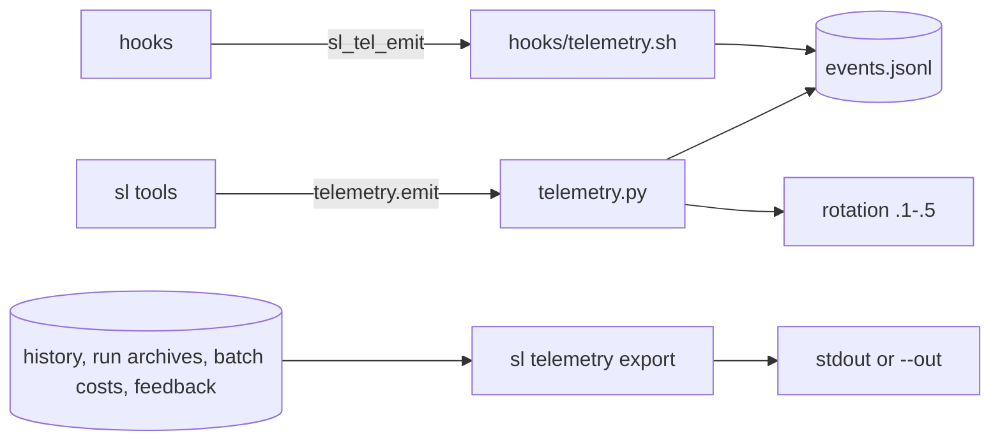
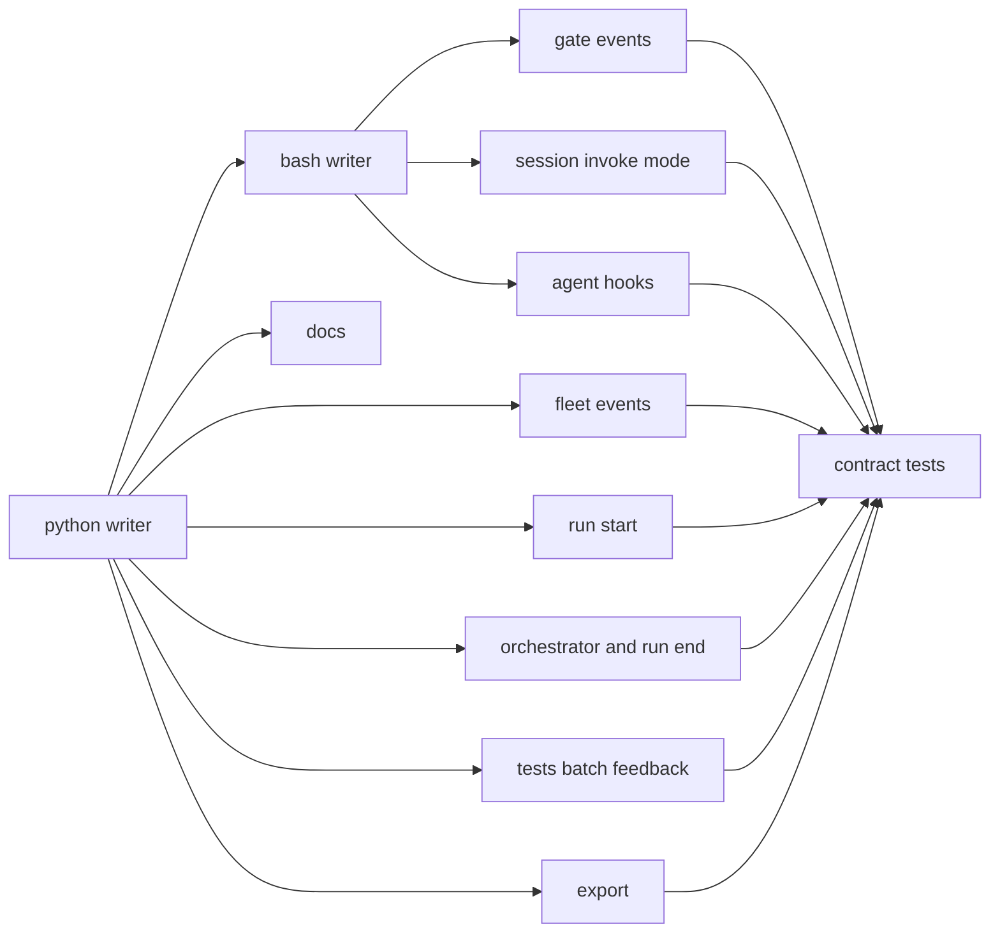

# Superlite: local telemetry event log (#933)

**Goal:** superlite appends one JSON line per invocation, mode, orchestrator and fleet choice, session start and end, run start and end, dispatch, agent stop, test run, hook decision, review verdict, batch state change and feedback entry to `<superlite home>/events.jsonl`; `sl telemetry export --since` rebuilds the same lines from the existing ledgers for a backfill.
**Architecture:** one Python writer (`telemetry.py`) and one sourced bash writer (`hooks/telemetry.sh`) produce the same line shape; every emit point calls one of them and never fails because of it. A new `SessionEnd` hook. Lines stay on the machine; a separate shipper (not superlite) reads the file.
**Tech stack:** Python 3.10+ stdlib; bash 3.2-compatible hooks; pytest through `sl run_tests`.
**Spec:** this file, section Design; issue #933 (contract C6 of the agent telemetry design, kept by main).
**Detail:** contracts
**Target-min:** 11
**Wave0:** none
**Max chars:** 42000

Global constraints:
- Standing note from main (binding, full text in `<run root>/.superlite/briefs/_common.md`): contract C6 is shared by five repositories: never rename, retype or drop a field; a gap or conflict in it is a question to the coordinator, not a local change; adding an optional field is allowed and is named in your report. Producers fail open; no prompts, responses or file contents in any line. Test against fixtures and the contract, never against another repository. Every follow-up for another repository goes into your report as `Follow-up: other repository <name>: ...`.
- Every Python script line keeps the repo's `# O(...)` complexity comment; stdlib only; LF endings; hooks pass `tests/scripts/test_hooks_bash32.py` (no bash 4+ syntax; `EPOCHREALTIME` with a fallback).
- This repository is public: no host names, user names, home paths, other project or repository names in code, tests, docs or commit messages.
- Fail open: a telemetry write never changes a hook's or tool's exit code, stdout or stderr. Every Python emit is `telemetry.emit(...)`, which catches every exception (SystemExit too) and returns False; every bash emit is `sl_tel_emit`/`sl_tel_gate`, which sends its own errors to /dev/null.
- No free text in a line: no prompt, response, last message, Agent description, feedback text or file content. `target` is cut to 200 characters; a whole line is at most 4096 bytes.
- A hook adds bash builtins only on its telemetry path (no process spawn), except `date` on bash without `EPOCHREALTIME`, `mkdir` when the telemetry folder is missing, and the one Python call in `capture-agent-stop` (T5).
- Tests: `tests/scripts/conftest.py` already points `SUPERLITE_HOME` at a per-test folder; read lines with `telemetry.read_events()`. Every test that asserts an emitted line is named `test_kind_<kind>_<case>` (T12 checks that each kind has one) and checks the line with `telemetry.validate(line) == []`.
- An existing test that pins a changed output is updated in the same task only when it is in the task's Owns; any other failing test is reported, never edited. The verdict is `sl run_tests` (never raw pytest); new tests see a red run before the code they test.

## Design

What #933 asks: a local, generic event log with a documented schema (contract C6), emit points in the hooks and `sl` tools, a `SessionEnd` hook, an explicit mode, a run outcome including `abandoned`, `sl telemetry export --since` for the backfill, hook and doc contract tests, a patch release. Done when a test per kind drives the real flow and asserts the line, and every writer fails open under a read-only `SUPERLITE_HOME`.

### 1. The file

- Path: `${SUPERLITE_HOME:-~/.superlite}/events.jsonl`. JSON Lines, UTF-8, one object per line, at most 4096 bytes, written with one `os.write` on an `O_APPEND` descriptor (bash: one `printf` into `>>`).
- Rotation (Python writer only): before a write, when the file is at least 20 MB (`telemetry.MAX_BYTES = 20 * 1024 * 1024`), rename `.4`→`.5` … `events.jsonl`→`.1` under `fcntl.flock` on `<home>/telemetry/rotate.lock` (no lock on Windows: rename best effort); 5 kept. The bash writer only appends.
- Off: `SUPERLITE_TELEMETRY=0` in the environment, or a file `<home>/telemetry-off`. Also off when `PYTEST_CURRENT_TEST` is set and `SUPERLITE_HOME` is not (a test that strips the variable never writes into the real home).
- State beside it: `<home>/telemetry/sessions/<sid>.start` (epoch seconds) and `<sid>.mode` (one word); `<home>/telemetry/pending/<key>.json` and `<key>.outcome` (section 4). A session id is used in a path only when it matches `^[A-Za-z0-9_-]{1,128}$`.

### 2. The line

Common fields, in this order, each `null` when unset: `v` (1), `t` (UTC, `2026-11-16T12:34:56.789Z`), `kind`, `session` (`$CLAUDE_CODE_SESSION_ID`, else `$SUPERLITE_SESSION_ID`; a hook passes its input's `session_id` first), `run` (the `run_id` of the run folder's `stable.json`), `repo_root` (nearest folder above the cwd holding `.git`, a file or a folder), `harness` (`$SUPERLITE_HARNESS`, else the first of `CLAUDECODE`→`claude-code`, `CODEX_THREAD_ID`/`CODEX_SANDBOX`→`codex`, `GEMINI_CLI`→`gemini`), `version` (the plugin's `package.json`), `worker` (`$SUPERLITE_FLEET_WORKER`), `role` (`$SUPERLITE_FLEET_ROLE`), `config_dir` (`$CLAUDE_CONFIG_DIR`). Then every field of the kind, `null` when unknown; no other keys except `backfill` (true on exported lines).

| kind | fields | written by |
|---|---|---|
| `invoke` | `name`, `via` (`command`, `skill`) | `mark-inline-flow` (T4) |
| `mode` | `mode` (`regular`, `mvp`, `feature`, `debug`, `small`, `backlog`) | `mark-inline-flow` (T4) |
| `orchestrator` | `mode` (`ai`, `human`), `by` | `sl orchestrator set` (T8) |
| `fleet` | `on`, `accounts` | `sl fleet on/off` (T6) |
| `session_start` | `source`, `duration_s` | `session-start` (T4) |
| `session_end` | `reason`, `duration_s` | `session-end` (T4) |
| `run_start` | `plan`, `tasks`, `detail`, `branch`, `mode`, `orchestrator`, `fleet` | `lint --stable` (T7) |
| `dispatch` | `task`, `role`, `agent_type`, `model`, `effort`, `tier`, `account`, `machine`, `label` | `capture-agent-launch` (T5), `fleet spawn/send` (T6) |
| `agent_stop` | `task`, `role`, `model`, `effort`, `account`, `machine`, `duration_s`, `tokens` {`in`,`out`,`cache_read`,`cache_write`}, `cost_usd`, `tool_calls`, `status` | `capture-agent-stop` (T5), fleet worker stop (T6) |
| `tests` | `mode` (`fast`, `full`), `passed`, `failed`, `skipped`, `seconds`, `task` | `run_tests` (T9) |
| `gate` | `hook`, `decision` (`block`, `rewrite`, `deny`, `warn`), `rule`, `tool`, `target` | six hooks (T3) |
| `review` | `review_kind` (`package`, `final`), `verdict`, `findings`, `round` | reviewer stops (T5, T6) |
| `batch` | `batch`, `state`, `lead_model`, `pr`, `reason` | `backlog_state.update` (T9) |
| `feedback` | `fkind`, `reason` | `sl feedback add`, auto entries (T9) |
| `run_end` | `outcome` (`shipped`, `done`, `parked`, `stopped`, `abandoned`, `failed`), `wall_s`, `cost_usd`, `tasks`, `first_time_pass`, `fix_rounds`, `final_verdict`, `agents`, `tests_passed`, `tests_failed`, `ci_red`, `questions`, `projected_min`, `critical_path_min`, `reason` | `lint --stable` (abandoned, T7), `sl orchestrator end` (T8), backlog terminal states (T9) |

Ruling (main's ruling): C6 names a per-kind `kind` for `review`, which collides with the line's own `kind`; it is written as `review_kind` (an added field).
Ruling (main's ruling): on `dispatch` and `agent_stop` the per-kind `role` (the dispatched or stopped agent's role) replaces the common `role`; the writer's fleet role goes into an added `writer_role` field on those two kinds.

### 3. Emit points

- `invoke`: every Skill call whose skill starts `superlite:` (via `skill`) and every prompt whose first word is `/superlite:<name>` (via `command`, name `superlite:<name>`; the rest of the prompt is never read), before the hook's subagent and fleet-worker exits.
- `mode`: persisted at the invocation that chooses it: `superlite:mvp|feature|debug|small|backlog` (command or skill) → that word; `/superlite:start <regular|mvp|feature|debug> ...` → that word; `superlite:brainstorming` in a session with no mode yet → `regular`. The hook writes `<sid>.mode` and emits `mode`.
- `session_start`: `session-start` for startup, clear and compact (its matcher; `resume` is not matched, so a resumed session writes no start), writing `<sid>.start` when absent. `session_end`: new `hooks/session-end` (`SessionEnd`, all reasons): `duration_s` from `<sid>.start` (else null); removes `<sid>.start` and `<sid>.mode`.
- `gate`: every non-allow decision of `block-coordinator-edits`, `block-unsafe-kill`, `rewrite-test-runs` (deny, rewrite), `inline-worktree-guard`, `deny-worker-permission` (deny) and `final-review-check` (warn), with the hook's own rule word, the tool name and the target (path or command, 200 chars; a rewrite: `<original> -> <rewritten>`).
- `run_start` / `abandoned`: `plan_tools lint --stable` mints `run_id` (`<UTC %Y%m%dT%H%M%SZ>-<6 hex>`) and `run_session` into `stable.json` when it has none, and keeps both on every rewrite. A lint that finds a `run_id` written by another live or ended session (`run_session` set, differs from the current non-null session) writes `run_end` `abandoned` (reason `resumed by another session`) for it, then mints a new id and writes `run_start`.
- `run_end`: `sl orchestrator end` computes the fields (report and batch-grade helpers) before it moves the files. Outcome: `--outcome` when given, else `stopped` when `<sd>/stopped.md` exists, else `done`. A lead's run (`lead_batch(sd)` set) stores the fields with `telemetry.defer_run_end(batch_key, fields)` instead; the backlog's terminal state writes it (section 4).
- `dispatch`: the Agent tool during a run (`capture-agent-launch`: `agent_type`, `model`, `task` = the first `T<n>` id in the description, `role` = agent type without `superlite:`); `fleet spawn` with a brief and every `fleet send` of a task or brief (role, agent, model, tier, account, machine, label). `effort` is null where superlite does not choose it.
- `agent_stop`: `capture-agent-stop` runs `sl telemetry agent-stop` (tokens, cost, tool calls and duration from the subagent transcript through `metrics.session_usage`; status from its last text); a fleet worker's turn end (`fleet_io`) does the same for the worker transcript since the send.
- `review`: the same two stop paths, for `superlite:package-reviewer` and `superlite:final-reviewer`: verdict word, count of finding lines, round (`FR<n>` label digits, else 1 + earlier review lines of that run and `review_kind`).
- `tests`: `run_tests` once per run with a result (`fast` or `full`); no line for a stamp hit, a recorded run or a usage error.
- `batch`: every state change in `backlog_state.update` (old state differs from the new one).
- `feedback`: `sl feedback add` (`fkind` = kind, `reason` null) and auto entries (`reason` = the entry's reason word).
- `orchestrator`: `sl orchestrator set`. `fleet`: `sl fleet on` and `off`.

### 4. Deferred run end of a lead

`telemetry.batch_key(root, batch)` is `<main repository folder name>-<batch>`. `orchestrator end` of a lead run calls `defer_run_end(key, fields)`; `backlog_state.update` calls `finish_deferred(key, outcome, reason)` when a batch enters `shipped` (outcome `shipped`), `parked` (`parked`) or `no-change` (`done`). Whichever comes second writes the one `run_end` line: `finish_deferred` with no stored fields writes `<key>.outcome`; `defer_run_end` with an `<key>.outcome` present writes the line at once with that outcome.

### 5. Export

`sl telemetry export --since YYYY-MM-DD [--root DIR ...] [--out FILE]` prints lines (or writes FILE whole, replacing it) for the time since the date: `agent_stop` per `<home>/history.jsonl` row (`t` = its date at 00:00:00.000Z), `run_start` and `run_end` per run archive `<root>/.superlite/runs/*/` (`run.json`, `lint-log.jsonl`, `build-report.json`), `dispatch` per archived `metrics.jsonl` launch row, `tests` per archived `test-summary-*.json`, `batch` per `<root>/.superlite/batch-costs.jsonl` batch row, `feedback` per `<home>/feedback.jsonl` entry. `--root` defaults to the current git top level's main checkout. Each line carries `backfill: true`; `run` is the archive's `run.json` `run_id`, else its folder name. Free text in the sources (`last`, `text`, `desc`, failure names) is never copied.

### 6. Rulings

Ruling: the mode is persisted by the hook at the invoking command or skill, not by a new instruction in `commands/*.md` (because a hook cannot be skipped by the model and a commands edit needs the evals layer, about $2-4 a run; cost if wrong: a start-menu choice made without a skill call records no mode until brainstorming records `regular`).
Ruling: `capture-agent-stop` makes one Python call per subagent stop during a run (because tokens and cost need the transcript; it stops once per agent, off the tool path; cost if wrong: about 0.1-0.3 s per subagent stop).
Ruling: rotation is done by the Python writer only (because size needs a stat call the bash writer would spawn; cost if wrong: a file may pass 20 MB by the hook lines written between two Python writes).
Ruling: export prints to stdout or `--out`, never into `events.jsonl` (because a second export would duplicate lines in the shipped ledger; cost if wrong: the shipper registers the export file once).
Ruling: `session-start` keeps its `startup|clear|compact` matcher (because a `resume` entry would re-inject the session prompt; cost if wrong: resumed sessions have no `session_start` line).
Ruling: `**Detail:** contracts` (the C6 table above carries the examples).

## Coverage

| Category | State | Basis |
|---|---|---|
| Scope and success criteria | ruled | the 15 kinds of section 2, the SessionEnd hook, export; a test per kind; fail open under a read-only home |
| Domain and data model | ruled | sections 1-2 |
| Persistence and migration | ruled | 20 MB rotation, 5 kept; `run_id` added to `stable.json` and `run.json`; older runs get an id at their next lint |
| Interfaces and contracts | ruled | C6 as in section 2; added fields `review_kind`, `writer_role`, `backfill` |
| UI states | n/a | no UI |
| Concurrency and state ownership | ruled | one `O_APPEND` write per line; rotation under a file lock; deferred run end ordered by section 4 |
| Error handling and recovery | ruled | fail open everywhere; no exception escapes `emit` |
| Security and privacy | ruled | no free text; 200-char targets; session ids validated before use in a path |
| Performance and limits | ruled | hooks stay builtin-only on the telemetry path; 4096-byte lines |
| Observability | ruled | the log itself; off switches in section 1 |
| Testing strategy | ruled | `test_kind_<kind>_*` per emit point; read-only home per writer; docs and hook contract tests (T11, T12) |
| Compatibility | ruled | bash 3.2; Python 3.10; Windows: rotation without a lock |
| Rollout | ruled | one patch release (main's ruling) |
| Research unknowns | n/a | none |

## Task graph

```mermaid
%% schedule
gantt
  title Predicted schedule (mm:ss)
  dateFormat X
  axisFormat %M:%S
  section lane 1
  T1 Python telemetry writer :t1, 0, 793s
  T9 Test batch and feedback events :t9, 793, 798s
  T12 Hook and kind contract tests :t12, 2360, 746s
  section lane 2
  T8 Orchestrator choice and run end :t8, 793, 779s
  section lane 3
  T6 Fleet events :t6, 793, 777s
  section lane 4
  T10 Backfill export :t10, 793, 762s
  section lane 5
  T2 Bash telemetry writer :t2, 793, 760s
  T4 Session invoke and mode events :t4, 1554, 806s
  section lane 6
  T11 Telemetry docs :t11, 793, 756s
  T5 Agent dispatch and stop from hooks :t5, 1554, 789s
  section lane 7
  T7 Run id run start and abandoned runs :t7, 793, 748s
  T3 Gate events from six hooks :t3, 1554, 779s
```

critical path: T1 → T2 → T4 → T12 (51.8 min) · peak width 7 · predicted build 51.8 min · predicted total ≈ 72.3 min (target ✗ 11.0)

## Package: writers

App type: library. Categories: encoding (JSON escaping, 4096-byte cut, UTF-8), state (rotation, deferred run end), file (read-only home, missing folder).
**Probe entry:** none (writes into the home folder; the named tests cover each case)

### T1 Python telemetry writer · Complexity 5 · Est. context 52k
**Owns:** skills/subagent-driven-development/scripts/telemetry.py, tests/scripts/test_telemetry_events.py
**Components:** 2
**LOC owned:** 240
**Tests:** fast
**Model:** sonnet
**Kind:** design
**Covers:** 1, 2, 4
**Produces:** telemetry.KINDS: dict[str, tuple[str, ...]] · telemetry.COMMON: tuple[str, ...] · telemetry.events_path() -> Path | None · telemetry.emit(kind: str, sd: Path | None = None, cwd: str | None = None, session: str | None = None, **fields) -> bool · telemetry.read_events(path: Path | None = None) -> list[dict] · telemetry.validate(line: dict) -> list[str] · telemetry.run_id(sd: Path | None) -> str | None · telemetry.new_run_id(now: datetime | None = None) -> str · telemetry.session_mode(session: str | None = None) -> str | None · telemetry.count(kind: str, run: str | None, **eq) -> int · telemetry.batch_key(root: Path, batch: str) -> str · telemetry.defer_run_end(key: str, fields: dict) -> bool · telemetry.finish_deferred(key: str, outcome: str, reason: str | None = None) -> bool
  e.g. emit("tests", mode="fast", passed=3, failed=0, skipped=1, seconds=2.5, task="T2") -> True, last line {"v":1,"t":"2026-11-16T12:34:56.789Z","kind":"tests","session":null,"run":null,"repo_root":"/tmp/p","harness":null,"version":"1.5.252","worker":null,"role":null,"config_dir":null,"mode":"fast","passed":3,"failed":0,"skipped":1,"seconds":2.5,"task":"T2"}
  e.g. emit("nope", x=1) -> False and nothing written; emit("tests") with a read-only home -> False, no exception, no stderr
  e.g. validate({...that line...}) -> []; validate(line without "task") -> ["tests: missing task"]; new_run_id(datetime(2026,11,16,13,5,0,tzinfo=timezone.utc)) -> "20261116T130500Z-" + 6 hex chars
  e.g. batch_key(Path("/w/superlite/.claude/worktrees/b233"), "B233") -> "superlite-B233" (the main repository of a linked worktree, via feedback.project)
  e.g. read_events() -> [{"v":1,"kind":"tests",...}] (events.jsonl of the current home, bad lines skipped; [] when the file is missing) · run_id(Path("/p/.superlite")) with stable.json {"run_id":"20261116T130500Z-a1b2c3"} -> "20261116T130500Z-a1b2c3"; run_id(None) -> None
  e.g. session_mode("s1") with <home>/telemetry/sessions/s1.mode "feature" -> "feature"; session_mode(None) -> None
**Review Focus:** encoding: `test_kind_tests_line_shape` (key order COMMON then KINDS["tests"], `t` matches `^\d{4}-\d\d-\d\dT\d\d:\d\d:\d\d\.\d{3}Z$`); encoding: `test_cut_to_4096` (a 10,000-char `target` on a gate line gives a line of at most 4096 bytes that still parses and ends with `}`); state: `test_rotation_keeps_five` (MAX_BYTES patched to 100; 7 rotations leave events.jsonl and .1-.5, no .6); file: `test_read_only_home_fails_open` (home chmod 0o500: emit returns False, stderr empty); file: `test_off_switches` (SUPERLITE_TELEMETRY=0, `<home>/telemetry-off`, PYTEST_CURRENT_TEST without SUPERLITE_HOME: events_path() is None); state: `test_deferred_run_end_either_order` (defer then finish writes one run_end with outcome shipped; finish then defer writes one run_end too; a second finish writes nothing); state: `test_run_id_from_stable_json`; state: `test_session_mode_rejects_bad_id` (session "../x" -> None, no file read outside the sessions folder)
**Steps:** 1 failing tests, 2 run: FAIL, 3 implement, 4 run: PASS
**Notes:** KINDS holds exactly the section 2 table (with `review_kind` and, on `dispatch` and `agent_stop`, `writer_role` as the last field). `emit` drops keys not in COMMON + KINDS[kind] + `backfill`, fills missing ones with None, and on `dispatch`/`agent_stop` sets `writer_role` from `$SUPERLITE_FLEET_ROLE` when the caller passes none. `sd` (a `.superlite` folder) gives `run`; without `sd`, `run` comes from `$SUPERLITE_STATE_DIR/stable.json` only (never `state.resolve`). The 4096 cut shortens the longest string values first (suffix `…`), then drops `target`. `count` reads events.jsonl and .1. Version and harness: reuse `feedback.version()` and `feedback.HARNESS_ENV` (`unknown` becomes null). The CLI (`sl telemetry`) has two subcommands, each importing its module lazily: `agent-stop --transcript P --agent-type T [--agent-id ID] [--cwd D] [--sd D]` → `telemetry_agents.main(a) -> int` (T5) and `export --since YYYY-MM-DD [--root DIR]... [--out FILE]` → `telemetry_export.main(a) -> int` (T10); a missing module or any exception exits 0 silently for `agent-stop`; `export` exits 2 on a bad date.

### T2 Bash telemetry writer · Complexity 4 · Est. context 46k
**Owns:** hooks/telemetry.sh, tests/scripts/test_telemetry_bash_933.py
**Components:** 1
**LOC owned:** 190
**Tests:** fast
**Model:** sonnet
**Kind:** design
**Covers:** 1, 2
**Consumes:** telemetry.validate(line: dict) -> list[str] (T1) · telemetry.KINDS: dict[str, tuple[str, ...]] (T1) · telemetry.read_events(path: Path | None = None) -> list[dict] (T1)
**Produces:** bash `sl_tel_json VAR VALUE [MAX]` (VAR = JSON string literal of VALUE cut to MAX chars, default 200, or `null` when empty) · bash `sl_tel_emit KIND FRAGMENT` (FRAGMENT: the kind's fields as JSON members) · bash `sl_tel_gate HOOK DECISION RULE TOOL TARGET` · bash `sl_tel_session_file SID EXT` (prints nothing and returns 1 for an invalid id)
  e.g. SL_TEL_SESSION=s1 SL_TEL_CWD=/tmp/p; sl_tel_gate block-unsafe-kill block kill-pattern Bash 'pkill -f node' -> line {"v":1,...,"kind":"gate","session":"s1",...,"hook":"block-unsafe-kill","decision":"block","rule":"kill-pattern","tool":"Bash","target":"pkill -f node"}
  e.g. sl_tel_json V 'a"b\c' -> V='"a\"b\\c"'; sl_tel_json V '' -> V=null
**Review Focus:** encoding: `test_bash_escapes_quotes_backslash_newline` (a target with `"`, `\`, a newline and a tab gives a line `json.loads` reads back with newline and tab as spaces); encoding: `test_bash_line_matches_python_keys` (a gate line from bash has exactly the keys of the same line from `telemetry.emit`); file: `test_bash_read_only_home_silent` (home 0o500: exit 0, stdout and stderr empty); file: `test_bash_off_switches` (same three switches as T1); state: `test_bash_run_from_sl_sd` (SL_SD with stable.json {"run_id":"R1"} gives "run":"R1"); `test_bash32_lint_passes` (test_hooks_bash32's BANNED patterns find nothing in hooks/telemetry.sh)
**Steps:** 1 failing tests, 2 run: FAIL, 3 implement, 4 run: PASS
**Notes:** A sourced library, not a hook (no hooks.json entry; the file passes `bash -n` and the LF check of test_hooks_contract). Context: `SL_TEL_SESSION` (the hook sets it from its input), else the two env vars; `SL_TEL_CWD`, else `$PWD`; `run` from `$SL_SD/stable.json` read with builtins (`read -r -d ''`), regex `"run_id"[[:space:]]*:[[:space:]]*"([^"]+)"`; version from `${BASH_SOURCE%/*}/../package.json`. Write: `{ printf '%s\n' "$line" >>"$f"; } 2>/dev/null`. Tests run the helper through `bash -c '. hooks/telemetry.sh; ...'` with `shutil.which("bash")`, never a quoted `/bin/bash`.

## Package: hooks

App type: CLI (hooks: JSON on stdin, exit code and stdout). Categories: protocol (hook outputs unchanged), encoding (targets), state (session files).
**Probe entry:** none (hooks run in tests with JSON payloads)

### T3 Gate events from six hooks · Complexity 4 · Est. context 60k
**Owns:** hooks/block-coordinator-edits, hooks/block-unsafe-kill, hooks/rewrite-test-runs, hooks/inline-worktree-guard, hooks/deny-worker-permission, hooks/final-review-check, tests/scripts/test_telemetry_gates_933.py
**Components:** 2
**LOC owned:** 170
**Tests:** fast
**Model:** sonnet
**Kind:** design
**Covers:** 3
**Consumes:** bash `sl_tel_gate HOOK DECISION RULE TOOL TARGET` (T2) · telemetry.read_events(path: Path | None = None) -> list[dict] (T1)
**Review Focus:** protocol: `test_kind_gate_outputs_unchanged` (for each hook's decision case the exit code, stdout and stderr equal those with `SUPERLITE_TELEMETRY=0`); one `test_kind_gate_<hook>` per hook asserting decision, rule, tool and target: block-coordinator-edits (a code edit by the coordinator: block), block-unsafe-kill (`pkill -f node`: block), rewrite-test-runs (a raw pytest: rewrite, target `<original> -> <rewritten>`; a denied form: deny), inline-worktree-guard (block), deny-worker-permission (deny, rule `worker-permission`), final-review-check (warn, rule `final-review-missing`, target the branch); `test_kind_gate_allow_writes_nothing` (an allowed command writes no line)
**Steps:** 1 failing tests, 2 run: FAIL, 3 implement, 4 run: PASS
**Notes:** Each hook sources `telemetry.sh` (`. "${BASH_SOURCE[0]%/*}/telemetry.sh" 2>/dev/null`) only on the decision path, sets `SL_TEL_SESSION` from its input's `session_id` and `SL_TEL_CWD` from its `cwd`, and calls `sl_tel_gate` right before the decision is printed or the exit happens. The rule word is the one the hook's incident row already uses where it writes one, else a short kebab-case word naming the check (state it in the report). The decision output text is unchanged.

### T4 Session, invoke and mode events · Complexity 4 · Est. context 56k
**Owns:** hooks/session-start, hooks/session-end, hooks/hooks.json, hooks/mark-inline-flow, tests/scripts/test_telemetry_session_933.py, tests/scripts/test_mark_inline_flow.py
**Components:** 3
**LOC owned:** 190
**Tests:** fast
**Model:** sonnet
**Kind:** design
**Covers:** 3
**Consumes:** bash `sl_tel_emit KIND FRAGMENT` (T2) · bash `sl_tel_json VAR VALUE [MAX]` (T2) · bash `sl_tel_session_file SID EXT` (T2) · telemetry.read_events(path: Path | None = None) -> list[dict] (T1)
**Review Focus:** `test_kind_session_start_startup` (source startup, `<sid>.start` written; a later `compact` start keeps the first time); `test_kind_session_end_duration` (start file 120 s old: duration_s between 119 and 125, both session files removed; no start file: duration_s null); `test_kind_invoke_skill` (Skill `superlite:brainstorming` from a subagent payload still writes via skill); `test_kind_invoke_command` (prompt `/superlite:feature add x` gives name `superlite:feature`, via command, and no other prompt word in the file); `test_kind_mode_from_command` (`/superlite:mvp` gives mode mvp and `<sid>.mode`); `test_kind_mode_start_word` (`/superlite:start debug fix y` gives mode debug); `test_kind_mode_regular_once` (brainstorming without a mode gives regular; after `/superlite:feature`, brainstorming writes no mode line); `test_non_superlite_skill_ignored`; protocol: `test_session_hooks_output_unchanged` (session-start stdout byte-equal with `SUPERLITE_TELEMETRY=0`); `test_hooks_json_session_end_entry`
**Steps:** 1 failing tests, 2 run: FAIL, 3 implement, 4 run: PASS
**Notes:** `hooks/session-end` is a new bash hook: `SessionEnd`, no matcher, `bash "${CLAUDE_PLUGIN_ROOT}/hooks/session-end"`, silent, exit 0 always, builtins only. In `mark-inline-flow` the telemetry block runs before the `agent_id` and fleet-worker exits; the existing inline-flow marking is unchanged. Update `test_mark_inline_flow.py` hooks.json pins only if the new entry moves them.

### T5 Agent dispatch and stop from hooks · Complexity 5 · Est. context 62k
**Owns:** hooks/capture-agent-launch, hooks/capture-agent-stop, skills/subagent-driven-development/scripts/telemetry_agents.py, tests/scripts/test_telemetry_agents_933.py
**Components:** 2
**LOC owned:** 220
**Tests:** fast
**Model:** sonnet
**Kind:** design
**Covers:** 3
**Consumes:** bash `sl_tel_emit KIND FRAGMENT` (T2) · telemetry.emit(kind: str, sd: Path | None = None, cwd: str | None = None, session: str | None = None, **fields) -> bool (T1) · telemetry.count(kind: str, run: str | None, **eq) -> int (T1) · telemetry.run_id(sd: Path | None) -> str | None (T1)
**Produces:** telemetry_agents.main(a: argparse.Namespace) -> int · telemetry_agents.agent_stop(transcript: Path, agent_type: str, sd: Path | None = None, agent_id: str | None = None) -> dict | None
  e.g. agent_stop(<fixture transcript, 2 assistant turns, 3 tool_use blocks, usage in 100/out 20/cache_read 50/cache_write 10, last text "Status: DONE">, "superlite:implementer") -> {"role": "implementer", "model": "claude-sonnet-5-5", "tokens": {"in": 100, "out": 20, "cache_read": 50, "cache_write": 10}, "tool_calls": 3, "status": "DONE", ...}
**Review Focus:** `test_kind_dispatch_agent_launch` (Agent PostToolUse during a run, description "T3 parser": task T3, role implementer, model from resolvedModel, and no description text in the line); `test_kind_agent_stop_subagent` (the fixture above: tokens, tool_calls 3, status DONE, duration_s from first to last transcript timestamp, cost_usd > 0); `test_kind_review_final_reviewer` (last text `Verdict: CHANGES_REQUESTED` and two `file:line - ... - tier 1` lines: review_kind final, verdict CHANGES_REQUESTED, findings 2, round 1; a second stop gives round 2); file: `test_agent_stop_missing_transcript` (no line, exit 0, metrics row still written); `test_agent_hooks_outside_run_silent`
**Steps:** 1 failing tests, 2 run: FAIL, 3 implement, 4 run: PASS
**Notes:** `capture-agent-launch` emits `dispatch` with builtins next to its metrics row. `capture-agent-stop` keeps its metrics row and then runs `"${BASH_SOURCE[0]%/*}/../skills/subagent-driven-development/scripts/sl" telemetry agent-stop --transcript ... --agent-type ... --agent-id ... --sd "$sd" </dev/null >/dev/null 2>&1` (synchronous, fail open). Tokens and cost: `metrics.session_usage` (cache_write = 5 m + 1 h); no text of the transcript is copied.

### T6 Fleet events · Complexity 5 · Est. context 64k
**Owns:** skills/subagent-driven-development/scripts/fleet.py, skills/subagent-driven-development/scripts/fleet_io.py, tests/scripts/test_telemetry_fleet_933.py
**Components:** 2
**LOC owned:** 160
**Tests:** fast
**Model:** sonnet
**Kind:** design
**Covers:** 3
**Consumes:** telemetry.emit(kind: str, sd: Path | None = None, cwd: str | None = None, session: str | None = None, **fields) -> bool (T1) · telemetry.count(kind: str, run: str | None, **eq) -> int (T1)
**Review Focus:** `test_kind_fleet_on_off` (`fleet on` then `off`: two lines, on true then false, accounts as stored); `test_kind_dispatch_fleet_send` (sending T2 T3 to a worker gives two dispatch lines with role, agent_type, model, tier, account, label; machine null for a local worker); `test_kind_agent_stop_fleet_worker` (a worker report DONE after a send: status DONE, duration_s from the send time, tokens from the worker transcript fixture since the send); `test_kind_review_fleet_final` (label FR2, verdict APPROVED, findings 0: review_kind final, round 2); state: `test_fleet_finish_twice_one_line` (`_finish` run twice for one report writes one agent_stop); `test_fleet_telemetry_failure_keeps_output` (emit raising inside: command output unchanged)
**Steps:** 1 failing tests, 2 run: FAIL, 3 implement, 4 run: PASS
**Notes:** Emit points from research: `fleet.py` on/off (~1332/1339), `_spawn` (~602) for a spawn with a brief, the send path for each task or brief; `fleet_io._finish` (~825) for the turn end. Fake herdr and transcripts the way the existing fleet tests do.

## Package: runs and ledgers

App type: CLI. Categories: state (run identity, outcomes), protocol (exit codes and outputs unchanged), numeric (run totals).
**Probe entry:** none (tools run on temporary run folders; the named tests cover each case)

### T7 Run id, run start and abandoned runs · Complexity 4 · Est. context 58k
**Owns:** skills/subagent-driven-development/scripts/plan_tools.py, tests/scripts/test_telemetry_runs_933.py
**Components:** 1
**LOC owned:** 130
**Tests:** fast
**Model:** sonnet
**Kind:** design
**Covers:** 3
**Consumes:** telemetry.emit(kind: str, sd: Path | None = None, cwd: str | None = None, session: str | None = None, **fields) -> bool (T1) · telemetry.new_run_id(now: datetime | None = None) -> str (T1) · telemetry.session_mode(session: str | None = None) -> str | None (T1)
**Review Focus:** `test_kind_run_start_first_lint` (first `lint --stable` of a 3-task plan with `**Detail:** contracts`: stable.json gains run_id and run_session; line has tasks 3, detail contracts, branch, orchestrator from orchestrator.json, fleet from fleet state, mode from the session's mode file); state: `test_relint_keeps_run_id` (a second lint by the same session: same run_id, no second run_start); `test_kind_run_end_abandoned_on_resume` (a lint by another session: run_end abandoned for the old id with reason `resumed by another session`, then run_start with a new id); `test_lead_run_mode_backlog` (SUPERLITE_FLEET_ROLE=lead and no mode file: mode backlog); `test_old_stable_json_gets_id` (stable.json without run_id: id minted, no abandoned line)
**Steps:** 1 failing tests, 2 run: FAIL, 3 implement, 4 run: PASS
**Notes:** Emit point: where `stable.json` is written (~3529-3531). `plan`: the plan path relative to repo root. `detail`: the plan header `**Detail:**` value, else null.

### T8 Orchestrator choice and run end · Complexity 5 · Est. context 62k
**Owns:** skills/subagent-driven-development/scripts/orchestrator.py, tests/scripts/test_telemetry_run_end_933.py
**Components:** 2
**LOC owned:** 170
**Tests:** fast
**Model:** sonnet
**Kind:** design
**Covers:** 3, 4
**Consumes:** telemetry.emit(kind: str, sd: Path | None = None, cwd: str | None = None, session: str | None = None, **fields) -> bool (T1) · telemetry.batch_key(root: Path, batch: str) -> str (T1) · telemetry.defer_run_end(key: str, fields: dict) -> bool (T1) · telemetry.run_id(sd: Path | None) -> str | None (T1)
**Review Focus:** `test_kind_orchestrator_set` (`orchestrator set ai --by main`: mode ai, by main); `test_kind_run_end_done` (end of a run folder with stable.json run_id R1, metrics and a build report fixture: outcome done, run R1, wall_s and cost_usd from report.collect, tasks count; run.json gains run_id R1); `test_kind_run_end_stopped` (stopped.md present: outcome stopped); `test_kind_run_end_outcome_flag` (`end --outcome failed`); state: `test_lead_run_end_deferred` (briefs/lead.md `# Lead brief: B9`: no run_end line, a pending file for key `<repo>-B9`); numeric: `test_run_end_missing_report_nulls` (no build report: numeric fields null, line still written); protocol: `test_end_output_unchanged`
**Steps:** 1 failing tests, 2 run: FAIL, 3 implement, 4 run: PASS
**Notes:** `end` gains `outcome: str | None = None`; the CLI gains `end --outcome {shipped,done,parked,stopped,failed,abandoned}`. Fields come from `report.collect` and `batch_grade` helpers (final verdict, fix rounds, ci_red, questions) before any file moves; each lookup is wrapped so a missing source gives null.

### T9 Test, batch and feedback events · Complexity 5 · Est. context 64k
**Owns:** skills/subagent-driven-development/scripts/run_tests.py, skills/subagent-driven-development/scripts/backlog_state.py, skills/subagent-driven-development/scripts/feedback.py, tests/scripts/test_telemetry_ledgers_933.py
**Components:** 3
**LOC owned:** 150
**Tests:** fast
**Model:** sonnet
**Kind:** design
**Covers:** 3, 4
**Consumes:** telemetry.emit(kind: str, sd: Path | None = None, cwd: str | None = None, session: str | None = None, **fields) -> bool (T1) · telemetry.batch_key(root: Path, batch: str) -> str (T1) · telemetry.finish_deferred(key: str, outcome: str, reason: str | None = None) -> bool (T1)
**Review Focus:** `test_kind_tests_fast_run` (a fast run of a 2-test fixture project: mode fast, passed 2, failed 0, seconds > 0, task from --task); `test_tests_stamp_hit_no_line`; `test_kind_batch_state_change` (update running -> shipped with pr 12: one batch line, state shipped, pr 12; an update with the same state writes none); `test_kind_run_end_shipped_from_batch` (a deferred run end for the batch's key becomes run_end shipped); `test_kind_feedback_add` (fkind bug, reason null, the text absent from the file); `test_kind_feedback_auto` (reason = the auto entry's reason word); protocol: `test_run_tests_summary_unchanged`
**Steps:** 1 failing tests, 2 run: FAIL, 3 implement, 4 run: PASS
**Notes:** `run_tests.finish_run` (~2529) is the one point for runs with a result. `backlog_state.update` (~51) compares each batch's state before and after the caller's change; terminal states map shipped→shipped, parked→parked, no-change→done.

### T10 Backfill export · Complexity 5 · Est. context 58k
**Owns:** skills/subagent-driven-development/scripts/telemetry_export.py, tests/scripts/test_telemetry_export_933.py
**Components:** 1
**LOC owned:** 200
**Tests:** fast
**Model:** sonnet
**Kind:** design
**Covers:** 5
**Consumes:** telemetry.validate(line: dict) -> list[str] (T1) · telemetry.KINDS: dict[str, tuple[str, ...]] (T1)
**Produces:** telemetry_export.main(a: argparse.Namespace) -> int · telemetry_export.rebuild(since: date, roots: list[Path], home: Path) -> list[dict]
  e.g. rebuild(date(2026,11,1), [root], home) with one history row of 2026-11-02 -> [{"kind":"agent_stop","t":"2026-11-02T00:00:00.000Z","backfill":true,...}]
**Review Focus:** `test_kind_agent_stop_export_history`; `test_kind_run_start_export_archive` and `test_kind_run_end_export_archive` (an archive with run.json, lint-log.jsonl and build-report.json); `test_kind_dispatch_export_metrics`; `test_kind_tests_export_summary`; `test_kind_batch_export_costs`; `test_kind_feedback_export` (no `text` copied); `test_export_since_filters`; `test_export_out_replaces_file`; `test_export_bad_date_exit_2`; encoding: `test_export_skips_bad_lines` (a non-JSON line in history.jsonl is skipped); every exported line passes `validate`
**Steps:** 1 failing tests, 2 run: FAIL, 3 implement, 4 run: PASS
**Notes:** Run through `sl telemetry export` (T1's CLI). Sorted by `t`. Field mapping per source from section 5; unknown fields null.

## Package: docs and contracts

App type: library (docs). Categories: file.
**Probe entry:** none (documentation and contract tests)

### T11 Telemetry docs · Complexity 3 · Est. context 44k
**Owns:** docs/telemetry.md, docs/hooks.md, docs/tools.md, tests/scripts/test_telemetry_docs_933.py
**Components:** 1
**LOC owned:** 170
**Tests:** fast
**Model:** sonnet
**Kind:** design
**Covers:** 1, 2, 5
**Consumes:** telemetry.KINDS: dict[str, tuple[str, ...]] (T1) · telemetry.COMMON: tuple[str, ...] (T1)
**Review Focus:** `test_docs_table_matches_kinds` (docs/telemetry.md has one table row per KINDS kind listing exactly its fields, and the common fields in order); `test_docs_name_off_switches_and_rotation`; `test_hooks_md_lists_session_end` (a `- \`session-end\`` bullet)
**Steps:** 1 failing tests, 2 run: FAIL, 3 write docs, 4 run: PASS
**Notes:** docs/telemetry.md: path, line shape, every kind with fields, writer and example line, rotation, off switches, privacy (no free text), the deferred run end, export, the added fields (`review_kind`, `writer_role`, `backfill`); generic (no names of outside systems). docs/hooks.md and docs/tools.md are append-only: add lines at the end (a `session-end` bullet and a gate-events sentence; a `telemetry` row), never edit existing ones.

### T12 Hook and kind contract tests · Complexity 3 · Est. context 46k
**Owns:** tests/scripts/test_hooks_contract.py, tests/scripts/test_telemetry_contract_933.py
**Components:** 1
**LOC owned:** 120
**Tests:** fast
**Model:** sonnet
**Kind:** design
**Covers:** 2, 3
**Consumes:** telemetry.KINDS: dict[str, tuple[str, ...]] (T1) · telemetry.validate(line: dict) -> list[str] (T1)
**Review Focus:** `test_every_kind_has_a_test` (each KINDS kind has a `def test_kind_<kind>_` in tests/scripts/test_telemetry*.py); in test_hooks_contract.py: `test_hooks_fail_open_read_only_home` (every hooks.json hook with each MALFORMED input and one valid payload under a read-only SUPERLITE_HOME: exit code, stdout and stderr equal the writable-home run) and `test_hook_events_valid` (every line any hook wrote in the contract runs passes `validate`)
**Steps:** 1 failing tests, 2 run: FAIL, 3 implement, 4 run: PASS
**Notes:** Runs after every emit task, so a missing kind test or an invalid hook line shows here.

## Review Focus

Per package above. Cross-cutting: no line holds free text (grep the test home's events.jsonl for the fixture prompts and descriptions: none); every writer fails open under a read-only home; hook outputs are byte-identical with telemetry on and off.

## Self-review

Every section 3 emit point has a task; no two parallel tasks share a file; each Consumes matches a T1 or T2 Produces; tasks are 3-5 min.
