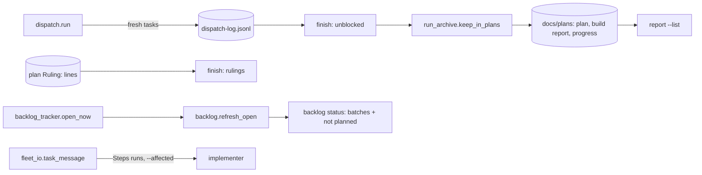
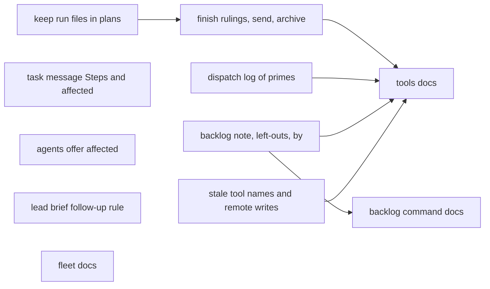

# Superlite B237: finish rulings, plan archive, prime lag, backlog status and doc fixes

**Goal:** `sl finish` counts the plan's `Ruling:` lines, copies plan, build report and progress.md into the plans folder so they outlive the worktree, and stops counting the prime handshake as coordinator lag; `backlog status` shows the note's size and drops closed left-out issues; `by` is named wherever an answers file is; task messages and agent files offer `run_tests --affected` and name extra Steps runs; stale tool names and missing doc facts are fixed (#788 #789 #802 #804 #810 #814 #815 #825 #827 #828 #878 #879 #882 #885 #888 #894 #895 #896 #899; #826 is a follow-up).
**Architecture:** small changes on existing seams. `run_archive.keep_in_plans` copies the run's plan files into the plans folder; `finish` calls it, reads plan rulings and a new `dispatch-log.jsonl` that `dispatch.run` writes for every `fresh` (primed) task. `backlog.refresh_open` re-reads left-out issues in its one tracker call. `fleet_io.task_message` parses the task's Steps line. The rest is prose in docs, agents and the lead brief.
**Tech stack:** Python 3.10+ stdlib; bash hooks; pytest through `sl run_tests`.
**Spec:** this file, section Design.
**Detail:** contracts
**Target-min:** 11
**Wave0:** none
**Max chars:** 40000

Global constraints:
- Every line of a Python script under `skills/**/scripts/` keeps the repo's `# O(...)` complexity comment; stdlib only; LF endings. Files under `tests/` carry no such comments.
- This repository is public: no host names, user names, home paths, other project or repository names in code, tests, docs or commit messages.
- The verdict is `sl run_tests` (never raw pytest); every new test sees a red run before the code it tests.
- An existing test that pins a changed text is updated in the same task only when it is in the task's Owns. Any other test your change turns red: leave it, and name the file and the failing assertion in your report.
- docs/tools.md rows: edit mid-row (tests pin row starts and ends); a new sentence never adds a bare ` | ` inside a row (write `\|`).
- `skills/subagent-driven-development/SKILL.md` stays at most 13300 characters (it is at 13287).
- Fail open: `run_archive.keep_in_plans` and `dispatch.log_fresh` never raise into their callers (an OSError ends the copy or the write quietly).
- `.superlite/dispatch-log.jsonl`: one JSON object per line, `{"time": "2026-11-12T11:01:20", "fresh": ["T3", "T4"]}`; `time` is `datetime.now().isoformat(timespec="seconds")`, as in lint-log.jsonl.
- `sl backlog decide --print` stderr line (exact): `answers file: {"answers": {"<question>": "<option label>"}, "by": "user"}; "by" is required: "user" (the user answered), "main" (main ruled) or {"<question>": "user" | "main"}`
- Builds: the verdict is `sl run_tests` (the project's test command; a project with `.maxapp` runs `maxapp test`, which a build pool may place on another Mac, and a full run whose tree a green maxapp test stamp covers returns that result without a run); task trees build in <tree>/.build/DerivedData and any build of your own goes under .build/ of the worktree, never -derivedDataPath outside the worktree (your session scratchpad included; backlog cleanup removes scratchpad build folders when the worktree goes); a product, simulator or device build stays on this machine and runs only when an issue's acceptance asks for a running-app check.
- Simulators: append the UDID of each simulator you or a worker creates (`xcrun simctl create` or `clone`; a checker's `Simulators:` line marks its created ones) as one line to /Users/max/github/superlite/.claude/worktrees/superlite-b237-finish-rulings-archive-unblocked/.superlite/simulators.txt; never list one you did not create; ship cleanup shuts down and deletes each listed one.

LAYERS: unit, headless, evals



## Design

### 1. What the issues ask, restated
- #828: finish's `rulings:` misses the plan's own `Ruling:` lines. #827: plan, build report and progress.md kept under `.superlite` die with the worktree; Max decided: finish archives them in docs/plans next to the plan. #804: `unblocked: NO` blames the coordinator for the fresh agent's prime handshake.
- #788: status should show `N of 2000 characters`. #814: status's `not planned` lines keep closed issues. #789: commands/backlog.md says `by` defaults to user while the check requires it; `decide --print` and `--help` do not name it.
- #825: Steps items that run another suite are missed by the Verify line. #899: Verify line and the haiku, fixer and reviewer agents should offer `run_tests --affected`.
- #895, #896: `sl lint --stable` and `sl setup` are no tools. #802, #810, #815, #878, #879, #882, #885, #888, #894: doc and rule gaps.

### 2. Rulings
Ruling: [scope] #826 is not built in this batch: Max's decision `run_tests --worker NAME` needs a new flag in run_tests.py, which batch B238 owns; it is a follow-up (the flag plus the fleet-off reviewer and fixer briefs passing it), and the PR says `Refs #826` (because a brief that names a flag run_tests rejects would break every fleet-off reviewer; cost if wrong: #826 waits one batch).
Ruling: [scope] #894's testcmd.py half (its docstring and `sl testcmd` output naming test-cmd.json "cwd") is a follow-up for B238, which owns testcmd.py; docs/tools.md's half is built here.
Ruling: [scope] #815: a lead never files a follow-up in the tracker itself, also in a project that tracks work in an issue tracker; main files each one from the full text `sl backlog ship B notes` prints (because a lead's auto mode denies writes to outside services and the brief's Tracker line allows only evidence comments; one rule for every lead removes the inconsistency the issue reports; cost if wrong: main files them, as today). Main's side in backlog-main.md (B240) is a follow-up.
Ruling: #804: the prime dispatch is the dispatch decision. `dispatch.run` (used by `sl dispatch`, `fleet spawn --for-dispatch` and `commit_task --dispatch`) appends the task ids of its `fresh` lines with the time to `dispatch-log.jsonl`; finish takes the earlier of that time and the task's `unblocked:` line as its send (because the handshake runs after the decision; cost if wrong: a coordinator that runs dispatch and then idles is not flagged for that idle time). `orchestrator end` moves the file with the run's logs.
Ruling: #827: `run_archive.keep_in_plans` holds the copy, `finish` calls it after the build report is written and prints one `archived:` line; the plans folder rule is report.py's (`docs/superpowers/plans` when it exists, else `docs/plans`), moved into `run_archive.plans_dir` and shared. A plan outside the plans folder gets a dated stem (`<today>-<stem>` unless it already starts with a date); an existing file of that name with other bytes moves the stem to `-2`, `-3`, ... An inline run without a plan file archives nothing; a run folder not named `.superlite` archives nothing (because an overwrite of another plan loses it; cost if wrong: an edited plan finished twice leaves one extra copy).
Ruling: #828: the plan's `Ruling:` lines outside fenced code blocks count with the ledger's, deduped by text, before spec.md's; scope rulings in the plan count too.
Ruling: #814: `refresh_open` adds the left-out issues `left_out_lines` would show to its one `open_now` call and drops the closed ones from backlog.json `outside[]` (because hiding them only would re-read them on every status; unreadable ones stay).
Ruling: #788: `status` and `start --note` name the note's characters as `N of 2000 characters`; the `run end:` line keeps its text.
Ruling: #789: `by` stays required (the check, backlog-main.md and the tests agree); commands/backlog.md, `decide` and `answer --help`, and one `decide --print` stderr line name it.
Ruling: #825: a Steps item `<n> run <X>` (X not FAIL or PASS) is an extra run; a test file X joins the --fast paths, any other X goes into one `Steps also run:` line.
Ruling: #802 goes into docs/config.md `## Permissions (Claude Code)`; #810 into docs/fleet.md `## Run root and task trees`.
Ruling: this run's fleet placement is local (`sl fleet placement local`) after four remote researchers' panes vanished.
Ruling: `**Detail:** contracts` (small changes, named tests with exact values).

## Coverage

| Category | State | Basis |
|---|---|---|
| Scope and success criteria | ruled | the issues of section 1 minus #826 and #894's testcmd half (section 2); done when each task's named tests pass and the unit, headless and evals layers are green |
| Domain and data model | ruled | dispatch-log.jsonl lines (Global constraints); backlog.json `outside[]` loses closed entries |
| Persistence and migration | ruled | new files only; a run without dispatch-log.jsonl behaves as before; copies in the plans folder are new files |
| Interfaces and contracts | ruled | finish, status and task message lines change only as section 2 says; decide --print stdout stays pure JSON |
| UI states | n/a | no UI |
| Concurrency and state ownership | ruled | dispatch-log is append-only; backlog.json changes go through `bs.update` as today |
| Error handling and recovery | ruled | archive and log fail open; open_now keeps unreadable issues |
| Security and privacy | ruled | copies stay inside the project root; no tracker write by a lead |
| Performance and limits | ruled | no new tracker call (one open_now call per status); note limit 2000 |
| Observability | ruled | `archived:` line, dispatch-log.jsonl, `Steps also run:` line |
| Testing strategy | ruled | named unit tests per task; headless and evals layers once by the coordinator |
| Compatibility | ruled | Python 3.10; old lint logs and ledgers without dispatch-log still parse |
| Rollout | settled | one pull request, one patch release (backlog ship) |
| Research unknowns | n/a | researched in R1-R10 |

## Task graph

```mermaid
%% schedule
gantt
  title Predicted schedule (mm:ss)
  dateFormat X
  axisFormat %M:%S
  section lane 1
  T4 backlog note left-outs by :t4, 0, 509s
  T10 backlog command docs :t10, 509, 459s
  T11 tools docs :t11, 1002, 462s
  section lane 2
  T1 keep run files in plans :t1, 0, 491s
  T2 finish rulings send archive :t2, 491, 511s
  section lane 3
  T5 task message Steps and affected :t5, 0, 486s
  section lane 4
  T3 dispatch log of primes :t3, 0, 484s
  section lane 5
  T7 stale tool names and remote writes :t7, 0, 483s
  section lane 6
  T9 fleet docs :t9, 0, 461s
  section lane 7
  T8 lead brief follow-up rule :t8, 0, 460s
  section lane 8
  T6 agents offer affected :t6, 0, 458s
```





critical path: T1 → T2 → T11 (24.4 min) · peak width 8 · predicted build 24.4 min · predicted total ≈ 38.9 min (target ✗ 11.0)

## Package: finish

App type: CLI and file I/O. Categories: file, state, protocol.
**Probe entry:** none (it reads and copies run files; the named tests cover each case)

### T1 keep run files in plans · Complexity 4 · Est. context 36k
**Owns:** skills/subagent-driven-development/scripts/run_archive.py, skills/subagent-driven-development/scripts/report.py, tests/scripts/test_keep_in_plans_827.py
**Components:** 2
**LOC owned:** 110
**Tests:** fast
**Model:** sonnet
**Kind:** design
**Covers:** 2
**Produces:** run_archive.plans_dir(root: Path) -> Path · run_archive.keep_in_plans(plan: str, sd: str, today: str | None = None) -> list[str]
  e.g. keep_in_plans("/r/.superlite/plans/fix-login.md", "/r/.superlite", today="2026-11-19") -> ["docs/plans/2026-11-19-fix-login.md", "docs/plans/2026-11-19-fix-login.build-report.md", "docs/plans/2026-11-19-fix-login.build-report.json", "docs/plans/2026-11-19-fix-login.progress.md"]
  e.g. keep_in_plans("/r/docs/plans/2026-11-19-x.md", "/r/.superlite") -> ["docs/plans/2026-11-19-x.progress.md"]
  e.g. keep_in_plans("", "/r/.superlite") -> []
**Review Focus:** file: `test_outside_plan_copied_with_dated_stem` (the first e.g.; the four files exist with the source bytes); file: `test_plan_in_plans_folder_copies_progress_only` (second e.g.; the plan and its build report are not rewritten); file: `test_dated_stem_kept` (`/r/.superlite/2026-01-02-a.md` -> `docs/plans/2026-01-02-a.md`); state: `test_other_file_of_that_name_gets_suffix` (`docs/plans/2026-11-19-fix-login.md` holds other bytes -> `docs/plans/2026-11-19-fix-login-2.md`, the old file unchanged); state: `test_identical_file_reused` (same bytes -> stem kept, progress copy overwritten); file: `test_superpowers_folder_wins` (`docs/superpowers/plans` exists -> copies go there); file: `test_missing_parts_skipped` (no build report, no progress.md -> only the plan); state: `test_no_plan_or_foreign_run_folder` (plan "" or a missing file -> []; sd not named `.superlite` -> []); state: `test_oserror_returns_written_so_far` (copy raising OSError on the third file -> the first two paths, no raise); protocol: `test_report_list_uses_plans_dir` (report.py's `--list` default folder comes from `run_archive.plans_dir`)
**Steps:** 1 failing tests, 2 run: FAIL, 3 implement, 4 run: PASS
**Notes:** root is `Path(sd).resolve().parent` when the folder's name is `.superlite`. The build report sits beside the plan as `<plan stem>.build-report.md` and `.json` (`report.stored_paths`, report.py:262). progress.md is `<sd>/progress.md`. Returned paths are relative to root, POSIX, in the order plan, build-report.md, build-report.json, progress; only files actually written. `plans_dir` replaces the inline rule at report.py:562 (`docs/superpowers/plans` if that folder exists, else `docs/plans`); create the folder when missing.

### T2 finish rulings, send, archive · Complexity 5 · Est. context 46k
**Owns:** skills/subagent-driven-development/scripts/finish.py, tests/scripts/test_finish_b237.py, tests/scripts/test_run_scripts.py
**Components:** 3
**LOC owned:** 90
**Tests:** fast
**Model:** sonnet
**Kind:** design
**Covers:** 2
**Consumes:** run_archive.keep_in_plans(plan: str, sd: str, today: str | None = None) -> list[str] (T1)
**Produces:** finish.plan_rulings(plan: str) -> list[str]
  e.g. plan_rulings("p.md") with lines `Ruling: a`, "```", `Ruling: in code`, "```", `- Ruling: [scope] b` -> ["a", "[scope] b"]
  e.g. plan_rulings("") -> []
**Review Focus:** protocol: `test_plan_rulings_counted` (ledger `- Ruling: x` and a plan with `Ruling: a` and `Ruling: x` -> `rulings: 2`, lines `- x`, `- a`); protocol: `test_plan_scope_ruling_listed` (plan `Ruling: [scope] drop y` -> `scope rulings: 1`); encoding: `test_fenced_ruling_ignored` (first e.g.); state: `test_no_plan_keeps_spec_path` (plan "" with spec.md rulings -> as test_finish_plan_folder_668); state: `test_prime_dispatch_counts_as_send` (lint log `{"time":"2026-11-12T11:01:07","pending":["T1"]}` then `{"time":"2026-11-12T11:02:00","pending":["T1"]}`, ledger `- unblocked: dispatched T1 at 11:03:15`, dispatch-log `{"time": "2026-11-12T11:01:20", "fresh": ["T1"]}` -> the line does not start `unblocked: NO` and holds `max lag 13s`); state: `test_without_dispatch_log_unchanged` (same without the file -> `unblocked: NO - T1 still waiting at the next lint (offered 11:01:07, next lint 11:02:00, sent 11:03:15); max lag 128s`); encoding: `test_bad_dispatch_log_lines_skipped` (a non-JSON line and one without `fresh` -> as without the file); protocol: `test_archived_line_printed` (keep_in_plans patched to return two paths -> stdout holds `archived: docs/plans/a.md, docs/plans/a.progress.md (commit them with the branch: they outlive the worktree)`); protocol: `test_nothing_archived_no_line` (returns [] -> no `archived:` line)
**Steps:** 1 failing tests, 2 run: FAIL, 3 implement, 4 run: PASS
**Notes:** `plan_rulings` uses finish's `RULING` pattern (finish.py:40) and skips lines between fence lines (``` or ~~~). In `summary`, the plan is the `plan` argument, else `orchestrator.plan_file(run_sd)` when `plan` is None; `""` means none. Merge order: ledger, plan (new texts only), then spec.md as #668 does. `unblocked_report(ledger, lint_log, dispatch_log=None)`: default `Path(lint_log).with_name("dispatch-log.jsonl")`; each task's send is the earlier of its first `unblocked:` time and its first dispatch-log time; held and lag use that. The archive call sits in `main` right after the build report is written (where `report.report_text` runs, finish.py:501), only when a plan file exists; its line goes to stdout. `test_run_scripts.py` is owned only to update a `rulings:` count its fixture plan changes.

### T3 dispatch log of primes · Complexity 3 · Est. context 34k
**Owns:** skills/subagent-driven-development/scripts/dispatch.py, skills/subagent-driven-development/scripts/orchestrator.py, tests/scripts/test_dispatch_log_804.py
**Components:** 2
**LOC owned:** 50
**Tests:** fast
**Model:** sonnet
**Kind:** design
**Covers:** 2
**Produces:** dispatch.log_fresh(sd: Path, lines: list[tuple[str, str]], now: str | None = None) -> list[str]
  e.g. log_fresh(sd, [("T1", "agent=W2"), ("T3,T4", "fresh tier=sonnet agent=superlite:implementer"), ("T5", "fresh tier=haiku agent=superlite:implementer-haiku")], now="2026-11-12T11:01:20") -> ["T3", "T4", "T5"]; sd/dispatch-log.jsonl gains `{"time": "2026-11-12T11:01:20", "fresh": ["T3", "T4", "T5"]}`
  e.g. log_fresh(sd, [("T1", "agent=W2"), ("T2,T6", "poll W1,W3")]) -> [] and no file written
**Review Focus:** protocol: `test_log_fresh_examples` (both e.g.); state: `test_run_logs_fresh_lines` (`dispatch.run` on a plan with two ready tasks and an empty pool in `<tmp>/.superlite` -> one dispatch-log line naming both); state: `test_run_outside_superlite_writes_nothing` (pool outside a `.superlite` folder -> no file); state: `test_log_fresh_oserror_quiet` (unwritable folder -> returns the ids, no raise); protocol: `test_orchestrator_end_moves_dispatch_log` (`orchestrator end` moves dispatch-log.jsonl into the run archive with lint-log.jsonl); protocol: `test_docstring_names_plan_tools_lint` (dispatch.py's docstring holds `rerun sl plan_tools lint --stable` and no `rerun sl lint --stable`)
**Steps:** 1 failing tests, 2 run: FAIL, 3 implement, 4 run: PASS
**Notes:** `run()` calls `log_fresh(sd, lines)` once before it returns, only when `tree_root(sd)` is not None (the pool sits in `<root>/.superlite/`, as the tree reaping). A line's decision text starts with `fresh` for a primed agent; ids split on commas. Append with one trailing newline. orchestrator.py:56 lists the run files `end` moves: add `"dispatch-log.jsonl"` beside `"lint-log.jsonl"`. dispatch.py:24's docstring: `rerun sl lint --stable` -> `rerun sl plan_tools lint --stable`.

## Package: backlog

App type: CLI. Categories: protocol, state.
**Probe entry:** none (it reads backlog.json and a tracker; the named tests cover each case)

### T4 backlog note, left-outs, by · Complexity 4 · Est. context 44k
**Owns:** skills/subagent-driven-development/scripts/backlog_state.py, skills/subagent-driven-development/scripts/backlog.py, skills/subagent-driven-development/scripts/backlog_run.py, tests/scripts/test_backlog_b237.py, tests/scripts/test_backlog_state_b89.py, tests/scripts/test_backlog_start_note_504.py, tests/scripts/test_backlog_decide_fit.py
**Components:** 3
**LOC owned:** 70
**Tests:** fast
**Model:** sonnet
**Kind:** design
**Covers:** 1
**Review Focus:** protocol: `test_status_note_names_characters` (a 2-line note of 1450 characters -> `note: 2 lines (1450 of 2000 characters) from /m/rules.md (T) go into every lead brief (sl backlog start --note FILE replaces it, an empty file clears it)`); protocol: `test_start_note_names_characters` (`note: stored from /m/rules.md (2 lines, 1450 of 2000 characters); every lead brief from now on carries it`); state: `test_status_drops_closed_left_out` (outside `[{"number": 5, "title": "a", "reason": "not planned (cap)"}, {"number": 6, "title": "b", "reason": "not planned (triage)"}]`, open_now patched to return [6] -> status prints `not planned (triage): #6`, no `not planned (cap)` line and no `cap:` hint; backlog.json outside keeps only #6); state: `test_left_out_and_batches_one_call` (a batch with open_issues [1] and outside #5 -> open_now called once with [1, 5]); state: `test_unreadable_left_out_kept` (open_now returns its input -> outside unchanged); state: `test_left_out_held_by_batch_not_asked` (outside #5 also in a batch's issues -> not passed to open_now); protocol: `test_decide_print_names_by` (`decide --print` stdout is the same JSON as before; stderr holds the exact answers-file line of the Global constraints); protocol: `test_help_names_by` (`backlog decide --help` and `backlog answer B --help` output hold `"by"` and `"main"`)
**Steps:** 1 failing tests, 2 run: FAIL, 3 implement, 4 run: PASS
**Notes:** backlog_state.py:316 `note_line` and :307 `set_note` get the counts (`len(text)`, `NOTE_MAX`). backlog.py:987 `refresh_open`: the left-out set is the entries `left_out_lines` lists (`_left_out` and not held by a batch); the early return happens only when neither batches nor left-outs exist; drop an `outside[]` entry inside the same `bs.update` only when its number was asked and open_now did not return it; the return value (changed batches) stays as is. decide help (backlog.py:1141): append `; FILE needs "by": "user", "main" or {question: "user"|"main"}`; `--file` help for decide and answer (backlog_run.py:1269): `answers file {"answers": {question: answer}, "by": "user"|"main"|{question: "user"|"main"}}; "by" is required`. The stderr line goes after decide --print's existing `step:` line.

### T8 lead brief follow-up rule · Complexity 2 · Est. context 30k
**Owns:** skills/subagent-driven-development/scripts/backlog_brief.py, skills/subagent-driven-development/backlog.md, tests/scripts/test_backlog_docs_b90.py, tests/scripts/test_backlog_brief_815.py
**Components:** 1
**LOC owned:** 30
**Tests:** fast
**Model:** sonnet
**Kind:** design
**Covers:** 1
**Review Focus:** protocol: `test_brief_says_lead_never_files_followups` (a lead brief built as test_backlog_brief.py builds one holds `one \`Follow-up: ...\` line per follow-up issue (main files it; never file one yourself, also when the project tracks work in an issue tracker)`); protocol: `test_backlog_md_followup_rule` (SDD backlog.md holds `(a follow-up issue; main files it from the full text \`sl backlog ship B notes\` prints, also in a project with an issue tracker; a lead never files one itself)`)
**Steps:** 1 failing tests, 2 run: FAIL, 3 implement, 4 run: PASS
**Notes:** backlog_brief.py:53 `(main files it)` -> the brief text above. backlog.md:23 `(a follow-up issue; main files it)` -> the backlog.md text above; update the `LEAD` constant of test_backlog_docs_b90.py to match. Change no other sentence.

### T10 backlog command docs · Complexity 2 · Est. context 30k
**Owns:** commands/backlog.md, tests/scripts/test_docs_b237_backlog.py
**Components:** 1
**LOC owned:** 20
**Tests:** fast
**Model:** sonnet
**Kind:** design
**Covers:** 1
**Review Focus:** protocol: `test_by_required_not_default` (commands/backlog.md no longer holds `the default is \`user\``; it holds `"by" is required` and names `"user"`, `"main"` and the per-question map); protocol: `test_decide_print_line_quoted` (it quotes `answers file:` and that text is in backlog.py); protocol: `test_github_not_found_line` (it holds `not found: #N (not in the open-issue list; read by number:` and `read by number`, and backlog.py:570 still prints `not found: #{n} (not in the open-issue list; read by number:`)
**Steps:** 1 failing tests, 2 run: FAIL, 3 implement, 4 run: PASS
**Notes:** Line 12 (step 3): drop `(the default is \`user\`)` and say `"by"` is required: `"user"`, `"main"` or `{"<question>": "user"|"main"}`, and that `decide --print` names the shape on stderr. Line 11: beside the Jira `not found:` line name the GitHub `not found: #N (not in the open-issue list; read by number: <why>)` line, that a pinned issue the listing or search misses is read by number, and its retry `sl backlog plan --issues N --add` (none for a closed issue or a pull request; backlog.py:566-570).

## Package: task message and agents

App type: library (text builder). Categories: protocol, encoding.
**Probe entry:** call=fleet_io.steps_runs

### T5 task message Steps and affected · Complexity 4 · Est. context 44k
**Owns:** skills/subagent-driven-development/scripts/fleet_io.py, tests/scripts/test_fleet_io_steps_825.py, tests/scripts/test_fleet_io_batch_verify_556.py, tests/scripts/test_fleet_io_task_cmd_475.py, tests/scripts/test_fleet_io_destinations_598.py, tests/scripts/test_fleet_io.py, tests/scripts/test_external_repo_brief.py
**Components:** 2
**LOC owned:** 60
**Tests:** fast
**Model:** sonnet
**Kind:** design
**Covers:** 1
**Produces:** fleet_io.steps_runs(steps: str) -> list[str]
  e.g. steps_runs("1 failing test, 2 run: FAIL, 3 implement, 4 run: PASS, 5 run TestCompactDue") -> ["TestCompactDue"]
  e.g. steps_runs("1 failing tests, 2 run: FAIL, 3 implement, 4 run: PASS") -> []
  e.g. steps_runs("1 edit, 2 run `tests/scripts/test_x.py`, 3 run: pass") -> ["tests/scripts/test_x.py"]
**Review Focus:** protocol: `test_steps_runs_examples` (the three e.g.); encoding: `test_steps_runs_empty_and_odd` ("" -> []; "2 run: FAIL (red)" -> []; "5 run X, 6 run X" -> ["X"]); protocol: `test_fast_line_offers_affected` (single task with a test file in Owns -> `Verify: \`<sl> run_tests --fast tests/a_test.py --task T1 --background\` (or \`<sl> run_tests --affected --task T1 --background\`, which picks the tests your change touches), then run the printed \`wait:\` line in the foreground.`); protocol: `test_steps_test_file_joins_fast_paths` (Steps `5 run tests/b_test.py` -> the --fast paths are `tests/a_test.py tests/b_test.py`, no `Steps also run:` line); protocol: `test_steps_class_gets_line` (Steps `5 run TestCompactDue` -> next line `Steps also run: TestCompactDue; run each before you report DONE (the Verify line does not cover them).`); protocol: `test_batch_steps_line_per_member` (batch T1,T2, T2's Steps run `TestX` -> `Steps also run T2: TestX; ...` after `Verify T2:`); protocol: `test_cmd_and_build_forms_unchanged` (a `cmd=` task and a `Tests: build` task keep their Verify text; a path X goes into their `Steps also run:` line)
**Steps:** 1 failing tests, 2 run: FAIL, 3 implement, 4 run: PASS
**Notes:** Items split on commas; an item matching `^\s*\d+\s+run\b:?\s*(.+)$` whose X (backticks and spaces stripped) does not start with FAIL or PASS (any case) is a run. In `task_message` (fleet_io.py:120), X is a test path when `testcmd.verify_paths([X]) == [X]`; only the `--fast` form takes path items, the other forms list them in the line. The `--affected` parenthesis sits only in the `--fast` form, between the command and the `wait:` tail. Owned fleet_io tests change only where they pin the `--fast` line.

### T6 agents offer affected · Complexity 1 · Est. context 26k
**Owns:** agents/implementer-haiku.md, agents/fixer-sonnet.md, agents/fixer-sonnet-high.md, agents/fixer-opus.md, agents/package-reviewer.md, tests/scripts/test_fixer_foreground_b26.py, tests/scripts/test_agents_affected_899.py
**Components:** 1
**LOC owned:** 25
**Tests:** fast
**Model:** haiku
**Kind:** mechanical
**Covers:** 1
**Review Focus:** protocol: `test_haiku_offers_affected` (agents/implementer-haiku.md holds `` `<abs sl> run_tests --fast PATHS --task Tn --background` (or `<abs sl> run_tests --affected --task Tn --background`: run_tests picks the tests your change touches; when no test covers it, it exits 2 naming the files, so write that test), then run the `wait:` line ``); protocol: `test_fixers_offer_affected` (each of the three fixer files holds `` `<abs sl> run_tests --fast <touched test files> --background` (or `<abs sl> run_tests --affected --task Tn --background` when your brief names the task Tn: run_tests picks the tests your change touches), then run the `wait:` line ``); protocol: `test_reviewer_offers_affected` (agents/package-reviewer.md holds `` `<abs sl> run_tests --fast PATHS --background` (or `<abs sl> run_tests --affected --task Tn --background` for the task under review: run_tests picks the tests its change touches), then run the `wait:` line ``)
**Test code (verbatim):** the three tests read each file with `Path(...).read_text(encoding="utf-8")` from the repo root (`Path(__file__).resolve().parents[2]`) and assert the quoted substring is in it.
**Steps:** 1 failing tests, 2 run: FAIL, 3 implement, 4 run: PASS
**Notes:** Insert the parenthesis right after the backticked `--fast` command in agents/implementer-haiku.md:20, agents/fixer-sonnet.md:23, agents/fixer-sonnet-high.md:23, agents/fixer-opus.md:23 and agents/package-reviewer.md:16; nothing else changes. Update `FIXER_LINE` and `REVIEWER_LINE` in tests/scripts/test_fixer_foreground_b26.py to the new lines.

## Package: stale names and docs

App type: file (prose and messages). Categories: file, encoding.
**Probe entry:** none (prose and message text; the named tests pin it)

### T7 stale tool names and remote writes · Complexity 3 · Est. context 40k
**Owns:** skills/subagent-driven-development/scripts/next_tasks.py, skills/subagent-driven-development/scripts/compact_due.py, hooks/compact-nudge, skills/subagent-driven-development/SKILL.md, docs/config.md, docs/hooks.md, tests/scripts/doc_contract_allowlist.txt, tests/scripts/test_dispatch_unstable.py, tests/scripts/test_stable_lapse.py, tests/scripts/test_compact_due.py, tests/scripts/test_docs_b32_sdd.py, tests/scripts/test_orchestrator.py, tests/scripts/test_stale_tool_names_895.py
**Also-touches:** docs/tools.md, tests/scripts/test_docs_b32_tools.py
**Components:** 2
**LOC owned:** 40
**Tests:** fast
**Model:** sonnet
**Kind:** design
**Covers:** 1
**Review Focus:** protocol: `test_no_sl_lint_stable` (none of next_tasks.py, SDD SKILL.md, docs/tools.md holds `sl lint --stable`; next_tasks prints `rerun sl plan_tools lint --stable`); protocol: `test_no_sl_setup` (none of compact_due.py, hooks/compact-nudge, docs/config.md, docs/hooks.md holds `sl setup`; each names `/superlite:setup`); protocol: `test_allowlist_has_no_setup_or_lint_lines` (doc_contract_allowlist.txt holds no `| lint --stable |` and no `| setup |` line; test_doc_contract.py stays green); protocol: `test_config_names_remote_write_grant` (docs/config.md's Permissions section holds `ssh <host> bash -s < script`)
**Steps:** 1 failing tests, 2 run: FAIL, 3 implement, 4 run: PASS
**Notes:** `sl lint --stable` -> `sl plan_tools lint --stable` at next_tasks.py:432, SDD SKILL.md:54 (adds 11 characters: stays at most 13300) and docs/tools.md:19,21. `sl setup` -> `/superlite:setup` at compact_due.py:8,93, hooks/compact-nudge:4, docs/config.md:52, docs/hooks.md:28. Drop the four allowlist lines 2-5 (keep line 1 and the docs/mvp-flow.md line). Update the pinned strings in the owned tests and in test_docs_b32_tools.py (lines 33, 36). docs/config.md `## Permissions (Claude Code)` gains one bullet (#802): remote shell writes (`ssh <host> git worktree add`, `systemctl restart` there) are denied by auto mode's classifier as remote shell writes until the user grants the exact command; ask once for one self-cleaning script run as `ssh <host> bash -s < script` (it does the step and removes what it made), so one grant covers the step; a lead or worker writes such a step as `Left undone:` instead.

### T9 fleet docs · Complexity 3 · Est. context 46k
**Owns:** docs/fleet.md, skills/subagent-driven-development/fleet.md, tests/scripts/test_docs_b237_fleet.py
**Components:** 1
**LOC owned:** 40
**Tests:** fast
**Model:** sonnet
**Kind:** design
**Covers:** 1
**Review Focus:** protocol: `test_fleet_names_sign_in_screen` (docs/fleet.md holds `signed out (Claude Code sign-in screen)` and `(signed out: account`, and fleet.py:318 / fleet_io.py:981 still print them); protocol: `test_fleet_names_spawn_timeout` (docs/fleet.md and SDD fleet.md name a `fleet spawn` Bash call with a timeout of 600000 ms); protocol: `test_fleet_names_standing_note_end` (docs/fleet.md holds `run end: standing note` and `--note /dev/null`, and backlog_run.py still prints both); protocol: `test_fleet_names_git_deny_and_root` (docs/fleet.md holds `Bash(git checkout *)`, `Bash(git restore *)`, `Bash(git stash *)` and `ROOT=`, and fleet_roles.py still lists the four patterns); protocol: `test_fleet_names_whole_tree_and_builds` (docs/fleet.md's `## Run root and task trees` holds `whole-tree` and `two workers`)
**Steps:** 1 failing tests, 2 run: FAIL, 3 implement, 4 run: PASS
**Notes:** Read the code before you write each fact. #879: the sign-in screen retry and its lines (fleet.py:169, :318, :524, :566), wait's ` (signed out: account X shows the Claude Code sign-in screen; sign in there, then respawn)` tail (fleet_io.py:981), the spawn stop line (fleet.py:1170) and the spawn error BLOCKED line (find it in fleet.py), and that a coordinator gives a `fleet spawn` Bash call a timeout of 600000 ms; in docs/fleet.md `## Troubleshooting` and the SDD fleet.md sentence that names 600000 ms for `fleet wait`. #882: docs/fleet.md:100 paragraph gains the `run end: standing note from <file> still goes into every later lead brief; sl backlog start --note /dev/null clears it` line (backlog_run.py:996). #888: `## Roles`: every worker role starts with `--disallowedTools AskUserQuestion Bash(git checkout *) Bash(git restore *) Bash(git stash) Bash(git stash *)` (fleet_roles.py:28-29; name the role at fleet_roles.py:87 that denies Bash outright and the lead's list, fleet_lead.py:60), and the task message names `ROOT=<run root>` (fleet_io.py:132; none for an external-repo task). #810: `## Run root and task trees`: two workers in one checkout: a worker formats and lints only its own Owns files, never the whole tree (another worker's half-written files fail a whole-tree check); whole-tree checks are the coordinator's, after the wave's commits; workers never build or test in the same folder at once: `run_tests --fast ... --task Tn` and a fleet worker's own tree build in that tree's `.build/DerivedData`, while `--full` runs and fleet-off workers use the run root one at a time (the sentence at docs/fleet.md:138). Keep every other sentence.

### T11 tools docs · Complexity 3 · Est. context 50k
**Owns:** docs/tools.md, tests/scripts/test_docs_b32_tools.py, tests/scripts/test_docs_b237_tools.py
**Components:** 1
**LOC owned:** 50
**Tests:** fast
**Model:** sonnet
**Kind:** design
**Covers:** 1, 2
**Review Focus:** protocol: `test_backlog_row_names_github_not_found` (the backlog plan row holds `not found: #N` and `read by number`); protocol: `test_backlog_rows_name_note_size_left_out_and_by` (rows hold `of 2000 characters`, that status drops closed left-out issues, and `"by" is required`); protocol: `test_commit_task_row` (the commit_task row holds `import check skipped (__main__ runs the program)`, `TimeoutExpired` and `SUPERLITE_IMPORT_TIMEOUT`, and commit_task.py still holds each); protocol: `test_run_tests_and_trees_rows` (the rows hold `tree index not updated`, `kept at base`, `changed in the run root while the tests ran`, `[run folder`, `found no scheme or package` and `"cwd"`, and run_tests.py / trees.py still hold each); protocol: `test_finish_and_dispatch_rows` (the finish row holds `archived:`, `dispatch-log.jsonl` and the plan's `Ruling:` lines; the dispatch row holds `dispatch-log.jsonl`); protocol: `test_fleet_row_names_sign_in` (the fleet row holds `signed out` and `600000`)
**Steps:** 1 failing tests, 2 run: FAIL, 3 implement, 4 run: PASS
**Notes:** Rows (R9): commit_task line 24, run_tests 27, trees 33, backlog 56-62 (plan row 56 holds the Jira `not found:`). Facts: backlog.py:557-570 (not found lines), commit_task.py:261-263, 286-288, 899 (120 s default, `IMPORT_TIMEOUT`), trees.py:199, run_tests.py:1669, 1679, 1731, 1900, 2360-2365, 2525; T2's `archived:` line and plan rulings, T3's dispatch log, T4's status and decide lines, T9's sign-in facts. Edit mid-row; T7 already changed lines 19 and 21.

## Review Focus

- finish (CLI, file I/O): file, state, protocol. Risks: a copy that overwrites another plan; a copy outside the project root; a fenced example counted as a ruling; a stale dispatch log from an earlier run hiding a real hold.
- backlog (CLI): protocol, state. Risks: an open issue dropped because the tracker read failed; decide --print stdout no longer pure JSON.
- task message (library): protocol, encoding. Risks: a FAIL/PASS step read as a suite; a byte change in the cmd= and build forms.
- docs: file. Risks: an `sl` call in prose that does not exist; a row pin broken by a bare ` | `; SDD SKILL.md over 13300 characters.

## Coordinator steps after the last task

1. Test layers once: `sl run_tests --full`, then `fleet run --layer headless` and `--layer evals` (the change touches `hooks/**`, `agents/**`, `commands/**` and SDD SKILL.md).
2. Final review, then `sl finish` (its own `archived:` line is this batch's proof for #827; commit the copies it writes), then ship.

## Self-review

- Coverage: #828, #804, #827 -> T1-T3; #788, #814, #789 -> T4, T10, T11; #815 -> T8; #825, #899 -> T5, T6; #895, #896, #802 -> T7; #810, #879, #882, #888 -> T9 (+T11 fleet row); #878, #885, #894 -> T10, T11; #826 and #894's testcmd half are follow-ups (section 2).
- Graph: T1 -> T2 (finish calls keep_in_plans); T4 -> T10 and T2, T3, T4, T7 -> T11 are docs whose tests check the quoted code text. No two tasks own one file; T7's docs/tools.md edit is an Also-touches of T11, which depends on T7.
- Names: `run_archive.keep_in_plans`, `run_archive.plans_dir`, `finish.plan_rulings`, `dispatch.log_fresh`, `fleet_io.steps_runs` are written the same everywhere.
