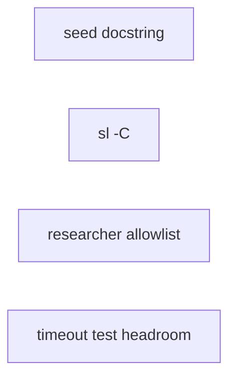

# Superlite B256: seed docstring, researcher allowlist, `sl -C`, timeout test headroom (#797 #809 #811 #954)

**Goal:** `seed_test_cmd`'s docstring names the seed record (#797); fleet research workers run a read-only Bash allowlist (#809, Max: read-only command allowlist); `sl -C DIR` / `--root DIR` runs a tool in DIR so calls need no `cd <worktree> &&` (#811); `test_slow_start_raises_the_run_timeout` no longer fails on a loaded runner (#954).
**Architecture:** four disjoint edits: a docstring in `backlog.py`; launch flags in `fleet_roles.py` plus the researcher agent file and docs/fleet.md; a leading-option loop in the `sl` bash launcher plus docs/tools.md; one test's assertions.
**Tech stack:** Python 3.10+ stdlib, bash; pytest through `sl run_tests`.
**Spec:** this file, section Design.
**Detail:** tests
**Target-min:** 11
**Wave0:** none
**Coverage:** off

Global constraints:
- Every line of a Python script under `skills/**/scripts/` and of `sl` keeps the repo's `# O(...)` complexity comment; stdlib only; LF endings. Files under `tests/` carry no such comments.
- This repository is public: no host names, user names, home paths, other project or repository names in code, tests, docs or commit messages.
- The verdict is `sl run_tests` (never raw pytest); every new test sees a red run before the code it tests.
- An existing test that pins a changed text or output is updated in the same task only when it is in the task's Owns. Any other test your change turns red: leave it, and name the file and the failing assertion in your report (the coordinator rules it).
- Builds: the verdict is `sl run_tests` (the project's test command; a project with `.maxapp` runs `maxapp test`, which a build pool may place on another Mac, and a full run whose tree a green maxapp test stamp covers returns that result without a run); task trees build in <tree>/.build/DerivedData and any build of your own goes under .build/ of the worktree, never -derivedDataPath outside the worktree (your session scratchpad included; backlog cleanup removes scratchpad build folders when the worktree goes); a product, simulator or device build stays on this machine and runs only when an issue's acceptance asks for a running-app check; copy this sentence into every worker brief.
- Simulators: append the UDID of each simulator you or a worker creates (`xcrun simctl create` or `clone`; a checker's `Simulators:` line marks its created ones) as one line to the worktree's `.superlite/simulators.txt`; never list one you did not create; ship cleanup shuts down and deletes each listed one; copy this sentence into every worker brief.

## Design

### 1. Seed record docstring (#797)

`backlog.seed_test_cmd` returns True after a copy; `backlog_run.cmd_start` then calls `testcmd.record_seed(wt)`, which writes the copied bytes to the worktree's `.superlite/test-cmd.seeded` (#638). The docstring says so.

### 2. Researcher read-only allowlist (#809, Max: read-only command allowlist)

Measured on the installed Claude Code (2026-11-19): with `--agent`, the agent file's `tools:` list caps the session's tools (`--tools` adds none), so `agents/researcher.md` lists Bash; `--permission-mode dontAsk` plus `--allowedTools Read Grep Glob Bash(git log *) ...` ran `git log`, `git status` and `xcrun simctl list` and refused `touch`, `python3 -c` and `git log ... && touch ...` without a dialog, and Read of a file outside the working directory ran.

- `fleet_roles.RESEARCH_BASH` (allow patterns, this order): `Bash(git log *)`, `Bash(git show *)`, `Bash(git diff *)`, `Bash(git status *)`, `Bash(git blame *)`, `Bash(git ls-files *)`, `Bash(git rev-parse *)`, `Bash(git merge-base *)`, `Bash(git cat-file *)`, `Bash(git worktree list *)`, `Bash(git apply --check *)`, `Bash(ls *)`, `Bash(xcrun simctl list *)`.
- `fleet_roles.RESEARCH_DENY`: `Bash(git * --output*)`, `Bash(git apply * --apply*)` (the two allowlisted forms that write a file or apply a patch).
- `RESEARCH_TAIL = ["--permission-mode", "dontAsk", "--allowedTools", "Read", "Grep", "Glob", *RESEARCH_BASH, "--disallowedTools", "AskUserQuestion", *GIT_DENY, *RESEARCH_DENY, "Edit", "Write", "NotebookEdit"]`; the variadic `--disallowedTools` list stays last, as in `TAIL`.
- `agents/researcher.md`: `tools: Read, Grep, Glob, Bash`; the body names the allowlist and says a refused command is an answer, never retried another way.
- docs/fleet.md: the research row, the "Every worker role starts with" paragraph and the "Research worker limits:" paragraph name the allowlist and `dontAsk`.

Rulings:
- Ruling: `dontAsk` over `default` plus the deny-worker-permission hook (because dontAsk refuses an off-list command with no dialog and no "end BLOCKED" message, so the researcher keeps answering, and it holds without the hook).
- Ruling: [scope] with the fleet off, the in-process researcher's Bash runs under the parent session's permission mode and rules; only its agent text binds it to the allowlist (because Claude Code ignores `permissionMode` and `hooks` in plugin subagent frontmatter, so the agent file cannot enforce it); a Follow-up names a PreToolUse hook that would.
- Ruling: MISSED TARGET accepted (because the four tasks have no edges and run at once; the forecast comes from contention and history, not from the plan's shape).
- Ruling: `git grep` is left off the allowlist (because `git grep -O<cmd>` runs a program; Grep covers the search) and `git branch`/`git tag` too (their argument forms create refs).

### 3. `sl -C DIR` / `--root DIR` (#811)

Before the tool name, `sl` reads leading options in a loop: `-C DIR`, `--root DIR` and `--root=DIR` each `cd` into DIR (repeatable; each relative to the last, like `git -C`), then the tool runs there; `here` is computed before, so the tool lookup is unchanged. Errors, exit 2, nothing run: `sl: -C needs a directory` (also `--root`, `--root=` with an empty value: `sl: --root needs a directory`) and `sl: -C DIR: not a directory` (the option as written, then the value). The usage line becomes `usage: sl [-C DIR | --root DIR] <tool> [args...]`; the header comment's usage line too. docs/tools.md's opening paragraph gains one sentence.

### 4. Timeout test headroom (#954)

The flake is the `<= 9.0` bound: a loaded runner measured a second start near 2.9 s, so `run_timeout_from` gave 9.8. The test asserts the measured timeout follows `pr.run_timeout_from(warm["second"])` and is at least 7.0, and its probe argument drops from 3.6 to 3.2 (5.2 s run: still over the 5.0 default, 1.8 s under the smallest measured timeout).

## Task graph

```mermaid
%% schedule
gantt
  title Predicted schedule (mm:ss)
  dateFormat X
  axisFormat %M:%S
  section lane 1
  T3 researcher allowlist :t3, 0, 395s
  section lane 2
  T2 sl -C and --root :t2, 0, 374s
  section lane 3
  T1 seed docstring :t1, 0, 366s
  section lane 4
  T4 timeout test headroom :t4, 0, 285s
```





critical path: T3 (6.6 min) · peak width 4 · predicted build 6.6 min · predicted total ≈ 19.1 min (target ✗ 11.0)

## Package: launcher and scripts

App type: CLI and library. Categories: protocol (exact argv and messages).
**Probe entry:** none (the named tests run each case through `sl` or the library)

### T1 seed docstring · Complexity 1 · Est. context 22k
**Owns:** skills/subagent-driven-development/scripts/backlog.py, tests/scripts/test_backlog_seed_doc_797.py
**Components:** 1
**LOC owned:** 15
**Tests:** fast
**Model:** haiku
**Kind:** mechanical
**Covers:** 1
**Produces:** backlog.seed_test_cmd.__doc__ names `.superlite/test-cmd.seeded` and `testcmd.record_seed`
**Review Focus:** protocol: `test_seed_docstring_names_the_record`
**Test code (verbatim):**
```python
# tests/scripts/test_backlog_seed_doc_797.py
"""seed_test_cmd's docstring names the seed record backlog_run writes after it (#797)."""
import sys
from pathlib import Path

sys.path.insert(0, str(Path(__file__).resolve().parents[2] / "skills" / "subagent-driven-development" / "scripts"))
import backlog  # noqa: E402


def test_seed_docstring_names_the_record():
    doc = backlog.seed_test_cmd.__doc__
    for s in (".superlite/test-cmd.seeded", "testcmd.record_seed", "backlog_run.cmd_start", "#638"):
        assert s in doc, s
```
**Steps:** 1 write the test, 2 run: FAIL, 3 replace the docstring's second paragraph with exactly these lines (keep the first line):
```
    Only when the main checkout has the file and the worktree has none (a lead's own file is kept).
    On True, backlog_run.cmd_start calls testcmd.record_seed(wt), which writes the copied bytes to the
    worktree's .superlite/test-cmd.seeded, so an unedited copy follows the main checkout's file (#638).
    A failed copy prints one stderr line and returns False; `backlog start` goes on."""
```
4 run: PASS
**Notes:** verify with `sl run_tests --fast tests/scripts/test_backlog_seed_doc_797.py --task T1`.

### T2 sl -C and --root · Complexity 2 · Est. context 30k
**Owns:** skills/subagent-driven-development/scripts/sl, tests/scripts/test_sl_root_811.py, docs/tools.md
**Components:** 1
**LOC owned:** 90
**Tests:** fast
**Model:** sonnet
**Covers:** 3
**Produces:** `sl [-C DIR | --root DIR | --root=DIR]... <tool> [args...]`
  e.g. `sl -C /x/wt orchestrator status` runs orchestrator.py with /x/wt as the working directory
**Review Focus:** protocol: `test_option_runs_the_tool_in_dir` (-C, --root, --root=), `test_repeated_c_is_relative`, `test_bad_dir_exits_2_and_runs_nothing`, `test_missing_dir_exits_2`, `test_no_option_keeps_cwd`, `test_version_and_usage_after_c`
**Test code (verbatim):**
```python
# tests/scripts/test_sl_root_811.py
"""sl -C DIR / --root DIR runs the tool in DIR, so calls need no `cd <worktree> &&` (#811)."""
import os
import shutil
import subprocess
from pathlib import Path

import pytest

ROOT = Path(__file__).resolve().parents[2]
SL = ROOT / "skills" / "subagent-driven-development" / "scripts" / "sl"
pytestmark = pytest.mark.skipif(os.name == "nt", reason="the fake interpreter is a POSIX shell script")


def _sl(tmp_path, *args, cwd=None):
    fake = tmp_path / "fakepy"
    fake.write_text('#!/bin/sh\nprintf "%s\\n" "$(pwd -P)" "$@"\n', encoding="utf-8")
    fake.chmod(0o755)
    env = {k: v for k, v in os.environ.items() if k != "SUPERLITE_SL"}
    env.update(SUPERLITE_PYTHON=str(fake), SUPERLITE_CACHE_DIR=str(tmp_path / "cache"))
    return subprocess.run([shutil.which("bash"), str(SL), *args], capture_output=True, text=True, env=env, cwd=cwd or tmp_path)


@pytest.mark.parametrize("opt", [["-C", "{d}"], ["--root", "{d}"], ["--root={d}"]])
def test_option_runs_the_tool_in_dir(tmp_path, opt):
    d = tmp_path / "wt"
    d.mkdir()
    r = _sl(tmp_path, *[o.format(d=d) for o in opt], "metrics", "--plan", ".superlite")
    assert r.returncode == 0, r.stderr
    out = r.stdout.splitlines()
    assert out[0] == os.path.realpath(d) and out[1].endswith("/metrics.py") and out[2:] == ["--plan", ".superlite"]


def test_repeated_c_is_relative(tmp_path):
    (tmp_path / "a" / "b").mkdir(parents=True)
    r = _sl(tmp_path, "-C", str(tmp_path / "a"), "-C", "b", "metrics")
    assert r.returncode == 0, r.stderr
    assert r.stdout.splitlines()[0] == os.path.realpath(tmp_path / "a" / "b")


def test_bad_dir_exits_2_and_runs_nothing(tmp_path):
    missing = tmp_path / "nope"
    r = _sl(tmp_path, "-C", str(missing), "metrics")
    assert r.returncode == 2 and r.stdout == ""
    assert f"sl: -C {missing}: not a directory" in r.stderr
    r = _sl(tmp_path, f"--root={missing}", "metrics")
    assert r.returncode == 2 and f"sl: --root {missing}: not a directory" in r.stderr


@pytest.mark.parametrize("args,msg", [(["-C"], "sl: -C needs a directory"), (["--root"], "sl: --root needs a directory"),
                                      (["--root=", "metrics"], "sl: --root needs a directory"), (["-C", "", "metrics"], "sl: -C needs a directory")])
def test_missing_dir_exits_2(tmp_path, args, msg):
    r = _sl(tmp_path, *args)
    assert r.returncode == 2 and r.stdout == "" and msg in r.stderr


def test_no_option_keeps_cwd(tmp_path):
    d = tmp_path / "here"
    d.mkdir()
    r = _sl(tmp_path, "metrics", "x", cwd=d)
    assert r.returncode == 0 and r.stdout.splitlines()[0] == os.path.realpath(d) and r.stdout.splitlines()[2:] == ["x"]


def test_version_and_usage_after_c(tmp_path):
    r = _sl(tmp_path, "-C", str(tmp_path), "version")
    assert r.returncode == 0 and r.stdout.startswith("superlite ")
    r = _sl(tmp_path, "-C", str(tmp_path))
    assert r.returncode == 2 and "usage: sl [-C DIR | --root DIR] <tool> [args...]" in r.stderr
```
**Steps:** 1 write the test, 2 run: FAIL, 3 in `sl`, after the `here=` line and before `tool=`, add a `while` loop over `"${1:-}"`: `-C|--root` needs a non-empty `$2` (else `sl: $1 needs a directory`, exit 2), `--root=*` takes the text after `=` (empty: `sl: --root needs a directory`, exit 2); each does `cd -- "<dir>" 2>/dev/null` or prints `sl: <-C or --root> <dir>: not a directory` and exits 2, then shifts; any other first word ends the loop; change the usage line to `usage: sl [-C DIR | --root DIR] <tool> [args...]` and the header's usage comment to `<skill-dir>/scripts/sl [-C DIR | --root DIR] <tool> [args...]` with one comment line on the options; every new line keeps its `# O(...)` comment, 4 append to docs/tools.md's opening paragraph (the line starting "Mechanical steps are scripts"): ` Leading \`-C DIR\` (or \`--root DIR\`, \`--root=DIR\`, repeatable like \`git -C\`) runs the tool in DIR, so a call needs no \`cd <worktree> &&\`; a missing or bad DIR exits 2 and runs nothing (#811).`, 5 run: PASS
**Notes:** verify with `sl run_tests --fast tests/scripts/test_sl_root_811.py tests/scripts/test_sl_tools.py tests/scripts/test_sl_form.py --task T2`, then once `sl run_tests --fast $(grep -rl "tools.md" tests/scripts) --task T2` and report any red test outside Owns by file and assertion.

### T3 researcher allowlist · Complexity 2 · Est. context 34k
**Owns:** skills/subagent-driven-development/scripts/fleet_roles.py, agents/researcher.md, docs/fleet.md, tests/scripts/test_fleet_research_bash_809.py, tests/scripts/test_fleet_roles.py, tests/scripts/test_fleet_research_docs_b43.py
**Components:** 2
**LOC owned:** 70
**Tests:** fast
**Model:** sonnet
**Covers:** 2
**Produces:** fleet_roles.RESEARCH_BASH: tuple[str, ...] · fleet_roles.RESEARCH_DENY: tuple[str, ...] · fleet_roles.RESEARCH_TAIL: list[str]
  e.g. fr.launch("research", None, {})["argv"][6:9] == ["--permission-mode", "dontAsk", "--allowedTools"]
**Review Focus:** protocol: `test_research_bash_allowlist_exact`, `test_research_argv_runs_dont_ask_with_the_allowlist`, `test_other_roles_keep_their_tail`, `test_researcher_agent_lists_bash_and_the_allowlist`
**Test code (verbatim):**
```python
# tests/scripts/test_fleet_research_bash_809.py
"""The research role runs a read-only Bash allowlist under dontAsk (#809)."""
import sys
from pathlib import Path

ROOT = Path(__file__).resolve().parents[2]
sys.path.insert(0, str(ROOT / "skills" / "subagent-driven-development" / "scripts"))
import fleet_roles as fr  # noqa: E402

ALLOW = ["Bash(git log *)", "Bash(git show *)", "Bash(git diff *)", "Bash(git status *)", "Bash(git blame *)",
         "Bash(git ls-files *)", "Bash(git rev-parse *)", "Bash(git merge-base *)", "Bash(git cat-file *)",
         "Bash(git worktree list *)", "Bash(git apply --check *)", "Bash(ls *)", "Bash(xcrun simctl list *)"]
DENY = ["Bash(git * --output*)", "Bash(git apply * --apply*)"]


def test_research_bash_allowlist_exact():
    assert list(fr.RESEARCH_BASH) == ALLOW and list(fr.RESEARCH_DENY) == DENY


def test_research_argv_runs_dont_ask_with_the_allowlist():
    argv = fr.launch("research", None, {})["argv"]
    assert argv == ["--agent", "superlite:researcher", "--model", "sonnet", "--effort", "low",
                    "--permission-mode", "dontAsk", "--allowedTools", "Read", "Grep", "Glob", *ALLOW,
                    "--disallowedTools", "AskUserQuestion", *fr.GIT_DENY, *DENY, "Edit", "Write", "NotebookEdit"]
    assert "Bash" not in argv


def test_other_roles_keep_their_tail():
    assert fr.launch("final-reviewer", None, {})["argv"][-len(fr.TAIL):] == fr.TAIL
    assert "dontAsk" not in fr.launch("fixer", None, {})["argv"]


def test_researcher_agent_lists_bash_and_the_allowlist():
    text = (ROOT / "agents" / "researcher.md").read_text(encoding="utf-8")
    assert "tools: Read, Grep, Glob, Bash\n" in text.split("---")[1]
    for cmd in ("`git log`", "`git show`", "`git diff`", "`git status`", "`git blame`", "`git ls-files`", "`git rev-parse`",
                "`git merge-base`", "`git cat-file`", "`git worktree list`", "`git apply --check`", "`ls`",
                "`xcrun simctl list`", "`--output`", "refused command is an answer", "fleet off"):
        assert cmd in text, cmd
```
**Steps:** 1 write the test, 2 run: FAIL, 3 in fleet_roles.py add `RESEARCH_BASH` and `RESEARCH_DENY` as tuples (Design 2, that order) and set `RESEARCH_TAIL` as Design 2 gives it, each with an `# O(1)` comment naming #809, 4 agents/researcher.md: `tools: Read, Grep, Glob, Bash`; replace the sentence "You have no shell: ... so say so when the brief needs history." with: "Read files with Read and search with Grep and Glob. Bash runs only read-only commands, in the brief's folder with paths as arguments (no `cd`, no `git -C`): `git log`, `git show`, `git diff`, `git status`, `git blame`, `git ls-files`, `git rev-parse`, `git merge-base`, `git cat-file`, `git worktree list`, `git apply --check`, `ls` and `xcrun simctl list`, never with `--output` and never with a redirect into a file. With the fleet on, the fleet refuses every other command without asking; with the fleet off, run no other command either. A refused command is an answer: say what you could not check and never retry it another way." (keep the `sl` path sentence and the rest), 5 docs/fleet.md: in the `research` row replace `read-only (Read, Grep, Glob; no Write, Edit or shell)` with `read-only (Read, Grep, Glob and a read-only Bash allowlist under \`--permission-mode dontAsk\`: git log, show, diff, status, blame, ls-files, rev-parse, merge-base, cat-file, worktree list, apply --check, ls, xcrun simctl list; no Write or Edit)`; in the "Every worker role starts with" paragraph replace `research adds Edit, Write and NotebookEdit` with `research runs under \`--permission-mode dontAsk\` with \`--allowedTools Read Grep Glob\` and the Bash allowlist (RESEARCH_BASH), denies \`--output\` and \`git apply --apply\` and adds Edit, Write and NotebookEdit (#809)`; in "Research worker limits:" replace `the researcher has only Read, Grep and Glob (spawn also disallows Edit, Write, NotebookEdit and Bash), so it cannot write a report file or run \`git\`` with `the researcher has Read, Grep, Glob and the read-only Bash allowlist (spawn disallows Edit, Write and NotebookEdit; dontAsk refuses every other command), so it cannot write a report file but can read git history and \`xcrun simctl list\``, 6 update the pins: test_fleet_roles.py `test_research_runs_the_read_only_researcher` expects `... "--effort", "low"] + fr.RESEARCH_TAIL` and `test_researcher_agent_is_read_only` expects `"tools: Read, Grep, Glob, Bash\n"` and `"read-only commands"` instead of `"no shell"`; test_fleet_research_docs_b43.py's row pin becomes `"read-only (Read, Grep, Glob and a read-only Bash allowlist under \`--permission-mode dontAsk\`"` and `"no Write or Edit)"`, 7 run: PASS
**Notes:** verify with `sl run_tests --fast tests/scripts/test_fleet_research_bash_809.py tests/scripts/test_fleet_roles.py tests/scripts/test_fleet_research_docs_b43.py --task T3`, then once `sl run_tests --fast $(grep -rlE "fleet_roles|researcher|fleet\.md" tests/scripts --include="*.py") --task T3` and report any red test outside Owns by file and assertion.

### T4 timeout test headroom · Complexity 1 · Est. context 24k
**Owns:** tests/scripts/test_probe_run_timeout_368.py
**Components:** 1
**LOC owned:** 10
**Tests:** slow
**Model:** sonnet
**Covers:** 4
**Produces:** test_slow_start_raises_the_run_timeout asserts the timeout formula, not a fixed upper bound
**Review Focus:** numeric: `test_slow_start_raises_the_run_timeout` passes with a loaded second start (one-off FAKE_START="2.8")
**Test code (verbatim):**
```python
def test_slow_start_raises_the_run_timeout(tmp_path):
    root = project(tmp_path, "3.2")
    p, res, calls = probe(root, FAKE_START="2.0")
    assert p.returncode == 0, p.stdout + p.stderr
    warm = res["run_warmup"]
    assert warm["second"] >= 2.0 and warm["timeout"] == pr.run_timeout_from(warm["second"]) and warm["timeout"] >= 7.0, warm
    assert res["stats"]["run_timeout"] == warm["timeout"]
    assert [x["status"] for x in res["probes"]] == ["pass"], res["probes"]
    assert res["stats"]["workers_started"] == 2
    assert calls[-1] == f"3.2 {warm['timeout']} {warm['timeout']}", calls
```
**Steps:** 1 red: in your tree only, change the current test's `FAKE_START="2.0"` to `"2.8"` (a loaded second start) and run it: FAIL on the `<= 9.0` bound; keep that summary line, 2 replace the test with the code above (FAKE_START back to "2.0"), 3 one-off: the new test with `"2.8"` passes, then restore `"2.0"`, 4 run: PASS; nothing with "2.8" is committed
**Notes:** verify with `sl run_tests --fast tests/scripts/test_probe_run_timeout_368.py --task T4`; the red line in your report is step 1's summary.

## Review Focus

Protocol: exact argv (T3), exact messages and exit codes (T2), docstring text (T1). Numeric: T4's formula assertion under a loaded start.

## Running-app checks

None: no UI, widget or extension target.

## Self-review

All four Design sections map to one task each; no task shares a file; no edges (no task runs another's code); the docs edits sit with the code they describe.
