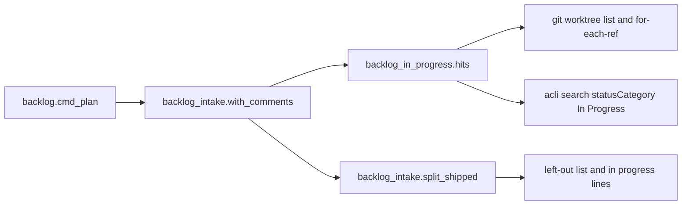
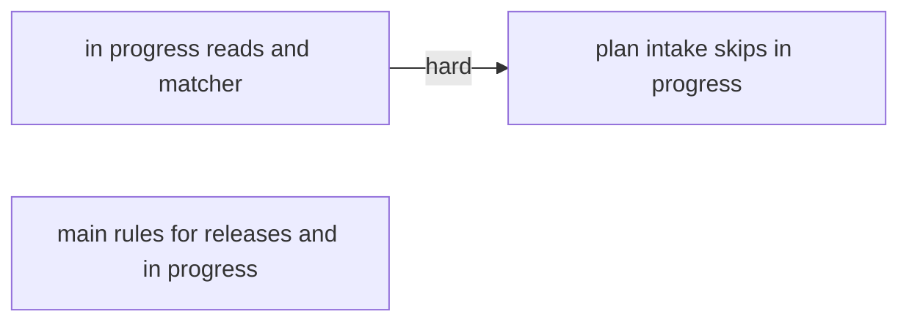

# Superlite: backlog plan skips issues another session builds; main checks releases

**Goal:** `sl backlog plan` leaves out an issue another session already builds (#813), and backlog main checks the repository's release state before it relies on its own release plan (#812).
**Architecture:** a new pure-plus-readers module `backlog_in_progress.py` answers "which issues does another session build" (Jira status category In Progress, a worktree, a local or origin branch naming the issue). `backlog_intake.with_comments` (the plan's per-issue reader, already called by `backlog.cmd_plan`) attaches its hits to each item as `busy`; `backlog_intake.split_shipped` (pure) drops a busy, unpinned issue into the left-out list. backlog-main.md gains the #812 release check and names the new plan line. No change to backlog.py (B237's file).
**Tech stack:** Python 3.10+ stdlib; git; acli (Jira, faked in tests); pytest through `sl run_tests`.
**Spec:** this file, section Design.
**Detail:** contracts
**Target-min:** 11
**Wave0:** none
**Coverage:** off (bounded change to the existing plan intake flow)

Global constraints:
- Every line of a Python script under `skills/**/scripts/` keeps the repo's `# O(...)` complexity comment; a new script carries the notation header; stdlib only; LF endings. Files under `tests/` carry no such comments.
- This repository is public: no host names, user names, home paths, other project or repository names in code, tests, docs or commit messages.
- The verdict is `sl run_tests` (never raw pytest); every new test sees a red run before the code it tests.
- An existing test that pins a changed text or output is updated in the same task only when it is in the task's Owns. Any other test your change turns red: leave it, and name the file and the failing assertion in your report (the coordinator rules it).
- Builds: the verdict is `sl run_tests` (the project's test command; a project with `.maxapp` runs `maxapp test`, which a build pool may place on another Mac, and a full run whose tree a green maxapp test stamp covers returns that result without a run); task trees build in <tree>/.build/DerivedData and any build of your own goes under .build/ of the worktree, never -derivedDataPath outside the worktree (your session scratchpad included; backlog cleanup removes scratchpad build folders when the worktree goes); a product, simulator or device build stays on this machine and runs only when an issue's acceptance asks for a running-app check.
- Simulators: append the UDID of each simulator you or a worker creates (`xcrun simctl create` or `clone`; a checker's `Simulators:` line marks its created ones) as one line to /Users/max/github/superlite/.claude/worktrees/superlite-b240-backlog-plan-skip-and-release/.superlite/simulators.txt; never list one you did not create; ship cleanup shuts down and deletes each listed one.
- Live reads (git, acli) of `backlog_in_progress.hits` are off when the environment holds `SUPERLITE_IN_PROGRESS_LIVE=0`; `tests/scripts/conftest.py` sets it for every test (as `SUPERLITE_LEAD_CAP_LIVE`), and a test of the reads deletes it.

## Design

### 1. In progress elsewhere (#813, Max's decision: skip In Progress status, worktree or branch)

- An issue is in progress elsewhere when any of these holds:
  - Jira only: its status is in the In Progress category, read by one search `key in (K1, K2) AND statusCategory = "In Progress"` with `--fields key,status`; the hit names the status (`fields.status.name`, else `In Progress`).
  - a worktree of the repository other than the main checkout (`git worktree list --porcelain`) names it by its folder's basename or its branch;
  - a local branch (`refs/heads/*`) or a branch of `origin` (`refs/remotes/origin/*`, not `HEAD`) names it.
- Names it: a Jira key appears anywhere in the name, case-insensitive, with no letter or digit right before it and no digit right after it (`feature/PIX-2-login`, `pix-2`; not `PIX-21`, `XPIX-2`). A GitHub number N names the name's last `/`-part when that part is `N`, `N-...`, `N_...`, or the same after `issue`, `issues` or `gh` with an optional `-` or `_` (`812-x`, `fix/812-x`, `issue-812`, `gh_812`; not `node-812`, `action-1.2.812`, `superlite/b812-x`).
- This backlog's own batches do not count: a hit whose branch or worktree (real path) is a `branch` or `worktree` of any batch record in backlog.json is ignored.
- An unpinned issue in progress elsewhere is not planned: one line `in progress: <ref> (<label>): not planned, another session builds it; sl backlog plan --issues <plain> --add plans it anyway`, and it joins the left-out list with reason `not planned (in progress: <label>)`. A pinned one is planned anyway: `in progress?: <ref> (<label>): planned anyway (pinned); sl backlog skip <plain> drops it`. An issue already shipped keeps its `already shipped:` handling first.
- A read that fails names itself and the plan goes on: `in progress: Jira status not read (<error, 120 chars>); worktrees and branches still checked` and `in progress: worktrees and branches not read (<error, 120 chars>)`.

### 2. Release check (#812)

backlog-main.md step 8 (hand-over and closing report; step 1's ending is pinned by test_docs_b72_backlog) gains one sentence: before main relies on a release it holds or plans (a standing note such as `Main releases <version>`, a release task) and again before the closing report, it fetches origin and reads the version and latest tag or release on the default branch; when the release is already out, it corrects its plan, task list and standing note and names it in the closing report.

### 3. Rulings

Ruling: [scope] #824 is not built here: its fix is one Rules sentence in `backlog_brief.triage_brief`, and backlog_brief.py is B237's; the PR says `Refs #824` and a follow-up carries the sentence (because the brief's file rule sends another batch's file to a follow-up).
Ruling: Jira status uses the status category In Progress, not the status name alone (because workflows rename it, such as In Review or In Development; cost if wrong: an issue in a renamed in-progress status is left out, named in its line).
Ruling: GitHub issues get the worktree and branch check too, with the strict last-part rule (because Max's decision names worktrees and branches without a source; cost if wrong: a branch such as `4-docs` holds issue #4 out, named in its line, and pinning plans it).
Ruling: a pinned issue is planned anyway with an `in progress?:` line (because `--issues` is main's explicit choice, as `already shipped?:`; the left-out line's hint relies on it).
Ruling: only `origin`'s remote branches count (because another remote is another repository whose numbers are not this repository's issues; sync already assumes `origin`).
Ruling: #812 is a rule in words, no script check (because the issue asks for the smallest sensible fix and the release state lives in the project, such as its version file, tags or a store build).
Ruling: `**Detail:** contracts` (three small tasks with named tests and exact values).



## File structure

- `skills/subagent-driven-development/scripts/backlog_in_progress.py` (new): git and Jira reads, the name matcher, the hit label.
- `skills/subagent-driven-development/scripts/backlog_intake.py`: `with_comments` attaches `busy`; `split_shipped` decides.
- `tests/scripts/conftest.py`: sets `SUPERLITE_IN_PROGRESS_LIVE=0` per test.
- `skills/subagent-driven-development/backlog-main.md`: the #812 sentence (step 8) and the #813 sentence (step 2).
- Tests: `tests/scripts/test_backlog_in_progress_813.py`, `tests/scripts/test_backlog_plan_in_progress_813.py`, `tests/scripts/test_backlog_docs_812_813.py`.

## Task graph

```mermaid
%% schedule
gantt
  title Predicted schedule (mm:ss)
  dateFormat X
  axisFormat %M:%S
  section lane 1
  IP1 in progress reads and matcher :ip1, 0, 500s
  IP2 plan intake skips in progress :ip2, 500, 498s
  section lane 2
  DOC1 main rules for releases and in prog :doc1, 0, 459s
```





critical path: IP1 → IP2 (16.6 min) · peak width 2 · predicted build 16.6 min · predicted total ≈ 31.1 min (target ✗ 11.0)

## Package: in progress

App type: library (git and tracker reads plus pure decisions). Categories: encoding, state, file.
**Probe entry:** none (the reads need a git repository and a faked acli; the named tests cover each case)

### IP1 in progress reads and matcher · Complexity 4 · Est. context 34k
**Owns:** skills/subagent-driven-development/scripts/backlog_in_progress.py, tests/scripts/test_backlog_in_progress_813.py
**Components:** 2
**LOC owned:** 190
**Tests:** fast
**Model:** sonnet
**Kind:** design
**Covers:** 1
**Produces:** backlog_in_progress.git_names(root: Path) -> tuple[list[dict], str | None] · backlog_in_progress.match(ref: int | str, names: list[dict]) -> list[dict] · backlog_in_progress.jira_in_progress(keys: list[str]) -> tuple[dict, str | None] · backlog_in_progress.label(hits: list[dict]) -> str · backlog_in_progress.hits(items: list[dict], jira: bool, root: Path) -> tuple[dict, list[str]]
e.g. match("PIX-2", [{"kind": "branch", "name": "feature/pix-2-login"}, {"kind": "branch", "name": "PIX-21"}, {"kind": "branch", "name": "XPIX-2"}]) -> [{"kind": "branch", "name": "feature/pix-2-login"}]
e.g. match(7, [{"kind": "worktree", "name": "/r/.claude/worktrees/7-login", "branch": "7-login"}, {"kind": "branch", "name": "7-login"}]) -> [{"kind": "worktree", "name": "/r/.claude/worktrees/7-login", "branch": "7-login"}]
e.g. label([{"kind": "status", "name": "In Progress"}, {"kind": "worktree", "name": "/r/wt/pix-2-login", "branch": "pix-2-login"}, {"kind": "branch", "name": "origin-only/PIX-2"}]) -> "Jira status In Progress; worktree pix-2-login (+1 more)"
e.g. hits([{"number": "PIX-2"}, {"number": "PIX-3"}], True, root) with the search giving PIX-2 status "In Review" and a branch feature/PIX-3-x -> ({"PIX-2": [{"kind": "status", "name": "In Review"}], "PIX-3": [{"kind": "branch", "name": "feature/PIX-3-x"}]}, [])
**Review Focus:** encoding: `test_match_jira_key_bounds` (the first e.g.; `bugfix/abc_PIX-2` matches); encoding: `test_match_github_number_last_part` (812 against `fix/812-release`, `issue-812`, `gh_812`, `812`, `dependabot/x/action-1.2.812`, `superlite/b812-x`, `node-812`, `fix/8120-x`: the first four match, in input order); state: `test_match_worktree_hides_its_branch_hit` (the second e.g.; a worktree matched only by basename `/r/wt/issue-7` with branch `misc` is a hit); file: `test_git_names_reads_worktrees_and_branches` (a tmp repo with one commit, branch `5-x`, a second worktree on branch `6-y`, a detached worktree, and a fake `origin` remote ref `refs/remotes/origin/7-z` plus `refs/remotes/origin/HEAD`: worktrees `[{"kind": "worktree", "name": <real path>, "branch": "6-y"}, {"kind": "worktree", "name": <real path>, "branch": ""}]` without the main checkout, branches `5-x`, `6-y`, `7-z` and the default branch, each once, no `HEAD`; error None); file: `test_git_names_outside_a_repo` (a plain tmp folder: `([], "<text naming git worktree list>")`, never raises); protocol: `test_jira_in_progress_one_search` (keys `["PIX-2", "PIX-3"]`, `backlog._acli` faked: exactly one call `["jira", "workitem", "search", "--jql", 'key in (PIX-2, PIX-3) AND statusCategory = "In Progress"', "--fields", "key,status", "--paginate", "--json"]`; result `[{"key": "PIX-2", "fields": {"status": {"name": "In Review"}}}, {"key": "PIX-9"}]` -> `({"PIX-2": "In Review"}, None)`; an item without status gives `In Progress`; `[]` keys: no call, `({}, None)`); state: `test_jira_in_progress_failure` (the fake raises `RuntimeError("acli jira workitem search failed: x")` -> `({}, "acli jira workitem search failed: x")`; a dict result -> `({}, "acli search gave no issue list")`); encoding: `test_label_cuts_and_cleans` (a branch name of 200 characters holding `\x1b` and `\n`: its part is at most 87 characters, `branch ` plus 80, with no control character); state: `test_hits_gate_off_reads_nothing` (`SUPERLITE_IN_PROGRESS_LIVE=0`: `({}, [])`, git and acli never called); state: `test_hits_lines_on_failures` (acli raising and `git_names` returning `([], "git worktree list failed: boom")` -> `({}, ["in progress: Jira status not read (acli jira workitem search failed: x); worktrees and branches still checked", "in progress: worktrees and branches not read (git worktree list failed: boom)"])`); state: `test_hits_example` (the fourth e.g., `git_names` and `jira_in_progress` patched)
**Steps:** 1 failing tests, 2 run: FAIL, 3 implement, 4 run: PASS
**Notes:** Module docstring names #813. `git_names` runs `git worktree list --porcelain` and `git for-each-ref --format=%(refname) refs/heads refs/remotes/origin` with `cwd=root`, `capture_output`, `text`, a 30 s timeout and `stdin=DEVNULL`; it skips the porcelain entry whose real path is the real path of `root` and turns `branch refs/heads/X` into `X` (a `detached` entry has branch `""`); worktree names are real paths; branch names are deduped, keeping the first. A failed command (OSError, timeout, non-zero exit) gives the names read so far and `"<git worktree list|git for-each-ref> failed: <stderr, first 120 chars>"`. `match` keeps input order. `jira_in_progress` calls `backlog._acli` through a local `import backlog` (as `backlog_tracker._jira_done`), keeps only result keys in `keys`, and cuts a status name to 40 characters. `label`: `Jira status <name>`, `worktree <basename of name>`, `branch <name>`; each part cleaned of control characters (replaced by a space, runs of whitespace collapsed) and cut to 80 characters after its prefix word; the first two joined by `; `, then ` (+N more)`. `hits` reads the status only when `jira`, matches every item's `number` against the names, keeps only non-empty hit lists (status hit first), and returns `({}, [])` for no items or the gate off, before any read.

### IP2 plan intake skips in progress · Complexity 4 · Est. context 40k
**Owns:** skills/subagent-driven-development/scripts/backlog_intake.py, tests/scripts/conftest.py, tests/scripts/test_backlog_plan_in_progress_813.py
**Components:** 2
**LOC owned:** 170
**Tests:** fast
**Model:** sonnet
**Kind:** design
**Covers:** 1
**Consumes:** backlog_in_progress.hits(items: list[dict], jira: bool, root: Path) -> tuple[dict, list[str]] (IP1) · backlog_in_progress.label(hits: list[dict]) -> str (IP1)
**Produces:** backlog_intake.with_comments(trusted: list[dict], repo: str, public: bool, jira: bool = False) -> tuple[list[dict], list[str]] · backlog_intake.split_shipped(trusted: list[dict], batches: list[dict], merged: dict, pin: list) -> tuple[list[dict], list[dict], list[str]]
**Review Focus:** state: `test_split_drops_busy_unpinned` (`split_shipped([{"number": "PIX-2", "title": "T", "body": "", "busy": [{"kind": "status", "name": "In Progress"}]}], [], {}, [])` -> `([], [{"number": "PIX-2", "title": "T", "reason": "not planned (in progress: Jira status In Progress)"}], ["in progress: PIX-2 (Jira status In Progress): not planned, another session builds it; sl backlog plan --issues PIX-2 --add plans it anyway"])`); state: `test_split_keeps_busy_pinned` (`split_shipped([{"number": 5, "title": "T", "body": "", "busy": [{"kind": "branch", "name": "5-x"}]}], [], {}, [5])` -> `([{"number": 5, "title": "T", "body": ""}], [], ["in progress?: #5 (branch 5-x): planned anyway (pinned); sl backlog skip 5 drops it"])`); state: `test_split_ignores_own_batch_branch_and_worktree` (busy `[{"kind": "branch", "name": "superlite/b3-5-x"}, {"kind": "worktree", "name": <tmp wt real path>, "branch": "other"}]`, batches `[{"id": "B3", "state": "parked", "issues": [5], "branch": "superlite/b3-5-x", "worktree": <same tmp wt>}]` -> `([{"number": 5, "title": "T", "body": ""}], [], [])`); state: `test_split_shipped_wins_over_busy` (an issue of a shipped batch with busy hits: only the `already shipped:` line, as today); state: `test_split_reopened_busy_unpinned_is_left_out` (reopened True, in a shipped batch, busy: dropped with the in progress reason, no `reopened:` line); state: `test_split_never_returns_busy_key` (every kept item lacks `busy`); protocol: `test_with_comments_attaches_busy` (`backlog_in_progress.hits` patched to return `({5: [{"kind": "branch", "name": "5-x"}]}, ["in progress: worktrees and branches not read (x)"])` and the GraphQL read faked as test_backlog_intake_comments_563 does: item 5 gains `busy`, item 6 does not, the line follows the comment lines; for Jira the patched `hits` gets `jira=True`); protocol: `test_with_comments_empty_reads_nothing` (`with_comments([], "o/r", True)` -> `([], [])`, `hits` not called); protocol: `test_plan_jira_leaves_out_in_progress` (the `bk` fixture of test_backlog_cli.py with the Jira source `--jql "project = PIX"`, `SUPERLITE_IN_PROGRESS_LIVE` deleted, the root a git repo with one commit, the acli fake answering the status search with `[{"key": "PIX-2", "fields": {"status": {"name": "In Progress"}}}]`: stdout holds `in progress: PIX-2 (Jira status In Progress): not planned, another session builds it; sl backlog plan --issues PIX-2 --add plans it anyway`, the triage brief (`briefed(ns)`) lists PIX-1 and not PIX-2, and backlog.json `outside` holds PIX-2 with reason `not planned (in progress: Jira status In Progress)`); protocol: `test_plan_github_leaves_out_issue_with_branch` (GitHub source, the root a git repo with branch `7-login`: issue 7 is left out with `in progress: #7 (branch 7-login): ...`, issue 8 is triaged); protocol: `test_plan_pinned_in_progress_is_planned` (`--issues 7` with branch `7-login`: the `in progress?: #7 (branch 7-login): planned anyway (pinned); sl backlog skip 7 drops it` line and the fast path or triage still plans it)
**Steps:** 1 failing tests, 2 run: FAIL, 3 implement, 4 run: PASS
**Notes:** `with_comments` keeps its body as `_with_comments` and becomes a wrapper: for a non-empty result it calls `bip.hits(items, jira, backlog._root())` (local `import backlog`, top-level `import backlog_in_progress as bip`) and adds `"busy": hits[n]` to each item that has hits; the hits lines go after the comment lines. `split_shipped` builds `own` from every batch record's `branch` and real-path `worktree`, filters each item's `busy` (a branch hit whose name is in own; a worktree hit whose real path or branch is in own), then per item: not reopened and shipped -> today's `already shipped:` line; not reopened, merged and unpinned -> today's dropped entry; busy and unpinned -> the dropped entry and `in progress:` line; busy and pinned -> the `in progress?:` line, then today's kept handling (its `reopened:` or `already shipped?:` line after it); else today's. Lines use `_ref`, `_plain` and `_clean(bip.label(busy))`; a dropped entry is `{"number", "title" (cleaned), "reason"}` as today's. conftest: add `monkeypatch.setenv("SUPERLITE_IN_PROGRESS_LIVE", "0")` beside the `SUPERLITE_LEAD_CAP_LIVE` line. Read test_backlog_jira_208.py and test_backlog_plan_shipped_585.py for how `bk`, the acli fake and the triage fake are driven; the existing tests of with_comments and split_shipped stay green unchanged.

## Package: main rules

App type: docs. **Probe entry:** none (prose)

### DOC1 main rules for releases and in progress · Complexity 1 · Est. context 22k
**Owns:** skills/subagent-driven-development/backlog-main.md, tests/scripts/test_backlog_docs_812_813.py, tests/scripts/fixtures/docs_812_813/s812.txt, tests/scripts/fixtures/docs_812_813/s813.txt
**Components:** 1
**LOC owned:** 40
**Tests:** fast
**Model:** haiku
**Kind:** mechanical
**Covers:** 2
**Review Focus:** protocol: `test_main_step1_has_release_check` (step 1's line ends with S812); protocol: `test_main_step2_names_in_progress_lines` (step 2's line holds S813 right after ANCHOR)
**Test code (verbatim):**
```python
"""backlog-main.md names main's release check (#812) and plan's in progress lines (#813)."""
from pathlib import Path

DOC = Path(__file__).resolve().parents[2] / "skills" / "subagent-driven-development" / "backlog-main.md"
S812 = Path(__file__).with_name("fixtures").joinpath("docs_812_813", "s812.txt").read_text(encoding="utf-8").strip()
S813 = Path(__file__).with_name("fixtures").joinpath("docs_812_813", "s813.txt").read_text(encoding="utf-8").strip()
ANCHOR = "a plan with nothing left says `nothing to plan: every issue is already shipped`."


def _step(n):
    return next(ln for ln in DOC.read_text(encoding="utf-8").splitlines() if ln.startswith(f"{n}. "))


def test_main_step1_has_release_check():
    assert _step(1).endswith(" " + S812)


def test_main_step2_names_in_progress_lines():
    assert ANCHOR + " " + S813 + " " in _step(2)
```
**Steps:** 1 failing tests, 2 run: FAIL, 3 implement, 4 run: PASS
**Notes:** Write the test file as given, plus `tests/scripts/fixtures/docs_812_813/s812.txt` and `s813.txt`, each holding its sentence below as one line. In backlog-main.md add each sentence after an existing sentence, changing no existing sentence (tests/scripts/test_backlog_rules_split_684.py pins them): S812 at the end of the line starting `1. `, after one space; S813 right after ANCHOR in the line starting `2. `, with one space before it and one after it. S812: `Another session may release meanwhile (a merged version bump, a tag, an uploaded build): before main relies on a release it holds or plans (a standing note such as `Main releases <version>`, a release task) and again before the closing report, it runs `git fetch origin` and reads the version on `origin/<default>` (`git show origin/<default>:<version file>`) and the latest tag or release (`git describe --tags --abbrev=0 origin/<default>`, `gh release list --limit 1`); when that release is already out, main corrects its plan, task list and standing note (`start --note FILE`) and names it in the closing report (#812).` S813: `An issue another session already builds is not planned either: its Jira status is in the In Progress category, or a worktree or a local or `origin` branch names it (a Jira key anywhere in the name; a GitHub number as the name's last part, such as `812-x`, `fix/812-x` or `issue-812`); one `in progress: KEY (<status, worktree or branch>): not planned, another session builds it; sl backlog plan --issues KEY --add plans it anyway` line names it and `status` lists it as `not planned (in progress: ...)`; this backlog's own batch branches and worktrees do not count, and a pinned one is planned anyway, with an `in progress?:` line (#813).`

## Review Focus

- in progress (library): encoding (branch and key bounds, control characters in names), state (pinned, own batch, shipped first, reopened, gate), file (worktree porcelain, detached worktrees, no repository). Cases are in IP1 and IP2.
- main rules (docs): the two sentences byte for byte, existing sentences unchanged.

## Self-review

Coverage: #813 -> IP1, IP2, DOC1; #812 -> DOC1; #824 -> ruling and follow-up. No placeholders. IP2 consumes exactly IP1's `hits` and `label`. The one edge is hard: IP2's existing tests import IP1's module through backlog_intake. DOC1 shares no file. Running-app checks: none (no UI).
