# Superlite: run_tests --base-skips reruns the base where the full run ran (#999)

**Goal:** when the project's full test command runs through `maxapp remote` (another host), `sl run_tests --base-skips` runs the base commit's skipped tests through that same remote command, narrowed to the skipped tests' files, so platform and session skips (macOS-only, case-sensitive filesystem, whole-session) match the full run's instead of reading as new (#999).
**Architecture:** `run_base_tests` reads the full run's command (`testcmd.resolve(".", [])`); a `maxapp remote` command (`is_remote_command`) is rewritten by `narrowed_remote` (its pytest positional test paths replaced by the base files, every option kept) and run in the base scratch tree, whose files `maxapp remote` ships (`git ls-files` of its cwd's worktree); a command it cannot rewrite runs whole at the base; any other command keeps today's local fast path. `test-summary-base.json` gains `host` and `command`.
**Tech stack:** Python 3.10+ stdlib; pytest 9.2.0 (uv.lock) through `sl run_tests`.
**Spec:** this file, section Design.
**Detail:** tests
**Target-min:** 11
**Wave0:** none
**Coverage:** off

Global constraints:
- Every line of a Python script under `skills/**/scripts/` keeps the repo's `# O(...)` complexity comment; stdlib only; LF endings. Files under `tests/` carry no such comments.
- This repository is public: no host names, user names, home paths, other project or repository names in code, tests, docs or commit messages.
- The verdict is `sl run_tests` (never raw pytest); every new test sees a red run before the code it tests.
- Existing run_tests messages stay byte-identical (docs/tools.md and doc tests pin them); only the new lines below are added.
- An existing test that pins a changed text or output is updated in the same task only when it is in the task's Owns. Any other test your change turns red: leave it, and name the file and the failing assertion in your report (the coordinator rules it).
- Builds: the verdict is `sl run_tests` (the project's test command; a project with `.maxapp` runs `maxapp test`, which a build pool may place on another Mac, and a full run whose tree a green maxapp test stamp covers returns that result without a run); task trees build in <tree>/.build/DerivedData and any build of your own goes under .build/ of the worktree, never -derivedDataPath outside the worktree (your session scratchpad included; backlog cleanup removes scratchpad build folders when the worktree goes); a product, simulator or device build stays on this machine and runs only when an issue's acceptance asks for a running-app check; copy this sentence into every worker brief.
- Simulators: append the UDID of each simulator you or a worker creates (`xcrun simctl create` or `clone`; a checker's `Simulators:` line marks its created ones) as one line to the worktree's `.superlite/simulators.txt`; never list one you did not create; ship cleanup shuts down and deletes each listed one; copy this sentence into every worker brief.

## Design

### 1. Which host the full run used

Research (R1): the full summary records no command; the scratch tree `.superlite/trees/base-skips` is a detached `git worktree`, and `maxapp remote` ships `git ls-files --cached --others --exclude-standard` of its cwd's worktree (no `.maxapp` needed when a command is given), so a remote command run with cwd = the tree tests the base commit's files.

- `is_remote_command(command: str) -> bool`: `shlex.split` (a `ValueError` gives False); skip leading `NAME=value` words (`^[A-Za-z_][A-Za-z0-9_]*=`); True when the next word's basename is `maxapp` and the word after it is `remote`. Any other command (local pytest, `maxapp test`, a test_file) is the local host.

### 2. Narrowing the remote command

`narrowed_remote(command: str, paths: list[str], tree: Path) -> str | None`: the same command with its pytest test paths replaced by `paths`, or None when it cannot be rewritten safely:
- None when `is_remote_command` is False, the command holds `$` or a backtick (requoting would change an expansion), or a word starts with `~`.
- After `maxapp remote`, its options: a word with `=` is one word; `--host`, `--timeout`, `--kind`, `--fetch` take the next word; `--no-cache` is a flag; any other `-` word gives None. The rest are the command words; none gives None (`maxapp remote` alone runs `.maxapp`'s ci key).
- One command word is a shell string: its inner words are `shlex.split` of it. Several command words are the inner words as they are. A shell operator in the inner text or in the outer command (tokens of `shlex.shlex(text, posix=True, punctuation_chars=True)` made only of `();<>|&`) gives None.
- The first inner word whose basename is `pytest` or `py.test` starts pytest's arguments (so `python -m pytest`, `uv run pytest` work); none gives None.
- Each later word: a `-` word without `=` in PYTEST_VALUE_OPTS takes the next word as its value; any other `-` word is a flag; every other word is a positional. Each positional must exist in `tree` (its part before `::`), else None.
- PYTEST_VALUE_OPTS = `-k -m -p -o -c -n -W -r --deselect --ignore --ignore-glob --rootdir --confcutdir --basetemp --junitxml --junit-xml --junit-prefix --maxfail --tb --durations --durations-min --log-level --log-file --log-file-level --log-cli-level --log-format --log-date-format --log-cli-format --cov --cov-report --cov-config --timeout --dist --import-mode --capture --override-ini --color --code-highlight --pastebin --maxprocesses --max-worker-restart --tx --rsyncdir --report-log --reruns --reruns-delay --randomly-seed --doctest-glob`.
- The result: the positionals removed and `paths` (in order) put where the first positional stood, else appended; every option and value kept in order. Written as `shlex.join(outer words up to the command)` + `" "` + (`shlex.quote(shlex.join(inner))` for one command word, else `shlex.join(inner)`).

So the base run keeps the full run's flags (this repo's `-rfEs --no-fold-skipped` names skips in the same `file::name` form the full run's summary holds, via `testcmd.parse_output`).

### 3. run_base_tests and the base summary

- `run_base_tests` first resolves the full run's spec `full = testcmd.resolve(".", [])` (same exception tuple as today's `fast_spec` call). When `full` is not the built-in runner and `is_remote_command(full["command"])`: `narrowed = narrowed_remote(full["command"], paths, tree)`; the run uses `{**full, "command": narrowed or full["command"]}` through the existing test-cmd branch (cwd = tree, shell, env, `{junit}`), printing one stderr line: narrowed `run_tests: --base-skips runs on the full run's host: <command>`, whole `run_tests: --base-skips: the remote test command cannot be narrowed to the skipped tests' files; it runs whole at the base: <command>`. Otherwise today's path (`fast_spec(paths, quiet=True)`) runs unchanged.
- It returns `(skipped, counts, seconds, host, command)`: `host` is `"remote"` or `"local"`, `command` the command string run (the built-in runner: `shlex.join` of its argv).
- `base_skips` writes `"host"` and `"command"` (first 200 characters) into `test-summary-base.json`; both `""` when no id's file exists at the base (no run). Every existing key and message stays.
- The `--base-skips` argparse help gains: `; a full run through maxapp remote reruns them through that remote command`.

### 4. Rulings

- Ruling: [scope] #999 offered "run the base where the full run ran, or mark such skips"; the base runs where the full run ran (because the same host and flags make platform and session skips match exactly, while marking would need reason heuristics per platform) (lead's ruling).
- Ruling: the full run's host is read from the configured `test` command at `--base-skips` time, since the full summary records no command; only `maxapp remote` counts as another host (`maxapp test` builds in a pool of Macs of the same platform) (lead's ruling).
- Ruling: a remote command the narrowing cannot rewrite runs whole at the base on the remote host rather than locally (because a slower correct comparison beats a fast wrong one) (lead's ruling).
- Ruling: docs/tools.md (B268's file) is a follow-up: its `--base-skips` paragraph should name the remote rerun and the `host` and `command` keys (lead's ruling).
- Ruling: MISSED TARGET accepted (because the plan is one small task; the forecast comes from contention and history, not from its shape).

## Task graph

```mermaid
%% schedule
gantt
  title Predicted schedule (mm:ss)
  dateFormat X
  axisFormat %M:%S
  section lane 1
  T1 base on the full run's host :t1, 0, 654s
```




critical path: T1 (10.9 min) · peak width 1 · predicted build 10.9 min · predicted total ≈ 29.4 min (target ✗ 11.0)

## Package: run_tests base-skips

App type: CLI (a run_tests mode). Categories: protocol (command words and quoting), state (the scratch tree, the summary keys).
**Probe entry:** none (the mode runs git and a remote command; the named tests, three of them through run_tests.py with a fake `maxapp`, cover each case)

### T1 base on the full run's host · Complexity 3 · Est. context 50k
**Owns:** skills/subagent-driven-development/scripts/run_tests.py, tests/scripts/test_run_tests_base_skips_999.py
**Components:** 1
**LOC owned:** 190
**Tests:** fast
**Model:** sonnet
**Covers:** 1, 2, 3
**Produces:** run_tests.is_remote_command(command: str) -> bool · run_tests.narrowed_remote(command: str, paths: list[str], tree: Path) -> str | None
  e.g. run_tests.narrowed_remote("maxapp remote --timeout 40 'python -m pytest tests -q -n 4'", ["tests/a/test_x.py"], tree_with_a_tests_folder) == "maxapp remote --timeout 40 'python -m pytest tests/a/test_x.py -q -n 4'"
**Review Focus:** protocol: `test_narrowed_remote_keeps_option_values_and_forms`, `test_narrowed_remote_refuses_what_it_cannot_rewrite`; state: `test_remote_full_run_reruns_the_base_on_the_remote_host`, `test_unnarrowable_remote_command_runs_whole_at_the_base`, `test_local_full_run_keeps_the_local_base_run`
**Test code (verbatim):**
```python
# tests/scripts/test_run_tests_base_skips_999.py
"""run_tests --base-skips reruns the base where the full run ran: a `maxapp remote` full run's base goes through the same remote command (#999)."""
import json
import os
import shlex
import stat
import subprocess
import sys
from pathlib import Path

SCRIPTS = Path(__file__).resolve().parents[2] / "skills" / "subagent-driven-development" / "scripts"
sys.path.insert(0, str(SCRIPTS))
import run_tests  # noqa: E402

BASE_TESTS = '''import os

import pytest


@pytest.mark.skipif(os.environ.get("FAKE_REMOTE_HOST") == "1", reason="local host only")
def test_local_only():
    pass


@pytest.mark.skip(reason="gated")
def test_gated():
    pass


def test_plain():
    pass
'''
NEW_TESTS = BASE_TESTS + '''

@pytest.mark.skip(reason="new")
def test_new_skip():
    pass
'''
SKIPPED = ["tests/test_a.py::test_local_only", "tests/test_a.py::test_gated", "tests/test_a.py::test_new_skip"]
FULL = {"mode": "full", "started": 1763560000.5, "passed": 1, "failed": 0, "skipped": 3, "skipped_tests": SKIPPED}
PYTEST = f"{sys.executable} -m pytest tests -q -rs --no-fold-skipped -p no:cacheprovider"
FAKE_MAXAPP = '''#!/bin/sh
# a fake `maxapp remote`: logs its cwd and words, then runs its last word as the command with FAKE_REMOTE_HOST=1
pwd -P > "$FAKE_LOG"
for w in "$@"; do printf '%s\\n' "$w" >> "$FAKE_LOG"; done
[ "$1" = remote ] || exit 9
for w in "$@"; do last="$w"; done
FAKE_REMOTE_HOST=1 exec sh -c "$last"
'''
INNER = "uv run --group dev python -m pytest tests -q -rfEs --no-fold-skipped -p no:cacheprovider -n 4"


def git(repo, *args):
    env = {k: v for k, v in os.environ.items() if k not in ("GIT_DIR", "GIT_INDEX_FILE", "GIT_WORK_TREE")}
    r = subprocess.run(["git", "-C", str(repo), "-c", "user.name=t", "-c", "user.email=t@t", *args], capture_output=True, text=True, env=env)
    assert r.returncode == 0, r.stderr
    return r.stdout.strip()


def make_repo(tmp_path, test):
    repo = tmp_path / "repo"
    (repo / "tests").mkdir(parents=True)
    (repo / "pytest.ini").write_text("[pytest]\n", encoding="utf-8")
    (repo / "tests" / "test_a.py").write_text(BASE_TESTS, encoding="utf-8")
    sd = repo / ".superlite"
    sd.mkdir()
    cmd = {"language": "python", "test": test, "test_file": f"{sys.executable} -m pytest {{files}} -q -p no:cacheprovider -o junit_family=xunit1 --junitxml={{junit}}", "junit": "{junit}"}
    (sd / "test-cmd.json").write_text(json.dumps(cmd), encoding="utf-8")
    git(repo, "init", "-q", "-b", "main")
    git(repo, "add", "-A")
    git(repo, "commit", "-q", "-m", "base")
    base = git(repo, "rev-parse", "HEAD")
    (sd / "checkpoints.json").write_text(json.dumps({"base": base, "entries": []}), encoding="utf-8")
    (repo / "tests" / "test_a.py").write_text(NEW_TESTS, encoding="utf-8")
    git(repo, "add", "tests")
    git(repo, "commit", "-q", "-m", "change")
    (sd / "test-summary-full.json").write_text(json.dumps(FULL), encoding="utf-8")
    (tmp_path / "bin").mkdir()
    fake = tmp_path / "bin" / "maxapp"
    fake.write_text(FAKE_MAXAPP, encoding="utf-8")
    fake.chmod(fake.stat().st_mode | stat.S_IXUSR | stat.S_IXGRP | stat.S_IXOTH)
    return repo, base, tmp_path / "maxapp.log"


def rt(repo, log, *args):
    env = {k: v for k, v in os.environ.items() if not k.startswith("SUPERLITE_") and k not in ("GIT_DIR", "GIT_INDEX_FILE", "GIT_WORK_TREE", "FAKE_REMOTE_HOST")}
    env["PATH"] = f"{log.parent / 'bin'}{os.pathsep}{env.get('PATH', '')}"
    env["FAKE_LOG"] = str(log)
    return subprocess.run([sys.executable, str(SCRIPTS / "run_tests.py"), *args], cwd=repo, capture_output=True, text=True, timeout=180, env=env)


def base_summary(repo):
    return json.loads((repo / ".superlite" / "test-summary-base.json").read_text(encoding="utf-8"))


def logged(log):
    lines = log.read_text(encoding="utf-8").splitlines()
    return lines[0], lines[1:]


def tree_with_tests(tmp_path):
    (tmp_path / "tests" / "a").mkdir(parents=True)
    (tmp_path / "tests" / "a" / "test_x.py").write_text("", encoding="utf-8")
    return tmp_path


def test_remote_full_run_reruns_the_base_on_the_remote_host(tmp_path):
    repo, base, log = make_repo(tmp_path, f"maxapp remote --timeout 40 '{PYTEST}'")
    r = rt(repo, log, "--base-skips")
    assert r.returncode == 0, r.stdout + r.stderr
    s = base_summary(repo)
    assert s["skipped_tests"] == ["tests/test_a.py::test_local_only", "tests/test_a.py::test_gated"]
    assert f"base {base[:7]} skips 2 of 3" in r.stderr
    cwd, words = logged(log)
    assert cwd.endswith("/.superlite/trees/base-skips")
    assert words[:3] == ["remote", "--timeout", "40"]
    assert words[3] == shlex.join([sys.executable, "-m", "pytest", "tests/test_a.py", "-q", "-rs", "--no-fold-skipped", "-p", "no:cacheprovider"])
    assert s["host"] == "remote"
    assert s["command"].startswith("maxapp remote --timeout 40 '")
    assert "run_tests: --base-skips runs on the full run's host: maxapp remote --timeout 40 " in r.stderr


def test_unnarrowable_remote_command_runs_whole_at_the_base(tmp_path):
    inner = f"cd . && {PYTEST}"
    repo, _base, log = make_repo(tmp_path, f"maxapp remote --timeout 40 '{inner}'")
    r = rt(repo, log, "--base-skips")
    assert r.returncode == 0, r.stdout + r.stderr
    assert "run_tests: --base-skips: the remote test command cannot be narrowed to the skipped tests' files; it runs whole at the base: " in r.stderr
    assert logged(log)[1][3] == inner
    s = base_summary(repo)
    assert s["host"] == "remote"
    assert s["skipped_tests"] == ["tests/test_a.py::test_local_only", "tests/test_a.py::test_gated"]


def test_local_full_run_keeps_the_local_base_run(tmp_path):
    repo, _base, log = make_repo(tmp_path, PYTEST)
    r = rt(repo, log, "--base-skips")
    assert r.returncode == 0, r.stdout + r.stderr
    s = base_summary(repo)
    assert s["host"] == "local" and s["command"]
    assert s["skipped_tests"] == ["tests/test_a.py::test_gated"]
    assert not log.exists()
    assert "full run's host" not in r.stderr


def test_is_remote_command():
    assert run_tests.is_remote_command(f"maxapp remote --timeout 40 '{INNER}'")
    assert run_tests.is_remote_command("FOO=1 /opt/bin/maxapp remote 'pytest tests'")
    assert run_tests.is_remote_command("maxapp remote")
    assert not run_tests.is_remote_command("maxapp test --ios")
    assert not run_tests.is_remote_command(INNER)
    assert not run_tests.is_remote_command("echo 'maxapp remote'")
    assert not run_tests.is_remote_command("maxapp remote 'unclosed")


def test_narrowed_remote_replaces_the_test_paths(tmp_path):
    tree = tree_with_tests(tmp_path)
    got = run_tests.narrowed_remote(f"maxapp remote --timeout 40 '{INNER}'", ["tests/a/test_x.py"], tree)
    assert got == "maxapp remote --timeout 40 'uv run --group dev python -m pytest tests/a/test_x.py -q -rfEs --no-fold-skipped -p no:cacheprovider -n 4'"


def test_narrowed_remote_keeps_option_values_and_forms(tmp_path):
    tree = tree_with_tests(tmp_path)
    cmd = "maxapp remote --timeout=40 --host h1 'pytest -k \"a or b\" --tb short tests/a -o addopts= -n 2'"
    want = "maxapp remote --timeout=40 --host h1 " + shlex.quote("pytest -k 'a or b' --tb short tests/a/test_x.py tests/b/test_y.py -o addopts= -n 2")
    assert run_tests.narrowed_remote(cmd, ["tests/a/test_x.py", "tests/b/test_y.py"], tree) == want
    node = "maxapp remote 'pytest tests/a/test_x.py::test_q -q'"
    assert run_tests.narrowed_remote(node, ["tests/a/test_x.py"], tree) == "maxapp remote 'pytest tests/a/test_x.py -q'"


def test_narrowed_remote_appends_paths_without_positionals(tmp_path):
    tree = tree_with_tests(tmp_path)
    assert run_tests.narrowed_remote("maxapp remote 'python -m pytest -q'", ["tests/a/test_x.py"], tree) == "maxapp remote 'python -m pytest -q tests/a/test_x.py'"


def test_narrowed_remote_multi_word_command(tmp_path):
    tree = tree_with_tests(tmp_path)
    got = run_tests.narrowed_remote("maxapp remote --no-cache uv run pytest tests -q", ["tests/a/test_x.py"], tree)
    assert got == "maxapp remote --no-cache uv run pytest tests/a/test_x.py -q"


def test_narrowed_remote_refuses_what_it_cannot_rewrite(tmp_path):
    tree = tree_with_tests(tmp_path)
    for cmd in ("pytest tests -q",
                "maxapp remote",
                "maxapp remote --timeout 40",
                "maxapp remote --frob 'pytest tests'",
                "maxapp remote 'cd sub && pytest tests'",
                "maxapp remote 'pytest tests | tee log'",
                "maxapp remote uv run pytest tests ';' echo",
                "maxapp remote 'pytest tests -n $N'",
                "maxapp remote 'pytest ~/tests'",
                "maxapp remote 'make test'",
                "maxapp remote 'pytest --frobnicate short tests'",
                "maxapp remote 'pytest missing_dir'"):
        assert run_tests.narrowed_remote(cmd, ["tests/a/test_x.py"], tree) is None, cmd
```
**Steps:** 1 write the test file, 2 run: FAIL, 3 add `is_remote_command`, `narrowed_remote` and the PYTEST_VALUE_OPTS / maxapp remote option sets beside `run_base_tests` (Design 1, 2), 4 change `run_base_tests` and `base_skips` (Design 3: the full spec first, the two stderr lines, the 5-tuple, `host` and `command` in the base summary) and the argparse help, 5 run: PASS
**Notes:** `maxapp remote uv run pytest tests ';' echo` holds a quoted `;` word: the multi-word inner words are checked for operator-only words too. Keep `fast_spec(paths, quiet=True)` exactly as today on the local path. Verify with `sl run_tests --fast tests/scripts/test_run_tests_base_skips_999.py --task T1`, then once `sl run_tests --fast tests/scripts/test_run_tests_base_skips_886.py tests/scripts/test_pt_review_base_skips_886.py tests/scripts/test_docs_b246.py tests/scripts/test_docs_b255_skill.py --task T1` and report any red test outside Owns by file and assertion.

## Review Focus

- run_tests base-skips (CLI): protocol, state. Risks: requoting that changes what the remote shell runs (an expansion, a quoted value with spaces); a pytest option value read as a test path and dropped; the remote command run from the main checkout instead of the scratch tree (it would test the branch, not the base); the local path changing for a non-remote project; skip names from the remote output in a form other than the full run's.

## Coordinator steps after the last task

1. Unit layer: `sl run_tests --full` (remote Linux host); then the live probe: this worktree's `sl run_tests --base-skips --plan .superlite` must say it runs on the full run's host, and the platform skips B263 saw as new (test_fleet_mcp_576, test_pt_review's case-sensitive filesystem, test_guard_parity) must now be base skips.
2. Final review, then ship: notes.md, pr-body.md, `sl backlog ship B267 lock`, `bump`, `merge`.

## Self-review

- Coverage: Design 1, 2 and 3 are T1.
- Graph: one task, no edges.
- Names: `is_remote_command`, `narrowed_remote`, `run_base_tests`, `base_skips`, `host`, `command` are written the same in every line.
