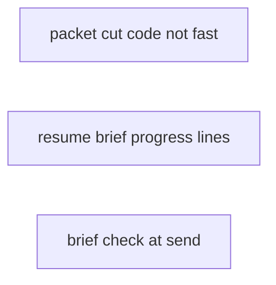

# Superlite: brief and packet gaps (#794, #819, #829)

**Goal:** a brief whose ROOT names a missing folder or whose mutation recipe cannot apply is flagged when it is sent (#794); a review packet that cuts a changed code file's diff is never the fast path and names the files to read in full (#819); a resumed lead brief names the checkpointed tasks, the reviews, the last full run and the steps left (#829).
**Architecture:** new `brief_check.py` (pure checks, a few read-only git calls) called from `fleet_report.brief_message`, the one text builder every brief send (local, remote, lead) goes through; `pt_review.py` decides the fast path again after section 8's final cut; `backlog_run._resume_state` reads the run folder's ledger, fleet reports and full-run summary.
**Tech stack:** Python 3.10+ stdlib; pytest through `sl run_tests`.
**Spec:** this file, section Design.
**Detail:** contracts
**Target-min:** 11
**Wave0:** none
**Coverage:** off

Global constraints:
- Every line of a Python script under `skills/**/scripts/` keeps the repo's `# O(...)` complexity comment; stdlib only; LF endings. Files under `tests/` carry no such comments.
- This repository is public: no host names, user names, home paths, other project or repository names in code, tests, docs or commit messages.
- The verdict is `sl run_tests` (never raw pytest); every new test sees a red run before the code it tests.
- An existing test that pins a changed text or output is updated in the same task only when it is in the task's Owns. Any other test your change turns red: leave it, and name the file and the failing assertion in your report (the coordinator rules it).
- Builds: the verdict is `sl run_tests` (the project's test command; a project with `.maxapp` runs `maxapp test`, which a build pool may place on another Mac, and a full run whose tree a green maxapp test stamp covers returns that result without a run); task trees build in <tree>/.build/DerivedData and any build of your own goes under .build/ of the worktree, never -derivedDataPath outside the worktree (your session scratchpad included; backlog cleanup removes scratchpad build folders when the worktree goes); a product, simulator or device build stays on this machine and runs only when an issue's acceptance asks for a running-app check; copy this sentence into every worker brief.
- Simulators: append the UDID of each simulator you or a worker creates (`xcrun simctl create` or `clone`; a checker's `Simulators:` line marks its created ones) as one line to the worktree's `.superlite/simulators.txt`; never list one you did not create; ship cleanup shuts down and deletes each listed one; copy this sentence into every worker brief.

## Design

### 1. Brief check at send (#794)

Every generated ROOT=/Root: line comes from the live plan or run folder (fleet_io.py:149, :373, findings.py:258, build_prime.with_root), and no generator writes a mutation recipe: the bad brief was hand-written. Every brief file a worker gets passes `fleet_report.brief_message(role, path, full)` (fleet_io.send_brief local, fleet_remote_worker.send_brief, the lead send), so the check hooks in there.
- `brief_check.problems(path)` returns at most 5 problem texts and never raises: (a) each line whose stripped text starts `ROOT=` or `Root:` with an absolute path (after `~` expansion) that is not a directory; (b) each `git apply` recipe with `-R`/`--reverse` (inside backticks, else the whole line; at most 5 checked) that `git apply --check -R` refuses in the recipe root (the first existing ROOT/Root folder, else the brief folder's git toplevel; none: no recipe check).
- `brief_message` (every role but `final-reviewer`, whose packet is generated) prints each problem to stderr as `brief check: <path>: <problem>` and appends `brief_check.note(problems)` to the worker's line, so the sender can resend and the worker knows before it starts.

### 2. Fast path after the final cut (#819)

`fast` is set at pt_review.py:3362, before section 8 is rendered and cut (render_excerpts, the over-cap shrink at :3493). After the last `excerpts`, the changed code files it cuts (`cut_files(excerpts)` minus test paths and `.md`) make the packet not the fast path: title `REVIEW REQUIRED (code diffs cut)`, the open-items line says why, and every packet with such cuts gets a must-read line naming them (built at the end like the Cut line, CUT_TOKEN).

### 3. Resume brief (#829)

`backlog_run._resume_state` adds four lines after `- Uncommitted files:`: checkpointed tasks from the ledger `- commit Tn <sha> <title>` lines (hidden checkpoints are not on HEAD), reviewer reports from `.superlite/fleet/reports/*.json`, the last full run from `test-summary-full.json`, and the steps left.

### 4. Rulings

- Ruling: the #794 check flags and never refuses a send (because the issue asks for a flag, and a refused send would leave a spawned worker idle mid-spawn); it lives in a new `brief_check.py` called from `fleet_report.brief_message` (because `fleet_io.send_brief` and `fleet.py` belong to running batches B251 and B252, and `brief_message` is the one builder both local and remote sends call).
- Ruling: B251's plan also edits `fleet_report.brief_message` (a package-reviewer line); T3 leaves that function's body untouched (renamed `_brief_line`, wrapped by the new `brief_message`), so the batch that merges second resolves at most the def line (because lint's OVERLAP warning names B251 and no other choke point is free).
- Ruling: recipe producers run only as `git show`/`git diff` with `--no-ext-diff --no-textconv --no-color`, and a recipe holding a shell metacharacter other than its one `|`, or an option outside `-p`, `--patch`, `--binary`, `--format=...`, `--pretty=...`, `--`, is skipped unchecked (because brief text must never run a writing command such as `git diff --output=F`).
- Ruling: the resume brief infers no render check (because no file records one; only `.superlite/render/` screenshots exist) and lists no open plan tasks (because the resumed lead reads the plan itself).
- Ruling: B253 edits pt_review.py, backlog_run.py and fleet_report.py and adds brief_check.py instead of fleet_lead.py and plan_tools.py, which hold none of the three defects (no open batch lists them).

## Task graph

```mermaid
%% schedule
gantt
  title Predicted schedule (mm:ss)
  dateFormat X
  axisFormat %M:%S
  section lane 1
  T3 brief check at send :t3, 0, 584s
  section lane 2
  T1 packet cut code not fast :t1, 0, 557s
  section lane 3
  T2 resume brief progress lines :t2, 0, 555s
```

critical path: T3 (9.7 min) · peak width 3 · predicted build 9.7 min · predicted total ≈ 26.2 min (target ✗ 11.0)

## Package: review packet

App type: library (packet text builder). Categories: protocol (exact head lines), state (fast flag after the cut).
**Probe entry:** none (the packet builder runs in the named tests)

### T1 packet cut code not fast · Complexity 3 · Est. context 45k
**Owns:** skills/subagent-driven-development/scripts/pt_review.py, tests/scripts/test_packet_cut_code_819.py
**Components:** 1
**LOC owned:** 110
**Tests:** fast
**Model:** sonnet
**Covers:** 2
**Produces:** pt_review.cut_code_files(text: str) -> list[str]
  e.g. cut_code_files("Left out: a.py, docs/x.md\n(truncated: 5 of 90 diff lines shown, size cap; read b/c.py in full)\n(truncated: 5 of 9 diff lines shown, size cap; read tests/test_d.py in full)") -> ["a.py", "b/c.py"]
  e.g. cut_code_files("- none (no changed hunks in the hot-spot files)") -> []
**Review Focus:** state: `test_fast_packet_with_cut_code_is_review_required`, `test_uncut_packet_stays_fast`, `test_cut_test_or_md_only_stays_fast`; protocol: `test_must_read_line_names_cut_code`, `test_cut_code_files_filters`
**Test code (contracts):**
- `test_cut_code_files_filters`: the two e.g. lines above, exactly.
- `test_fast_packet_with_cut_code_is_review_required`: a non-inline plan run with nothing open (copy the plan and run fixtures of tests/scripts/test_packet_stale.py or test_pt_review.py) whose diff changes `src/big.py` by 400 lines, packet built with a small `--max-tokens` so section 8 truncates `src/big.py`: the packet's first line is `# Review packet: REVIEW REQUIRED (code diffs cut)`; it holds the line `Nothing is open, but section 8 cut the diff of changed code files: read each file the next line names in full, then review it; the fast path does not apply.` and not `Reply with a short APPROVED`; stdout's `wrote` line ends `- 0 open item(s), 1 cut code diff(s)`.
- `test_must_read_line_names_cut_code`: the same packet holds, right after its `Cut to fit the size cap:` line, `Read in full before your verdict (section 8 cut their diff; one Read each): src/big.py`; a packet with open items (one failing test in the summary) and the same cut holds that line too and its title stays `REVIEW REQUIRED`.
- `test_uncut_packet_stays_fast`: the same run with a 5-line change and the default cap: first line `# Review packet: FAST PATH`, no `Read in full before your verdict` line, stdout ends `- FAST PATH`.
- `test_cut_test_or_md_only_stays_fast`: only `docs/big.md` (400 lines) and `tests/test_big.py` (400 lines) changed, small cap: first line `# Review packet: FAST PATH`.
**Steps:** 1 write the tests, 2 run: FAIL, 3 add `cut_code_files` next to `cut_files` (sorted, `is_test_path` and `.md` dropped); after the last `excerpts` (after the over-cap shrink) compute `cut_code`; when `fast` and `cut_code`, set `fast = False` and swap the head's title and Nothing-is-open lines for the texts above; add a token like `CUT_TOKEN` right after it in `head`, replaced at the end with the must-read line (or dropped); the stdout `wrote` line appends `, K cut code diff(s)` when `cut_code`; keep `tool_only` as computed before, 4 run: PASS
**Notes:** the head is built before section 8 is cut and feeds `fixed_len`, so decide and patch at the end as the Cut line does; never recompute `tool_only` (an empty item list makes it True). Verify with `sl run_tests --fast tests/scripts/test_packet_cut_code_819.py tests/scripts/test_packet_cuts_591.py tests/scripts/test_pt_review.py tests/scripts/test_packet_stale.py tests/scripts/test_packet_inline.py --task T1`.

## Package: backlog resume

App type: library (lead brief text). Categories: protocol (exact lines), error handling (missing or bad files).
**Probe entry:** none (the brief builder runs in the named tests)

### T2 resume brief progress lines · Complexity 2 · Est. context 35k
**Owns:** skills/subagent-driven-development/scripts/backlog_run.py, tests/scripts/test_backlog_run_resume_829.py
**Components:** 1
**LOC owned:** 90
**Tests:** fast
**Model:** sonnet
**Covers:** 3
**Produces:** backlog_run._progress_lines(sd: Path) -> list[str]
  e.g. _progress_lines(sd) for a ledger with `- commit T1 abc1234567 ship guard`, `- commit T2 def4567890 brief text`, a report FR1.json {"role": "final-reviewer", "label": "FR1", "status": "APPROVED"} and no full run -> ["- Checkpointed tasks (ledger .superlite/progress.md; hidden checkpoints are not in the commits above): 2: T1 abc1234567 ship guard; T2 def4567890 brief text", "- Reviews (.superlite/fleet/reports): 1: FR1 APPROVED (final-reviewer)", "- Last full run (.superlite/test-summary-full.json): none", "- Steps left after the park: full suite, ship"]
  e.g. _progress_lines(empty sd) -> ["- Checkpointed tasks (ledger .superlite/progress.md; hidden checkpoints are not in the commits above): 0", "- Reviews (.superlite/fleet/reports): 0", "- Last full run (.superlite/test-summary-full.json): none", "- Steps left after the park: final review, full suite, ship"]
**Review Focus:** protocol: `test_progress_lines_examples`, `test_resume_brief_lists_checkpoints_after_uncommitted`; error handling: `test_progress_lines_skip_bad_files`, `test_progress_lines_cap_and_recheckpoint`, `test_full_run_green_drops_full_suite`
**Test code (contracts):**
- `test_progress_lines_examples`: both e.g. lines exactly.
- `test_progress_lines_cap_and_recheckpoint`: 7 tasks T1..T7 plus a second `- commit T1 fff0000000 ship guard v2` line: the first line reads `...: 7: T1 fff0000000 ship guard v2; T2 ...; T3 ...; T4 ...; T5 ... (+2 more)` (first-seen order, the last line per task wins); a ledger title with `\x1b` shows `?` (`_clean`).
- `test_full_run_green_drops_full_suite`: `test-summary-full.json` {"mode": "full", "passed": 812, "failed": 0} and an APPROVED final review: `- Last full run (.superlite/test-summary-full.json): 812 passed, 0 failed` and `- Steps left after the park: ship`; {"passed": 800, "failed": 3}: `800 passed, 3 failed` and `full suite, ship`; no full file but `test-summary.json` {"mode": "full", "passed": 5, "failed": 0} counts as the full run (its own path in the label); `test-summary.json` with mode `fast` does not.
- `test_progress_lines_skip_bad_files`: an invalid json report, a report without role, a `package-reviewer` report {"label": "T1", "status": "DONE"} and an implementer report: `- Reviews (.superlite/fleet/reports): 1: T1 DONE (package-reviewer)`; reports list oldest first by mtime, at most the newest 5 (`(+N earlier)` before them); a final review whose status starts `APPROVED (partial` counts as not approved.
- `test_resume_brief_lists_checkpoints_after_uncommitted`: with the parked fixture of tests/scripts/test_backlog_run.py (`parked`, `git`, `GIT`, `brief_of`, `run`, `bk`) and a ledger in `<wt>/.superlite/progress.md`, `start B1` writes the four lines right after the `- Uncommitted files:` line and before the answers line.
**Steps:** 1 write the tests, 2 run: FAIL, 3 add `_progress_lines(sd)` (ledger regex `^- commit ([A-Z]{1,3}\d+[A-Za-z]?) (\S+) (.*)$`; reports: `role` in package-reviewer, final-reviewer, line `<label> <status> (<role>)`; full run: `failed == 0 and passed > 0` is green; steps left: `final review` unless the newest final-reviewer report's status is `APPROVED` or starts `APPROVED` without `(partial`, `full suite` unless green, then `ship`) and extend `_resume_state` with it before the answers line, 4 run: PASS
**Notes:** each read is wrapped so a missing or bad file gives the empty case, never an exception; every text goes through `_clean`. Verify with `sl run_tests --fast tests/scripts/test_backlog_run_resume_829.py tests/scripts/test_backlog_run.py --task T2`.

## Package: brief check

App type: library (text checks with read-only git calls). Categories: protocol (problem texts), security (no writing git command from brief text), error handling (never raises).
**Probe entry:** none (the checks run in the named tests on a temporary git repository)

### T3 brief check at send · Complexity 4 · Est. context 45k
**Owns:** skills/subagent-driven-development/scripts/brief_check.py, skills/subagent-driven-development/scripts/fleet_report.py, tests/scripts/test_brief_check_794.py
**Components:** 2
**LOC owned:** 150
**Tests:** fast
**Model:** sonnet
**Covers:** 1
**Produces:** brief_check.problems(path: str) -> list[str] · brief_check.note(problems: list[str]) -> str
  e.g. problems(brief holding the line "ROOT=/no/such/tree") -> ["ROOT=/no/such/tree names a folder that does not exist"]
  e.g. problems(brief in repo R holding "`git show <sha of an old commit> | git apply -R`" whose lines a later commit rewrote) -> ["recipe `git show <sha> | git apply -R` does not apply in R: <first line of git's error> (a later commit rewrote those lines: build the mutation by hand)"]
  e.g. note([]) -> "" · note(["a", "b"]) -> "Brief check (sl, before sending): a; b."
**Review Focus:** protocol: `test_missing_root_flagged`, `test_existing_root_and_applying_recipe_pass`, `test_stale_recipe_flagged`, `test_apply_r_with_a_sha`, `test_note_text`; security: `test_writing_producer_skipped`; error handling: `test_unreadable_brief_no_problems`; seam: `test_brief_message_flags_and_appends`, `test_final_reviewer_not_checked`
**Test code (contracts):**
- `test_missing_root_flagged`: `ROOT=/no/such/tree` -> the first e.g. text; `Root: /no/such/tree` -> `Root: /no/such/tree names a folder that does not exist`; a relative `ROOT=trees/T1` is not checked.
- `test_existing_root_and_applying_recipe_pass`: tmp repo, commits c1 (file a.txt lines 1-3) and c2 (line 2 changed); brief `ROOT=<repo>` and "`git show <c2> | git apply -R`" -> [].
- `test_stale_recipe_flagged`: c3 rewrites line 2 again; the same brief -> one problem starting ``recipe `git show <c2> | git apply -R` does not apply in <repo>: `` and ending `(a later commit rewrote those lines: build the mutation by hand)`; without a ROOT line, a brief file inside the repo uses the repo's toplevel.
- `test_apply_r_with_a_sha`: "`git apply -R <c2>`" (no such file) at HEAD c2 -> [``recipe `git apply -R <c2>` names a commit, not a patch file (`git show <c2> | git apply -R` applies it)``]; at c3 that problem and the does-not-apply one for the `git show` form; a real patch file path (`git format-patch -1 c2`) at c2 -> [].
- `test_writing_producer_skipped`: "`git diff --output=out.txt HEAD~1 | git apply -R`" and "`git show c2 | git apply -R; rm -rf x`" -> [] and no `out.txt` written.
- `test_unreadable_brief_no_problems`: a missing path and a directory -> []; problems never raise and return at most 5 texts (7 missing ROOT lines -> 5).
- `test_note_text`: the e.g. line.
- `test_brief_message_flags_and_appends`: `fleet_report.brief_message("implementer", p)` for a brief with `ROOT=/no/such/tree` returns the unchanged line plus ` Brief check (sl, before sending): ROOT=/no/such/tree names a folder that does not exist.` and stderr holds `brief check: 
: ROOT=/no/such/tree names a folder that does not exist`; a clean brief returns exactly the old text and prints nothing.
- `test_final_reviewer_not_checked`: role `final-reviewer` with a packet holding `ROOT=/no/such/tree`: the old text, nothing on stderr.
**Steps:** 1 write the tests, 2 run: FAIL, 3 write brief_check.py (module docstring with the library line, complexity notation; text capped at 200 KB; git via `subprocess.run([...], cwd=root, capture_output=True, timeout=10)`, producers `git show`/`git diff` with `--no-ext-diff --no-color` inserted after the subcommand, its stdout piped to `git apply --check -R`; shlex parse, skip on error), hook it into `fleet_report.brief_message` without editing its body: rename the existing function to `_brief_line` (def line only; body and docstring untouched) and add a new `brief_message(role, path, full=False)` right above it that calls `_brief_line(role, path, full)` and, for every role but `final-reviewer`, runs the check (lazy import in a try that leaves the text unchanged on any error), 4 run: PASS
**Notes:** a recipe is a backtick span holding `git apply` and `-R` or `--reverse`, else such a whole line; a `|` splits producer and `git apply`; any other `;`, `&`, `>`, `<`, `$`, backtick or a second `|` skips it. Verify with `sl run_tests --fast tests/scripts/test_brief_check_794.py tests/scripts/test_fleet_report.py tests/scripts/test_fleet_report_planned_716.py --task T3`.

## Review Focus

- T1 state: the fast flag is decided after section 8's last cut; `tool_only` keeps its first value.
- T2 error handling: any missing or bad ledger, report or summary file gives the empty line, never an exception.
- T3 security: no command a brief names runs except `git show`/`git diff` (no ext diff) and `git apply --check`; nothing is written.
- T3 seam: `brief_message` is unchanged for a clean brief and for the final reviewer.

## Self-review

Every issue maps to one task (#794 T3, #819 T1, #829 T2); no shared files; no edges; contracts name exact texts.
