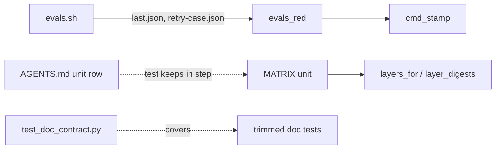
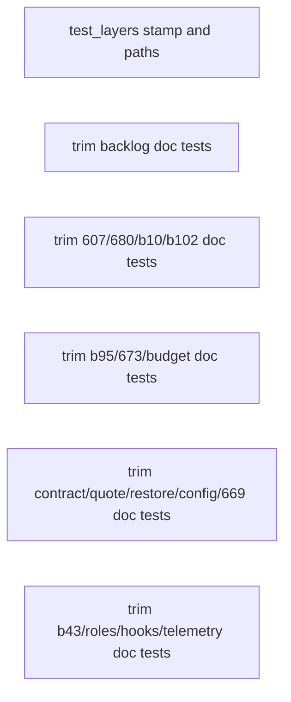

# Superlite: retry-aware evals stamp, pytest config in the unit layer, fewer phrase-grep doc tests

**Goal:** `test_layers.py stamp evals` stops recording a case red that `scripts/evals.sh`'s retry turned green (#881); `pyproject.toml` and `uv.lock` move the unit layer (#892); the phrase-grep doc asserts `tests/scripts/test_doc_contract.py` already covers are removed (#897).
**Architecture:** three changes on existing seams. `scripts/test_layers.py` gains `evals_red(results)`, which `cmd_stamp` calls instead of `red_cases(last.json)`, and its `MATRIX["unit"]` include list gains two root files (AGENTS.md's table and docs/testing.md follow). The #897 tasks only delete named asserts and needles from existing doc tests.
**Tech stack:** Python 3.10+ stdlib; pytest through `sl run_tests`.
**Spec:** this file, section Design.
**Detail:** tests
**Target-min:** 11
**Wave0:** none
**Worktree:** none
**Coverage:** off

Global constraints:
- Every line of a Python script under `scripts/` keeps the repo's `# O(...)` complexity comment; stdlib only; LF endings. Files under `tests/` carry no such comments.
- This repository is public: no host names, user names, home paths, other project or repository names in code, tests, docs or commit messages.
- The verdict is `sl run_tests` (never raw pytest); every new test sees a red run before the code it tests.
- An existing test that pins a changed text or output is updated in the same task only when it is in the task's Owns. Any other test your change turns red: leave it, and name the file and the failing assertion in your report (the coordinator rules it).
- Builds: the verdict is `sl run_tests` (the project's test command; a project with `.maxapp` runs `maxapp test`, which a build pool may place on another Mac, and a full run whose tree a green maxapp test stamp covers returns that result without a run); task trees build in <tree>/.build/DerivedData and any build of your own goes under .build/ of the worktree, never -derivedDataPath outside the worktree (your session scratchpad included; backlog cleanup removes scratchpad build folders when the worktree goes); a product, simulator or device build stays on this machine and runs only when an issue's acceptance asks for a running-app check; copy this sentence into every worker brief.
- Simulators: append the UDID of each simulator you or a worker creates (`xcrun simctl create` or `clone`; a checker's `Simulators:` line marks its created ones) as one line to the worktree's `.superlite/simulators.txt`; never list one you did not create; ship cleanup shuts down and deletes each listed one; copy this sentence into every worker brief.

## Design

### 1. Evals stamp reads the retry (#881)

`scripts/evals.sh` writes the first attempt to `evals/results/last.json` (it removes the old one first) and reruns each failing case whose runs disagreed into `evals/results/retry-<case>.json`; it does not remove older retry files. New `evals_red(results: Path) -> list[str]`: `red_cases(results / "last.json")`, minus each name that matches `[A-Za-z0-9._-]+` (evals_retry's `SAFE`, so no name reaches outside `results/`) whose `results / f"retry-{name}.json"` exists, has an mtime at or after `last.json`'s (a retry left from an earlier run counts for nothing), lists a case of that name, and whose own `red_cases` does not hold the name. Unreadable or wrong-typed files keep the case red. No `last.json`: `[]`. `cmd_stamp` uses `evals_red(root / "evals" / "results")`; `--red` still wins. docs/testing.md's `stamp --ruling` paragraph names the retry.

### 2. Pytest config moves the unit layer (#892)

`MATRIX["unit"]` include list appends `"pyproject.toml", "uv.lock"` (root files only; the anchored glob matches nothing deeper). AGENTS.md's unit row appends `` `pyproject.toml` ``, `` `uv.lock` `` in the same order as the MATRIX list, and a test keeps the two in step. docs/testing.md's pyproject paragraph says both files map to the unit layer.

### 3. Doc asserts the contract test covers (#897)

Four researchers classified all 116 doc tests in `tests/scripts` (every file with `doc` in its name, except the contract test's own files). An assert or needle goes only when it names an sl tool or subcommand plus nothing but flags, flag choices and placeholders the contract test skips (`<...>`, all-caps words, `Tn`, `Wn`, `$PLAN`, `[...]`), and the doc it reads holds it inside a call with a launcher (`sl`, `"$SL"`, `$SL`, `<abs sl>`, `<sl>`, a path ending `/sl`), so a renamed flag or subcommand fails `test_doc_contract.py`. A needle that is a bare flag, or that carries a literal value (a number such as `540`, a path such as `/dev/null`, example ids such as `B7 B10`, a tier number), stays: the contract test checks neither. No file is covered in full, so none is deleted; 23 files are trimmed.

Trim rules for T2 to T6: remove exactly the named needles; a tuple or loop loses only those, an `a and b` assert only the named half, an assert left with no needle goes, a test left with no assert goes, then an import, constant or helper only that removal left unused goes. Change nothing else. Before each removal, grep the named doc line: when the needle no longer sits after a launcher there, keep it and name it in the report.

### 4. Rulings

- Ruling: B244's files beyond the brief's list (docs/testing.md, the two new test files, the 22 other doc test files, this plan) are listed by no open batch, so they are this batch's (lead's ruling, brief rule).
- Ruling: [scope] #897 trims 23 files and deletes none: the B224 list was a hint; most of its asserts read docs/tools.md cells or prose with no launcher, which the contract test never sees, so they stay (lead's ruling).
- Ruling: a stale retry file is told apart by mtime (at or after last.json's), not by editing evals.sh to clear retries, so the fix stays in test_layers.py (lead's ruling).
- Ruling: fleet placement local for this run: two remote research panes died (lead's ruling).

## Main diagram



## File structure

- `scripts/test_layers.py`: `evals_red`, `cmd_stamp`, `MATRIX` (T1).
- `tests/scripts/test_layer_stamp_retry_881.py`, `tests/scripts/test_layer_paths_892.py`: new tests (T1).
- `AGENTS.md`, `docs/testing.md`: unit row and two sentences (T1).
- 23 files under `tests/scripts/`: trimmed doc asserts (T2 to T6).

## Task graph

```mermaid
%% schedule
gantt
  title Predicted schedule (mm:ss)
  dateFormat X
  axisFormat %M:%S
  section lane 1
  T1 test_layers retry-aware evals stamp p :t1, 0, 580s
  section lane 2
  T2 trim the backlog doc tests :t2, 0, 546s
  section lane 3
  T4 trim the b95/673/budget doc tests :t4, 0, 546s
  section lane 4
  T5 trim the contract/quote/restore/confi :t5, 0, 546s
  section lane 5
  T6 trim the b43/roles/hooks/telemetry do :t6, 0, 546s
  section lane 6
  T3 trim the 607/680/b10/b102 doc tests :t3, 0, 546s
```





critical path: T1 (9.7 min) · peak width 6 · predicted build 9.7 min · predicted total ≈ 26.2 min (target ✗ 11.0)

## Tasks

### T1 test_layers: retry-aware evals stamp, pytest config in unit · Complexity 3 (O-1) · Est. context 30k
**Owns:** scripts/test_layers.py, tests/scripts/test_layer_stamp_retry_881.py, tests/scripts/test_layer_paths_892.py, AGENTS.md, docs/testing.md
**Components:** 2
**LOC owned:** 110
**Tests:** fast
**Model:** sonnet
**Kind:** design
**Produces:** test_layers.evals_red(results: Path) -> list[str]
  e.g. evals_red(Path("evals/results")) -> ["b"] (last.json red a and b, a newer retry-a.json scores a at 1)
  e.g. evals_red(Path("missing")) -> []
**Review Focus:** `test_unsafe_case_name_never_reads_a_retry_881`: a case named `../x` stays red although `results/retry-../x.json` is green; `test_retry_older_than_last_json_is_ignored_881`: a green retry 60 s older than last.json keeps the case red.
**Test code (verbatim):**
```python
# tests/scripts/test_layer_stamp_retry_881.py
"""#881: an evals stamp drops a case its newer evals.sh retry turned green; a stale, red, missing or bad retry keeps it red."""
from __future__ import annotations

import json
import os
import sys
from pathlib import Path

sys.path.insert(0, str(Path(__file__).resolve().parent))
from test_test_layers import cli, real_store, repo, store_file, tl  # noqa: E402,F401  (repo is a fixture)


def result(*cases, threshold=1):
    return json.dumps({"suite": {"threshold": threshold},
                       "cases": [{"name": n, "aggregates": {"score": s}} for n, s in cases]})


def results_dir(root: Path) -> Path:
    out = root / "evals" / "results"
    out.mkdir(parents=True, exist_ok=True)
    (out / "last.json").write_text(result(("a", 0.5), ("b", 0.5), ("c", 1)))
    return out


def test_retry_green_case_is_not_red_881(tmp_path):
    out = results_dir(tmp_path)
    (out / "retry-a.json").write_text(result(("a", 1)))
    assert tl.evals_red(out) == ["b"]


def test_retry_still_red_keeps_the_case_881(tmp_path):
    out = results_dir(tmp_path)
    (out / "retry-a.json").write_text(result(("a", 0.5)))
    assert tl.evals_red(out) == ["a", "b"]


def test_retry_older_than_last_json_is_ignored_881(tmp_path):
    out = results_dir(tmp_path)
    retry = out / "retry-a.json"
    retry.write_text(result(("a", 1)))
    t = (out / "last.json").stat().st_mtime - 60
    os.utime(retry, (t, t))
    assert tl.evals_red(out) == ["a", "b"]


def test_retry_naming_another_case_or_bad_json_keeps_red_881(tmp_path):
    out = results_dir(tmp_path)
    (out / "retry-a.json").write_text(result(("z", 1)))
    (out / "retry-b.json").write_text("{not json")
    assert tl.evals_red(out) == ["a", "b"]


def test_unsafe_case_name_never_reads_a_retry_881(tmp_path):
    out = tmp_path / "evals" / "results"
    (out / "retry-..").mkdir(parents=True)
    (out / "last.json").write_text(result(("../x", 0.5)))
    (out / "retry-.." / "x.json").write_text(result(("../x", 1)))
    assert tl.evals_red(out) == ["../x"]


def test_missing_last_json_has_no_red_881(tmp_path):
    assert tl.evals_red(tmp_path / "evals" / "results") == []


def test_stamp_evals_records_only_what_the_retry_left_red_881(repo):
    out = results_dir(repo)
    (out / "retry-a.json").write_text(result(("a", 1)))
    r = cli(repo, "stamp", "evals", "--ruling", "judge flake")
    assert r.returncode == 0, r.stderr
    assert r.stdout.strip() == "evals: stamped (red: b)"
    rec = real_store.stamp_of(store_file(repo), "evals", tl.layer_hash("evals", repo))
    assert rec["red"] == ["b"]


def test_explicit_red_still_wins_881(repo):
    out = results_dir(repo)
    (out / "retry-a.json").write_text(result(("a", 1)))
    assert cli(repo, "stamp", "evals", "--ruling", "r", "--red", "a").stdout.strip() == "evals: stamped (red: a)"
```
```python
# tests/scripts/test_layer_paths_892.py
"""#892: pyproject.toml and uv.lock move the unit layer; AGENTS.md's unit row lists the MATRIX globs."""
from __future__ import annotations

import re
import sys
from pathlib import Path

sys.path.insert(0, str(Path(__file__).resolve().parent))
from test_test_layers import tl  # noqa: E402

ROOT = Path(__file__).resolve().parents[2]


def test_pytest_config_and_lock_map_to_unit_892():
    assert tl.layers_for(["pyproject.toml"]) == ["unit"]
    assert tl.layers_for(["uv.lock"]) == ["unit"]
    assert tl.layers_for(["bench/pyproject.toml", "docs/uv.lock"]) == []


def test_agents_md_unit_row_lists_the_matrix_globs_892():
    text = (ROOT / "AGENTS.md").read_text(encoding="utf-8")
    row = next(ln for ln in text.splitlines() if ln.startswith("| unit |"))
    assert re.findall(r"`([^`]+)`", row.split("|")[3]) == tl.MATRIX["unit"][0]
    assert tl.MATRIX["unit"][0][-2:] == ["pyproject.toml", "uv.lock"]
```
**Steps:** 1 failing tests, 2 run: FAIL, 3 implement, 4 run: PASS
**Notes:** Design 1 and 2. In docs/testing.md, the `stamp --ruling` paragraph's "(`--red`, or for evals the cases below threshold in `evals/results/last.json`)" becomes "(`--red`, or for evals the cases below threshold in `evals/results/last.json`, minus each case a newer `evals/results/retry-<case>.json` from the retry shows green)"; the pyproject paragraph gains "`pyproject.toml` and `uv.lock` map to the unit layer, so a pytest-config or pin change reruns the suite." Verify with `sl run_tests --fast tests/scripts/test_layer_stamp_retry_881.py tests/scripts/test_layer_paths_892.py tests/scripts/test_layer_stamp_record_626.py tests/scripts/test_test_layers.py --task T1`.

### T2 trim the backlog doc tests · Complexity 1 (O-1) · Est. context 22k
**Owns:** tests/scripts/test_backlog_docs.py, tests/scripts/test_backlog_docs_b86.py, tests/scripts/test_backlog_main_docs.py, tests/scripts/test_docs_580_fleet.py
**Components:** 1
**LOC owned:** 20
**Tests:** fast
**Model:** haiku
**Kind:** mechanical
**Test code (verbatim):** none new: the trimmed files and `tests/scripts/test_doc_contract.py` pass.
**Steps:** 1 remove, 2 run: PASS
**Notes:** Trim rules in Design 3. Remove:
- test_backlog_docs.py: `test_command_is_the_main_loop` needles `"$SL" backlog status`, `"$SL" backlog plan`, `"$SL" backlog decide --print`, `"$SL" backlog decide --file`, `"$SL" backlog start`, `"$SL" backlog wait`, `"$SL" backlog answer` (about lines 7-9; commands/backlog.md:10-14), the ordering line stays; `test_reference_holds_the_main_and_lead_rules` needle `"$SL" backlog ship B lock` (line 15; SDD backlog.md:31); `test_reference_spells_skip_park_closing_and_bare_ship_steps` needles `"$SL" backlog skip <issue>`, `"$SL" backlog park B --reason R` (line 23; backlog-main.md:17).
- test_backlog_docs_b86.py: `test_sdd_backlog_names_source_and_reasons` needle `sl backlog skip <issue>` (lines 13-14); `test_command_names_source` the `backlog plan --github` half (line 20), `--max-batches N` stays.
- test_backlog_main_docs.py: `test_docs_name_the_main_side_merge` the three `ship B merge --from-main` asserts (lines 14, 15, 17); `test_command_names_skip_and_park_with_their_reasons` needles `"$SL" backlog skip <issue>`, `"$SL" backlog park B --reason R` (line 23); `test_command_names_several_ids_done_and_the_reprompt` needle `"$SL" backlog ship B done --pr N` only (line 29), `start B7 B10` stays.
- test_docs_580_fleet.py: `test_fixing_md_names_post_run_fixer` needle `fleet spawn --role fixer --tier T --brief` (line 17).
Verify with `sl run_tests --fast tests/scripts/test_backlog_docs.py tests/scripts/test_backlog_docs_b86.py tests/scripts/test_backlog_main_docs.py tests/scripts/test_docs_580_fleet.py tests/scripts/test_doc_contract.py --task T2`.

### T3 trim the 607/680/b10/b102 doc tests · Complexity 1 (O-1) · Est. context 20k
**Owns:** tests/scripts/test_docs_607_backlog.py, tests/scripts/test_docs_680.py, tests/scripts/test_docs_b10.py, tests/scripts/test_docs_b102.py
**Components:** 1
**LOC owned:** 10
**Tests:** fast
**Model:** haiku
**Kind:** mechanical
**Test code (verbatim):** none new: the trimmed files and `tests/scripts/test_doc_contract.py` pass.
**Steps:** 1 remove, 2 run: PASS
**Notes:** Trim rules in Design 3. Remove:
- test_docs_607_backlog.py: `test_plan_and_undo_lines_are_documented` needle `reset B [--discard]` (line 13; backlog-main.md:17).
- test_docs_680.py: `test_tools_lines` needle `report --batches` (line 23; docs/tools.md:77).
- test_docs_b10.py: `test_skill_names_gate_hold_report` the `hold Tn --reason R` check (line 10; SDD SKILL.md:56).
- test_docs_b102.py: `test_fleet_docs_name_the_new_format` the `"sl fleet name [ID]" in d` half only (line 22).
Verify with `sl run_tests --fast tests/scripts/test_docs_607_backlog.py tests/scripts/test_docs_680.py tests/scripts/test_docs_b10.py tests/scripts/test_docs_b102.py tests/scripts/test_doc_contract.py --task T3`.

### T4 trim the b95/673/budget doc tests · Complexity 1 (O-1) · Est. context 22k
**Owns:** tests/scripts/test_docs_b95_prompts.py, tests/scripts/test_docs_b95_sdd.py, tests/scripts/test_docs_b95_tools.py, tests/scripts/test_docs_b95_fleet.py, tests/scripts/test_docs_backlog_run_673.py, tests/scripts/test_docs_budget_corrections.py
**Components:** 1
**LOC owned:** 15
**Tests:** fast
**Model:** haiku
**Kind:** mechanical
**Test code (verbatim):** none new: the trimmed files and `tests/scripts/test_doc_contract.py` pass.
**Steps:** 1 remove, 2 run: PASS
**Notes:** Trim rules in Design 3. Remove:
- test_docs_b95_prompts.py: `test_resume_calls_orchestrator_resume` line 27 `has(RESUME, "sl orchestrator resume", "sl status")`.
- test_docs_b95_sdd.py: `test_package_reviewer` line 31 `has(PKG, "probe_run --plan", "--dismiss")` (agents/package-reviewer.md:14 holds both in `<abs sl> probe_run` calls).
- test_docs_b95_tools.py: `test_status_pool_orchestrator_worktree_rows` line 66 `has(row("status"), "sl status")`.
- test_docs_b95_fleet.py: `test_batch_leads_section` needle `incident resolve --kind` (lines 25-27).
- test_docs_backlog_run_673.py: `test_backlog_md_run` needles `backlog run` and `fleet restore` (line 13); `--window` and `re-arm` stay.
- test_docs_budget_corrections.py: `test_metrics_md_documents_the_subcommands` line 51 (`sl budget extend`, `sl budget raise`); `test_resume_names_budget_raise` line 71.
Verify with `sl run_tests --fast tests/scripts/test_docs_b95_prompts.py tests/scripts/test_docs_b95_sdd.py tests/scripts/test_docs_b95_tools.py tests/scripts/test_docs_b95_fleet.py tests/scripts/test_docs_backlog_run_673.py tests/scripts/test_docs_budget_corrections.py tests/scripts/test_doc_contract.py --task T4`.

### T5 trim the contract/quote/restore/config/669 doc tests · Complexity 1 (O-1) · Est. context 22k
**Owns:** tests/scripts/test_docs_contract.py, tests/scripts/test_docs_finding_quote.py, tests/scripts/test_docs_fleet_restore_577.py, tests/scripts/test_docs_run_config_681.py, tests/scripts/test_fleet_docs_669.py
**Components:** 1
**LOC owned:** 12
**Tests:** fast
**Model:** haiku
**Kind:** mechanical
**Test code (verbatim):** none new: the trimmed files and `tests/scripts/test_doc_contract.py` pass.
**Steps:** 1 remove, 2 run: PASS
**Notes:** Trim rules in Design 3. Remove:
- test_docs_contract.py: the whole `test_skill_verify_command_has_task` (line 33; SDD SKILL.md:55).
- test_docs_finding_quote.py: `test_fleet_md_names_rounds` line 34 `findings rounds --plan $PLAN --out`; line 35 stays.
- test_docs_fleet_restore_577.py: `test_fleet_md_names_restore` needle `"$SL" fleet restore --plan $PLAN` (line 13).
- test_docs_run_config_681.py: `test_tools_md_lines` needles `backlog start --config`, `fleet on --config` (line 18).
- test_fleet_docs_669.py: `test_debug_md_names_fleet_path` needle `fleet spawn --role implementer --brief` (about line 52); `fleet spawn --role fixer --tier 3 --brief` stays.
Verify with `sl run_tests --fast tests/scripts/test_docs_contract.py tests/scripts/test_docs_finding_quote.py tests/scripts/test_docs_fleet_restore_577.py tests/scripts/test_docs_run_config_681.py tests/scripts/test_fleet_docs_669.py tests/scripts/test_doc_contract.py --task T5`.

### T6 trim the b43/roles/hooks/telemetry doc tests · Complexity 1 (O-1) · Est. context 20k
**Owns:** tests/scripts/test_fleet_research_docs_b43.py, tests/scripts/test_fleet_roles_docs.py, tests/scripts/test_hooks_doc.py, tests/scripts/test_telemetry_docs_933.py
**Components:** 1
**LOC owned:** 12
**Tests:** fast
**Model:** haiku
**Kind:** mechanical
**Test code (verbatim):** none new: the trimmed files and `tests/scripts/test_doc_contract.py` pass.
**Steps:** 1 remove, 2 run: PASS
**Notes:** Trim rules in Design 3. Remove:
- test_fleet_research_docs_b43.py: `test_research_limits_paragraph` needles `` `sl fleet spawn --role research --plan PLAN` ``, `` `sl fleet send Wn --brief ``, `` `sl fleet wait Wn --plan PLAN` `` (lines 26-27; docs/fleet.md:29).
- test_fleet_roles_docs.py: `test_fixing_md_routes_fleet_fixes` needles `"$SL" findings route`, `fleet spawn --role fixer --tier`, `fleet send Wn --brief` (line 9); `test_docs_fleet_md_covers_roles` needle `findings route` only, `--role` stays.
- test_hooks_doc.py: `test_run_detection_section` needle `sl orchestrator end` (line 17); the whole `test_commands_name_inplace` (line 58).
- test_telemetry_docs_933.py: `test_docs_name_off_switches_and_rotation` needle `telemetry export --since` (line 33).
Verify with `sl run_tests --fast tests/scripts/test_fleet_research_docs_b43.py tests/scripts/test_fleet_roles_docs.py tests/scripts/test_hooks_doc.py tests/scripts/test_telemetry_docs_933.py tests/scripts/test_doc_contract.py --task T6`.

## Review Focus

- test_layers (CLI): file, state. Risks: a retry file outside `evals/results/` read through a case name; a stale retry from an earlier run hiding a red case; `--red` no longer winning; the unit hash moving for files deeper than the root.
- doc tests: a removed needle the contract test does not see (no launcher on its doc line, or a literal value); a test left empty or a helper left unused.

**Probe entry:** none (the CLI writes the shared layer store; the unit tests drive it with a temp store)

## Coordinator steps after the last task

1. Unit layer: `sl run_tests --full` (the change touches `scripts/*.py` and `tests/scripts/**`, and after T1 `pyproject.toml`'s layer; no other layer is required).
2. Final review, then ship: notes.md, pr-body.md, `sl backlog ship B244 lock`, `bump`, `merge`.

## Self-review

- Coverage: Design 1 and 2 are T1, Design 3 is T2 to T6.
- Graph: no edges; no two tasks share a file.
- Names: `evals_red`, `red_cases`, `MATRIX`, `cmd_stamp` are written the same everywhere.
