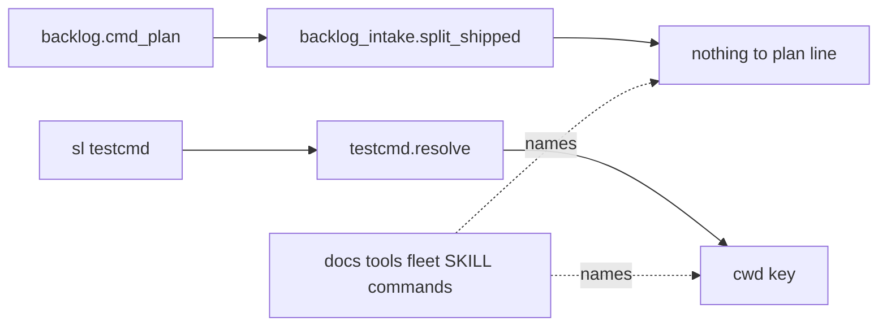
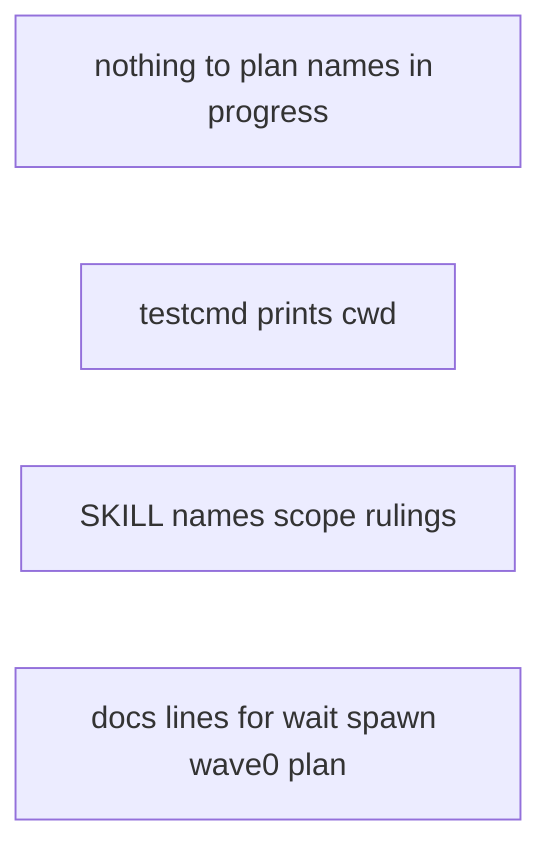

# Superlite: docs follow-ups for scope rulings, testcmd cwd, run_tests wait, spawn warning, plan in-progress lines

**Goal:** close five doc and message gaps: SDD SKILL.md names the `Ruling: [scope]` form (#898), `sl testcmd` and testcmd.py's docstring name test-cmd.json `"cwd"` (#950), docs/tools.md names run_tests' default `--wait` length, `<summary>.meta` and testcmd's default command (#952), docs name fleet spawn's launchd warning, `SUPERLITE_GUI_CHECK=0` and wave0 `stubbed_ids` (#955), and the backlog plan's in-progress lines plus a nothing-to-plan message that says `or in progress` (#956).
**Architecture:** two small code changes (backlog.cmd_plan's nothing-to-plan line; testcmd.resolve passes `cwd` through) and doc lines. docs/tools.md and docs/fleet.md are append-only for this batch: new lines only, no existing line rewritten.
**Tech stack:** Python 3.10+ stdlib; Markdown; pytest through `sl run_tests`.
**Spec:** this file, section Design.
**Detail:** tests
**Target-min:** 11
**Wave0:** none
**Coverage:** off (bounded doc and message changes to existing flows)

Global constraints:
- Every code line of a Python script under `skills/**/scripts/` keeps the repo's `# O(...)` complexity comment; stdlib only; LF endings. Files under `tests/` carry no such comments.
- This repository is public: no host names, user names, home paths, other project or repository names in code, tests, docs or commit messages.
- The verdict is `sl run_tests` (never raw pytest); every new test sees a red run before the change it tests.
- docs/tools.md and docs/fleet.md are append-only: add new lines; never reorder, rewrite or delete an existing line.
- An existing test that pins a changed text is updated in the same task only when it is in the task's Owns. Any other test your change turns red: leave it, and name the file and the failing assertion in your report.
- Builds: the verdict is `sl run_tests` (the project's test command; a project with `.maxapp` runs `maxapp test`, which a build pool may place on another Mac, and a full run whose tree a green maxapp test stamp covers returns that result without a run); task trees build in <tree>/.build/DerivedData and any build of your own goes under .build/ of the worktree, never -derivedDataPath outside the worktree (your session scratchpad included; backlog cleanup removes scratchpad build folders when the worktree goes); a product, simulator or device build stays on this machine and runs only when an issue's acceptance asks for a running-app check.
- Simulators: append the UDID of each simulator you or a worker creates (`xcrun simctl create` or `clone`; a checker's `Simulators:` line marks its created ones) as one line to /Users/max/github/superlite/.claude/worktrees/superlite-b245-docs-follow-ups/.superlite/simulators.txt; never list one you did not create; ship cleanup shuts down and deletes each listed one.

## Design

### 1. Nothing to plan (#956)

`backlog.cmd_plan` prints `nothing to plan: every issue is already shipped or in progress` when the left-out list (`more` from `backlog_intake.split_shipped`) holds an entry whose reason starts with `not planned (in progress`; otherwise the text stays `nothing to plan: every issue is already shipped` (pinned by test_backlog_plan_shipped_585 and backlog-main.md step 2). commands/backlog.md step 2 gains one closing sentence naming the `in progress:` and `in progress?:` lines and both nothing-to-plan texts.

### 2. testcmd cwd (#950)

`testcmd.resolve` returns `"cwd": cfg.get("cwd", "")` in both of its result dicts (the Python-default early return and the general one), so `sl testcmd` prints it as written, `""` when unset. testcmd.py's module docstring gains one sentence on `cwd`. run_tests keeps reading `cwd` from the config itself (`run_tests.run_folder` validates it); nothing else reads the new key.

### 3. Scope rulings in SDD SKILL.md (#898)

The `**Rulings, not stalls.**` line gains the scope form and points to orchestrator.md `## Scope rulings`. SKILL.md is at 13298 of its 13300 cap: three unpinned passages are trimmed to fit (13288 after).

### 4. Docs lines (#950, #952, #955, #956)

docs/tools.md gains six lines at its end (run_tests `--wait` default and `<summary>.meta`; testcmd default command; testcmd `cwd`; fleet spawn launchd warning and `SUPERLITE_GUI_CHECK=0`; wave0 `stubbed_ids`; backlog plan in-progress lines). docs/fleet.md gains one `## Troubleshooting` bullet for the spawn warning.

### 5. Rulings

Ruling: [scope] #952 and #955 ask the run_tests, testcmd, wave0 and prune rows of docs/tools.md to name the facts; they are new lines at the end of docs/tools.md instead, and the run_tests row keeps its stale `defaults to 540 s (DEFAULT_WAIT, under a 600 s Bash cap)` clause (because docs/tools.md is append-only in this batch and test_docs_b67_tools pins that row's tail; the new line names the clause as the floor; cost if wrong: a reader of the row alone sees only the floor).
Ruling: `cwd` is passed through as written, `""` when unset, not normalised (because run_tests.run_folder owns validation and the `.maxapp` fallback; cost if wrong: `sl testcmd` shows `""` where run_tests runs in a `.maxapp` package folder, which the docstring and docs line say).
Ruling: SDD SKILL.md trims: the disk-gate line drops "and remove trees of committed tasks and stopped workers", the pool paragraph's dispatch sync parenthesis becomes "(syncs it first)", and the finish line's trees parenthesis becomes "(`--module-cache-hours 24` also prunes module cache)" (because none is pinned and docs/tools.md states each in full; cost if wrong: a coordinator learns those details from tools.md only).
Ruling: the new SKILL.md phrase joins SDD_PINNED in tests/scripts/test_orchestrator.py (because that list must hold every pinned phrase, #555; no open batch lists the file).
Ruling: backlog-main.md is not edited (because its step 2 sentence on `already shipped` stays true and is pinned by test_backlog_docs_812_813 and the rules_684 fixture; commands/backlog.md carries the new text).
Ruling: `**Detail:** tests`, every task `Kind: mechanical` on haiku (exact texts and verbatim tests below).



## File structure

- `skills/subagent-driven-development/scripts/backlog.py`: cmd_plan's nothing-to-plan line.
- `commands/backlog.md`: step 2 closing sentence.
- `skills/subagent-driven-development/scripts/testcmd.py`: docstring sentence; `cwd` in resolve's results.
- `skills/subagent-driven-development/SKILL.md`: Rulings line and three trims.
- `tests/scripts/test_orchestrator.py`: SDD_PINNED gains the new phrase.
- `docs/tools.md`, `docs/fleet.md`: appended lines.
- Tests: `tests/scripts/test_backlog_nothing_to_plan_956.py`, `tests/scripts/test_testcmd_cwd_950.py`, `tests/scripts/test_sdd_scope_ruling_898.py`, `tests/scripts/test_docs_b245.py`.

## Task graph

```mermaid
%% schedule
gantt
  title Predicted schedule (mm:ss)
  dateFormat X
  axisFormat %M:%S
  section lane 1
  P1 nothing to plan names in progress :p1, 0, 390s
  section lane 2
  D1 docs lines for wait spawn wave0 plan :d1, 0, 369s
  section lane 3
  P2 testcmd prints cwd :p2, 0, 367s
  section lane 4
  S1 SKILL names scope rulings :s1, 0, 367s
```





critical path: P1 (6.5 min) · peak width 4 · predicted build 6.5 min · predicted total ≈ 19.0 min (target ✗ 11.0)

## Package: messages

App type: CLI. Categories: encoding, state.
**Probe entry:** none (one printed line and one JSON key; the named tests cover each case)

### P1 nothing to plan names in progress · Complexity 1 · Est. context 26k
**Owns:** skills/subagent-driven-development/scripts/backlog.py, commands/backlog.md, tests/scripts/test_backlog_nothing_to_plan_956.py
**Components:** 2
**LOC owned:** 45
**Tests:** fast
**Model:** haiku
**Kind:** mechanical
**Covers:** 1
**Produces:** backlog.cmd_plan nothing-to-plan line `nothing to plan: every issue is already shipped or in progress` when an in-progress issue was left out
**Review Focus:** state: `test_in_progress_left_out_names_it`; state: `test_shipped_only_keeps_text`; encoding: `test_command_step2_names_lines`
**Test code (verbatim):**
```python
"""#956: a plan that leaves out an in-progress issue says `already shipped or in progress`; commands/backlog.md step 2 names the lines."""
from pathlib import Path

import pytest
from test_backlog_cli import bk, cli, bs, bl  # noqa: F401

DOC = Path(__file__).resolve().parents[2] / "commands" / "backlog.md"
S956 = ("An issue another session builds (a Jira status in the In Progress category, or a worktree or branch naming it) is not planned: "
        "`in progress: #N (<status, worktree or branch>): not planned, another session builds it; sl backlog plan --issues N --add plans it anyway`; "
        "a pinned one is planned anyway with `in progress?: #N (<status, worktree or branch>): planned anyway (pinned); sl backlog skip N drops it`. "
        "A plan that leaves every issue out says `nothing to plan: every issue is already shipped`, or "
        "`nothing to plan: every issue is already shipped or in progress` when an issue another session builds was among them.")
IP = {"number": 1, "title": "One", "reason": "not planned (in progress: branch 1-x)"}
IP_LINE = "in progress: #1 (branch 1-x): not planned, another session builds it; sl backlog plan --issues 1 --add plans it anyway"
SHIPPED = {"number": 2, "title": "Two", "reason": "not planned (shipped: PR #41)"}


@pytest.fixture(autouse=True)
def _env(monkeypatch):
    for k in ("SUPERLITE_FLEET_ROLE", "SUPERLITE_FLEET_PARENT_DIR", "SUPERLITE_FLEET_WORKER", "SUPERLITE_STATE_DIR"):
        monkeypatch.delenv(k, raising=False)
    monkeypatch.setattr(bl, "_tracked", lambda root: [])
    monkeypatch.setattr(bl, "_subjects", lambda root, ref: [])


def test_in_progress_left_out_names_it(bk, capsys, monkeypatch):
    monkeypatch.setattr(bl.bi, "split_shipped", lambda *a, **k: ([], [IP, SHIPPED], [IP_LINE]))
    rc, out = cli(capsys, "plan")
    assert rc == 0
    assert IP_LINE in out
    assert "nothing to plan: every issue is already shipped or in progress" in out.splitlines()
    assert not any(c[0] in ("spawn", "send") for c in bk.calls)


def test_shipped_only_keeps_text(bk, capsys, monkeypatch):
    monkeypatch.setattr(bl.bi, "split_shipped", lambda *a, **k: ([], [SHIPPED], ["already shipped: #2 named by merged PR #41"]))
    rc, out = cli(capsys, "plan")
    assert rc == 0
    assert "nothing to plan: every issue is already shipped" in out.splitlines()
    assert "or in progress" not in out


def test_command_step2_names_lines():
    line = next(l for l in DOC.read_text(encoding="utf-8").splitlines() if l.startswith("2. "))
    assert line.endswith(" " + S956)
```
**Steps:** 1 write the test file, 2 run: FAIL, 3 implement, 4 run: PASS
**Notes:** backlog.py, in cmd_plan, replace the line `print("\n".join(notes + ["nothing to plan: every issue is already shipped"]))  # O(i)` with two lines: `busy = any(str(m.get("reason", "")).startswith("not planned (in progress") for m in more)  # an in-progress issue was left out (#956) | O(i)` and `print("\n".join(notes + ["nothing to plan: every issue is already shipped" + (" or in progress" if busy else "")]))  # O(i)`, same indent. commands/backlog.md: append one space and then S956 (the test's constant, exactly) to the end of the line that starts with `2. `; change nothing else in that file.

### P2 testcmd prints cwd · Complexity 1 · Est. context 26k
**Owns:** skills/subagent-driven-development/scripts/testcmd.py, tests/scripts/test_testcmd_cwd_950.py
**Components:** 1
**LOC owned:** 30
**Tests:** fast
**Model:** haiku
**Kind:** mechanical
**Covers:** 2
**Produces:** testcmd.resolve(root, paths=(), notes=None) -> dict with key "cwd" (test-cmd.json "cwd" as written, "" when unset)
**Review Focus:** encoding: `test_cli_prints_cwd`; state: `test_cli_cwd_empty_when_unset`; state: `test_python_default_prints_cwd`; encoding: `test_docstring_names_cwd`
**Test code (verbatim):**
```python
"""#950: sl testcmd prints test-cmd.json "cwd" (as written, "" when unset); the testcmd.py docstring names it."""
from __future__ import annotations

from test_testcmd import TESTCMD, config, resolved


def test_cli_prints_cwd(tmp_path):
    config(tmp_path, language="go", test="go test ./...", cwd="app")
    assert resolved(tmp_path)["cwd"] == "app"


def test_cli_cwd_empty_when_unset(tmp_path):
    config(tmp_path, language="go", test="go test ./...")
    assert resolved(tmp_path)["cwd"] == ""


def test_python_default_prints_cwd(tmp_path):
    config(tmp_path, language="python", cwd="pkg")
    out = resolved(tmp_path)
    assert out["python"] is True and out["cwd"] == "pkg"


def test_docstring_names_cwd():
    head = TESTCMD.read_text(encoding="utf-8").split('"""', 2)[1]
    assert "`cwd` in (a) is the folder" in head and 'spec["cwd"]' in head
```
**Steps:** 1 write the test file, 2 run: FAIL, 3 implement, 4 run: PASS
**Notes:** In `resolve`, add `"cwd": cfg.get("cwd", ""),` to both returned dicts (the `language == "python"` early return and the final return), keeping each line's `# O(1)` comment. In the module docstring, insert this line directly after the line that starts with `` `not_code` in (a) ``: `` `cwd` in (a) is the folder, relative to the project root (`.` is the root), that run_tests runs `setup` and the test command in (run_tests.run_folder checks it; unset: the `.maxapp` package folder, else the root); resolve returns it as written as spec["cwd"], `""` when unset, so `sl testcmd` prints it. `` (the text between the outer double backticks, as one line).

## Package: docs

App type: docs. **Probe entry:** none (prose)

### S1 SKILL names scope rulings · Complexity 1 · Est. context 30k
**Owns:** skills/subagent-driven-development/SKILL.md, tests/scripts/test_orchestrator.py, tests/scripts/test_sdd_scope_ruling_898.py
**Components:** 1
**LOC owned:** 30
**Tests:** fast
**Model:** haiku
**Kind:** mechanical
**Covers:** 3
**Review Focus:** encoding: `test_rulings_line_names_the_scope_form`; state: `test_orchestrator_section_matches`; state: `test_cap_holds`
**Test code (verbatim):**
```python
"""#898: SDD SKILL.md's "Rulings, not stalls" line names the scope ruling form and points to orchestrator.md."""
from pathlib import Path

SDD_DIR = Path(__file__).resolve().parents[2] / "skills" / "subagent-driven-development"
SDD = (SDD_DIR / "SKILL.md").read_text(encoding="utf-8")
ORCH = (SDD_DIR / "orchestrator.md").read_text(encoding="utf-8")
FORM = "`Ruling: [scope] <decision> - <why> - <cost if wrong>`"
SCOPE = "a deliverable added, dropped or changed after approval: " + FORM + " (`orchestrator.md` `## Scope rulings`)."


def test_rulings_line_names_the_scope_form():
    line = next(l for l in SDD.splitlines() if l.startswith("**Rulings, not stalls.**"))
    assert line.endswith("to `.superlite/progress.md`; " + SCOPE)


def test_orchestrator_section_matches():
    assert "## Scope rulings" in ORCH and FORM in ORCH


def test_cap_holds():
    assert len(SDD) <= 13300, len(SDD)
```
**Steps:** 1 write the test file, 2 run: FAIL, 3 implement, 4 run: PASS
**Notes:** Four exact replacements in SKILL.md, each text found once: (1) `` append `Ruling: <decision> - <why> - <cost if wrong>` to `.superlite/progress.md`. `` becomes `` append `Ruling: <decision> - <why> - <cost if wrong>` to `.superlite/progress.md`; a deliverable added, dropped or changed after approval: `Ruling: [scope] <decision> - <why> - <cost if wrong>` (`orchestrator.md` `## Scope rulings`). ``; (2) delete ` and remove trees of committed tasks and stopped workers` (leading space included); (3) `` `dispatch` (syncs first: real `context_k`, `idle_min` from transcripts, `busy` cleared by a newer stop record) keep it. `` becomes `` `dispatch` (syncs it first) keep it. ``; (4) `` (also orphaned DerivedData; `--module-cache-hours 24` prunes module cache) `` becomes `` (`--module-cache-hours 24` also prunes module cache) ``. The file is then 13288 characters. tests/scripts/test_orchestrator.py: append one entry to the end of the `SDD_PINNED` tuple, after the `# test_docs_affected_847.py` entry: a comment line `    # test_sdd_scope_ruling_898.py` and the line ``    "a deliverable added, dropped or changed after approval: `Ruling: [scope] <decision> - <why> - <cost if wrong>` (`orchestrator.md` `## Scope rulings`).",``. Verify with `--affected` so test_orchestrator.py and the other SKILL.md cap tests run.

### D1 docs lines for wait spawn wave0 plan · Complexity 1 · Est. context 30k
**Owns:** docs/tools.md, docs/fleet.md, tests/scripts/test_docs_b245.py
**Components:** 1
**LOC owned:** 60
**Tests:** fast
**Model:** haiku
**Kind:** mechanical
**Covers:** 4
**Review Focus:** encoding: `test_tools_ends_with_the_lines`; encoding: `test_fleet_troubleshooting_names_the_warning`; state: `test_quoted_texts_match_the_code`
**Test code (verbatim):**
```python
"""B245 (#950, #952, #955, #956): docs/tools.md and docs/fleet.md name the --wait default, <summary>.meta, the default pytest command, the testcmd cwd key, the launchd spawn warning, SUPERLITE_GUI_CHECK=0, wave0 stubbed_ids and the plan in-progress lines."""
from pathlib import Path

ROOT = Path(__file__).resolve().parents[2]
TOOLS = (ROOT / "docs" / "tools.md").read_text(encoding="utf-8")
FLEET = (ROOT / "docs" / "fleet.md").read_text(encoding="utf-8")
SCRIPTS = ROOT / "skills" / "subagent-driven-development" / "scripts"
LINES = [
    '`run_tests --wait` without `--timeout` sizes its wait from `<summary>.meta`, which `--background` writes beside the summary as one JSON line (`started`, `mode`, `limit`, `predicted` in seconds and `predicted_from`: `run_min in <file>` of the plan forecast or `median of N ledger runs`): the shorter of `predicted` and `limit` less the time already run, + 60 s, at least 540 s (`DEFAULT_WAIT`, the `defaults to 540 s` of the run_tests row) and at most one harness call less 60 s (`BASH_MAX_TIMEOUT_MS` / 1000, else 600 s; half of it under 120 s); with no meta, prediction or limit it waits that whole cap, and its timeout line adds `about N s left of a predicted M s run` (or `N s past its predicted M s`) and, when the cap cut the wait, `one call waits at most C s; BASH_MAX_TIMEOUT_MS raises it` (#952).',
    '`sl testcmd` in a Python project with no configured test command fills `command` with the default pytest command run_tests runs (the pytest prefix, then the `--fast` paths or else the full-run args: none when `testpaths` is configured, `tests` when that folder exists, else `--ignore=bench`; then `-q -rP -p no:cacheprovider -o junit_family=xunit1 --junitxml={junit}`) and adds `"default_command": true`; a configured command has no `default_command` key, and with no pytest runner `command` stays null and a `testcmd:` stderr line says why (#952).',
    '`sl testcmd` prints test-cmd.json `"cwd"` as its `cwd` key, as written (`""` when unset): the folder inside the project, relative to its root (`.` the root itself), that run_tests runs `setup` and the test command in; unset, run_tests uses the `.maxapp` package folder, else the root (#950).',
    '`fleet spawn` on this Mac prints `fleet: warning: launchd session <kind>, not Aqua: a worker spawned now cannot launch or drive a Mac app window or run a macOS xcodebuild test; fallback: ...; SUPERLITE_GUI_CHECK=0 skips this check` on stderr when the test config launches or tests a Mac app (a `launch` entry for a GUI platform whose `worker` is not false, or a macOS or Catalyst `xcodebuild test` in `test` or `test_file`) and the session is not Aqua; the spawn goes on. `SUPERLITE_GUI_CHECK=0` skips that warning and the run_tests GUI preflight (#798, #955).',
    '`wave0.stubbed_ids`, the tasks Wave 0 stubs that `plan_tools prune` (through `shape.removable_edges`) and the lint `TYPES:` check count as stubbed, honours the stubs the written `briefs/wave0.json` lists: with that record a stub pick counts only when one of its files is in `stubs`; with no usable record every stub pick counts; `**Wave0:** none` gives none (#831, #955).',
    '`backlog plan` leaves out an issue another session builds (a Jira status in the In Progress category, or a worktree or a local or `origin` branch naming it) with `in progress: #N (<status, worktree or branch>): not planned, another session builds it; sl backlog plan --issues N --add plans it anyway` and the `status` reason `not planned (in progress: <label>)`; a pinned one is planned anyway with `in progress?: #N (<status, worktree or branch>): planned anyway (pinned); sl backlog skip N drops it`; a plan with nothing left says `nothing to plan: every issue is already shipped`, or `nothing to plan: every issue is already shipped or in progress` when an issue another session builds was left out (#813, #956).',
]
BULLET = '- `fleet: warning: launchd session <kind>, not Aqua: ...` (stderr, a spawn on this Mac; the spawn goes on): the test config launches or tests a Mac app and this session is not the desktop login session, so the new worker cannot launch or drive a Mac app window or run a macOS `xcodebuild test`; the line names the fallback (`swift test`, an iOS Simulator destination, or the logged-in desktop session). `SUPERLITE_GUI_CHECK=0` skips the check, and the run_tests GUI preflight with it (#798).'


def test_tools_ends_with_the_lines():
    lines = TOOLS.splitlines()
    assert lines[-len(LINES):] == LINES


def test_fleet_troubleshooting_names_the_warning():
    section = FLEET.split("\n## Troubleshooting\n", 1)[1].split("\n## ", 1)[0]
    assert BULLET in section.splitlines()


def test_quoted_texts_match_the_code():
    gui = (SCRIPTS / "gui_session.py").read_text(encoding="utf-8")
    assert "launchd session {kind}, not Aqua: a worker spawned now cannot launch or drive a Mac app window or run a macOS xcodebuild test; " in gui
    assert 'os.environ.get("SUPERLITE_GUI_CHECK") == "0"' in gui
    assert "fleet: warning: {warn}" in (SCRIPTS / "fleet.py").read_text(encoding="utf-8")
    rt = (SCRIPTS / "run_tests.py").read_text(encoding="utf-8")
    assert "about {left:.0f} s left of a predicted {predicted:.0f} s run" in rt
    assert "one call waits at most {cap:g} s; BASH_MAX_TIMEOUT_MS raises it" in rt
    intake = (SCRIPTS / "backlog_intake.py").read_text(encoding="utf-8")
    assert "not planned, another session builds it; sl backlog plan --issues {p} --add plans it anyway" in intake
    assert "planned anyway (pinned); sl backlog skip {p} drops it" in intake
    assert "def stubbed_ids(" in (SCRIPTS / "wave0.py").read_text(encoding="utf-8")
```
**Steps:** 1 write the test file, 2 run: FAIL, 3 implement, 4 run: PASS
**Notes:** docs/tools.md: append the six `LINES` entries, exactly and in order, each as its own line after the file's current last line (the file ends with one newline). docs/fleet.md: insert `BULLET` as a new line directly after the `## Troubleshooting` bullet that starts with `` - `Blocked: fleet is on` `` (the section's last bullet, before the blank line and `## Run root and task trees`). Change no existing line in either file. Verify with `--affected` too, so test_doc_contract.py checks the `sl` calls in the new lines.

## Review Focus

- P1: the nothing-to-plan text changes only when an in-progress entry was left out; the shipped-only text is byte-identical to today's.
- P2: `cwd` appears in both resolve results; no other key changes.
- S1: SKILL.md stays at or under 13300 characters and keeps every SDD_PINNED phrase.
- D1: no existing line of docs/tools.md or docs/fleet.md changes (diff shows only added lines); every quoted message matches the code.

## Running-app checks

None (no UI target).

## Self-review

Coverage: sections 1-4 map to P1, P2, S1, D1. No placeholders. No task consumes another's code (D1 names P1's and P2's texts only as quoted text). No two tasks share a file. Each task has Components, LOC owned, Tests, Model.
