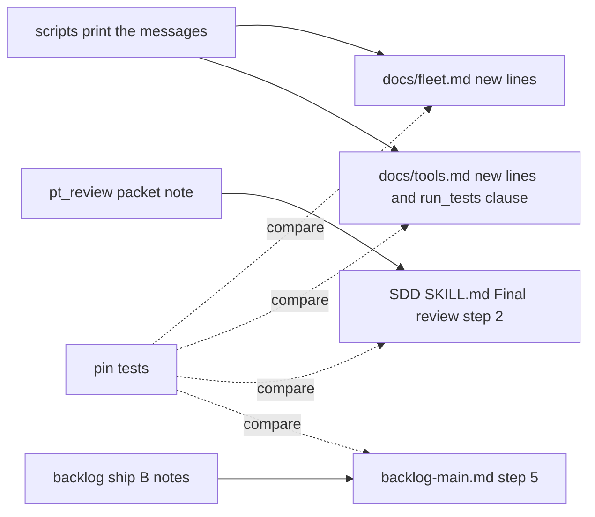
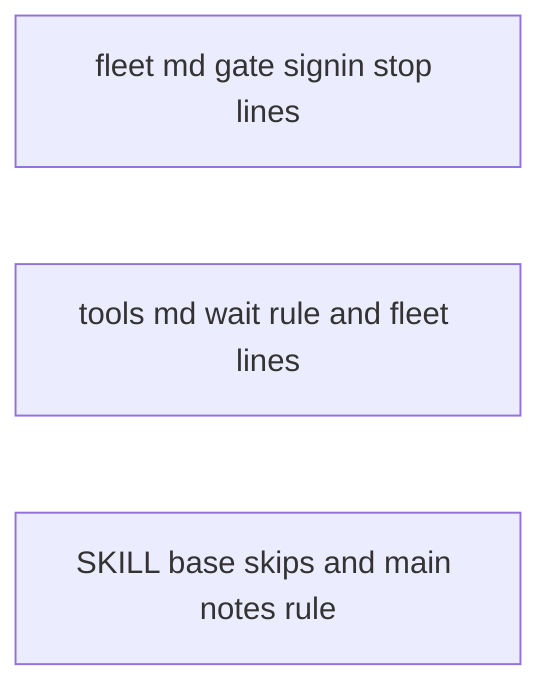

# Superlite: docs for the gate, sign-in checks, fleet status and stop, the run_tests wait rule, base skips and follow-up filing

**Goal:** close six doc follow-ups: backlog-main.md says main files lead follow-ups from the full notes text (#951); docs/fleet.md names the lead and restore sign-in checks, the remote resend and the per-account placement skip (#967); docs/fleet.md and docs/tools.md name the `worktree:` status line and the lead-only `/exit` stop (#969), and the gate's cause-based refusal, its `--max-workers`/`--min-swap-free-mb` bounds, review-first admission, the account, usage and brief-not-taken lines and the ` waits on` suffix (#970); the docs/tools.md run_tests row states the `--wait` sizing rule (#972); SDD SKILL.md Final review step 2 runs `run_tests --base-skips` when the full run skipped tests (#973).
**Architecture:** text only: new lines in docs/fleet.md and docs/tools.md next to the lines on the same feature, one clause rewritten in the docs/tools.md run_tests row (plus the B245 line that cites it), one clause and three trims in SDD SKILL.md, one sentence in backlog-main.md; pin tests compare each quoted message with the scripts that print it.
**Tech stack:** Markdown; Python 3.10+ stdlib tests through `sl run_tests`.
**Spec:** this file, section Design.
**Detail:** tests
**Target-min:** 11
**Wave0:** none
**Coverage:** off (bounded doc changes to existing flows)

Global constraints:
- This repository is public: no host names, user names, home paths, other project or repository names in docs, tests or commit messages.
- The verdict is `sl run_tests` (never raw pytest); every new test sees a red run before the change it tests.
- docs/fleet.md is append-only: add the new lines; never reorder, rewrite or delete an existing line. docs/tools.md likewise, except the two clauses task D2 names.
- Never edit a script under `skills/subagent-driven-development/scripts/`: other batches own several of them; the tests only read them.
- Copy every test file byte-for-byte from its plan block (extract it with a script, never retype it); each docs line is the test's constant, exactly, as one line.
- An existing test that pins a changed text is updated in the same task only when it is in the task's Owns. Any other test your change turns red: leave it, and name the file and the failing assertion in your report.
- Builds: the verdict is `sl run_tests` (the project's test command; a project with `.maxapp` runs `maxapp test`, which a build pool may place on another Mac, and a full run whose tree a green maxapp test stamp covers returns that result without a run); task trees build in <tree>/.build/DerivedData and any build of your own goes under .build/ of the worktree, never -derivedDataPath outside the worktree (your session scratchpad included; backlog cleanup removes scratchpad build folders when the worktree goes); a product, simulator or device build stays on this machine and runs only when an issue's acceptance asks for a running-app check.
- Simulators: append the UDID of each simulator you or a worker creates (`xcrun simctl create` or `clone`; a checker's `Simulators:` line marks its created ones) as one line to /Users/max/github/superlite/.claude/worktrees/superlite-b255-docs-and-skill-text/.superlite/simulators.txt; never list one you did not create; ship cleanup shuts down and deletes each listed one.

## Design

### 1. docs/fleet.md (#967, #969, #970)

Eleven new lines, each placed right after the existing line on the same feature: the usage line after the `claude-profile usage` bullet and the refusal, bounds and review-first lines after the Machine gate bullet (## Capacity); the `worktree:` and ` waits on` lines after the `fleet status` bullet and the stop line after the `fleet stop` bullet (## Commands); the lead and restore sign-in line after the Sign-in screen bullet and the brief resend after the `agent_prompt_stalled` bullet (## Troubleshooting); the remote resend and the account-pair skip after the room-answer bullet (## Remote machines). The texts are the constants of `tests/scripts/test_docs_b255_fleet.py`.

### 2. docs/tools.md (#969, #970, #972)

The run_tests row's clause `its limit defaults to 540 s (`DEFAULT_WAIT`, under a 600 s Bash cap)` becomes the sizing rule (predicted time left + 60 s, at least 540 s, at most one harness call less 60 s), and the B245 line's `(`DEFAULT_WAIT`, the `defaults to 540 s` of the run_tests row)` becomes `(`DEFAULT_WAIT`)`, since the row no longer says "defaults to 540 s". Three lines go at the end of the file: status `worktree:` line and lean stop; gate bounds, refusal tail and review-first; account, usage, brief and ` waits on` lines. The texts are the constants of `tests/scripts/test_docs_b255_tools.py`; test_docs_b67_tools.py's RT and test_docs_b245.py's first line follow the rewrite.

### 3. SDD SKILL.md and backlog-main.md (#951, #973)

Final review step 2 gains `, then `run_tests --base-skips` if it skipped tests` after `then its `wait:` line`; SKILL.md is at 13288 of its 13300 cap, so three unpinned passages are trimmed (13288 after). backlog-main.md step 5 gains one sentence after the pinned S5 block (it ends `names the running leads in one `backlog:` line.`). The new SKILL.md phrase joins SDD_PINNED in test_orchestrator.py (#555).

### 4. Rulings

Ruling: [scope] #972 rewrites one clause of the docs/tools.md run_tests row and the B245 line that cites it, although the brief lists docs/tools.md as append-only (because the triage rule says a file a batch rewrites lines in is never append_only for it, no other open batch lists docs/tools.md, and #972 with its test_docs_b67_tools.py pin asks for exactly that rewrite; cost if wrong: a ship-rebase conflict on those two lines, resolved by hand).
Ruling: stale existing lines stay and the new lines state the newer behaviour beside them: docs/tools.md fleet row `--over-limit` skips both checks and its old refusal example, docs/fleet.md's 30-minute stored-reading limit and its 10-minute machine skip for a signed-out host account (because both files are append-only for every other line; cost if wrong: a reader of the old line alone sees the old rule).
Ruling: the SKILL.md trims are `, probe results and incidents` (step 2), ` for it` (step 2) and `, longest first` (scheduling loop step 1) (because no test pins them and docs/tools.md states the packet inputs and dispatch order; cost if wrong: a coordinator reads those details in tools.md only).
Ruling: the pin tests check each quoted message in the script that prints it, as B67 and B245 did (because a doc quote must not drift from the code; cost if wrong: a later message change in a script must update these constants too).
Ruling: B255 also edits tests/scripts/test_orchestrator.py and tests/scripts/test_docs_b245.py, and writes this plan under docs/plans/ (no open batch lists them).
Ruling: `**Detail:** tests`; every task `Kind: mechanical` on haiku (exact texts and verbatim tests below).



## File structure

- `docs/fleet.md`: eleven new lines (D1).
- `docs/tools.md`: the run_tests clause, the B245 line's cross-reference and three new lines (D2).
- `skills/subagent-driven-development/SKILL.md`: step 2 clause and three trims (D3).
- `skills/subagent-driven-development/backlog-main.md`: step 5 sentence (D3).
- `tests/scripts/test_docs_b67_tools.py`, `tests/scripts/test_docs_b245.py`: pinned texts follow the rewrite (D2).
- `tests/scripts/test_orchestrator.py`: SDD_PINNED gains the new phrase (D3).
- Tests: `tests/scripts/test_docs_b255_fleet.py` (D1), `tests/scripts/test_docs_b255_tools.py` (D2), `tests/scripts/test_docs_b255_skill.py` (D3).

## Task graph

```mermaid
%% schedule
gantt
  title Predicted schedule (mm:ss)
  dateFormat X
  axisFormat %M:%S
  section lane 1
  D1 fleet md gate signin stop lines :d1, 0, 821s
  section lane 2
  D2 tools md wait rule and fleet lines :d2, 0, 818s
  section lane 3
  D3 SKILL base skips and main notes rule :d3, 0, 817s
```





critical path: D1 (13.7 min) · peak width 3 · predicted build 13.7 min · predicted total ≈ 36.2 min (target ✗ 11.0)

## Package: docs

App type: CLI. Categories: encoding.
**Probe entry:** none (doc text only; the pin tests compare each quoted text with the scripts)

### D1 fleet md gate signin stop lines · Complexity 1 · Est. context 30k
**Owns:** docs/fleet.md, tests/scripts/test_docs_b255_fleet.py
**Components:** 1
**LOC owned:** 110
**Tests:** fast
**Model:** haiku
**Kind:** mechanical
**Covers:** 1
**Produces:** docs/fleet.md lines USAGE, REFUSAL, BOUNDS, REVIEW, WORKTREE, WAITS, STOP, SIGNIN, BRIEF, RESEND, PAIR (the test's constants)
**Review Focus:** encoding: `test_each_block_follows_its_anchor_in_its_section`; encoding: `test_each_new_line_appears_once`; encoding: `test_quoted_texts_match_the_code`
**Test code (verbatim):**
```python
"""B255 (#967, #969, #970): docs/fleet.md names the lead and restore sign-in checks, the remote resend, the per-account placement skip, the status worktree: line, the lean stop, the gate's refusal and bounds, review-first admission, the account and usage lines, the brief resend and the waits-on suffix."""
from pathlib import Path

ROOT = Path(__file__).resolve().parents[2]
FLEET = (ROOT / "docs" / "fleet.md").read_text(encoding="utf-8").splitlines()
SCRIPTS = ROOT / "skills" / "subagent-driven-development" / "scripts"

USAGE = ("- `fleet spawn` names the accounts it left out in one stderr line once it picked one: `accounts skipped: claude2 (<why>), claude3 (signed out)`. "
         "When `claude-profile usage` gives no report at all, the pick takes every account's stored last reading, of any age, and says so on stderr: "
         "`usage: claude-profile usage gave no report; using last readings: claude1 3 h old, ...`, plus `; no stored reading: <accounts>` for listed, signed-in accounts with none, "
         "which count as unknown; a single failed reading also takes its stored reading of any age, so the 30-minute limit above is gone (#909).")
REFUSAL = ("- A machine-gate refusal names what drove it (#902): `BLOCKED: fleet spawn: machine busy after N s: memory <figures> (N agents, about X GB each)<cause>; "
           "gave up after K checks in N s: <what>; room comes when <ways>; rerun later, or pass --over-limit`. `<figures>` starts with `P% free, floor F%, ` only for a floor refusal, "
           "then `pressure <level>` and the swap and compressor figures it knows; `<cause>` is `; N agents of limit L from <source>`, `; swap free under --min-swap-free-mb M`, "
           "`; N live workers in this run, --max-workers N` or `; a review spawn waits first: <what>`, then `; largest non-agent process <name> X GB` when one holds memory; "
           "`<ways>` names what would make room: `agents end (N running)`, `workers of this run end (N live, --max-workers N)`, `the waiting review spawn (<what>) starts or gives up` "
           "or `<name> (X GB) ends`, else `memory frees up`. The first wait prints `machine busy: <text>; waiting up to S s for <what>` on stderr.")
BOUNDS = ("- `fleet spawn --over-limit --max-workers N --min-swap-free-mb M` (either bound alone works) bounds the override (#902): it still refuses at critical memory pressure, "
          "when swap is set up and its free part (total less used) is under M MB, or when this run has N or more live workers (any state but stopped and blocked); "
          "an admitted bounded override prints `machine limit overridden (--over-limit within --max-workers N and --min-swap-free-mb M): ...` on stderr. "
          "Either flag without `--over-limit` is an error (`--max-workers and --min-swap-free-mb bound --over-limit; pass --over-limit too`); plain `--over-limit` skips every check as before.")
REVIEW = ("- Reviews go first (#902): a package or final reviewer spawn that waits for room writes `machine-wait/<pid>.json` in `~/.superlite` (`SUPERLITE_HOME` moves it), "
          "and any other spawn the gate would admit waits while such a file is live (cause `a review spawn waits first: <what>`), so the review starts first. "
          "A file of a dead process or older than an hour is dropped; plain `--over-limit` does not wait for it, a bounded one does.")
WORKTREE = ("- A plain `fleet status` (no `--plan`) in a worktree whose own `.superlite` is not the folder status read, and whose fleet is on where that folder's is off or the reverse, "
            "adds one line after `fleet: on` or `fleet: off`: `worktree: fleet is on in <W>, the folder fleet spawn --plan <W> uses (this status read <S>); sl fleet status --plan <W> shows its workers`, "
            "or `worktree: fleet is off in <W>, the folder fleet spawn --plan <W> checks (this status read <S>); run sl fleet on --plan <W> first` (#904).")
WAITS = ("- A busy local worker's `fleet status` line ends ` waits on <command> <N min>` (` <N> s` under a minute) while a test or build command runs in its pane's process tree: "
         "the worker is alive; keep waiting (#909).")
STOP = ("- `fleet stop` sends `/exit` only to a worker that runs with slash commands, a lead (its launch has no `--disable-slash-commands`), and waits up to 10 s for its agent to end "
        "before it closes the pane; a lean worker gets no `/exit` and no wait, since closing its pane ends it (#930).")
SIGNIN = ("- A lead start and `sl fleet restore` check for the sign-in screen too (#880): a lead start on it marks the account signed out and starts once more on another account "
          "(stderr `Wn account A signed out: Claude Code sign-in screen; retrying on account B`); a second sign-in screen ends in "
          "`BLOCKED: Wn account B signed out: Claude Code sign-in screen; sign in once (CLAUDE_CONFIG_DIR=<dir> claude, then /login), then rerun ...` "
          "(no `CLAUDE_CONFIG_DIR=` for the default folder). Restore relaunches a worker on its own account only, since its `--resume` needs that account's session: "
          "on the sign-in screen it prints `BLOCKED: Wn not restored (account A signed out: Claude Code sign-in screen; sign in once (CLAUDE_CONFIG_DIR=<dir> claude, then /login), then rerun sl fleet restore)`, "
          "and a dead worker keeps its record, so a rerun after the sign-in tries it again.")
BRIEF = ("- A fresh one-turn worker whose pane goes idle with no turn after its first brief gets the brief once more "
         "(stderr `Wn: brief not taken (the pane went idle with no turn); resending once`); a second miss stops the worker and prints "
         "`BLOCKED: Wn <label> not sent (brief not taken after one resend)` (exit 3, #909).")
RESEND = ("- A remote prompt that herdr answers with `timed out waiting for agent status` is sent once more when the agent is idle or done and the first 40 characters "
          "of the prompt's first line are not on its screen; a working agent counts it as sent, and a sign-in screen after the prompt still fails at once with `account_signed_out` (#931).")
PAIR = ("- A remote start or send that fails because an account is signed out on the host skips only that machine and account pair, for 15 minutes (`room-skip.json` `accounts`), "
        "not the whole machine: stderr also prints, once per pair, `placement: account A is signed out on L; L stays in placement with its other accounts; sign A in there once (claude, then /login)`; "
        "the worker starts here and L keeps taking workers on its other accounts. The 10-minute machine skip above stays for every other reason, and a host whose accounts are all skipped "
        "is skipped as `no account with headroom` (#932).")
AFTER = [  # (section, anchor line prefix, the new lines right after it, in order)
    ("## Capacity", "- An account whose `claude-profile usage` reading failed", [USAGE]),
    ("## Capacity", "- Machine gate (#560, #643):", [REFUSAL, BOUNDS, REVIEW]),
    ("## Commands", "- `fleet status` prints `fleet: on` and one line per worker", [WORKTREE, WAITS]),
    ("## Commands", "- `fleet stop W1` or `fleet stop --all` closes workers", [STOP]),
    ("## Troubleshooting", "- Sign-in screen (Claude Code asks to log in):", [SIGNIN]),
    ("## Troubleshooting", "- `agent_prompt_stalled` (a herdr error code", [BRIEF]),
    ("## Remote machines", "- The room answer is cached for 60 s.", [RESEND, PAIR]),
]


def _section(name):
    at = FLEET.index(name)
    end = next((i for i in range(at + 1, len(FLEET)) if FLEET[i].startswith("## ")), len(FLEET))
    return FLEET[at:end]


def test_each_block_follows_its_anchor_in_its_section():
    for section, prefix, block in AFTER:
        lines = _section(section)
        hits = [i for i, line in enumerate(lines) if line.startswith(prefix)]
        assert len(hits) == 1, prefix
        assert lines[hits[0] + 1:hits[0] + 1 + len(block)] == block, prefix


def test_each_new_line_appears_once():
    for _, _, block in AFTER:
        for line in block:
            assert FLEET.count(line) == 1, line[:60]


def test_quoted_texts_match_the_code():
    def src(name):
        return (SCRIPTS / name).read_text(encoding="utf-8")
    acc, ml, fleet, io = src("accounts.py"), src("machine_load.py"), src("fleet.py"), src("fleet_io.py")
    assert '"accounts skipped: "' in acc and "using last readings: %s" in acc and "; no stored reading: %s" in acc
    assert "gave up after {k} check" in ml and '"room comes when "' in ml and "memory frees up" in ml
    assert "; largest non-agent process " in ml and "a review spawn waits first: {waiter}" in ml
    assert "machine limit overridden (--over-limit within {_bound_text(bounds)}): " in ml and "WAIT_TTL = 3600" in ml
    assert "machine busy: {text}; waiting up to {int(wait_s)} s for {what}" in ml
    assert "--max-workers and --min-swap-free-mb bound --over-limit; pass --over-limit too" in fleet
    assert '"; rerun later, or pass --over-limit"' in fleet
    assert "worktree: fleet is on in {W}, the folder fleet spawn --plan {W} uses (this status read {S}); sl fleet status --plan {W} shows its workers" in fleet
    assert "worktree: fleet is off in {W}, the folder fleet spawn --plan {W} checks (this status read {S}); run sl fleet on --plan {W} first" in fleet
    assert "not sent ({why})" in fleet and 'SIGNED_OUT_WHY = "signed out: Claude Code sign-in screen"' in fleet
    assert "brief not taken (the pane went idle with no turn); resending once" in io and "brief not taken after one resend" in io
    assert 'f" waits on {lab} "' in src("fleet_waits.py")
    assert 'wait_state(name, ["unknown"], 10000)' in src("herdr_client.py")
    lead = src("fleet_lead.py")
    assert "; retrying on account {account}" in lead and "; sign in once ({var}claude, then /login), then rerun" in lead
    restore = src("fleet_restore.py")
    assert "not restored (account {account} signed out: Claude Code sign-in screen; sign in once ({var}claude, then /login), then rerun {SL_CMD})" in restore
    assert 'SL_CMD = "sl fleet restore"' in restore
    assert 'STATUS_MSG = "timed out waiting for agent status"' in src("fleet_remote_worker.py")
    place = src("fleet_placement.py")
    assert "PAIR_MINUTES = 15.0" in place and "stays in placement with its other accounts; " in place
    assert "sign {name} in there once (claude, then /login)" in place
```
**Steps:** 1 write the test file, 2 run: FAIL, 3 implement, 4 run: PASS
**Notes:** for each `(section, prefix, block)` in the test's AFTER list, insert the block's constants as new lines, in order, right after the one line of docs/fleet.md that starts with `prefix`; do it with a short script that imports the test module's constants (`sys.path` = tests/scripts), never by retyping them. Change no other line of docs/fleet.md.

### D2 tools md wait rule and fleet lines · Complexity 1 · Est. context 30k
**Owns:** docs/tools.md, tests/scripts/test_docs_b255_tools.py, tests/scripts/test_docs_b67_tools.py, tests/scripts/test_docs_b245.py
**Components:** 1
**LOC owned:** 60
**Tests:** fast
**Model:** haiku
**Kind:** mechanical
**Covers:** 2
**Produces:** docs/tools.md run_tests row clause WAIT and three end lines LINES (the test's constants)
**Review Focus:** encoding: `test_run_tests_row_states_the_wait_rule`; encoding: `test_tools_holds_the_lines_as_one_block`; encoding: `test_quoted_texts_match_the_code`
**Test code (verbatim):**
```python
"""B255 (#969, #970, #972): docs/tools.md names the status worktree: line and the lean stop, the gate's bounds, refusal and review-first admission, the account, usage, brief and waits-on lines, and the run_tests row states the --wait sizing rule."""
from pathlib import Path

ROOT = Path(__file__).resolve().parents[2]
TOOLS = (ROOT / "docs" / "tools.md").read_text(encoding="utf-8")
SCRIPTS = ROOT / "skills" / "subagent-driven-development" / "scripts"
WAIT = ("its limit without `--timeout` is the run's predicted time left + 60 s, at least 540 s (`DEFAULT_WAIT`) and at most one harness call less 60 s "
        "(`BASH_MAX_TIMEOUT_MS` / 1000, else 600 s; the `run_tests --wait` line below the table has the details)")
OLD = "its limit defaults to 540 s (`DEFAULT_WAIT`, under a 600 s Bash cap)"
LINES = [
    "`fleet status` without `--plan` adds one `worktree: fleet is on in <W>, ...` or `worktree: fleet is off in <W>, ...` line after `fleet: on` or `fleet: off` when the worktree's own "
    "`.superlite` is not the folder it read and its fleet is on where that folder's is off or the reverse (#904); `fleet stop` sends `/exit` and waits up to 10 s only for a lead, "
    "and a lean worker's pane close ends it with no wait (#930); [fleet.md](fleet.md) quotes both lines.",
    "`fleet spawn --over-limit [--max-workers N] [--min-swap-free-mb M]`: the bounds keep the override refusing at critical pressure, under M MB of free swap and at N live workers of the run "
    "(`machine limit overridden (--over-limit within ...): ...` when admitted); either flag without `--over-limit` is an error and plain `--over-limit` skips every check. A gate refusal names "
    "what drove it and ends `gave up after K checks in N s: <what>; room comes when <ways>; rerun later, or pass --over-limit`, and a waiting package or final reviewer spawn is admitted "
    "before any other (`a review spawn waits first: <what>`); [fleet.md](fleet.md) lists every part (#902).",
    "`fleet spawn` prints `accounts skipped: <name> (<why>), ...` on stderr once it picked an account, and `usage: claude-profile usage gave no report; using last readings: <name> <age> old, ...` "
    "when the usage call gave no report; a fresh one-turn worker that does not take its first brief gets it once more, then `BLOCKED: Wn <label> not sent (brief not taken after one resend)`; "
    "`fleet status` ends a busy local worker's line with ` waits on <command> <N min>` (#909).",
]


def _row(name):
    return next(line for line in TOOLS.splitlines() if line.startswith(f"| `{name}` |"))


def test_run_tests_row_states_the_wait_rule():
    row = _row("run_tests")
    assert row.count(WAIT) == 1
    assert OLD not in TOOLS and "under a 600 s Bash cap" not in TOOLS
    assert "the `defaults to 540 s` of the run_tests row" not in TOOLS


def test_tools_holds_the_lines_as_one_block():
    lines = TOOLS.splitlines()
    assert any(lines[i:i + len(LINES)] == LINES for i in range(len(lines) - len(LINES) + 1))
    assert all(lines.count(line) == 1 for line in LINES)


def test_quoted_texts_match_the_code():
    rt = (SCRIPTS / "run_tests.py").read_text(encoding="utf-8")
    assert "DEFAULT_WAIT = 540.0" in rt and "BASH_MAX_TIMEOUT_MS" in rt
    assert "want = min(expected) - (now - started) + 60.0" in rt
    assert "half of it under 120 s" in rt
```
**Steps:** 1 write the test file, 2 run: FAIL, 3 implement, 4 run: PASS
**Notes:** with a short script that imports the test's constants: in docs/tools.md replace the one occurrence of OLD with WAIT, and the one occurrence of ``(`DEFAULT_WAIT`, the `defaults to 540 s` of the run_tests row)`` with ``(`DEFAULT_WAIT`)``; then append the three LINES at the end of the file, one per line, after its current last line (the file keeps its final newline). In tests/scripts/test_docs_b67_tools.py replace the one occurrence of ``its limit defaults to 540 s (`DEFAULT_WAIT`, under a 600 s Bash cap)`` inside RT with WAIT; in tests/scripts/test_docs_b245.py replace the one occurrence of ``(`DEFAULT_WAIT`, the `defaults to 540 s` of the run_tests row)`` in LINES[0] with ``(`DEFAULT_WAIT`)``. Change nothing else. Run test_docs_b67_tools.py and test_docs_b245.py with the new test.

### D3 SKILL base skips and main notes rule · Complexity 1 · Est. context 30k
**Owns:** skills/subagent-driven-development/SKILL.md, skills/subagent-driven-development/backlog-main.md, tests/scripts/test_docs_b255_skill.py, tests/scripts/test_orchestrator.py
**Components:** 1
**LOC owned:** 50
**Tests:** fast
**Model:** haiku
**Kind:** mechanical
**Covers:** 3
**Produces:** SDD SKILL.md Final review step 2 clause BASE; backlog-main.md step 5 sentence NOTES (the test's constants)
**Review Focus:** encoding: `test_step2_runs_base_skips_before_the_packet`; encoding: `test_trims_keep_the_pinned_phrases`; encoding: `test_base_skips_phrase_is_pinned_for_trims`; encoding: `test_main_step5_names_the_notes_text`; encoding: `test_quoted_commands_exist`
**Test code (verbatim):**
```python
"""B255 (#951, #973): SDD Final review step 2 runs run_tests --base-skips after a full run that skipped tests, before the packet; backlog-main.md step 5 says main files follow-ups from the full notes text."""
from pathlib import Path

ROOT = Path(__file__).resolve().parents[2]
SDD = ROOT / "skills" / "subagent-driven-development"
SKILL = (SDD / "SKILL.md").read_text(encoding="utf-8")
MAIN = (SDD / "backlog-main.md").read_text(encoding="utf-8")
BASE = "then its `wait:` line, then `run_tests --base-skips` if it skipped tests."
NOTES = ("Main files each follow-up from the full text `\"$SL\" backlog ship B notes` prints, never from the cut text of a wait line; "
         "a lead never files one (#815).")
S5_END = "names the running leads in one `backlog:` line."


def _step(text, n):
    return next(line for line in text.splitlines() if line.startswith(f"{n}. "))


def test_step2_runs_base_skips_before_the_packet():
    final = SKILL.split("## Final review", 1)[1].split("## Measure and budget", 1)[0]
    step2 = _step(final, 2)
    assert step2.count(BASE) == 1
    assert step2.index("`wait:` line") < step2.index("--base-skips") < step2.index("plan_tools packet")
    assert len(SKILL) <= 13300


def test_trims_keep_the_pinned_phrases():
    assert "uses that run's summary, and writes `.superlite/review-packet.md`" in SKILL
    assert "the packet's `## Render evidence` section lists them." in SKILL
    assert "prints per ready task: `Tn agent=ID tier=T`" in SKILL


def test_base_skips_phrase_is_pinned_for_trims():
    orch = (ROOT / "tests" / "scripts" / "test_orchestrator.py").read_text(encoding="utf-8")
    assert '    # test_docs_b255_skill.py\n    "then `run_tests --base-skips` if it skipped tests.",\n)' in orch


def test_main_step5_names_the_notes_text():
    step5 = _step(MAIN.split("## Main", 1)[1].split("## Limits", 1)[0], 5)
    assert step5.count(S5_END + " " + NOTES + " ") == 1


def test_quoted_commands_exist():
    scripts = SDD / "scripts"
    assert "run_tests --base-skips, then rebuild the packet" in (scripts / "pt_review.py").read_text(encoding="utf-8")
    assert '"--base-skips"' in (scripts / "run_tests.py").read_text(encoding="utf-8")
    assert 'a.action == "notes"' in (scripts / "backlog_ship.py").read_text(encoding="utf-8")
```
**Steps:** 1 write the test file, 2 run: FAIL, 3 implement, 4 run: PASS
**Notes:** each a replacement of exactly one occurrence. SKILL.md: ``then its `wait:` line. A plan's`` -> ``then its `wait:` line, then `run_tests --base-skips` if it skipped tests. A plan's``; ``uses that run's summary, probe results and incidents, and writes`` -> ``uses that run's summary, and writes``; ``section lists them for it.`` -> ``section lists them.``; ``prints per ready task, longest first:`` -> ``prints per ready task:`` (13288 characters after). backlog-main.md: ``names the running leads in one `backlog:` line. To compare`` -> the same with `` `` + NOTES + `` `` between `line.` and `To compare`. tests/scripts/test_orchestrator.py: right before the `)` that closes SDD_PINNED, after its last entry (the `# test_sdd_scope_ruling_898.py` phrase), add the two lines ``    # test_docs_b255_skill.py`` and ``    "then `run_tests --base-skips` if it skipped tests.",``. Run test_orchestrator.py, test_docs_b98_sdd.py and test_backlog_docs_b90.py with the new test.

## Review Focus

encoding: every new doc line is the test constant byte-for-byte, at its anchor, once; every quoted message still exists in the script that prints it; the rewritten clauses leave no reference to the old 540 s default.

## Self-review

Coverage: #951 D3, #967 D1, #969 D1+D2, #970 D1+D2, #972 D2, #973 D3. No placeholders. No shared files between tasks, no edges. Constants and Notes were applied to a scratch copy of the tree: all new tests and the touched pins (b67, b245, b98, 568, checker_600) pass, and SKILL.md is 13288 characters.
