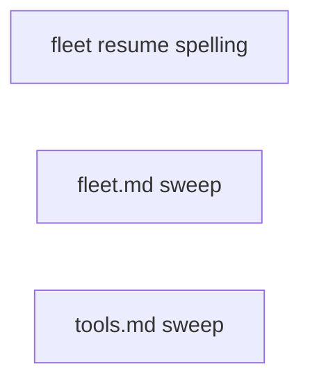

# Superlite: `sl fleet resume` spelling and a docs sweep of the fleet and tools docs (#976, #985, #988)

**Goal:** `sl fleet resume Wn --text T` runs the resume tool through fleet.py like `restore`, and every hint, doc and test spells it that way (#985); the docs/tools.md run_tests row names `--worker NAME` (#976); docs/fleet.md, docs/tools.md and skills/subagent-driven-development/fleet.md lose the lines append-only batches left stale and gain the missing ones #988 lists (#988).
**Architecture:** fleet.py's `main` delegates `resume` to `fleet_resume.main(argv[1:])` before argparse, as it does `restore`; the `--help` loop lists it; `fleet_resume.CMD` (the spelling `fleet_io`'s send refusal prints) becomes `"sl fleet resume"`. The docs are rewritten in place; new doc tests pin the new facts and check each quoted message against the script that prints it (the B255 pattern).
**Tech stack:** Python 3.10+ stdlib; pytest through `sl run_tests`; Markdown docs.
**Spec:** this file, section Design.
**Detail:** tests
**Target-min:** 11
**Wave0:** none
**Coverage:** off (bounded: one routing line plus docs; every open choice is a Ruling below)

Global constraints:
- Every line of a Python script under `skills/**/scripts/` keeps the repo's `# O(...)` complexity comment; stdlib only; LF endings. Files under `tests/` carry no such comments.
- This repository is public: no host names, user names, home paths, other project or repository names in code, tests, docs or commit messages.
- The verdict is `sl run_tests` (never raw pytest); every new test sees a red run before the change it tests.
- Docs describe the code as it is today: before you write a sentence about a message, find the message in the script and copy it (placeholders such as `Wn`, `<sd>`, `N` for its variables).
- A test under `tests/scripts/` that pins a doc line or hint your task rewrites is updated in your task to the new text, keeping the facts it checked; name each such file in your report's `files`. A pin test of a line your task does not rewrite stays as it is.
- In `skills/subagent-driven-development/scripts/fleet.py` change only the module docstring line, the `resume` route in `main` and the `--help` loop entry (another batch plans changes in that file).
- Builds: the verdict is `sl run_tests` (the project's test command; a project with `.maxapp` runs `maxapp test`, which a build pool may place on another Mac, and a full run whose tree a green maxapp test stamp covers returns that result without a run); task trees build in <tree>/.build/DerivedData and any build of your own goes under .build/ of the worktree, never -derivedDataPath outside the worktree (your session scratchpad included; backlog cleanup removes scratchpad build folders when the worktree goes); a product, simulator or device build stays on this machine and runs only when an issue's acceptance asks for a running-app check; copy this sentence into every worker brief.
- Simulators: append the UDID of each simulator you or a worker creates (`xcrun simctl create` or `clone`; a checker's `Simulators:` line marks its created ones) as one line to the worktree's `.superlite/simulators.txt`; never list one you did not create; ship cleanup shuts down and deletes each listed one; copy this sentence into every worker brief.

## Design

### 1. `sl fleet resume` (#985)

- fleet.py `main`: right after the `restore` route, `if argv and argv[0] == "resume": return importlib.import_module("fleet_resume").main(argv[1:])` (so `--plan` checks and the session fleet follow run first, as for `restore`). The `--help` loop gains `("resume", "continue a stopped one-turn worker's session")`, after `restore`. The module docstring gains, after the `restore` line: `    fleet.py resume WID --text T [--plan P]     (continue a stopped one-turn worker's session: delegated to fleet_resume)`.
- fleet_resume.py: `CMD = "sl fleet resume"`; the docstring usage line reads `    sl fleet resume WID --text TEXT [--plan P]    (sl fleet_resume runs the same tool)`; argparse `prog="sl fleet resume"`. Behaviour, refusals and exit codes stay as they are; `sl fleet_resume` keeps working because the tool file stays.
- The send refusal (`fleet_io._refusal`) prints `fleet_resume.CMD`, so it reads `continue its session: sl fleet resume W1 --text "..." --plan <sd>` with no fleet_io.py change.
- SDD fleet.md: both `"$SL" fleet_resume Wn` spellings become `"$SL" fleet resume Wn`; line 3's last sentence ("One fleet per session: it follows the session into the run (lint's binding, ... moves it there; stderr says so), and before a plan, $PLAN is the worktree's .superlite folder.") becomes T1's `FOLDER` constant (#786, #988).

### 2. docs/fleet.md (#988)

Facts each rewritten or new line states (code references to verify against):
- What it is (line 7): the sentence starting `A fleet that moved (` becomes: a run's `fleet.json` is a link to the session's fleet file `~/.superlite/fleets/<sid>/fleet.json`, so the block reads through it; an off `fleet.json` that an older version left with `moved_to` is still read at its target, up to 5 hops, and the block message ends `Fleet state read: <dir>/fleet.json.`, or `..., moved to <dir>/fleet.json.` after such a hop (fleet_state.py docstring lines 3-7).
- Capacity line 42 (keep its start `- An account whose \`claude-profile usage\` reading failed`): it takes its last good reading of any age, minus limits that have reset (accounts.py:124, stderr accounts.py:155), else the coordinator's own account as now (accounts.py:163). Line 43 drops `, so the 30-minute limit above is gone` (ends `... of any age (#909).`).
- Capacity line 45 (keep its start `- Machine gate (#560, #643):` and the facts test_docs_machine_memory_643.py checks): `One \`ps\` call finds` becomes one `ps` call, plus a second that reads the arguments of node, bun or deno processes when any run (machine_load.py:47-52).
- Capacity line 48: `A file of a dead process or older than an hour is dropped` becomes: the file of a dead process is deleted, and one older than an hour (`WAIT_TTL`) no longer holds other spawns (machine_load.py:318-330).
- Commands line 58: the `--help` list becomes `(on, off, status, spawn, placement, stop, name, report, send, keys, wait, run, restore, resume)`; its last sentence keeps the run-state rule but no longer quotes a stderr line: `The session's fleet serves only a folder that holds run state or that \`fleet on\` names (see \`fleet status\` below).`
- Commands line 72 (wait line): after the ` concerns=N` clause: a report with `Not run: <check> - <why>` lines (not for research or writer workers) adds ` not_run=N` after it; its DONE becomes DONE_WITH_CONCERNS and an APPROVED gets ` partial`; the report JSON holds `not_run` (the checks) and `status_reported` (the reply's own status, written when it changed) (fleet_io.py:955-971, #807). Line 73: a package reviewer's brief line and report contract also carry `fleet_report.NOT_RUN` (fleet_report.py:29, fleet_io.py:843).
- Commands, a new bullet right after line 77 (`fleet keys ...`): `fleet resume Wn --text TEXT [--plan P]` (also `sl fleet_resume`): continues a stopped one-turn worker of this machine (reviewer, fixer, research, writer, checker) in its own session: fresh pane, agent started with `--resume <session>`, text sent with its report contract; prints `Wn resumed pane=P session=S (<role>, last task T)`; the next `fleet wait` collects and stops it again (#808). Refusals: one `error:` line on stderr, exit 2, nothing touched (quote the six from fleet_resume.py:45-60). A failed relaunch: `BLOCKED: Wn not resumed (<why>)` (no session id, no pane, account signed out, startup), exit 3, record stays stopped. `fleet send` to such a worker exits 2 naming it: `error: Wn is stopped (<role>, last task T); continue its session: sl fleet resume Wn --text "..." --plan <sd>; or start a fresh one: ...` (fleet_io.py:1060-1068).
- Commands line 78 (keep its start `- \`fleet status\` prints \`fleet: on\` and one line per worker`): the sentence from `Fleet state is kept per session:` to `pass --plan X\`.` becomes: the session's fleet file lives in `~/.superlite/fleets/<sid>/fleet.json` (`-<n>` added when that name is taken; `SUPERLITE_HOME` moves `~/.superlite`); each run it serves holds `.superlite/fleet.json` as an absolute link to it; a fleet command or session binding in another run that holds run state adds that run's link (`fleet: this session's fleet in F now also serves R (N workers)`), and a fleet still kept as a run's own file first moves into the session folder (`fleet: this session's fleet moved from R to F (N workers)`); `fleet off` drops the file and the link; a session folder idle 14 days is pruned; each worker record keeps the `state_dir` its stop hook writes to; an off `fleet.json` from before #786 with `moved_to` is still followed (up to 5 hops), such a run prints `fleet: off (moved to X)` and `fleet spawn` there says `this fleet moved to X: pass --plan X` (fleet_state.py:3-8, 226-268; state.py:46; fleet.py:1445, 1497).
- Remote machines line 167: `a margin of 2` becomes a margin (`remote_margin` in `~/.superlite/machine.json`, default 2) (fleet_placement.py:6, 45).
- Remote machines line 168 (keep its start `- The room answer is cached for 60 s.`): drop `, an account signed out there` from the parenthesis; add after the 10-minute sentence: a start or send that fails because the account is not signed in there prints `placement: account A skipped on L (not signed in there); local` instead and skips only that pair (the bullet after next, #966) (fleet.py:696). Lines 169-170 stay byte-identical and right after it.
- Remote machines, a new bullet after line 170: a remote one-turn worker's first brief is checked like a local one's (#971): its stop records are synced from the host every 2 s; one not taken gets the brief once more (stderr `Wn: brief not taken (the pane went idle with no turn); resending once`), a second miss stops the worker with `BLOCKED: Wn <label> not sent (brief not taken after one resend)` (fleet_remote_worker.py:340-362).
- Remote machines line 175, appended: collect takes only the stop record of the task turn (at or after its send); while none is mirrored it syncs and rereads every 2 s for up to 45 s (the hook's 30 s snapshot bound plus the read), then the worker ends BLOCKED with the concern `remote worker Wn left no snapshot: no stop record of its task reached this machine within 45 s; its tree T stays on L (snapshot ref R)`, or, for a record whose hook took none, `remote worker Wn left no snapshot: its stop hook took none (remote_apply snapshot failed or ran past 30 s); its tree T stays on L` (#953) (fleet_remote_collect.py:23, 60-90).

### 3. docs/tools.md (#976, #985, #988)

- `run_tests` row: next to the `--task Tn [--plan P]` clause: `--worker NAME` runs a fleet-off reviewer's or fixer's tests in its own tree `.superlite/trees/worker-NAME` on an isolated stack, as a fleet worker's run uses `worker-<Wn>`; a fleet worker's `$SUPERLITE_FLEET_WORKER` id wins; a NAME outside 1 to 64 letters, digits, `-` or `_` exits 2 with `--worker NAME: 1 to 64 letters, digits, - or _ (got ...)` (#826) (run_tests.py:1521, 1588, 2495, 2772-2777). The `--wait` summary line becomes `tests (<mode>): P passed, F failed[, S skipped][; failing: <up to 3 names> (+N more)][; error: E][; <tested>]`, `<tested>` being the `; `-joined parts `tree <tree>`, `lacks N changed file(s) of the run root: ...`, `N file(s) changed while the tests ran: ...` and `result bundle <path> (+N more)` of a run whose summary holds `tree`, `lacks`, `drift` or `result_bundles` (#818) (run_tests.py:662-676, 721-734).
- `fleet` row: the refusal example becomes the current shape (`BLOCKED: fleet spawn: machine busy after N s: memory <figures> (N agents, about X GB each)<cause>; gave up after K checks in N s: <what>; room comes when <ways>; rerun later, or pass --over-limit`, details in fleet.md) and `\`--over-limit\` skips both checks` becomes `plain \`--over-limit\` skips every check; \`--max-workers N\` and \`--min-swap-free-mb M\` bound it (the line below the table)` (machine_load.py:342-376, 428; fleet.py:629). The fleet-pointer clause (`the session's fleet pointer ... leaving \`moved_to\` behind`) becomes the Design 2 line-78 facts, briefly, with `~/.superlite/fleets/<sid>/fleet.json` and `fleet: this session's fleet in F now also serves R (N workers)`; `off` prints `fleet: off (moved to X)` only for an old `moved_to`. The row names `resume Wn --text T` (delegated to fleet_resume) and the account-only skip `placement: account A skipped on L (not signed in there); local` (#966). The row's end, `(see \`docs/fleet.md\`)` plus test_docs_b67_tools.py's FLEET text, stays last.
- `fleet_io` row: after ` concerns=N`: ` not_run=N` for a report with `Not run:` lines (DONE to DONE_WITH_CONCERNS, APPROVED gets ` partial`, JSON `not_run` and `status_reported`; research and writer exempt) (#807).
- `fleet_state` row: the session's fleet file `~/.superlite/fleets/<sid>/fleet.json`, a `.superlite/fleet.json` link in each run it serves, `follow` (adds a run's link, first moving a run's own fleet file into the session folder), `home` still following an old `moved_to`; library, no CLI.
- New `fleet_resume` row right after `fleet_restore`: `sl fleet resume Wn --text T [--plan P]` (delegated by `fleet`; `sl fleet_resume` runs the same tool): continues a stopped local one-turn worker in its own session; exit 2 with one `error:` line for a refusal (nothing touched), exit 3 with `BLOCKED: Wn not resumed (...)` (record stays stopped) (#808).
- `accounts` row: `while at most 30 min old` becomes `of any age, minus limits that have reset` (#909).

### 4. Rulings

- Ruling: [scope] #988's sweep rewrites only text that contradicts the code; the incomplete rows found (backlog in-progress lines #947, trees `prepare_at`, backlog_brief linked-spec rules, pt_review cut code diffs and backlog_run resume brief lines #B253, a `brief_check` row, predict `suite`/`review`/`extra_min`) go to one Follow-up (because #988 asks for stale lines, and a full row audit would double the batch).
- Ruling: `sl fleet_resume` stays a working alias (the tool file stays; docs name `sl fleet resume` first) (because hints already printed and sessions running old copies still name it; cost if wrong: one extra spelling in two doc clauses).
- Ruling: fleet placement local for this run (because B233, B241 and B251 saw remote write workers' work lost; cost if wrong: less parallel room).
- Ruling: the tests that pin rewritten lines (outside the batch's list, no open batch lists them) are updated in the task that rewrites the line, and notes.md names them.

## Task graph

```mermaid
%% schedule
gantt
  title Predicted schedule (mm:ss)
  dateFormat X
  axisFormat %M:%S
  section lane 1
  T2 fleet.md sweep :t2, 0, 660s
  section lane 2
  T3 tools.md sweep :t3, 0, 658s
  section lane 3
  T1 fleet resume spelling :t1, 0, 578s
```





critical path: T2 (11.0 min) · peak width 3 · predicted build 11.0 min · predicted total ≈ 27.5 min (target ✗ 11.0)

## Package: fleet resume and docs

App type: CLI (fleet subcommand routing) plus Markdown docs. Categories: protocol (subcommand and help list), file (doc lines and pins). Risks: a route placed before the `--plan` check; a pin test turned red by a rewrite and left red; a quoted message that no script prints.
**Probe entry:** none (fleet subcommands drive Herdr panes; the docs have no runnable entry)

### T1 fleet resume spelling · Complexity 2 · Est. context 40k
**Owns:** skills/subagent-driven-development/scripts/fleet.py, skills/subagent-driven-development/scripts/fleet_resume.py, skills/subagent-driven-development/fleet.md, tests/scripts/test_fleet_resume_route_985.py, tests/scripts/test_fleet_resume_808.py, tests/scripts/test_docs_b251.py, tests/scripts/test_fleet_docs_578_579.py
**Components:** 2
**LOC owned:** 60
**Tests:** fast
**Model:** sonnet
**Covers:** 1
**Review Focus:** protocol: `test_resume_is_delegated` (argv after `resume` reaches fleet_resume.main unchanged), `test_help_lists_resume`; file: `test_sdd_fleet_md_spells_fleet_resume_and_names_the_session_file`
**Test code (verbatim):**
```python
"""sl fleet resume runs fleet_resume through fleet.py, as restore runs fleet_restore; SDD fleet.md spells it so and names the session fleet file (#985, #786)."""
import sys
import types
import pytest
from test_fleet import world, FakeHerdr, SCRIPTS  # noqa: F401
import fleet  # noqa: E402
import fleet_resume  # noqa: E402

FOLDER = ("One fleet per session: it follows the session into the run. Its file lives in `~/.superlite/fleets/<sid>/fleet.json`, "
          "and each run it serves holds `.superlite/fleet.json` as a link to that file, which lint's binding or the first fleet command "
          "naming another run adds (stderr `fleet: this session's fleet in F now also serves R (N workers)`, after "
          "`fleet: this session's fleet moved from R to F (N workers)` when a run still kept the fleet as its own file) (#786), "
          "and before a plan, $PLAN is the worktree's .superlite folder.")


def test_resume_is_delegated(world, monkeypatch):
    calls = []
    mod = types.ModuleType("fleet_resume")
    mod.main = lambda argv: (calls.append(argv), 5)[1]
    monkeypatch.setitem(sys.modules, "fleet_resume", mod)
    assert fleet.main(["resume", "W1", "--text", "run the check", "--plan", str(world.sd)]) == 5
    assert calls == [["W1", "--text", "run the check", "--plan", str(world.sd)]]


def test_help_lists_resume(monkeypatch, capsys):
    monkeypatch.setenv("COLUMNS", "200")
    with pytest.raises(SystemExit):
        fleet.main(["--help"])
    out = capsys.readouterr().out
    assert "{on,off,status,spawn,placement,stop,name,report,send,keys,wait,run,restore,resume}" in out
    assert "continue a stopped one-turn worker's session" in out


def test_hints_spell_fleet_resume():
    assert fleet_resume.CMD == "sl fleet resume"
    assert "fleet.py resume WID --text T [--plan P]" in fleet.__doc__


def test_sdd_fleet_md_spells_fleet_resume_and_names_the_session_file():
    text = (SCRIPTS.parent / "fleet.md").read_text(encoding="utf-8")
    assert "fleet_resume" not in text
    assert text.count('`"$SL" fleet resume Wn --text') == 2
    assert text.splitlines()[2].endswith(" Details: `docs/fleet.md`. " + FOLDER)
```
**Steps:** 1 write the test file, 2 run: FAIL, 3 Design 1 in fleet.py, fleet_resume.py and SDD fleet.md, 4 update the pins: test_fleet_resume_808.py (docstring line 1 and the refusal at line 173 to `sl fleet resume W1`), test_docs_b251.py (NOT_RUN and RESUME constants: `fleet_resume Wn` to `fleet resume Wn`), test_fleet_docs_578_579.py (its SDD fleet.md sentence, same change), 5 run: PASS
**Notes:** verify with `sl run_tests --fast tests/scripts/test_fleet_resume_route_985.py --task T1`, then once `sl run_tests --fast tests/scripts/test_fleet_resume_808.py tests/scripts/test_docs_b251.py tests/scripts/test_fleet_docs_578_579.py tests/scripts/test_docs_580_fleet.py tests/scripts/test_fleet_launch_record_577.py tests/scripts/test_fleet_cli_b54.py --task T1`. `test_docs_580_fleet.py` keeps passing because FOLDER holds `follows the session` and `before a plan, $PLAN is the worktree's .superlite`.

### T2 fleet.md sweep · Complexity 3 · Est. context 60k
**Owns:** docs/fleet.md, tests/scripts/test_docs_b259_fleet.py, tests/scripts/test_docs_b255_fleet.py
**Components:** 1
**LOC owned:** 90
**Tests:** fast
**Model:** sonnet
**Kind:** prose
**Covers:** 2
**Review Focus:** file: `test_stale_text_is_gone`, `test_section_names_it_once`, `test_capacity_usage_line_says_any_age`, `test_quoted_texts_match_the_code`
**Test code (verbatim):**
```python
"""B259 (#988, #985): docs/fleet.md rewrites the lines append-only batches left stale and names the remote collect wait, the remote brief check, not_run, fleet resume and the session fleet folder; each quoted message is checked against the script printing it."""
from pathlib import Path
import pytest

ROOT = Path(__file__).resolve().parents[2]
TEXT = (ROOT / "docs" / "fleet.md").read_text(encoding="utf-8")
LINES = TEXT.splitlines()
SCRIPTS = ROOT / "skills" / "subagent-driven-development" / "scripts"

STALE = [
    "while that is at most 30 min old",
    "so the 30-minute limit above is gone",
    "an account signed out there",
    "leaves `moved_to` behind",
    "One `ps` call finds",
    "A file of a dead process or older than an hour is dropped",
    "(on, off, status, spawn, stop, report, send, keys, wait, run)",
    "fleet: this session's fleet moved from A to B`",
    "A fleet that moved (`moved_to` in an off `fleet.json`) is read at its target",
]
NAMED = [  # (section, text the section holds exactly once)
    ("## What it is", "`~/.superlite/fleets/<sid>/fleet.json`"),
    ("## Commands", "(on, off, status, spawn, placement, stop, name, report, send, keys, wait, run, restore, resume)"),
    ("## Commands", "`~/.superlite/fleets/<sid>/fleet.json`"),
    ("## Commands", "`fleet: this session's fleet in F now also serves R (N workers)`"),
    ("## Commands", "`fleet: this session's fleet moved from R to F (N workers)`"),
    ("## Commands", " not_run=N"),
    ("## Commands", "`status_reported`"),
    ("## Commands", "`fleet_report.NOT_RUN`"),
    ("## Commands", "`fleet resume Wn --text TEXT [--plan P]`"),
    ("## Commands", "`Wn resumed pane=P session=S (<role>, last task T)`"),
    ("## Commands", 'continue its session: sl fleet resume Wn --text "..." --plan <sd>; or start a fresh one: ...'),
    ("## Remote machines", "`placement: account A skipped on L (not signed in there); local`"),
    ("## Remote machines", "no stop record of its task reached this machine within 45 s; its tree T stays on L (snapshot ref R)"),
    ("## Remote machines", "its stop hook took none (remote_apply snapshot failed or ran past 30 s); its tree T stays on L"),
    ("## Remote machines", "`BLOCKED: Wn <label> not sent (brief not taken after one resend)`"),
    ("## Remote machines", "`remote_margin`"),
]
CODE = [  # (script, literal its source holds)
    ("fleet_state.py", "fleet: this session's fleet in {held} now also serves {target} ({_count(held)} workers)"),
    ("fleet_state.py", "fleet: this session's fleet moved from {run} to {held} ({_count(held)} workers)"),
    ("fleet.py", "placement: account {acct} skipped on {machine} (not signed in there); local"),
    ("fleet_remote_collect.py", "no stop record of its task reached this machine within {WAIT_S} s; its tree {tree} stays on {label} (snapshot ref "),
    ("fleet_remote_collect.py", "WAIT_S = 45"),
    ("fleet_remote_collect.py", "its stop hook took none (remote_apply snapshot failed or ran past 30 s); its tree {tree} stays on {label}"),
    ("fleet_remote_worker.py", '"brief not taken after one resend"'),
    ("fleet_resume.py", "resumed pane={pane} session={sid[:8]} ({role}, last task "),
    ("fleet_io.py", 'extra["status_reported"]'),
    ("fleet_io.py", 'f" not_run={len(unrun)}"'),
    ("fleet_io.py", "continue its session: {fleet_resume.CMD} {wid} --text"),
    ("fleet_placement.py", '["remote_margin"]'),
    ("accounts.py", "using its reading from %s ago"),
    ("machine_load.py", "WAIT_TTL = 3600"),
]


def _section(name):
    at = LINES.index(name)
    end = next((i for i in range(at + 1, len(LINES)) if LINES[i].startswith("## ")), len(LINES))
    return "\n".join(LINES[at:end])


@pytest.mark.parametrize("text", STALE)
def test_stale_text_is_gone(text):
    assert text not in TEXT


@pytest.mark.parametrize("section,text", NAMED)
def test_section_names_it_once(section, text):
    assert _section(section).count(text) == 1


def test_capacity_usage_line_says_any_age():
    line = next(x for x in LINES if x.startswith("- An account whose `claude-profile usage` reading failed"))
    assert "of any age" in line and "minus limits that have reset" in line


@pytest.mark.parametrize("script,literal", CODE)
def test_quoted_texts_match_the_code(script, literal):
    assert literal in (SCRIPTS / script).read_text(encoding="utf-8")
```
**Steps:** 1 write the test file, 2 run: FAIL, 3 rewrite docs/fleet.md per Design 2 (edit the named lines in place; new bullets where Design 2 puts them), 4 update test_docs_b255_fleet.py's USAGE and REVIEW constants to the rewritten lines 43 and 48, keeping its anchors, 5 run: PASS, 6 run every other test that reads docs/fleet.md and fix only pins of lines you rewrote
**Notes:** verify with `sl run_tests --fast tests/scripts/test_docs_b259_fleet.py --task T2`, then once `sl run_tests --fast $(grep -rlE '"fleet\.md"|docs/fleet\.md' tests/scripts) --task T2`. Leave docs/fleet.md lines 169-170 byte-identical and directly after line 168 (test_docs_b255_fleet.py AFTER). The `resume` bullet and line 72 quote `fleet resume` before T1 lands; that is intended. Each fact's code reference is in Design 2: read it before writing the sentence.

### T3 tools.md sweep · Complexity 3 · Est. context 60k
**Owns:** docs/tools.md, tests/scripts/test_docs_b259_tools.py, tests/scripts/test_docs_machine_memory_643.py
**Components:** 1
**LOC owned:** 80
**Tests:** fast
**Model:** sonnet
**Kind:** prose
**Covers:** 3
**Review Focus:** file: `test_stale_text_is_gone`, `test_row_names_it_once`, `test_quoted_texts_match_the_code`
**Test code (verbatim):**
```python
"""B259 (#976, #985, #988): docs/tools.md names run_tests --worker NAME and its tested tail, the current gate refusal and --over-limit, the session fleet folder, the account-only placement skip, not_run, fleet resume and any-age usage readings; each quoted message is checked against the script printing it."""
from pathlib import Path
import pytest

ROOT = Path(__file__).resolve().parents[2]
TEXT = (ROOT / "docs" / "tools.md").read_text(encoding="utf-8")
SCRIPTS = ROOT / "skills" / "subagent-driven-development" / "scripts"

STALE = [
    "`--over-limit` skips both checks",
    "memory 11% free, floor 15% (23 agents, about 0.7 GB each); largest non-agent process WindowServer 20.0 GB; rerun later, or pass --over-limit",
    "leaving `moved_to` behind",
    "while at most 30 min old",
    "`tests (<mode>): P passed, F failed[, S skipped][; error: E]`",
]
NAMED = [  # (row, text the row holds exactly once)
    ("run_tests", "`--worker NAME`"),
    ("run_tests", "`.superlite/trees/worker-NAME`"),
    ("run_tests", "`--worker NAME: 1 to 64 letters, digits, - or _ (got ...)`"),
    ("run_tests", "[; error: E][; <tested>]`"),
    ("run_tests", "`lacks N changed file(s) of the run root: ...`"),
    ("run_tests", "`N file(s) changed while the tests ran: ...`"),
    ("fleet", "gave up after K checks in N s: <what>; room comes when <ways>; rerun later, or pass --over-limit"),
    ("fleet", "plain `--over-limit` skips every check"),
    ("fleet", "`~/.superlite/fleets/<sid>/fleet.json`"),
    ("fleet", "`fleet: this session's fleet in F now also serves R (N workers)`"),
    ("fleet", "`placement: account A skipped on L (not signed in there); local`"),
    ("fleet", "`resume Wn --text T`"),
    ("fleet_io", " not_run=N"),
    ("fleet_io", "`status_reported`"),
    ("fleet_state", "`~/.superlite/fleets/<sid>/fleet.json`"),
    ("fleet_resume", "`sl fleet resume Wn --text T [--plan P]`"),
    ("fleet_resume", "`sl fleet_resume`"),
    ("accounts", "of any age"),
]
CODE = [  # (script, literal its source holds)
    ("run_tests.py", 'ap.add_argument("--worker", default=None, metavar="NAME"'),
    ("run_tests.py", "--worker NAME: 1 to 64 letters, digits, - or _ (got "),
    ("run_tests.py", "of the run root: {names(lacks)}"),
    ("run_tests.py", "changed while the tests ran: {names(drift)}"),
    ("machine_load.py", "gave up after {k} check"),
    ("machine_load.py", '"room comes when "'),
    ("fleet.py", 'BUSY_TAIL = "; rerun later, or pass --over-limit"'),
    ("fleet_state.py", "now also serves {target} ({_count(held)} workers)"),
    ("fleet.py", "placement: account {acct} skipped on {machine} (not signed in there); local"),
    ("fleet_io.py", 'extra["status_reported"]'),
    ("accounts.py", "whatever its age, minus limits that have reset"),
]


def row(tool):
    rows = [x for x in TEXT.splitlines() if x.startswith(f"| `{tool}` |")]
    assert len(rows) == 1, tool
    return rows[0]


@pytest.mark.parametrize("text", STALE)
def test_stale_text_is_gone(text):
    assert text not in TEXT


@pytest.mark.parametrize("tool,text", NAMED)
def test_row_names_it_once(tool, text):
    assert row(tool).count(text) == 1


def test_fleet_resume_row_follows_fleet_restore():
    lines = TEXT.splitlines()
    i = lines.index(row("fleet_restore"))
    assert lines[i + 1] == row("fleet_resume")


@pytest.mark.parametrize("script,literal", CODE)
def test_quoted_texts_match_the_code(script, literal):
    assert literal in (SCRIPTS / script).read_text(encoding="utf-8")
```
**Steps:** 1 write the test file, 2 run: FAIL, 3 rewrite the docs/tools.md rows per Design 3 (edit the named clauses in place; add the `fleet_resume` row), 4 update test_docs_machine_memory_643.py's `` `--over-limit` skips both checks `` needle to `` plain `--over-limit` skips every check ``, 5 run: PASS, 6 run every other test that reads docs/tools.md and fix only pins of clauses you rewrote
**Notes:** verify with `sl run_tests --fast tests/scripts/test_docs_b259_tools.py --task T3`, then once `sl run_tests --fast $(grep -rlE '"tools\.md"|docs/tools\.md' tests/scripts) --task T3`. Keep the `fleet` row's end (`(see \`docs/fleet.md\`)` plus test_docs_b67_tools.py's FLEET text, then ` |`) and the three lines test_docs_b255_tools.py pins as LINES unchanged. Each fact's code reference is in Design 3: read it before writing the clause.

## Self-review

- Every #976, #985 and #988 item maps to Design 1-3 and one task; the incomplete-row findings are a scoped Follow-up (Ruling).
- No two tasks share a file: SDD fleet.md and its pins are T1's, docs/fleet.md and its B255 pin T2's, docs/tools.md and the 643 pin T3's.
- No edges: T2 and T3 quote `sl fleet resume` as text and pin only messages that exist today; `CMD = "sl fleet resume"` is pinned by T1 alone.
