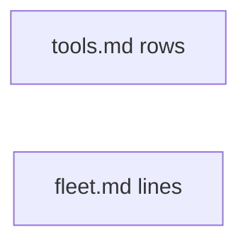

# Superlite: docs/tools.md and docs/fleet.md name what 1.5.278-1.5.284 shipped (#1000)

**Goal:** the docs/tools.md rows and docs/fleet.md lines named in #1000 state the features shipped in 1.5.278-1.5.284 that they lack today: the run_tests tested line and bundle WARNING (#818), predict's suite and review terms and lint SIZE (#787), backlog's live in-progress switch (#947), the linked-spec rules (#824), the brief check, the cut-code packet title and the resume-brief lines (#794, #819, #829), `trees.prepare_at` (#886), `fleet collect Wn` and the report home (#984, #986), the researcher Bash hook (#987), pytest skip names (#974), and in docs/fleet.md the count-cap suffix, the empty restore line and the report `tests` wording.
**Architecture:** docs only. Each row or line gains clauses in place; no row loses a fact. Two new pin tests check each new clause and that each quoted message still exists in the script that prints it (the B259 pattern).
**Tech stack:** Markdown docs; pytest through `sl run_tests`.
**Spec:** this file, section Design.
**Detail:** tests
**Target-min:** 11
**Wave0:** none
**Coverage:** off (bounded: docs only; every open choice is a Ruling below)

Global constraints:
- This repository is public: no host names, user names, home paths, other project or repository names in docs, tests or commit messages.
- The verdict is `sl run_tests` (never raw pytest); every new test sees a red run before the change it tests.
- Docs describe the code as it is today: before you write a sentence about a message, find the message in the script and copy it (placeholders such as `Wn`, `<sd>`, `N` for its variables). Each fact's code reference is in the Design: read it before writing the clause.
- Add clauses; never drop or reword an existing fact. A test under `tests/scripts/` that pins a line your task rewrites is updated in your task to the new text, keeping the facts it checked; name each such file in your report's `files`.
- docs/tools.md rows stay one table line each (`| \`tool\` | ... |`), terse: backticked names, exact output strings, the issue number in parentheses.
- Builds: the verdict is `sl run_tests` (the project's test command; a project with `.maxapp` runs `maxapp test`, which a build pool may place on another Mac, and a full run whose tree a green maxapp test stamp covers returns that result without a run); task trees build in <tree>/.build/DerivedData and any build of your own goes under .build/ of the worktree, never -derivedDataPath outside the worktree (your session scratchpad included; backlog cleanup removes scratchpad build folders when the worktree goes); a product, simulator or device build stays on this machine and runs only when an issue's acceptance asks for a running-app check; copy this sentence into every worker brief.
- Simulators: append the UDID of each simulator you or a worker creates (`xcrun simctl create` or `clone`; a checker's `Simulators:` line marks its created ones) as one line to the worktree's `.superlite/simulators.txt`; never list one you did not create; ship cleanup shuts down and deletes each listed one; copy this sentence into every worker brief.

## Design

Code references are under `skills/subagent-driven-development/scripts/`.

### 1. docs/tools.md

- `run_tests` row, right after the existing `... \`result_bundles\` (#818)` clause: `tree`, `lacks` and `drift` come from an isolated-tree run (`lacks` and `drift` only when not empty), `result_bundles` (at most 5 `.xcresult` paths) from any run whose command or output names one (run_tests.py:679-700, 995-1013); once the tests end the run prints that tail on stderr: `run_tests: tested <tested>` from a tree, `run_tests: <tested>` without one (run_tests.py:2646-2652); a tree run whose result bundle lies outside its tree prints `run_tests: WARNING: result bundle <b> is outside the tree <t>: it may hold another build's results` and adds it to the summary's `warning`; a `maxapp` command is exempt (its own build pool) (run_tests.py:703-710, 2054-2057) (#818).
- `predict` row, after its live-inputs `(#605, ...)` clause: the suite term: a task's existing test cases (its `cmd=` test files, else its owned test files, counted statically) times the seconds per case (median of the newest `- tests fast` ledger lines with at least 20 cases, from 3 runs, else the 0.2 s `case_s` prior) replace a test run's fast minutes when larger; the gain is time only (predict.py:89, 202-228, 304-338). The review term: with `plan=` (as `predict_plan` passes it), a task whose package has a Review Focus line matching the task that names `security` or `auth` (`review.words`) adds `review.rounds` (2) rounds of `review.round_min` (2.5) min, priced on `review.model` (opus), to its time and `cost.total`; settings in `predictor.json` `review` (predict.py:90, 477-525). Per task the JSON gains `suite` (`files`, `cases`, `case_s`, `run_min`, `extra_min`), `review` (`why`, `rounds`, `model`, `min`, `usd`) and `extra_min` (their minutes together), each only when it applies (predict.py:539-546, 734) (#787).
- `plan_tools` row, after its lint checks: lint `SIZE:` and the under-band NOTE measure a task without its `extra_min`; when that is at least 1 min lint adds `NOTE: Tn predicted X min, Y of it outside the size band (existing tests, review rounds); splitting does not shrink it` (warning only) (plan_tools.py:632-648, 2926-2932) (#787).
- The `backlog plan` paragraph below the table (it starts ``` `backlog plan` leaves out an issue another session builds ```), appended: `SUPERLITE_IN_PROGRESS_LIVE=0` skips the Jira, worktree and branch reads (default on) and prints no `in progress:` lines; a failed read prints `in progress: Jira status not read (<error>); worktrees and branches still checked` or `in progress: worktrees and branches not read (<error>)` and plans on (backlog_in_progress.py:8, 123-134) (#947).
- `backlog_brief` row: keep its text, add: both briefs carry a linked-spec rule: `SPEC_TRIAGE` (the triage worker reads a linked spec, plan or design doc first, plans the batch to what it rules and never proposes a decision it rules) and `SPEC_LEAD` (the lead reads it before planning and never asks or rules against it) (backlog_brief.py:64-66, 216, 382) (#824).
- `backlog_run` row, next to its `backlog start` text: a parked batch's restarted lead brief opens with `Previous lead Bn: parked (<reason>); its work stays in this worktree. ...` and lists `- Checkpointed tasks (ledger .superlite/progress.md; hidden checkpoints are not in the commits above): N`, `- Reviews (.superlite/fleet/reports): N`, `- Last full run (<summary file>): P passed, F failed` and `- Steps left after the park: final review, full suite, ship` (each step dropped once done) (backlog_run.py:121-185) (#829).
- New `brief_check` row right after the `fleet_io` row: library, no CLI: `problems(path)` returns up to 5 problems of a brief file: an absolute `ROOT=`/`Root:` folder that does not exist, or a backticked `git apply -R` recipe that `git apply --check -R` refuses or that names a commit, not a patch file; `fleet_report.brief_message` appends `Brief check (sl, before sending): a; b.` to the brief line of every role but the final reviewer and prints each problem on stderr as `brief check: <path>: <problem>`; it flags and never refuses a send (brief_check.py, fleet_report.py:275-285) (#794).
- `pt_review` row, next to its `FAST PATH` text: a packet with nothing open whose section 8 cut a changed code file's diff is titled `REVIEW REQUIRED (code diffs cut)`, not `FAST PATH`, and every packet with such cuts names the files in a `Read in full before your verdict (section 8 cut their diff; one Read each): <files>` line (test paths and `.md` files excluded) (pt_review.py:3530-3545) (#819).
- `trees` row: `prepare_at(root, key, rev)` (library) makes a detached tree `.superlite/trees/<key>` at `rev` with no overlay, reusing an existing one with its build output; `run_tests --base-skips` and `worktree scratch` use it (trees.py:172, run_tests.py:1800, worktree.py:414) (#886, #816).
- `fleet` row, next to its `resume Wn --text T` clause: `collect Wn [--plan P]` syncs a remote write worker's mirror and collects its saved report again: exit 0 collected (or `Wn T already collected: <json>`), 3 still BLOCKED, 2 refused (fleet.py:9, 1400, 1569; fleet_io.py:1014-1048) (#984); next to its `--role ... research` text: a `superlite:researcher`'s Bash calls are held to the read-only allowlist by `hooks/researcher-bash` (`fleet_roles.research_bash_refusal`; `git apply` takes read-only options only) (fleet_roles.py:186, 236) (#987). The row's end (`(see \`docs/fleet.md\`)` plus test_docs_b67_tools.py's FLEET text, then ` |`) stays last.
- `fleet_io` row, in its `wait` text: `wait` files each report in the worker's own run (`report_dir`: the record's `state_dir`; a remote record's two levels above its `remote/<wid>` folder), else in the waiting run's `<sd>/fleet/reports` (fleet_io.py:947) (#986).
- `testcmd` row: a pytest run's unfolded `SKIPPED <node id>` short-summary lines (`-rs --no-fold-skipped`, pytest 8.3+) become `skipped_names` (`file::name`, unique, at most 50; folded `SKIPPED [N]` lines are ignored), so a run names its skipped tests without JUnit (testcmd.py:1649-1660, 1748) (#974).

### 2. docs/fleet.md

- Capacity, the `- Machine gate (#560, #643):` bullet, after ``` `sl fleet status` ends with the same `machine: ...` line ```: the line ends `; no count cap` when no count limit is set (machine_load.py:436-440).
- Commands, the `fleet restore` bullet, after its `BLOCKED: fleet is off in <sd>; nothing to restore` clause: with fleet on and nothing to re-launch, re-arm or report it prints `fleet restore: nothing to restore in <sd>` and exits 0 (fleet_restore.py:300-318).
- What a worker ends with, the `- A one-turn worker (everything except the implementer) ends with ...` bullet, appended: its JSON `tests` field asks for the test command and result line with the tree and result bundle `run_tests` named (`fleet_report.WORK`: `"<test command and result line, with the tree and result bundle run_tests named>"`) (fleet_report.py:44-49) (#818).
- Run root and task trees, a new bullet after the `- A fleet worker's \`run_tests --fast\` without \`--task\`` bullet: a run in a tree prints `run_tests: tested tree <t>[; lacks N changed file(s) of the run root: ...][; N file(s) changed while the tests ran: ...][; result bundle <path> (+N more)]` on stderr, the `--wait` line ends with the same tail, and a result bundle outside the tree prints `run_tests: WARNING: result bundle <b> is outside the tree <t>: it may hold another build's results` (a `maxapp` command exempt) (run_tests.py:721-734, 2054-2057, 2652) (#818).

### 3. Rulings

- Ruling: the 1.5.281 researcher Bash hook (tools.md `fleet` row) and the 1.5.282 pytest skip names (`testcmd` row) join the sweep: #1000's title names 1.5.278-1.5.284, and the issue's list predates both (lead's ruling).
- Ruling: the resume-brief lines go into the `backlog_run` row (the brief is written by `backlog start`), and `brief_check` gets its own row right after `fleet_io` (it runs at every `fleet send --brief`) (lead's ruling).
- Ruling: the WORK `tests` wording goes into docs/fleet.md only; docs/tools.md has no `fleet_report` row and adding one is outside #1000 (lead's ruling).
- Ruling: fleet placement local for this run (because B262 lost a remote fixer's snapshot; cost if wrong: less parallel room for two small tasks) (lead's ruling).
- Ruling: the new tests and any pin test of a rewritten line are outside the batch's file list; no open batch lists them, and notes.md names them (lead's ruling).
- Ruling: MISSED TARGET (37.9 min predicted, T1 the critical path) accepted: T1 owns the one file docs/tools.md, and splitting its rows would put two tasks on one file (lead's ruling).

## Task graph

```mermaid
%% schedule
gantt
  title Predicted schedule (mm:ss)
  dateFormat X
  axisFormat %M:%S
  section lane 1
  T1 tools.md rows :t1, 0, 925s
  section lane 2
  T2 fleet.md lines :t2, 0, 917s
```





critical path: T1 (15.4 min) · peak width 2 · predicted build 15.4 min · predicted total ≈ 37.9 min (target ✗ 11.0)

## Package: docs sweep

App type: Markdown docs. Categories: file (doc rows and pins). Risks: a clause that drops an existing fact; a pin test turned red by a rewrite and left red; a quoted message that no script prints.
**Probe entry:** none (docs have no runnable entry)

### T1 tools.md rows · Complexity 3 · Est. context 60k
**Owns:** docs/tools.md, tests/scripts/test_docs_b268_tools.py
**Components:** 1
**LOC owned:** 70
**Tests:** fast
**Model:** sonnet
**Kind:** prose
**Covers:** 1
**Review Focus:** file: `test_row_names_it_once`, `test_brief_check_row_follows_fleet_io`, `test_in_progress_paragraph_names_the_switch`, `test_quoted_texts_match_the_code`
**Test code (verbatim):**
```python
"""B268 (#1000): docs/tools.md names the run_tests tested line and bundle WARNING, predict's suite and review terms, lint SIZE's extra_min NOTE, the live in-progress switch, the linked-spec rules, the resume-brief lines, the brief check, the cut-code packet title, trees.prepare_at, fleet collect, the report home, the researcher Bash hook and pytest skip names; each quoted message is checked against the script printing it."""
from pathlib import Path
import pytest

ROOT = Path(__file__).resolve().parents[2]
TEXT = (ROOT / "docs" / "tools.md").read_text(encoding="utf-8")
LINES = TEXT.splitlines()
SCRIPTS = ROOT / "skills" / "subagent-driven-development" / "scripts"

NAMED = [  # (row, text the row holds exactly once)
    ("run_tests", "`run_tests: tested <tested>`"),
    ("run_tests", "`run_tests: WARNING: result bundle <b> is outside the tree <t>: it may hold another build's results`"),
    ("predict", "`- tests fast`"),
    ("predict", "0.2 s `case_s` prior"),
    ("predict", "`review.round_min`"),
    ("predict", "`extra_min` (their minutes together)"),
    ("plan_tools", "`NOTE: Tn predicted X min, Y of it outside the size band (existing tests, review rounds); splitting does not shrink it`"),
    ("backlog_brief", "`SPEC_TRIAGE`"),
    ("backlog_brief", "`SPEC_LEAD`"),
    ("backlog_run", "`- Checkpointed tasks (ledger .superlite/progress.md; hidden checkpoints are not in the commits above): N`"),
    ("backlog_run", "`- Steps left after the park: final review, full suite, ship`"),
    ("brief_check", "`Brief check (sl, before sending): a; b.`"),
    ("brief_check", "`brief check: <path>: <problem>`"),
    ("pt_review", "`REVIEW REQUIRED (code diffs cut)`"),
    ("pt_review", "`Read in full before your verdict (section 8 cut their diff; one Read each): <files>`"),
    ("trees", "`prepare_at(root, key, rev)`"),
    ("fleet", "`collect Wn [--plan P]`"),
    ("fleet", "`hooks/researcher-bash`"),
    ("fleet_io", "`report_dir`"),
    ("testcmd", "`SKIPPED <node id>`"),
    ("testcmd", "`skipped_names`"),
]
CODE = [  # (script, literal its source holds)
    ("run_tests.py", "print(f\"run_tests: {'tested ' if tree else ''}{tail}\""),
    ("run_tests.py", "is outside the tree {TESTED['tree']}: it may hold another build's results"),
    ("predict.py", '"case_s": 0.2'),
    ("predict.py", '"round_min": 2.5'),
    ("plan_tools.py", "of it outside the size band (existing tests, review rounds); splitting does not shrink it"),
    ("backlog_in_progress.py", 'LIVE_ENV = "SUPERLITE_IN_PROGRESS_LIVE"'),
    ("backlog_in_progress.py", "); worktrees and branches still checked"),
    ("backlog_brief.py", "SPEC_TRIAGE = ("),
    ("backlog_brief.py", "SPEC_LEAD = ("),
    ("backlog_run.py", "- Checkpointed tasks (ledger .superlite/progress.md; hidden checkpoints are not in the commits above): "),
    ("backlog_run.py", '"- Steps left after the park: "'),
    ("brief_check.py", "Brief check (sl, before sending): "),
    ("fleet_report.py", 'print(f"brief check: {path}: {item}"'),
    ("pt_review.py", '"# Review packet: REVIEW REQUIRED (code diffs cut)"'),
    ("pt_review.py", '"Read in full before your verdict (section 8 cut their diff; one Read each): "'),
    ("trees.py", "def prepare_at(root, key, rev):"),
    ("fleet_io.py", "def recollect(sd, wid):"),
    ("fleet_io.py", "def report_dir(sd, w):"),
    ("fleet_roles.py", "def research_bash_refusal(command: str)"),
    ("testcmd.py", "def _pytest_skipped(lines"),
]


def row(tool):
    rows = [x for x in LINES if x.startswith(f"| `{tool}` |")]
    assert len(rows) == 1, tool
    return rows[0]


@pytest.mark.parametrize("tool,text", NAMED)
def test_row_names_it_once(tool, text):
    assert row(tool).count(text) == 1


def test_brief_check_row_follows_fleet_io():
    assert LINES[LINES.index(row("fleet_io")) + 1] == row("brief_check")


def test_in_progress_paragraph_names_the_switch():
    para = next(x for x in LINES if x.startswith("`backlog plan` leaves out an issue another session builds"))
    assert "`SUPERLITE_IN_PROGRESS_LIVE=0`" in para
    assert "`in progress: worktrees and branches not read (<error>)`" in para


@pytest.mark.parametrize("script,literal", CODE)
def test_quoted_texts_match_the_code(script, literal):
    assert literal in (SCRIPTS / script).read_text(encoding="utf-8")
```
**Steps:** 1 write the test file, 2 run: FAIL, 3 add the clauses of Design 1 to the named rows and the paragraph (in place, after the named clause; add the `brief_check` row), 4 run: PASS, 5 run every other test that reads docs/tools.md and fix only pins of clauses you changed
**Notes:** verify with `sl run_tests --fast tests/scripts/test_docs_b268_tools.py --task T1`, then once `sl run_tests --fast $(grep -rlE '"tools\.md"|docs/tools\.md' tests/scripts) --task T1`. Keep the `fleet` row's end (`(see \`docs/fleet.md\`)` plus test_docs_b67_tools.py's FLEET text, then ` |`) and every line test_docs_b255_tools.py pins unchanged. Rows are long: read a row with `awk 'NR==N' docs/tools.md | tr ';' '\n'` before you edit it.

### T2 fleet.md lines · Complexity 2 · Est. context 45k
**Owns:** docs/fleet.md, tests/scripts/test_docs_b268_fleet.py
**Components:** 1
**LOC owned:** 30
**Tests:** fast
**Model:** sonnet
**Kind:** prose
**Covers:** 2
**Review Focus:** file: `test_section_names_it_once`, `test_tree_bullet_follows_the_fast_bullet`, `test_quoted_texts_match_the_code`
**Test code (verbatim):**
```python
"""B268 (#1000): docs/fleet.md names the `; no count cap` suffix, the empty `fleet restore` line, the report contract's tests wording and the run_tests tested line and bundle WARNING; each quoted message is checked against the script printing it."""
from pathlib import Path
import pytest

ROOT = Path(__file__).resolve().parents[2]
TEXT = (ROOT / "docs" / "fleet.md").read_text(encoding="utf-8")
LINES = TEXT.splitlines()
SCRIPTS = ROOT / "skills" / "subagent-driven-development" / "scripts"

NAMED = [  # (section, text the section holds exactly once)
    ("## Capacity", "`; no count cap`"),
    ("## Commands", "`fleet restore: nothing to restore in <sd>`"),
    ("## Roles", "`\"<test command and result line, with the tree and result bundle run_tests named>\"`"),
    ("## Run root and task trees", "`run_tests: tested tree <t>[; lacks N changed file(s) of the run root: ...][; N file(s) changed while the tests ran: ...][; result bundle <path> (+N more)]`"),
    ("## Run root and task trees", "`run_tests: WARNING: result bundle <b> is outside the tree <t>: it may hold another build's results`"),
]
CODE = [  # (script, literal its source holds)
    ("machine_load.py", '("" if lim else "; no count cap")'),
    ("fleet_restore.py", 'f"fleet restore: nothing to restore in {sd}"'),
    ("fleet_report.py", '"tests": "<test command and result line, with the tree and result bundle run_tests named>"'),
    ("run_tests.py", "print(f\"run_tests: {'tested ' if tree else ''}{tail}\""),
    ("run_tests.py", 'print(f"run_tests: WARNING: {note}"'),
    ("run_tests.py", "is outside the tree {TESTED['tree']}: it may hold another build's results"),
]


def _section(name):
    at = LINES.index(name)
    end = next((i for i in range(at + 1, len(LINES)) if LINES[i].startswith("## ")), len(LINES))
    return "\n".join(LINES[at:end])


@pytest.mark.parametrize("section,text", NAMED)
def test_section_names_it_once(section, text):
    assert _section(section).count(text) == 1


def test_tree_bullet_follows_the_fast_bullet():
    at = next(i for i, x in enumerate(LINES) if x.startswith("- A fleet worker's `run_tests --fast` without `--task`"))
    assert LINES[at + 1].startswith("- A run in a tree prints `run_tests: tested tree <t>")


@pytest.mark.parametrize("script,literal", CODE)
def test_quoted_texts_match_the_code(script, literal):
    assert literal in (SCRIPTS / script).read_text(encoding="utf-8")
```
**Steps:** 1 write the test file, 2 run: FAIL, 3 add Design 2's clauses in place and the new bullet (it starts `- A run in a tree prints `), 4 run: PASS, 5 run every other test that reads docs/fleet.md and fix only pins of lines you changed
**Notes:** verify with `sl run_tests --fast tests/scripts/test_docs_b268_fleet.py --task T2`, then once `sl run_tests --fast $(grep -rlE '"fleet\.md"|docs/fleet\.md' tests/scripts) --task T2`. The one-turn worker bullet sits in `## Roles`. Leave docs/fleet.md lines 169-170 byte-identical (test_docs_b255_fleet.py AFTER).

## Self-review

- Every #1000 item maps to Design 1 or 2 and one task; the two title-range additions are a Ruling.
- No two tasks share a file; no edges (each task pins only messages that exist today).
- Exact messages were copied from the scripts at HEAD (bd8fd1e6).
